# DEVELOPMENT_MAP.md - Pixs l'Application Universelle

## 1. Périmètre et fraîcheur

### Relevé courant — ACL-PIXS-2026-11-07-R1 — 7 novembre 2026

Plan validé après rapport. Le contrôle documentaire recense **301 codes logiques dans 303 dossiers**, dont **116 actifs et 187 emplacements archivés** pour **185 changes logiques archivés**. Les reprises historiques O55/C66 sont conservées. Les tâches actives totalisent **38/1 101** cases cochées ; les archives **1 544/1 544** par emplacement. Les **2 652 sous-lots** comprennent 1 108 unités actives et 1 544 archivées ; les sept unités supplémentaires de PA01 sont des unités partielles documentées, distinctes du compteur des tâches.

Sources : propositions et tasks.md des 303 dossiers, recoupés avec [BATCH_CODES.md](openspec/BATCH_CODES.md). C12 est archivé depuis le 5 novembre : ses trois libellés Mermaid sont actualisés et il est retiré des candidats à engager. C10, C15 puis Z27 restent des candidats à examiner sous leurs conditions existantes ; aucune disponibilité opérationnelle n'est nouvellement établie. Les bilans de blocage, dates, preuves et photographies historiques ci-dessous sont conservés. Aucun test produit, livraison, activation ou qualification opérationnelle n'est déduit de ce relevé.

### Réconciliation des synthèses — 1er novembre 2026

Application du plan CGP-PIXS-2026-10-31-R1 aux synthèses documentaires après E3.
Le recomptage confirme 117 actifs et 186 emplacements archivés, soit 303 dossiers
pour 301 codes logiques ; les 184 changes logiques archivés et les reprises
O55/C66 sont conservés. Les cases restent à 37/1 111 et 1 534/1 534.
C20 conserve deux exigences et six scénarios proposés, non synchronisés au canon.
O41 conserve son dossier actif, mais son objectif remplacé est non sélectionnable ;
ses anciennes relations restent historiques. Les preuves acquises, notamment PA01,
restent attachées à leurs unités et versions. Cette synthèse n'adopte aucune
exigence et ne démontre aucune nouvelle qualification, livraison ou activation.

### Actualisation C12 — 1er novembre 2026 (après relevé)

Compteur initial du relevé : 37/1 111 ; compteur actuel vérifié : 39/1 111 (C12 1.1 et 1.2 cochées sur 10, `openspec validate complete-shared-ui-i18n-and-accessibility --strict` exit 0). Tâches C12 2.x/3.x non réalisées. Progression logicielle et réalisabilité du prochain prérequis : À VÉRIFIER. Registre actif : seule ligne C12 passe à 2/10 avec preuve stricte ; autres lignes, nœuds et dépendances inchangés.

### Actualisation C12 2.1 — 1er novembre 2026 (après preuves)

Les photographies antérieures 37/1 111 puis 39/1 111 et l’état 2/10 sont conservés ci-dessus. La tâche C12 2.1 est validée et cochée sous le périmètre détaillé dans tasks.md. Compteur courant : 40/1 111 ; C12 : 3/10. Preuves : catalogues shell et Core préexistants, catalogue d’erreurs API d’infrastructure ajouté ; suites Python 13+5+4+3+7 OK ; build frontend exit 0 (111 modules) ; catalog-browser/2 ok:true avec Chromium 145 et Firefox 145 passés ; validation OpenSpec stricte après mise à jour de tasks.md : exit 0, skip_specs=true et zéro delta. Les exclusions T15, commandes, versions de navigateurs et limites sont détaillées dans tasks.md. Les tâches 2.2-3.4 ne sont pas réalisées ; réalisabilité de 2.2 : À VÉRIFIER. Les autres lignes, relations C12→C06/C11, graphes, dépendances et BATCH_CODES restent inchangés. Aucun audit WCAG manuel, C17/C19, P0 complet, livraison, activation ou publication n’est revendiqué.

### Actualisation C12 2.2 — 2 novembre 2026 (après preuves)

Photos et états antérieurs du 1er novembre conservés ci-dessus (37/1 111, 39/1 111, 40/1 111 ; C12 2/10 puis 3/10). Tâche C12 2.2 validée et cochée sous périmètre `tasks.md` C12-SL04. Compteur courant : 41/1 111 ; C12 : 4/10. Preuves exécutées le 1er novembre avant cette correction documentaire : validateur/hook/tests (`test:node` 162/162, `build` 111 modules `exit 0`, `validate --all --strict` 208/0, `skip_specs` zéro delta) ; `theme.css` tokenisé pendant 2.2 ; locale/thème éphémères préexistants sans persistance ; `Intl` non requis. 2.3/2.4 non réalisées ; réalisabilité 2.3 : À VÉRIFIER. Seule ligne C12 passe à 4/10 ; `BATCH_CODES`, graphes, dépendances, autres sections inchangés. Aucune livraison/activation/C17/C19/WCAG manuel.

### Actualisation C12 2.3-harnais — 3 novembre 2026 (preuves automatisées ; tâche non cochée)

Photos et états antérieurs conservés ci-dessus (37/1 111, 39/1 111, 40/1 111, 41/1 111 ; C12 2/10, 3/10 puis 4/10). Harnais `frontend/tests/browser-check.mjs` : option `--vite-port` (défaut conservé 5173), reflow multi-largeurs sans débordement avec absence `nav/form/table` rapportée N/A documentée (shell STANDALONE minimal, aucun faux DOM), contraste mesuré sur paires de même élément/ancêtre dont lien réel du panel NotFound, thème réappliqué après chaque navigation/reload (préférences éphémères D2), focus skip-link `:focus-visible` sans focalisation préalable. Recette Chromium 156.0.8078.79 sur Vite éphémère `127.0.0.1:5174` fermé dans `finally` : exit 0, `ok:true`, `criticalOk:true` ; 153 requêtes locales autorisées, 0 externe bloquée, 0 erreur http/console/runtime/fetch/CDP ; focus light 6,64:1 et dark 12,00:1. `node --check` exit 0 ; `test:node` 162/162 ; `build` 111 modules exit 0. Tâche 2.3 NON cochée : contrôle manuel D3 (zoom navigateur natif 200 %, parcours lecteur) non réalisable dans cet environnement — prévols natifs `DISPLAY=false`, `WAYLAND_DISPLAY=false`, `Xvfb`/`xvfb-run` absents, Orca présent mais sans affichage ; port 5173 historique toujours HELD/quarantiné (sondes : `listening=false`, 3 candidats, `exit 2`, aucun processus arrêté). Bilan historique C12-SL05 du 3 novembre 2026 : la tâche 2.3 était alors non cochée ; ses critères ont été validés sur preuves avant archivage le 5 novembre. Compteurs inchangés : 41/1 111 ; C12 : 4/10. `BATCH_CODES`, graphes, dépendances, autres sections inchangés. Aucune livraison/activation/C17/C19/certification WCAG.

### Actualisation C12 2.4/3.1-3.3 — 5 novembre 2026 (preuves, tâche 3.4 en attente)

Les états antérieurs du 1er au 3 novembre restent historiques. Les tâches C12 2.4, 3.1, 3.2 et 3.3 sont maintenant validées sur les preuves datées dans tasks.md ; C12 est à 9/10. La tâche 3.4 reste ouverte, autorisée par 1CISMP5 et en cours de finalisation (archivage puis STATISTICS.md). Le dernier relevé global vérifié reste 41/1 111 au 2 novembre ; le total global n’a pas été recompté dans cette actualisation ciblée. Preuves : Chromium/Firefox catalog-browser .42 145/145 ; build .47 exit0 111 modules, artefacts frontend/dist conservés ; browser-check .49 ok/criticalOk, reflow320, clavier/AX, reducedMotion, contrastes et réseau/console sans erreur ; inspection CUA .52 focus, lien de saut, labels, H1 et viewport320 ; py_compile .54 exit0 ; suites Python .55 18/18, .56 7/7, .57 7/7 ; test:node .58 162/162. Limites : aucune certification WCAG complète, aucun scan dédié de secrets, aucun VCS diff (interdit par le prompt), aucune livraison ou activation revendiquée. Code C12, dossier et dépendances inchangés ; BATCH_CODES inchangé jusqu’à l’archive.

### Finalisation C12 — 5 novembre 2026 (après archivage)

C12 est archivé sous `2026-11-05-complete-shared-ui-i18n-and-accessibility` ; 10/10 tâches validées, archive et STATISTICS.md de l’archive vérifiés. C12 figure désormais uniquement parmi les changes archivés et le registre BATCH_CODES le marque ARCHIVÉ. Aucune livraison ni activation globale n’est revendiquée.

### Contrôle courant — ACL-PIXS-2026-10-31-CHECK-R1 — 31 octobre 2026

Plan validé après rapport ACL et appliqué dans les seuls supports C08, PA01 et la présente cartographie. Les 301 codes logiques et leurs 303 emplacements sont conservés : 117 actifs et 186 emplacements archivés, pour 184 changes logiques archivés. Le registre [BATCH_CODES.md](openspec/BATCH_CODES.md) reste inchangé : aucune attribution ni consolidation nécessaire.

La normalisation documentaire couvre désormais les tâches des 303 emplacements : 17 sous-lots ajoutés à [C08](openspec/changes/add-installation-and-first-configuration/tasks.md), dix compléments ajoutés à [PA01](openspec/changes/add-pa-native-build-and-component-composition/tasks.md), dont les sept unités antérieures sont intégralement conservées. Les 2 652 identifiants de sous-lot par emplacement comprennent des unités partielles d’une même tâche ; ils ne sont pas un deuxième compteur de tâches. Les tâches actives restent 37/1 111, les archives 1 534/1 534 par emplacement, sans nouvelle qualification ni livraison.

Les six fichiers BLOCKERS.md actifs restent présents. Le dernier bilan PA10 du 30 octobre décrit la finalisation BLOQUÉE, sans unité indépendante utile restante identifiée ; les unités locales acquises sont historiques et ne prouvent pas une possibilité actuelle de poursuivre. La réalisabilité courante reste À VÉRIFIER avant engagement. Les conditions de phase complémentaires ci-dessous n’imposent pas la livraison globale de chaque dossier préalable.

Le contrôle de navigation préalable porte sur 15 949 liens locaux Markdown des changes et des deux index. Les liens et ancres de la cartographie et du registre sont résolus. Deux références externes de sessions restent introuvables dans les [statistiques Z12](openspec/changes/add-pzt-ca-hierarchy-rotation-and-recovery/STATISTICS.md) ; leur contenu n’a pas été lu. Les archives comportent 2 564 occurrences de liens introuvables dans 40 fichiers, dont 2 332 dans le [dossier C00](openspec/changes/archive/2026-10-18-define-first-installable-pbo-profile/couverture-preparation-globale.md). Il s’agit d’un constat de navigation, pas d’une preuve de perte du contenu. Les sources historiques, preuves et statistiques restent intactes ; aucune réécriture automatique de ces liens n’est effectuée.

Les sources fonctionnelles restent le canon et les changes : ce relevé ne synchronise aucune exigence, ne ferme aucune tâche et n’ouvre ni ne rouvre aucun change. Les disponibilités opérationnelles et les preuves externes non accessibles restent NON VÉRIFIÉES. L’ordre spécifique de réalisation et de contrôle de C08, et le cycle par lot de PA01, sont conservés dans leurs supports propriétaires.

### Relevé courant E3 — 31 octobre 2026

Le plan ACL-PIXS-2026-10-31-E3-R1 et son complément de rangement des anciens deltas sont validés et appliqués documentairement. Le périmètre comprend 10 ouvertures résiduelles, 32 amendements de cible, 4 actualisations de références et O41 identifié comme proposition remplacée/non sélectionnable. Les 70 autres changes actifs restent inchangés.

Inventaire courant : **301 codes logiques / 303 dossiers**, dont **117 actifs** et **186 emplacements archivés** pour 184 changes logiques archivés. Les doublons historiques O55/C66 sont conservés. Les tâches actives totalisent **37/1111** : 44 nouvelles tâches, toutes non cochées, et aucun changement des cases antérieures. Les archives restent à 1534/1534 par emplacement, sans requalification.

Les 21 anciens fichiers de deltas de C21/O37/O38/O39/PA10/Z12/Z27 sont conservés par empreinte dans leur historique interne, après contrôle des 66 exigences. Les 49 tâches ouvertes de ces sept dossiers restent explicitement rattachées et actives. Voir leurs COUVERTURE_DELTAS_E3.md et requirements.md ; ce rangement ne termine aucune réalisation.

Reprise ACSM du 31 octobre 2026 : C20 conserve deux exigences Nuitka normatives encore proposées et range ses sept fichiers antérieurs avec couverture intégrale ; C97 distingue préparation pré-domaine, garde avant création et preuves avant activation ; les tâches 1.1 d’O37/O38/O39 portent sur la revue du canon courant, sans réadoption des deltas historiques. Les identifiants, libellés, cases et preuves de réalisation sont conservés. Voir les critères courants dans les dossiers concernés.

La préparation documentaire est réalisée. La qualification produit, les fournisseurs, les prérequis d'exécution et la livraison ne sont pas déduits ; leurs états restent À VÉRIFIER ou ceux de leurs preuves historiques. Le canon de 91 capacités, AGENTS.md et les archives sont préservés.

Les relevés ACL-R3/R4 et tableaux antérieurs conservés ci-dessous restent datés et se lisent avec l'extension E3 de la section 3. Le registre global de codes est [BATCH_CODES.md](openspec/BATCH_CODES.md).


Plan ACL-R3, volets B et C explicitement validés par le développeur après rapport. Relevé du 28 octobre 2026 (Europe/Paris). Aucune attribution nouvelle : 291 codes conservés, 107 changes actifs et 184 changes logiques archivés dans 186 dossiers, soit 293 emplacements. O55 et C66 conservent chacun deux reprises historiques. C64 et C71 restent deux réalisations distinctes.

Sources : [règles](AGENTS.md), [projet](PROJECT.md), [technique](TECHNICAL.md), [construction](BUILD.md), [environnement](DEVOPS.md), [configuration OpenSpec](openspec/config.yaml), [registre des codes](openspec/BATCH_CODES.md), propositions, conceptions, tâches et bilans liés ci-dessous. Les textes OpenSpec prévalent sur cette synthèse. Les sections ciblées et les bilans ne constituent pas un audit intégral du code ou du fonctionnement.

Faits vérifiés à la date du relevé : identités, titres, chemins et comptage des cases ; actifs 37/1067, archives 1534/1534 par emplacement. Une case cochée est un avancement documentaire, sans pourcentage fonctionnel déduit. Les preuves historiques restent attachées à leurs versions ; aucun test produit, déploiement ou accès fournisseur n’est rejoué.

La couverture des identités est complète. Le registre des relations reprend les sections de dépendances des 107 propositions/conceptions actives, complétées des raccords explicitement indiqués. Les dépendances historiques des archives et les mentions dispersées hors de ces sections ne sont pas auditées exhaustivement. Toutes les satisfactions runtime restent NON VÉRIFIÉES ; l’absence d’une relation extraite ne signifie pas absence de prérequis.

Contrôle ACL-R4 du 29 octobre 2026 (Europe/Paris), limité aux identités et codes, ratios documentaires, liens locaux, structure des diagrammes et corrections de traçabilité présentées dans ce plan. Les états de réalisabilité et les satisfactions opérationnelles restent À VÉRIFIER / NON VÉRIFIÉES. Les preuves historiques ne sont pas requalifiées par ce contrôle.

## 2. Vue d’ensemble

### Incidence du cadrage Instance, Domaine, ZT et PA — 31 octobre 2026

> Note historique de cadrage antérieure à l'application E3. Les étapes alors
> annoncées ci-dessous sont réalisées documentairement dans le relevé E3 du §1
> et l'[extension courante](#extension-e3--changes-et-phases-courants) du §3.
> Leur réalisation produit et leurs prérequis restent à vérifier.

L'étape 1 est validée ; l'étape 2 a ajouté 13 capacités canoniques et amendé
14 capacités, sans ouvrir de change ou attribuer de code. La confiance
d'amorçage est distincte de la PKI normale. PG reste souveraine Core ; LDAP
porte l'état Kerberos durable normal et la reconstruction complète relève
d'une procédure critique, avec restauration ou recréation/reprovisionnement
selon profil. Les anciens objectifs incompatibles, notamment O41, ne sont pas
des travaux à engager tels quels ; leur réconciliation est prévue en étape 3.
Les états de réalisation ci-dessous ne sont pas requalifiés par ces décisions.

La cible [PROJECT.md §45](PROJECT.md#45-instance-pixs-domaines-et-zt--cadrage-consolidé-du-31-octobre-2026),
[TECHNICAL.md §46](TECHNICAL.md#46-contrats-techniques-cibles-instance-domaine-zt-et-pa--31-octobre-2026)
et [BUILD.md §49](BUILD.md#49-qualification-cible-instance-domaine-zt-et-pa--31-octobre-2026)
est intégrée aux cadrages en étape 1. Les modes Standalone/ZT/Domaine,
le ZT dédié/partagé, les identités multiples, bases et organigrammes séparés,
les services LZT/KZT et les frontières PA/DZT nécessitent une réconciliation
avec les dossiers existants avant de conclure à leur réalisabilité.

Les ensembles C, O, PA, Z, X et Q ci-dessous sont concernés par cette revue,
sans nouvelle dépendance bloquante déduite de leur seul regroupement. La
proposition de stockage Core réversible, les services Auth/LDAP/Kerberos/AD,
le DNS et les secours PKI antérieurs doivent notamment être rapprochés de
la cible. Les preuves existantes ne qualifient pas les nouveaux périmètres.

Les inventaires, codes, tâches et résultats datés sont conservés. Cette note
ciblée n'attribue aucun code, ne crée aucun change et ne recalcule pas les
avancements ; ces travaux attendent les étapes OpenSpec et le processus ACL
applicables après validation de l'intégration.

**A → B signifie : A dépend de B.** Les conteneurs ci-dessous expriment seulement une appartenance documentaire, justifiée par les responsabilités du registre et les propositions. Ils ne constituent pas des dépendances entre familles. Les vues détaillées couvrent les 291 lots sans omettre les archives.

```mermaid
flowchart TB
  groupeB["B : Bulk : opérations, contrats et primitives associées"]
  groupeC["C : Socle P0 : fondations, composition, Core/Auth, API et frontend essentiels"]
  groupeN["N : Compléments transverses de sûreté et de qualification du profil"]
  groupeO["O : Compléments fonctionnels et providers sélectionnables"]
  groupePA["PA : Pixs Agent, séparation PA/PZT et distribution de leurs exécutants"]
  groupeQ["Q : Qualification des compositions étendues"]
  groupeSP["SP : Spécifications et traçabilité OpenSpec, hors réalisation produit"]
  groupeX["X : Image Docker Pixs"]
  groupeZ["Z : PZT et services réseau gérés"]
```

> Tableau historique ACL-R3/R4 : 291 codes, avant les dix ouvertures E3.
> Les [comptages courants par famille](#comptages-courants-par-famille) du §3
> couvrent les 301 codes ; les vues de base restent complétées par l'extension E3.

| Ensemble | Responsabilité et source | Actifs | Archivés logiques | Vue détaillée |
|---|---|---:|---:|---|
| B | Bulk : opérations, contrats et primitives associées — [registre](openspec/BATCH_CODES.md) | 11 | 50 | [Lots B](#vue-b) |
| C | Socle P0 : fondations, composition, Core/Auth, API et frontend essentiels — [registre](openspec/BATCH_CODES.md) | 11 | 84 | [Lots C](#vue-c) |
| N | Compléments transverses de sûreté et de qualification du profil — [registre](openspec/BATCH_CODES.md) | 6 | 1 | [Lots N](#vue-n) |
| O | Compléments fonctionnels et providers sélectionnables — [registre](openspec/BATCH_CODES.md) | 40 | 21 | [Lots O](#vue-o) |
| PA | Pixs Agent, séparation PA/PZT et distribution de leurs exécutants — [registre](openspec/BATCH_CODES.md) | 10 | 1 | [Lots PA](#vue-pa) |
| Q | Qualification des compositions étendues — [registre](openspec/BATCH_CODES.md) | 1 | 0 | [Lots Q](#vue-q) |
| SP | Spécifications et traçabilité OpenSpec, hors réalisation produit — [registre](openspec/BATCH_CODES.md) | 0 | 27 | [Lots SP](#vue-sp) |
| X | Image Docker Pixs — [registre](openspec/BATCH_CODES.md) | 1 | 0 | [Lots X](#vue-x) |
| Z | PZT et services réseau gérés — [registre](openspec/BATCH_CODES.md) | 27 | 0 | [Lots Z](#vue-z) |

## 3. Vues détaillées

### Extension E3 — changes et phases courants

Cette extension complète les 291 lots historiques ; leur union couvre les 301 codes actuels. Les tableaux ci-dessous sont les sources textuelles du diagramme. Les flèches **A → B signifient A dépend de B** et sont limitées à la phase indiquée ; elles ne déclarent aucun prérequis livré.

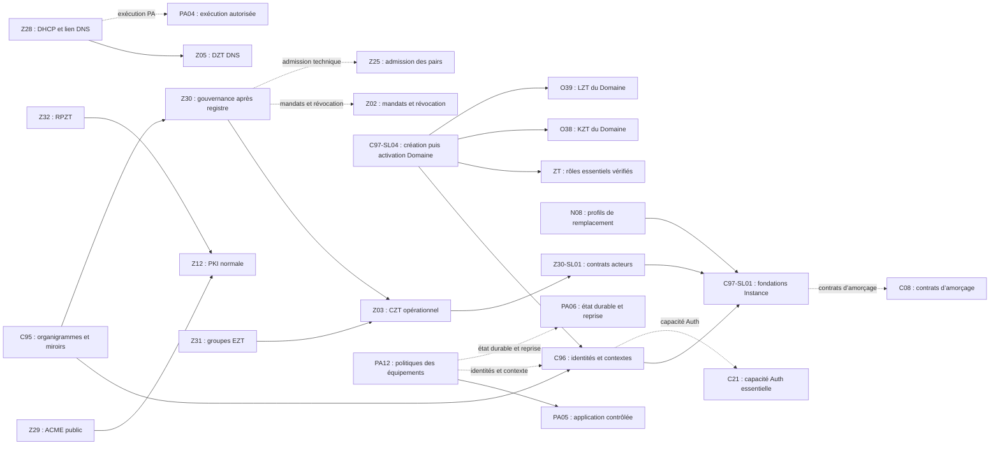

| Code | Change et source | Sous-lots / tâches futures | État de réalisation |
|---|---|---|---|
| C95 | [Organigrammes Core et ZT et miroitage gouverné](openspec/changes/add-core-zt-organization-charts-and-mirroring/proposal.md) | 4 ; C95-SL01 à SL04 | À FAIRE ; qualification à vérifier |
| C96 | [Identités de domaine, périmètres et transferts contrôlés](openspec/changes/add-domain-scoped-identities-and-controlled-transfers/proposal.md) | 5 ; C96-SL01 à SL05 | À FAIRE ; qualification à vérifier |
| C97 | [Fondations Instance Pixs et Domaines et modes d’exploitation](openspec/changes/add-pixs-instance-and-domain-foundations/proposal.md) | 5 ; C97-SL01 à SL05 | À FAIRE ; qualification à vérifier |
| N08 | [Profils d’autorité et remplacement contrôlé des briques](openspec/changes/add-brick-authority-profiles-and-controlled-replacement/proposal.md) | 4 ; N08-SL01 à SL04 | À FAIRE ; qualification à vérifier |
| PA12 | [Politiques des postes Linux et Windows et serveurs Linux](openspec/changes/add-managed-linux-windows-device-policies/proposal.md) | 4 ; PA12-SL01 à SL04 | À FAIRE ; qualification à vérifier |
| Z28 | [DHCPv4 et DHCPv6 DZT et liaison DNS](openspec/changes/add-dzt-dhcpv4-dhcpv6-and-dns-link/proposal.md) | 4 ; Z28-SL01 à SL04 | À FAIRE ; qualification à vérifier |
| Z29 | [Certificats ACME publics et renouvellement PKIZT](openspec/changes/add-pkizt-public-acme-certificates/proposal.md) | 4 ; Z29-SL01 à SL04 | À FAIRE ; qualification à vérifier |
| Z30 | [Acteurs ZT, gouvernance et approbations entre domaines](openspec/changes/add-zt-actors-governance-and-domain-approvals/proposal.md) | 5 ; Z30-SL01 à SL05 | À FAIRE ; qualification à vérifier |
| Z31 | [Sorties EZT et groupes de priorisation](openspec/changes/add-zt-exit-groups-and-priority-policies/proposal.md) | 4 ; Z31-SL01 à SL04 | À FAIRE ; qualification à vérifier |
| Z32 | [Publications RPZT et gestion TLS ciblée](openspec/changes/add-zt-reverse-proxy-publications/proposal.md) | 5 ; Z32-SL01 à SL05 | À FAIRE ; qualification à vérifier |

#### Dossiers existants concernés

Les identités, titres, tâches et preuves antérieures sont conservés. Les taux suivants sont des comptages documentaires, sans disponibilité actuelle déduite.

| Code | Source courante | Cases conservées | Traitement et limite |
|---|---|---:|---|
| C08 | [Installateur et première configuration](openspec/changes/add-installation-and-first-configuration/proposal.md) | 6/17 | Cible amendée ; prérequis produit à vérifier |
| C13 | [Panneau d’administration utilisable](openspec/changes/add-initial-administration-panel/proposal.md) | 0/10 | Cible amendée ; prérequis produit à vérifier |
| C16 | [Migrations, mise à niveau et restauration](openspec/changes/add-upgrade-backup-and-restore-contracts/proposal.md) | 0/10 | Cible amendée ; prérequis produit à vérifier |
| C18 | [Paquet Debian et services](openspec/changes/build-first-pbo-pfo-debian-package/proposal.md) | 0/10 | Cible amendée ; prérequis produit à vérifier |
| C21 | [Module essentiel pixs.auth et authentification autonome PostgreSQL](openspec/changes/define-essential-autonomous-auth-module/proposal.md) | 0/10 | Cible amendée ; prérequis produit à vérifier ; [couverture des anciens deltas](openspec/changes/define-essential-autonomous-auth-module/COUVERTURE_DELTAS_E3.md) |
| O08 | [Projection LDAP sortante](openspec/changes/add-ldap-outbound-directory-projections/proposal.md) | 0/10 | Cible amendée ; prérequis produit à vérifier |
| O09 | [Lectures annuaire, fraîcheur et repli PostgreSQL](openspec/changes/add-directory-read-freshness-and-postgres-fallback/proposal.md) | 0/10 | Cible amendée ; prérequis produit à vérifier |
| O34 | [Forge et enrôlement des identités numériques](openspec/changes/add-auth-identity-enrollment/proposal.md) | 0/9 | Cible amendée ; prérequis produit à vérifier |
| O36 | [Méthodes locales modernes et MFA extensible](openspec/changes/add-auth-local-authenticators-and-mfa/proposal.md) | 0/9 | Cible amendée ; prérequis produit à vérifier |
| O37 | [Active Directory propre géré par pixs.auth.directory.ad](openspec/changes/add-auth-managed-active-directory/proposal.md) | 0/9 | Cible amendée ; prérequis produit à vérifier ; [couverture des anciens deltas](openspec/changes/add-auth-managed-active-directory/COUVERTURE_DELTAS_E3.md) |
| O38 | [KDC Kerberos propre géré par pixs.auth](openspec/changes/add-auth-managed-kerberos-kdc/proposal.md) | 0/9 | Cible amendée ; prérequis produit à vérifier ; [couverture des anciens deltas](openspec/changes/add-auth-managed-kerberos-kdc/COUVERTURE_DELTAS_E3.md) |
| O39 | [Annuaire OpenLDAP propre géré par pixs.auth](openspec/changes/add-auth-managed-openldap/proposal.md) | 0/9 | Cible amendée ; prérequis produit à vérifier ; [couverture des anciens deltas](openspec/changes/add-auth-managed-openldap/COUVERTURE_DELTAS_E3.md) |
| O40 | [Coffre indépendant pour les secrets d’exploitation distribués](openspec/changes/add-distributed-runtime-secret-vault/proposal.md) | 0/10 | Cible amendée ; prérequis produit à vérifier |
| PA04 | [Instructions, mandats et exécution locale](openspec/changes/add-pa-authorized-instruction-execution/proposal.md) | 1/10 | Cible amendée ; prérequis produit à vérifier |
| PA05 | [Configuration souhaitée/appliquée et dérives](openspec/changes/add-pa-desired-applied-configuration-and-drift/proposal.md) | 0/10 | Cible amendée ; prérequis produit à vérifier |
| PA06 | [État technique durable et continuité bornée](openspec/changes/add-pa-durable-technical-state-and-offline-recovery/proposal.md) | 0/10 | Cible amendée ; prérequis produit à vérifier |
| PA07 | [Supervision, maintenance et quarantaine PA](openspec/changes/add-pa-supervision-maintenance-and-quarantine/proposal.md) | 0/10 | Cible amendée ; prérequis produit à vérifier |
| PA08 | [Qualification des plateformes et recette PA](openspec/changes/qualify-pa-platforms-and-r01-r68-matrix/proposal.md) | 0/10 | Cible amendée ; prérequis produit à vérifier |
| PA10 | [Séparer PA, PZT et les modules de gestion PBO](openspec/changes/separate-pa-pzt-and-pbo-management-modules/proposal.md) | 10/13 | Cible amendée ; prérequis produit à vérifier ; [couverture des anciens deltas](openspec/changes/separate-pa-pzt-and-pbo-management-modules/COUVERTURE_DELTAS_E3.md) |
| Z01 | [Transport PZT et filtrage natif](openspec/changes/add-pzt-wireguard-local-transport-and-filtering/proposal.md) | 0/10 | Cible amendée ; prérequis produit à vérifier |
| Z02 | [Mandats réseau, délégations et révocation](openspec/changes/add-pzt-network-mandates-and-fail-closed-revocation/proposal.md) | 0/10 | Cible amendée ; prérequis produit à vérifier |
| Z03 | [Autorité de contrôle, durabilité et reçus](openspec/changes/add-pzt-authoritative-control-and-signed-receipts/proposal.md) | 0/10 | Cible amendée ; prérequis produit à vérifier |
| Z05 | [Exécution DNS et adapters PA](openspec/changes/add-pzt-managed-dns-service-and-pa-adapters/proposal.md) | 0/10 | Cible amendée ; prérequis produit à vérifier |
| Z07 | [Découverte de chemins et relais chiffrés](openspec/changes/add-pzt-path-discovery-and-encrypted-relays/proposal.md) | 0/10 | Cible amendée ; prérequis produit à vérifier |
| Z08 | [Profil passerelle et bascule](openspec/changes/add-pzt-gateway-and-controlled-failover-profile/proposal.md) | 0/10 | Cible amendée ; prérequis produit à vérifier |
| Z11 | [Renouvellement des certificats TLS](openspec/changes/add-pzt-operational-certificate-renewal/proposal.md) | 0/10 | Cible amendée ; prérequis produit à vérifier |
| Z12 | [PKI et cycle de vie des autorités CA](openspec/changes/add-pzt-ca-hierarchy-rotation-and-recovery/proposal.md) | 2/10 | Cible amendée ; prérequis produit à vérifier ; [couverture des anciens deltas](openspec/changes/add-pzt-ca-hierarchy-rotation-and-recovery/COUVERTURE_DELTAS_E3.md) |
| Z25 | [Admission PA et pairs éphémères](openspec/changes/add-pzt-pa-admission-and-ephemeral-peer-generation/proposal.md) | 0/10 | Cible amendée ; prérequis produit à vérifier |
| Z26 | [Recette PZT par contrat et profil](openspec/changes/qualify-active-pzt-contracts-and-profiles/proposal.md) | 0/10 | Cible amendée ; prérequis produit à vérifier |
| Z27 | [Choix BIND 9 pour le DNS géré et sa distribution](openspec/changes/adopt-bind9-managed-dns-and-packaging/proposal.md) | 6/7 | Cible amendée ; prérequis produit à vérifier ; [couverture des anciens deltas](openspec/changes/adopt-bind9-managed-dns-and-packaging/COUVERTURE_DELTAS_E3.md) |
| X01 | [Image Docker conforme](openspec/changes/build-and-qualify-pixs-docker-image/proposal.md) | 0/10 | Cible amendée ; prérequis produit à vérifier |
| Q01 | [Recette des compositions étendues](openspec/changes/qualify-selected-extended-pixs-compositions/proposal.md) | 0/10 | Cible amendée ; prérequis produit à vérifier |
| C20 | [Binaire PBO commun et profils de processus selon les ressources](openspec/changes/define-common-pbo-binary-and-resource-profiles/proposal.md) | 6/11 | Deltas réconciliés : 34 blocs au canon, un modèle remplacé et deux exigences Nuitka encore proposées ; [couverture](openspec/changes/define-common-pbo-binary-and-resource-profiles/COUVERTURE_DELTAS_ACSM.md) ; pas de requalification |
| PA01 | [Composition et compilation des trois binaires PA et de PZT](openspec/changes/add-pa-native-build-and-component-composition/proposal.md) | 2/10 | Preuves ciblées : recette live D14 MainPID réussie le 5/11/2026 ; inventaire CT100 libsystemd-dev (headers, pkg-config et SONAME, exit 0) ; qualification globale inachevée, tâche 4 non cochée |
| PA09 | [Paquet PA indépendant et distribution vérifiable](openspec/changes/build-and-publish-independent-pa-debian-package/proposal.md) | 0/10 | Références actualisées ; pas de requalification |
| Z13 | [Sauvegarde et récupération de racine hors ligne](openspec/changes/add-pzt-offline-root-backup-and-recovery/proposal.md) | 0/10 | Références actualisées ; pas de requalification |
| O41 | [Stockage Core réversible PostgreSQL et OpenLDAP interne](openspec/changes/add-reversible-core-directory-storage/proposal.md) | 0/10 | OBJECTIF REMPLACÉ — NON SÉLECTIONNABLE ; dossier conservé |

#### Conditions de phase et sources des dépendances

| Phase dépendante | Prérequis proposé et source | Limite de la conclusion |
|---|---|---|
| C96 et contrats Z30 | C97-SL01, selon leurs design.md | Les fondations ne requièrent pas un Domaine déjà activé. |
| Gouvernance Z30 après contrats | Registre Z03 ; Z03 consomme préalablement les contrats Z30-SL01 | Phases distinguées ; pas de boucle globale imposée entre tous les travaux. |
| C97-SL04 | Contrats de transition C96 ; ZT vérifié à la création ; transfert C96 et services O38/O39 vérifiés à l’activation | Le ZT doit être entièrement initialisé et vérifié avant création du premier Domaine ; transfert, services et authentification cibles sont vérifiés avant activation en SL04. Ces conditions ne remontent pas à l’amorçage pré-domaine SL01. |
| C95 | Références Core C96 et structures Z30 | Aucun miroir ne crée admission ou droits. |
| N08 | Références d'Instance C97-SL01 | Les garanties propres aux rôles restent chez leurs propriétaires. |
| PA12 | Application PA05/PA04 ; O37 pour le profil Windows natif | Le fournisseur Windows reste à qualifier ; aucune dépendance globale Windows n'est imposée à Linux seul. |
| Z28 | DZT Z05 et coordination CZT Z03 | Pas d'allocateur actif avant vérification des baux et du propriétaire. |
| Z29 | Z12/Z11 ; Z05 pour DNS-01 ; Z32 pour HTTP/TLS-ALPN sélectionnés | Les profils de challenges ne créent pas une dépendance globale réciproque ACME/RPZT. |
| Z31 | Z01/Z02/Z03 | Groupes désactivés par défaut et aucune sortie implicite. |
| Z32 | Z01/Z02/Z03/Z12 ; GZT seulement si le chemin le requiert | La publication peut utiliser PKI privée sans ACME public. |

Sources détaillées : proposal.md et design.md des dix nouveaux dossiers. Ces relations sont des contrats/prérequis de réalisation future, tous NON VÉRIFIÉS pour leur disponibilité produit dans cette préparation. Les BLOCKERS existants sont conservés ; aucune dépendance n'est déclarée livrée depuis un simple archivage.

#### Complément de dépendances — ACL-PIXS-2026-10-31-CHECK-R1

Ces sept relations sont déclarées par leurs propriétaires. Les flèches du diagramme sont des références de contrat par phase, pas une preuve de blocage ou de disponibilité globale. La phase et la condition exactes doivent être revérifiées pour la tâche consommatrice avant effet ; aucune phase inconnue n’est inventée.

| Dépendant → prérequis | Phase consommatrice et condition à vérifier | Satisfaction opérationnelle | Sources |
|---|---|---|---|
| C97-SL01 → C08 | Fondations pré-domaine : contrats d’amorçage consommés par SL01 ; ne pas exiger un Domaine actif ni l’achèvement global de C08. | NON VÉRIFIÉE | [C97 tâches SL01](openspec/changes/add-pixs-instance-and-domain-foundations/tasks.md#c97-sl01--identité-instance-et-données-pré-domaine), [C97 conception](openspec/changes/add-pixs-instance-and-domain-foundations/design.md) |
| C96 → C21 | Phase d’identité/authentification consommant la capacité Auth essentielle ; versions et disponibilité au point d’usage à vérifier avant réalisation dépendante. Phase précise à confirmer par unité. | NON VÉRIFIÉE | [C96 conception](openspec/changes/add-domain-scoped-identities-and-controlled-transfers/design.md) |
| PA12 → C96 | Contrats d’identité et de contexte nécessaires au profil sélectionné ; aucune jonction Domaine implicite. Phase précise à confirmer par unité. | NON VÉRIFIÉE | [PA12 conception](openspec/changes/add-managed-linux-windows-device-policies/design.md) |
| PA12 → PA06 | État technique durable et reprise requis par la politique sélectionnée ; vérifier les garanties réellement consommées et leur périmètre. Phase précise à confirmer par unité. | NON VÉRIFIÉE | [PA12 conception](openspec/changes/add-managed-linux-windows-device-policies/design.md) |
| Z28 → PA04 | Coordination avec l’exécution PA autorisée du seul périmètre DHCP/DNS consommé ; conserver les frontières PA/DZT et vérifier contrats, mandats et résultats au point d’usage. Phase précise à confirmer par unité. | NON VÉRIFIÉE | [Z28 conception](openspec/changes/add-dzt-dhcpv4-dhcpv6-and-dns-link/design.md) |
| Z30 → Z02 | Phase de gouvernance consommant les contrats de mandats, politique et révocation ; vérifier leur version et les garanties effectivement requises, sans bloquer les seuls modèles d’acteurs. | NON VÉRIFIÉE | [Z30 conception](openspec/changes/add-zt-actors-governance-and-domain-approvals/design.md) |
| Z30 → Z25 | Phase consommant l’admission technique des pairs ; interfaces et garanties à vérifier au point d’usage, sans confondre modèle d’acteur et admission opérationnelle. | NON VÉRIFIÉE | [Z30 conception](openspec/changes/add-zt-actors-governance-and-domain-approvals/design.md) |

#### Comptages courants par famille

| Famille | Actifs | Archivés logiques | Emplacements archivés |
|---|---:|---:|---:|
| B | 11 | 50 | 50 |
| C | 13 | 85 | 86 |
| N | 7 | 1 | 1 |
| O | 40 | 21 | 22 |
| PA | 11 | 1 | 1 |
| Q | 1 | 0 | 0 |
| SP | 0 | 27 | 27 |
| X | 1 | 0 | 0 |
| Z | 32 | 0 | 0 |

La préparation et l’attribution des codes sont vérifiées ; les recettes produit et les opérations d’archivage restent hors mandat. Les divergences de copies de référence O05/O17/O18/O23/B11/Z17 observées hors des amendements E3 sont réconciliées documentairement le 1er novembre 2026 par GSCM3 : neuf copies actualisées, deux clauses d’annexe Bulk réconciliées et trois références distinctes des frontières préparatoires Bulk ajoutées dans les requirements.md des six changes. Le canon et les états de réalisation restent conservés ; cette réconciliation ne qualifie aucun produit. Sources : [O05](openspec/changes/add-versioned-workflow-execution/requirements.md), [O17](openspec/changes/add-offline-eligible-local-projections/requirements.md), [O18](openspec/changes/add-offline-intents-and-server-reconciliation/requirements.md), [O23](openspec/changes/add-native-client-contract-and-session-support/requirements.md), [B11](openspec/changes/qualify-complete-bulk-runtime/requirements.md) et [Z17](openspec/changes/add-pzt-qualified-time-and-freshness-decisions/requirements.md).


Chaque vue montre les lots de l’ensemble et leurs références directes extraites vers des prérequis. Les flèches en pointillés sont des relations documentées dont la satisfaction reste NON VÉRIFIÉE ; leur type et leur source sont dans le registre §5. Les liens de cadrage et la coordination PA10 sont conservés au tableau, sans flèche bloquante. Les dépendances transitives sont à parcourir dans le registre ; elles ne sont pas ajoutées artificiellement.

<a id="vue-b"></a>
### Lots B

```mermaid
flowchart LR
  B01["B01 : Admission, ports propriétaires et mapping import (actif)"]
  B02["B02 : Import ATOMIC complet (actif)"]
  B03["B03 : Import BEST_EFFORT (actif)"]
  B04["B04 : Stratégies CREATE_ONLY, UPDATE_ONLY et UPSERT (actif)"]
  B05["B05 : Staging et lecture privée sur provider réel (actif)"]
  B06["B06 : Export et résultats révocables (actif)"]
  B07["B07 : Inbox, outbox et publication réelles (actif)"]
  B08["B08 : Worker, baux, reprise et annulation Bulk (actif)"]
  B09["B09 : API HTTP Bulk et suivi des opérations (actif)"]
  B10["B10 : Rapports de validation et preuves de reprise (actif)"]
  B11["B11 : Recette complète du runtime Bulk (actif)"]
  B12["B12 : Proposition — Vocabulaire des modes d’import en masse (archivé)"]
  B13["B13 : Proposition — Vocabulaire des états d&#x27;opération en masse v1 (archivé)"]
  B14["B14 : Proposition — Vocabulaire des variantes d&#x27;opération en masse (archivé)"]
  B15["B15 : Proposition — Vocabulaire des formats de référence en masse (archivé)"]
  B16["B16 : Proposition — Vocabulaire des stratégies de conflit en masse v1 (archivé)"]
  B17["B17 : add-initial-bulk-job-link-v1 (archivé)"]
  B18["B18 : Format des opérations en masse v1 (archivé)"]
  C04["C04 : Autorisation Django et Super Admin (archivé)"]
  C06["C06 : API et opérations publiques (archivé)"]
  C09["C09 : Worker, scheduler et événements (archivé)"]
  C10["C10 : Gouvernance et cycle de vie effectifs (actif)"]
  O01["O01 : Provider objet sélectionné et métadonnées (actif)"]
  B01 -. "condition à vérifier" .-> C04
  B01 -. "condition à vérifier" .-> C06
  B01 -. "condition à vérifier" .-> C10
  B02 -. "condition à vérifier" .-> B01
  B02 -. "condition à vérifier" .-> B05
  B03 -. "condition à vérifier" .-> B01
  B03 -. "condition à vérifier" .-> B05
  B04 -. "condition à vérifier" .-> B01
  B05 -. "condition à vérifier" .-> B01
  B05 -. "condition à vérifier" .-> O01
  B06 -. "condition à vérifier" .-> B01
  B06 -. "condition à vérifier" .-> C10
  B06 -. "condition à vérifier" .-> O01
  B07 -. "condition à vérifier" .-> B01
  B07 -. "condition à vérifier" .-> C09
  B08 -. "condition à vérifier" .-> B01
  B08 -. "condition à vérifier" .-> B07
  B08 -. "condition à vérifier" .-> C09
  B09 -. "condition à vérifier" .-> B01
  B09 -. "condition à vérifier" .-> B08
  B09 -. "condition à vérifier" .-> C06
  B10 -. "condition à vérifier" .-> B01
  B10 -. "condition à vérifier" .-> B08
  B10 -. "condition à vérifier" .-> C10
  B11 -. "condition à vérifier" .-> B02
  B11 -. "condition à vérifier" .-> B03
  B11 -. "condition à vérifier" .-> B04
  B11 -. "condition à vérifier" .-> B06
  B11 -. "condition à vérifier" .-> B07
  B11 -. "condition à vérifier" .-> B08
  B11 -. "condition à vérifier" .-> B09
  B11 -. "condition à vérifier" .-> B10
```

```mermaid
flowchart LR
  B19["B19 : add-initial-bulk-operation-header-v1 (archivé)"]
  B20["B20 : add-initial-bulk-operation-status-v1 (archivé)"]
  B21["B21 : Lien de scope des opérations en masse v1 (archivé)"]
  B22["B22 : Correction — appartenance canonique des variantes Header (archivé)"]
  B23["B23 : Persistance et baux du runtime Bulk v1 (archivé)"]
  B24["B24 : Validation des valeurs du runtime Bulk v1 (archivé)"]
  B25["B25 : Mode de commit des opérations en masse v1 (archivé)"]
  B26["B26 : Conflits des opérations en masse v1 (archivé)"]
  B27["B27 : Persistance des enregistrements d’opérations en masse v1 (archivé)"]
  B28["B28 : Valeurs des enregistrements d’opérations en masse v1 (archivé)"]
  B29["B29 : Lien de tenant des opérations en masse v1 (archivé)"]
  B30["B30 : Primitive de demande d’annulation Bulk v1 (archivé)"]
  B31["B31 : Persistance de l’idempotence des commandes Bulk v1 (archivé)"]
  B32["B32 : Valeurs d’idempotence des commandes Bulk v1 (archivé)"]
  B33["B33 : Validation des enveloppes d’événements Bulk v1 (archivé)"]
  B34["B34 : Valeurs des manifestes d’export Bulk v1 (archivé)"]
  B35["B35 : Valeurs des reçus inbox Bulk v1 (archivé)"]
  B36["B36 : Valeurs des publications outbox Bulk v1 (archivé)"]
```

```mermaid
flowchart LR
  B37["B37 : Empreinte d’admission du runtime Bulk v1 (archivé)"]
  B38["B38 : Persistance de l’identité d’admission du runtime Bulk v1 (archivé)"]
  B39["B39 : Staging privé des objets du runtime Bulk v1 (archivé)"]
  B40["B40 : Parseurs d’import en flux du runtime Bulk v1 (archivé)"]
  B41["B41 : Contrats de confiance et de mapping du runtime Bulk v1 (archivé)"]
  B42["B42 : Proposal — add-bulk-validation-report-values-v1 (archivé)"]
  B43["B43 : Proposal — add-bulk-event-envelope-persistence-v1 (archivé)"]
  B44["B44 : Proposal — add-bulk-export-manifest-persistence-v1 (archivé)"]
  B45["B45 : Proposal add-bulk-inbox-receipt-persistence-v1 (archivé)"]
  B46["B46 : Proposal add-bulk-outbox-initial-persistence-v1 (archivé)"]
  B47["B47 : proposal — add-bulk-publisher-contract-validation-v1 (archivé)"]
  B48["B48 : Proposition — validation structurelle du téléchargement Bulk v1 (archivé)"]
  B49["B49 : Proposal: add-bulk-validation-report-persistence-v1 (archivé)"]
  B50["B50 : Invocation de lecture des objets privés Bulk v1 (archivé)"]
  B51["B51 : Transaction serveur d’admission Bulk v1 (archivé)"]
  B52["B52 : Proposal — VALIDATE IMPORT VALIDATE_ONLY (parcours unique) (archivé)"]
  B53["B53 : Proposal — add-bulk-server-cancellation-request-v1 (archivé)"]
  B54["B54 : Proposition — add-bulk-server-cancelled-transition-v1 (archivé)"]
```

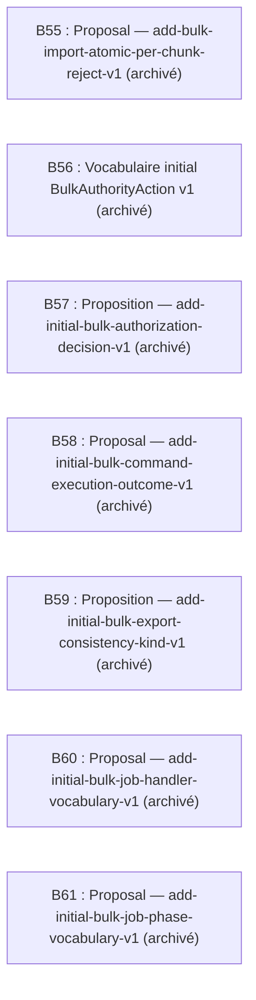


<a id="vue-c"></a>
### Lots C

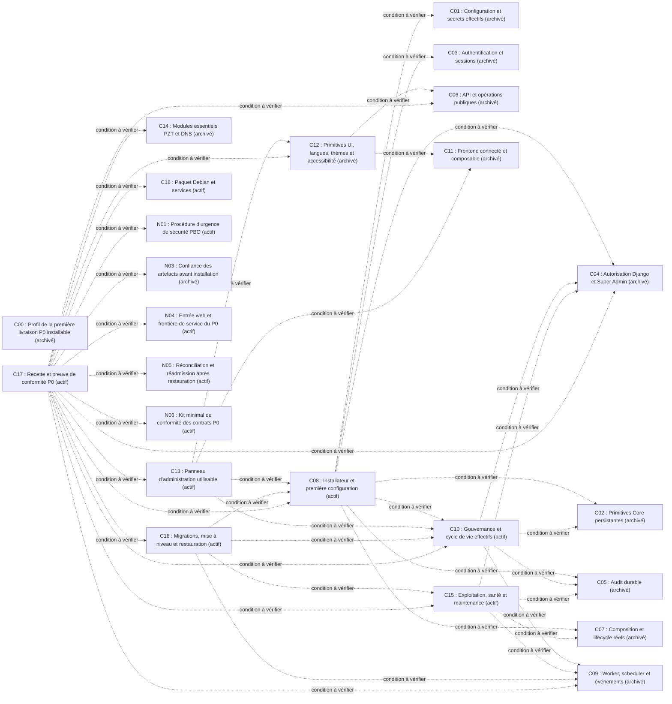

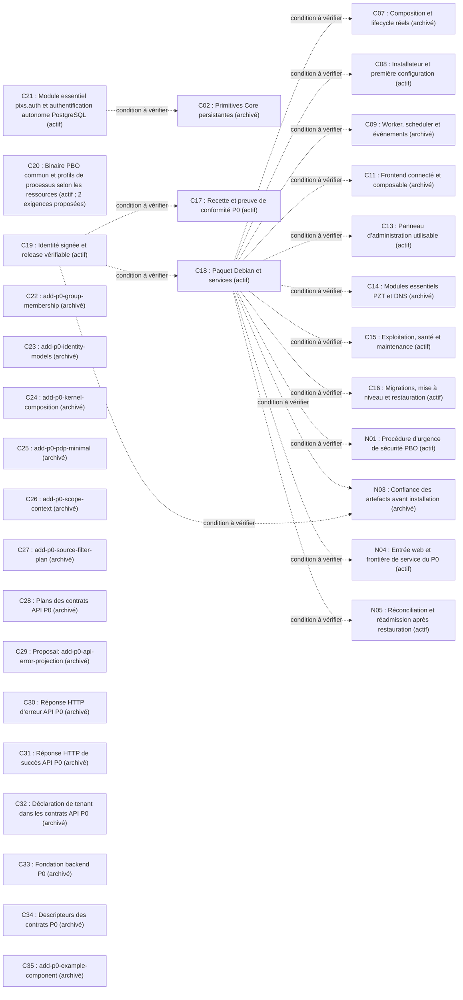

```mermaid
flowchart LR
  C36["C36 : Proposition — déclarations de profils runtime (archivé)"]
  C37["C37 : Proposal — add-p0-tenant-membership (archivé)"]
  C38["C38 : Déclarations initiales des composants (archivé)"]
  C39["C39 : Garde de déclaration explicite des routes HTTP (archivé)"]
  C40["C40 : Vue liveness initiale bornée (archivé)"]
  C41["C41 : Entrée Django réelle minimale (archivé)"]
  C42["C42 : Premier shell TanStack local (archivé)"]
  C43["C43 : Proposal: add-initial-capability-descriptors (archivé)"]
  C44["C44 : Preuve partielle honnête initiale validate/resolve (archivé)"]
  C45["C45 : Journal local corrélé initial (archivé)"]
  C46["C46 : Adaptateur Django explicite Kernel/Core/Exemple (archivé)"]
  C47["C47 : Proposal: add-initial-health-classifier (archivé)"]
  C48["C48 : Composition HTTP TEST locale conjointe (archivé)"]
  C49["C49 : Document OpenAPI réel servi en HTTP (archivé)"]
  C50["C50 : Sonde PG connectivite initiale ASYNC (archivé)"]
  C51["C51 : Adaptateur statique borné du shell construit (archivé)"]
  C52["C52 : Littéraux de chemins de fichiers statiques dans la garde (archivé)"]
  C53["C53 : Proposal: add-initial-capability-availability-gate (archivé)"]
```

```mermaid
flowchart LR
  C54["C54 : Proposition : add-p0-provider-assurance-mapping (archivé)"]
  C55["C55 : Proposal: Exécution des unités frontend web dans les navigateurs déclarés… (archivé)"]
  C56["C56 : Représentation minimale d’un événement d’audit (archivé)"]
  C57["C57 : Proposal — add-initial-command-metadata-representation (archivé)"]
  C58["C58 : Proposition — Représentation déclarative des contrats d&#x27;événement (archivé)"]
  C59["C59 : Proposal — add-initial-command-idempotency-dimensions (archivé)"]
  C60["C60 : Proposal — add-initial-job-state-vocabulary (archivé)"]
  C61["C61 : Proposal — align-jobs-state-vocabulary (archivé)"]
  C62["C62 : Proposition — Vocabulaire Enum des classifications de gouvernance des don… (archivé)"]
  C63["C63 : Proposition — Représentation déclarative interne du DataGovernanceProfile (archivé)"]
  C64["C64 : Proposition — Vocabulaire Enum des états de persistance des données (archivé)"]
  C65["C65 : Proposition — Vocabulaire Enum des opérations de demande relative aux don… (archivé)"]
  C66["C66 : Proposition — Représentation déclarative interne du DataSubjectRequest (archivé)"]
  C67["C67 : Proposition — Représentation déclarative initiale de corrélation des travaux (archivé)"]
  C68["C68 : Proposition — Unité de persistance JobRecord pour les travaux (archivé)"]
  C69["C69 : Proposition — Vocabulaire commun des stratégies de suppression (archivé)"]
  C70["C70 : Proposition — Représentation déclarative interne d&#x27;une déclaration de flu… (archivé)"]
  C71["C71 : Proposition — Vocabulaire Enum des états de persistance des données (archivé)"]
```

```mermaid
flowchart LR
  C72["C72 : Vocabulaire de rétention et de stratégie de suppression (archivé)"]
  C73["C73 : Proposition — Vocabulaire commun des états de rétention (archivé)"]
  C74["C74 : Profil structurel préparatoire de tombstone v1 (archivé)"]
  C75["C75 : Masquage des champs d’audit v1 (archivé)"]
  C76["C76 : Proposal — add-initial-frontend-contribution-type-vocabulary (archivé)"]
  C77["C77 : Proposal — add-initial-frontend-entry-path-validation-v1 (archivé)"]
  C78["C78 : Proposal — add-initial-identity-assurance-vocabulary-v1 (archivé)"]
  C79["C79 : Proposition — Déclaration passive d’enregistrement d’événement v1 (archivé)"]
  C80["C80 : Proposal — add-initial-frontend-contribution-declaration-v1 (archivé)"]
  C81["C81 : Proposal — add-initial-frontend-contribution-id-validation-v1 (archivé)"]
  C82["C82 : Proposal — qualify-pdp-authentication-federation-vocabularies-v1 (archivé)"]
  C83["C83 : Projection des décisions d’autorisation vers l’audit v1 (archivé)"]
  C84["C84 : Invocation de la projection d’audit v1 (archivé)"]
  C85["C85 : Proposition — add-initial-frontend-manifest-facet-v1 (archivé)"]
  C86["C86 : Vocabulaire initial des états de décision d’architecture v1 (archivé)"]
  C87["C87 : Vocabulaire initial des modes de démarrage v1 (archivé)"]
  C88["C88 : Proposal — add-initial-capability-criticality-vocabulary-v1 (archivé)"]
  C89["C89 : Proposal — add-initial-component-type-vocabulary-v1 (archivé)"]
```

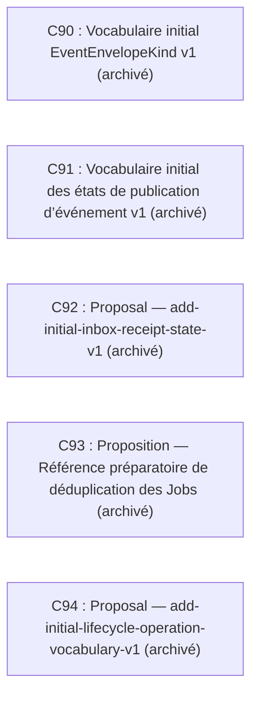


<a id="vue-n"></a>
### Lots N

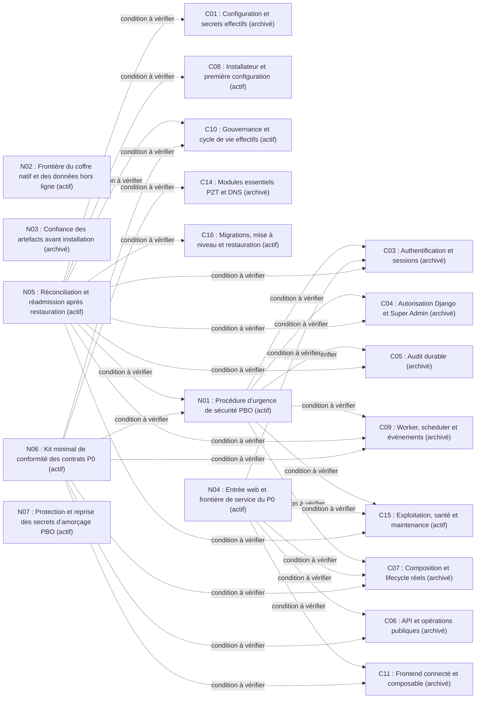


<a id="vue-o"></a>
### Lots O

```mermaid
flowchart LR
  C01["C01 : Configuration et secrets effectifs (archivé)"]
  C02["C02 : Primitives Core persistantes (archivé)"]
  C03["C03 : Authentification et sessions (archivé)"]
  C04["C04 : Autorisation Django et Super Admin (archivé)"]
  C05["C05 : Audit durable (archivé)"]
  C06["C06 : API et opérations publiques (archivé)"]
  C07["C07 : Composition et lifecycle réels (archivé)"]
  C09["C09 : Worker, scheduler et événements (archivé)"]
  C10["C10 : Gouvernance et cycle de vie effectifs (actif)"]
  C12["C12 : Primitives UI, langues, thèmes et accessibilité (archivé)"]
  C13["C13 : Panneau d’administration utilisable (actif)"]
  O01["O01 : Provider objet sélectionné et métadonnées (actif)"]
  O02["O02 : Référentiel documentaire et adapter (actif)"]
  O03["O03 : Recherche, projections et filtrage à la source (actif)"]
  O04["O04 : Cache dérivé et invalidation (actif)"]
  O05["O05 : Workflows versionnés et reprise (actif)"]
  O06["O06 : Évaluation bornée des règles métier (profil v1) (archivé)"]
  O07["O07 : Synchronisation externe (actif)"]
  O08["O08 : Projection LDAP sortante (actif)"]
  O09["O09 : Lectures annuaire, fraîcheur et repli PostgreSQL (actif)"]
  O10["O10 : Provisionnement SCIM (actif)"]
  O11["O11 : Notifications, préférences et canaux (actif)"]
  O12["O12 : Livraison et déduplication persistante des notifications (actif)"]
  O13["O13 : Administration des fanions (actif)"]
  O14["O14 : Convergence runtime des fanions (actif)"]
  O15["O15 : Entitlements et quotas atomiques (actif)"]
  O16["O16 : Synchronisation réactive sélectionnée (actif)"]
  O17["O17 : Projections locales éligibles hors ligne (actif)"]
  O18["O18 : Intentions hors ligne et réconciliation serveur (actif)"]
  O01 -. "condition à vérifier" .-> C01
  O01 -. "condition à vérifier" .-> C04
  O01 -. "condition à vérifier" .-> C05
  O01 -. "condition à vérifier" .-> C10
  O02 -. "condition à vérifier" .-> C04
  O02 -. "condition à vérifier" .-> C05
  O02 -. "condition à vérifier" .-> C10
  O02 -. "condition à vérifier" .-> O01
  O03 -. "condition à vérifier" .-> C04
  O03 -. "condition à vérifier" .-> C09
  O03 -. "condition à vérifier" .-> C10
  O04 -. "condition à vérifier" .-> C04
  O04 -. "condition à vérifier" .-> C09
  O04 -. "condition à vérifier" .-> C10
  O05 -. "condition à vérifier" .-> C04
  O05 -. "condition à vérifier" .-> C05
  O05 -. "condition à vérifier" .-> C09
  O07 -. "condition à vérifier" .-> C04
  O07 -. "condition à vérifier" .-> C05
  O07 -. "condition à vérifier" .-> C09
  O07 -. "condition à vérifier" .-> C10
  O08 -. "condition à vérifier" .-> C02
  O08 -. "condition à vérifier" .-> C04
  O08 -. "condition à vérifier" .-> C05
  O08 -. "condition à vérifier" .-> C09
  O08 -. "condition à vérifier" .-> C10
  O09 -. "condition à vérifier" .-> O08
  O10 -. "condition à vérifier" .-> C03
  O10 -. "condition à vérifier" .-> C04
  O10 -. "condition à vérifier" .-> C06
  O10 -. "condition à vérifier" .-> C09
  O11 -. "condition à vérifier" .-> C04
  O11 -. "condition à vérifier" .-> C05
  O11 -. "condition à vérifier" .-> C10
  O11 -. "condition à vérifier" .-> C12
  O12 -. "condition à vérifier" .-> C09
  O12 -. "condition à vérifier" .-> O11
  O13 -. "condition à vérifier" .-> C04
  O13 -. "condition à vérifier" .-> C05
  O13 -. "condition à vérifier" .-> C06
  O13 -. "condition à vérifier" .-> C13
  O14 -. "condition à vérifier" .-> C07
  O14 -. "condition à vérifier" .-> C09
  O14 -. "condition à vérifier" .-> O13
  O15 -. "condition à vérifier" .-> C04
  O15 -. "condition à vérifier" .-> C05
  O15 -. "condition à vérifier" .-> C06
  O15 -. "condition à vérifier" .-> C09
  O16 -. "condition à vérifier" .-> C04
  O16 -. "condition à vérifier" .-> C06
  O16 -. "condition à vérifier" .-> C09
  O16 -. "condition à vérifier" .-> C10
  O17 -. "condition à vérifier" .-> C04
  O17 -. "condition à vérifier" .-> C06
  O17 -. "condition à vérifier" .-> C10
  O18 -. "condition à vérifier" .-> C06
  O18 -. "condition à vérifier" .-> O17
```

```mermaid
flowchart LR
  C00["C00 : Profil de la première livraison P0 installable (archivé)"]
  C01["C01 : Configuration et secrets effectifs (archivé)"]
  C02["C02 : Primitives Core persistantes (archivé)"]
  C03["C03 : Authentification et sessions (archivé)"]
  C04["C04 : Autorisation Django et Super Admin (archivé)"]
  C05["C05 : Audit durable (archivé)"]
  C06["C06 : API et opérations publiques (archivé)"]
  C07["C07 : Composition et lifecycle réels (archivé)"]
  C09["C09 : Worker, scheduler et événements (archivé)"]
  C10["C10 : Gouvernance et cycle de vie effectifs (actif)"]
  C11["C11 : Frontend connecté et composable (archivé)"]
  C15["C15 : Exploitation, santé et maintenance (actif)"]
  C16["C16 : Migrations, mise à niveau et restauration (actif)"]
  C17["C17 : Recette et preuve de conformité P0 (actif)"]
  C19["C19 : Identité signée et release vérifiable (actif)"]
  C21["C21 : Module essentiel pixs.auth et authentification autonome PostgreSQL (actif)"]
  N06["N06 : Kit minimal de conformité des contrats P0 (actif)"]
  O15["O15 : Entitlements et quotas atomiques (actif)"]
  O18["O18 : Intentions hors ligne et réconciliation serveur (actif)"]
  O19["O19 : Collaboration temps réel (actif)"]
  O20["O20 : Reporting et analytique (actif)"]
  O21["O21 : SDK TypeScript et Python (actif)"]
  O22["O22 : Developer Kit et parcours CLI (actif)"]
  O23["O23 : Clients natifs (actif)"]
  O24["O24 : Providers IA et récupération gouvernée (actif)"]
  O25["O25 : Outils IA médiés, évaluations et budgets (actif)"]
  O26["O26 : Intégrité d&#x27;audit et exports vérifiables (actif)"]
  O27["O27 : Placement régional et routage tenant (actif)"]
  O28["O28 : Bascule régionale contrôlée (actif)"]
  O29["O29 : Catalogue et registre de composants (actif)"]
  O30["O30 : Déploiement progressif (actif)"]
  O31["O31 : Objectifs et budgets de performance (actif)"]
  O32["O32 : Niveaux de confiance et adapters d&#x27;extension (actif)"]
  O33["O33 : Sous-modules installables de sources d&#x27;authentification externes (actif)"]
  O34["O34 : Forge et enrôlement des identités numériques (actif)"]
  O35["O35 : Pixs fournisseur d&#x27;identité pour les applications clientes (actif)"]
  O36["O36 : Méthodes locales modernes et MFA extensible (actif)"]
  O19 -. "condition à vérifier" .-> C04
  O19 -. "condition à vérifier" .-> C06
  O19 -. "condition à vérifier" .-> C09
  O19 -. "condition à vérifier" .-> C10
  O19 -. "condition à vérifier" .-> O18
  O20 -. "condition à vérifier" .-> C04
  O20 -. "condition à vérifier" .-> C09
  O20 -. "condition à vérifier" .-> C10
  O21 -. "condition à vérifier" .-> C06
  O21 -. "condition à vérifier" .-> C09
  O22 -. "condition à vérifier" .-> C07
  O22 -. "condition à vérifier" .-> C17
  O22 -. "condition à vérifier" .-> N06
  O22 -. "condition à vérifier" .-> O21
  O23 -. "condition à vérifier" .-> C03
  O23 -. "condition à vérifier" .-> C04
  O23 -. "condition à vérifier" .-> O21
  O24 -. "condition à vérifier" .-> C01
  O24 -. "condition à vérifier" .-> C04
  O24 -. "condition à vérifier" .-> C06
  O24 -. "condition à vérifier" .-> C10
  O25 -. "condition à vérifier" .-> C05
  O25 -. "condition à vérifier" .-> C09
  O25 -. "condition à vérifier" .-> O15
  O25 -. "condition à vérifier" .-> O24
  O26 -. "condition à vérifier" .-> C05
  O26 -. "condition à vérifier" .-> C10
  O26 -. "condition à vérifier" .-> C16
  O27 -. "condition à vérifier" .-> C04
  O27 -. "condition à vérifier" .-> C06
  O27 -. "condition à vérifier" .-> C10
  O28 -. "condition à vérifier" .-> C16
  O28 -. "condition à vérifier" .-> O27
  O29 -. "condition à vérifier" .-> C07
  O29 -. "condition à vérifier" .-> C19
  O30 -. "condition à vérifier" .-> C15
  O30 -. "condition à vérifier" .-> C16
  O30 -. "condition à vérifier" .-> C19
  O31 -. "condition à vérifier" .-> C00
  O31 -. "condition à vérifier" .-> C15
  O31 -. "condition à vérifier" .-> C17
  O32 -. "condition à vérifier" .-> C07
  O32 -. "condition à vérifier" .-> C11
  O32 -. "condition à vérifier" .-> C17
  O33 -. "condition à vérifier" .-> C02
  O33 -. "condition à vérifier" .-> C03
  O33 -. "condition à vérifier" .-> C05
  O33 -. "condition à vérifier" .-> C21
  O34 -. "condition à vérifier" .-> C02
  O34 -. "condition à vérifier" .-> C03
  O34 -. "condition à vérifier" .-> C04
  O34 -. "condition à vérifier" .-> C05
  O34 -. "condition à vérifier" .-> C21
  O35 -. "condition à vérifier" .-> C03
  O35 -. "condition à vérifier" .-> C05
  O35 -. "condition à vérifier" .-> C21
  O35 -. "condition à vérifier" .-> O36
  O36 -. "condition à vérifier" .-> C02
  O36 -. "condition à vérifier" .-> C03
  O36 -. "condition à vérifier" .-> C05
  O36 -. "condition à vérifier" .-> C21
```

```mermaid
flowchart LR
  C02["C02 : Primitives Core persistantes (archivé)"]
  C03["C03 : Authentification et sessions (archivé)"]
  C04["C04 : Autorisation Django et Super Admin (archivé)"]
  C05["C05 : Audit durable (archivé)"]
  C21["C21 : Module essentiel pixs.auth et authentification autonome PostgreSQL (actif)"]
  N05["N05 : Réconciliation et réadmission après restauration (actif)"]
  O08["O08 : Projection LDAP sortante (actif)"]
  O09["O09 : Lectures annuaire, fraîcheur et repli PostgreSQL (actif)"]
  O37["O37 : Active Directory propre géré par pixs.auth.directory.ad (actif)"]
  O38["O38 : KDC Kerberos propre géré par pixs.auth (actif)"]
  O39["O39 : Annuaire OpenLDAP propre géré par pixs.auth (actif)"]
  O40["O40 : Coffre indépendant pour les secrets d’exploitation distribués (actif)"]
  O41["O41 : Stockage Core réversible PostgreSQL et OpenLDAP interne (actif ; objectif remplacé ; non sélectionnable)"]
  O42["O42 : add-p0-developer-kit-validators (archivé)"]
  O43["O43 : Proposition — add-initial-feature-flag-assignments (archivé)"]
  O44["O44 : Proposition : add-initial-feature-flag-definitions (archivé)"]
  O45["O45 : Proposition — add-initial-feature-flag-evaluation (archivé)"]
  O46["O46 : Proposition — intégration de la cohorte à l&#x27;évaluation (archivé)"]
  O47["O47 : Proposition — règles de cohorte (archivé)"]
  O48["O48 : Proposition — add-initial-feature-flag-definition-expiry (archivé)"]
  O49["O49 : Proposition — add-initial-feature-flag-evaluation-bounded (archivé)"]
  O50["O50 : Proposition — add-initial-feature-flag-fallback (archivé)"]
  O51["O51 : Proposition — codec backend pur du snapshot source (archivé)"]
  O52["O52 : Proposition — contrat de source de fanions (archivé)"]
  O53["O53 : Adaptateur PostgreSQL initial de la source de fanions (archivé)"]
  O54["O54 : Proposition — Représentation Enum du vocabulaire de canaux Notification (archivé)"]
  O37 -. "condition à vérifier" .-> C02
  O37 -. "condition à vérifier" .-> C03
  O37 -. "condition à vérifier" .-> C05
  O37 -. "condition à vérifier" .-> C21
  O38 -. "condition à vérifier" .-> C02
  O38 -. "condition à vérifier" .-> C03
  O38 -. "condition à vérifier" .-> C05
  O38 -. "condition à vérifier" .-> C21
  O39 -. "condition à vérifier" .-> C02
  O39 -. "condition à vérifier" .-> C03
  O39 -. "condition à vérifier" .-> C05
  O39 -. "condition à vérifier" .-> C21
  O41 -. "historique : objectif remplacé" .-> C02
  O41 -. "historique : objectif remplacé" .-> C04
  O41 -. "historique : objectif remplacé" .-> C05
  O41 -. "historique : objectif remplacé" .-> C21
  O41 -. "historique : objectif remplacé" .-> N05
  O41 -. "historique : objectif remplacé" .-> O08
  O41 -. "historique : objectif remplacé" .-> O09
  O41 -. "historique : objectif remplacé" .-> O39
```

```mermaid
flowchart LR
  O55["O55 : Proposition — Représentation déclarative interne partielle du contrat de … (archivé)"]
  O56["O56 : Proposition — Représentation Enum du vocabulaire des états de livraison N… (archivé)"]
  O57["O57 : Proposition — Refus déclaratif explicite du canal de notification non déc… (archivé)"]
  O58["O58 : Proposition — Refus déclaratif explicite du destinataire élargi non déclaré (archivé)"]
  O59["O59 : Proposition — Liaison des gardes déclaratives de notification au contrat … (archivé)"]
  O60["O60 : Proposition — Références préparatoires de déduplication des notifications (archivé)"]
  O61["O61 : Vocabulaire initial du type de sujet d&#x27;entitlement (archivé)"]
```


<a id="vue-pa"></a>
### Lots PA

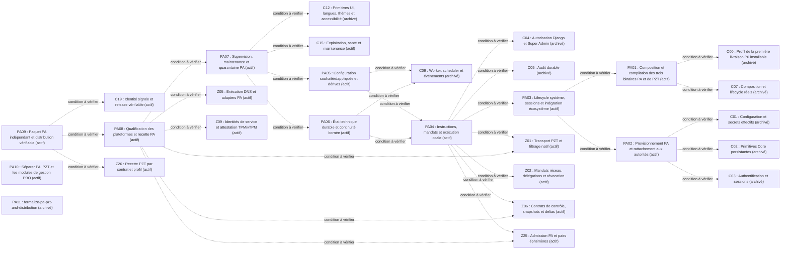


<a id="vue-q"></a>
### Lots Q

```mermaid
flowchart LR
  B11["B11 : Recette complète du runtime Bulk (actif)"]
  C19["C19 : Identité signée et release vérifiable (actif)"]
  O01["O01 : Provider objet sélectionné et métadonnées (actif)"]
  O02["O02 : Référentiel documentaire et adapter (actif)"]
  O03["O03 : Recherche, projections et filtrage à la source (actif)"]
  O04["O04 : Cache dérivé et invalidation (actif)"]
  O05["O05 : Workflows versionnés et reprise (actif)"]
  O06["O06 : Évaluation bornée des règles métier (profil v1) (archivé)"]
  O07["O07 : Synchronisation externe (actif)"]
  O08["O08 : Projection LDAP sortante (actif)"]
  O09["O09 : Lectures annuaire, fraîcheur et repli PostgreSQL (actif)"]
  O10["O10 : Provisionnement SCIM (actif)"]
  O11["O11 : Notifications, préférences et canaux (actif)"]
  O12["O12 : Livraison et déduplication persistante des notifications (actif)"]
  O13["O13 : Administration des fanions (actif)"]
  O14["O14 : Convergence runtime des fanions (actif)"]
  O15["O15 : Entitlements et quotas atomiques (actif)"]
  O16["O16 : Synchronisation réactive sélectionnée (actif)"]
  O17["O17 : Projections locales éligibles hors ligne (actif)"]
  O18["O18 : Intentions hors ligne et réconciliation serveur (actif)"]
  O19["O19 : Collaboration temps réel (actif)"]
  O20["O20 : Reporting et analytique (actif)"]
  O21["O21 : SDK TypeScript et Python (actif)"]
  O22["O22 : Developer Kit et parcours CLI (actif)"]
  O23["O23 : Clients natifs (actif)"]
  O24["O24 : Providers IA et récupération gouvernée (actif)"]
  O25["O25 : Outils IA médiés, évaluations et budgets (actif)"]
  O26["O26 : Intégrité d&#x27;audit et exports vérifiables (actif)"]
  O27["O27 : Placement régional et routage tenant (actif)"]
  O28["O28 : Bascule régionale contrôlée (actif)"]
  O29["O29 : Catalogue et registre de composants (actif)"]
  O30["O30 : Déploiement progressif (actif)"]
  O31["O31 : Objectifs et budgets de performance (actif)"]
  O32["O32 : Niveaux de confiance et adapters d&#x27;extension (actif)"]
  PA09["PA09 : Paquet PA indépendant et distribution vérifiable (actif)"]
  Q01["Q01 : Recette des compositions étendues (actif)"]
  X01["X01 : Image Docker conforme (actif)"]
  Z26["Z26 : Recette PZT par contrat et profil (actif)"]
  Q01 -. "condition à vérifier" .-> B11
  Q01 -. "condition à vérifier" .-> C19
  Q01 -. "condition à vérifier" .-> O01
  Q01 -. "condition à vérifier" .-> O02
  Q01 -. "condition à vérifier" .-> O03
  Q01 -. "condition à vérifier" .-> O04
  Q01 -. "condition à vérifier" .-> O05
  Q01 -. "condition à vérifier" .-> O06
  Q01 -. "condition à vérifier" .-> O07
  Q01 -. "condition à vérifier" .-> O08
  Q01 -. "condition à vérifier" .-> O09
  Q01 -. "condition à vérifier" .-> O10
  Q01 -. "condition à vérifier" .-> O11
  Q01 -. "condition à vérifier" .-> O12
  Q01 -. "condition à vérifier" .-> O13
  Q01 -. "condition à vérifier" .-> O14
  Q01 -. "condition à vérifier" .-> O15
  Q01 -. "condition à vérifier" .-> O16
  Q01 -. "condition à vérifier" .-> O17
  Q01 -. "condition à vérifier" .-> O18
  Q01 -. "condition à vérifier" .-> O19
  Q01 -. "condition à vérifier" .-> O20
  Q01 -. "condition à vérifier" .-> O21
  Q01 -. "condition à vérifier" .-> O22
  Q01 -. "condition à vérifier" .-> O23
  Q01 -. "condition à vérifier" .-> O24
  Q01 -. "condition à vérifier" .-> O25
  Q01 -. "condition à vérifier" .-> O26
  Q01 -. "condition à vérifier" .-> O27
  Q01 -. "condition à vérifier" .-> O28
  Q01 -. "condition à vérifier" .-> O29
  Q01 -. "condition à vérifier" .-> O30
  Q01 -. "condition à vérifier" .-> O31
  Q01 -. "condition à vérifier" .-> O32
  Q01 -. "condition à vérifier" .-> PA09
  Q01 -. "condition à vérifier" .-> X01
  Q01 -. "condition à vérifier" .-> Z26
```


<a id="vue-sp"></a>
### Lots SP

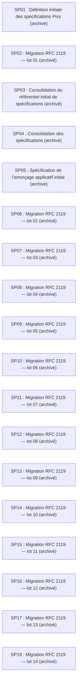

```mermaid
flowchart LR
  SP19["SP19 : Migration RFC 2119 — lot 15 (archivé)"]
  SP20["SP20 : Migration RFC 2119 — lot 16 (archivé)"]
  SP21["SP21 : Migration RFC 2119 — lot 17 (archivé)"]
  SP22["SP22 : Migration RFC 2119 — lot 18 (archivé)"]
  SP23["SP23 : Migration RFC 2119 — lot 19 (archivé)"]
  SP24["SP24 : Migration RFC 2119 — lot 20 (archivé)"]
  SP25["SP25 : Migration RFC 2119 — lot 21 (archivé)"]
  SP26["SP26 : Reconstruction de la traçabilité du référentiel initial de spécifications (archivé)"]
  SP27["SP27 : Spécification de l’administration initiale, de la maintenance et de l’audit (archivé)"]
```


<a id="vue-x"></a>
### Lots X

```mermaid
flowchart LR
  C19["C19 : Identité signée et release vérifiable (actif)"]
  PA09["PA09 : Paquet PA indépendant et distribution vérifiable (actif)"]
  X01["X01 : Image Docker conforme (actif)"]
  Z26["Z26 : Recette PZT par contrat et profil (actif)"]
  X01 -. "condition à vérifier" .-> C19
  X01 -. "condition à vérifier" .-> PA09
  X01 -. "condition à vérifier" .-> Z26
```


<a id="vue-z"></a>
### Lots Z

```mermaid
flowchart LR
  C01["C01 : Configuration et secrets effectifs (archivé)"]
  C02["C02 : Primitives Core persistantes (archivé)"]
  C04["C04 : Autorisation Django et Super Admin (archivé)"]
  C05["C05 : Audit durable (archivé)"]
  C06["C06 : API et opérations publiques (archivé)"]
  C09["C09 : Worker, scheduler et événements (archivé)"]
  C14["C14 : Modules essentiels PZT et DNS (archivé)"]
  PA01["PA01 : Composition et compilation des trois binaires PA et de PZT (actif)"]
  PA02["PA02 : Provisionnement PA et rattachement aux autorités (actif)"]
  PA03["PA03 : Lifecycle système, sessions et intégration écosystème (actif)"]
  PA04["PA04 : Instructions, mandats et exécution locale (actif)"]
  PA06["PA06 : État technique durable et continuité bornée (actif)"]
  Z01["Z01 : Transport PZT et filtrage natif (actif)"]
  Z02["Z02 : Mandats réseau, délégations et révocation (actif)"]
  Z03["Z03 : Autorité de contrôle, durabilité et reçus (actif)"]
  Z04["Z04 : Plan privé, allocation et IPv6 (actif)"]
  Z05["Z05 : Exécution DNS et adapters PA (actif)"]
  Z06["Z06 : Contrats de contrôle, snapshots et deltas (actif)"]
  Z07["Z07 : Découverte de chemins et relais chiffrés (actif)"]
  Z08["Z08 : Profil passerelle et bascule (actif)"]
  Z09["Z09 : Identités de service et attestation TPM/vTPM (actif)"]
  Z10["Z10 : TLS et migration bornée du chiffrement (actif)"]
  Z11["Z11 : Renouvellement des certificats TLS (actif)"]
  Z12["Z12 : PKI et cycle de vie des autorités CA (actif)"]
  Z13["Z13 : Sauvegarde et récupération de racine hors ligne (actif)"]
  Z14["Z14 : Témoin monotone et assainissement (actif)"]
  Z15["Z15 : Dossier de preuve et validation bornée (actif)"]
  Z16["Z16 : Admission et réconciliation des tentatives (actif)"]
  Z17["Z17 : Temps qualifié et décisions de fraîcheur (actif)"]
  Z18["Z18 : Auxiliaire temporel isolé et IPC (actif)"]
  Z19["Z19 : État technique auxiliaire et exclusion des écrivains (actif)"]
  Z25["Z25 : Admission PA et pairs éphémères (actif)"]
  Z01 -. "condition à vérifier" .-> C14
  Z01 -. "condition à vérifier" .-> PA01
  Z01 -. "condition à vérifier" .-> PA02
  Z01 -. "condition à vérifier" .-> Z02
  Z01 -. "condition à vérifier" .-> Z09
  Z01 -. "condition à vérifier" .-> Z25
  Z02 -. "condition à vérifier" .-> C04
  Z02 -. "condition à vérifier" .-> C05
  Z02 -. "condition à vérifier" .-> Z03
  Z03 -. "condition à vérifier" .-> C02
  Z03 -. "condition à vérifier" .-> C05
  Z03 -. "condition à vérifier" .-> Z12
  Z04 -. "condition à vérifier" .-> C14
  Z04 -. "condition à vérifier" .-> Z03
  Z05 -. "condition à vérifier" .-> C14
  Z05 -. "condition à vérifier" .-> PA04
  Z05 -. "condition à vérifier" .-> Z04
  Z05 -. "condition à vérifier" .-> Z06
  Z06 -. "condition à vérifier" .-> C06
  Z06 -. "condition à vérifier" .-> Z02
  Z06 -. "condition à vérifier" .-> Z03
  Z07 -. "condition à vérifier" .-> Z01
  Z07 -. "condition à vérifier" .-> Z02
  Z07 -. "condition à vérifier" .-> Z06
  Z08 -. "condition à vérifier" .-> Z01
  Z08 -. "condition à vérifier" .-> Z03
  Z08 -. "condition à vérifier" .-> Z07
  Z09 -. "condition à vérifier" .-> C04
  Z09 -. "condition à vérifier" .-> PA02
  Z09 -. "condition à vérifier" .-> Z12
  Z10 -. "condition à vérifier" .-> Z01
  Z10 -. "condition à vérifier" .-> Z06
  Z10 -. "condition à vérifier" .-> Z12
  Z11 -. "condition à vérifier" .-> Z06
  Z11 -. "condition à vérifier" .-> Z09
  Z11 -. "condition à vérifier" .-> Z12
  Z12 -. "condition à vérifier" .-> C01
  Z12 -. "condition à vérifier" .-> C02
  Z12 -. "condition à vérifier" .-> C05
  Z12 -. "condition à vérifier" .-> PA01
  Z13 -. "condition à vérifier" .-> Z12
  Z14 -. "condition à vérifier" .-> PA06
  Z14 -. "condition à vérifier" .-> Z13
  Z15 -. "condition à vérifier" .-> Z03
  Z15 -. "condition à vérifier" .-> Z13
  Z15 -. "condition à vérifier" .-> Z14
  Z16 -. "condition à vérifier" .-> C09
  Z16 -. "condition à vérifier" .-> Z15
  Z16 -. "condition à vérifier" .-> Z17
  Z17 -. "condition à vérifier" .-> Z18
  Z17 -. "condition à vérifier" .-> Z19
  Z18 -. "condition à vérifier" .-> PA01
  Z18 -. "condition à vérifier" .-> PA03
```

```mermaid
flowchart LR
  C04["C04 : Autorisation Django et Super Admin (archivé)"]
  C05["C05 : Audit durable (archivé)"]
  C09["C09 : Worker, scheduler et événements (archivé)"]
  C10["C10 : Gouvernance et cycle de vie effectifs (actif)"]
  C15["C15 : Exploitation, santé et maintenance (actif)"]
  C17["C17 : Recette et preuve de conformité P0 (actif)"]
  C19["C19 : Identité signée et release vérifiable (actif)"]
  PA02["PA02 : Provisionnement PA et rattachement aux autorités (actif)"]
  PA06["PA06 : État technique durable et continuité bornée (actif)"]
  PA08["PA08 : Qualification des plateformes et recette PA (actif)"]
  Z01["Z01 : Transport PZT et filtrage natif (actif)"]
  Z02["Z02 : Mandats réseau, délégations et révocation (actif)"]
  Z03["Z03 : Autorité de contrôle, durabilité et reçus (actif)"]
  Z04["Z04 : Plan privé, allocation et IPv6 (actif)"]
  Z05["Z05 : Exécution DNS et adapters PA (actif)"]
  Z06["Z06 : Contrats de contrôle, snapshots et deltas (actif)"]
  Z07["Z07 : Découverte de chemins et relais chiffrés (actif)"]
  Z09["Z09 : Identités de service et attestation TPM/vTPM (actif)"]
  Z10["Z10 : TLS et migration bornée du chiffrement (actif)"]
  Z11["Z11 : Renouvellement des certificats TLS (actif)"]
  Z12["Z12 : PKI et cycle de vie des autorités CA (actif)"]
  Z13["Z13 : Sauvegarde et récupération de racine hors ligne (actif)"]
  Z14["Z14 : Témoin monotone et assainissement (actif)"]
  Z15["Z15 : Dossier de preuve et validation bornée (actif)"]
  Z16["Z16 : Admission et réconciliation des tentatives (actif)"]
  Z17["Z17 : Temps qualifié et décisions de fraîcheur (actif)"]
  Z18["Z18 : Auxiliaire temporel isolé et IPC (actif)"]
  Z19["Z19 : État technique auxiliaire et exclusion des écrivains (actif)"]
  Z20["Z20 : Télémétrie bornée et export (actif)"]
  Z21["Z21 : Travaux de purge télémétrie (actif)"]
  Z22["Z22 : Manifestes canoniques de purge (actif)"]
  Z23["Z23 : Incident de manifeste et réarmement (actif)"]
  Z24["Z24 : Suivi événementiel du réarmement (actif)"]
  Z25["Z25 : Admission PA et pairs éphémères (actif)"]
  Z26["Z26 : Recette PZT par contrat et profil (actif)"]
  Z27["Z27 : Choix BIND 9 pour le DNS géré et sa distribution (actif)"]
  Z19 -. "condition à vérifier" .-> PA06
  Z19 -. "condition à vérifier" .-> Z18
  Z20 -. "condition à vérifier" .-> C15
  Z20 -. "condition à vérifier" .-> Z19
  Z21 -. "condition à vérifier" .-> C09
  Z21 -. "condition à vérifier" .-> C10
  Z21 -. "condition à vérifier" .-> Z20
  Z22 -. "condition à vérifier" .-> C05
  Z22 -. "condition à vérifier" .-> Z21
  Z23 -. "condition à vérifier" .-> C04
  Z23 -. "condition à vérifier" .-> Z15
  Z23 -. "condition à vérifier" .-> Z16
  Z23 -. "condition à vérifier" .-> Z22
  Z24 -. "condition à vérifier" .-> Z06
  Z24 -. "condition à vérifier" .-> Z23
  Z25 -. "condition à vérifier" .-> C09
  Z25 -. "condition à vérifier" .-> PA02
  Z25 -. "condition à vérifier" .-> Z02
  Z25 -. "condition à vérifier" .-> Z09
  Z26 -. "condition à vérifier" .-> C17
  Z26 -. "condition à vérifier" .-> C19
  Z26 -. "condition à vérifier" .-> PA08
  Z26 -. "condition à vérifier" .-> Z01
  Z26 -. "condition à vérifier" .-> Z02
  Z26 -. "condition à vérifier" .-> Z03
  Z26 -. "condition à vérifier" .-> Z04
  Z26 -. "condition à vérifier" .-> Z05
  Z26 -. "condition à vérifier" .-> Z06
  Z26 -. "condition à vérifier" .-> Z07
  Z26 -. "condition à vérifier" .-> Z09
  Z26 -. "condition à vérifier" .-> Z10
  Z26 -. "condition à vérifier" .-> Z11
  Z26 -. "condition à vérifier" .-> Z12
  Z26 -. "condition à vérifier" .-> Z13
  Z26 -. "condition à vérifier" .-> Z14
  Z26 -. "condition à vérifier" .-> Z15
  Z26 -. "condition à vérifier" .-> Z16
  Z26 -. "condition à vérifier" .-> Z17
  Z26 -. "condition à vérifier" .-> Z18
  Z26 -. "condition à vérifier" .-> Z19
  Z26 -. "condition à vérifier" .-> Z20
  Z26 -. "condition à vérifier" .-> Z21
  Z26 -. "condition à vérifier" .-> Z22
  Z26 -. "condition à vérifier" .-> Z23
  Z26 -. "condition à vérifier" .-> Z24
  Z26 -. "condition à vérifier" .-> Z25
```

## 4. Registre des lots et changes

Les titres et identifiants ci-dessous sont repris des sources attestées, sans renumérotation. Les regroupements suivent les responsabilités documentées au §2. Les ratios comptent les cases des tasks.md, pas des validations d’exécution constatées dans cette session. Livraison et activation actuelles : NON VÉRIFIÉES pour chaque entrée, y compris archivées.

### Changes actifs

Pour chaque état À VÉRIFIER : relire la conception, les tâches ouvertes, les décisions acquises et le bilan éventuel, puis contrôler le contrat/producteur réellement requis par la prochaine unité. Les audits de sélection possibles ne sont pas des autorisations de code.

| Code | Identifiant exact et titre | Tâches cochées / total | Réalisabilité | Sources et conditions de réexamen |
|---|---|---:|---|---|
| B01 | `complete-bulk-owner-admission-and-import-mapping` — Admission, ports propriétaires et mapping import | 0/10 | À VÉRIFIER | [proposal.md](openspec/changes/complete-bulk-owner-admission-and-import-mapping/proposal.md) ; [design.md](openspec/changes/complete-bulk-owner-admission-and-import-mapping/design.md) ; [tasks.md](openspec/changes/complete-bulk-owner-admission-and-import-mapping/tasks.md) ; contrôler les prérequis de la prochaine tâche avant engagement. |
| B02 | `add-bulk-atomic-import-execution` — Import ATOMIC complet | 0/10 | À VÉRIFIER | [proposal.md](openspec/changes/add-bulk-atomic-import-execution/proposal.md) ; [design.md](openspec/changes/add-bulk-atomic-import-execution/design.md) ; [tasks.md](openspec/changes/add-bulk-atomic-import-execution/tasks.md) ; contrôler les prérequis de la prochaine tâche avant engagement. |
| B03 | `add-bulk-best-effort-import-execution` — Import BEST_EFFORT | 0/10 | À VÉRIFIER | [proposal.md](openspec/changes/add-bulk-best-effort-import-execution/proposal.md) ; [design.md](openspec/changes/add-bulk-best-effort-import-execution/design.md) ; [tasks.md](openspec/changes/add-bulk-best-effort-import-execution/tasks.md) ; contrôler les prérequis de la prochaine tâche avant engagement. |
| B04 | `complete-bulk-owner-conflict-strategies` — Stratégies CREATE_ONLY, UPDATE_ONLY et UPSERT | 0/10 | À VÉRIFIER | [proposal.md](openspec/changes/complete-bulk-owner-conflict-strategies/proposal.md) ; [design.md](openspec/changes/complete-bulk-owner-conflict-strategies/design.md) ; [tasks.md](openspec/changes/complete-bulk-owner-conflict-strategies/tasks.md) ; contrôler les prérequis de la prochaine tâche avant engagement. |
| B05 | `integrate-bulk-private-object-storage` — Staging et lecture privée sur provider réel | 0/10 | À VÉRIFIER | [proposal.md](openspec/changes/integrate-bulk-private-object-storage/proposal.md) ; [design.md](openspec/changes/integrate-bulk-private-object-storage/design.md) ; [tasks.md](openspec/changes/integrate-bulk-private-object-storage/tasks.md) ; contrôler les prérequis de la prochaine tâche avant engagement. |
| B06 | `add-bulk-authorized-export-and-revocable-results` — Export et résultats révocables | 0/10 | À VÉRIFIER | [proposal.md](openspec/changes/add-bulk-authorized-export-and-revocable-results/proposal.md) ; [design.md](openspec/changes/add-bulk-authorized-export-and-revocable-results/design.md) ; [tasks.md](openspec/changes/add-bulk-authorized-export-and-revocable-results/tasks.md) ; contrôler les prérequis de la prochaine tâche avant engagement. |
| B07 | `integrate-bulk-inbox-outbox-and-publication` — Inbox, outbox et publication réelles | 0/10 | À VÉRIFIER | [proposal.md](openspec/changes/integrate-bulk-inbox-outbox-and-publication/proposal.md) ; [design.md](openspec/changes/integrate-bulk-inbox-outbox-and-publication/design.md) ; [tasks.md](openspec/changes/integrate-bulk-inbox-outbox-and-publication/tasks.md) ; contrôler les prérequis de la prochaine tâche avant engagement. |
| B08 | `integrate-bulk-worker-jobs-and-cancellation` — Worker, baux, reprise et annulation Bulk | 0/10 | À VÉRIFIER | [proposal.md](openspec/changes/integrate-bulk-worker-jobs-and-cancellation/proposal.md) ; [design.md](openspec/changes/integrate-bulk-worker-jobs-and-cancellation/design.md) ; [tasks.md](openspec/changes/integrate-bulk-worker-jobs-and-cancellation/tasks.md) ; contrôler les prérequis de la prochaine tâche avant engagement. |
| B09 | `expose-bulk-versioned-http-api` — API HTTP Bulk et suivi des opérations | 0/10 | À VÉRIFIER | [proposal.md](openspec/changes/expose-bulk-versioned-http-api/proposal.md) ; [design.md](openspec/changes/expose-bulk-versioned-http-api/design.md) ; [tasks.md](openspec/changes/expose-bulk-versioned-http-api/tasks.md) ; contrôler les prérequis de la prochaine tâche avant engagement. |
| B10 | `complete-bulk-validation-reports-and-recovery-proofs` — Rapports de validation et preuves de reprise | 0/10 | À VÉRIFIER | [proposal.md](openspec/changes/complete-bulk-validation-reports-and-recovery-proofs/proposal.md) ; [design.md](openspec/changes/complete-bulk-validation-reports-and-recovery-proofs/design.md) ; [tasks.md](openspec/changes/complete-bulk-validation-reports-and-recovery-proofs/tasks.md) ; contrôler les prérequis de la prochaine tâche avant engagement. |
| B11 | `qualify-complete-bulk-runtime` — Recette complète du runtime Bulk | 0/10 | À VÉRIFIER | [proposal.md](openspec/changes/qualify-complete-bulk-runtime/proposal.md) ; [design.md](openspec/changes/qualify-complete-bulk-runtime/design.md) ; [tasks.md](openspec/changes/qualify-complete-bulk-runtime/tasks.md) ; contrôler les prérequis de la prochaine tâche avant engagement. |
| C08 | `add-installation-and-first-configuration` — Installateur et première configuration | 6/17 | BLOQUÉ | [proposal.md](openspec/changes/add-installation-and-first-configuration/proposal.md) ; [design.md](openspec/changes/add-installation-and-first-configuration/design.md) ; [tasks.md](openspec/changes/add-installation-and-first-configuration/tasks.md) ; [BLOCKERS.md](openspec/changes/add-installation-and-first-configuration/BLOCKERS.md) ; constat 30/10, providers post-INSTALLER / PZT / gouvernance réelle non établis, six coches doc / 11 ouvertes ; contrôler les prérequis avant engagement. |
| C10 | `enforce-core-data-governance-and-lifecycle` — Gouvernance et cycle de vie effectifs | 0/10 | À VÉRIFIER | [proposal.md](openspec/changes/enforce-core-data-governance-and-lifecycle/proposal.md) ; [design.md](openspec/changes/enforce-core-data-governance-and-lifecycle/design.md) ; [tasks.md](openspec/changes/enforce-core-data-governance-and-lifecycle/tasks.md) ; 1.1 validée techniquement sur sa portée documentaire, case maintenue non cochée sur instruction explicite ; 1.2 demeure OUVERTE. Décisions documentaires acquises à conserver ; interfaces, preuves et paramètres restants à arrêter avant réalisation. [validation technique documentaire 1.1](openspec/changes/enforce-core-data-governance-and-lifecycle/design.md#validation-technique-documentaire-de-la-tâche-11) ; [état des décisions et points ouverts](openspec/changes/enforce-core-data-governance-and-lifecycle/design.md#points-ouverts-et-statuts-conservés). |
| C13 | `add-initial-administration-panel` — Panneau d’administration utilisable | 0/10 | À VÉRIFIER | [proposal.md](openspec/changes/add-initial-administration-panel/proposal.md) ; [design.md](openspec/changes/add-initial-administration-panel/design.md) ; [tasks.md](openspec/changes/add-initial-administration-panel/tasks.md) ; contrôler les prérequis de la prochaine tâche avant engagement. |
| C15 | `add-runtime-observability-and-operations` — Exploitation, santé et maintenance | 0/10 | À VÉRIFIER | [proposal.md](openspec/changes/add-runtime-observability-and-operations/proposal.md) ; [design.md](openspec/changes/add-runtime-observability-and-operations/design.md) ; [tasks.md](openspec/changes/add-runtime-observability-and-operations/tasks.md) ; contrôler les prérequis de la prochaine tâche avant engagement. |
| C16 | `add-upgrade-backup-and-restore-contracts` — Migrations, mise à niveau et restauration | 0/10 | À VÉRIFIER | [proposal.md](openspec/changes/add-upgrade-backup-and-restore-contracts/proposal.md) ; [design.md](openspec/changes/add-upgrade-backup-and-restore-contracts/design.md) ; [tasks.md](openspec/changes/add-upgrade-backup-and-restore-contracts/tasks.md) ; contrôler les prérequis de la prochaine tâche avant engagement. |
| C17 | `qualify-first-pbo-composition` — Recette et preuve de conformité P0 | 0/10 | À VÉRIFIER | [proposal.md](openspec/changes/qualify-first-pbo-composition/proposal.md) ; [design.md](openspec/changes/qualify-first-pbo-composition/design.md) ; [tasks.md](openspec/changes/qualify-first-pbo-composition/tasks.md) ; contrôler les prérequis de la prochaine tâche avant engagement. |
| C18 | `build-first-pbo-pfo-debian-package` — Paquet Debian et services | 0/10 | À VÉRIFIER | [proposal.md](openspec/changes/build-first-pbo-pfo-debian-package/proposal.md) ; [design.md](openspec/changes/build-first-pbo-pfo-debian-package/design.md) ; [tasks.md](openspec/changes/build-first-pbo-pfo-debian-package/tasks.md) ; contrôler les prérequis de la prochaine tâche avant engagement. |
| C19 | `publish-first-qualified-pbo-release` — Identité signée et release vérifiable | 0/10 | À VÉRIFIER | [proposal.md](openspec/changes/publish-first-qualified-pbo-release/proposal.md) ; [design.md](openspec/changes/publish-first-qualified-pbo-release/design.md) ; [tasks.md](openspec/changes/publish-first-qualified-pbo-release/tasks.md) ; contrôler les prérequis de la prochaine tâche avant engagement. |
| C20 | `define-common-pbo-binary-and-resource-profiles` — Binaire PBO commun et profils de processus selon les ressources | 6/11 | À VÉRIFIER | [proposal.md](openspec/changes/define-common-pbo-binary-and-resource-profiles/proposal.md) ; [design.md](openspec/changes/define-common-pbo-binary-and-resource-profiles/design.md) ; [tasks.md](openspec/changes/define-common-pbo-binary-and-resource-profiles/tasks.md) ; deux exigences de preuve officielle Nuitka et six scénarios restent proposés, non synchronisés au canon ; adoption et réalisation distinctes, sans réapplication des blocs déjà adoptés ; contrôler les prérequis de la prochaine tâche avant engagement. |
| C21 | `define-essential-autonomous-auth-module` — Module essentiel pixs.auth et authentification autonome PostgreSQL | 0/10 | À VÉRIFIER | [proposal.md](openspec/changes/define-essential-autonomous-auth-module/proposal.md) ; [design.md](openspec/changes/define-essential-autonomous-auth-module/design.md) ; [tasks.md](openspec/changes/define-essential-autonomous-auth-module/tasks.md) ; contrôler les prérequis de la prochaine tâche avant engagement. |
| N01 | `add-pbo-security-quarantine-and-revocation` — Procédure d’urgence de sécurité PBO | 0/10 | À VÉRIFIER | [proposal.md](openspec/changes/add-pbo-security-quarantine-and-revocation/proposal.md) ; [design.md](openspec/changes/add-pbo-security-quarantine-and-revocation/design.md) ; [tasks.md](openspec/changes/add-pbo-security-quarantine-and-revocation/tasks.md) ; contrôler les prérequis de la prochaine tâche avant engagement. |
| N02 | `clarify-native-credentials-and-offline-storage-boundary` — Frontière du coffre natif et des données hors ligne | 3/6 | À VÉRIFIER | [proposal.md](openspec/changes/clarify-native-credentials-and-offline-storage-boundary/proposal.md) ; [design.md](openspec/changes/clarify-native-credentials-and-offline-storage-boundary/design.md) ; [tasks.md](openspec/changes/clarify-native-credentials-and-offline-storage-boundary/tasks.md) ; contrôler les prérequis de la prochaine tâche avant engagement. |
| N04 | `define-p0-web-serving-and-security-boundary` — Entrée web et frontière de service du P0 | 0/10 | À VÉRIFIER | [proposal.md](openspec/changes/define-p0-web-serving-and-security-boundary/proposal.md) ; [design.md](openspec/changes/define-p0-web-serving-and-security-boundary/design.md) ; [tasks.md](openspec/changes/define-p0-web-serving-and-security-boundary/tasks.md) ; contrôler les prérequis de la prochaine tâche avant engagement. |
| N05 | `add-p0-post-restore-reconciliation-and-readmission` — Réconciliation et réadmission après restauration | 0/10 | À VÉRIFIER | [proposal.md](openspec/changes/add-p0-post-restore-reconciliation-and-readmission/proposal.md) ; [design.md](openspec/changes/add-p0-post-restore-reconciliation-and-readmission/design.md) ; [tasks.md](openspec/changes/add-p0-post-restore-reconciliation-and-readmission/tasks.md) ; contrôler les prérequis de la prochaine tâche avant engagement. |
| N06 | `add-minimal-p0-contract-conformance-kit` — Kit minimal de conformité des contrats P0 | 0/10 | À VÉRIFIER | [proposal.md](openspec/changes/add-minimal-p0-contract-conformance-kit/proposal.md) ; [design.md](openspec/changes/add-minimal-p0-contract-conformance-kit/design.md) ; [tasks.md](openspec/changes/add-minimal-p0-contract-conformance-kit/tasks.md) ; contrôler les prérequis de la prochaine tâche avant engagement. |
| N07 | `qualify-pbo-bootstrap-secrets-host-tpm2` — Protection et reprise des secrets d’amorçage PBO | 0/10 | À VÉRIFIER | [proposal.md](openspec/changes/qualify-pbo-bootstrap-secrets-host-tpm2/proposal.md) ; [design.md](openspec/changes/qualify-pbo-bootstrap-secrets-host-tpm2/design.md) ; [tasks.md](openspec/changes/qualify-pbo-bootstrap-secrets-host-tpm2/tasks.md) ; contrôler les prérequis de la prochaine tâche avant engagement. |
| O01 | `add-selected-object-storage-provider` — Provider objet sélectionné et métadonnées | 0/10 | À VÉRIFIER | [proposal.md](openspec/changes/add-selected-object-storage-provider/proposal.md) ; [design.md](openspec/changes/add-selected-object-storage-provider/design.md) ; [tasks.md](openspec/changes/add-selected-object-storage-provider/tasks.md) ; contrôler les prérequis de la prochaine tâche avant engagement. |
| O02 | `add-governed-document-repository-adapter` — Référentiel documentaire et adapter | 0/10 | À VÉRIFIER | [proposal.md](openspec/changes/add-governed-document-repository-adapter/proposal.md) ; [design.md](openspec/changes/add-governed-document-repository-adapter/design.md) ; [tasks.md](openspec/changes/add-governed-document-repository-adapter/tasks.md) ; contrôler les prérequis de la prochaine tâche avant engagement. |
| O03 | `add-authorized-search-projections` — Recherche, projections et filtrage à la source | 0/10 | À VÉRIFIER | [proposal.md](openspec/changes/add-authorized-search-projections/proposal.md) ; [design.md](openspec/changes/add-authorized-search-projections/design.md) ; [tasks.md](openspec/changes/add-authorized-search-projections/tasks.md) ; contrôler les prérequis de la prochaine tâche avant engagement. |
| O04 | `add-derived-distributed-cache-provider` — Cache dérivé et invalidation | 0/10 | À VÉRIFIER | [proposal.md](openspec/changes/add-derived-distributed-cache-provider/proposal.md) ; [design.md](openspec/changes/add-derived-distributed-cache-provider/design.md) ; [tasks.md](openspec/changes/add-derived-distributed-cache-provider/tasks.md) ; contrôler les prérequis de la prochaine tâche avant engagement. |
| O05 | `add-versioned-workflow-execution` — Workflows versionnés et reprise | 0/10 | À VÉRIFIER | [proposal.md](openspec/changes/add-versioned-workflow-execution/proposal.md) ; [design.md](openspec/changes/add-versioned-workflow-execution/design.md) ; [tasks.md](openspec/changes/add-versioned-workflow-execution/tasks.md) ; contrôler les prérequis de la prochaine tâche avant engagement. |
| O07 | `add-external-synchronization-provider` — Synchronisation externe | 0/10 | À VÉRIFIER | [proposal.md](openspec/changes/add-external-synchronization-provider/proposal.md) ; [design.md](openspec/changes/add-external-synchronization-provider/design.md) ; [tasks.md](openspec/changes/add-external-synchronization-provider/tasks.md) ; contrôler les prérequis de la prochaine tâche avant engagement. |
| O08 | `add-ldap-outbound-directory-projections` — Projection LDAP sortante | 0/10 | À VÉRIFIER | [proposal.md](openspec/changes/add-ldap-outbound-directory-projections/proposal.md) ; [design.md](openspec/changes/add-ldap-outbound-directory-projections/design.md) ; [tasks.md](openspec/changes/add-ldap-outbound-directory-projections/tasks.md) ; contrôler les prérequis de la prochaine tâche avant engagement. |
| O09 | `add-directory-read-freshness-and-postgres-fallback` — Lectures annuaire, fraîcheur et repli PostgreSQL | 0/10 | À VÉRIFIER | [proposal.md](openspec/changes/add-directory-read-freshness-and-postgres-fallback/proposal.md) ; [design.md](openspec/changes/add-directory-read-freshness-and-postgres-fallback/design.md) ; [tasks.md](openspec/changes/add-directory-read-freshness-and-postgres-fallback/tasks.md) ; contrôler les prérequis de la prochaine tâche avant engagement. |
| O10 | `add-scim-provisioning-through-owner-commands` — Provisionnement SCIM | 0/10 | À VÉRIFIER | [proposal.md](openspec/changes/add-scim-provisioning-through-owner-commands/proposal.md) ; [design.md](openspec/changes/add-scim-provisioning-through-owner-commands/design.md) ; [tasks.md](openspec/changes/add-scim-provisioning-through-owner-commands/tasks.md) ; contrôler les prérequis de la prochaine tâche avant engagement. |
| O11 | `add-notification-preferences-and-selected-channels` — Notifications, préférences et canaux | 0/10 | À VÉRIFIER | [proposal.md](openspec/changes/add-notification-preferences-and-selected-channels/proposal.md) ; [design.md](openspec/changes/add-notification-preferences-and-selected-channels/design.md) ; [tasks.md](openspec/changes/add-notification-preferences-and-selected-channels/tasks.md) ; contrôler les prérequis de la prochaine tâche avant engagement. |
| O12 | `add-durable-notification-delivery-and-deduplication` — Livraison et déduplication persistante des notifications | 0/10 | À VÉRIFIER | [proposal.md](openspec/changes/add-durable-notification-delivery-and-deduplication/proposal.md) ; [design.md](openspec/changes/add-durable-notification-delivery-and-deduplication/design.md) ; [tasks.md](openspec/changes/add-durable-notification-delivery-and-deduplication/tasks.md) ; contrôler les prérequis de la prochaine tâche avant engagement. |
| O13 | `add-feature-flag-administration-and-audit` — Administration des fanions | 0/10 | À VÉRIFIER | [proposal.md](openspec/changes/add-feature-flag-administration-and-audit/proposal.md) ; [design.md](openspec/changes/add-feature-flag-administration-and-audit/design.md) ; [tasks.md](openspec/changes/add-feature-flag-administration-and-audit/tasks.md) ; contrôler les prérequis de la prochaine tâche avant engagement. |
| O14 | `integrate-feature-flag-runtime-convergence` — Convergence runtime des fanions | 0/10 | À VÉRIFIER | [proposal.md](openspec/changes/integrate-feature-flag-runtime-convergence/proposal.md) ; [design.md](openspec/changes/integrate-feature-flag-runtime-convergence/design.md) ; [tasks.md](openspec/changes/integrate-feature-flag-runtime-convergence/tasks.md) ; contrôler les prérequis de la prochaine tâche avant engagement. |
| O15 | `add-entitlements-and-atomic-quota-reservations` — Entitlements et quotas atomiques | 0/10 | À VÉRIFIER | [proposal.md](openspec/changes/add-entitlements-and-atomic-quota-reservations/proposal.md) ; [design.md](openspec/changes/add-entitlements-and-atomic-quota-reservations/design.md) ; [tasks.md](openspec/changes/add-entitlements-and-atomic-quota-reservations/tasks.md) ; contrôler les prérequis de la prochaine tâche avant engagement. |
| O16 | `add-selected-reactive-synchronization` — Synchronisation réactive sélectionnée | 0/10 | À VÉRIFIER | [proposal.md](openspec/changes/add-selected-reactive-synchronization/proposal.md) ; [design.md](openspec/changes/add-selected-reactive-synchronization/design.md) ; [tasks.md](openspec/changes/add-selected-reactive-synchronization/tasks.md) ; contrôler les prérequis de la prochaine tâche avant engagement. |
| O17 | `add-offline-eligible-local-projections` — Projections locales éligibles hors ligne | 0/10 | À VÉRIFIER | [proposal.md](openspec/changes/add-offline-eligible-local-projections/proposal.md) ; [design.md](openspec/changes/add-offline-eligible-local-projections/design.md) ; [tasks.md](openspec/changes/add-offline-eligible-local-projections/tasks.md) ; contrôler les prérequis de la prochaine tâche avant engagement. |
| O18 | `add-offline-intents-and-server-reconciliation` — Intentions hors ligne et réconciliation serveur | 0/10 | À VÉRIFIER | [proposal.md](openspec/changes/add-offline-intents-and-server-reconciliation/proposal.md) ; [design.md](openspec/changes/add-offline-intents-and-server-reconciliation/design.md) ; [tasks.md](openspec/changes/add-offline-intents-and-server-reconciliation/tasks.md) ; contrôler les prérequis de la prochaine tâche avant engagement. |
| O19 | `add-authorized-realtime-collaboration` — Collaboration temps réel | 0/10 | À VÉRIFIER | [proposal.md](openspec/changes/add-authorized-realtime-collaboration/proposal.md) ; [design.md](openspec/changes/add-authorized-realtime-collaboration/design.md) ; [tasks.md](openspec/changes/add-authorized-realtime-collaboration/tasks.md) ; contrôler les prérequis de la prochaine tâche avant engagement. |
| O20 | `add-governed-reporting-analytics` — Reporting et analytique | 0/10 | À VÉRIFIER | [proposal.md](openspec/changes/add-governed-reporting-analytics/proposal.md) ; [design.md](openspec/changes/add-governed-reporting-analytics/design.md) ; [tasks.md](openspec/changes/add-governed-reporting-analytics/tasks.md) ; contrôler les prérequis de la prochaine tâche avant engagement. |
| O21 | `generate-typescript-python-public-sdks` — SDK TypeScript et Python | 0/10 | À VÉRIFIER | [proposal.md](openspec/changes/generate-typescript-python-public-sdks/proposal.md) ; [design.md](openspec/changes/generate-typescript-python-public-sdks/design.md) ; [tasks.md](openspec/changes/generate-typescript-python-public-sdks/tasks.md) ; contrôler les prérequis de la prochaine tâche avant engagement. |
| O22 | `complete-developer-kit-and-cli-workflows` — Developer Kit et parcours CLI | 0/10 | À VÉRIFIER | [proposal.md](openspec/changes/complete-developer-kit-and-cli-workflows/proposal.md) ; [design.md](openspec/changes/complete-developer-kit-and-cli-workflows/design.md) ; [tasks.md](openspec/changes/complete-developer-kit-and-cli-workflows/tasks.md) ; contrôler les prérequis de la prochaine tâche avant engagement. |
| O23 | `add-native-client-contract-and-session-support` — Clients natifs | 0/10 | À VÉRIFIER | [proposal.md](openspec/changes/add-native-client-contract-and-session-support/proposal.md) ; [design.md](openspec/changes/add-native-client-contract-and-session-support/design.md) ; [tasks.md](openspec/changes/add-native-client-contract-and-session-support/tasks.md) ; contrôler les prérequis de la prochaine tâche avant engagement. |
| O24 | `add-declared-ai-provider-and-governed-retrieval` — Providers IA et récupération gouvernée | 0/10 | À VÉRIFIER | [proposal.md](openspec/changes/add-declared-ai-provider-and-governed-retrieval/proposal.md) ; [design.md](openspec/changes/add-declared-ai-provider-and-governed-retrieval/design.md) ; [tasks.md](openspec/changes/add-declared-ai-provider-and-governed-retrieval/tasks.md) ; contrôler les prérequis de la prochaine tâche avant engagement. |
| O25 | `add-mediated-ai-tools-evaluations-and-budgets` — Outils IA médiés, évaluations et budgets | 0/10 | À VÉRIFIER | [proposal.md](openspec/changes/add-mediated-ai-tools-evaluations-and-budgets/proposal.md) ; [design.md](openspec/changes/add-mediated-ai-tools-evaluations-and-budgets/design.md) ; [tasks.md](openspec/changes/add-mediated-ai-tools-evaluations-and-budgets/tasks.md) ; contrôler les prérequis de la prochaine tâche avant engagement. |
| O26 | `add-audit-integrity-and-verifiable-exports` — Intégrité d'audit et exports vérifiables | 0/10 | À VÉRIFIER | [proposal.md](openspec/changes/add-audit-integrity-and-verifiable-exports/proposal.md) ; [design.md](openspec/changes/add-audit-integrity-and-verifiable-exports/design.md) ; [tasks.md](openspec/changes/add-audit-integrity-and-verifiable-exports/tasks.md) ; contrôler les prérequis de la prochaine tâche avant engagement. |
| O27 | `add-tenant-regional-placement-and-routing` — Placement régional et routage tenant | 0/10 | À VÉRIFIER | [proposal.md](openspec/changes/add-tenant-regional-placement-and-routing/proposal.md) ; [design.md](openspec/changes/add-tenant-regional-placement-and-routing/design.md) ; [tasks.md](openspec/changes/add-tenant-regional-placement-and-routing/tasks.md) ; contrôler les prérequis de la prochaine tâche avant engagement. |
| O28 | `add-regional-authority-failover` — Bascule régionale contrôlée | 0/10 | À VÉRIFIER | [proposal.md](openspec/changes/add-regional-authority-failover/proposal.md) ; [design.md](openspec/changes/add-regional-authority-failover/design.md) ; [tasks.md](openspec/changes/add-regional-authority-failover/tasks.md) ; contrôler les prérequis de la prochaine tâche avant engagement. |
| O29 | `add-verified-component-registry` — Catalogue et registre de composants | 0/10 | À VÉRIFIER | [proposal.md](openspec/changes/add-verified-component-registry/proposal.md) ; [design.md](openspec/changes/add-verified-component-registry/design.md) ; [tasks.md](openspec/changes/add-verified-component-registry/tasks.md) ; contrôler les prérequis de la prochaine tâche avant engagement. |
| O30 | `add-health-gated-progressive-deployment` — Déploiement progressif | 0/10 | À VÉRIFIER | [proposal.md](openspec/changes/add-health-gated-progressive-deployment/proposal.md) ; [design.md](openspec/changes/add-health-gated-progressive-deployment/design.md) ; [tasks.md](openspec/changes/add-health-gated-progressive-deployment/tasks.md) ; contrôler les prérequis de la prochaine tâche avant engagement. |
| O31 | `qualify-selected-performance-budgets` — Objectifs et budgets de performance | 0/10 | À VÉRIFIER | [proposal.md](openspec/changes/qualify-selected-performance-budgets/proposal.md) ; [design.md](openspec/changes/qualify-selected-performance-budgets/design.md) ; [tasks.md](openspec/changes/qualify-selected-performance-budgets/tasks.md) ; contrôler les prérequis de la prochaine tâche avant engagement. |
| O32 | `complete-extension-trust-and-isolation-adapters` — Niveaux de confiance et adapters d'extension | 0/10 | À VÉRIFIER | [proposal.md](openspec/changes/complete-extension-trust-and-isolation-adapters/proposal.md) ; [design.md](openspec/changes/complete-extension-trust-and-isolation-adapters/design.md) ; [tasks.md](openspec/changes/complete-extension-trust-and-isolation-adapters/tasks.md) ; contrôler les prérequis de la prochaine tâche avant engagement. |
| O33 | `add-auth-external-source-submodules` — Sous-modules installables de sources d'authentification externes | 0/9 | À VÉRIFIER | [proposal.md](openspec/changes/add-auth-external-source-submodules/proposal.md) ; [design.md](openspec/changes/add-auth-external-source-submodules/design.md) ; [tasks.md](openspec/changes/add-auth-external-source-submodules/tasks.md) ; contrôler les prérequis de la prochaine tâche avant engagement. |
| O34 | `add-auth-identity-enrollment` — Forge et enrôlement des identités numériques | 0/9 | À VÉRIFIER | [proposal.md](openspec/changes/add-auth-identity-enrollment/proposal.md) ; [design.md](openspec/changes/add-auth-identity-enrollment/design.md) ; [tasks.md](openspec/changes/add-auth-identity-enrollment/tasks.md) ; contrôler les prérequis de la prochaine tâche avant engagement. |
| O35 | `add-auth-identity-provider` — Pixs fournisseur d'identité pour les applications clientes | 0/9 | À VÉRIFIER | [proposal.md](openspec/changes/add-auth-identity-provider/proposal.md) ; [design.md](openspec/changes/add-auth-identity-provider/design.md) ; [tasks.md](openspec/changes/add-auth-identity-provider/tasks.md) ; contrôler les prérequis de la prochaine tâche avant engagement. |
| O36 | `add-auth-local-authenticators-and-mfa` — Méthodes locales modernes et MFA extensible | 0/9 | À VÉRIFIER | [proposal.md](openspec/changes/add-auth-local-authenticators-and-mfa/proposal.md) ; [design.md](openspec/changes/add-auth-local-authenticators-and-mfa/design.md) ; [tasks.md](openspec/changes/add-auth-local-authenticators-and-mfa/tasks.md) ; contrôler les prérequis de la prochaine tâche avant engagement. |
| O37 | `add-auth-managed-active-directory` — Active Directory propre géré par pixs.auth.directory.ad | 0/9 | À VÉRIFIER | [proposal.md](openspec/changes/add-auth-managed-active-directory/proposal.md) ; [design.md](openspec/changes/add-auth-managed-active-directory/design.md) ; [tasks.md](openspec/changes/add-auth-managed-active-directory/tasks.md) ; contrôler les prérequis de la prochaine tâche avant engagement. |
| O38 | `add-auth-managed-kerberos-kdc` — KDC Kerberos propre géré par pixs.auth | 0/9 | À VÉRIFIER | [proposal.md](openspec/changes/add-auth-managed-kerberos-kdc/proposal.md) ; [design.md](openspec/changes/add-auth-managed-kerberos-kdc/design.md) ; [tasks.md](openspec/changes/add-auth-managed-kerberos-kdc/tasks.md) ; contrôler les prérequis de la prochaine tâche avant engagement. |
| O39 | `add-auth-managed-openldap` — Annuaire OpenLDAP propre géré par pixs.auth | 0/9 | À VÉRIFIER | [proposal.md](openspec/changes/add-auth-managed-openldap/proposal.md) ; [design.md](openspec/changes/add-auth-managed-openldap/design.md) ; [tasks.md](openspec/changes/add-auth-managed-openldap/tasks.md) ; contrôler les prérequis de la prochaine tâche avant engagement. |
| O40 | `add-distributed-runtime-secret-vault` — Coffre indépendant pour les secrets d’exploitation distribués | 0/10 | À VÉRIFIER | [proposal.md](openspec/changes/add-distributed-runtime-secret-vault/proposal.md) ; [design.md](openspec/changes/add-distributed-runtime-secret-vault/design.md) ; [tasks.md](openspec/changes/add-distributed-runtime-secret-vault/tasks.md) ; contrôler les prérequis de la prochaine tâche avant engagement. |
| O41 | `add-reversible-core-directory-storage` — Stockage Core réversible PostgreSQL et OpenLDAP interne | 0/10 | OBJECTIF REMPLACÉ — NON SÉLECTIONNABLE | [proposal.md](openspec/changes/add-reversible-core-directory-storage/proposal.md) ; [design.md](openspec/changes/add-reversible-core-directory-storage/design.md) ; [tasks.md](openspec/changes/add-reversible-core-directory-storage/tasks.md) ; dossier actif conservé pour traçabilité ; ancien objectif exclu de la réalisation et anciens deltas hors cible de synchronisation ; aucun archivage déduit. |
| PA01 | `add-pa-native-build-and-component-composition` — Composition et compilation des trois binaires PA et de PZT | 2/10 | PARTIELLEMENT RÉALISABLE | SL05 VALIDÉ scope 10 — TLS 10/10 réelles, strict observé ; SL06 13/13 PASS — TLS contexte et Ed25519, strict final APRÈS docs tracé checkpoint ; SL04 VALIDÉ 2026-10-31 (compile2 17 steps PASS SO f3f0fcd7 1059800o, anchor34 34/34 PASS pid1055 environ 0,32s, tcti26 26/26 PASS pid1089 environ 0,39s, 2 roots nettoyés et vérifiés, release 12645, local VERIFY_OK, strict APRÈS docs `is valid` exit 0, sans somme globale ni livraison) ; SL03 VALIDÉ scope 11 publics sans connexion SQL 2026-10-30 (retest libpq11 11/11 PASS 0.08838s, cleanup LXC 17/11 + local 28 objets, lease RELEASED12413, strict APRÈS docs `is valid` exit 0, preuves pa01-libpq11-*) ;  [proposal.md](openspec/changes/add-pa-native-build-and-component-composition/proposal.md) ; [design.md](openspec/changes/add-pa-native-build-and-component-composition/design.md) ; [tasks.md](openspec/changes/add-pa-native-build-and-component-composition/tasks.md) ; [VALIDATION.md](openspec/changes/add-pa-native-build-and-component-composition/VALIDATION.md) ; SL02 VALIDÉ scope 17 publics 17 PASS retest / restitution LXC+locale prouvée, strict APRÈS docs exécuté ; 1/10 historique conservée, constat du 29/10 ; Provenance28 22 PASS ; graphe 156 PASS (74+82 REMPLACE 149/142/135/128/122) avec WithdrawalPlan16, Confirmation17, Proofs18 et Intent7, forme/composition métadonnées seules 2026-10-30, sans qualification native, admission ou vérification de signature ni effet TPM/SQL/PZT/livraison/activation prouvé ; B-FIN source 622 / tests 560 / 35 PASS forme/liaisons 2026-10-29 distincts ; WithdrawalPlan16 source 319 / tests 453 / 48 PASS de forme et du binding propre du plan, sur données fournies, 2026-10-29, sans somme globale (35/142/22/48 séparés), sans Cython/link/admission/retrait/signature courante/TPM/SQL/PZT prouvés ; Graph WithdrawalPlan16 135 PASS unitaires 2026-10-29 (gardes générateur/constructeur avant outils, 7 méthodes 4+3, PG unique/4 rôles, FIN graphe complet partagé, TOOL_UNAVAILABLE simulé, aucun Cython/link/retrait/TPM/SQL/PZT) historique conservé, sans somme globale avec 35/22/48/21 ; NativeJournal21 journal fichiers seul 21 PASS natifs 2026-10-29 (SO dc6eeb…, log 4100d11e…, cleanup 23/23 digest d89fcb28…, vérification OK, horloge/pannes injectées, aucun TPM/SQL/PZT ni qualification globale PA01, testlease tests-pa01-nvjournal-bf780118ac71490f9a098944272e4abc RELEASED), sans somme globale avec 35/142/22/48 ; bilan VALIDATION conservé, Confirmation17 63 PASS forme seule 2026-10-29 (17 champs/UTC6/binding propre, sans C08 réel), graphe Confirmation17 142 PASS (66+76 REMPLACE 135/128) forme/composition métadonnées seules 2026-10-30 historique conservé, Proofs18 63 PASS forme seule 2026-10-30 (18 champs/3 bindings FOURNIS/UTC calendrier, sans C08 réel), graphe Proofs18 149 PASS (70+79 REMPLACE 142/135/128) forme/composition métadonnées seules 2026-10-30 historique conservé, Intent7 54 PASS forme seule 2026-10-30 (7 champs/2 bindings FOURNIS version 1.0.0/relation positive request_ref==operation_id/binding propre CANON, sans autorité/signature/journal réel), graphe Intent7 156 PASS (74+82 REMPLACE 149/142/135/128) forme/composition métadonnées seules 2026-10-30 suite courante, vrais raccords C08/autorité actuelle/qualification native restant dus ; fermeture par contrôle OpenSpec strict ciblé des documents finaux, résultat consigné au checkpoint avant nouvelle unité ; dépendances non vérifiées conservées ; contrôler les prérequis de la prochaine tâche avant engagement ; SL07 — reçu historique du 2026-11-01 : 38/38 recettes natives publiques PASS, sans réexécution ; construction et chaîne Cython fraîches, linkage/import/ABI, TPM/HMAC matériel et qualification physique/VM restent non prouvés. ; SL14 — 5–6 novembre 2026 : recette live réelle MainPID/InvocationID sur CT100/hvp1 réussie (1 test, 0 échec/erreur/saut, systemd SUCCESS) ; `JournalContractTest` codec JournalTransition PG 1.0, 24/24 PASS en mémoire (aucune connexion/SQL) ; inventaire `libsystemd0 257.13-1~deb13u1 install ok installed` (SSH exit 0), distinct de `libsystemd-dev` ; le 6/11 : `py_compile` distant CPython 3.14.9 -I -B exit 0 ; positive MainPID Type=exec 1/1 PASS systemd-run exit 0 ; refus MainPID=0 Type=forking 1/1 PASS systemd-run exit 0 ; copie du fichier de test et .pyc supprimés avec absence vérifiée ; runtime et extension conservés ; 6 novembre 2026 : NativeLinkerRefusalTest 21/21 PASS sur fixtures synthétiques, sans sous-processus ni liaison réelle ; tâche 4 ouverte, aucune qualification ABI/runtime ou livraison déduite ; détail et limites dans VALIDATION.md ; ABI/linkage, manager complet, D13, identité forte, politique, UTC et qualification globale restent non prouvés ; aucune coche ni livraison. 6 novembre 2026 : inventaire dpkg LXC du paquet `libsystemd-dev` sur CT100/hvp1 : `257.13-1~deb13u1 install ok installed` (SSH exit 0) ; helper temporaire supprimé ; bail reste `HELD` fencing 13953. Ce relevé dpkg ne prouve ni en-têtes présents, ni compilation, linkage, ABI ou runtime. 6 novembre 2026 : inventaire des fichiers libsystemd-dev CT100/hvp1 réussi en lecture seule (headers accessibles, pkg-config v257/-lsystemd, SONAME libsystemd.so.0 et DT_NEEDED directs relevés) ; py_compile du helper exit 0, helper/cache temporaires supprimés ; aucun paquet ni fichier distant modifié. Cette preuve ne qualifie pas le lien de développement libsystemd.so, la compilation/liaison C/Cython, l’ABI ou le runtime systemd complet. Revue PyPI Cython du 6 novembre : 3.3.0 était la version stable la plus récente au démarrage du 22 octobre (inférence rétrospective depuis les dates de publication ; 3.3.1 est publiée le 1er novembre) ; le verrou 3.3.0 reste conservé pour cette campagne, et 3.3.1 sera réévaluée à la prochaine campagne. Aucun changement de version ou installation. Test unitaire ciblé `test_pa_native_builder` : 82 tests, résultat OK en 0.663 s (exit 0), fixtures nettoyées ; preuve dans `VALIDATION.md` §PA01-SL14. Ce test ne qualifie pas la génération Cython réelle, la liaison, l’ABI ou le runtime. Tâche 4 ouverte, PA01 2/10. |
| PA02 | `add-pa-bootstrap-and-authority-binding` — Provisionnement PA et rattachement aux autorités | 1/10 | TOUJOURS BLOQUÉ | 102 historiques 44+28+30 non rejoués, backend POSIX 30 PASS, dépendances origine/autorisation/fencing/admission encore insatisfaites, constat 30/10/2026 ; [proposal.md](openspec/changes/add-pa-bootstrap-and-authority-binding/proposal.md) ; [design.md](openspec/changes/add-pa-bootstrap-and-authority-binding/design.md) ; [tasks.md](openspec/changes/add-pa-bootstrap-and-authority-binding/tasks.md) ; [BLOCKERS.md](openspec/changes/add-pa-bootstrap-and-authority-binding/BLOCKERS.md) ; [STATISTICS.md](openspec/changes/add-pa-bootstrap-and-authority-binding/STATISTICS.md) ; sans nouvelle livraison. |
| PA03 | `add-pa-system-session-lifecycle` — Lifecycle système, sessions et intégration écosystème | 1/10 | TOUJOURS BLOQUÉ (finalisation), constat du 30/10 | [proposal.md](openspec/changes/add-pa-system-session-lifecycle/proposal.md) ; [design.md](openspec/changes/add-pa-system-session-lifecycle/design.md) ; [tasks.md](openspec/changes/add-pa-system-session-lifecycle/tasks.md) ; [BLOCKERS.md](openspec/changes/add-pa-system-session-lifecycle/BLOCKERS.md) ; [STATISTICS.md](openspec/changes/add-pa-system-session-lifecycle/STATISTICS.md) rapport cumulatif depuis création déclarée 17 oct avec lacunes explicites ; adoption des 3 objets et 4 opérations reste à recevoir, prérequis runtime à vérifier au point d usage, aucun code ni test produit nouveaux, résultats finaux et reçu et clôture en checkpoint, pas de réalisation produit. |
| PA04 | `add-pa-authorized-instruction-execution` — Instructions, mandats et exécution locale | 1/10 | BLOQUÉ | [proposal.md](openspec/changes/add-pa-authorized-instruction-execution/proposal.md) ; [design.md](openspec/changes/add-pa-authorized-instruction-execution/design.md) ; [tasks.md](openspec/changes/add-pa-authorized-instruction-execution/tasks.md) ; [BLOCKERS.md](openspec/changes/add-pa-authorized-instruction-execution/BLOCKERS.md) ; revalidation 2026-10-30 : TOUJOURS BLOQUÉ 2-10 confirmé PA01/PA02/PA03/Z01/Z02/Z06/Z25/Z12, contrôler les prérequis avant engagement. |
| PA05 | `add-pa-desired-applied-configuration-and-drift` — Configuration souhaitée/appliquée et dérives | 0/10 | À VÉRIFIER | [proposal.md](openspec/changes/add-pa-desired-applied-configuration-and-drift/proposal.md) ; [design.md](openspec/changes/add-pa-desired-applied-configuration-and-drift/design.md) ; [tasks.md](openspec/changes/add-pa-desired-applied-configuration-and-drift/tasks.md) ; contrôler les prérequis de la prochaine tâche avant engagement. |
| PA06 | `add-pa-durable-technical-state-and-offline-recovery` — État technique durable et continuité bornée | 0/10 | À VÉRIFIER | [proposal.md](openspec/changes/add-pa-durable-technical-state-and-offline-recovery/proposal.md) ; [design.md](openspec/changes/add-pa-durable-technical-state-and-offline-recovery/design.md) ; [tasks.md](openspec/changes/add-pa-durable-technical-state-and-offline-recovery/tasks.md) ; contrôler les prérequis de la prochaine tâche avant engagement. |
| PA07 | `add-pa-supervision-maintenance-and-quarantine` — Supervision, maintenance et quarantaine PA | 0/10 | À VÉRIFIER | [proposal.md](openspec/changes/add-pa-supervision-maintenance-and-quarantine/proposal.md) ; [design.md](openspec/changes/add-pa-supervision-maintenance-and-quarantine/design.md) ; [tasks.md](openspec/changes/add-pa-supervision-maintenance-and-quarantine/tasks.md) ; contrôler les prérequis de la prochaine tâche avant engagement. |
| PA08 | `qualify-pa-platforms-and-r01-r68-matrix` — Qualification des plateformes et recette PA | 0/10 | À VÉRIFIER | [proposal.md](openspec/changes/qualify-pa-platforms-and-r01-r68-matrix/proposal.md) ; [design.md](openspec/changes/qualify-pa-platforms-and-r01-r68-matrix/design.md) ; [tasks.md](openspec/changes/qualify-pa-platforms-and-r01-r68-matrix/tasks.md) ; contrôler les prérequis de la prochaine tâche avant engagement. |
| PA09 | `build-and-publish-independent-pa-debian-package` — Paquet PA indépendant et distribution vérifiable | 0/10 | À VÉRIFIER | [proposal.md](openspec/changes/build-and-publish-independent-pa-debian-package/proposal.md) ; [design.md](openspec/changes/build-and-publish-independent-pa-debian-package/design.md) ; [tasks.md](openspec/changes/build-and-publish-independent-pa-debian-package/tasks.md) ; contrôler les prérequis de la prochaine tâche avant engagement. |
| PA10 | `separate-pa-pzt-and-pbo-management-modules` — Séparer PA, PZT et les modules de gestion PBO | 10/13 | À VÉRIFIER — finalisation BLOQUÉE au 30/10/2026 | [proposal.md](openspec/changes/separate-pa-pzt-and-pbo-management-modules/proposal.md) ; [design.md](openspec/changes/separate-pa-pzt-and-pbo-management-modules/design.md) ; [tasks.md](openspec/changes/separate-pa-pzt-and-pbo-management-modules/tasks.md) ; dernier bilan : aucune unité indépendante utile restante identifiée ; acquis locaux historiques, disponibilité actuelle à revérifier ; preuves 30/10 : douze unités locales VALIDÉES LOCALES dont sept pures et cinq unités PG — finalisation BLOQUÉE voir [BLOCKERS.md](openspec/changes/separate-pa-pzt-and-pbo-management-modules/BLOCKERS.md) pour 2.2 à 2.4 sourcées — unité PG lecture reconciliation VALIDÉE LOCALE CGPT (read_reconciliation 1 statement scope/cible révision courante 3 divergences refusées UUID7 tuples stables, 14 PG PASS après correction queries, régressions 14/12/12/11/20/14 PG PASS 209 unitaires PASS, W045 x1, TEST 11 inchangé, SL11 EN COURS, 2.2–2.4 ouvertes, 10/13 inchangé, détail en tasks.md SL11 ; historique conservé : onze unités — unité pure reçu résolution VALIDÉE LOCALE CGPT (ResolutionReceipt 1.0.0 neuf champs fermés tuple immuable vide accepté slots, 13 ciblés + 209 unitaires PASS sans addition, PG antérieurs non réexécutés, sans resolve/fournisseur/DB/réseau/horloge/runtime/wire, schéma TEST 11 inchangé, SL11 EN COURS, 2.2–2.4 ouvertes, 10/13 inchangé, détail en tasks.md SL11 ; historique conservé : dix unités — unité pure composition VALIDÉE LOCALE CGPT (RelayComposition 1.0.0 sept champs fermés slots/immutabilité, 12 ciblés + 196 unitaires PASS sans addition, PG antérieurs non réexécutés, sans provider/registre/runtime/DB/réseau/horloge/wire, schéma test 11 inchangé, SL11 EN COURS, 2.2–2.4 ouvertes, 10/13 inchangé, détail en tasks.md SL11 ; historique conservé : neuf unités — unité pure observation VALIDÉE LOCALE CGPT (TransportObservation 1.0.0 cinq champs fermés slots/immutabilité, 12 motifs, 16 ciblés + 184 unitaires PASS sans addition, PG antérieurs non réexécutés, sans fournisseur/runtime/DB/réseau/horloge/wire, schéma test 11 inchangé, SL11 EN COURS, 2.2–2.4 ouvertes, 10/13 inchangé, détail en tasks.md SL11 ; historique conservé : huit unités — unité8 relais U4 INERTE VALIDÉE LOCALE CGPT (syntaxe 0, drift/registre 11 + graphe 5 valides, 14 critères PG relay vrais avec 2 PID distincts, 4 FK 23503, tableaux/index/reverse préservés, régressions 12 binding / 12 provenance / 11 document / 20 stockage v1 / 14 adapter vraies, 168 unitaires PASS sans addition, seul warning models.W045 x1 zéro erreur, cache/conns/threads/schémas nettoyés, 11 tables = 3 historiques + 8 S1 en TEST SEULEMENT, colonnes 20/18/24 insert-only, ni déploiement métier/global M1 ni M2/M4 ni profil/autorité/temps/transport/provenance qualifiés (schéma test 11 tables validé localement), 0001–0004/manifest 0.1.0/migration_lock/lifecycle inchangés, SL11 EN COURS, 2.2–2.4 ouvertes, 10/13 inchangé, détail en tasks.md SL11 ; historique conservé : sept unités — unité7 binding U3 VALIDÉE LOCALE CGPT (syntaxe 0, drift/registre 8 valide, 12 critères PG binding vrais + diagnostics 10/10 dont pk_ok=true, régressions 12 provenance / 11 document / 20 stockage v1 / 14 adapter vraies, 168 unitaires PASS sans addition des ciblés ni PG, cache nettoyé, conns/threads/schemas fermés, schéma test 8 tables = 3 historiques + doc + provenance + 3 binding, restent 3 tables S1 nouvelles U4 outbox/attempt/delivery_event ; DDL et primitives privées locales seulement dans src/pixs/agent/models.py + src/pixs/agent/migrations/0004_agent_pa_binding.py + src/pixs/agent/_registry_support.py + src/pixs/agent/lifecycle.py + tests/integration/agent_pg_test_support.py + tests/integration/test_agent_pa_binding_postgres.py, ni stage_binding/admission F1/transport/authenticité/temps/autorité/Agent2 opérationnel ni M1/M2/M4 global, 0001–0003/manifest 0.1.0/migration_lock inchangés, SL11 EN COURS, 2.2–2.4 ouvertes, 10/13 inchangé, détail en tasks.md SL11 ; historique conservé : six unités, chacune sur son périmètre — codec UTC6 et agent-content.v2 dans src/pixs/agent/identifiers.py avec tests/unit/test_agent_identifiers_v2.py (17 ciblés), descripteurs et validateurs 2.0.0 dans src/pixs/agent/contracts_v2.py avec tests/unit/test_agent_contracts_v2.py (24 ciblés), documents payload D-S1 §3.4 dans src/pixs/agent/documents.py avec tests/unit/test_agent_documents.py (18 ciblés), table seule PayloadDocument S1 avec persistance PostgreSQL réelle en schémas jetables dans src/pixs/agent/models.py + src/pixs/agent/migrations/0002_agent_payload_document.py + src/pixs/agent/lifecycle.py + tests/integration/agent_pg_test_support.py + tests/integration/test_agent_payload_document_postgres.py (11 critères PG réels vrais), codec agent-fact-inventory.v1 D-S1 §3.6 dans src/pixs/agent/fact_inventory.py avec tests/unit/test_agent_fact_inventory.py (10 ciblés), table seule PayloadProvenance D-S1 §3.6/§3.7 dans src/pixs/agent/models.py + src/pixs/agent/migrations/0003_agent_payload_provenance.py + src/pixs/agent/_registry_support.py + src/pixs/agent/lifecycle.py + tests/integration/agent_pg_test_support.py + tests/integration/test_agent_payload_provenance_postgres.py (12 critères PG réels vrais) ; compilation 0, drift Django et registre cinq figé valides, régression 168 PASS dont 168 inclut 10, 18, 24 et 17 sans les additionner ni additionner PG, régressions 11 document, 20 stockage v1 et 14 adapter/lifecycle v1 vraies, cache nettoyé et connexions/threads prouvés ; limites : pas de classification M2, provenance authentique, autorité, temps, transport, activation ni schéma S1 complet, schéma de tests 5 tables et six tables S1 nouvelles restant à réaliser, 0001/0002, migration_lock et manifest 0.1.0 inchangés ; persistance v1 et preuves 2.1c conservées ; SL11 EN COURS ; 2.2-2.4 ouvertes. |
| Q01 | `qualify-selected-extended-pixs-compositions` — Recette des compositions étendues | 0/10 | À VÉRIFIER | [proposal.md](openspec/changes/qualify-selected-extended-pixs-compositions/proposal.md) ; [design.md](openspec/changes/qualify-selected-extended-pixs-compositions/design.md) ; [tasks.md](openspec/changes/qualify-selected-extended-pixs-compositions/tasks.md) ; contrôler les prérequis de la prochaine tâche avant engagement. |
| X01 | `build-and-qualify-pixs-docker-image` — Image Docker conforme | 0/10 | À VÉRIFIER | [proposal.md](openspec/changes/build-and-qualify-pixs-docker-image/proposal.md) ; [design.md](openspec/changes/build-and-qualify-pixs-docker-image/design.md) ; [tasks.md](openspec/changes/build-and-qualify-pixs-docker-image/tasks.md) ; contrôler les prérequis de la prochaine tâche avant engagement. |
| Z01 | `add-pzt-wireguard-local-transport-and-filtering` — Transport PZT et filtrage natif | 0/10 | À VÉRIFIER | [proposal.md](openspec/changes/add-pzt-wireguard-local-transport-and-filtering/proposal.md) ; [design.md](openspec/changes/add-pzt-wireguard-local-transport-and-filtering/design.md) ; [tasks.md](openspec/changes/add-pzt-wireguard-local-transport-and-filtering/tasks.md) ; contrôler les prérequis de la prochaine tâche avant engagement. |
| Z02 | `add-pzt-network-mandates-and-fail-closed-revocation` — Mandats réseau, délégations et révocation | 0/10 | À VÉRIFIER | [proposal.md](openspec/changes/add-pzt-network-mandates-and-fail-closed-revocation/proposal.md) ; [design.md](openspec/changes/add-pzt-network-mandates-and-fail-closed-revocation/design.md) ; [tasks.md](openspec/changes/add-pzt-network-mandates-and-fail-closed-revocation/tasks.md) ; contrôler les prérequis de la prochaine tâche avant engagement. |
| Z03 | `add-pzt-authoritative-control-and-signed-receipts` — Autorité de contrôle, durabilité et reçus | 0/10 | À VÉRIFIER | [proposal.md](openspec/changes/add-pzt-authoritative-control-and-signed-receipts/proposal.md) ; [design.md](openspec/changes/add-pzt-authoritative-control-and-signed-receipts/design.md) ; [tasks.md](openspec/changes/add-pzt-authoritative-control-and-signed-receipts/tasks.md) ; contrôler les prérequis de la prochaine tâche avant engagement. |
| Z04 | `add-pzt-private-address-plan-and-ipv6-lifecycle` — Plan privé, allocation et IPv6 | 0/10 | À VÉRIFIER | [proposal.md](openspec/changes/add-pzt-private-address-plan-and-ipv6-lifecycle/proposal.md) ; [design.md](openspec/changes/add-pzt-private-address-plan-and-ipv6-lifecycle/design.md) ; [tasks.md](openspec/changes/add-pzt-private-address-plan-and-ipv6-lifecycle/tasks.md) ; contrôler les prérequis de la prochaine tâche avant engagement. |
| Z05 | `add-pzt-managed-dns-service-and-pa-adapters` — Exécution DNS et adapters PA | 0/10 | À VÉRIFIER | [proposal.md](openspec/changes/add-pzt-managed-dns-service-and-pa-adapters/proposal.md) ; [design.md](openspec/changes/add-pzt-managed-dns-service-and-pa-adapters/design.md) ; [tasks.md](openspec/changes/add-pzt-managed-dns-service-and-pa-adapters/tasks.md) ; contrôler les prérequis de la prochaine tâche avant engagement. |
| Z06 | `add-pzt-public-control-contracts-and-state-streams` — Contrats de contrôle, snapshots et deltas | 0/10 | À VÉRIFIER | [proposal.md](openspec/changes/add-pzt-public-control-contracts-and-state-streams/proposal.md) ; [design.md](openspec/changes/add-pzt-public-control-contracts-and-state-streams/design.md) ; [tasks.md](openspec/changes/add-pzt-public-control-contracts-and-state-streams/tasks.md) ; contrôler les prérequis de la prochaine tâche avant engagement. |
| Z07 | `add-pzt-path-discovery-and-encrypted-relays` — Découverte de chemins et relais chiffrés | 0/10 | À VÉRIFIER | [proposal.md](openspec/changes/add-pzt-path-discovery-and-encrypted-relays/proposal.md) ; [design.md](openspec/changes/add-pzt-path-discovery-and-encrypted-relays/design.md) ; [tasks.md](openspec/changes/add-pzt-path-discovery-and-encrypted-relays/tasks.md) ; contrôler les prérequis de la prochaine tâche avant engagement. |
| Z08 | `add-pzt-gateway-and-controlled-failover-profile` — Profil passerelle et bascule | 0/10 | À VÉRIFIER | [proposal.md](openspec/changes/add-pzt-gateway-and-controlled-failover-profile/proposal.md) ; [design.md](openspec/changes/add-pzt-gateway-and-controlled-failover-profile/design.md) ; [tasks.md](openspec/changes/add-pzt-gateway-and-controlled-failover-profile/tasks.md) ; contrôler les prérequis de la prochaine tâche avant engagement. |
| Z09 | `add-pzt-service-identities-and-tpm-attestation` — Identités de service et attestation TPM/vTPM | 0/10 | À VÉRIFIER | [proposal.md](openspec/changes/add-pzt-service-identities-and-tpm-attestation/proposal.md) ; [design.md](openspec/changes/add-pzt-service-identities-and-tpm-attestation/design.md) ; [tasks.md](openspec/changes/add-pzt-service-identities-and-tpm-attestation/tasks.md) ; contrôler les prérequis de la prochaine tâche avant engagement. |
| Z10 | `add-pzt-tls-policy-and-bounded-cipher-migration` — TLS et migration bornée du chiffrement | 0/10 | À VÉRIFIER | [proposal.md](openspec/changes/add-pzt-tls-policy-and-bounded-cipher-migration/proposal.md) ; [design.md](openspec/changes/add-pzt-tls-policy-and-bounded-cipher-migration/design.md) ; [tasks.md](openspec/changes/add-pzt-tls-policy-and-bounded-cipher-migration/tasks.md) ; contrôler les prérequis de la prochaine tâche avant engagement. |
| Z11 | `add-pzt-operational-certificate-renewal` — Renouvellement des certificats TLS | 0/10 | À VÉRIFIER | [proposal.md](openspec/changes/add-pzt-operational-certificate-renewal/proposal.md) ; [design.md](openspec/changes/add-pzt-operational-certificate-renewal/design.md) ; [tasks.md](openspec/changes/add-pzt-operational-certificate-renewal/tasks.md) ; contrôler les prérequis de la prochaine tâche avant engagement. |
| Z12 | `add-pzt-ca-hierarchy-rotation-and-recovery` — PKI et cycle de vie des autorités CA | 2/10 | À VÉRIFIER | [proposal.md](openspec/changes/add-pzt-ca-hierarchy-rotation-and-recovery/proposal.md) ; [design.md](openspec/changes/add-pzt-ca-hierarchy-rotation-and-recovery/design.md) ; [tasks.md](openspec/changes/add-pzt-ca-hierarchy-rotation-and-recovery/tasks.md) ; [BLOCKERS.md](openspec/changes/add-pzt-ca-hierarchy-rotation-and-recovery/BLOCKERS.md) ; contrôler les prérequis de la prochaine tâche avant engagement. |
| Z13 | `add-pzt-offline-root-backup-and-recovery` — Sauvegarde et récupération de racine hors ligne | 0/10 | À VÉRIFIER | [proposal.md](openspec/changes/add-pzt-offline-root-backup-and-recovery/proposal.md) ; [design.md](openspec/changes/add-pzt-offline-root-backup-and-recovery/design.md) ; [tasks.md](openspec/changes/add-pzt-offline-root-backup-and-recovery/tasks.md) ; contrôler les prérequis de la prochaine tâche avant engagement. |
| Z14 | `add-pzt-monotonic-witness-and-key-sanitation` — Témoin monotone et assainissement | 0/10 | À VÉRIFIER | [proposal.md](openspec/changes/add-pzt-monotonic-witness-and-key-sanitation/proposal.md) ; [design.md](openspec/changes/add-pzt-monotonic-witness-and-key-sanitation/design.md) ; [tasks.md](openspec/changes/add-pzt-monotonic-witness-and-key-sanitation/tasks.md) ; contrôler les prérequis de la prochaine tâche avant engagement. |
| Z15 | `add-pzt-evidence-dossier-and-bounded-validation` — Dossier de preuve et validation bornée | 0/10 | À VÉRIFIER | [proposal.md](openspec/changes/add-pzt-evidence-dossier-and-bounded-validation/proposal.md) ; [design.md](openspec/changes/add-pzt-evidence-dossier-and-bounded-validation/design.md) ; [tasks.md](openspec/changes/add-pzt-evidence-dossier-and-bounded-validation/tasks.md) ; contrôler les prérequis de la prochaine tâche avant engagement. |
| Z16 | `add-pzt-proof-admission-and-attempt-reconciliation` — Admission et réconciliation des tentatives | 0/10 | À VÉRIFIER | [proposal.md](openspec/changes/add-pzt-proof-admission-and-attempt-reconciliation/proposal.md) ; [design.md](openspec/changes/add-pzt-proof-admission-and-attempt-reconciliation/design.md) ; [tasks.md](openspec/changes/add-pzt-proof-admission-and-attempt-reconciliation/tasks.md) ; contrôler les prérequis de la prochaine tâche avant engagement. |
| Z17 | `add-pzt-qualified-time-and-freshness-decisions` — Temps qualifié et décisions de fraîcheur | 0/10 | À VÉRIFIER | [proposal.md](openspec/changes/add-pzt-qualified-time-and-freshness-decisions/proposal.md) ; [design.md](openspec/changes/add-pzt-qualified-time-and-freshness-decisions/design.md) ; [tasks.md](openspec/changes/add-pzt-qualified-time-and-freshness-decisions/tasks.md) ; contrôler les prérequis de la prochaine tâche avant engagement. |
| Z18 | `add-pzt-isolated-time-helper-and-ipc` — Auxiliaire temporel isolé et IPC | 0/10 | À VÉRIFIER | [proposal.md](openspec/changes/add-pzt-isolated-time-helper-and-ipc/proposal.md) ; [design.md](openspec/changes/add-pzt-isolated-time-helper-and-ipc/design.md) ; [tasks.md](openspec/changes/add-pzt-isolated-time-helper-and-ipc/tasks.md) ; contrôler les prérequis de la prochaine tâche avant engagement. |
| Z19 | `add-pzt-durable-helper-state-and-writer-exclusion` — État technique auxiliaire et exclusion des écrivains | 0/10 | À VÉRIFIER | [proposal.md](openspec/changes/add-pzt-durable-helper-state-and-writer-exclusion/proposal.md) ; [design.md](openspec/changes/add-pzt-durable-helper-state-and-writer-exclusion/design.md) ; [tasks.md](openspec/changes/add-pzt-durable-helper-state-and-writer-exclusion/tasks.md) ; contrôler les prérequis de la prochaine tâche avant engagement. |
| Z20 | `add-pzt-bounded-telemetry-export-and-retention` — Télémétrie bornée et export | 0/10 | À VÉRIFIER | [proposal.md](openspec/changes/add-pzt-bounded-telemetry-export-and-retention/proposal.md) ; [design.md](openspec/changes/add-pzt-bounded-telemetry-export-and-retention/design.md) ; [tasks.md](openspec/changes/add-pzt-bounded-telemetry-export-and-retention/tasks.md) ; contrôler les prérequis de la prochaine tâche avant engagement. |
| Z21 | `add-pzt-telemetry-purge-jobs-and-leases` — Travaux de purge télémétrie | 0/10 | À VÉRIFIER | [proposal.md](openspec/changes/add-pzt-telemetry-purge-jobs-and-leases/proposal.md) ; [design.md](openspec/changes/add-pzt-telemetry-purge-jobs-and-leases/design.md) ; [tasks.md](openspec/changes/add-pzt-telemetry-purge-jobs-and-leases/tasks.md) ; contrôler les prérequis de la prochaine tâche avant engagement. |
| Z22 | `add-pzt-canonical-purge-manifests-and-integrity` — Manifestes canoniques de purge | 0/10 | À VÉRIFIER | [proposal.md](openspec/changes/add-pzt-canonical-purge-manifests-and-integrity/proposal.md) ; [design.md](openspec/changes/add-pzt-canonical-purge-manifests-and-integrity/design.md) ; [tasks.md](openspec/changes/add-pzt-canonical-purge-manifests-and-integrity/tasks.md) ; contrôler les prérequis de la prochaine tâche avant engagement. |
| Z23 | `add-pzt-controlled-manifest-incident-rearm` — Incident de manifeste et réarmement | 0/10 | À VÉRIFIER | [proposal.md](openspec/changes/add-pzt-controlled-manifest-incident-rearm/proposal.md) ; [design.md](openspec/changes/add-pzt-controlled-manifest-incident-rearm/design.md) ; [tasks.md](openspec/changes/add-pzt-controlled-manifest-incident-rearm/tasks.md) ; contrôler les prérequis de la prochaine tâche avant engagement. |
| Z24 | `add-pzt-rearm-status-stream-and-reconciliation` — Suivi événementiel du réarmement | 0/10 | À VÉRIFIER | [proposal.md](openspec/changes/add-pzt-rearm-status-stream-and-reconciliation/proposal.md) ; [design.md](openspec/changes/add-pzt-rearm-status-stream-and-reconciliation/design.md) ; [tasks.md](openspec/changes/add-pzt-rearm-status-stream-and-reconciliation/tasks.md) ; contrôler les prérequis de la prochaine tâche avant engagement. |
| Z25 | `add-pzt-pa-admission-and-ephemeral-peer-generation` — Admission PA et pairs éphémères | 0/10 | À VÉRIFIER | [proposal.md](openspec/changes/add-pzt-pa-admission-and-ephemeral-peer-generation/proposal.md) ; [design.md](openspec/changes/add-pzt-pa-admission-and-ephemeral-peer-generation/design.md) ; [tasks.md](openspec/changes/add-pzt-pa-admission-and-ephemeral-peer-generation/tasks.md) ; contrôler les prérequis de la prochaine tâche avant engagement. |
| Z26 | `qualify-active-pzt-contracts-and-profiles` — Recette PZT par contrat et profil | 0/10 | À VÉRIFIER | [proposal.md](openspec/changes/qualify-active-pzt-contracts-and-profiles/proposal.md) ; [design.md](openspec/changes/qualify-active-pzt-contracts-and-profiles/design.md) ; [tasks.md](openspec/changes/qualify-active-pzt-contracts-and-profiles/tasks.md) ; contrôler les prérequis de la prochaine tâche avant engagement. |
| Z27 | `adopt-bind9-managed-dns-and-packaging` — Choix BIND 9 pour le DNS géré et sa distribution | 6/7 | À VÉRIFIER | [proposal.md](openspec/changes/adopt-bind9-managed-dns-and-packaging/proposal.md) ; [design.md](openspec/changes/adopt-bind9-managed-dns-and-packaging/design.md) ; [tasks.md](openspec/changes/adopt-bind9-managed-dns-and-packaging/tasks.md) ; contrôler les prérequis de la prochaine tâche avant engagement. |

### Changes archivés

ARCHIVÉ signifie emplacement historique vérifié. Les cases et rapports sont conservés ; l’archive ne qualifie pas sa consommation par un autre change. Pour O55 et C66, les deux comptages restent séparés par emplacement, sans doubler le change logique.

| Code | Identifiant logique et titre | Cases par emplacement | Sources historiques |
|---|---|---|---|
| B12 | `add-initial-bulk-commit-mode-vocabulary` — Proposition — Vocabulaire des modes d’import en masse | 4/4 | [proposal.md](openspec/changes/archive/2026-10-08-add-initial-bulk-commit-mode-vocabulary/proposal.md) ; [tasks.md](openspec/changes/archive/2026-10-08-add-initial-bulk-commit-mode-vocabulary/tasks.md) ; [STATISTICS.md](openspec/changes/archive/2026-10-08-add-initial-bulk-commit-mode-vocabulary/STATISTICS.md) |
| B13 | `add-initial-bulk-operation-state-vocabulary` — Proposition — Vocabulaire des états d'opération en masse v1 | 4/4 | [proposal.md](openspec/changes/archive/2026-10-09-add-initial-bulk-operation-state-vocabulary/proposal.md) ; [tasks.md](openspec/changes/archive/2026-10-09-add-initial-bulk-operation-state-vocabulary/tasks.md) ; [STATISTICS.md](openspec/changes/archive/2026-10-09-add-initial-bulk-operation-state-vocabulary/STATISTICS.md) |
| B14 | `add-initial-bulk-operation-variant-vocabulary` — Proposition — Vocabulaire des variantes d'opération en masse | 4/4 | [proposal.md](openspec/changes/archive/2026-10-09-add-initial-bulk-operation-variant-vocabulary/proposal.md) ; [tasks.md](openspec/changes/archive/2026-10-09-add-initial-bulk-operation-variant-vocabulary/tasks.md) ; [STATISTICS.md](openspec/changes/archive/2026-10-09-add-initial-bulk-operation-variant-vocabulary/STATISTICS.md) |
| B15 | `add-initial-bulk-reference-format-vocabulary` — Proposition — Vocabulaire des formats de référence en masse | 4/4 | [proposal.md](openspec/changes/archive/2026-10-09-add-initial-bulk-reference-format-vocabulary/proposal.md) ; [tasks.md](openspec/changes/archive/2026-10-09-add-initial-bulk-reference-format-vocabulary/tasks.md) ; [STATISTICS.md](openspec/changes/archive/2026-10-09-add-initial-bulk-reference-format-vocabulary/STATISTICS.md) |
| B16 | `add-initial-bulk-conflict-strategy-vocabulary` — Proposition — Vocabulaire des stratégies de conflit en masse v1 | 4/4 | [proposal.md](openspec/changes/archive/2026-10-10-add-initial-bulk-conflict-strategy-vocabulary/proposal.md) ; [tasks.md](openspec/changes/archive/2026-10-10-add-initial-bulk-conflict-strategy-vocabulary/tasks.md) ; [STATISTICS.md](openspec/changes/archive/2026-10-10-add-initial-bulk-conflict-strategy-vocabulary/STATISTICS.md) |
| B17 | `add-initial-bulk-job-link-v1` — add-initial-bulk-job-link-v1 | 7/7 | [proposal.md](openspec/changes/archive/2026-10-10-add-initial-bulk-job-link-v1/proposal.md) ; [tasks.md](openspec/changes/archive/2026-10-10-add-initial-bulk-job-link-v1/tasks.md) ; [STATISTICS.md](openspec/changes/archive/2026-10-10-add-initial-bulk-job-link-v1/STATISTICS.md) |
| B18 | `add-initial-bulk-operation-format-v1` — Format des opérations en masse v1 | 7/7 | [proposal.md](openspec/changes/archive/2026-10-10-add-initial-bulk-operation-format-v1/proposal.md) ; [tasks.md](openspec/changes/archive/2026-10-10-add-initial-bulk-operation-format-v1/tasks.md) ; [STATISTICS.md](openspec/changes/archive/2026-10-10-add-initial-bulk-operation-format-v1/STATISTICS.md) |
| B19 | `add-initial-bulk-operation-header-v1` — add-initial-bulk-operation-header-v1 | 7/7 | [proposal.md](openspec/changes/archive/2026-10-10-add-initial-bulk-operation-header-v1/proposal.md) ; [tasks.md](openspec/changes/archive/2026-10-10-add-initial-bulk-operation-header-v1/tasks.md) ; [STATISTICS.md](openspec/changes/archive/2026-10-10-add-initial-bulk-operation-header-v1/STATISTICS.md) |
| B20 | `add-initial-bulk-operation-status-v1` — add-initial-bulk-operation-status-v1 | 7/7 | [proposal.md](openspec/changes/archive/2026-10-10-add-initial-bulk-operation-status-v1/proposal.md) ; [tasks.md](openspec/changes/archive/2026-10-10-add-initial-bulk-operation-status-v1/tasks.md) ; [STATISTICS.md](openspec/changes/archive/2026-10-10-add-initial-bulk-operation-status-v1/STATISTICS.md) |
| B21 | `add-initial-bulk-scope-link-v1` — Lien de scope des opérations en masse v1 | 7/7 | [proposal.md](openspec/changes/archive/2026-10-10-add-initial-bulk-scope-link-v1/proposal.md) ; [tasks.md](openspec/changes/archive/2026-10-10-add-initial-bulk-scope-link-v1/tasks.md) ; [STATISTICS.md](openspec/changes/archive/2026-10-10-add-initial-bulk-scope-link-v1/STATISTICS.md) |
| B22 | `fix-bulk-operation-header-variant-membership-v1` — Correction — appartenance canonique des variantes Header | 7/7 | [proposal.md](openspec/changes/archive/2026-10-10-fix-bulk-operation-header-variant-membership-v1/proposal.md) ; [tasks.md](openspec/changes/archive/2026-10-10-fix-bulk-operation-header-variant-membership-v1/tasks.md) ; [STATISTICS.md](openspec/changes/archive/2026-10-10-fix-bulk-operation-header-variant-membership-v1/STATISTICS.md) |
| B23 | `add-bulk-runtime-persistence-and-leases-v1` — Persistance et baux du runtime Bulk v1 | 6/6 | [proposal.md](openspec/changes/archive/2026-10-11-add-bulk-runtime-persistence-and-leases-v1/proposal.md) ; [tasks.md](openspec/changes/archive/2026-10-11-add-bulk-runtime-persistence-and-leases-v1/tasks.md) ; [STATISTICS.md](openspec/changes/archive/2026-10-11-add-bulk-runtime-persistence-and-leases-v1/STATISTICS.md) |
| B24 | `add-bulk-runtime-value-validation-v1` — Validation des valeurs du runtime Bulk v1 | 5/5 | [proposal.md](openspec/changes/archive/2026-10-11-add-bulk-runtime-value-validation-v1/proposal.md) ; [tasks.md](openspec/changes/archive/2026-10-11-add-bulk-runtime-value-validation-v1/tasks.md) ; [STATISTICS.md](openspec/changes/archive/2026-10-11-add-bulk-runtime-value-validation-v1/STATISTICS.md) |
| B25 | `add-initial-bulk-operation-commit-mode-v1` — Mode de commit des opérations en masse v1 | 7/7 | [proposal.md](openspec/changes/archive/2026-10-11-add-initial-bulk-operation-commit-mode-v1/proposal.md) ; [tasks.md](openspec/changes/archive/2026-10-11-add-initial-bulk-operation-commit-mode-v1/tasks.md) ; [STATISTICS.md](openspec/changes/archive/2026-10-11-add-initial-bulk-operation-commit-mode-v1/STATISTICS.md) |
| B26 | `add-initial-bulk-operation-conflict-v1` — Conflits des opérations en masse v1 | 7/7 | [proposal.md](openspec/changes/archive/2026-10-11-add-initial-bulk-operation-conflict-v1/proposal.md) ; [tasks.md](openspec/changes/archive/2026-10-11-add-initial-bulk-operation-conflict-v1/tasks.md) ; [STATISTICS.md](openspec/changes/archive/2026-10-11-add-initial-bulk-operation-conflict-v1/STATISTICS.md) |
| B27 | `add-initial-bulk-operation-record-persistence-v1` — Persistance des enregistrements d’opérations en masse v1 | 7/7 | [proposal.md](openspec/changes/archive/2026-10-11-add-initial-bulk-operation-record-persistence-v1/proposal.md) ; [tasks.md](openspec/changes/archive/2026-10-11-add-initial-bulk-operation-record-persistence-v1/tasks.md) ; [STATISTICS.md](openspec/changes/archive/2026-10-11-add-initial-bulk-operation-record-persistence-v1/STATISTICS.md) |
| B28 | `add-initial-bulk-operation-record-values-v1` — Valeurs des enregistrements d’opérations en masse v1 | 7/7 | [proposal.md](openspec/changes/archive/2026-10-11-add-initial-bulk-operation-record-values-v1/proposal.md) ; [tasks.md](openspec/changes/archive/2026-10-11-add-initial-bulk-operation-record-values-v1/tasks.md) ; [STATISTICS.md](openspec/changes/archive/2026-10-11-add-initial-bulk-operation-record-values-v1/STATISTICS.md) |
| B29 | `add-initial-bulk-tenant-link-v1` — Lien de tenant des opérations en masse v1 | 7/7 | [proposal.md](openspec/changes/archive/2026-10-11-add-initial-bulk-tenant-link-v1/proposal.md) ; [tasks.md](openspec/changes/archive/2026-10-11-add-initial-bulk-tenant-link-v1/tasks.md) ; [STATISTICS.md](openspec/changes/archive/2026-10-11-add-initial-bulk-tenant-link-v1/STATISTICS.md) |
| B30 | `add-bulk-cancellation-request-primitive-v1` — Primitive de demande d’annulation Bulk v1 | 6/6 | [proposal.md](openspec/changes/archive/2026-10-12-add-bulk-cancellation-request-primitive-v1/proposal.md) ; [tasks.md](openspec/changes/archive/2026-10-12-add-bulk-cancellation-request-primitive-v1/tasks.md) ; [STATISTICS.md](openspec/changes/archive/2026-10-12-add-bulk-cancellation-request-primitive-v1/STATISTICS.md) |
| B31 | `add-bulk-command-idempotency-persistence-v1` — Persistance de l’idempotence des commandes Bulk v1 | 6/6 | [proposal.md](openspec/changes/archive/2026-10-12-add-bulk-command-idempotency-persistence-v1/proposal.md) ; [tasks.md](openspec/changes/archive/2026-10-12-add-bulk-command-idempotency-persistence-v1/tasks.md) ; [STATISTICS.md](openspec/changes/archive/2026-10-12-add-bulk-command-idempotency-persistence-v1/STATISTICS.md) |
| B32 | `add-bulk-command-idempotency-values-v1` — Valeurs d’idempotence des commandes Bulk v1 | 6/6 | [proposal.md](openspec/changes/archive/2026-10-12-add-bulk-command-idempotency-values-v1/proposal.md) ; [tasks.md](openspec/changes/archive/2026-10-12-add-bulk-command-idempotency-values-v1/tasks.md) ; [STATISTICS.md](openspec/changes/archive/2026-10-12-add-bulk-command-idempotency-values-v1/STATISTICS.md) |
| B33 | `add-bulk-event-envelope-validation-v1` — Validation des enveloppes d’événements Bulk v1 | 6/6 | [proposal.md](openspec/changes/archive/2026-10-12-add-bulk-event-envelope-validation-v1/proposal.md) ; [tasks.md](openspec/changes/archive/2026-10-12-add-bulk-event-envelope-validation-v1/tasks.md) ; [STATISTICS.md](openspec/changes/archive/2026-10-12-add-bulk-event-envelope-validation-v1/STATISTICS.md) |
| B34 | `add-bulk-export-manifest-values-v1` — Valeurs des manifestes d’export Bulk v1 | 6/6 | [proposal.md](openspec/changes/archive/2026-10-12-add-bulk-export-manifest-values-v1/proposal.md) ; [tasks.md](openspec/changes/archive/2026-10-12-add-bulk-export-manifest-values-v1/tasks.md) ; [STATISTICS.md](openspec/changes/archive/2026-10-12-add-bulk-export-manifest-values-v1/STATISTICS.md) |
| B35 | `add-bulk-inbox-receipt-values-v1` — Valeurs des reçus inbox Bulk v1 | 6/6 | [proposal.md](openspec/changes/archive/2026-10-12-add-bulk-inbox-receipt-values-v1/proposal.md) ; [tasks.md](openspec/changes/archive/2026-10-12-add-bulk-inbox-receipt-values-v1/tasks.md) ; [STATISTICS.md](openspec/changes/archive/2026-10-12-add-bulk-inbox-receipt-values-v1/STATISTICS.md) |
| B36 | `add-bulk-outbox-publication-values-v1` — Valeurs des publications outbox Bulk v1 | 6/6 | [proposal.md](openspec/changes/archive/2026-10-12-add-bulk-outbox-publication-values-v1/proposal.md) ; [tasks.md](openspec/changes/archive/2026-10-12-add-bulk-outbox-publication-values-v1/tasks.md) ; [STATISTICS.md](openspec/changes/archive/2026-10-12-add-bulk-outbox-publication-values-v1/STATISTICS.md) |
| B37 | `add-bulk-runtime-admission-fingerprint-v1` — Empreinte d’admission du runtime Bulk v1 | 6/6 | [proposal.md](openspec/changes/archive/2026-10-12-add-bulk-runtime-admission-fingerprint-v1/proposal.md) ; [tasks.md](openspec/changes/archive/2026-10-12-add-bulk-runtime-admission-fingerprint-v1/tasks.md) ; [STATISTICS.md](openspec/changes/archive/2026-10-12-add-bulk-runtime-admission-fingerprint-v1/STATISTICS.md) |
| B38 | `add-bulk-runtime-admission-identity-persistence-v1` — Persistance de l’identité d’admission du runtime Bulk v1 | 10/10 | [proposal.md](openspec/changes/archive/2026-10-12-add-bulk-runtime-admission-identity-persistence-v1/proposal.md) ; [tasks.md](openspec/changes/archive/2026-10-12-add-bulk-runtime-admission-identity-persistence-v1/tasks.md) ; [STATISTICS.md](openspec/changes/archive/2026-10-12-add-bulk-runtime-admission-identity-persistence-v1/STATISTICS.md) |
| B39 | `add-bulk-runtime-private-object-staging-v1` — Staging privé des objets du runtime Bulk v1 | 6/6 | [proposal.md](openspec/changes/archive/2026-10-12-add-bulk-runtime-private-object-staging-v1/proposal.md) ; [tasks.md](openspec/changes/archive/2026-10-12-add-bulk-runtime-private-object-staging-v1/tasks.md) ; [STATISTICS.md](openspec/changes/archive/2026-10-12-add-bulk-runtime-private-object-staging-v1/STATISTICS.md) |
| B40 | `add-bulk-runtime-streaming-import-parsers-v1` — Parseurs d’import en flux du runtime Bulk v1 | 6/6 | [proposal.md](openspec/changes/archive/2026-10-12-add-bulk-runtime-streaming-import-parsers-v1/proposal.md) ; [tasks.md](openspec/changes/archive/2026-10-12-add-bulk-runtime-streaming-import-parsers-v1/tasks.md) ; [STATISTICS.md](openspec/changes/archive/2026-10-12-add-bulk-runtime-streaming-import-parsers-v1/STATISTICS.md) |
| B41 | `add-bulk-runtime-trust-and-mapping-contracts-v1` — Contrats de confiance et de mapping du runtime Bulk v1 | 6/6 | [proposal.md](openspec/changes/archive/2026-10-12-add-bulk-runtime-trust-and-mapping-contracts-v1/proposal.md) ; [tasks.md](openspec/changes/archive/2026-10-12-add-bulk-runtime-trust-and-mapping-contracts-v1/tasks.md) ; [STATISTICS.md](openspec/changes/archive/2026-10-12-add-bulk-runtime-trust-and-mapping-contracts-v1/STATISTICS.md) |
| B42 | `add-bulk-validation-report-values-v1` — Proposal — add-bulk-validation-report-values-v1 | 6/6 | [proposal.md](openspec/changes/archive/2026-10-12-add-bulk-validation-report-values-v1/proposal.md) ; [tasks.md](openspec/changes/archive/2026-10-12-add-bulk-validation-report-values-v1/tasks.md) ; [STATISTICS.md](openspec/changes/archive/2026-10-12-add-bulk-validation-report-values-v1/STATISTICS.md) |
| B43 | `add-bulk-event-envelope-persistence-v1` — Proposal — add-bulk-event-envelope-persistence-v1 | 6/6 | [proposal.md](openspec/changes/archive/2026-10-13-add-bulk-event-envelope-persistence-v1/proposal.md) ; [tasks.md](openspec/changes/archive/2026-10-13-add-bulk-event-envelope-persistence-v1/tasks.md) ; [STATISTICS.md](openspec/changes/archive/2026-10-13-add-bulk-event-envelope-persistence-v1/STATISTICS.md) |
| B44 | `add-bulk-export-manifest-persistence-v1` — Proposal — add-bulk-export-manifest-persistence-v1 | 6/6 | [proposal.md](openspec/changes/archive/2026-10-13-add-bulk-export-manifest-persistence-v1/proposal.md) ; [tasks.md](openspec/changes/archive/2026-10-13-add-bulk-export-manifest-persistence-v1/tasks.md) ; [STATISTICS.md](openspec/changes/archive/2026-10-13-add-bulk-export-manifest-persistence-v1/STATISTICS.md) |
| B45 | `add-bulk-inbox-receipt-persistence-v1` — Proposal add-bulk-inbox-receipt-persistence-v1 | 6/6 | [proposal.md](openspec/changes/archive/2026-10-13-add-bulk-inbox-receipt-persistence-v1/proposal.md) ; [tasks.md](openspec/changes/archive/2026-10-13-add-bulk-inbox-receipt-persistence-v1/tasks.md) ; [STATISTICS.md](openspec/changes/archive/2026-10-13-add-bulk-inbox-receipt-persistence-v1/STATISTICS.md) |
| B46 | `add-bulk-outbox-initial-persistence-v1` — Proposal add-bulk-outbox-initial-persistence-v1 | 6/6 | [proposal.md](openspec/changes/archive/2026-10-13-add-bulk-outbox-initial-persistence-v1/proposal.md) ; [tasks.md](openspec/changes/archive/2026-10-13-add-bulk-outbox-initial-persistence-v1/tasks.md) ; [STATISTICS.md](openspec/changes/archive/2026-10-13-add-bulk-outbox-initial-persistence-v1/STATISTICS.md) |
| B47 | `add-bulk-publisher-contract-validation-v1` — proposal — add-bulk-publisher-contract-validation-v1 | 5/5 | [proposal.md](openspec/changes/archive/2026-10-13-add-bulk-publisher-contract-validation-v1/proposal.md) ; [tasks.md](openspec/changes/archive/2026-10-13-add-bulk-publisher-contract-validation-v1/tasks.md) ; [STATISTICS.md](openspec/changes/archive/2026-10-13-add-bulk-publisher-contract-validation-v1/STATISTICS.md) |
| B48 | `add-bulk-storage-download-contract-validation-v1` — Proposition — validation structurelle du téléchargement Bulk v1 | 5/5 | [proposal.md](openspec/changes/archive/2026-10-13-add-bulk-storage-download-contract-validation-v1/proposal.md) ; [tasks.md](openspec/changes/archive/2026-10-13-add-bulk-storage-download-contract-validation-v1/tasks.md) ; [STATISTICS.md](openspec/changes/archive/2026-10-13-add-bulk-storage-download-contract-validation-v1/STATISTICS.md) |
| B49 | `add-bulk-validation-report-persistence-v1` — Proposal: add-bulk-validation-report-persistence-v1 | 6/6 | [proposal.md](openspec/changes/archive/2026-10-13-add-bulk-validation-report-persistence-v1/proposal.md) ; [tasks.md](openspec/changes/archive/2026-10-13-add-bulk-validation-report-persistence-v1/tasks.md) ; [STATISTICS.md](openspec/changes/archive/2026-10-13-add-bulk-validation-report-persistence-v1/STATISTICS.md) |
| B50 | `add-bulk-private-object-read-invocation-v1` — Invocation de lecture des objets privés Bulk v1 | 6/6 | [proposal.md](openspec/changes/archive/2026-10-14-add-bulk-private-object-read-invocation-v1/proposal.md) ; [tasks.md](openspec/changes/archive/2026-10-14-add-bulk-private-object-read-invocation-v1/tasks.md) ; [STATISTICS.md](openspec/changes/archive/2026-10-14-add-bulk-private-object-read-invocation-v1/STATISTICS.md) |
| B51 | `add-bulk-server-admission-transaction-v1` — Transaction serveur d’admission Bulk v1 | 8/8 | [proposal.md](openspec/changes/archive/2026-10-14-add-bulk-server-admission-transaction-v1/proposal.md) ; [tasks.md](openspec/changes/archive/2026-10-14-add-bulk-server-admission-transaction-v1/tasks.md) ; [STATISTICS.md](openspec/changes/archive/2026-10-14-add-bulk-server-admission-transaction-v1/STATISTICS.md) |
| B52 | `add-bulk-import-validation-orchestration-v1` — Proposal — VALIDATE IMPORT VALIDATE_ONLY (parcours unique) | 9/9 | [proposal.md](openspec/changes/archive/2026-10-15-add-bulk-import-validation-orchestration-v1/proposal.md) ; [tasks.md](openspec/changes/archive/2026-10-15-add-bulk-import-validation-orchestration-v1/tasks.md) ; [STATISTICS.md](openspec/changes/archive/2026-10-15-add-bulk-import-validation-orchestration-v1/STATISTICS.md) |
| B53 | `add-bulk-server-cancellation-request-v1` — Proposal — add-bulk-server-cancellation-request-v1 | 7/7 | [proposal.md](openspec/changes/archive/2026-10-15-add-bulk-server-cancellation-request-v1/proposal.md) ; [tasks.md](openspec/changes/archive/2026-10-15-add-bulk-server-cancellation-request-v1/tasks.md) ; [STATISTICS.md](openspec/changes/archive/2026-10-15-add-bulk-server-cancellation-request-v1/STATISTICS.md) |
| B54 | `add-bulk-server-cancelled-transition-v1` — Proposition — add-bulk-server-cancelled-transition-v1 | 7/7 | [proposal.md](openspec/changes/archive/2026-10-15-add-bulk-server-cancelled-transition-v1/proposal.md) ; [tasks.md](openspec/changes/archive/2026-10-15-add-bulk-server-cancelled-transition-v1/tasks.md) ; [STATISTICS.md](openspec/changes/archive/2026-10-15-add-bulk-server-cancelled-transition-v1/STATISTICS.md) |
| B55 | `add-bulk-import-atomic-per-chunk-reject-v1` — Proposal — add-bulk-import-atomic-per-chunk-reject-v1 | 7/7 | [proposal.md](openspec/changes/archive/2026-10-16-add-bulk-import-atomic-per-chunk-reject-v1/proposal.md) ; [tasks.md](openspec/changes/archive/2026-10-16-add-bulk-import-atomic-per-chunk-reject-v1/tasks.md) ; [STATISTICS.md](openspec/changes/archive/2026-10-16-add-bulk-import-atomic-per-chunk-reject-v1/STATISTICS.md) |
| B56 | `add-initial-bulk-authority-action-v1` — Vocabulaire initial BulkAuthorityAction v1 | 5/5 | [proposal.md](openspec/changes/archive/2026-10-18-add-initial-bulk-authority-action-v1/proposal.md) ; [tasks.md](openspec/changes/archive/2026-10-18-add-initial-bulk-authority-action-v1/tasks.md) ; [STATISTICS.md](openspec/changes/archive/2026-10-18-add-initial-bulk-authority-action-v1/STATISTICS.md) |
| B57 | `add-initial-bulk-authorization-decision-v1` — Proposition — add-initial-bulk-authorization-decision-v1 | 8/8 | [proposal.md](openspec/changes/archive/2026-10-18-add-initial-bulk-authorization-decision-v1/proposal.md) ; [tasks.md](openspec/changes/archive/2026-10-18-add-initial-bulk-authorization-decision-v1/tasks.md) ; [STATISTICS.md](openspec/changes/archive/2026-10-18-add-initial-bulk-authorization-decision-v1/STATISTICS.md) |
| B58 | `add-initial-bulk-command-execution-outcome-v1` — Proposal — add-initial-bulk-command-execution-outcome-v1 | 8/8 | [proposal.md](openspec/changes/archive/2026-10-18-add-initial-bulk-command-execution-outcome-v1/proposal.md) ; [tasks.md](openspec/changes/archive/2026-10-18-add-initial-bulk-command-execution-outcome-v1/tasks.md) ; [STATISTICS.md](openspec/changes/archive/2026-10-18-add-initial-bulk-command-execution-outcome-v1/STATISTICS.md) |
| B59 | `add-initial-bulk-export-consistency-kind-v1` — Proposition — add-initial-bulk-export-consistency-kind-v1 | 8/8 | [proposal.md](openspec/changes/archive/2026-10-18-add-initial-bulk-export-consistency-kind-v1/proposal.md) ; [tasks.md](openspec/changes/archive/2026-10-18-add-initial-bulk-export-consistency-kind-v1/tasks.md) ; [STATISTICS.md](openspec/changes/archive/2026-10-18-add-initial-bulk-export-consistency-kind-v1/STATISTICS.md) |
| B60 | `add-initial-bulk-job-handler-vocabulary-v1` — Proposal — add-initial-bulk-job-handler-vocabulary-v1 | 8/8 | [proposal.md](openspec/changes/archive/2026-10-18-add-initial-bulk-job-handler-vocabulary-v1/proposal.md) ; [tasks.md](openspec/changes/archive/2026-10-18-add-initial-bulk-job-handler-vocabulary-v1/tasks.md) ; [STATISTICS.md](openspec/changes/archive/2026-10-18-add-initial-bulk-job-handler-vocabulary-v1/STATISTICS.md) |
| B61 | `add-initial-bulk-job-phase-vocabulary-v1` — Proposal — add-initial-bulk-job-phase-vocabulary-v1 | 6/6 | [proposal.md](openspec/changes/archive/2026-10-18-add-initial-bulk-job-phase-vocabulary-v1/proposal.md) ; [tasks.md](openspec/changes/archive/2026-10-18-add-initial-bulk-job-phase-vocabulary-v1/tasks.md) ; [STATISTICS.md](openspec/changes/archive/2026-10-18-add-initial-bulk-job-phase-vocabulary-v1/STATISTICS.md) |
| C00 | `define-first-installable-pbo-profile` — Profil de la première livraison P0 installable | 6/6 | [proposal.md](openspec/changes/archive/2026-10-18-define-first-installable-pbo-profile/proposal.md) ; [tasks.md](openspec/changes/archive/2026-10-18-define-first-installable-pbo-profile/tasks.md) ; [STATISTICS.md](openspec/changes/archive/2026-10-18-define-first-installable-pbo-profile/STATISTICS.md) |
| C01 | `add-pbo-runtime-secret-provider` — Configuration et secrets effectifs | 10/10 | [proposal.md](openspec/changes/archive/2026-10-19-add-pbo-runtime-secret-provider/proposal.md) ; [tasks.md](openspec/changes/archive/2026-10-19-add-pbo-runtime-secret-provider/tasks.md) ; [STATISTICS.md](openspec/changes/archive/2026-10-19-add-pbo-runtime-secret-provider/STATISTICS.md) |
| C02 | `add-core-postgres-services` — Primitives Core persistantes | 10/10 | [proposal.md](openspec/changes/archive/2026-10-20-add-core-postgres-services/proposal.md) ; [tasks.md](openspec/changes/archive/2026-10-20-add-core-postgres-services/tasks.md) ; [STATISTICS.md](openspec/changes/archive/2026-10-20-add-core-postgres-services/STATISTICS.md) |
| C03 | `add-initial-authentication-and-sessions` — Authentification et sessions | 10/10 | [proposal.md](openspec/changes/archive/2026-10-21-add-initial-authentication-and-sessions/proposal.md) ; [tasks.md](openspec/changes/archive/2026-10-21-add-initial-authentication-and-sessions/tasks.md) ; [STATISTICS.md](openspec/changes/archive/2026-10-21-add-initial-authentication-and-sessions/STATISTICS.md) |
| C04 | `integrate-runtime-authorization-and-super-admin` — Autorisation Django et Super Admin | 10/10 | [proposal.md](openspec/changes/archive/2026-10-21-integrate-runtime-authorization-and-super-admin/proposal.md) ; [tasks.md](openspec/changes/archive/2026-10-21-integrate-runtime-authorization-and-super-admin/tasks.md) ; [STATISTICS.md](openspec/changes/archive/2026-10-21-integrate-runtime-authorization-and-super-admin/STATISTICS.md) |
| C05 | `add-durable-minimized-audit` — Audit durable | 10/10 | [proposal.md](openspec/changes/archive/2026-10-21-add-durable-minimized-audit/proposal.md) ; [tasks.md](openspec/changes/archive/2026-10-21-add-durable-minimized-audit/tasks.md) ; [STATISTICS.md](openspec/changes/archive/2026-10-21-add-durable-minimized-audit/STATISTICS.md) |
| C06 | `add-protected-core-http-commands-and-queries` — API et opérations publiques | 10/10 | [proposal.md](openspec/changes/archive/2026-10-22-add-protected-core-http-commands-and-queries/proposal.md) ; [tasks.md](openspec/changes/archive/2026-10-22-add-protected-core-http-commands-and-queries/tasks.md) ; [STATISTICS.md](openspec/changes/archive/2026-10-22-add-protected-core-http-commands-and-queries/STATISTICS.md) |
| C07 | `activate-reference-runtime-composition` — Composition et lifecycle réels | 10/10 | [proposal.md](openspec/changes/archive/2026-10-21-activate-reference-runtime-composition/proposal.md) ; [tasks.md](openspec/changes/archive/2026-10-21-activate-reference-runtime-composition/tasks.md) ; [STATISTICS.md](openspec/changes/archive/2026-10-21-activate-reference-runtime-composition/STATISTICS.md) |
| C09 | `add-reference-worker-scheduler-and-event-delivery` — Worker, scheduler et événements | 10/10 | [proposal.md](openspec/changes/archive/2026-10-23-add-reference-worker-scheduler-and-event-delivery/proposal.md) ; [tasks.md](openspec/changes/archive/2026-10-23-add-reference-worker-scheduler-and-event-delivery/tasks.md) ; [STATISTICS.md](openspec/changes/archive/2026-10-23-add-reference-worker-scheduler-and-event-delivery/STATISTICS.md) |
| C11 | `compose-modular-frontend-with-core-api` — Frontend connecté et composable | 10/10 | [proposal.md](openspec/changes/archive/2026-10-24-compose-modular-frontend-with-core-api/proposal.md) ; [tasks.md](openspec/changes/archive/2026-10-24-compose-modular-frontend-with-core-api/tasks.md) ; [STATISTICS.md](openspec/changes/archive/2026-10-24-compose-modular-frontend-with-core-api/STATISTICS.md) |
| C12 | `complete-shared-ui-i18n-and-accessibility` — Primitives UI, langues, thèmes et accessibilité | 10/10 | [proposal.md](openspec/changes/archive/2026-11-05-complete-shared-ui-i18n-and-accessibility/proposal.md) ; [tasks.md](openspec/changes/archive/2026-11-05-complete-shared-ui-i18n-and-accessibility/tasks.md) ; [STATISTICS.md](openspec/changes/archive/2026-11-05-complete-shared-ui-i18n-and-accessibility/STATISTICS.md) |
| C14 | `add-essential-pbo-pzt-and-dns-modules` — Modules essentiels PZT et DNS | 10/10 | [proposal.md](openspec/changes/archive/2026-10-23-add-essential-pbo-pzt-and-dns-modules/proposal.md) ; [tasks.md](openspec/changes/archive/2026-10-23-add-essential-pbo-pzt-and-dns-modules/tasks.md) ; [STATISTICS.md](openspec/changes/archive/2026-10-23-add-essential-pbo-pzt-and-dns-modules/STATISTICS.md) |
| C22 | `add-p0-group-membership` — Proposal | 6/6 | [proposal.md](openspec/changes/archive/2026-09-29-add-p0-group-membership/proposal.md) ; [tasks.md](openspec/changes/archive/2026-09-29-add-p0-group-membership/tasks.md) ; [STATISTICS.md](openspec/changes/archive/2026-09-29-add-p0-group-membership/STATISTICS.md) |
| C23 | `add-p0-identity-models` — Proposal | 7/7 | [proposal.md](openspec/changes/archive/2026-09-29-add-p0-identity-models/proposal.md) ; [tasks.md](openspec/changes/archive/2026-09-29-add-p0-identity-models/tasks.md) ; [STATISTICS.md](openspec/changes/archive/2026-09-29-add-p0-identity-models/STATISTICS.md) |
| C24 | `add-p0-kernel-composition` — Proposal | 24/24 | [proposal.md](openspec/changes/archive/2026-09-29-add-p0-kernel-composition/proposal.md) ; [tasks.md](openspec/changes/archive/2026-09-29-add-p0-kernel-composition/tasks.md) ; [STATISTICS.md](openspec/changes/archive/2026-09-29-add-p0-kernel-composition/STATISTICS.md) |
| C25 | `add-p0-pdp-minimal` — Proposal | 13/13 | [proposal.md](openspec/changes/archive/2026-09-29-add-p0-pdp-minimal/proposal.md) ; [tasks.md](openspec/changes/archive/2026-09-29-add-p0-pdp-minimal/tasks.md) ; [STATISTICS.md](openspec/changes/archive/2026-09-29-add-p0-pdp-minimal/STATISTICS.md) |
| C26 | `add-p0-scope-context` — Proposal | 15/15 | [proposal.md](openspec/changes/archive/2026-09-29-add-p0-scope-context/proposal.md) ; [tasks.md](openspec/changes/archive/2026-09-29-add-p0-scope-context/tasks.md) ; [STATISTICS.md](openspec/changes/archive/2026-09-29-add-p0-scope-context/STATISTICS.md) |
| C27 | `add-p0-source-filter-plan` — Proposal | 10/10 | [proposal.md](openspec/changes/archive/2026-09-29-add-p0-source-filter-plan/proposal.md) ; [tasks.md](openspec/changes/archive/2026-09-29-add-p0-source-filter-plan/tasks.md) ; [STATISTICS.md](openspec/changes/archive/2026-09-29-add-p0-source-filter-plan/STATISTICS.md) |
| C28 | `add-p0-api-contract-plans` — Plans des contrats API P0 | 10/10 | [proposal.md](openspec/changes/archive/2026-09-30-add-p0-api-contract-plans/proposal.md) ; [tasks.md](openspec/changes/archive/2026-09-30-add-p0-api-contract-plans/tasks.md) ; [STATISTICS.md](openspec/changes/archive/2026-09-30-add-p0-api-contract-plans/STATISTICS.md) |
| C29 | `add-p0-api-error-projection` — Proposal: add-p0-api-error-projection | 10/10 | [proposal.md](openspec/changes/archive/2026-09-30-add-p0-api-error-projection/proposal.md) ; [tasks.md](openspec/changes/archive/2026-09-30-add-p0-api-error-projection/tasks.md) ; [STATISTICS.md](openspec/changes/archive/2026-09-30-add-p0-api-error-projection/STATISTICS.md) |
| C30 | `add-p0-api-error-response` — Réponse HTTP d’erreur API P0 | 10/10 | [proposal.md](openspec/changes/archive/2026-09-30-add-p0-api-error-response/proposal.md) ; [tasks.md](openspec/changes/archive/2026-09-30-add-p0-api-error-response/tasks.md) ; [STATISTICS.md](openspec/changes/archive/2026-09-30-add-p0-api-error-response/STATISTICS.md) |
| C31 | `add-p0-api-success-response` — Réponse HTTP de succès API P0 | 10/10 | [proposal.md](openspec/changes/archive/2026-09-30-add-p0-api-success-response/proposal.md) ; [tasks.md](openspec/changes/archive/2026-09-30-add-p0-api-success-response/tasks.md) ; [STATISTICS.md](openspec/changes/archive/2026-09-30-add-p0-api-success-response/STATISTICS.md) |
| C32 | `add-p0-api-tenant-claim` — Déclaration de tenant dans les contrats API P0 | 10/10 | [proposal.md](openspec/changes/archive/2026-09-30-add-p0-api-tenant-claim/proposal.md) ; [tasks.md](openspec/changes/archive/2026-09-30-add-p0-api-tenant-claim/tasks.md) ; [STATISTICS.md](openspec/changes/archive/2026-09-30-add-p0-api-tenant-claim/STATISTICS.md) |
| C33 | `add-p0-backend-foundation` — Fondation backend P0 | 9/9 | [proposal.md](openspec/changes/archive/2026-09-30-add-p0-backend-foundation/proposal.md) ; [tasks.md](openspec/changes/archive/2026-09-30-add-p0-backend-foundation/tasks.md) ; [STATISTICS.md](openspec/changes/archive/2026-09-30-add-p0-backend-foundation/STATISTICS.md) |
| C34 | `add-p0-contract-descriptors` — Descripteurs des contrats P0 | 10/10 | [proposal.md](openspec/changes/archive/2026-09-30-add-p0-contract-descriptors/proposal.md) ; [tasks.md](openspec/changes/archive/2026-09-30-add-p0-contract-descriptors/tasks.md) ; [STATISTICS.md](openspec/changes/archive/2026-09-30-add-p0-contract-descriptors/STATISTICS.md) |
| C35 | `add-p0-example-component` — Proposal | 10/10 | [proposal.md](openspec/changes/archive/2026-09-30-add-p0-example-component/proposal.md) ; [tasks.md](openspec/changes/archive/2026-09-30-add-p0-example-component/tasks.md) ; [STATISTICS.md](openspec/changes/archive/2026-09-30-add-p0-example-component/STATISTICS.md) |
| C36 | `add-p0-runtime-profile-declarations` — Proposition — déclarations de profils runtime | 10/10 | [proposal.md](openspec/changes/archive/2026-09-30-add-p0-runtime-profile-declarations/proposal.md) ; [tasks.md](openspec/changes/archive/2026-09-30-add-p0-runtime-profile-declarations/tasks.md) ; [STATISTICS.md](openspec/changes/archive/2026-09-30-add-p0-runtime-profile-declarations/STATISTICS.md) |
| C37 | `add-p0-tenant-membership` — Proposal — add-p0-tenant-membership | 10/10 | [proposal.md](openspec/changes/archive/2026-09-30-add-p0-tenant-membership/proposal.md) ; [tasks.md](openspec/changes/archive/2026-09-30-add-p0-tenant-membership/tasks.md) ; [STATISTICS.md](openspec/changes/archive/2026-09-30-add-p0-tenant-membership/STATISTICS.md) |
| C38 | `add-initial-component-declarations` — Déclarations initiales des composants | 9/9 | [proposal.md](openspec/changes/archive/2026-10-01-add-initial-component-declarations/proposal.md) ; [tasks.md](openspec/changes/archive/2026-10-01-add-initial-component-declarations/tasks.md) ; [STATISTICS.md](openspec/changes/archive/2026-10-01-add-initial-component-declarations/STATISTICS.md) |
| C39 | `add-initial-http-route-guard` — Garde de déclaration explicite des routes HTTP | 8/8 | [proposal.md](openspec/changes/archive/2026-10-01-add-initial-http-route-guard/proposal.md) ; [tasks.md](openspec/changes/archive/2026-10-01-add-initial-http-route-guard/tasks.md) ; [STATISTICS.md](openspec/changes/archive/2026-10-01-add-initial-http-route-guard/STATISTICS.md) |
| C40 | `add-initial-liveness-view` — Vue liveness initiale bornée | 8/8 | [proposal.md](openspec/changes/archive/2026-10-01-add-initial-liveness-view/proposal.md) ; [tasks.md](openspec/changes/archive/2026-10-01-add-initial-liveness-view/tasks.md) ; [STATISTICS.md](openspec/changes/archive/2026-10-01-add-initial-liveness-view/STATISTICS.md) |
| C41 | `add-initial-manage-entrypoint` — Entrée Django réelle minimale | 8/8 | [proposal.md](openspec/changes/archive/2026-10-01-add-initial-manage-entrypoint/proposal.md) ; [tasks.md](openspec/changes/archive/2026-10-01-add-initial-manage-entrypoint/tasks.md) ; [STATISTICS.md](openspec/changes/archive/2026-10-01-add-initial-manage-entrypoint/STATISTICS.md) |
| C42 | `add-initial-tanstack-shell` — Premier shell TanStack local | 10/10 | [proposal.md](openspec/changes/archive/2026-10-01-add-initial-tanstack-shell/proposal.md) ; [tasks.md](openspec/changes/archive/2026-10-01-add-initial-tanstack-shell/tasks.md) ; [STATISTICS.md](openspec/changes/archive/2026-10-01-add-initial-tanstack-shell/STATISTICS.md) |
| C43 | `add-initial-capability-descriptors` — Proposal: add-initial-capability-descriptors | 9/9 | [proposal.md](openspec/changes/archive/2026-10-02-add-initial-capability-descriptors/proposal.md) ; [tasks.md](openspec/changes/archive/2026-10-02-add-initial-capability-descriptors/tasks.md) ; [STATISTICS.md](openspec/changes/archive/2026-10-02-add-initial-capability-descriptors/STATISTICS.md) |
| C44 | `add-initial-composition-proof` — Preuve partielle honnête initiale validate/resolve | 8/8 | [proposal.md](openspec/changes/archive/2026-10-02-add-initial-composition-proof/proposal.md) ; [tasks.md](openspec/changes/archive/2026-10-02-add-initial-composition-proof/tasks.md) ; [STATISTICS.md](openspec/changes/archive/2026-10-02-add-initial-composition-proof/STATISTICS.md) |
| C45 | `add-initial-correlated-log` — Journal local corrélé initial | 8/8 | [proposal.md](openspec/changes/archive/2026-10-02-add-initial-correlated-log/proposal.md) ; [tasks.md](openspec/changes/archive/2026-10-02-add-initial-correlated-log/tasks.md) ; [STATISTICS.md](openspec/changes/archive/2026-10-02-add-initial-correlated-log/STATISTICS.md) |
| C46 | `add-initial-django-app-configs` — Adaptateur Django explicite Kernel/Core/Exemple | 8/8 | [proposal.md](openspec/changes/archive/2026-10-02-add-initial-django-app-configs/proposal.md) ; [tasks.md](openspec/changes/archive/2026-10-02-add-initial-django-app-configs/tasks.md) ; [STATISTICS.md](openspec/changes/archive/2026-10-02-add-initial-django-app-configs/STATISTICS.md) |
| C47 | `add-initial-health-classifier` — Proposal: add-initial-health-classifier | 8/8 | [proposal.md](openspec/changes/archive/2026-10-02-add-initial-health-classifier/proposal.md) ; [tasks.md](openspec/changes/archive/2026-10-02-add-initial-health-classifier/tasks.md) ; [STATISTICS.md](openspec/changes/archive/2026-10-02-add-initial-health-classifier/STATISTICS.md) |
| C48 | `add-local-test-composition` — Composition HTTP TEST locale conjointe | 8/8 | [proposal.md](openspec/changes/archive/2026-10-02-add-local-test-composition/proposal.md) ; [tasks.md](openspec/changes/archive/2026-10-02-add-local-test-composition/tasks.md) ; [STATISTICS.md](openspec/changes/archive/2026-10-02-add-local-test-composition/STATISTICS.md) |
| C49 | `add-openapi-document-view` — Document OpenAPI réel servi en HTTP | 8/8 | [proposal.md](openspec/changes/archive/2026-10-02-add-openapi-document-view/proposal.md) ; [tasks.md](openspec/changes/archive/2026-10-02-add-openapi-document-view/tasks.md) ; [STATISTICS.md](openspec/changes/archive/2026-10-02-add-openapi-document-view/STATISTICS.md) |
| C50 | `add-pg-connectivity-probe` — Sonde PG connectivite initiale ASYNC | 8/8 | [proposal.md](openspec/changes/archive/2026-10-02-add-pg-connectivity-probe/proposal.md) ; [tasks.md](openspec/changes/archive/2026-10-02-add-pg-connectivity-probe/tasks.md) ; [STATISTICS.md](openspec/changes/archive/2026-10-02-add-pg-connectivity-probe/STATISTICS.md) |
| C51 | `add-shell-static-adapter` — Adaptateur statique borné du shell construit | 8/8 | [proposal.md](openspec/changes/archive/2026-10-02-add-shell-static-adapter/proposal.md) ; [tasks.md](openspec/changes/archive/2026-10-02-add-shell-static-adapter/tasks.md) ; [STATISTICS.md](openspec/changes/archive/2026-10-02-add-shell-static-adapter/STATISTICS.md) |
| C52 | `add-static-file-path-literals` — Littéraux de chemins de fichiers statiques dans la garde | 8/8 | [proposal.md](openspec/changes/archive/2026-10-02-add-static-file-path-literals/proposal.md) ; [tasks.md](openspec/changes/archive/2026-10-02-add-static-file-path-literals/tasks.md) ; [STATISTICS.md](openspec/changes/archive/2026-10-02-add-static-file-path-literals/STATISTICS.md) |
| C53 | `add-initial-capability-availability-gate` — Proposal: add-initial-capability-availability-gate | 8/8 | [proposal.md](openspec/changes/archive/2026-10-03-add-initial-capability-availability-gate/proposal.md) ; [tasks.md](openspec/changes/archive/2026-10-03-add-initial-capability-availability-gate/tasks.md) ; [STATISTICS.md](openspec/changes/archive/2026-10-03-add-initial-capability-availability-gate/STATISTICS.md) |
| C54 | `add-p0-provider-assurance-mapping` — Proposition : add-p0-provider-assurance-mapping | 8/8 | [proposal.md](openspec/changes/archive/2026-10-03-add-p0-provider-assurance-mapping/proposal.md) ; [tasks.md](openspec/changes/archive/2026-10-03-add-p0-provider-assurance-mapping/tasks.md) ; [STATISTICS.md](openspec/changes/archive/2026-10-03-add-p0-provider-assurance-mapping/STATISTICS.md) |
| C55 | `run-frontend-unit-tests-in-headless-browsers` — Proposal: Exécution des unités frontend web dans les navigateurs déclarés headless | 9/9 | [proposal.md](openspec/changes/archive/2026-10-03-run-frontend-unit-tests-in-headless-browsers/proposal.md) ; [tasks.md](openspec/changes/archive/2026-10-03-run-frontend-unit-tests-in-headless-browsers/tasks.md) ; [STATISTICS.md](openspec/changes/archive/2026-10-03-run-frontend-unit-tests-in-headless-browsers/STATISTICS.md) |
| C56 | `add-initial-audit-event-representation` — Représentation minimale d’un événement d’audit | 70/70 | [proposal.md](openspec/changes/archive/2026-10-04-add-initial-audit-event-representation/proposal.md) ; [tasks.md](openspec/changes/archive/2026-10-04-add-initial-audit-event-representation/tasks.md) ; [STATISTICS.md](openspec/changes/archive/2026-10-04-add-initial-audit-event-representation/STATISTICS.md) |
| C57 | `add-initial-command-metadata-representation` — Proposal — add-initial-command-metadata-representation | 52/52 | [proposal.md](openspec/changes/archive/2026-10-04-add-initial-command-metadata-representation/proposal.md) ; [tasks.md](openspec/changes/archive/2026-10-04-add-initial-command-metadata-representation/tasks.md) ; [STATISTICS.md](openspec/changes/archive/2026-10-04-add-initial-command-metadata-representation/STATISTICS.md) |
| C58 | `add-initial-event-contract-representation` — Proposition — Représentation déclarative des contrats d'événement | 58/58 | [proposal.md](openspec/changes/archive/2026-10-04-add-initial-event-contract-representation/proposal.md) ; [tasks.md](openspec/changes/archive/2026-10-04-add-initial-event-contract-representation/tasks.md) ; [STATISTICS.md](openspec/changes/archive/2026-10-04-add-initial-event-contract-representation/STATISTICS.md) |
| C59 | `add-initial-command-idempotency-dimensions` — Proposal — add-initial-command-idempotency-dimensions | 43/43 | [proposal.md](openspec/changes/archive/2026-10-05-add-initial-command-idempotency-dimensions/proposal.md) ; [tasks.md](openspec/changes/archive/2026-10-05-add-initial-command-idempotency-dimensions/tasks.md) ; [STATISTICS.md](openspec/changes/archive/2026-10-05-add-initial-command-idempotency-dimensions/STATISTICS.md) |
| C60 | `add-initial-job-state-vocabulary` — Proposal — add-initial-job-state-vocabulary | 6/6 | [proposal.md](openspec/changes/archive/2026-10-05-add-initial-job-state-vocabulary/proposal.md) ; [tasks.md](openspec/changes/archive/2026-10-05-add-initial-job-state-vocabulary/tasks.md) ; [STATISTICS.md](openspec/changes/archive/2026-10-05-add-initial-job-state-vocabulary/STATISTICS.md) |
| C61 | `align-jobs-state-vocabulary` — Proposal — align-jobs-state-vocabulary | 4/4 | [proposal.md](openspec/changes/archive/2026-10-05-align-jobs-state-vocabulary/proposal.md) ; [tasks.md](openspec/changes/archive/2026-10-05-align-jobs-state-vocabulary/tasks.md) ; [STATISTICS.md](openspec/changes/archive/2026-10-05-align-jobs-state-vocabulary/STATISTICS.md) |
| C62 | `add-initial-data-classification-vocabulary` — Proposition — Vocabulaire Enum des classifications de gouvernance des données | 6/6 | [proposal.md](openspec/changes/archive/2026-10-06-add-initial-data-classification-vocabulary/proposal.md) ; [tasks.md](openspec/changes/archive/2026-10-06-add-initial-data-classification-vocabulary/tasks.md) ; [STATISTICS.md](openspec/changes/archive/2026-10-06-add-initial-data-classification-vocabulary/STATISTICS.md) |
| C63 | `add-initial-data-governance-profile-representation` — Proposition — Représentation déclarative interne du DataGovernanceProfile | 6/6 | [proposal.md](openspec/changes/archive/2026-10-06-add-initial-data-governance-profile-representation/proposal.md) ; [tasks.md](openspec/changes/archive/2026-10-06-add-initial-data-governance-profile-representation/tasks.md) ; [STATISTICS.md](openspec/changes/archive/2026-10-06-add-initial-data-governance-profile-representation/STATISTICS.md) |
| C64 | `2026-10-06-add-initial-data-persistence-state-vocabulary` — Proposition — Vocabulaire Enum des états de persistance des données | 6/6 | [proposal.md](openspec/changes/archive/2026-10-06-add-initial-data-persistence-state-vocabulary/proposal.md) ; [tasks.md](openspec/changes/archive/2026-10-06-add-initial-data-persistence-state-vocabulary/tasks.md) ; [STATISTICS.md](openspec/changes/archive/2026-10-06-add-initial-data-persistence-state-vocabulary/STATISTICS.md) |
| C65 | `add-initial-data-subject-request-operations-vocabulary` — Proposition — Vocabulaire Enum des opérations de demande relative aux données | 6/6 | [proposal.md](openspec/changes/archive/2026-10-06-add-initial-data-subject-request-operations-vocabulary/proposal.md) ; [tasks.md](openspec/changes/archive/2026-10-06-add-initial-data-subject-request-operations-vocabulary/tasks.md) ; [STATISTICS.md](openspec/changes/archive/2026-10-06-add-initial-data-subject-request-operations-vocabulary/STATISTICS.md) |
| C66 | `add-initial-data-subject-request-representation` — Proposition — Représentation déclarative interne du DataSubjectRequest | 2026-10-06-add-initial-data-subject-request-representation : 6/6 ; 2026-10-07-add-initial-data-subject-request-representation : 6/6 | [proposal.md](openspec/changes/archive/2026-10-06-add-initial-data-subject-request-representation/proposal.md) ; [proposal.md](openspec/changes/archive/2026-10-07-add-initial-data-subject-request-representation/proposal.md) ; [tasks.md](openspec/changes/archive/2026-10-06-add-initial-data-subject-request-representation/tasks.md) ; [tasks.md](openspec/changes/archive/2026-10-07-add-initial-data-subject-request-representation/tasks.md) ; [STATISTICS.md](openspec/changes/archive/2026-10-06-add-initial-data-subject-request-representation/STATISTICS.md) ; [STATISTICS.md](openspec/changes/archive/2026-10-07-add-initial-data-subject-request-representation/STATISTICS.md) |
| C67 | `add-initial-job-correlation-representation` — Proposition — Représentation déclarative initiale de corrélation des travaux | 6/6 | [proposal.md](openspec/changes/archive/2026-10-06-add-initial-job-correlation-representation/proposal.md) ; [tasks.md](openspec/changes/archive/2026-10-06-add-initial-job-correlation-representation/tasks.md) ; [STATISTICS.md](openspec/changes/archive/2026-10-06-add-initial-job-correlation-representation/STATISTICS.md) |
| C68 | `add-initial-job-persistence-record` — Proposition — Unité de persistance JobRecord pour les travaux | 7/7 | [proposal.md](openspec/changes/archive/2026-10-06-add-initial-job-persistence-record/proposal.md) ; [tasks.md](openspec/changes/archive/2026-10-06-add-initial-job-persistence-record/tasks.md) ; [STATISTICS.md](openspec/changes/archive/2026-10-06-add-initial-job-persistence-record/STATISTICS.md) |
| C69 | `add-initial-data-deletion-strategy-vocabulary` — Proposition — Vocabulaire commun des stratégies de suppression | 6/6 | [proposal.md](openspec/changes/archive/2026-10-07-add-initial-data-deletion-strategy-vocabulary/proposal.md) ; [tasks.md](openspec/changes/archive/2026-10-07-add-initial-data-deletion-strategy-vocabulary/tasks.md) ; [STATISTICS.md](openspec/changes/archive/2026-10-07-add-initial-data-deletion-strategy-vocabulary/STATISTICS.md) |
| C70 | `add-initial-data-outbound-declaration` — Proposition — Représentation déclarative interne d'une déclaration de flux sortant | 5/5 | [proposal.md](openspec/changes/archive/2026-10-07-add-initial-data-outbound-declaration/proposal.md) ; [tasks.md](openspec/changes/archive/2026-10-07-add-initial-data-outbound-declaration/tasks.md) ; [STATISTICS.md](openspec/changes/archive/2026-10-07-add-initial-data-outbound-declaration/STATISTICS.md) |
| C71 | `2026-10-07-add-initial-data-persistence-state-vocabulary` — Proposition — Vocabulaire Enum des états de persistance des données | 5/5 | [proposal.md](openspec/changes/archive/2026-10-07-add-initial-data-persistence-state-vocabulary/proposal.md) ; [tasks.md](openspec/changes/archive/2026-10-07-add-initial-data-persistence-state-vocabulary/tasks.md) ; [STATISTICS.md](openspec/changes/archive/2026-10-07-add-initial-data-persistence-state-vocabulary/STATISTICS.md) |
| C72 | `add-initial-data-retention-and-deletion-vocabulary` — Vocabulaire de rétention et de stratégie de suppression | 5/5 | [proposal.md](openspec/changes/archive/2026-10-07-add-initial-data-retention-and-deletion-vocabulary/proposal.md) ; [tasks.md](openspec/changes/archive/2026-10-07-add-initial-data-retention-and-deletion-vocabulary/tasks.md) ; [STATISTICS.md](openspec/changes/archive/2026-10-07-add-initial-data-retention-and-deletion-vocabulary/STATISTICS.md) |
| C73 | `add-initial-data-retention-state-vocabulary` — Proposition — Vocabulaire commun des états de rétention | 6/6 | [proposal.md](openspec/changes/archive/2026-10-07-add-initial-data-retention-state-vocabulary/proposal.md) ; [tasks.md](openspec/changes/archive/2026-10-07-add-initial-data-retention-state-vocabulary/tasks.md) ; [STATISTICS.md](openspec/changes/archive/2026-10-07-add-initial-data-retention-state-vocabulary/STATISTICS.md) |
| C74 | `add-initial-data-tombstone-profile-v1` — Profil structurel préparatoire de tombstone v1 | 7/7 | [proposal.md](openspec/changes/archive/2026-10-07-add-initial-data-tombstone-profile-v1/proposal.md) ; [tasks.md](openspec/changes/archive/2026-10-07-add-initial-data-tombstone-profile-v1/tasks.md) ; [STATISTICS.md](openspec/changes/archive/2026-10-07-add-initial-data-tombstone-profile-v1/STATISTICS.md) |
| C75 | `add-initial-audit-field-redaction-v1` — Masquage des champs d’audit v1 | 7/7 | [proposal.md](openspec/changes/archive/2026-10-08-add-initial-audit-field-redaction-v1/proposal.md) ; [tasks.md](openspec/changes/archive/2026-10-08-add-initial-audit-field-redaction-v1/tasks.md) ; [STATISTICS.md](openspec/changes/archive/2026-10-08-add-initial-audit-field-redaction-v1/STATISTICS.md) |
| C76 | `add-initial-frontend-contribution-type-vocabulary` — Proposal — add-initial-frontend-contribution-type-vocabulary | 8/8 | [proposal.md](openspec/changes/archive/2026-10-13-add-initial-frontend-contribution-type-vocabulary/proposal.md) ; [tasks.md](openspec/changes/archive/2026-10-13-add-initial-frontend-contribution-type-vocabulary/tasks.md) ; [STATISTICS.md](openspec/changes/archive/2026-10-13-add-initial-frontend-contribution-type-vocabulary/STATISTICS.md) |
| C77 | `add-initial-frontend-entry-path-validation-v1` — Proposal — add-initial-frontend-entry-path-validation-v1 | 8/8 | [proposal.md](openspec/changes/archive/2026-10-14-add-initial-frontend-entry-path-validation-v1/proposal.md) ; [tasks.md](openspec/changes/archive/2026-10-14-add-initial-frontend-entry-path-validation-v1/tasks.md) ; [STATISTICS.md](openspec/changes/archive/2026-10-14-add-initial-frontend-entry-path-validation-v1/STATISTICS.md) |
| C78 | `add-initial-identity-assurance-vocabulary-v1` — Proposal — add-initial-identity-assurance-vocabulary-v1 | 8/8 | [proposal.md](openspec/changes/archive/2026-10-14-add-initial-identity-assurance-vocabulary-v1/proposal.md) ; [tasks.md](openspec/changes/archive/2026-10-14-add-initial-identity-assurance-vocabulary-v1/tasks.md) ; [STATISTICS.md](openspec/changes/archive/2026-10-14-add-initial-identity-assurance-vocabulary-v1/STATISTICS.md) |
| C79 | `add-initial-event-registration-declaration-v1` — Proposition — Déclaration passive d’enregistrement d’événement v1 | 9/9 | [proposal.md](openspec/changes/archive/2026-10-15-add-initial-event-registration-declaration-v1/proposal.md) ; [tasks.md](openspec/changes/archive/2026-10-15-add-initial-event-registration-declaration-v1/tasks.md) ; [STATISTICS.md](openspec/changes/archive/2026-10-15-add-initial-event-registration-declaration-v1/STATISTICS.md) |
| C80 | `add-initial-frontend-contribution-declaration-v1` — Proposal — add-initial-frontend-contribution-declaration-v1 | 8/8 | [proposal.md](openspec/changes/archive/2026-10-15-add-initial-frontend-contribution-declaration-v1/proposal.md) ; [tasks.md](openspec/changes/archive/2026-10-15-add-initial-frontend-contribution-declaration-v1/tasks.md) ; [STATISTICS.md](openspec/changes/archive/2026-10-15-add-initial-frontend-contribution-declaration-v1/STATISTICS.md) |
| C81 | `add-initial-frontend-contribution-id-validation-v1` — Proposal — add-initial-frontend-contribution-id-validation-v1 | 8/8 | [proposal.md](openspec/changes/archive/2026-10-15-add-initial-frontend-contribution-id-validation-v1/proposal.md) ; [tasks.md](openspec/changes/archive/2026-10-15-add-initial-frontend-contribution-id-validation-v1/tasks.md) ; [STATISTICS.md](openspec/changes/archive/2026-10-15-add-initial-frontend-contribution-id-validation-v1/STATISTICS.md) |
| C82 | `qualify-pdp-authentication-federation-vocabularies-v1` — Proposal — qualify-pdp-authentication-federation-vocabularies-v1 | 12/12 | [proposal.md](openspec/changes/archive/2026-10-15-qualify-pdp-authentication-federation-vocabularies-v1/proposal.md) ; [tasks.md](openspec/changes/archive/2026-10-15-qualify-pdp-authentication-federation-vocabularies-v1/tasks.md) ; [STATISTICS.md](openspec/changes/archive/2026-10-15-qualify-pdp-authentication-federation-vocabularies-v1/STATISTICS.md) |
| C83 | `add-initial-audit-decision-projection-v1` — Projection des décisions d’autorisation vers l’audit v1 | 9/9 | [proposal.md](openspec/changes/archive/2026-10-16-add-initial-audit-decision-projection-v1/proposal.md) ; [tasks.md](openspec/changes/archive/2026-10-16-add-initial-audit-decision-projection-v1/tasks.md) ; [STATISTICS.md](openspec/changes/archive/2026-10-16-add-initial-audit-decision-projection-v1/STATISTICS.md) |
| C84 | `add-initial-audit-projection-invocation-v1` — Invocation de la projection d’audit v1 | 9/9 | [proposal.md](openspec/changes/archive/2026-10-16-add-initial-audit-projection-invocation-v1/proposal.md) ; [tasks.md](openspec/changes/archive/2026-10-16-add-initial-audit-projection-invocation-v1/tasks.md) ; [STATISTICS.md](openspec/changes/archive/2026-10-16-add-initial-audit-projection-invocation-v1/STATISTICS.md) |
| C85 | `add-initial-frontend-manifest-facet-v1` — Proposition — add-initial-frontend-manifest-facet-v1 | 8/8 | [proposal.md](openspec/changes/archive/2026-10-16-add-initial-frontend-manifest-facet-v1/proposal.md) ; [tasks.md](openspec/changes/archive/2026-10-16-add-initial-frontend-manifest-facet-v1/tasks.md) ; [STATISTICS.md](openspec/changes/archive/2026-10-16-add-initial-frontend-manifest-facet-v1/STATISTICS.md) |
| C86 | `add-initial-architecture-decision-state-v1` — Vocabulaire initial des états de décision d’architecture v1 | 4/4 | [proposal.md](openspec/changes/archive/2026-10-17-add-initial-architecture-decision-state-v1/proposal.md) ; [tasks.md](openspec/changes/archive/2026-10-17-add-initial-architecture-decision-state-v1/tasks.md) ; [STATISTICS.md](openspec/changes/archive/2026-10-17-add-initial-architecture-decision-state-v1/STATISTICS.md) |
| C87 | `add-initial-startup-mode-vocabulary-v1` — Vocabulaire initial des modes de démarrage v1 | 5/5 | [proposal.md](openspec/changes/archive/2026-10-17-add-initial-startup-mode-vocabulary-v1/proposal.md) ; [tasks.md](openspec/changes/archive/2026-10-17-add-initial-startup-mode-vocabulary-v1/tasks.md) ; [STATISTICS.md](openspec/changes/archive/2026-10-17-add-initial-startup-mode-vocabulary-v1/STATISTICS.md) |
| C88 | `add-initial-capability-criticality-vocabulary-v1` — Proposal — add-initial-capability-criticality-vocabulary-v1 | 8/8 | [proposal.md](openspec/changes/archive/2026-10-18-add-initial-capability-criticality-vocabulary-v1/proposal.md) ; [tasks.md](openspec/changes/archive/2026-10-18-add-initial-capability-criticality-vocabulary-v1/tasks.md) ; [STATISTICS.md](openspec/changes/archive/2026-10-18-add-initial-capability-criticality-vocabulary-v1/STATISTICS.md) |
| C89 | `add-initial-component-type-vocabulary-v1` — Proposal — add-initial-component-type-vocabulary-v1 | 8/8 | [proposal.md](openspec/changes/archive/2026-10-18-add-initial-component-type-vocabulary-v1/proposal.md) ; [tasks.md](openspec/changes/archive/2026-10-18-add-initial-component-type-vocabulary-v1/tasks.md) ; [STATISTICS.md](openspec/changes/archive/2026-10-18-add-initial-component-type-vocabulary-v1/STATISTICS.md) |
| C90 | `add-initial-event-envelope-kind-v1` — Vocabulaire initial EventEnvelopeKind v1 | 5/5 | [proposal.md](openspec/changes/archive/2026-10-18-add-initial-event-envelope-kind-v1/proposal.md) ; [tasks.md](openspec/changes/archive/2026-10-18-add-initial-event-envelope-kind-v1/tasks.md) ; [STATISTICS.md](openspec/changes/archive/2026-10-18-add-initial-event-envelope-kind-v1/STATISTICS.md) |
| C91 | `add-initial-event-publication-state-v1` — Vocabulaire initial des états de publication d’événement v1 | 4/4 | [proposal.md](openspec/changes/archive/2026-10-18-add-initial-event-publication-state-v1/proposal.md) ; [tasks.md](openspec/changes/archive/2026-10-18-add-initial-event-publication-state-v1/tasks.md) ; [STATISTICS.md](openspec/changes/archive/2026-10-18-add-initial-event-publication-state-v1/STATISTICS.md) |
| C92 | `add-initial-inbox-receipt-state-v1` — Proposal — add-initial-inbox-receipt-state-v1 | 6/6 | [proposal.md](openspec/changes/archive/2026-10-18-add-initial-inbox-receipt-state-v1/proposal.md) ; [tasks.md](openspec/changes/archive/2026-10-18-add-initial-inbox-receipt-state-v1/tasks.md) ; [STATISTICS.md](openspec/changes/archive/2026-10-18-add-initial-inbox-receipt-state-v1/STATISTICS.md) |
| C93 | `add-initial-job-deduplication-reference-v1` — Proposition — Référence préparatoire de déduplication des Jobs | 8/8 | [proposal.md](openspec/changes/archive/2026-10-18-add-initial-job-deduplication-reference-v1/proposal.md) ; [tasks.md](openspec/changes/archive/2026-10-18-add-initial-job-deduplication-reference-v1/tasks.md) ; [STATISTICS.md](openspec/changes/archive/2026-10-18-add-initial-job-deduplication-reference-v1/STATISTICS.md) |
| C94 | `add-initial-lifecycle-operation-vocabulary-v1` — Proposal — add-initial-lifecycle-operation-vocabulary-v1 | 6/6 | [proposal.md](openspec/changes/archive/2026-10-18-add-initial-lifecycle-operation-vocabulary-v1/proposal.md) ; [tasks.md](openspec/changes/archive/2026-10-18-add-initial-lifecycle-operation-vocabulary-v1/tasks.md) ; [STATISTICS.md](openspec/changes/archive/2026-10-18-add-initial-lifecycle-operation-vocabulary-v1/STATISTICS.md) |
| N03 | `add-p0-artifact-trust-and-preinstallation-verification` — Confiance des artefacts avant installation | 10/10 | [proposal.md](openspec/changes/archive/2026-10-20-add-p0-artifact-trust-and-preinstallation-verification/proposal.md) ; [tasks.md](openspec/changes/archive/2026-10-20-add-p0-artifact-trust-and-preinstallation-verification/tasks.md) ; [STATISTICS.md](openspec/changes/archive/2026-10-20-add-p0-artifact-trust-and-preinstallation-verification/STATISTICS.md) |
| O06 | `add-bounded-business-rule-evaluation` — Évaluation bornée des règles métier (profil v1) | 5/5 | [proposal.md](openspec/changes/archive/2026-10-23-add-bounded-business-rule-evaluation/proposal.md) ; [tasks.md](openspec/changes/archive/2026-10-23-add-bounded-business-rule-evaluation/tasks.md) ; [STATISTICS.md](openspec/changes/archive/2026-10-23-add-bounded-business-rule-evaluation/STATISTICS.md) |
| O42 | `add-p0-developer-kit-validators` — Proposal | 10/10 | [proposal.md](openspec/changes/archive/2026-09-30-add-p0-developer-kit-validators/proposal.md) ; [tasks.md](openspec/changes/archive/2026-09-30-add-p0-developer-kit-validators/tasks.md) ; [STATISTICS.md](openspec/changes/archive/2026-09-30-add-p0-developer-kit-validators/STATISTICS.md) |
| O43 | `add-initial-feature-flag-assignments` — Proposition — add-initial-feature-flag-assignments | 9/9 | [proposal.md](openspec/changes/archive/2026-10-03-add-initial-feature-flag-assignments/proposal.md) ; [tasks.md](openspec/changes/archive/2026-10-03-add-initial-feature-flag-assignments/tasks.md) ; [STATISTICS.md](openspec/changes/archive/2026-10-03-add-initial-feature-flag-assignments/STATISTICS.md) |
| O44 | `add-initial-feature-flag-definitions` — Proposition : add-initial-feature-flag-definitions | 8/8 | [proposal.md](openspec/changes/archive/2026-10-03-add-initial-feature-flag-definitions/proposal.md) ; [tasks.md](openspec/changes/archive/2026-10-03-add-initial-feature-flag-definitions/tasks.md) ; [STATISTICS.md](openspec/changes/archive/2026-10-03-add-initial-feature-flag-definitions/STATISTICS.md) |
| O45 | `add-initial-feature-flag-evaluation` — Proposition — add-initial-feature-flag-evaluation | 8/8 | [proposal.md](openspec/changes/archive/2026-10-03-add-initial-feature-flag-evaluation/proposal.md) ; [tasks.md](openspec/changes/archive/2026-10-03-add-initial-feature-flag-evaluation/tasks.md) ; [STATISTICS.md](openspec/changes/archive/2026-10-03-add-initial-feature-flag-evaluation/STATISTICS.md) |
| O46 | `add-initial-feature-flag-cohort-evaluation` — Proposition — intégration de la cohorte à l'évaluation | 8/8 | [proposal.md](openspec/changes/archive/2026-10-04-add-initial-feature-flag-cohort-evaluation/proposal.md) ; [tasks.md](openspec/changes/archive/2026-10-04-add-initial-feature-flag-cohort-evaluation/tasks.md) ; [STATISTICS.md](openspec/changes/archive/2026-10-04-add-initial-feature-flag-cohort-evaluation/STATISTICS.md) |
| O47 | `add-initial-feature-flag-cohort-rules` — Proposition — règles de cohorte | 8/8 | [proposal.md](openspec/changes/archive/2026-10-04-add-initial-feature-flag-cohort-rules/proposal.md) ; [tasks.md](openspec/changes/archive/2026-10-04-add-initial-feature-flag-cohort-rules/tasks.md) ; [STATISTICS.md](openspec/changes/archive/2026-10-04-add-initial-feature-flag-cohort-rules/STATISTICS.md) |
| O48 | `add-initial-feature-flag-definition-expiry` — Proposition — add-initial-feature-flag-definition-expiry | 8/8 | [proposal.md](openspec/changes/archive/2026-10-04-add-initial-feature-flag-definition-expiry/proposal.md) ; [tasks.md](openspec/changes/archive/2026-10-04-add-initial-feature-flag-definition-expiry/tasks.md) ; [STATISTICS.md](openspec/changes/archive/2026-10-04-add-initial-feature-flag-definition-expiry/STATISTICS.md) |
| O49 | `add-initial-feature-flag-evaluation-bounded` — Proposition — add-initial-feature-flag-evaluation-bounded | 8/8 | [proposal.md](openspec/changes/archive/2026-10-04-add-initial-feature-flag-evaluation-bounded/proposal.md) ; [tasks.md](openspec/changes/archive/2026-10-04-add-initial-feature-flag-evaluation-bounded/tasks.md) ; [STATISTICS.md](openspec/changes/archive/2026-10-04-add-initial-feature-flag-evaluation-bounded/STATISTICS.md) |
| O50 | `add-initial-feature-flag-fallback` — Proposition — add-initial-feature-flag-fallback | 8/8 | [proposal.md](openspec/changes/archive/2026-10-04-add-initial-feature-flag-fallback/proposal.md) ; [tasks.md](openspec/changes/archive/2026-10-04-add-initial-feature-flag-fallback/tasks.md) ; [STATISTICS.md](openspec/changes/archive/2026-10-04-add-initial-feature-flag-fallback/STATISTICS.md) |
| O51 | `add-initial-feature-flag-snapshot-codec` — Proposition — codec backend pur du snapshot source | 8/8 | [proposal.md](openspec/changes/archive/2026-10-04-add-initial-feature-flag-snapshot-codec/proposal.md) ; [tasks.md](openspec/changes/archive/2026-10-04-add-initial-feature-flag-snapshot-codec/tasks.md) ; [STATISTICS.md](openspec/changes/archive/2026-10-04-add-initial-feature-flag-snapshot-codec/STATISTICS.md) |
| O52 | `add-initial-feature-flag-source-contract` — Proposition — contrat de source de fanions | 8/8 | [proposal.md](openspec/changes/archive/2026-10-04-add-initial-feature-flag-source-contract/proposal.md) ; [tasks.md](openspec/changes/archive/2026-10-04-add-initial-feature-flag-source-contract/tasks.md) ; [STATISTICS.md](openspec/changes/archive/2026-10-04-add-initial-feature-flag-source-contract/STATISTICS.md) |
| O53 | `add-initial-postgresql-feature-flag-source-adapter` — Adaptateur PostgreSQL initial de la source de fanions | 33/33 | [proposal.md](openspec/changes/archive/2026-10-04-add-initial-postgresql-feature-flag-source-adapter/proposal.md) ; [tasks.md](openspec/changes/archive/2026-10-04-add-initial-postgresql-feature-flag-source-adapter/tasks.md) ; [STATISTICS.md](openspec/changes/archive/2026-10-04-add-initial-postgresql-feature-flag-source-adapter/STATISTICS.md) |
| O54 | `add-initial-notification-channel-vocabulary` — Proposition — Représentation Enum du vocabulaire de canaux Notification | 6/6 | [proposal.md](openspec/changes/archive/2026-10-05-add-initial-notification-channel-vocabulary/proposal.md) ; [tasks.md](openspec/changes/archive/2026-10-05-add-initial-notification-channel-vocabulary/tasks.md) ; [STATISTICS.md](openspec/changes/archive/2026-10-05-add-initial-notification-channel-vocabulary/STATISTICS.md) |
| O55 | `add-initial-notification-contract-representation` — Proposition — Représentation déclarative interne partielle du contrat de notification | 2026-10-05-add-initial-notification-contract-representation : 6/6 ; 2026-10-06-add-initial-notification-contract-representation : 6/6 | [proposal.md](openspec/changes/archive/2026-10-05-add-initial-notification-contract-representation/proposal.md) ; [proposal.md](openspec/changes/archive/2026-10-06-add-initial-notification-contract-representation/proposal.md) ; [tasks.md](openspec/changes/archive/2026-10-05-add-initial-notification-contract-representation/tasks.md) ; [tasks.md](openspec/changes/archive/2026-10-06-add-initial-notification-contract-representation/tasks.md) ; [STATISTICS.md](openspec/changes/archive/2026-10-05-add-initial-notification-contract-representation/STATISTICS.md) ; [STATISTICS.md](openspec/changes/archive/2026-10-06-add-initial-notification-contract-representation/STATISTICS.md) |
| O56 | `add-initial-notification-delivery-state-vocabulary` — Proposition — Représentation Enum du vocabulaire des états de livraison Notification | 6/6 | [proposal.md](openspec/changes/archive/2026-10-05-add-initial-notification-delivery-state-vocabulary/proposal.md) ; [tasks.md](openspec/changes/archive/2026-10-05-add-initial-notification-delivery-state-vocabulary/tasks.md) ; [STATISTICS.md](openspec/changes/archive/2026-10-05-add-initial-notification-delivery-state-vocabulary/STATISTICS.md) |
| O57 | `add-initial-notification-undeclared-channel-refusal` — Proposition — Refus déclaratif explicite du canal de notification non déclaré | 6/6 | [proposal.md](openspec/changes/archive/2026-10-05-add-initial-notification-undeclared-channel-refusal/proposal.md) ; [tasks.md](openspec/changes/archive/2026-10-05-add-initial-notification-undeclared-channel-refusal/tasks.md) ; [STATISTICS.md](openspec/changes/archive/2026-10-05-add-initial-notification-undeclared-channel-refusal/STATISTICS.md) |
| O58 | `add-initial-notification-undeclared-recipient-refusal` — Proposition — Refus déclaratif explicite du destinataire élargi non déclaré | 6/6 | [proposal.md](openspec/changes/archive/2026-10-05-add-initial-notification-undeclared-recipient-refusal/proposal.md) ; [tasks.md](openspec/changes/archive/2026-10-05-add-initial-notification-undeclared-recipient-refusal/tasks.md) ; [STATISTICS.md](openspec/changes/archive/2026-10-05-add-initial-notification-undeclared-recipient-refusal/STATISTICS.md) |
| O59 | `add-initial-notification-contract-declaration-gate` — Proposition — Liaison des gardes déclaratives de notification au contrat validé | 6/6 | [proposal.md](openspec/changes/archive/2026-10-06-add-initial-notification-contract-declaration-gate/proposal.md) ; [tasks.md](openspec/changes/archive/2026-10-06-add-initial-notification-contract-declaration-gate/tasks.md) ; [STATISTICS.md](openspec/changes/archive/2026-10-06-add-initial-notification-contract-declaration-gate/STATISTICS.md) |
| O60 | `add-initial-notification-deduplication-reference-v1` — Proposition — Références préparatoires de déduplication des notifications | 8/8 | [proposal.md](openspec/changes/archive/2026-10-16-add-initial-notification-deduplication-reference-v1/proposal.md) ; [tasks.md](openspec/changes/archive/2026-10-16-add-initial-notification-deduplication-reference-v1/tasks.md) ; [STATISTICS.md](openspec/changes/archive/2026-10-16-add-initial-notification-deduplication-reference-v1/STATISTICS.md) |
| O61 | `add-initial-entitlement-subject-type-v1` — Vocabulaire initial du type de sujet d'entitlement | 8/8 | [proposal.md](openspec/changes/archive/2026-10-19-add-initial-entitlement-subject-type-v1/proposal.md) ; [tasks.md](openspec/changes/archive/2026-10-19-add-initial-entitlement-subject-type-v1/tasks.md) ; [STATISTICS.md](openspec/changes/archive/2026-10-19-add-initial-entitlement-subject-type-v1/STATISTICS.md) |
| PA11 | `formalize-pa-pzt-and-distribution` — formalize-pa-pzt-and-distribution | 5/5 | [proposal.md](openspec/changes/archive/2026-10-10-formalize-pa-pzt-and-distribution/proposal.md) ; [tasks.md](openspec/changes/archive/2026-10-10-formalize-pa-pzt-and-distribution/tasks.md) ; [STATISTICS.md](openspec/changes/archive/2026-10-10-formalize-pa-pzt-and-distribution/STATISTICS.md) |
| SP01 | `define-pixs-specifications` — Définition initiale des spécifications Pixs | 11/11 | [proposal.md](openspec/changes/archive/2026-09-08-define-pixs-specifications/proposal.md) ; [tasks.md](openspec/changes/archive/2026-09-08-define-pixs-specifications/tasks.md) ; [STATISTICS.md](openspec/changes/archive/2026-09-08-define-pixs-specifications/STATISTICS.md) |
| SP02 | `adopt-rfc2119-keywords` — Migration RFC 2119 — lot 01 | 3/3 | [proposal.md](openspec/changes/archive/2026-09-10-adopt-rfc2119-keywords/proposal.md) ; [tasks.md](openspec/changes/archive/2026-09-10-adopt-rfc2119-keywords/tasks.md) ; [STATISTICS.md](openspec/changes/archive/2026-09-10-adopt-rfc2119-keywords/STATISTICS.md) |
| SP03 | `consolidate-initial-specification-baseline` — Consolidation du référentiel initial de spécifications | 9/9 | [proposal.md](openspec/changes/archive/2026-09-16-consolidate-initial-specification-baseline/proposal.md) ; [tasks.md](openspec/changes/archive/2026-09-16-consolidate-initial-specification-baseline/tasks.md) ; [STATISTICS.md](openspec/changes/archive/2026-09-16-consolidate-initial-specification-baseline/STATISTICS.md) |
| SP04 | `consolidate-specifications` — Consolidation des spécifications | 8/8 | [proposal.md](openspec/changes/archive/2026-09-16-consolidate-specifications/proposal.md) ; [tasks.md](openspec/changes/archive/2026-09-16-consolidate-specifications/tasks.md) ; [STATISTICS.md](openspec/changes/archive/2026-09-16-consolidate-specifications/STATISTICS.md) |
| SP05 | `specify-initial-application-bootstrap` — Spécification de l’amorçage applicatif initial | 12/12 | [proposal.md](openspec/changes/archive/2026-09-16-specify-initial-application-bootstrap/proposal.md) ; [tasks.md](openspec/changes/archive/2026-09-16-specify-initial-application-bootstrap/tasks.md) ; [STATISTICS.md](openspec/changes/archive/2026-09-16-specify-initial-application-bootstrap/STATISTICS.md) |
| SP06 | `adopt-rfc2119-keywords-02` — Migration RFC 2119 — lot 02 | 3/3 | [proposal.md](openspec/changes/archive/2026-10-26-adopt-rfc2119-keywords-02/proposal.md) ; [tasks.md](openspec/changes/archive/2026-10-26-adopt-rfc2119-keywords-02/tasks.md) ; [STATISTICS.md](openspec/changes/archive/2026-10-26-adopt-rfc2119-keywords-02/STATISTICS.md) |
| SP07 | `adopt-rfc2119-keywords-03` — Migration RFC 2119 — lot 03 | 3/3 | [proposal.md](openspec/changes/archive/2026-10-26-adopt-rfc2119-keywords-03/proposal.md) ; [tasks.md](openspec/changes/archive/2026-10-26-adopt-rfc2119-keywords-03/tasks.md) ; [STATISTICS.md](openspec/changes/archive/2026-10-26-adopt-rfc2119-keywords-03/STATISTICS.md) |
| SP08 | `adopt-rfc2119-keywords-04` — Migration RFC 2119 — lot 04 | 3/3 | [proposal.md](openspec/changes/archive/2026-10-26-adopt-rfc2119-keywords-04/proposal.md) ; [tasks.md](openspec/changes/archive/2026-10-26-adopt-rfc2119-keywords-04/tasks.md) ; [STATISTICS.md](openspec/changes/archive/2026-10-26-adopt-rfc2119-keywords-04/STATISTICS.md) |
| SP09 | `adopt-rfc2119-keywords-05` — Migration RFC 2119 — lot 05 | 3/3 | [proposal.md](openspec/changes/archive/2026-10-26-adopt-rfc2119-keywords-05/proposal.md) ; [tasks.md](openspec/changes/archive/2026-10-26-adopt-rfc2119-keywords-05/tasks.md) ; [STATISTICS.md](openspec/changes/archive/2026-10-26-adopt-rfc2119-keywords-05/STATISTICS.md) |
| SP10 | `adopt-rfc2119-keywords-06` — Migration RFC 2119 — lot 06 | 3/3 | [proposal.md](openspec/changes/archive/2026-10-26-adopt-rfc2119-keywords-06/proposal.md) ; [tasks.md](openspec/changes/archive/2026-10-26-adopt-rfc2119-keywords-06/tasks.md) ; [STATISTICS.md](openspec/changes/archive/2026-10-26-adopt-rfc2119-keywords-06/STATISTICS.md) |
| SP11 | `adopt-rfc2119-keywords-07` — Migration RFC 2119 — lot 07 | 3/3 | [proposal.md](openspec/changes/archive/2026-10-26-adopt-rfc2119-keywords-07/proposal.md) ; [tasks.md](openspec/changes/archive/2026-10-26-adopt-rfc2119-keywords-07/tasks.md) ; [STATISTICS.md](openspec/changes/archive/2026-10-26-adopt-rfc2119-keywords-07/STATISTICS.md) |
| SP12 | `adopt-rfc2119-keywords-08` — Migration RFC 2119 — lot 08 | 3/3 | [proposal.md](openspec/changes/archive/2026-10-26-adopt-rfc2119-keywords-08/proposal.md) ; [tasks.md](openspec/changes/archive/2026-10-26-adopt-rfc2119-keywords-08/tasks.md) ; [STATISTICS.md](openspec/changes/archive/2026-10-26-adopt-rfc2119-keywords-08/STATISTICS.md) |
| SP13 | `adopt-rfc2119-keywords-09` — Migration RFC 2119 — lot 09 | 3/3 | [proposal.md](openspec/changes/archive/2026-10-26-adopt-rfc2119-keywords-09/proposal.md) ; [tasks.md](openspec/changes/archive/2026-10-26-adopt-rfc2119-keywords-09/tasks.md) ; [STATISTICS.md](openspec/changes/archive/2026-10-26-adopt-rfc2119-keywords-09/STATISTICS.md) |
| SP14 | `adopt-rfc2119-keywords-10` — Migration RFC 2119 — lot 10 | 3/3 | [proposal.md](openspec/changes/archive/2026-10-26-adopt-rfc2119-keywords-10/proposal.md) ; [tasks.md](openspec/changes/archive/2026-10-26-adopt-rfc2119-keywords-10/tasks.md) ; [STATISTICS.md](openspec/changes/archive/2026-10-26-adopt-rfc2119-keywords-10/STATISTICS.md) |
| SP15 | `adopt-rfc2119-keywords-11` — Migration RFC 2119 — lot 11 | 3/3 | [proposal.md](openspec/changes/archive/2026-10-26-adopt-rfc2119-keywords-11/proposal.md) ; [tasks.md](openspec/changes/archive/2026-10-26-adopt-rfc2119-keywords-11/tasks.md) ; [STATISTICS.md](openspec/changes/archive/2026-10-26-adopt-rfc2119-keywords-11/STATISTICS.md) |
| SP16 | `adopt-rfc2119-keywords-12` — Migration RFC 2119 — lot 12 | 3/3 | [proposal.md](openspec/changes/archive/2026-10-26-adopt-rfc2119-keywords-12/proposal.md) ; [tasks.md](openspec/changes/archive/2026-10-26-adopt-rfc2119-keywords-12/tasks.md) ; [STATISTICS.md](openspec/changes/archive/2026-10-26-adopt-rfc2119-keywords-12/STATISTICS.md) |
| SP17 | `adopt-rfc2119-keywords-13` — Migration RFC 2119 — lot 13 | 3/3 | [proposal.md](openspec/changes/archive/2026-10-26-adopt-rfc2119-keywords-13/proposal.md) ; [tasks.md](openspec/changes/archive/2026-10-26-adopt-rfc2119-keywords-13/tasks.md) ; [STATISTICS.md](openspec/changes/archive/2026-10-26-adopt-rfc2119-keywords-13/STATISTICS.md) |
| SP18 | `adopt-rfc2119-keywords-14` — Migration RFC 2119 — lot 14 | 3/3 | [proposal.md](openspec/changes/archive/2026-10-26-adopt-rfc2119-keywords-14/proposal.md) ; [tasks.md](openspec/changes/archive/2026-10-26-adopt-rfc2119-keywords-14/tasks.md) ; [STATISTICS.md](openspec/changes/archive/2026-10-26-adopt-rfc2119-keywords-14/STATISTICS.md) |
| SP19 | `adopt-rfc2119-keywords-15` — Migration RFC 2119 — lot 15 | 3/3 | [proposal.md](openspec/changes/archive/2026-10-26-adopt-rfc2119-keywords-15/proposal.md) ; [tasks.md](openspec/changes/archive/2026-10-26-adopt-rfc2119-keywords-15/tasks.md) ; [STATISTICS.md](openspec/changes/archive/2026-10-26-adopt-rfc2119-keywords-15/STATISTICS.md) |
| SP20 | `adopt-rfc2119-keywords-16` — Migration RFC 2119 — lot 16 | 3/3 | [proposal.md](openspec/changes/archive/2026-10-26-adopt-rfc2119-keywords-16/proposal.md) ; [tasks.md](openspec/changes/archive/2026-10-26-adopt-rfc2119-keywords-16/tasks.md) ; [STATISTICS.md](openspec/changes/archive/2026-10-26-adopt-rfc2119-keywords-16/STATISTICS.md) |
| SP21 | `adopt-rfc2119-keywords-17` — Migration RFC 2119 — lot 17 | 3/3 | [proposal.md](openspec/changes/archive/2026-10-26-adopt-rfc2119-keywords-17/proposal.md) ; [tasks.md](openspec/changes/archive/2026-10-26-adopt-rfc2119-keywords-17/tasks.md) ; [STATISTICS.md](openspec/changes/archive/2026-10-26-adopt-rfc2119-keywords-17/STATISTICS.md) |
| SP22 | `adopt-rfc2119-keywords-18` — Migration RFC 2119 — lot 18 | 3/3 | [proposal.md](openspec/changes/archive/2026-10-26-adopt-rfc2119-keywords-18/proposal.md) ; [tasks.md](openspec/changes/archive/2026-10-26-adopt-rfc2119-keywords-18/tasks.md) ; [STATISTICS.md](openspec/changes/archive/2026-10-26-adopt-rfc2119-keywords-18/STATISTICS.md) |
| SP23 | `adopt-rfc2119-keywords-19` — Migration RFC 2119 — lot 19 | 3/3 | [proposal.md](openspec/changes/archive/2026-10-26-adopt-rfc2119-keywords-19/proposal.md) ; [tasks.md](openspec/changes/archive/2026-10-26-adopt-rfc2119-keywords-19/tasks.md) ; [STATISTICS.md](openspec/changes/archive/2026-10-26-adopt-rfc2119-keywords-19/STATISTICS.md) |
| SP24 | `adopt-rfc2119-keywords-20` — Migration RFC 2119 — lot 20 | 3/3 | [proposal.md](openspec/changes/archive/2026-10-26-adopt-rfc2119-keywords-20/proposal.md) ; [tasks.md](openspec/changes/archive/2026-10-26-adopt-rfc2119-keywords-20/tasks.md) ; [STATISTICS.md](openspec/changes/archive/2026-10-26-adopt-rfc2119-keywords-20/STATISTICS.md) |
| SP25 | `adopt-rfc2119-keywords-21` — Migration RFC 2119 — lot 21 | 3/3 | [proposal.md](openspec/changes/archive/2026-10-26-adopt-rfc2119-keywords-21/proposal.md) ; [tasks.md](openspec/changes/archive/2026-10-26-adopt-rfc2119-keywords-21/tasks.md) ; [STATISTICS.md](openspec/changes/archive/2026-10-26-adopt-rfc2119-keywords-21/STATISTICS.md) |
| SP26 | `reconstruct-initial-specification-baseline-traceability` — Reconstruction de la traçabilité du référentiel initial de spécifications | 14/14 | [proposal.md](openspec/changes/archive/2026-10-26-reconstruct-initial-specification-baseline-traceability/proposal.md) ; [tasks.md](openspec/changes/archive/2026-10-26-reconstruct-initial-specification-baseline-traceability/tasks.md) ; [STATISTICS.md](openspec/changes/archive/2026-10-26-reconstruct-initial-specification-baseline-traceability/STATISTICS.md) |
| SP27 | `specify-initial-administration-and-maintenance` — Spécification de l’administration initiale, de la maintenance et de l’audit | 5/5 | [proposal.md](openspec/changes/archive/2026-10-26-specify-initial-administration-and-maintenance/proposal.md) ; [tasks.md](openspec/changes/archive/2026-10-26-specify-initial-administration-and-maintenance/tasks.md) ; [STATISTICS.md](openspec/changes/archive/2026-10-26-specify-initial-administration-and-maintenance/STATISTICS.md) |

### Entrées provisoires

Aucune entrée sans code attesté au relevé. Cette absence ne préjuge pas des changes créés après cette date.

## 5. Registre des dépendances

Chaque relation identifie ses deux changes via le registre §4. Fait documenté : présence du lien ou de la condition dans la source citée. Fait vérifié : résolution de l’identité et accessibilité du document au 28 octobre 2026. Satisfaction opérationnelle : NON VÉRIFIÉE. Une référence de cadrage ou une coordination n’est pas assimilée à un prérequis de réalisation.

Pour les contrats/intégrations, la condition de satisfaction est une interface versionnée du propriétaire, disponible au point d’usage, et les preuves de conformité des scénarios de la tâche consommatrice. La liste exacte de tâches et les paramètres doivent être précisés avec la conception avant engagement ; aucune valeur ni API absente n’est inventée ici. Les contrats archivés ne suffisent pas à cette preuve.

| Dépendant → prérequis | Nature et phase | Condition / état | Sources exactes |
|---|---|---|
| B01 → C04 | Contrat / intégration à préciser | Contrat et preuve au point d’usage selon les scénarios de la tâche ; NON VÉRIFIÉE. Phase précise à confirmer avant engagement. | [proposal.md, ligne 31](openspec/changes/complete-bulk-owner-admission-and-import-mapping/proposal.md) ; [design.md, ligne 47](openspec/changes/complete-bulk-owner-admission-and-import-mapping/design.md) |
| B01 → C06 | Contrat / intégration à préciser | Contrat et preuve au point d’usage selon les scénarios de la tâche ; NON VÉRIFIÉE. Phase précise à confirmer avant engagement. | [proposal.md, ligne 32](openspec/changes/complete-bulk-owner-admission-and-import-mapping/proposal.md) ; [design.md, ligne 48](openspec/changes/complete-bulk-owner-admission-and-import-mapping/design.md) |
| B01 → C10 | Contrat / intégration à préciser | Contrat et preuve au point d’usage selon les scénarios de la tâche ; NON VÉRIFIÉE. Phase précise à confirmer avant engagement. | [proposal.md, ligne 33](openspec/changes/complete-bulk-owner-admission-and-import-mapping/proposal.md) ; [design.md, ligne 49](openspec/changes/complete-bulk-owner-admission-and-import-mapping/design.md) |
| B02 → B01 | Contrat / intégration à préciser | Contrat et preuve au point d’usage selon les scénarios de la tâche ; NON VÉRIFIÉE. Phase précise à confirmer avant engagement. | [proposal.md, ligne 31](openspec/changes/add-bulk-atomic-import-execution/proposal.md) ; [design.md, ligne 42](openspec/changes/add-bulk-atomic-import-execution/design.md) |
| B02 → B05 | Contrat / intégration à préciser | Contrat et preuve au point d’usage selon les scénarios de la tâche ; NON VÉRIFIÉE. Phase précise à confirmer avant engagement. | [proposal.md, ligne 32](openspec/changes/add-bulk-atomic-import-execution/proposal.md) ; [design.md, ligne 43](openspec/changes/add-bulk-atomic-import-execution/design.md) |
| B03 → B01 | Contrat / intégration à préciser | Contrat et preuve au point d’usage selon les scénarios de la tâche ; NON VÉRIFIÉE. Phase précise à confirmer avant engagement. | [proposal.md, ligne 31](openspec/changes/add-bulk-best-effort-import-execution/proposal.md) ; [design.md, ligne 42](openspec/changes/add-bulk-best-effort-import-execution/design.md) |
| B03 → B05 | Contrat / intégration à préciser | Contrat et preuve au point d’usage selon les scénarios de la tâche ; NON VÉRIFIÉE. Phase précise à confirmer avant engagement. | [proposal.md, ligne 32](openspec/changes/add-bulk-best-effort-import-execution/proposal.md) ; [design.md, ligne 43](openspec/changes/add-bulk-best-effort-import-execution/design.md) |
| B04 → B01 | Contrat / intégration à préciser | Contrat et preuve au point d’usage selon les scénarios de la tâche ; NON VÉRIFIÉE. Phase précise à confirmer avant engagement. | [proposal.md, ligne 31](openspec/changes/complete-bulk-owner-conflict-strategies/proposal.md) ; [design.md, ligne 42](openspec/changes/complete-bulk-owner-conflict-strategies/design.md) |
| B05 → B01 | Contrat / intégration à préciser | Contrat et preuve au point d’usage selon les scénarios de la tâche ; NON VÉRIFIÉE. Phase précise à confirmer avant engagement. | [proposal.md, ligne 32](openspec/changes/integrate-bulk-private-object-storage/proposal.md) ; [design.md, ligne 43](openspec/changes/integrate-bulk-private-object-storage/design.md) |
| B05 → O01 | Contrat / intégration à préciser | Contrat et preuve au point d’usage selon les scénarios de la tâche ; NON VÉRIFIÉE. Phase précise à confirmer avant engagement. | [proposal.md, ligne 31](openspec/changes/integrate-bulk-private-object-storage/proposal.md) ; [design.md, ligne 42](openspec/changes/integrate-bulk-private-object-storage/design.md) |
| B06 → B01 | Contrat / intégration à préciser | Contrat et preuve au point d’usage selon les scénarios de la tâche ; NON VÉRIFIÉE. Phase précise à confirmer avant engagement. | [proposal.md, ligne 31](openspec/changes/add-bulk-authorized-export-and-revocable-results/proposal.md) ; [design.md, ligne 42](openspec/changes/add-bulk-authorized-export-and-revocable-results/design.md) |
| B06 → C10 | Contrat / intégration à préciser | Contrat et preuve au point d’usage selon les scénarios de la tâche ; NON VÉRIFIÉE. Phase précise à confirmer avant engagement. | [proposal.md, ligne 33](openspec/changes/add-bulk-authorized-export-and-revocable-results/proposal.md) ; [design.md, ligne 44](openspec/changes/add-bulk-authorized-export-and-revocable-results/design.md) |
| B06 → O01 | Contrat / intégration à préciser | Contrat et preuve au point d’usage selon les scénarios de la tâche ; NON VÉRIFIÉE. Phase précise à confirmer avant engagement. | [proposal.md, ligne 32](openspec/changes/add-bulk-authorized-export-and-revocable-results/proposal.md) ; [design.md, ligne 43](openspec/changes/add-bulk-authorized-export-and-revocable-results/design.md) |
| B07 → B01 | Contrat / intégration à préciser | Contrat et preuve au point d’usage selon les scénarios de la tâche ; NON VÉRIFIÉE. Phase précise à confirmer avant engagement. | [proposal.md, ligne 32](openspec/changes/integrate-bulk-inbox-outbox-and-publication/proposal.md) ; [design.md, ligne 48](openspec/changes/integrate-bulk-inbox-outbox-and-publication/design.md) |
| B07 → C09 | Contrat / intégration à préciser | Contrat et preuve au point d’usage selon les scénarios de la tâche ; NON VÉRIFIÉE. Phase précise à confirmer avant engagement. | [proposal.md, ligne 31](openspec/changes/integrate-bulk-inbox-outbox-and-publication/proposal.md) ; [design.md, ligne 47](openspec/changes/integrate-bulk-inbox-outbox-and-publication/design.md) |
| B08 → B01 | Contrat / intégration à préciser | Contrat et preuve au point d’usage selon les scénarios de la tâche ; NON VÉRIFIÉE. Phase précise à confirmer avant engagement. | [proposal.md, ligne 32](openspec/changes/integrate-bulk-worker-jobs-and-cancellation/proposal.md) ; [design.md, ligne 48](openspec/changes/integrate-bulk-worker-jobs-and-cancellation/design.md) |
| B08 → B07 | Contrat / intégration à préciser | Contrat et preuve au point d’usage selon les scénarios de la tâche ; NON VÉRIFIÉE. Phase précise à confirmer avant engagement. | [proposal.md, ligne 33](openspec/changes/integrate-bulk-worker-jobs-and-cancellation/proposal.md) ; [design.md, ligne 49](openspec/changes/integrate-bulk-worker-jobs-and-cancellation/design.md) |
| B08 → C09 | Contrat / intégration à préciser | Contrat et preuve au point d’usage selon les scénarios de la tâche ; NON VÉRIFIÉE. Phase précise à confirmer avant engagement. | [proposal.md, ligne 31](openspec/changes/integrate-bulk-worker-jobs-and-cancellation/proposal.md) ; [design.md, ligne 47](openspec/changes/integrate-bulk-worker-jobs-and-cancellation/design.md) |
| B09 → B01 | Contrat / intégration à préciser | Contrat et preuve au point d’usage selon les scénarios de la tâche ; NON VÉRIFIÉE. Phase précise à confirmer avant engagement. | [proposal.md, ligne 32](openspec/changes/expose-bulk-versioned-http-api/proposal.md) ; [design.md, ligne 48](openspec/changes/expose-bulk-versioned-http-api/design.md) |
| B09 → B08 | Contrat / intégration à préciser | Contrat et preuve au point d’usage selon les scénarios de la tâche ; NON VÉRIFIÉE. Phase précise à confirmer avant engagement. | [proposal.md, ligne 33](openspec/changes/expose-bulk-versioned-http-api/proposal.md) ; [design.md, ligne 49](openspec/changes/expose-bulk-versioned-http-api/design.md) |
| B09 → C06 | Contrat / intégration à préciser | Contrat et preuve au point d’usage selon les scénarios de la tâche ; NON VÉRIFIÉE. Phase précise à confirmer avant engagement. | [proposal.md, ligne 31](openspec/changes/expose-bulk-versioned-http-api/proposal.md) ; [design.md, ligne 47](openspec/changes/expose-bulk-versioned-http-api/design.md) |
| B10 → B01 | Contrat / intégration à préciser | Contrat et preuve au point d’usage selon les scénarios de la tâche ; NON VÉRIFIÉE. Phase précise à confirmer avant engagement. | [proposal.md, ligne 31](openspec/changes/complete-bulk-validation-reports-and-recovery-proofs/proposal.md) ; [design.md, ligne 42](openspec/changes/complete-bulk-validation-reports-and-recovery-proofs/design.md) |
| B10 → B08 | Contrat / intégration à préciser | Contrat et preuve au point d’usage selon les scénarios de la tâche ; NON VÉRIFIÉE. Phase précise à confirmer avant engagement. | [proposal.md, ligne 32](openspec/changes/complete-bulk-validation-reports-and-recovery-proofs/proposal.md) ; [design.md, ligne 43](openspec/changes/complete-bulk-validation-reports-and-recovery-proofs/design.md) |
| B10 → C10 | Contrat / intégration à préciser | Contrat et preuve au point d’usage selon les scénarios de la tâche ; NON VÉRIFIÉE. Phase précise à confirmer avant engagement. | [proposal.md, ligne 33](openspec/changes/complete-bulk-validation-reports-and-recovery-proofs/proposal.md) ; [design.md, ligne 44](openspec/changes/complete-bulk-validation-reports-and-recovery-proofs/design.md) |
| B11 → B02 | Contrat / intégration à préciser | Contrat et preuve au point d’usage selon les scénarios de la tâche ; NON VÉRIFIÉE. Phase précise à confirmer avant engagement. | [proposal.md, ligne 31](openspec/changes/qualify-complete-bulk-runtime/proposal.md) ; [design.md, ligne 42](openspec/changes/qualify-complete-bulk-runtime/design.md) |
| B11 → B03 | Contrat / intégration à préciser | Contrat et preuve au point d’usage selon les scénarios de la tâche ; NON VÉRIFIÉE. Phase précise à confirmer avant engagement. | [proposal.md, ligne 32](openspec/changes/qualify-complete-bulk-runtime/proposal.md) ; [design.md, ligne 43](openspec/changes/qualify-complete-bulk-runtime/design.md) |
| B11 → B04 | Contrat / intégration à préciser | Contrat et preuve au point d’usage selon les scénarios de la tâche ; NON VÉRIFIÉE. Phase précise à confirmer avant engagement. | [proposal.md, ligne 33](openspec/changes/qualify-complete-bulk-runtime/proposal.md) ; [design.md, ligne 44](openspec/changes/qualify-complete-bulk-runtime/design.md) |
| B11 → B06 | Contrat / intégration à préciser | Contrat et preuve au point d’usage selon les scénarios de la tâche ; NON VÉRIFIÉE. Phase précise à confirmer avant engagement. | [proposal.md, ligne 34](openspec/changes/qualify-complete-bulk-runtime/proposal.md) ; [design.md, ligne 45](openspec/changes/qualify-complete-bulk-runtime/design.md) |
| B11 → B07 | Contrat / intégration à préciser | Contrat et preuve au point d’usage selon les scénarios de la tâche ; NON VÉRIFIÉE. Phase précise à confirmer avant engagement. | [proposal.md, ligne 35](openspec/changes/qualify-complete-bulk-runtime/proposal.md) ; [design.md, ligne 46](openspec/changes/qualify-complete-bulk-runtime/design.md) |
| B11 → B08 | Contrat / intégration à préciser | Contrat et preuve au point d’usage selon les scénarios de la tâche ; NON VÉRIFIÉE. Phase précise à confirmer avant engagement. | [proposal.md, ligne 36](openspec/changes/qualify-complete-bulk-runtime/proposal.md) ; [design.md, ligne 47](openspec/changes/qualify-complete-bulk-runtime/design.md) |
| B11 → B09 | Contrat / intégration à préciser | Contrat et preuve au point d’usage selon les scénarios de la tâche ; NON VÉRIFIÉE. Phase précise à confirmer avant engagement. | [proposal.md, ligne 37](openspec/changes/qualify-complete-bulk-runtime/proposal.md) ; [design.md, ligne 48](openspec/changes/qualify-complete-bulk-runtime/design.md) |
| B11 → B10 | Contrat / intégration à préciser | Contrat et preuve au point d’usage selon les scénarios de la tâche ; NON VÉRIFIÉE. Phase précise à confirmer avant engagement. | [proposal.md, ligne 38](openspec/changes/qualify-complete-bulk-runtime/proposal.md) ; [design.md, ligne 49](openspec/changes/qualify-complete-bulk-runtime/design.md) |
| C08 → C01 | Contrat / intégration à préciser | Contrat et preuve au point d’usage selon les scénarios de la tâche ; NON VÉRIFIÉE. Phase précise à confirmer avant engagement. | [design.md, ligne 146](openspec/changes/add-installation-and-first-configuration/design.md) |
| C08 → C02 | Contrat / intégration à préciser | Contrat et preuve au point d’usage selon les scénarios de la tâche ; NON VÉRIFIÉE. Phase précise à confirmer avant engagement. | [design.md, ligne 147](openspec/changes/add-installation-and-first-configuration/design.md) |
| C08 → C03 | Contrat / intégration à préciser | Contrat et preuve au point d’usage selon les scénarios de la tâche ; NON VÉRIFIÉE. Phase précise à confirmer avant engagement. | [design.md, ligne 148](openspec/changes/add-installation-and-first-configuration/design.md) |
| C08 → C04 | Contrat / intégration à préciser | Contrat et preuve au point d’usage selon les scénarios de la tâche ; NON VÉRIFIÉE. Phase précise à confirmer avant engagement. | [design.md, ligne 149](openspec/changes/add-installation-and-first-configuration/design.md) |
| C08 → C05 | Contrat / intégration à préciser | Contrat et preuve au point d’usage selon les scénarios de la tâche ; NON VÉRIFIÉE. Phase précise à confirmer avant engagement. | [design.md, ligne 150](openspec/changes/add-installation-and-first-configuration/design.md) |
| C08 → C07 | Contrat / intégration à préciser | Contrat et preuve au point d’usage selon les scénarios de la tâche ; NON VÉRIFIÉE. Phase précise à confirmer avant engagement. | [design.md, ligne 151](openspec/changes/add-installation-and-first-configuration/design.md) |
| C08 → C10 | Contrat / intégration à préciser | Contrat et preuve au point d’usage selon les scénarios de la tâche ; NON VÉRIFIÉE. Phase précise à confirmer avant engagement. | [proposal.md, ligne 32](openspec/changes/add-installation-and-first-configuration/proposal.md) |
| C10 → C02 | Contrat / intégration à préciser | Contrat et preuve au point d’usage selon les scénarios de la tâche ; NON VÉRIFIÉE. Phase précise à confirmer avant engagement. | [design.md, ligne 39](openspec/changes/enforce-core-data-governance-and-lifecycle/design.md) |
| C10 → C04 | Contrat / intégration à préciser | Contrat et preuve au point d’usage selon les scénarios de la tâche ; NON VÉRIFIÉE. Phase précise à confirmer avant engagement. | [design.md, ligne 40](openspec/changes/enforce-core-data-governance-and-lifecycle/design.md) |
| C10 → C05 | Contrat / intégration à préciser | Contrat et preuve au point d’usage selon les scénarios de la tâche ; NON VÉRIFIÉE. Phase précise à confirmer avant engagement. | [design.md, ligne 41](openspec/changes/enforce-core-data-governance-and-lifecycle/design.md) |
| C10 → C09 | Contrat / intégration à préciser | Contrat et preuve au point d’usage selon les scénarios de la tâche ; NON VÉRIFIÉE. Phase précise à confirmer avant engagement. | [design.md, ligne 42](openspec/changes/enforce-core-data-governance-and-lifecycle/design.md) |
| C12 → C06 | Contrat / intégration à préciser | Contrat et preuve au point d’usage selon les scénarios de la tâche ; NON VÉRIFIÉE. Phase précise à confirmer avant engagement. | [design.md, ligne 38](openspec/changes/archive/2026-11-05-complete-shared-ui-i18n-and-accessibility/design.md) |
| C12 → C11 | Contrat / intégration à préciser | Contrat et preuve au point d’usage selon les scénarios de la tâche ; NON VÉRIFIÉE. Phase précise à confirmer avant engagement. | [design.md, ligne 39](openspec/changes/archive/2026-11-05-complete-shared-ui-i18n-and-accessibility/design.md) |
| C13 → C08 | Contrat / intégration à préciser | Contrat et preuve au point d’usage selon les scénarios de la tâche ; NON VÉRIFIÉE. Phase précise à confirmer avant engagement. | [design.md, ligne 41](openspec/changes/add-initial-administration-panel/design.md) |
| C13 → C10 | Contrat / intégration à préciser | Contrat et preuve au point d’usage selon les scénarios de la tâche ; NON VÉRIFIÉE. Phase précise à confirmer avant engagement. | [design.md, ligne 42](openspec/changes/add-initial-administration-panel/design.md) |
| C13 → C11 | Contrat / intégration à préciser | Contrat et preuve au point d’usage selon les scénarios de la tâche ; NON VÉRIFIÉE. Phase précise à confirmer avant engagement. | [design.md, ligne 43](openspec/changes/add-initial-administration-panel/design.md) |
| C13 → C12 | Contrat / intégration à préciser | Contrat et preuve au point d’usage selon les scénarios de la tâche ; NON VÉRIFIÉE. Phase précise à confirmer avant engagement. | [design.md, ligne 44](openspec/changes/add-initial-administration-panel/design.md) |
| C15 → C04 | Contrat / intégration à préciser | Contrat et preuve au point d’usage selon les scénarios de la tâche ; NON VÉRIFIÉE. Phase précise à confirmer avant engagement. | [design.md, ligne 38](openspec/changes/add-runtime-observability-and-operations/design.md) |
| C15 → C05 | Contrat / intégration à préciser | Contrat et preuve au point d’usage selon les scénarios de la tâche ; NON VÉRIFIÉE. Phase précise à confirmer avant engagement. | [design.md, ligne 39](openspec/changes/add-runtime-observability-and-operations/design.md) |
| C15 → C07 | Contrat / intégration à préciser | Contrat et preuve au point d’usage selon les scénarios de la tâche ; NON VÉRIFIÉE. Phase précise à confirmer avant engagement. | [design.md, ligne 40](openspec/changes/add-runtime-observability-and-operations/design.md) |
| C15 → C09 | Contrat / intégration à préciser | Contrat et preuve au point d’usage selon les scénarios de la tâche ; NON VÉRIFIÉE. Phase précise à confirmer avant engagement. | [design.md, ligne 41](openspec/changes/add-runtime-observability-and-operations/design.md) |
| C16 → C08 | Contrat / intégration à préciser | Contrat et preuve au point d’usage selon les scénarios de la tâche ; NON VÉRIFIÉE. Phase précise à confirmer avant engagement. | [design.md, ligne 38](openspec/changes/add-upgrade-backup-and-restore-contracts/design.md) |
| C16 → C09 | Contrat / intégration à préciser | Contrat et preuve au point d’usage selon les scénarios de la tâche ; NON VÉRIFIÉE. Phase précise à confirmer avant engagement. | [design.md, ligne 39](openspec/changes/add-upgrade-backup-and-restore-contracts/design.md) |
| C16 → C10 | Contrat / intégration à préciser | Contrat et preuve au point d’usage selon les scénarios de la tâche ; NON VÉRIFIÉE. Phase précise à confirmer avant engagement. | [design.md, ligne 40](openspec/changes/add-upgrade-backup-and-restore-contracts/design.md) |
| C16 → C15 | Contrat / intégration à préciser | Contrat et preuve au point d’usage selon les scénarios de la tâche ; NON VÉRIFIÉE. Phase précise à confirmer avant engagement. | [design.md, ligne 41](openspec/changes/add-upgrade-backup-and-restore-contracts/design.md) |
| C17 → C04 | Contrat / intégration à préciser | Contrat et preuve au point d’usage selon les scénarios de la tâche ; NON VÉRIFIÉE. Phase précise à confirmer avant engagement. | [proposal.md, ligne 53](openspec/changes/qualify-first-pbo-composition/proposal.md) ; [design.md, ligne 44](openspec/changes/qualify-first-pbo-composition/design.md) ; [design.md, ligne 102](openspec/changes/qualify-first-pbo-composition/design.md) |
| C17 → C06 | Contrat / intégration à préciser | Contrat et preuve au point d’usage selon les scénarios de la tâche ; NON VÉRIFIÉE. Phase précise à confirmer avant engagement. | [proposal.md, ligne 53](openspec/changes/qualify-first-pbo-composition/proposal.md) ; [design.md, ligne 45](openspec/changes/qualify-first-pbo-composition/design.md) ; [design.md, ligne 102](openspec/changes/qualify-first-pbo-composition/design.md) |
| C17 → C08 | Contrat / intégration à préciser | Contrat et preuve au point d’usage selon les scénarios de la tâche ; NON VÉRIFIÉE. Phase précise à confirmer avant engagement. | [proposal.md, ligne 53](openspec/changes/qualify-first-pbo-composition/proposal.md) ; [design.md, ligne 46](openspec/changes/qualify-first-pbo-composition/design.md) ; [design.md, ligne 102](openspec/changes/qualify-first-pbo-composition/design.md) |
| C17 → C09 | Contrat / intégration à préciser | Contrat et preuve au point d’usage selon les scénarios de la tâche ; NON VÉRIFIÉE. Phase précise à confirmer avant engagement. | [proposal.md, ligne 53](openspec/changes/qualify-first-pbo-composition/proposal.md) ; [design.md, ligne 47](openspec/changes/qualify-first-pbo-composition/design.md) ; [design.md, ligne 102](openspec/changes/qualify-first-pbo-composition/design.md) |
| C17 → C10 | Contrat / intégration à préciser | Contrat et preuve au point d’usage selon les scénarios de la tâche ; NON VÉRIFIÉE. Phase précise à confirmer avant engagement. | [proposal.md, ligne 53](openspec/changes/qualify-first-pbo-composition/proposal.md) ; [design.md, ligne 48](openspec/changes/qualify-first-pbo-composition/design.md) ; [design.md, ligne 102](openspec/changes/qualify-first-pbo-composition/design.md) |
| C17 → C12 | Contrat / intégration à préciser | Contrat et preuve au point d’usage selon les scénarios de la tâche ; NON VÉRIFIÉE. Phase précise à confirmer avant engagement. | [proposal.md, ligne 53](openspec/changes/qualify-first-pbo-composition/proposal.md) ; [design.md, ligne 49](openspec/changes/qualify-first-pbo-composition/design.md) ; [design.md, ligne 102](openspec/changes/qualify-first-pbo-composition/design.md) |
| C17 → C13 | Contrat / intégration à préciser | Contrat et preuve au point d’usage selon les scénarios de la tâche ; NON VÉRIFIÉE. Phase précise à confirmer avant engagement. | [proposal.md, ligne 53](openspec/changes/qualify-first-pbo-composition/proposal.md) ; [design.md, ligne 50](openspec/changes/qualify-first-pbo-composition/design.md) ; [design.md, ligne 102](openspec/changes/qualify-first-pbo-composition/design.md) |
| C17 → C14 | Contrat / intégration à préciser | Contrat et preuve au point d’usage selon les scénarios de la tâche ; NON VÉRIFIÉE. Phase précise à confirmer avant engagement. | [proposal.md, ligne 53](openspec/changes/qualify-first-pbo-composition/proposal.md) ; [design.md, ligne 51](openspec/changes/qualify-first-pbo-composition/design.md) ; [design.md, ligne 102](openspec/changes/qualify-first-pbo-composition/design.md) |
| C17 → C15 | Contrat / intégration à préciser | Contrat et preuve au point d’usage selon les scénarios de la tâche ; NON VÉRIFIÉE. Phase précise à confirmer avant engagement. | [proposal.md, ligne 53](openspec/changes/qualify-first-pbo-composition/proposal.md) ; [design.md, ligne 52](openspec/changes/qualify-first-pbo-composition/design.md) ; [design.md, ligne 102](openspec/changes/qualify-first-pbo-composition/design.md) |
| C17 → C16 | Contrat / intégration à préciser | Contrat et preuve au point d’usage selon les scénarios de la tâche ; NON VÉRIFIÉE. Phase précise à confirmer avant engagement. | [proposal.md, ligne 53](openspec/changes/qualify-first-pbo-composition/proposal.md) ; [design.md, ligne 53](openspec/changes/qualify-first-pbo-composition/design.md) ; [design.md, ligne 102](openspec/changes/qualify-first-pbo-composition/design.md) |
| C17 → C18 | Contrat / intégration à préciser | Contrat et preuve au point d’usage selon les scénarios de la tâche ; NON VÉRIFIÉE. Phase précise à confirmer avant engagement. | [proposal.md, ligne 53](openspec/changes/qualify-first-pbo-composition/proposal.md) ; [design.md, ligne 54](openspec/changes/qualify-first-pbo-composition/design.md) ; [design.md, ligne 102](openspec/changes/qualify-first-pbo-composition/design.md) |
| C17 → N01 | Contrat / intégration à préciser | Contrat et preuve au point d’usage selon les scénarios de la tâche ; NON VÉRIFIÉE. Phase précise à confirmer avant engagement. | [proposal.md, ligne 23](openspec/changes/qualify-first-pbo-composition/proposal.md) ; [proposal.md, ligne 53](openspec/changes/qualify-first-pbo-composition/proposal.md) ; [design.md, ligne 40](openspec/changes/qualify-first-pbo-composition/design.md) ; [design.md, ligne 102](openspec/changes/qualify-first-pbo-composition/design.md) |
| C17 → N03 | Contrat / intégration à préciser | Contrat et preuve au point d’usage selon les scénarios de la tâche ; NON VÉRIFIÉE. Phase précise à confirmer avant engagement. | [proposal.md, ligne 53](openspec/changes/qualify-first-pbo-composition/proposal.md) ; [design.md, ligne 102](openspec/changes/qualify-first-pbo-composition/design.md) |
| C17 → N04 | Contrat / intégration à préciser | Contrat et preuve au point d’usage selon les scénarios de la tâche ; NON VÉRIFIÉE. Phase précise à confirmer avant engagement. | [proposal.md, ligne 53](openspec/changes/qualify-first-pbo-composition/proposal.md) ; [design.md, ligne 102](openspec/changes/qualify-first-pbo-composition/design.md) |
| C17 → N05 | Contrat / intégration à préciser | Contrat et preuve au point d’usage selon les scénarios de la tâche ; NON VÉRIFIÉE. Phase précise à confirmer avant engagement. | [proposal.md, ligne 53](openspec/changes/qualify-first-pbo-composition/proposal.md) ; [design.md, ligne 102](openspec/changes/qualify-first-pbo-composition/design.md) |
| C17 → N06 | Contrat / intégration à préciser | Contrat et preuve au point d’usage selon les scénarios de la tâche ; NON VÉRIFIÉE. Phase précise à confirmer avant engagement. | [proposal.md, ligne 53](openspec/changes/qualify-first-pbo-composition/proposal.md) ; [design.md, ligne 102](openspec/changes/qualify-first-pbo-composition/design.md) |
| C18 → C07 | Contrat / intégration à préciser | Contrat et preuve au point d’usage selon les scénarios de la tâche ; NON VÉRIFIÉE. Phase précise à confirmer avant engagement. | [proposal.md, ligne 50](openspec/changes/build-first-pbo-pfo-debian-package/proposal.md) ; [design.md, ligne 39](openspec/changes/build-first-pbo-pfo-debian-package/design.md) ; [design.md, ligne 66](openspec/changes/build-first-pbo-pfo-debian-package/design.md) |
| C18 → C08 | Contrat / intégration à préciser | Contrat et preuve au point d’usage selon les scénarios de la tâche ; NON VÉRIFIÉE. Phase précise à confirmer avant engagement. | [proposal.md, ligne 50](openspec/changes/build-first-pbo-pfo-debian-package/proposal.md) ; [design.md, ligne 40](openspec/changes/build-first-pbo-pfo-debian-package/design.md) ; [design.md, ligne 66](openspec/changes/build-first-pbo-pfo-debian-package/design.md) |
| C18 → C09 | Contrat / intégration à préciser | Contrat et preuve au point d’usage selon les scénarios de la tâche ; NON VÉRIFIÉE. Phase précise à confirmer avant engagement. | [proposal.md, ligne 50](openspec/changes/build-first-pbo-pfo-debian-package/proposal.md) ; [design.md, ligne 41](openspec/changes/build-first-pbo-pfo-debian-package/design.md) ; [design.md, ligne 66](openspec/changes/build-first-pbo-pfo-debian-package/design.md) |
| C18 → C11 | Contrat / intégration à préciser | Contrat et preuve au point d’usage selon les scénarios de la tâche ; NON VÉRIFIÉE. Phase précise à confirmer avant engagement. | [proposal.md, ligne 50](openspec/changes/build-first-pbo-pfo-debian-package/proposal.md) ; [design.md, ligne 42](openspec/changes/build-first-pbo-pfo-debian-package/design.md) ; [design.md, ligne 66](openspec/changes/build-first-pbo-pfo-debian-package/design.md) |
| C18 → C13 | Contrat / intégration à préciser | Contrat et preuve au point d’usage selon les scénarios de la tâche ; NON VÉRIFIÉE. Phase précise à confirmer avant engagement. | [proposal.md, ligne 50](openspec/changes/build-first-pbo-pfo-debian-package/proposal.md) ; [design.md, ligne 43](openspec/changes/build-first-pbo-pfo-debian-package/design.md) ; [design.md, ligne 66](openspec/changes/build-first-pbo-pfo-debian-package/design.md) |
| C18 → C14 | Contrat / intégration à préciser | Contrat et preuve au point d’usage selon les scénarios de la tâche ; NON VÉRIFIÉE. Phase précise à confirmer avant engagement. | [proposal.md, ligne 50](openspec/changes/build-first-pbo-pfo-debian-package/proposal.md) ; [design.md, ligne 44](openspec/changes/build-first-pbo-pfo-debian-package/design.md) ; [design.md, ligne 66](openspec/changes/build-first-pbo-pfo-debian-package/design.md) |
| C18 → C15 | Contrat / intégration à préciser | Contrat et preuve au point d’usage selon les scénarios de la tâche ; NON VÉRIFIÉE. Phase précise à confirmer avant engagement. | [proposal.md, ligne 50](openspec/changes/build-first-pbo-pfo-debian-package/proposal.md) ; [design.md, ligne 45](openspec/changes/build-first-pbo-pfo-debian-package/design.md) ; [design.md, ligne 66](openspec/changes/build-first-pbo-pfo-debian-package/design.md) |
| C18 → C16 | Contrat / intégration à préciser | Contrat et preuve au point d’usage selon les scénarios de la tâche ; NON VÉRIFIÉE. Phase précise à confirmer avant engagement. | [proposal.md, ligne 50](openspec/changes/build-first-pbo-pfo-debian-package/proposal.md) ; [design.md, ligne 46](openspec/changes/build-first-pbo-pfo-debian-package/design.md) ; [design.md, ligne 66](openspec/changes/build-first-pbo-pfo-debian-package/design.md) |
| C18 → N01 | Contrat / intégration à préciser | Contrat et preuve au point d’usage selon les scénarios de la tâche ; NON VÉRIFIÉE. Phase précise à confirmer avant engagement. | [proposal.md, ligne 23](openspec/changes/build-first-pbo-pfo-debian-package/proposal.md) ; [proposal.md, ligne 50](openspec/changes/build-first-pbo-pfo-debian-package/proposal.md) ; [design.md, ligne 35](openspec/changes/build-first-pbo-pfo-debian-package/design.md) ; [design.md, ligne 66](openspec/changes/build-first-pbo-pfo-debian-package/design.md) |
| C18 → N03 | Contrat / intégration à préciser | Contrat et preuve au point d’usage selon les scénarios de la tâche ; NON VÉRIFIÉE. Phase précise à confirmer avant engagement. | [proposal.md, ligne 50](openspec/changes/build-first-pbo-pfo-debian-package/proposal.md) ; [design.md, ligne 66](openspec/changes/build-first-pbo-pfo-debian-package/design.md) |
| C18 → N04 | Contrat / intégration à préciser | Contrat et preuve au point d’usage selon les scénarios de la tâche ; NON VÉRIFIÉE. Phase précise à confirmer avant engagement. | [proposal.md, ligne 50](openspec/changes/build-first-pbo-pfo-debian-package/proposal.md) ; [design.md, ligne 66](openspec/changes/build-first-pbo-pfo-debian-package/design.md) |
| C18 → N05 | Contrat / intégration à préciser | Contrat et preuve au point d’usage selon les scénarios de la tâche ; NON VÉRIFIÉE. Phase précise à confirmer avant engagement. | [proposal.md, ligne 50](openspec/changes/build-first-pbo-pfo-debian-package/proposal.md) ; [design.md, ligne 66](openspec/changes/build-first-pbo-pfo-debian-package/design.md) |
| C19 → C17 | Contrat / intégration à préciser | Contrat et preuve au point d’usage selon les scénarios de la tâche ; NON VÉRIFIÉE. Phase précise à confirmer avant engagement. | [proposal.md, ligne 42](openspec/changes/publish-first-qualified-pbo-release/proposal.md) ; [design.md, ligne 37](openspec/changes/publish-first-qualified-pbo-release/design.md) ; [design.md, ligne 58](openspec/changes/publish-first-qualified-pbo-release/design.md) |
| C19 → C18 | Contrat / intégration à préciser | Contrat et preuve au point d’usage selon les scénarios de la tâche ; NON VÉRIFIÉE. Phase précise à confirmer avant engagement. | [proposal.md, ligne 42](openspec/changes/publish-first-qualified-pbo-release/proposal.md) ; [design.md, ligne 38](openspec/changes/publish-first-qualified-pbo-release/design.md) ; [design.md, ligne 58](openspec/changes/publish-first-qualified-pbo-release/design.md) |
| C19 → N03 | Contrat / intégration à préciser | Contrat et preuve au point d’usage selon les scénarios de la tâche ; NON VÉRIFIÉE. Phase précise à confirmer avant engagement. | [proposal.md, ligne 42](openspec/changes/publish-first-qualified-pbo-release/proposal.md) ; [design.md, ligne 58](openspec/changes/publish-first-qualified-pbo-release/design.md) |
| C21 → C02 | Composition Auth vers contrats Core | Contrat et preuve au point d’usage selon les scénarios de la tâche ; NON VÉRIFIÉE. Phase précise à confirmer avant engagement. | [design.md, ligne 22](openspec/changes/define-essential-autonomous-auth-module/design.md) |
| N01 → C03 | Contrat de procédure d’urgence | Contrat et preuve au point d’usage selon les scénarios de la tâche ; NON VÉRIFIÉE. Phase précise à confirmer avant engagement. | [design.md, ligne 42](openspec/changes/add-pbo-security-quarantine-and-revocation/design.md) |
| N01 → C04 | Contrat de procédure d’urgence | Contrat et preuve au point d’usage selon les scénarios de la tâche ; NON VÉRIFIÉE. Phase précise à confirmer avant engagement. | [design.md, ligne 42](openspec/changes/add-pbo-security-quarantine-and-revocation/design.md) |
| N01 → C05 | Contrat de procédure d’urgence | Contrat et preuve au point d’usage selon les scénarios de la tâche ; NON VÉRIFIÉE. Phase précise à confirmer avant engagement. | [design.md, ligne 42](openspec/changes/add-pbo-security-quarantine-and-revocation/design.md) |
| N01 → C07 | Contrat de procédure d’urgence | Contrat et preuve au point d’usage selon les scénarios de la tâche ; NON VÉRIFIÉE. Phase précise à confirmer avant engagement. | [design.md, ligne 42](openspec/changes/add-pbo-security-quarantine-and-revocation/design.md) |
| N01 → C09 | Contrat de procédure d’urgence | Contrat et preuve au point d’usage selon les scénarios de la tâche ; NON VÉRIFIÉE. Phase précise à confirmer avant engagement. | [design.md, ligne 42](openspec/changes/add-pbo-security-quarantine-and-revocation/design.md) |
| N01 → C15 | Contrat de procédure d’urgence | Contrat et preuve au point d’usage selon les scénarios de la tâche ; NON VÉRIFIÉE. Phase précise à confirmer avant engagement. | [design.md, ligne 42](openspec/changes/add-pbo-security-quarantine-and-revocation/design.md) |
| N04 → C00 | Référence de cadrage | Référence documentaire accessible ; réalisation du prérequis NON VÉRIFIÉE ; pas de blocage déduit. | [proposal.md, ligne 19](openspec/changes/define-p0-web-serving-and-security-boundary/proposal.md) |
| N04 → C03 | Contrat / intégration à préciser | Contrat et preuve au point d’usage selon les scénarios de la tâche ; NON VÉRIFIÉE. Phase précise à confirmer avant engagement. | [proposal.md, ligne 27](openspec/changes/define-p0-web-serving-and-security-boundary/proposal.md) ; [design.md, ligne 45](openspec/changes/define-p0-web-serving-and-security-boundary/design.md) |
| N04 → C06 | Contrat / intégration à préciser | Contrat et preuve au point d’usage selon les scénarios de la tâche ; NON VÉRIFIÉE. Phase précise à confirmer avant engagement. | [proposal.md, ligne 27](openspec/changes/define-p0-web-serving-and-security-boundary/proposal.md) ; [design.md, ligne 45](openspec/changes/define-p0-web-serving-and-security-boundary/design.md) |
| N04 → C07 | Contrat / intégration à préciser | Contrat et preuve au point d’usage selon les scénarios de la tâche ; NON VÉRIFIÉE. Phase précise à confirmer avant engagement. | [proposal.md, ligne 27](openspec/changes/define-p0-web-serving-and-security-boundary/proposal.md) ; [design.md, ligne 45](openspec/changes/define-p0-web-serving-and-security-boundary/design.md) |
| N04 → C11 | Contrat / intégration à préciser | Contrat et preuve au point d’usage selon les scénarios de la tâche ; NON VÉRIFIÉE. Phase précise à confirmer avant engagement. | [proposal.md, ligne 27](openspec/changes/define-p0-web-serving-and-security-boundary/proposal.md) ; [design.md, ligne 45](openspec/changes/define-p0-web-serving-and-security-boundary/design.md) |
| N04 → C15 | Contrat / intégration à préciser | Contrat et preuve au point d’usage selon les scénarios de la tâche ; NON VÉRIFIÉE. Phase précise à confirmer avant engagement. | [proposal.md, ligne 27](openspec/changes/define-p0-web-serving-and-security-boundary/proposal.md) ; [design.md, ligne 45](openspec/changes/define-p0-web-serving-and-security-boundary/design.md) |
| N05 → C00 | Référence de cadrage | Référence documentaire accessible ; réalisation du prérequis NON VÉRIFIÉE ; pas de blocage déduit. | [proposal.md, ligne 19](openspec/changes/add-p0-post-restore-reconciliation-and-readmission/proposal.md) |
| N05 → C01 | Contrat / intégration à préciser | Contrat et preuve au point d’usage selon les scénarios de la tâche ; NON VÉRIFIÉE. Phase précise à confirmer avant engagement. | [proposal.md, ligne 27](openspec/changes/add-p0-post-restore-reconciliation-and-readmission/proposal.md) ; [design.md, ligne 39](openspec/changes/add-p0-post-restore-reconciliation-and-readmission/design.md) |
| N05 → C03 | Contrat / intégration à préciser | Contrat et preuve au point d’usage selon les scénarios de la tâche ; NON VÉRIFIÉE. Phase précise à confirmer avant engagement. | [proposal.md, ligne 27](openspec/changes/add-p0-post-restore-reconciliation-and-readmission/proposal.md) ; [design.md, ligne 39](openspec/changes/add-p0-post-restore-reconciliation-and-readmission/design.md) |
| N05 → C04 | Contrat / intégration à préciser | Contrat et preuve au point d’usage selon les scénarios de la tâche ; NON VÉRIFIÉE. Phase précise à confirmer avant engagement. | [proposal.md, ligne 27](openspec/changes/add-p0-post-restore-reconciliation-and-readmission/proposal.md) ; [design.md, ligne 39](openspec/changes/add-p0-post-restore-reconciliation-and-readmission/design.md) |
| N05 → C05 | Contrat / intégration à préciser | Contrat et preuve au point d’usage selon les scénarios de la tâche ; NON VÉRIFIÉE. Phase précise à confirmer avant engagement. | [proposal.md, ligne 27](openspec/changes/add-p0-post-restore-reconciliation-and-readmission/proposal.md) ; [design.md, ligne 39](openspec/changes/add-p0-post-restore-reconciliation-and-readmission/design.md) |
| N05 → C08 | Contrat / intégration à préciser | Contrat et preuve au point d’usage selon les scénarios de la tâche ; NON VÉRIFIÉE. Phase précise à confirmer avant engagement. | [proposal.md, ligne 27](openspec/changes/add-p0-post-restore-reconciliation-and-readmission/proposal.md) ; [design.md, ligne 39](openspec/changes/add-p0-post-restore-reconciliation-and-readmission/design.md) |
| N05 → C09 | Contrat / intégration à préciser | Contrat et preuve au point d’usage selon les scénarios de la tâche ; NON VÉRIFIÉE. Phase précise à confirmer avant engagement. | [proposal.md, ligne 27](openspec/changes/add-p0-post-restore-reconciliation-and-readmission/proposal.md) ; [design.md, ligne 39](openspec/changes/add-p0-post-restore-reconciliation-and-readmission/design.md) |
| N05 → C10 | Contrat / intégration à préciser | Contrat et preuve au point d’usage selon les scénarios de la tâche ; NON VÉRIFIÉE. Phase précise à confirmer avant engagement. | [proposal.md, ligne 27](openspec/changes/add-p0-post-restore-reconciliation-and-readmission/proposal.md) ; [design.md, ligne 39](openspec/changes/add-p0-post-restore-reconciliation-and-readmission/design.md) |
| N05 → C15 | Contrat / intégration à préciser | Contrat et preuve au point d’usage selon les scénarios de la tâche ; NON VÉRIFIÉE. Phase précise à confirmer avant engagement. | [proposal.md, ligne 27](openspec/changes/add-p0-post-restore-reconciliation-and-readmission/proposal.md) ; [design.md, ligne 39](openspec/changes/add-p0-post-restore-reconciliation-and-readmission/design.md) |
| N05 → C16 | Contrat / intégration à préciser | Contrat et preuve au point d’usage selon les scénarios de la tâche ; NON VÉRIFIÉE. Phase précise à confirmer avant engagement. | [proposal.md, ligne 27](openspec/changes/add-p0-post-restore-reconciliation-and-readmission/proposal.md) ; [design.md, ligne 39](openspec/changes/add-p0-post-restore-reconciliation-and-readmission/design.md) |
| N05 → N01 | Contrat / intégration à préciser | Contrat et preuve au point d’usage selon les scénarios de la tâche ; NON VÉRIFIÉE. Phase précise à confirmer avant engagement. | [proposal.md, ligne 27](openspec/changes/add-p0-post-restore-reconciliation-and-readmission/proposal.md) ; [design.md, ligne 39](openspec/changes/add-p0-post-restore-reconciliation-and-readmission/design.md) |
| N06 → C00 | Référence de cadrage | Référence documentaire accessible ; réalisation du prérequis NON VÉRIFIÉE ; pas de blocage déduit. | [proposal.md, ligne 19](openspec/changes/add-minimal-p0-contract-conformance-kit/proposal.md) |
| N06 → C06 | Contrat / intégration à préciser | Contrat et preuve au point d’usage selon les scénarios de la tâche ; NON VÉRIFIÉE. Phase précise à confirmer avant engagement. | [proposal.md, ligne 27](openspec/changes/add-minimal-p0-contract-conformance-kit/proposal.md) ; [design.md, ligne 33](openspec/changes/add-minimal-p0-contract-conformance-kit/design.md) |
| N06 → C07 | Contrat / intégration à préciser | Contrat et preuve au point d’usage selon les scénarios de la tâche ; NON VÉRIFIÉE. Phase précise à confirmer avant engagement. | [proposal.md, ligne 27](openspec/changes/add-minimal-p0-contract-conformance-kit/proposal.md) ; [design.md, ligne 33](openspec/changes/add-minimal-p0-contract-conformance-kit/design.md) |
| N06 → C09 | Contrat / intégration à préciser | Contrat et preuve au point d’usage selon les scénarios de la tâche ; NON VÉRIFIÉE. Phase précise à confirmer avant engagement. | [proposal.md, ligne 27](openspec/changes/add-minimal-p0-contract-conformance-kit/proposal.md) ; [design.md, ligne 33](openspec/changes/add-minimal-p0-contract-conformance-kit/design.md) |
| N06 → C10 | Contrat / intégration à préciser | Contrat et preuve au point d’usage selon les scénarios de la tâche ; NON VÉRIFIÉE. Phase précise à confirmer avant engagement. | [proposal.md, ligne 27](openspec/changes/add-minimal-p0-contract-conformance-kit/proposal.md) ; [design.md, ligne 33](openspec/changes/add-minimal-p0-contract-conformance-kit/design.md) |
| N06 → C11 | Contrat / intégration à préciser | Contrat et preuve au point d’usage selon les scénarios de la tâche ; NON VÉRIFIÉE. Phase précise à confirmer avant engagement. | [proposal.md, ligne 27](openspec/changes/add-minimal-p0-contract-conformance-kit/proposal.md) ; [design.md, ligne 33](openspec/changes/add-minimal-p0-contract-conformance-kit/design.md) |
| N06 → C14 | Contrat / intégration à préciser | Contrat et preuve au point d’usage selon les scénarios de la tâche ; NON VÉRIFIÉE. Phase précise à confirmer avant engagement. | [proposal.md, ligne 27](openspec/changes/add-minimal-p0-contract-conformance-kit/proposal.md) ; [design.md, ligne 33](openspec/changes/add-minimal-p0-contract-conformance-kit/design.md) |
| N06 → N01 | Contrat / intégration à préciser | Contrat et preuve au point d’usage selon les scénarios de la tâche ; NON VÉRIFIÉE. Phase précise à confirmer avant engagement. | [proposal.md, ligne 27](openspec/changes/add-minimal-p0-contract-conformance-kit/proposal.md) ; [design.md, ligne 33](openspec/changes/add-minimal-p0-contract-conformance-kit/design.md) |
| O01 → C01 | Contrat / intégration à préciser | Contrat et preuve au point d’usage selon les scénarios de la tâche ; NON VÉRIFIÉE. Phase précise à confirmer avant engagement. | [proposal.md, ligne 31](openspec/changes/add-selected-object-storage-provider/proposal.md) ; [design.md, ligne 44](openspec/changes/add-selected-object-storage-provider/design.md) |
| O01 → C04 | Contrat / intégration à préciser | Contrat et preuve au point d’usage selon les scénarios de la tâche ; NON VÉRIFIÉE. Phase précise à confirmer avant engagement. | [proposal.md, ligne 32](openspec/changes/add-selected-object-storage-provider/proposal.md) ; [design.md, ligne 45](openspec/changes/add-selected-object-storage-provider/design.md) |
| O01 → C05 | Contrat / intégration à préciser | Contrat et preuve au point d’usage selon les scénarios de la tâche ; NON VÉRIFIÉE. Phase précise à confirmer avant engagement. | [proposal.md, ligne 33](openspec/changes/add-selected-object-storage-provider/proposal.md) ; [design.md, ligne 46](openspec/changes/add-selected-object-storage-provider/design.md) |
| O01 → C10 | Contrat / intégration à préciser | Contrat et preuve au point d’usage selon les scénarios de la tâche ; NON VÉRIFIÉE. Phase précise à confirmer avant engagement. | [proposal.md, ligne 34](openspec/changes/add-selected-object-storage-provider/proposal.md) ; [design.md, ligne 47](openspec/changes/add-selected-object-storage-provider/design.md) |
| O02 → C04 | Contrat / intégration à préciser | Contrat et preuve au point d’usage selon les scénarios de la tâche ; NON VÉRIFIÉE. Phase précise à confirmer avant engagement. | [proposal.md, ligne 32](openspec/changes/add-governed-document-repository-adapter/proposal.md) ; [design.md, ligne 40](openspec/changes/add-governed-document-repository-adapter/design.md) |
| O02 → C05 | Contrat / intégration à préciser | Contrat et preuve au point d’usage selon les scénarios de la tâche ; NON VÉRIFIÉE. Phase précise à confirmer avant engagement. | [proposal.md, ligne 33](openspec/changes/add-governed-document-repository-adapter/proposal.md) ; [design.md, ligne 41](openspec/changes/add-governed-document-repository-adapter/design.md) |
| O02 → C10 | Contrat / intégration à préciser | Contrat et preuve au point d’usage selon les scénarios de la tâche ; NON VÉRIFIÉE. Phase précise à confirmer avant engagement. | [proposal.md, ligne 34](openspec/changes/add-governed-document-repository-adapter/proposal.md) ; [design.md, ligne 42](openspec/changes/add-governed-document-repository-adapter/design.md) |
| O02 → O01 | Conditionnelle au profil | Contrat et preuve au point d’usage selon les scénarios de la tâche ; NON VÉRIFIÉE. Phase précise à confirmer avant engagement. | [proposal.md, ligne 31](openspec/changes/add-governed-document-repository-adapter/proposal.md) ; [design.md, ligne 39](openspec/changes/add-governed-document-repository-adapter/design.md) |
| O03 → C04 | Contrat / intégration à préciser | Contrat et preuve au point d’usage selon les scénarios de la tâche ; NON VÉRIFIÉE. Phase précise à confirmer avant engagement. | [proposal.md, ligne 31](openspec/changes/add-authorized-search-projections/proposal.md) ; [design.md, ligne 39](openspec/changes/add-authorized-search-projections/design.md) |
| O03 → C09 | Contrat / intégration à préciser | Contrat et preuve au point d’usage selon les scénarios de la tâche ; NON VÉRIFIÉE. Phase précise à confirmer avant engagement. | [proposal.md, ligne 32](openspec/changes/add-authorized-search-projections/proposal.md) ; [design.md, ligne 40](openspec/changes/add-authorized-search-projections/design.md) |
| O03 → C10 | Contrat / intégration à préciser | Contrat et preuve au point d’usage selon les scénarios de la tâche ; NON VÉRIFIÉE. Phase précise à confirmer avant engagement. | [proposal.md, ligne 33](openspec/changes/add-authorized-search-projections/proposal.md) ; [design.md, ligne 41](openspec/changes/add-authorized-search-projections/design.md) |
| O04 → C04 | Contrat / intégration à préciser | Contrat et preuve au point d’usage selon les scénarios de la tâche ; NON VÉRIFIÉE. Phase précise à confirmer avant engagement. | [proposal.md, ligne 31](openspec/changes/add-derived-distributed-cache-provider/proposal.md) ; [design.md, ligne 39](openspec/changes/add-derived-distributed-cache-provider/design.md) |
| O04 → C09 | Contrat / intégration à préciser | Contrat et preuve au point d’usage selon les scénarios de la tâche ; NON VÉRIFIÉE. Phase précise à confirmer avant engagement. | [proposal.md, ligne 32](openspec/changes/add-derived-distributed-cache-provider/proposal.md) ; [design.md, ligne 40](openspec/changes/add-derived-distributed-cache-provider/design.md) |
| O04 → C10 | Contrat / intégration à préciser | Contrat et preuve au point d’usage selon les scénarios de la tâche ; NON VÉRIFIÉE. Phase précise à confirmer avant engagement. | [proposal.md, ligne 33](openspec/changes/add-derived-distributed-cache-provider/proposal.md) ; [design.md, ligne 41](openspec/changes/add-derived-distributed-cache-provider/design.md) |
| O05 → C04 | Contrat / intégration à préciser | Contrat et preuve au point d’usage selon les scénarios de la tâche ; NON VÉRIFIÉE. Phase précise à confirmer avant engagement. | [proposal.md, ligne 31](openspec/changes/add-versioned-workflow-execution/proposal.md) ; [design.md, ligne 39](openspec/changes/add-versioned-workflow-execution/design.md) |
| O05 → C05 | Contrat / intégration à préciser | Contrat et preuve au point d’usage selon les scénarios de la tâche ; NON VÉRIFIÉE. Phase précise à confirmer avant engagement. | [proposal.md, ligne 32](openspec/changes/add-versioned-workflow-execution/proposal.md) ; [design.md, ligne 40](openspec/changes/add-versioned-workflow-execution/design.md) |
| O05 → C09 | Contrat / intégration à préciser | Contrat et preuve au point d’usage selon les scénarios de la tâche ; NON VÉRIFIÉE. Phase précise à confirmer avant engagement. | [proposal.md, ligne 33](openspec/changes/add-versioned-workflow-execution/proposal.md) ; [design.md, ligne 41](openspec/changes/add-versioned-workflow-execution/design.md) |
| O07 → C04 | Contrat / intégration à préciser | Contrat et preuve au point d’usage selon les scénarios de la tâche ; NON VÉRIFIÉE. Phase précise à confirmer avant engagement. | [proposal.md, ligne 31](openspec/changes/add-external-synchronization-provider/proposal.md) ; [design.md, ligne 39](openspec/changes/add-external-synchronization-provider/design.md) |
| O07 → C05 | Contrat / intégration à préciser | Contrat et preuve au point d’usage selon les scénarios de la tâche ; NON VÉRIFIÉE. Phase précise à confirmer avant engagement. | [proposal.md, ligne 32](openspec/changes/add-external-synchronization-provider/proposal.md) ; [design.md, ligne 40](openspec/changes/add-external-synchronization-provider/design.md) |
| O07 → C09 | Contrat / intégration à préciser | Contrat et preuve au point d’usage selon les scénarios de la tâche ; NON VÉRIFIÉE. Phase précise à confirmer avant engagement. | [proposal.md, ligne 33](openspec/changes/add-external-synchronization-provider/proposal.md) ; [design.md, ligne 41](openspec/changes/add-external-synchronization-provider/design.md) |
| O07 → C10 | Contrat / intégration à préciser | Contrat et preuve au point d’usage selon les scénarios de la tâche ; NON VÉRIFIÉE. Phase précise à confirmer avant engagement. | [proposal.md, ligne 34](openspec/changes/add-external-synchronization-provider/proposal.md) ; [design.md, ligne 42](openspec/changes/add-external-synchronization-provider/design.md) |
| O08 → C02 | Contrat / intégration à préciser | Contrat et preuve au point d’usage selon les scénarios de la tâche ; NON VÉRIFIÉE. Phase précise à confirmer avant engagement. | [proposal.md, ligne 31](openspec/changes/add-ldap-outbound-directory-projections/proposal.md) ; [design.md, ligne 52](openspec/changes/add-ldap-outbound-directory-projections/design.md) |
| O08 → C04 | Contrat / intégration à préciser | Contrat et preuve au point d’usage selon les scénarios de la tâche ; NON VÉRIFIÉE. Phase précise à confirmer avant engagement. | [proposal.md, ligne 32](openspec/changes/add-ldap-outbound-directory-projections/proposal.md) ; [design.md, ligne 53](openspec/changes/add-ldap-outbound-directory-projections/design.md) |
| O08 → C05 | Contrat / intégration à préciser | Contrat et preuve au point d’usage selon les scénarios de la tâche ; NON VÉRIFIÉE. Phase précise à confirmer avant engagement. | [proposal.md, ligne 33](openspec/changes/add-ldap-outbound-directory-projections/proposal.md) ; [design.md, ligne 54](openspec/changes/add-ldap-outbound-directory-projections/design.md) |
| O08 → C09 | Contrat / intégration à préciser | Contrat et preuve au point d’usage selon les scénarios de la tâche ; NON VÉRIFIÉE. Phase précise à confirmer avant engagement. | [proposal.md, ligne 34](openspec/changes/add-ldap-outbound-directory-projections/proposal.md) ; [design.md, ligne 55](openspec/changes/add-ldap-outbound-directory-projections/design.md) |
| O08 → C10 | Contrat / intégration à préciser | Contrat et preuve au point d’usage selon les scénarios de la tâche ; NON VÉRIFIÉE. Phase précise à confirmer avant engagement. | [proposal.md, ligne 35](openspec/changes/add-ldap-outbound-directory-projections/proposal.md) ; [design.md, ligne 56](openspec/changes/add-ldap-outbound-directory-projections/design.md) |
| O09 → O08 | Contrat / intégration à préciser | Contrat et preuve au point d’usage selon les scénarios de la tâche ; NON VÉRIFIÉE. Phase précise à confirmer avant engagement. | [proposal.md, ligne 31](openspec/changes/add-directory-read-freshness-and-postgres-fallback/proposal.md) ; [design.md, ligne 52](openspec/changes/add-directory-read-freshness-and-postgres-fallback/design.md) |
| O10 → C03 | Contrat / intégration à préciser | Contrat et preuve au point d’usage selon les scénarios de la tâche ; NON VÉRIFIÉE. Phase précise à confirmer avant engagement. | [proposal.md, ligne 31](openspec/changes/add-scim-provisioning-through-owner-commands/proposal.md) ; [design.md, ligne 39](openspec/changes/add-scim-provisioning-through-owner-commands/design.md) |
| O10 → C04 | Contrat / intégration à préciser | Contrat et preuve au point d’usage selon les scénarios de la tâche ; NON VÉRIFIÉE. Phase précise à confirmer avant engagement. | [proposal.md, ligne 32](openspec/changes/add-scim-provisioning-through-owner-commands/proposal.md) ; [design.md, ligne 40](openspec/changes/add-scim-provisioning-through-owner-commands/design.md) |
| O10 → C06 | Contrat / intégration à préciser | Contrat et preuve au point d’usage selon les scénarios de la tâche ; NON VÉRIFIÉE. Phase précise à confirmer avant engagement. | [proposal.md, ligne 33](openspec/changes/add-scim-provisioning-through-owner-commands/proposal.md) ; [design.md, ligne 41](openspec/changes/add-scim-provisioning-through-owner-commands/design.md) |
| O10 → C09 | Contrat / intégration à préciser | Contrat et preuve au point d’usage selon les scénarios de la tâche ; NON VÉRIFIÉE. Phase précise à confirmer avant engagement. | [proposal.md, ligne 34](openspec/changes/add-scim-provisioning-through-owner-commands/proposal.md) ; [design.md, ligne 42](openspec/changes/add-scim-provisioning-through-owner-commands/design.md) |
| O11 → C04 | Contrat / intégration à préciser | Contrat et preuve au point d’usage selon les scénarios de la tâche ; NON VÉRIFIÉE. Phase précise à confirmer avant engagement. | [proposal.md, ligne 31](openspec/changes/add-notification-preferences-and-selected-channels/proposal.md) ; [design.md, ligne 44](openspec/changes/add-notification-preferences-and-selected-channels/design.md) |
| O11 → C05 | Contrat / intégration à préciser | Contrat et preuve au point d’usage selon les scénarios de la tâche ; NON VÉRIFIÉE. Phase précise à confirmer avant engagement. | [proposal.md, ligne 32](openspec/changes/add-notification-preferences-and-selected-channels/proposal.md) ; [design.md, ligne 45](openspec/changes/add-notification-preferences-and-selected-channels/design.md) |
| O11 → C10 | Contrat / intégration à préciser | Contrat et preuve au point d’usage selon les scénarios de la tâche ; NON VÉRIFIÉE. Phase précise à confirmer avant engagement. | [proposal.md, ligne 33](openspec/changes/add-notification-preferences-and-selected-channels/proposal.md) ; [design.md, ligne 46](openspec/changes/add-notification-preferences-and-selected-channels/design.md) |
| O11 → C12 | Contrat / intégration à préciser | Contrat et preuve au point d’usage selon les scénarios de la tâche ; NON VÉRIFIÉE. Phase précise à confirmer avant engagement. | [proposal.md, ligne 34](openspec/changes/add-notification-preferences-and-selected-channels/proposal.md) ; [design.md, ligne 47](openspec/changes/add-notification-preferences-and-selected-channels/design.md) |
| O12 → C09 | Contrat / intégration à préciser | Contrat et preuve au point d’usage selon les scénarios de la tâche ; NON VÉRIFIÉE. Phase précise à confirmer avant engagement. | [proposal.md, ligne 32](openspec/changes/add-durable-notification-delivery-and-deduplication/proposal.md) ; [design.md, ligne 45](openspec/changes/add-durable-notification-delivery-and-deduplication/design.md) |
| O12 → O11 | Contrat / intégration à préciser | Contrat et preuve au point d’usage selon les scénarios de la tâche ; NON VÉRIFIÉE. Phase précise à confirmer avant engagement. | [proposal.md, ligne 31](openspec/changes/add-durable-notification-delivery-and-deduplication/proposal.md) ; [design.md, ligne 44](openspec/changes/add-durable-notification-delivery-and-deduplication/design.md) |
| O13 → C04 | Contrat / intégration à préciser | Contrat et preuve au point d’usage selon les scénarios de la tâche ; NON VÉRIFIÉE. Phase précise à confirmer avant engagement. | [proposal.md, ligne 31](openspec/changes/add-feature-flag-administration-and-audit/proposal.md) ; [design.md, ligne 43](openspec/changes/add-feature-flag-administration-and-audit/design.md) |
| O13 → C05 | Contrat / intégration à préciser | Contrat et preuve au point d’usage selon les scénarios de la tâche ; NON VÉRIFIÉE. Phase précise à confirmer avant engagement. | [proposal.md, ligne 32](openspec/changes/add-feature-flag-administration-and-audit/proposal.md) ; [design.md, ligne 44](openspec/changes/add-feature-flag-administration-and-audit/design.md) |
| O13 → C06 | Contrat / intégration à préciser | Contrat et preuve au point d’usage selon les scénarios de la tâche ; NON VÉRIFIÉE. Phase précise à confirmer avant engagement. | [proposal.md, ligne 33](openspec/changes/add-feature-flag-administration-and-audit/proposal.md) ; [design.md, ligne 45](openspec/changes/add-feature-flag-administration-and-audit/design.md) |
| O13 → C13 | Contrat / intégration à préciser | Contrat et preuve au point d’usage selon les scénarios de la tâche ; NON VÉRIFIÉE. Phase précise à confirmer avant engagement. | [proposal.md, ligne 34](openspec/changes/add-feature-flag-administration-and-audit/proposal.md) ; [design.md, ligne 46](openspec/changes/add-feature-flag-administration-and-audit/design.md) |
| O14 → C07 | Contrat / intégration à préciser | Contrat et preuve au point d’usage selon les scénarios de la tâche ; NON VÉRIFIÉE. Phase précise à confirmer avant engagement. | [proposal.md, ligne 32](openspec/changes/integrate-feature-flag-runtime-convergence/proposal.md) ; [design.md, ligne 44](openspec/changes/integrate-feature-flag-runtime-convergence/design.md) |
| O14 → C09 | Contrat / intégration à préciser | Contrat et preuve au point d’usage selon les scénarios de la tâche ; NON VÉRIFIÉE. Phase précise à confirmer avant engagement. | [proposal.md, ligne 33](openspec/changes/integrate-feature-flag-runtime-convergence/proposal.md) ; [design.md, ligne 45](openspec/changes/integrate-feature-flag-runtime-convergence/design.md) |
| O14 → O13 | Contrat / intégration à préciser | Contrat et preuve au point d’usage selon les scénarios de la tâche ; NON VÉRIFIÉE. Phase précise à confirmer avant engagement. | [proposal.md, ligne 31](openspec/changes/integrate-feature-flag-runtime-convergence/proposal.md) ; [design.md, ligne 43](openspec/changes/integrate-feature-flag-runtime-convergence/design.md) |
| O15 → C04 | Contrat / intégration à préciser | Contrat et preuve au point d’usage selon les scénarios de la tâche ; NON VÉRIFIÉE. Phase précise à confirmer avant engagement. | [proposal.md, ligne 31](openspec/changes/add-entitlements-and-atomic-quota-reservations/proposal.md) ; [design.md, ligne 39](openspec/changes/add-entitlements-and-atomic-quota-reservations/design.md) |
| O15 → C05 | Contrat / intégration à préciser | Contrat et preuve au point d’usage selon les scénarios de la tâche ; NON VÉRIFIÉE. Phase précise à confirmer avant engagement. | [proposal.md, ligne 32](openspec/changes/add-entitlements-and-atomic-quota-reservations/proposal.md) ; [design.md, ligne 40](openspec/changes/add-entitlements-and-atomic-quota-reservations/design.md) |
| O15 → C06 | Contrat / intégration à préciser | Contrat et preuve au point d’usage selon les scénarios de la tâche ; NON VÉRIFIÉE. Phase précise à confirmer avant engagement. | [proposal.md, ligne 33](openspec/changes/add-entitlements-and-atomic-quota-reservations/proposal.md) ; [design.md, ligne 41](openspec/changes/add-entitlements-and-atomic-quota-reservations/design.md) |
| O15 → C09 | Contrat / intégration à préciser | Contrat et preuve au point d’usage selon les scénarios de la tâche ; NON VÉRIFIÉE. Phase précise à confirmer avant engagement. | [proposal.md, ligne 34](openspec/changes/add-entitlements-and-atomic-quota-reservations/proposal.md) ; [design.md, ligne 42](openspec/changes/add-entitlements-and-atomic-quota-reservations/design.md) |
| O16 → C04 | Contrat / intégration à préciser | Contrat et preuve au point d’usage selon les scénarios de la tâche ; NON VÉRIFIÉE. Phase précise à confirmer avant engagement. | [proposal.md, ligne 31](openspec/changes/add-selected-reactive-synchronization/proposal.md) ; [design.md, ligne 39](openspec/changes/add-selected-reactive-synchronization/design.md) |
| O16 → C06 | Contrat / intégration à préciser | Contrat et preuve au point d’usage selon les scénarios de la tâche ; NON VÉRIFIÉE. Phase précise à confirmer avant engagement. | [proposal.md, ligne 32](openspec/changes/add-selected-reactive-synchronization/proposal.md) ; [design.md, ligne 40](openspec/changes/add-selected-reactive-synchronization/design.md) |
| O16 → C09 | Contrat / intégration à préciser | Contrat et preuve au point d’usage selon les scénarios de la tâche ; NON VÉRIFIÉE. Phase précise à confirmer avant engagement. | [proposal.md, ligne 33](openspec/changes/add-selected-reactive-synchronization/proposal.md) ; [design.md, ligne 41](openspec/changes/add-selected-reactive-synchronization/design.md) |
| O16 → C10 | Contrat / intégration à préciser | Contrat et preuve au point d’usage selon les scénarios de la tâche ; NON VÉRIFIÉE. Phase précise à confirmer avant engagement. | [proposal.md, ligne 34](openspec/changes/add-selected-reactive-synchronization/proposal.md) ; [design.md, ligne 42](openspec/changes/add-selected-reactive-synchronization/design.md) |
| O17 → C04 | Contrat / intégration à préciser | Contrat et preuve au point d’usage selon les scénarios de la tâche ; NON VÉRIFIÉE. Phase précise à confirmer avant engagement. | [proposal.md, ligne 31](openspec/changes/add-offline-eligible-local-projections/proposal.md) ; [design.md, ligne 39](openspec/changes/add-offline-eligible-local-projections/design.md) |
| O17 → C06 | Contrat / intégration à préciser | Contrat et preuve au point d’usage selon les scénarios de la tâche ; NON VÉRIFIÉE. Phase précise à confirmer avant engagement. | [proposal.md, ligne 32](openspec/changes/add-offline-eligible-local-projections/proposal.md) ; [design.md, ligne 40](openspec/changes/add-offline-eligible-local-projections/design.md) |
| O17 → C10 | Contrat / intégration à préciser | Contrat et preuve au point d’usage selon les scénarios de la tâche ; NON VÉRIFIÉE. Phase précise à confirmer avant engagement. | [proposal.md, ligne 33](openspec/changes/add-offline-eligible-local-projections/proposal.md) ; [design.md, ligne 41](openspec/changes/add-offline-eligible-local-projections/design.md) |
| O18 → C06 | Contrat / intégration à préciser | Contrat et preuve au point d’usage selon les scénarios de la tâche ; NON VÉRIFIÉE. Phase précise à confirmer avant engagement. | [proposal.md, ligne 32](openspec/changes/add-offline-intents-and-server-reconciliation/proposal.md) ; [design.md, ligne 40](openspec/changes/add-offline-intents-and-server-reconciliation/design.md) |
| O18 → O17 | Contrat / intégration à préciser | Contrat et preuve au point d’usage selon les scénarios de la tâche ; NON VÉRIFIÉE. Phase précise à confirmer avant engagement. | [proposal.md, ligne 31](openspec/changes/add-offline-intents-and-server-reconciliation/proposal.md) ; [design.md, ligne 39](openspec/changes/add-offline-intents-and-server-reconciliation/design.md) |
| O19 → C04 | Contrat / intégration à préciser | Contrat et preuve au point d’usage selon les scénarios de la tâche ; NON VÉRIFIÉE. Phase précise à confirmer avant engagement. | [proposal.md, ligne 31](openspec/changes/add-authorized-realtime-collaboration/proposal.md) ; [design.md, ligne 39](openspec/changes/add-authorized-realtime-collaboration/design.md) |
| O19 → C06 | Contrat / intégration à préciser | Contrat et preuve au point d’usage selon les scénarios de la tâche ; NON VÉRIFIÉE. Phase précise à confirmer avant engagement. | [proposal.md, ligne 32](openspec/changes/add-authorized-realtime-collaboration/proposal.md) ; [design.md, ligne 40](openspec/changes/add-authorized-realtime-collaboration/design.md) |
| O19 → C09 | Contrat / intégration à préciser | Contrat et preuve au point d’usage selon les scénarios de la tâche ; NON VÉRIFIÉE. Phase précise à confirmer avant engagement. | [proposal.md, ligne 33](openspec/changes/add-authorized-realtime-collaboration/proposal.md) ; [design.md, ligne 41](openspec/changes/add-authorized-realtime-collaboration/design.md) |
| O19 → C10 | Contrat / intégration à préciser | Contrat et preuve au point d’usage selon les scénarios de la tâche ; NON VÉRIFIÉE. Phase précise à confirmer avant engagement. | [proposal.md, ligne 34](openspec/changes/add-authorized-realtime-collaboration/proposal.md) ; [design.md, ligne 42](openspec/changes/add-authorized-realtime-collaboration/design.md) |
| O19 → O18 | Conditionnelle au profil | Contrat et preuve au point d’usage selon les scénarios de la tâche ; NON VÉRIFIÉE. Phase précise à confirmer avant engagement. | [proposal.md, ligne 35](openspec/changes/add-authorized-realtime-collaboration/proposal.md) ; [design.md, ligne 43](openspec/changes/add-authorized-realtime-collaboration/design.md) |
| O20 → C04 | Contrat / intégration à préciser | Contrat et preuve au point d’usage selon les scénarios de la tâche ; NON VÉRIFIÉE. Phase précise à confirmer avant engagement. | [proposal.md, ligne 31](openspec/changes/add-governed-reporting-analytics/proposal.md) ; [design.md, ligne 39](openspec/changes/add-governed-reporting-analytics/design.md) |
| O20 → C09 | Contrat / intégration à préciser | Contrat et preuve au point d’usage selon les scénarios de la tâche ; NON VÉRIFIÉE. Phase précise à confirmer avant engagement. | [proposal.md, ligne 32](openspec/changes/add-governed-reporting-analytics/proposal.md) ; [design.md, ligne 40](openspec/changes/add-governed-reporting-analytics/design.md) |
| O20 → C10 | Contrat / intégration à préciser | Contrat et preuve au point d’usage selon les scénarios de la tâche ; NON VÉRIFIÉE. Phase précise à confirmer avant engagement. | [proposal.md, ligne 33](openspec/changes/add-governed-reporting-analytics/proposal.md) ; [design.md, ligne 41](openspec/changes/add-governed-reporting-analytics/design.md) |
| O21 → C06 | Contrat / intégration à préciser | Contrat et preuve au point d’usage selon les scénarios de la tâche ; NON VÉRIFIÉE. Phase précise à confirmer avant engagement. | [proposal.md, ligne 31](openspec/changes/generate-typescript-python-public-sdks/proposal.md) ; [design.md, ligne 39](openspec/changes/generate-typescript-python-public-sdks/design.md) |
| O21 → C09 | Contrat / intégration à préciser | Contrat et preuve au point d’usage selon les scénarios de la tâche ; NON VÉRIFIÉE. Phase précise à confirmer avant engagement. | [proposal.md, ligne 32](openspec/changes/generate-typescript-python-public-sdks/proposal.md) ; [design.md, ligne 40](openspec/changes/generate-typescript-python-public-sdks/design.md) |
| O22 → C07 | Contrat / intégration à préciser | Contrat et preuve au point d’usage selon les scénarios de la tâche ; NON VÉRIFIÉE. Phase précise à confirmer avant engagement. | [proposal.md, ligne 31](openspec/changes/complete-developer-kit-and-cli-workflows/proposal.md) ; [proposal.md, ligne 51](openspec/changes/complete-developer-kit-and-cli-workflows/proposal.md) ; [design.md, ligne 50](openspec/changes/complete-developer-kit-and-cli-workflows/design.md) ; [design.md, ligne 96](openspec/changes/complete-developer-kit-and-cli-workflows/design.md) |
| O22 → C17 | Contrat / intégration à préciser | Contrat et preuve au point d’usage selon les scénarios de la tâche ; NON VÉRIFIÉE. Phase précise à confirmer avant engagement. | [proposal.md, ligne 32](openspec/changes/complete-developer-kit-and-cli-workflows/proposal.md) ; [proposal.md, ligne 51](openspec/changes/complete-developer-kit-and-cli-workflows/proposal.md) ; [design.md, ligne 51](openspec/changes/complete-developer-kit-and-cli-workflows/design.md) ; [design.md, ligne 96](openspec/changes/complete-developer-kit-and-cli-workflows/design.md) |
| O22 → N06 | Contrat / intégration à préciser | Contrat et preuve au point d’usage selon les scénarios de la tâche ; NON VÉRIFIÉE. Phase précise à confirmer avant engagement. | [proposal.md, ligne 51](openspec/changes/complete-developer-kit-and-cli-workflows/proposal.md) ; [design.md, ligne 96](openspec/changes/complete-developer-kit-and-cli-workflows/design.md) |
| O22 → O21 | Contrat / intégration à préciser | Contrat et preuve au point d’usage selon les scénarios de la tâche ; NON VÉRIFIÉE. Phase précise à confirmer avant engagement. | [proposal.md, ligne 33](openspec/changes/complete-developer-kit-and-cli-workflows/proposal.md) ; [proposal.md, ligne 51](openspec/changes/complete-developer-kit-and-cli-workflows/proposal.md) ; [design.md, ligne 52](openspec/changes/complete-developer-kit-and-cli-workflows/design.md) ; [design.md, ligne 96](openspec/changes/complete-developer-kit-and-cli-workflows/design.md) |
| O23 → C03 | Contrat / intégration à préciser | Contrat et preuve au point d’usage selon les scénarios de la tâche ; NON VÉRIFIÉE. Phase précise à confirmer avant engagement. | [proposal.md, ligne 32](openspec/changes/add-native-client-contract-and-session-support/proposal.md) ; [design.md, ligne 40](openspec/changes/add-native-client-contract-and-session-support/design.md) |
| O23 → C04 | Contrat / intégration à préciser | Contrat et preuve au point d’usage selon les scénarios de la tâche ; NON VÉRIFIÉE. Phase précise à confirmer avant engagement. | [proposal.md, ligne 33](openspec/changes/add-native-client-contract-and-session-support/proposal.md) ; [design.md, ligne 41](openspec/changes/add-native-client-contract-and-session-support/design.md) |
| O23 → O21 | Contrat / intégration à préciser | Contrat et preuve au point d’usage selon les scénarios de la tâche ; NON VÉRIFIÉE. Phase précise à confirmer avant engagement. | [proposal.md, ligne 31](openspec/changes/add-native-client-contract-and-session-support/proposal.md) ; [design.md, ligne 39](openspec/changes/add-native-client-contract-and-session-support/design.md) |
| O24 → C01 | Contrat / intégration à préciser | Contrat et preuve au point d’usage selon les scénarios de la tâche ; NON VÉRIFIÉE. Phase précise à confirmer avant engagement. | [proposal.md, ligne 31](openspec/changes/add-declared-ai-provider-and-governed-retrieval/proposal.md) ; [design.md, ligne 39](openspec/changes/add-declared-ai-provider-and-governed-retrieval/design.md) |
| O24 → C04 | Contrat / intégration à préciser | Contrat et preuve au point d’usage selon les scénarios de la tâche ; NON VÉRIFIÉE. Phase précise à confirmer avant engagement. | [proposal.md, ligne 32](openspec/changes/add-declared-ai-provider-and-governed-retrieval/proposal.md) ; [design.md, ligne 40](openspec/changes/add-declared-ai-provider-and-governed-retrieval/design.md) |
| O24 → C06 | Contrat / intégration à préciser | Contrat et preuve au point d’usage selon les scénarios de la tâche ; NON VÉRIFIÉE. Phase précise à confirmer avant engagement. | [proposal.md, ligne 33](openspec/changes/add-declared-ai-provider-and-governed-retrieval/proposal.md) ; [design.md, ligne 41](openspec/changes/add-declared-ai-provider-and-governed-retrieval/design.md) |
| O24 → C10 | Contrat / intégration à préciser | Contrat et preuve au point d’usage selon les scénarios de la tâche ; NON VÉRIFIÉE. Phase précise à confirmer avant engagement. | [proposal.md, ligne 34](openspec/changes/add-declared-ai-provider-and-governed-retrieval/proposal.md) ; [design.md, ligne 42](openspec/changes/add-declared-ai-provider-and-governed-retrieval/design.md) |
| O25 → C05 | Contrat / intégration à préciser | Contrat et preuve au point d’usage selon les scénarios de la tâche ; NON VÉRIFIÉE. Phase précise à confirmer avant engagement. | [proposal.md, ligne 34](openspec/changes/add-mediated-ai-tools-evaluations-and-budgets/proposal.md) ; [design.md, ligne 40](openspec/changes/add-mediated-ai-tools-evaluations-and-budgets/design.md) |
| O25 → C09 | Contrat / intégration à préciser | Contrat et preuve au point d’usage selon les scénarios de la tâche ; NON VÉRIFIÉE. Phase précise à confirmer avant engagement. | [proposal.md, ligne 35](openspec/changes/add-mediated-ai-tools-evaluations-and-budgets/proposal.md) ; [design.md, ligne 41](openspec/changes/add-mediated-ai-tools-evaluations-and-budgets/design.md) |
| O25 → O15 | Contrat / intégration à préciser | Contrat et preuve au point d’usage selon les scénarios de la tâche ; NON VÉRIFIÉE. Phase précise à confirmer avant engagement. | [proposal.md, ligne 31](openspec/changes/add-mediated-ai-tools-evaluations-and-budgets/proposal.md) |
| O25 → O24 | Contrat / intégration à préciser | Contrat et preuve au point d’usage selon les scénarios de la tâche ; NON VÉRIFIÉE. Phase précise à confirmer avant engagement. | [proposal.md, ligne 33](openspec/changes/add-mediated-ai-tools-evaluations-and-budgets/proposal.md) ; [design.md, ligne 39](openspec/changes/add-mediated-ai-tools-evaluations-and-budgets/design.md) |
| O26 → C05 | Contrat / intégration à préciser | Contrat et preuve au point d’usage selon les scénarios de la tâche ; NON VÉRIFIÉE. Phase précise à confirmer avant engagement. | [proposal.md, ligne 31](openspec/changes/add-audit-integrity-and-verifiable-exports/proposal.md) ; [design.md, ligne 39](openspec/changes/add-audit-integrity-and-verifiable-exports/design.md) |
| O26 → C10 | Contrat / intégration à préciser | Contrat et preuve au point d’usage selon les scénarios de la tâche ; NON VÉRIFIÉE. Phase précise à confirmer avant engagement. | [proposal.md, ligne 32](openspec/changes/add-audit-integrity-and-verifiable-exports/proposal.md) ; [design.md, ligne 40](openspec/changes/add-audit-integrity-and-verifiable-exports/design.md) |
| O26 → C16 | Contrat / intégration à préciser | Contrat et preuve au point d’usage selon les scénarios de la tâche ; NON VÉRIFIÉE. Phase précise à confirmer avant engagement. | [proposal.md, ligne 33](openspec/changes/add-audit-integrity-and-verifiable-exports/proposal.md) ; [design.md, ligne 41](openspec/changes/add-audit-integrity-and-verifiable-exports/design.md) |
| O27 → C04 | Contrat / intégration à préciser | Contrat et preuve au point d’usage selon les scénarios de la tâche ; NON VÉRIFIÉE. Phase précise à confirmer avant engagement. | [proposal.md, ligne 31](openspec/changes/add-tenant-regional-placement-and-routing/proposal.md) ; [design.md, ligne 39](openspec/changes/add-tenant-regional-placement-and-routing/design.md) |
| O27 → C06 | Contrat / intégration à préciser | Contrat et preuve au point d’usage selon les scénarios de la tâche ; NON VÉRIFIÉE. Phase précise à confirmer avant engagement. | [proposal.md, ligne 32](openspec/changes/add-tenant-regional-placement-and-routing/proposal.md) ; [design.md, ligne 40](openspec/changes/add-tenant-regional-placement-and-routing/design.md) |
| O27 → C10 | Contrat / intégration à préciser | Contrat et preuve au point d’usage selon les scénarios de la tâche ; NON VÉRIFIÉE. Phase précise à confirmer avant engagement. | [proposal.md, ligne 33](openspec/changes/add-tenant-regional-placement-and-routing/proposal.md) ; [design.md, ligne 41](openspec/changes/add-tenant-regional-placement-and-routing/design.md) |
| O28 → C16 | Contrat / intégration à préciser | Contrat et preuve au point d’usage selon les scénarios de la tâche ; NON VÉRIFIÉE. Phase précise à confirmer avant engagement. | [proposal.md, ligne 32](openspec/changes/add-regional-authority-failover/proposal.md) ; [design.md, ligne 40](openspec/changes/add-regional-authority-failover/design.md) |
| O28 → O27 | Contrat / intégration à préciser | Contrat et preuve au point d’usage selon les scénarios de la tâche ; NON VÉRIFIÉE. Phase précise à confirmer avant engagement. | [proposal.md, ligne 31](openspec/changes/add-regional-authority-failover/proposal.md) ; [design.md, ligne 39](openspec/changes/add-regional-authority-failover/design.md) |
| O29 → C07 | Contrat / intégration à préciser | Contrat et preuve au point d’usage selon les scénarios de la tâche ; NON VÉRIFIÉE. Phase précise à confirmer avant engagement. | [proposal.md, ligne 31](openspec/changes/add-verified-component-registry/proposal.md) ; [design.md, ligne 39](openspec/changes/add-verified-component-registry/design.md) |
| O29 → C19 | Contrat / intégration à préciser | Contrat et preuve au point d’usage selon les scénarios de la tâche ; NON VÉRIFIÉE. Phase précise à confirmer avant engagement. | [proposal.md, ligne 32](openspec/changes/add-verified-component-registry/proposal.md) ; [design.md, ligne 40](openspec/changes/add-verified-component-registry/design.md) |
| O30 → C15 | Contrat / intégration à préciser | Contrat et preuve au point d’usage selon les scénarios de la tâche ; NON VÉRIFIÉE. Phase précise à confirmer avant engagement. | [proposal.md, ligne 31](openspec/changes/add-health-gated-progressive-deployment/proposal.md) ; [design.md, ligne 39](openspec/changes/add-health-gated-progressive-deployment/design.md) |
| O30 → C16 | Contrat / intégration à préciser | Contrat et preuve au point d’usage selon les scénarios de la tâche ; NON VÉRIFIÉE. Phase précise à confirmer avant engagement. | [proposal.md, ligne 32](openspec/changes/add-health-gated-progressive-deployment/proposal.md) ; [design.md, ligne 40](openspec/changes/add-health-gated-progressive-deployment/design.md) |
| O30 → C19 | Contrat / intégration à préciser | Contrat et preuve au point d’usage selon les scénarios de la tâche ; NON VÉRIFIÉE. Phase précise à confirmer avant engagement. | [proposal.md, ligne 33](openspec/changes/add-health-gated-progressive-deployment/proposal.md) ; [design.md, ligne 41](openspec/changes/add-health-gated-progressive-deployment/design.md) |
| O31 → C00 | Contrat / intégration à préciser | Contrat et preuve au point d’usage selon les scénarios de la tâche ; NON VÉRIFIÉE. Phase précise à confirmer avant engagement. | [proposal.md, ligne 31](openspec/changes/qualify-selected-performance-budgets/proposal.md) ; [design.md, ligne 43](openspec/changes/qualify-selected-performance-budgets/design.md) |
| O31 → C15 | Contrat / intégration à préciser | Contrat et preuve au point d’usage selon les scénarios de la tâche ; NON VÉRIFIÉE. Phase précise à confirmer avant engagement. | [proposal.md, ligne 32](openspec/changes/qualify-selected-performance-budgets/proposal.md) ; [design.md, ligne 44](openspec/changes/qualify-selected-performance-budgets/design.md) |
| O31 → C17 | Contrat / intégration à préciser | Contrat et preuve au point d’usage selon les scénarios de la tâche ; NON VÉRIFIÉE. Phase précise à confirmer avant engagement. | [proposal.md, ligne 33](openspec/changes/qualify-selected-performance-budgets/proposal.md) ; [design.md, ligne 45](openspec/changes/qualify-selected-performance-budgets/design.md) |
| O32 → C07 | Contrat / intégration à préciser | Contrat et preuve au point d’usage selon les scénarios de la tâche ; NON VÉRIFIÉE. Phase précise à confirmer avant engagement. | [proposal.md, ligne 31](openspec/changes/complete-extension-trust-and-isolation-adapters/proposal.md) ; [design.md, ligne 47](openspec/changes/complete-extension-trust-and-isolation-adapters/design.md) |
| O32 → C11 | Contrat / intégration à préciser | Contrat et preuve au point d’usage selon les scénarios de la tâche ; NON VÉRIFIÉE. Phase précise à confirmer avant engagement. | [proposal.md, ligne 32](openspec/changes/complete-extension-trust-and-isolation-adapters/proposal.md) ; [design.md, ligne 48](openspec/changes/complete-extension-trust-and-isolation-adapters/design.md) |
| O32 → C17 | Contrat / intégration à préciser | Contrat et preuve au point d’usage selon les scénarios de la tâche ; NON VÉRIFIÉE. Phase précise à confirmer avant engagement. | [proposal.md, ligne 33](openspec/changes/complete-extension-trust-and-isolation-adapters/proposal.md) ; [design.md, ligne 49](openspec/changes/complete-extension-trust-and-isolation-adapters/design.md) |
| O33 → C02 | Contrat / intégration à préciser | Contrat et preuve au point d’usage selon les scénarios de la tâche ; NON VÉRIFIÉE. Phase précise à confirmer avant engagement. | [design.md, ligne 23](openspec/changes/add-auth-external-source-submodules/design.md) |
| O33 → C03 | Contrat / intégration à préciser | Contrat et preuve au point d’usage selon les scénarios de la tâche ; NON VÉRIFIÉE. Phase précise à confirmer avant engagement. | [design.md, ligne 22](openspec/changes/add-auth-external-source-submodules/design.md) |
| O33 → C05 | Contrat / intégration à préciser | Contrat et preuve au point d’usage selon les scénarios de la tâche ; NON VÉRIFIÉE. Phase précise à confirmer avant engagement. | [design.md, ligne 24](openspec/changes/add-auth-external-source-submodules/design.md) |
| O33 → C21 | Contrat / intégration à préciser | Contrat et preuve au point d’usage selon les scénarios de la tâche ; NON VÉRIFIÉE. Phase précise à confirmer avant engagement. | [design.md, ligne 21](openspec/changes/add-auth-external-source-submodules/design.md) |
| O34 → C02 | Contrat / intégration à préciser | Contrat et preuve au point d’usage selon les scénarios de la tâche ; NON VÉRIFIÉE. Phase précise à confirmer avant engagement. | [design.md, ligne 20](openspec/changes/add-auth-identity-enrollment/design.md) |
| O34 → C03 | Contrat / intégration à préciser | Contrat et preuve au point d’usage selon les scénarios de la tâche ; NON VÉRIFIÉE. Phase précise à confirmer avant engagement. | [design.md, ligne 21](openspec/changes/add-auth-identity-enrollment/design.md) |
| O34 → C04 | Contrat / intégration à préciser | Contrat et preuve au point d’usage selon les scénarios de la tâche ; NON VÉRIFIÉE. Phase précise à confirmer avant engagement. | [design.md, ligne 22](openspec/changes/add-auth-identity-enrollment/design.md) |
| O34 → C05 | Contrat / intégration à préciser | Contrat et preuve au point d’usage selon les scénarios de la tâche ; NON VÉRIFIÉE. Phase précise à confirmer avant engagement. | [design.md, ligne 23](openspec/changes/add-auth-identity-enrollment/design.md) |
| O34 → C21 | Contrat / intégration à préciser | Contrat et preuve au point d’usage selon les scénarios de la tâche ; NON VÉRIFIÉE. Phase précise à confirmer avant engagement. | [design.md, ligne 19](openspec/changes/add-auth-identity-enrollment/design.md) |
| O35 → C03 | Contrat / intégration à préciser | Contrat et preuve au point d’usage selon les scénarios de la tâche ; NON VÉRIFIÉE. Phase précise à confirmer avant engagement. | [design.md, ligne 22](openspec/changes/add-auth-identity-provider/design.md) |
| O35 → C05 | Contrat / intégration à préciser | Contrat et preuve au point d’usage selon les scénarios de la tâche ; NON VÉRIFIÉE. Phase précise à confirmer avant engagement. | [design.md, ligne 24](openspec/changes/add-auth-identity-provider/design.md) |
| O35 → C21 | Contrat / intégration à préciser | Contrat et preuve au point d’usage selon les scénarios de la tâche ; NON VÉRIFIÉE. Phase précise à confirmer avant engagement. | [design.md, ligne 21](openspec/changes/add-auth-identity-provider/design.md) |
| O35 → O36 | Contrat / intégration à préciser | Contrat et preuve au point d’usage selon les scénarios de la tâche ; NON VÉRIFIÉE. Phase précise à confirmer avant engagement. | [design.md, ligne 23](openspec/changes/add-auth-identity-provider/design.md) |
| O36 → C02 | Contrat / intégration à préciser | Contrat et preuve au point d’usage selon les scénarios de la tâche ; NON VÉRIFIÉE. Phase précise à confirmer avant engagement. | [design.md, ligne 23](openspec/changes/add-auth-local-authenticators-and-mfa/design.md) |
| O36 → C03 | Contrat / intégration à préciser | Contrat et preuve au point d’usage selon les scénarios de la tâche ; NON VÉRIFIÉE. Phase précise à confirmer avant engagement. | [design.md, ligne 22](openspec/changes/add-auth-local-authenticators-and-mfa/design.md) |
| O36 → C05 | Contrat / intégration à préciser | Contrat et preuve au point d’usage selon les scénarios de la tâche ; NON VÉRIFIÉE. Phase précise à confirmer avant engagement. | [design.md, ligne 24](openspec/changes/add-auth-local-authenticators-and-mfa/design.md) |
| O36 → C21 | Contrat / intégration à préciser | Contrat et preuve au point d’usage selon les scénarios de la tâche ; NON VÉRIFIÉE. Phase précise à confirmer avant engagement. | [design.md, ligne 21](openspec/changes/add-auth-local-authenticators-and-mfa/design.md) |
| O37 → C02 | Contrat / intégration à préciser | Contrat et preuve au point d’usage selon les scénarios de la tâche ; NON VÉRIFIÉE. Phase précise à confirmer avant engagement. | [design.md, ligne 35](openspec/changes/add-auth-managed-active-directory/design.md) |
| O37 → C03 | Contrat / intégration à préciser | Contrat et preuve au point d’usage selon les scénarios de la tâche ; NON VÉRIFIÉE. Phase précise à confirmer avant engagement. | [design.md, ligne 34](openspec/changes/add-auth-managed-active-directory/design.md) |
| O37 → C05 | Contrat / intégration à préciser | Contrat et preuve au point d’usage selon les scénarios de la tâche ; NON VÉRIFIÉE. Phase précise à confirmer avant engagement. | [design.md, ligne 36](openspec/changes/add-auth-managed-active-directory/design.md) |
| O37 → C21 | Contrat / intégration à préciser | Contrat et preuve au point d’usage selon les scénarios de la tâche ; NON VÉRIFIÉE. Phase précise à confirmer avant engagement. | [design.md, ligne 33](openspec/changes/add-auth-managed-active-directory/design.md) |
| O38 → C02 | Contrat / intégration à préciser | Contrat et preuve au point d’usage selon les scénarios de la tâche ; NON VÉRIFIÉE. Phase précise à confirmer avant engagement. | [design.md, ligne 23](openspec/changes/add-auth-managed-kerberos-kdc/design.md) |
| O38 → C03 | Contrat / intégration à préciser | Contrat et preuve au point d’usage selon les scénarios de la tâche ; NON VÉRIFIÉE. Phase précise à confirmer avant engagement. | [design.md, ligne 22](openspec/changes/add-auth-managed-kerberos-kdc/design.md) |
| O38 → C05 | Contrat / intégration à préciser | Contrat et preuve au point d’usage selon les scénarios de la tâche ; NON VÉRIFIÉE. Phase précise à confirmer avant engagement. | [design.md, ligne 24](openspec/changes/add-auth-managed-kerberos-kdc/design.md) |
| O38 → C21 | Contrat / intégration à préciser | Contrat et preuve au point d’usage selon les scénarios de la tâche ; NON VÉRIFIÉE. Phase précise à confirmer avant engagement. | [design.md, ligne 21](openspec/changes/add-auth-managed-kerberos-kdc/design.md) |
| O39 → C02 | Contrat / intégration à préciser | Contrat et preuve au point d’usage selon les scénarios de la tâche ; NON VÉRIFIÉE. Phase précise à confirmer avant engagement. | [design.md, ligne 23](openspec/changes/add-auth-managed-openldap/design.md) |
| O39 → C03 | Contrat / intégration à préciser | Contrat et preuve au point d’usage selon les scénarios de la tâche ; NON VÉRIFIÉE. Phase précise à confirmer avant engagement. | [design.md, ligne 22](openspec/changes/add-auth-managed-openldap/design.md) |
| O39 → C05 | Contrat / intégration à préciser | Contrat et preuve au point d’usage selon les scénarios de la tâche ; NON VÉRIFIÉE. Phase précise à confirmer avant engagement. | [design.md, ligne 24](openspec/changes/add-auth-managed-openldap/design.md) |
| O39 → C21 | Contrat / intégration à préciser | Contrat et preuve au point d’usage selon les scénarios de la tâche ; NON VÉRIFIÉE. Phase précise à confirmer avant engagement. | [design.md, ligne 21](openspec/changes/add-auth-managed-openldap/design.md) |
| O41 → C02 | Historique — Contrat / intégration à préciser | OBJECTIF REMPLACÉ — NON SÉLECTIONNABLE ; aucune condition courante de réalisation. Ancien constat conservé : Contrat et preuve au point d’usage selon les scénarios de la tâche ; NON VÉRIFIÉE. Phase précise à confirmer avant engagement. | [design.md, ligne 61](openspec/changes/add-reversible-core-directory-storage/design.md) |
| O41 → C04 | Historique — Contrat / intégration à préciser | OBJECTIF REMPLACÉ — NON SÉLECTIONNABLE ; aucune condition courante de réalisation. Ancien constat conservé : Contrat et preuve au point d’usage selon les scénarios de la tâche ; NON VÉRIFIÉE. Phase précise à confirmer avant engagement. | [design.md, ligne 64](openspec/changes/add-reversible-core-directory-storage/design.md) |
| O41 → C05 | Historique — Contrat / intégration à préciser | OBJECTIF REMPLACÉ — NON SÉLECTIONNABLE ; aucune condition courante de réalisation. Ancien constat conservé : Contrat et preuve au point d’usage selon les scénarios de la tâche ; NON VÉRIFIÉE. Phase précise à confirmer avant engagement. | [design.md, ligne 64](openspec/changes/add-reversible-core-directory-storage/design.md) |
| O41 → C21 | Historique — Contrat / intégration à préciser | OBJECTIF REMPLACÉ — NON SÉLECTIONNABLE ; aucune condition courante de réalisation. Ancien constat conservé : Contrat et preuve au point d’usage selon les scénarios de la tâche ; NON VÉRIFIÉE. Phase précise à confirmer avant engagement. | [design.md, ligne 63](openspec/changes/add-reversible-core-directory-storage/design.md) |
| O41 → N05 | Historique — Contrat / intégration à préciser | OBJECTIF REMPLACÉ — NON SÉLECTIONNABLE ; aucune condition courante de réalisation. Ancien constat conservé : Contrat et preuve au point d’usage selon les scénarios de la tâche ; NON VÉRIFIÉE. Phase précise à confirmer avant engagement. | [design.md, ligne 64](openspec/changes/add-reversible-core-directory-storage/design.md) |
| O41 → O08 | Historique — Conditionnelle au profil | OBJECTIF REMPLACÉ — NON SÉLECTIONNABLE ; aucune condition courante de réalisation. Ancien constat conservé : Contrat et preuve au point d’usage selon les scénarios de la tâche ; NON VÉRIFIÉE. Phase précise à confirmer avant engagement. | [design.md, ligne 65](openspec/changes/add-reversible-core-directory-storage/design.md) |
| O41 → O09 | Historique — Conditionnelle au profil | OBJECTIF REMPLACÉ — NON SÉLECTIONNABLE ; aucune condition courante de réalisation. Ancien constat conservé : Contrat et preuve au point d’usage selon les scénarios de la tâche ; NON VÉRIFIÉE. Phase précise à confirmer avant engagement. | [design.md, ligne 65](openspec/changes/add-reversible-core-directory-storage/design.md) |
| O41 → O39 | Historique — Contrat / intégration à préciser | OBJECTIF REMPLACÉ — NON SÉLECTIONNABLE ; aucune condition courante de réalisation. Ancien constat conservé : Contrat et preuve au point d’usage selon les scénarios de la tâche ; NON VÉRIFIÉE. Phase précise à confirmer avant engagement. | [design.md, ligne 62](openspec/changes/add-reversible-core-directory-storage/design.md) |
| PA01 → C00 | Contrat / intégration à préciser | Contrat et preuve au point d’usage selon les scénarios de la tâche ; NON VÉRIFIÉE. Phase précise à confirmer avant engagement. | [proposal.md, ligne 77](openspec/changes/add-pa-native-build-and-component-composition/proposal.md) ; [design.md, ligne 353](openspec/changes/add-pa-native-build-and-component-composition/design.md) |
| PA01 → C07 | Contrat / intégration à préciser | Contrat et preuve au point d’usage selon les scénarios de la tâche ; NON VÉRIFIÉE. Phase précise à confirmer avant engagement. | [proposal.md, ligne 78](openspec/changes/add-pa-native-build-and-component-composition/proposal.md) ; [design.md, ligne 354](openspec/changes/add-pa-native-build-and-component-composition/design.md) |
| PA02 → C01 | Contrat / intégration à préciser | Contrat et preuve au point d’usage selon les scénarios de la tâche ; NON VÉRIFIÉE. Phase précise à confirmer avant engagement. | [proposal.md, ligne 31](openspec/changes/add-pa-bootstrap-and-authority-binding/proposal.md) ; [design.md, ligne 39](openspec/changes/add-pa-bootstrap-and-authority-binding/design.md) |
| PA02 → C02 | Contrat / intégration à préciser | Contrat et preuve au point d’usage selon les scénarios de la tâche ; NON VÉRIFIÉE. Phase précise à confirmer avant engagement. | [proposal.md, ligne 32](openspec/changes/add-pa-bootstrap-and-authority-binding/proposal.md) ; [design.md, ligne 40](openspec/changes/add-pa-bootstrap-and-authority-binding/design.md) |
| PA02 → C03 | Contrat / intégration à préciser | Contrat et preuve au point d’usage selon les scénarios de la tâche ; NON VÉRIFIÉE. Phase précise à confirmer avant engagement. | [proposal.md, ligne 33](openspec/changes/add-pa-bootstrap-and-authority-binding/proposal.md) ; [design.md, ligne 41](openspec/changes/add-pa-bootstrap-and-authority-binding/design.md) |
| PA03 → PA01 | PA03 dépend de PA01 | Phase INTÉGRATION et QUALIFICATION manquante, contrat et preuve au point d usage selon les scénarios, NON VÉRIFIÉE. PA01 Journal21 natif IO seuls et graphes formes, sans identité ni droits ni fencing ni session consommables. | [proposal.md, ligne 31](openspec/changes/add-pa-system-session-lifecycle/proposal.md) ; [design.md, ligne 27](openspec/changes/add-pa-system-session-lifecycle/design.md) ; [VALIDATION PA01](openspec/changes/add-pa-native-build-and-component-composition/VALIDATION.md) ; [BLOCKERS PA03](openspec/changes/add-pa-system-session-lifecycle/BLOCKERS.md) |
| PA03 → PA02 | PA03 dépend de PA02 | Phase INTÉGRATION et QUALIFICATION manquante, contrat et preuve au point d usage selon les scénarios, NON VÉRIFIÉE. PA02 102 historiques forme et IO, sans admission ni autorité ni fencing ni transport consommables. | [proposal.md, ligne 32](openspec/changes/add-pa-system-session-lifecycle/proposal.md) ; [design.md, ligne 28](openspec/changes/add-pa-system-session-lifecycle/design.md) ; [BLOCKERS PA02](openspec/changes/add-pa-bootstrap-and-authority-binding/BLOCKERS.md) ; [BLOCKERS PA03](openspec/changes/add-pa-system-session-lifecycle/BLOCKERS.md) |
| PA04 → C04 | Contrat / intégration à préciser | Contrat et preuve au point d’usage selon les scénarios de la tâche ; NON VÉRIFIÉE. Phase précise à confirmer avant engagement. | [proposal.md, ligne 36](openspec/changes/add-pa-authorized-instruction-execution/proposal.md) ; [design.md, ligne 44](openspec/changes/add-pa-authorized-instruction-execution/design.md) |
| PA04 → C05 | Contrat / intégration à préciser | Contrat et preuve au point d’usage selon les scénarios de la tâche ; NON VÉRIFIÉE. Phase précise à confirmer avant engagement. | [proposal.md, ligne 37](openspec/changes/add-pa-authorized-instruction-execution/proposal.md) ; [design.md, ligne 45](openspec/changes/add-pa-authorized-instruction-execution/design.md) |
| PA04 → PA03 | Contrat / intégration à préciser | Contrat et preuve au point d’usage selon les scénarios de la tâche ; NON VÉRIFIÉE. Phase précise à confirmer avant engagement. | [proposal.md, ligne 31](openspec/changes/add-pa-authorized-instruction-execution/proposal.md) ; [design.md, ligne 39](openspec/changes/add-pa-authorized-instruction-execution/design.md) |
| PA04 → Z01 | Contrat / intégration à préciser | Contrat et preuve au point d’usage selon les scénarios de la tâche ; NON VÉRIFIÉE. Phase précise à confirmer avant engagement. | [proposal.md, ligne 32](openspec/changes/add-pa-authorized-instruction-execution/proposal.md) ; [design.md, ligne 40](openspec/changes/add-pa-authorized-instruction-execution/design.md) |
| PA04 → Z02 | Contrat / intégration à préciser | Contrat et preuve au point d’usage selon les scénarios de la tâche ; NON VÉRIFIÉE. Phase précise à confirmer avant engagement. | [proposal.md, ligne 33](openspec/changes/add-pa-authorized-instruction-execution/proposal.md) ; [design.md, ligne 41](openspec/changes/add-pa-authorized-instruction-execution/design.md) |
| PA04 → Z06 | Contrat / intégration à préciser | Contrat et preuve au point d’usage selon les scénarios de la tâche ; NON VÉRIFIÉE. Phase précise à confirmer avant engagement. | [proposal.md, ligne 34](openspec/changes/add-pa-authorized-instruction-execution/proposal.md) ; [design.md, ligne 42](openspec/changes/add-pa-authorized-instruction-execution/design.md) |
| PA04 → Z25 | Contrat / intégration à préciser | Contrat et preuve au point d’usage selon les scénarios de la tâche ; NON VÉRIFIÉE. Phase précise à confirmer avant engagement. | [proposal.md, ligne 35](openspec/changes/add-pa-authorized-instruction-execution/proposal.md) ; [design.md, ligne 43](openspec/changes/add-pa-authorized-instruction-execution/design.md) |
| PA05 → C09 | Contrat / intégration à préciser | Contrat et preuve au point d’usage selon les scénarios de la tâche ; NON VÉRIFIÉE. Phase précise à confirmer avant engagement. | [proposal.md, ligne 32](openspec/changes/add-pa-desired-applied-configuration-and-drift/proposal.md) ; [design.md, ligne 40](openspec/changes/add-pa-desired-applied-configuration-and-drift/design.md) |
| PA05 → PA04 | Contrat / intégration à préciser | Contrat et preuve au point d’usage selon les scénarios de la tâche ; NON VÉRIFIÉE. Phase précise à confirmer avant engagement. | [proposal.md, ligne 31](openspec/changes/add-pa-desired-applied-configuration-and-drift/proposal.md) ; [design.md, ligne 39](openspec/changes/add-pa-desired-applied-configuration-and-drift/design.md) |
| PA06 → C09 | Contrat / intégration à préciser | Contrat et preuve au point d’usage selon les scénarios de la tâche ; NON VÉRIFIÉE. Phase précise à confirmer avant engagement. | [proposal.md, ligne 32](openspec/changes/add-pa-durable-technical-state-and-offline-recovery/proposal.md) ; [design.md, ligne 51](openspec/changes/add-pa-durable-technical-state-and-offline-recovery/design.md) |
| PA06 → PA04 | Contrat / intégration à préciser | Contrat et preuve au point d’usage selon les scénarios de la tâche ; NON VÉRIFIÉE. Phase précise à confirmer avant engagement. | [proposal.md, ligne 31](openspec/changes/add-pa-durable-technical-state-and-offline-recovery/proposal.md) ; [design.md, ligne 50](openspec/changes/add-pa-durable-technical-state-and-offline-recovery/design.md) |
| PA07 → C12 | Contrat / intégration à préciser | Contrat et preuve au point d’usage selon les scénarios de la tâche ; NON VÉRIFIÉE. Phase précise à confirmer avant engagement. | [proposal.md, ligne 33](openspec/changes/add-pa-supervision-maintenance-and-quarantine/proposal.md) ; [design.md, ligne 41](openspec/changes/add-pa-supervision-maintenance-and-quarantine/design.md) |
| PA07 → C15 | Contrat / intégration à préciser | Contrat et preuve au point d’usage selon les scénarios de la tâche ; NON VÉRIFIÉE. Phase précise à confirmer avant engagement. | [proposal.md, ligne 34](openspec/changes/add-pa-supervision-maintenance-and-quarantine/proposal.md) ; [design.md, ligne 42](openspec/changes/add-pa-supervision-maintenance-and-quarantine/design.md) |
| PA07 → PA05 | Contrat / intégration à préciser | Contrat et preuve au point d’usage selon les scénarios de la tâche ; NON VÉRIFIÉE. Phase précise à confirmer avant engagement. | [proposal.md, ligne 31](openspec/changes/add-pa-supervision-maintenance-and-quarantine/proposal.md) ; [design.md, ligne 39](openspec/changes/add-pa-supervision-maintenance-and-quarantine/design.md) |
| PA07 → PA06 | Contrat / intégration à préciser | Contrat et preuve au point d’usage selon les scénarios de la tâche ; NON VÉRIFIÉE. Phase précise à confirmer avant engagement. | [proposal.md, ligne 32](openspec/changes/add-pa-supervision-maintenance-and-quarantine/proposal.md) ; [design.md, ligne 40](openspec/changes/add-pa-supervision-maintenance-and-quarantine/design.md) |
| PA08 → PA07 | Contrat / intégration à préciser | Contrat et preuve au point d’usage selon les scénarios de la tâche ; NON VÉRIFIÉE. Phase précise à confirmer avant engagement. | [proposal.md, ligne 31](openspec/changes/qualify-pa-platforms-and-r01-r68-matrix/proposal.md) ; [design.md, ligne 39](openspec/changes/qualify-pa-platforms-and-r01-r68-matrix/design.md) |
| PA08 → Z01 | Contrat / intégration à préciser | Contrat et preuve au point d’usage selon les scénarios de la tâche ; NON VÉRIFIÉE. Phase précise à confirmer avant engagement. | [proposal.md, ligne 32](openspec/changes/qualify-pa-platforms-and-r01-r68-matrix/proposal.md) ; [design.md, ligne 40](openspec/changes/qualify-pa-platforms-and-r01-r68-matrix/design.md) |
| PA08 → Z05 | Contrat / intégration à préciser | Contrat et preuve au point d’usage selon les scénarios de la tâche ; NON VÉRIFIÉE. Phase précise à confirmer avant engagement. | [proposal.md, ligne 33](openspec/changes/qualify-pa-platforms-and-r01-r68-matrix/proposal.md) ; [design.md, ligne 41](openspec/changes/qualify-pa-platforms-and-r01-r68-matrix/design.md) |
| PA08 → Z06 | Contrat / intégration à préciser | Contrat et preuve au point d’usage selon les scénarios de la tâche ; NON VÉRIFIÉE. Phase précise à confirmer avant engagement. | [proposal.md, ligne 34](openspec/changes/qualify-pa-platforms-and-r01-r68-matrix/proposal.md) ; [design.md, ligne 42](openspec/changes/qualify-pa-platforms-and-r01-r68-matrix/design.md) |
| PA08 → Z09 | Contrat / intégration à préciser | Contrat et preuve au point d’usage selon les scénarios de la tâche ; NON VÉRIFIÉE. Phase précise à confirmer avant engagement. | [proposal.md, ligne 35](openspec/changes/qualify-pa-platforms-and-r01-r68-matrix/proposal.md) ; [design.md, ligne 43](openspec/changes/qualify-pa-platforms-and-r01-r68-matrix/design.md) |
| PA08 → Z25 | Contrat / intégration à préciser | Contrat et preuve au point d’usage selon les scénarios de la tâche ; NON VÉRIFIÉE. Phase précise à confirmer avant engagement. | [proposal.md, ligne 36](openspec/changes/qualify-pa-platforms-and-r01-r68-matrix/proposal.md) ; [design.md, ligne 44](openspec/changes/qualify-pa-platforms-and-r01-r68-matrix/design.md) |
| PA09 → C19 | Contrat / intégration à préciser | Contrat et preuve au point d’usage selon les scénarios de la tâche ; NON VÉRIFIÉE. Phase précise à confirmer avant engagement. | [proposal.md, ligne 33](openspec/changes/build-and-publish-independent-pa-debian-package/proposal.md) ; [design.md, ligne 41](openspec/changes/build-and-publish-independent-pa-debian-package/design.md) |
| PA09 → PA08 | Contrat / intégration à préciser | Contrat et preuve au point d’usage selon les scénarios de la tâche ; NON VÉRIFIÉE. Phase précise à confirmer avant engagement. | [proposal.md, ligne 31](openspec/changes/build-and-publish-independent-pa-debian-package/proposal.md) ; [design.md, ligne 39](openspec/changes/build-and-publish-independent-pa-debian-package/design.md) |
| PA09 → Z26 | Contrat / intégration à préciser | Contrat et preuve au point d’usage selon les scénarios de la tâche ; NON VÉRIFIÉE. Phase précise à confirmer avant engagement. | [proposal.md, ligne 32](openspec/changes/build-and-publish-independent-pa-debian-package/proposal.md) ; [design.md, ligne 40](openspec/changes/build-and-publish-independent-pa-debian-package/design.md) |
| PA10 → C08 | Coordination des raccords 2.2–2.4 | Raccords 2.2–2.4 : génération, état, temps, autorité et preuves concordants ; NON VÉRIFIÉE. | [RACCORDS.md, ligne 22](openspec/changes/separate-pa-pzt-and-pbo-management-modules/RACCORDS.md) |
| PA10 → PA01 | Coordination des raccords 2.2–2.4 | Raccords 2.2–2.4 : génération, état, temps, autorité et preuves concordants ; NON VÉRIFIÉE. | [RACCORDS.md, ligne 22](openspec/changes/separate-pa-pzt-and-pbo-management-modules/RACCORDS.md) |
| PA10 → Z12 | Coordination des raccords 2.2–2.4 | Raccords 2.2–2.4 : génération, état, temps, autorité et preuves concordants ; NON VÉRIFIÉE. | [RACCORDS.md, ligne 22](openspec/changes/separate-pa-pzt-and-pbo-management-modules/RACCORDS.md) |
| Q01 → B11 | Contrat / intégration à préciser | Contrat et preuve au point d’usage selon les scénarios de la tâche ; NON VÉRIFIÉE. Phase précise à confirmer avant engagement. | [proposal.md, ligne 34](openspec/changes/qualify-selected-extended-pixs-compositions/proposal.md) ; [design.md, ligne 53](openspec/changes/qualify-selected-extended-pixs-compositions/design.md) |
| Q01 → C19 | Contrat / intégration à préciser | Contrat et preuve au point d’usage selon les scénarios de la tâche ; NON VÉRIFIÉE. Phase précise à confirmer avant engagement. | [proposal.md, ligne 31](openspec/changes/qualify-selected-extended-pixs-compositions/proposal.md) ; [design.md, ligne 50](openspec/changes/qualify-selected-extended-pixs-compositions/design.md) |
| Q01 → O01 | Contrat / intégration à préciser | Contrat et preuve au point d’usage selon les scénarios de la tâche ; NON VÉRIFIÉE. Phase précise à confirmer avant engagement. | [proposal.md, ligne 36](openspec/changes/qualify-selected-extended-pixs-compositions/proposal.md) ; [design.md, ligne 55](openspec/changes/qualify-selected-extended-pixs-compositions/design.md) |
| Q01 → O02 | Contrat / intégration à préciser | Contrat et preuve au point d’usage selon les scénarios de la tâche ; NON VÉRIFIÉE. Phase précise à confirmer avant engagement. | [proposal.md, ligne 37](openspec/changes/qualify-selected-extended-pixs-compositions/proposal.md) ; [design.md, ligne 56](openspec/changes/qualify-selected-extended-pixs-compositions/design.md) |
| Q01 → O03 | Contrat / intégration à préciser | Contrat et preuve au point d’usage selon les scénarios de la tâche ; NON VÉRIFIÉE. Phase précise à confirmer avant engagement. | [proposal.md, ligne 38](openspec/changes/qualify-selected-extended-pixs-compositions/proposal.md) ; [design.md, ligne 57](openspec/changes/qualify-selected-extended-pixs-compositions/design.md) |
| Q01 → O04 | Contrat / intégration à préciser | Contrat et preuve au point d’usage selon les scénarios de la tâche ; NON VÉRIFIÉE. Phase précise à confirmer avant engagement. | [proposal.md, ligne 39](openspec/changes/qualify-selected-extended-pixs-compositions/proposal.md) ; [design.md, ligne 58](openspec/changes/qualify-selected-extended-pixs-compositions/design.md) |
| Q01 → O05 | Contrat / intégration à préciser | Contrat et preuve au point d’usage selon les scénarios de la tâche ; NON VÉRIFIÉE. Phase précise à confirmer avant engagement. | [proposal.md, ligne 40](openspec/changes/qualify-selected-extended-pixs-compositions/proposal.md) ; [design.md, ligne 59](openspec/changes/qualify-selected-extended-pixs-compositions/design.md) |
| Q01 → O06 | Contrat / intégration à préciser | Contrat et preuve au point d’usage selon les scénarios de la tâche ; NON VÉRIFIÉE. Phase précise à confirmer avant engagement. | [proposal.md, ligne 41](openspec/changes/qualify-selected-extended-pixs-compositions/proposal.md) ; [design.md, ligne 60](openspec/changes/qualify-selected-extended-pixs-compositions/design.md) |
| Q01 → O07 | Contrat / intégration à préciser | Contrat et preuve au point d’usage selon les scénarios de la tâche ; NON VÉRIFIÉE. Phase précise à confirmer avant engagement. | [proposal.md, ligne 42](openspec/changes/qualify-selected-extended-pixs-compositions/proposal.md) ; [design.md, ligne 61](openspec/changes/qualify-selected-extended-pixs-compositions/design.md) |
| Q01 → O08 | Contrat / intégration à préciser | Contrat et preuve au point d’usage selon les scénarios de la tâche ; NON VÉRIFIÉE. Phase précise à confirmer avant engagement. | [proposal.md, ligne 43](openspec/changes/qualify-selected-extended-pixs-compositions/proposal.md) ; [design.md, ligne 62](openspec/changes/qualify-selected-extended-pixs-compositions/design.md) |
| Q01 → O09 | Contrat / intégration à préciser | Contrat et preuve au point d’usage selon les scénarios de la tâche ; NON VÉRIFIÉE. Phase précise à confirmer avant engagement. | [proposal.md, ligne 44](openspec/changes/qualify-selected-extended-pixs-compositions/proposal.md) ; [design.md, ligne 63](openspec/changes/qualify-selected-extended-pixs-compositions/design.md) |
| Q01 → O10 | Contrat / intégration à préciser | Contrat et preuve au point d’usage selon les scénarios de la tâche ; NON VÉRIFIÉE. Phase précise à confirmer avant engagement. | [proposal.md, ligne 45](openspec/changes/qualify-selected-extended-pixs-compositions/proposal.md) ; [design.md, ligne 64](openspec/changes/qualify-selected-extended-pixs-compositions/design.md) |
| Q01 → O11 | Contrat / intégration à préciser | Contrat et preuve au point d’usage selon les scénarios de la tâche ; NON VÉRIFIÉE. Phase précise à confirmer avant engagement. | [proposal.md, ligne 46](openspec/changes/qualify-selected-extended-pixs-compositions/proposal.md) ; [design.md, ligne 65](openspec/changes/qualify-selected-extended-pixs-compositions/design.md) |
| Q01 → O12 | Contrat / intégration à préciser | Contrat et preuve au point d’usage selon les scénarios de la tâche ; NON VÉRIFIÉE. Phase précise à confirmer avant engagement. | [proposal.md, ligne 47](openspec/changes/qualify-selected-extended-pixs-compositions/proposal.md) ; [design.md, ligne 66](openspec/changes/qualify-selected-extended-pixs-compositions/design.md) |
| Q01 → O13 | Contrat / intégration à préciser | Contrat et preuve au point d’usage selon les scénarios de la tâche ; NON VÉRIFIÉE. Phase précise à confirmer avant engagement. | [proposal.md, ligne 48](openspec/changes/qualify-selected-extended-pixs-compositions/proposal.md) ; [design.md, ligne 67](openspec/changes/qualify-selected-extended-pixs-compositions/design.md) |
| Q01 → O14 | Contrat / intégration à préciser | Contrat et preuve au point d’usage selon les scénarios de la tâche ; NON VÉRIFIÉE. Phase précise à confirmer avant engagement. | [proposal.md, ligne 49](openspec/changes/qualify-selected-extended-pixs-compositions/proposal.md) ; [design.md, ligne 68](openspec/changes/qualify-selected-extended-pixs-compositions/design.md) |
| Q01 → O15 | Contrat / intégration à préciser | Contrat et preuve au point d’usage selon les scénarios de la tâche ; NON VÉRIFIÉE. Phase précise à confirmer avant engagement. | [proposal.md, ligne 50](openspec/changes/qualify-selected-extended-pixs-compositions/proposal.md) ; [design.md, ligne 69](openspec/changes/qualify-selected-extended-pixs-compositions/design.md) |
| Q01 → O16 | Contrat / intégration à préciser | Contrat et preuve au point d’usage selon les scénarios de la tâche ; NON VÉRIFIÉE. Phase précise à confirmer avant engagement. | [proposal.md, ligne 51](openspec/changes/qualify-selected-extended-pixs-compositions/proposal.md) ; [design.md, ligne 70](openspec/changes/qualify-selected-extended-pixs-compositions/design.md) |
| Q01 → O17 | Contrat / intégration à préciser | Contrat et preuve au point d’usage selon les scénarios de la tâche ; NON VÉRIFIÉE. Phase précise à confirmer avant engagement. | [proposal.md, ligne 52](openspec/changes/qualify-selected-extended-pixs-compositions/proposal.md) ; [design.md, ligne 71](openspec/changes/qualify-selected-extended-pixs-compositions/design.md) |
| Q01 → O18 | Contrat / intégration à préciser | Contrat et preuve au point d’usage selon les scénarios de la tâche ; NON VÉRIFIÉE. Phase précise à confirmer avant engagement. | [proposal.md, ligne 53](openspec/changes/qualify-selected-extended-pixs-compositions/proposal.md) ; [design.md, ligne 72](openspec/changes/qualify-selected-extended-pixs-compositions/design.md) |
| Q01 → O19 | Contrat / intégration à préciser | Contrat et preuve au point d’usage selon les scénarios de la tâche ; NON VÉRIFIÉE. Phase précise à confirmer avant engagement. | [proposal.md, ligne 54](openspec/changes/qualify-selected-extended-pixs-compositions/proposal.md) ; [design.md, ligne 73](openspec/changes/qualify-selected-extended-pixs-compositions/design.md) |
| Q01 → O20 | Contrat / intégration à préciser | Contrat et preuve au point d’usage selon les scénarios de la tâche ; NON VÉRIFIÉE. Phase précise à confirmer avant engagement. | [proposal.md, ligne 55](openspec/changes/qualify-selected-extended-pixs-compositions/proposal.md) ; [design.md, ligne 74](openspec/changes/qualify-selected-extended-pixs-compositions/design.md) |
| Q01 → O21 | Contrat / intégration à préciser | Contrat et preuve au point d’usage selon les scénarios de la tâche ; NON VÉRIFIÉE. Phase précise à confirmer avant engagement. | [proposal.md, ligne 56](openspec/changes/qualify-selected-extended-pixs-compositions/proposal.md) ; [design.md, ligne 75](openspec/changes/qualify-selected-extended-pixs-compositions/design.md) |
| Q01 → O22 | Contrat / intégration à préciser | Contrat et preuve au point d’usage selon les scénarios de la tâche ; NON VÉRIFIÉE. Phase précise à confirmer avant engagement. | [proposal.md, ligne 57](openspec/changes/qualify-selected-extended-pixs-compositions/proposal.md) ; [design.md, ligne 76](openspec/changes/qualify-selected-extended-pixs-compositions/design.md) |
| Q01 → O23 | Contrat / intégration à préciser | Contrat et preuve au point d’usage selon les scénarios de la tâche ; NON VÉRIFIÉE. Phase précise à confirmer avant engagement. | [proposal.md, ligne 58](openspec/changes/qualify-selected-extended-pixs-compositions/proposal.md) ; [design.md, ligne 77](openspec/changes/qualify-selected-extended-pixs-compositions/design.md) |
| Q01 → O24 | Contrat / intégration à préciser | Contrat et preuve au point d’usage selon les scénarios de la tâche ; NON VÉRIFIÉE. Phase précise à confirmer avant engagement. | [proposal.md, ligne 59](openspec/changes/qualify-selected-extended-pixs-compositions/proposal.md) ; [design.md, ligne 78](openspec/changes/qualify-selected-extended-pixs-compositions/design.md) |
| Q01 → O25 | Contrat / intégration à préciser | Contrat et preuve au point d’usage selon les scénarios de la tâche ; NON VÉRIFIÉE. Phase précise à confirmer avant engagement. | [proposal.md, ligne 60](openspec/changes/qualify-selected-extended-pixs-compositions/proposal.md) ; [design.md, ligne 79](openspec/changes/qualify-selected-extended-pixs-compositions/design.md) |
| Q01 → O26 | Contrat / intégration à préciser | Contrat et preuve au point d’usage selon les scénarios de la tâche ; NON VÉRIFIÉE. Phase précise à confirmer avant engagement. | [proposal.md, ligne 61](openspec/changes/qualify-selected-extended-pixs-compositions/proposal.md) ; [design.md, ligne 80](openspec/changes/qualify-selected-extended-pixs-compositions/design.md) |
| Q01 → O27 | Contrat / intégration à préciser | Contrat et preuve au point d’usage selon les scénarios de la tâche ; NON VÉRIFIÉE. Phase précise à confirmer avant engagement. | [proposal.md, ligne 62](openspec/changes/qualify-selected-extended-pixs-compositions/proposal.md) ; [design.md, ligne 81](openspec/changes/qualify-selected-extended-pixs-compositions/design.md) |
| Q01 → O28 | Contrat / intégration à préciser | Contrat et preuve au point d’usage selon les scénarios de la tâche ; NON VÉRIFIÉE. Phase précise à confirmer avant engagement. | [proposal.md, ligne 63](openspec/changes/qualify-selected-extended-pixs-compositions/proposal.md) ; [design.md, ligne 82](openspec/changes/qualify-selected-extended-pixs-compositions/design.md) |
| Q01 → O29 | Contrat / intégration à préciser | Contrat et preuve au point d’usage selon les scénarios de la tâche ; NON VÉRIFIÉE. Phase précise à confirmer avant engagement. | [proposal.md, ligne 64](openspec/changes/qualify-selected-extended-pixs-compositions/proposal.md) ; [design.md, ligne 83](openspec/changes/qualify-selected-extended-pixs-compositions/design.md) |
| Q01 → O30 | Contrat / intégration à préciser | Contrat et preuve au point d’usage selon les scénarios de la tâche ; NON VÉRIFIÉE. Phase précise à confirmer avant engagement. | [proposal.md, ligne 65](openspec/changes/qualify-selected-extended-pixs-compositions/proposal.md) ; [design.md, ligne 84](openspec/changes/qualify-selected-extended-pixs-compositions/design.md) |
| Q01 → O31 | Contrat / intégration à préciser | Contrat et preuve au point d’usage selon les scénarios de la tâche ; NON VÉRIFIÉE. Phase précise à confirmer avant engagement. | [proposal.md, ligne 66](openspec/changes/qualify-selected-extended-pixs-compositions/proposal.md) ; [design.md, ligne 85](openspec/changes/qualify-selected-extended-pixs-compositions/design.md) |
| Q01 → O32 | Contrat / intégration à préciser | Contrat et preuve au point d’usage selon les scénarios de la tâche ; NON VÉRIFIÉE. Phase précise à confirmer avant engagement. | [proposal.md, ligne 67](openspec/changes/qualify-selected-extended-pixs-compositions/proposal.md) ; [design.md, ligne 86](openspec/changes/qualify-selected-extended-pixs-compositions/design.md) |
| Q01 → PA09 | Contrat / intégration à préciser | Contrat et preuve au point d’usage selon les scénarios de la tâche ; NON VÉRIFIÉE. Phase précise à confirmer avant engagement. | [proposal.md, ligne 32](openspec/changes/qualify-selected-extended-pixs-compositions/proposal.md) ; [design.md, ligne 51](openspec/changes/qualify-selected-extended-pixs-compositions/design.md) |
| Q01 → X01 | Contrat / intégration à préciser | Contrat et preuve au point d’usage selon les scénarios de la tâche ; NON VÉRIFIÉE. Phase précise à confirmer avant engagement. | [proposal.md, ligne 35](openspec/changes/qualify-selected-extended-pixs-compositions/proposal.md) ; [design.md, ligne 54](openspec/changes/qualify-selected-extended-pixs-compositions/design.md) |
| Q01 → Z26 | Contrat / intégration à préciser | Contrat et preuve au point d’usage selon les scénarios de la tâche ; NON VÉRIFIÉE. Phase précise à confirmer avant engagement. | [proposal.md, ligne 33](openspec/changes/qualify-selected-extended-pixs-compositions/proposal.md) ; [design.md, ligne 52](openspec/changes/qualify-selected-extended-pixs-compositions/design.md) |
| X01 → C19 | Contrat / intégration à préciser | Contrat et preuve au point d’usage selon les scénarios de la tâche ; NON VÉRIFIÉE. Phase précise à confirmer avant engagement. | [proposal.md, ligne 31](openspec/changes/build-and-qualify-pixs-docker-image/proposal.md) ; [design.md, ligne 39](openspec/changes/build-and-qualify-pixs-docker-image/design.md) |
| X01 → PA09 | Contrat / intégration à préciser | Contrat et preuve au point d’usage selon les scénarios de la tâche ; NON VÉRIFIÉE. Phase précise à confirmer avant engagement. | [proposal.md, ligne 32](openspec/changes/build-and-qualify-pixs-docker-image/proposal.md) ; [design.md, ligne 40](openspec/changes/build-and-qualify-pixs-docker-image/design.md) |
| X01 → Z26 | Contrat / intégration à préciser | Contrat et preuve au point d’usage selon les scénarios de la tâche ; NON VÉRIFIÉE. Phase précise à confirmer avant engagement. | [proposal.md, ligne 33](openspec/changes/build-and-qualify-pixs-docker-image/proposal.md) ; [design.md, ligne 41](openspec/changes/build-and-qualify-pixs-docker-image/design.md) |
| Z01 → C14 | Contrat / intégration à préciser | Contrat et preuve au point d’usage selon les scénarios de la tâche ; NON VÉRIFIÉE. Phase précise à confirmer avant engagement. | [proposal.md, ligne 31](openspec/changes/add-pzt-wireguard-local-transport-and-filtering/proposal.md) ; [design.md, ligne 39](openspec/changes/add-pzt-wireguard-local-transport-and-filtering/design.md) |
| Z01 → PA01 | Contrat / intégration à préciser | Contrat et preuve au point d’usage selon les scénarios de la tâche ; NON VÉRIFIÉE. Phase précise à confirmer avant engagement. | [proposal.md, ligne 32](openspec/changes/add-pzt-wireguard-local-transport-and-filtering/proposal.md) ; [design.md, ligne 40](openspec/changes/add-pzt-wireguard-local-transport-and-filtering/design.md) |
| Z01 → PA02 | Contrat / intégration à préciser | Contrat et preuve au point d’usage selon les scénarios de la tâche ; NON VÉRIFIÉE. Phase précise à confirmer avant engagement. | [proposal.md, ligne 33](openspec/changes/add-pzt-wireguard-local-transport-and-filtering/proposal.md) ; [design.md, ligne 41](openspec/changes/add-pzt-wireguard-local-transport-and-filtering/design.md) |
| Z01 → Z02 | Contrat / intégration à préciser | Contrat et preuve au point d’usage selon les scénarios de la tâche ; NON VÉRIFIÉE. Phase précise à confirmer avant engagement. | [proposal.md, ligne 34](openspec/changes/add-pzt-wireguard-local-transport-and-filtering/proposal.md) ; [design.md, ligne 42](openspec/changes/add-pzt-wireguard-local-transport-and-filtering/design.md) |
| Z01 → Z09 | Contrat / intégration à préciser | Contrat et preuve au point d’usage selon les scénarios de la tâche ; NON VÉRIFIÉE. Phase précise à confirmer avant engagement. | [proposal.md, ligne 35](openspec/changes/add-pzt-wireguard-local-transport-and-filtering/proposal.md) ; [design.md, ligne 43](openspec/changes/add-pzt-wireguard-local-transport-and-filtering/design.md) |
| Z01 → Z25 | Contrat / intégration à préciser | Contrat et preuve au point d’usage selon les scénarios de la tâche ; NON VÉRIFIÉE. Phase précise à confirmer avant engagement. | [proposal.md, ligne 36](openspec/changes/add-pzt-wireguard-local-transport-and-filtering/proposal.md) ; [design.md, ligne 44](openspec/changes/add-pzt-wireguard-local-transport-and-filtering/design.md) |
| Z02 → C04 | Contrat / intégration à préciser | Contrat et preuve au point d’usage selon les scénarios de la tâche ; NON VÉRIFIÉE. Phase précise à confirmer avant engagement. | [proposal.md, ligne 31](openspec/changes/add-pzt-network-mandates-and-fail-closed-revocation/proposal.md) ; [design.md, ligne 39](openspec/changes/add-pzt-network-mandates-and-fail-closed-revocation/design.md) |
| Z02 → C05 | Contrat / intégration à préciser | Contrat et preuve au point d’usage selon les scénarios de la tâche ; NON VÉRIFIÉE. Phase précise à confirmer avant engagement. | [proposal.md, ligne 32](openspec/changes/add-pzt-network-mandates-and-fail-closed-revocation/proposal.md) ; [design.md, ligne 40](openspec/changes/add-pzt-network-mandates-and-fail-closed-revocation/design.md) |
| Z02 → Z03 | Contrat / intégration à préciser | Contrat et preuve au point d’usage selon les scénarios de la tâche ; NON VÉRIFIÉE. Phase précise à confirmer avant engagement. | [proposal.md, ligne 33](openspec/changes/add-pzt-network-mandates-and-fail-closed-revocation/proposal.md) ; [design.md, ligne 41](openspec/changes/add-pzt-network-mandates-and-fail-closed-revocation/design.md) |
| Z03 → C02 | Contrat / intégration à préciser | Contrat et preuve au point d’usage selon les scénarios de la tâche ; NON VÉRIFIÉE. Phase précise à confirmer avant engagement. | [proposal.md, ligne 31](openspec/changes/add-pzt-authoritative-control-and-signed-receipts/proposal.md) ; [design.md, ligne 39](openspec/changes/add-pzt-authoritative-control-and-signed-receipts/design.md) |
| Z03 → C05 | Contrat / intégration à préciser | Contrat et preuve au point d’usage selon les scénarios de la tâche ; NON VÉRIFIÉE. Phase précise à confirmer avant engagement. | [proposal.md, ligne 32](openspec/changes/add-pzt-authoritative-control-and-signed-receipts/proposal.md) ; [design.md, ligne 40](openspec/changes/add-pzt-authoritative-control-and-signed-receipts/design.md) |
| Z03 → Z12 | Contrat / intégration à préciser | Contrat et preuve au point d’usage selon les scénarios de la tâche ; NON VÉRIFIÉE. Phase précise à confirmer avant engagement. | [proposal.md, ligne 33](openspec/changes/add-pzt-authoritative-control-and-signed-receipts/proposal.md) ; [design.md, ligne 41](openspec/changes/add-pzt-authoritative-control-and-signed-receipts/design.md) |
| Z04 → C14 | Contrat / intégration à préciser | Contrat et preuve au point d’usage selon les scénarios de la tâche ; NON VÉRIFIÉE. Phase précise à confirmer avant engagement. | [proposal.md, ligne 31](openspec/changes/add-pzt-private-address-plan-and-ipv6-lifecycle/proposal.md) ; [design.md, ligne 39](openspec/changes/add-pzt-private-address-plan-and-ipv6-lifecycle/design.md) |
| Z04 → Z03 | Contrat / intégration à préciser | Contrat et preuve au point d’usage selon les scénarios de la tâche ; NON VÉRIFIÉE. Phase précise à confirmer avant engagement. | [proposal.md, ligne 32](openspec/changes/add-pzt-private-address-plan-and-ipv6-lifecycle/proposal.md) ; [design.md, ligne 40](openspec/changes/add-pzt-private-address-plan-and-ipv6-lifecycle/design.md) |
| Z05 → C14 | Contrat / intégration à préciser | Contrat et preuve au point d’usage selon les scénarios de la tâche ; NON VÉRIFIÉE. Phase précise à confirmer avant engagement. | [proposal.md, ligne 31](openspec/changes/add-pzt-managed-dns-service-and-pa-adapters/proposal.md) ; [design.md, ligne 39](openspec/changes/add-pzt-managed-dns-service-and-pa-adapters/design.md) |
| Z05 → PA04 | Contrat / intégration à préciser | Contrat et preuve au point d’usage selon les scénarios de la tâche ; NON VÉRIFIÉE. Phase précise à confirmer avant engagement. | [proposal.md, ligne 32](openspec/changes/add-pzt-managed-dns-service-and-pa-adapters/proposal.md) ; [design.md, ligne 40](openspec/changes/add-pzt-managed-dns-service-and-pa-adapters/design.md) |
| Z05 → Z04 | Contrat / intégration à préciser | Contrat et preuve au point d’usage selon les scénarios de la tâche ; NON VÉRIFIÉE. Phase précise à confirmer avant engagement. | [proposal.md, ligne 33](openspec/changes/add-pzt-managed-dns-service-and-pa-adapters/proposal.md) ; [design.md, ligne 41](openspec/changes/add-pzt-managed-dns-service-and-pa-adapters/design.md) |
| Z05 → Z06 | Contrat / intégration à préciser | Contrat et preuve au point d’usage selon les scénarios de la tâche ; NON VÉRIFIÉE. Phase précise à confirmer avant engagement. | [proposal.md, ligne 34](openspec/changes/add-pzt-managed-dns-service-and-pa-adapters/proposal.md) ; [design.md, ligne 42](openspec/changes/add-pzt-managed-dns-service-and-pa-adapters/design.md) |
| Z06 → C06 | Contrat / intégration à préciser | Contrat et preuve au point d’usage selon les scénarios de la tâche ; NON VÉRIFIÉE. Phase précise à confirmer avant engagement. | [proposal.md, ligne 31](openspec/changes/add-pzt-public-control-contracts-and-state-streams/proposal.md) ; [design.md, ligne 39](openspec/changes/add-pzt-public-control-contracts-and-state-streams/design.md) |
| Z06 → Z02 | Contrat / intégration à préciser | Contrat et preuve au point d’usage selon les scénarios de la tâche ; NON VÉRIFIÉE. Phase précise à confirmer avant engagement. | [proposal.md, ligne 32](openspec/changes/add-pzt-public-control-contracts-and-state-streams/proposal.md) ; [design.md, ligne 40](openspec/changes/add-pzt-public-control-contracts-and-state-streams/design.md) |
| Z06 → Z03 | Contrat / intégration à préciser | Contrat et preuve au point d’usage selon les scénarios de la tâche ; NON VÉRIFIÉE. Phase précise à confirmer avant engagement. | [proposal.md, ligne 33](openspec/changes/add-pzt-public-control-contracts-and-state-streams/proposal.md) ; [design.md, ligne 41](openspec/changes/add-pzt-public-control-contracts-and-state-streams/design.md) |
| Z07 → Z01 | Contrat / intégration à préciser | Contrat et preuve au point d’usage selon les scénarios de la tâche ; NON VÉRIFIÉE. Phase précise à confirmer avant engagement. | [proposal.md, ligne 31](openspec/changes/add-pzt-path-discovery-and-encrypted-relays/proposal.md) ; [design.md, ligne 39](openspec/changes/add-pzt-path-discovery-and-encrypted-relays/design.md) |
| Z07 → Z02 | Contrat / intégration à préciser | Contrat et preuve au point d’usage selon les scénarios de la tâche ; NON VÉRIFIÉE. Phase précise à confirmer avant engagement. | [proposal.md, ligne 32](openspec/changes/add-pzt-path-discovery-and-encrypted-relays/proposal.md) ; [design.md, ligne 40](openspec/changes/add-pzt-path-discovery-and-encrypted-relays/design.md) |
| Z07 → Z06 | Contrat / intégration à préciser | Contrat et preuve au point d’usage selon les scénarios de la tâche ; NON VÉRIFIÉE. Phase précise à confirmer avant engagement. | [proposal.md, ligne 33](openspec/changes/add-pzt-path-discovery-and-encrypted-relays/proposal.md) ; [design.md, ligne 41](openspec/changes/add-pzt-path-discovery-and-encrypted-relays/design.md) |
| Z08 → Z01 | Contrat / intégration à préciser | Contrat et preuve au point d’usage selon les scénarios de la tâche ; NON VÉRIFIÉE. Phase précise à confirmer avant engagement. | [proposal.md, ligne 31](openspec/changes/add-pzt-gateway-and-controlled-failover-profile/proposal.md) ; [design.md, ligne 39](openspec/changes/add-pzt-gateway-and-controlled-failover-profile/design.md) |
| Z08 → Z03 | Contrat / intégration à préciser | Contrat et preuve au point d’usage selon les scénarios de la tâche ; NON VÉRIFIÉE. Phase précise à confirmer avant engagement. | [proposal.md, ligne 32](openspec/changes/add-pzt-gateway-and-controlled-failover-profile/proposal.md) ; [design.md, ligne 40](openspec/changes/add-pzt-gateway-and-controlled-failover-profile/design.md) |
| Z08 → Z07 | Contrat / intégration à préciser | Contrat et preuve au point d’usage selon les scénarios de la tâche ; NON VÉRIFIÉE. Phase précise à confirmer avant engagement. | [proposal.md, ligne 33](openspec/changes/add-pzt-gateway-and-controlled-failover-profile/proposal.md) ; [design.md, ligne 41](openspec/changes/add-pzt-gateway-and-controlled-failover-profile/design.md) |
| Z09 → C04 | Contrat / intégration à préciser | Contrat et preuve au point d’usage selon les scénarios de la tâche ; NON VÉRIFIÉE. Phase précise à confirmer avant engagement. | [proposal.md, ligne 33](openspec/changes/add-pzt-service-identities-and-tpm-attestation/proposal.md) ; [design.md, ligne 41](openspec/changes/add-pzt-service-identities-and-tpm-attestation/design.md) |
| Z09 → PA02 | Contrat / intégration à préciser | Contrat et preuve au point d’usage selon les scénarios de la tâche ; NON VÉRIFIÉE. Phase précise à confirmer avant engagement. | [proposal.md, ligne 31](openspec/changes/add-pzt-service-identities-and-tpm-attestation/proposal.md) ; [design.md, ligne 39](openspec/changes/add-pzt-service-identities-and-tpm-attestation/design.md) |
| Z09 → Z12 | Contrat / intégration à préciser | Contrat et preuve au point d’usage selon les scénarios de la tâche ; NON VÉRIFIÉE. Phase précise à confirmer avant engagement. | [proposal.md, ligne 32](openspec/changes/add-pzt-service-identities-and-tpm-attestation/proposal.md) ; [design.md, ligne 40](openspec/changes/add-pzt-service-identities-and-tpm-attestation/design.md) |
| Z10 → Z01 | Contrat / intégration à préciser | Contrat et preuve au point d’usage selon les scénarios de la tâche ; NON VÉRIFIÉE. Phase précise à confirmer avant engagement. | [proposal.md, ligne 31](openspec/changes/add-pzt-tls-policy-and-bounded-cipher-migration/proposal.md) ; [design.md, ligne 39](openspec/changes/add-pzt-tls-policy-and-bounded-cipher-migration/design.md) |
| Z10 → Z06 | Contrat / intégration à préciser | Contrat et preuve au point d’usage selon les scénarios de la tâche ; NON VÉRIFIÉE. Phase précise à confirmer avant engagement. | [proposal.md, ligne 32](openspec/changes/add-pzt-tls-policy-and-bounded-cipher-migration/proposal.md) ; [design.md, ligne 40](openspec/changes/add-pzt-tls-policy-and-bounded-cipher-migration/design.md) |
| Z10 → Z12 | Contrat / intégration à préciser | Contrat et preuve au point d’usage selon les scénarios de la tâche ; NON VÉRIFIÉE. Phase précise à confirmer avant engagement. | [proposal.md, ligne 33](openspec/changes/add-pzt-tls-policy-and-bounded-cipher-migration/proposal.md) ; [design.md, ligne 41](openspec/changes/add-pzt-tls-policy-and-bounded-cipher-migration/design.md) |
| Z11 → Z06 | Contrat / intégration à préciser | Contrat et preuve au point d’usage selon les scénarios de la tâche ; NON VÉRIFIÉE. Phase précise à confirmer avant engagement. | [proposal.md, ligne 33](openspec/changes/add-pzt-operational-certificate-renewal/proposal.md) ; [design.md, ligne 41](openspec/changes/add-pzt-operational-certificate-renewal/design.md) |
| Z11 → Z09 | Contrat / intégration à préciser | Contrat et preuve au point d’usage selon les scénarios de la tâche ; NON VÉRIFIÉE. Phase précise à confirmer avant engagement. | [proposal.md, ligne 31](openspec/changes/add-pzt-operational-certificate-renewal/proposal.md) ; [design.md, ligne 39](openspec/changes/add-pzt-operational-certificate-renewal/design.md) |
| Z11 → Z12 | Contrat / intégration à préciser | Contrat et preuve au point d’usage selon les scénarios de la tâche ; NON VÉRIFIÉE. Phase précise à confirmer avant engagement. | [proposal.md, ligne 32](openspec/changes/add-pzt-operational-certificate-renewal/proposal.md) ; [design.md, ligne 40](openspec/changes/add-pzt-operational-certificate-renewal/design.md) |
| Z12 → C01 | Contrat / intégration à préciser | Contrat et preuve au point d’usage selon les scénarios de la tâche ; NON VÉRIFIÉE. Phase précise à confirmer avant engagement. | [proposal.md, ligne 31](openspec/changes/add-pzt-ca-hierarchy-rotation-and-recovery/proposal.md) ; [design.md, ligne 39](openspec/changes/add-pzt-ca-hierarchy-rotation-and-recovery/design.md) |
| Z12 → C02 | Contrat / intégration à préciser | Contrat et preuve au point d’usage selon les scénarios de la tâche ; NON VÉRIFIÉE. Phase précise à confirmer avant engagement. | [proposal.md, ligne 32](openspec/changes/add-pzt-ca-hierarchy-rotation-and-recovery/proposal.md) ; [design.md, ligne 40](openspec/changes/add-pzt-ca-hierarchy-rotation-and-recovery/design.md) |
| Z12 → C05 | Contrat / intégration à préciser | Contrat et preuve au point d’usage selon les scénarios de la tâche ; NON VÉRIFIÉE. Phase précise à confirmer avant engagement. | [proposal.md, ligne 33](openspec/changes/add-pzt-ca-hierarchy-rotation-and-recovery/proposal.md) ; [design.md, ligne 41](openspec/changes/add-pzt-ca-hierarchy-rotation-and-recovery/design.md) |
| Z12 → PA01 | Producteur temporel ; raccord et qualification | Condition de reprise T1 NON SATISFAITE au 2026-10-30 : aucun producteur UTC v2 consommable qualifié (time_service.pyx absent, profils rho/ancre/provenance/continuité et résolution courante non qualifiés, VALIDATION PA01:1088-1096/1116-1132) ; limites hors phase non évaluées ; voir BLOCKERS.md constat 2026-10-30T05:56:31.677Z. | [BLOCKERS.md, ligne 35](openspec/changes/add-pzt-ca-hierarchy-rotation-and-recovery/BLOCKERS.md) ; [BLOCKERS.md appendice 2026-10-30](openspec/changes/add-pzt-ca-hierarchy-rotation-and-recovery/BLOCKERS.md) |
| Z13 → Z12 | Contrat / intégration à préciser | Contrat et preuve au point d’usage selon les scénarios de la tâche ; NON VÉRIFIÉE. Phase précise à confirmer avant engagement. | [proposal.md, ligne 31](openspec/changes/add-pzt-offline-root-backup-and-recovery/proposal.md) ; [design.md, ligne 39](openspec/changes/add-pzt-offline-root-backup-and-recovery/design.md) |
| Z14 → PA06 | Contrat / intégration à préciser | Contrat et preuve au point d’usage selon les scénarios de la tâche ; NON VÉRIFIÉE. Phase précise à confirmer avant engagement. | [proposal.md, ligne 32](openspec/changes/add-pzt-monotonic-witness-and-key-sanitation/proposal.md) ; [design.md, ligne 40](openspec/changes/add-pzt-monotonic-witness-and-key-sanitation/design.md) |
| Z14 → Z13 | Contrat / intégration à préciser | Contrat et preuve au point d’usage selon les scénarios de la tâche ; NON VÉRIFIÉE. Phase précise à confirmer avant engagement. | [proposal.md, ligne 31](openspec/changes/add-pzt-monotonic-witness-and-key-sanitation/proposal.md) ; [design.md, ligne 39](openspec/changes/add-pzt-monotonic-witness-and-key-sanitation/design.md) |
| Z15 → Z03 | Contrat / intégration à préciser | Contrat et preuve au point d’usage selon les scénarios de la tâche ; NON VÉRIFIÉE. Phase précise à confirmer avant engagement. | [proposal.md, ligne 31](openspec/changes/add-pzt-evidence-dossier-and-bounded-validation/proposal.md) ; [design.md, ligne 39](openspec/changes/add-pzt-evidence-dossier-and-bounded-validation/design.md) |
| Z15 → Z13 | Contrat / intégration à préciser | Contrat et preuve au point d’usage selon les scénarios de la tâche ; NON VÉRIFIÉE. Phase précise à confirmer avant engagement. | [proposal.md, ligne 32](openspec/changes/add-pzt-evidence-dossier-and-bounded-validation/proposal.md) ; [design.md, ligne 40](openspec/changes/add-pzt-evidence-dossier-and-bounded-validation/design.md) |
| Z15 → Z14 | Contrat / intégration à préciser | Contrat et preuve au point d’usage selon les scénarios de la tâche ; NON VÉRIFIÉE. Phase précise à confirmer avant engagement. | [proposal.md, ligne 33](openspec/changes/add-pzt-evidence-dossier-and-bounded-validation/proposal.md) ; [design.md, ligne 41](openspec/changes/add-pzt-evidence-dossier-and-bounded-validation/design.md) |
| Z16 → C09 | Contrat / intégration à préciser | Contrat et preuve au point d’usage selon les scénarios de la tâche ; NON VÉRIFIÉE. Phase précise à confirmer avant engagement. | [proposal.md, ligne 33](openspec/changes/add-pzt-proof-admission-and-attempt-reconciliation/proposal.md) ; [design.md, ligne 41](openspec/changes/add-pzt-proof-admission-and-attempt-reconciliation/design.md) |
| Z16 → Z15 | Contrat / intégration à préciser | Contrat et preuve au point d’usage selon les scénarios de la tâche ; NON VÉRIFIÉE. Phase précise à confirmer avant engagement. | [proposal.md, ligne 31](openspec/changes/add-pzt-proof-admission-and-attempt-reconciliation/proposal.md) ; [design.md, ligne 39](openspec/changes/add-pzt-proof-admission-and-attempt-reconciliation/design.md) |
| Z16 → Z17 | Contrat / intégration à préciser | Contrat et preuve au point d’usage selon les scénarios de la tâche ; NON VÉRIFIÉE. Phase précise à confirmer avant engagement. | [proposal.md, ligne 32](openspec/changes/add-pzt-proof-admission-and-attempt-reconciliation/proposal.md) ; [design.md, ligne 40](openspec/changes/add-pzt-proof-admission-and-attempt-reconciliation/design.md) |
| Z17 → Z18 | Contrat / intégration à préciser | Contrat et preuve au point d’usage selon les scénarios de la tâche ; NON VÉRIFIÉE. Phase précise à confirmer avant engagement. | [proposal.md, ligne 31](openspec/changes/add-pzt-qualified-time-and-freshness-decisions/proposal.md) ; [design.md, ligne 39](openspec/changes/add-pzt-qualified-time-and-freshness-decisions/design.md) |
| Z17 → Z19 | Contrat / intégration à préciser | Contrat et preuve au point d’usage selon les scénarios de la tâche ; NON VÉRIFIÉE. Phase précise à confirmer avant engagement. | [proposal.md, ligne 32](openspec/changes/add-pzt-qualified-time-and-freshness-decisions/proposal.md) ; [design.md, ligne 40](openspec/changes/add-pzt-qualified-time-and-freshness-decisions/design.md) |
| Z18 → PA01 | Contrat / intégration à préciser | Contrat et preuve au point d’usage selon les scénarios de la tâche ; NON VÉRIFIÉE. Phase précise à confirmer avant engagement. | [proposal.md, ligne 31](openspec/changes/add-pzt-isolated-time-helper-and-ipc/proposal.md) ; [design.md, ligne 39](openspec/changes/add-pzt-isolated-time-helper-and-ipc/design.md) |
| Z18 → PA03 | Contrat / intégration à préciser | Contrat et preuve au point d’usage selon les scénarios de la tâche ; NON VÉRIFIÉE. Phase précise à confirmer avant engagement. | [proposal.md, ligne 32](openspec/changes/add-pzt-isolated-time-helper-and-ipc/proposal.md) ; [design.md, ligne 40](openspec/changes/add-pzt-isolated-time-helper-and-ipc/design.md) |
| Z19 → PA06 | Contrat / intégration à préciser | Contrat et preuve au point d’usage selon les scénarios de la tâche ; NON VÉRIFIÉE. Phase précise à confirmer avant engagement. | [proposal.md, ligne 31](openspec/changes/add-pzt-durable-helper-state-and-writer-exclusion/proposal.md) ; [design.md, ligne 39](openspec/changes/add-pzt-durable-helper-state-and-writer-exclusion/design.md) |
| Z19 → Z18 | Contrat / intégration à préciser | Contrat et preuve au point d’usage selon les scénarios de la tâche ; NON VÉRIFIÉE. Phase précise à confirmer avant engagement. | [proposal.md, ligne 32](openspec/changes/add-pzt-durable-helper-state-and-writer-exclusion/proposal.md) ; [design.md, ligne 40](openspec/changes/add-pzt-durable-helper-state-and-writer-exclusion/design.md) |
| Z20 → C15 | Contrat / intégration à préciser | Contrat et preuve au point d’usage selon les scénarios de la tâche ; NON VÉRIFIÉE. Phase précise à confirmer avant engagement. | [proposal.md, ligne 32](openspec/changes/add-pzt-bounded-telemetry-export-and-retention/proposal.md) ; [design.md, ligne 40](openspec/changes/add-pzt-bounded-telemetry-export-and-retention/design.md) |
| Z20 → Z19 | Contrat / intégration à préciser | Contrat et preuve au point d’usage selon les scénarios de la tâche ; NON VÉRIFIÉE. Phase précise à confirmer avant engagement. | [proposal.md, ligne 31](openspec/changes/add-pzt-bounded-telemetry-export-and-retention/proposal.md) ; [design.md, ligne 39](openspec/changes/add-pzt-bounded-telemetry-export-and-retention/design.md) |
| Z21 → C09 | Contrat / intégration à préciser | Contrat et preuve au point d’usage selon les scénarios de la tâche ; NON VÉRIFIÉE. Phase précise à confirmer avant engagement. | [proposal.md, ligne 32](openspec/changes/add-pzt-telemetry-purge-jobs-and-leases/proposal.md) ; [design.md, ligne 40](openspec/changes/add-pzt-telemetry-purge-jobs-and-leases/design.md) |
| Z21 → C10 | Contrat / intégration à préciser | Contrat et preuve au point d’usage selon les scénarios de la tâche ; NON VÉRIFIÉE. Phase précise à confirmer avant engagement. | [proposal.md, ligne 33](openspec/changes/add-pzt-telemetry-purge-jobs-and-leases/proposal.md) ; [design.md, ligne 41](openspec/changes/add-pzt-telemetry-purge-jobs-and-leases/design.md) |
| Z21 → Z20 | Contrat / intégration à préciser | Contrat et preuve au point d’usage selon les scénarios de la tâche ; NON VÉRIFIÉE. Phase précise à confirmer avant engagement. | [proposal.md, ligne 31](openspec/changes/add-pzt-telemetry-purge-jobs-and-leases/proposal.md) ; [design.md, ligne 39](openspec/changes/add-pzt-telemetry-purge-jobs-and-leases/design.md) |
| Z22 → C05 | Contrat / intégration à préciser | Contrat et preuve au point d’usage selon les scénarios de la tâche ; NON VÉRIFIÉE. Phase précise à confirmer avant engagement. | [proposal.md, ligne 32](openspec/changes/add-pzt-canonical-purge-manifests-and-integrity/proposal.md) ; [design.md, ligne 40](openspec/changes/add-pzt-canonical-purge-manifests-and-integrity/design.md) |
| Z22 → Z21 | Contrat / intégration à préciser | Contrat et preuve au point d’usage selon les scénarios de la tâche ; NON VÉRIFIÉE. Phase précise à confirmer avant engagement. | [proposal.md, ligne 31](openspec/changes/add-pzt-canonical-purge-manifests-and-integrity/proposal.md) ; [design.md, ligne 39](openspec/changes/add-pzt-canonical-purge-manifests-and-integrity/design.md) |
| Z23 → C04 | Contrat / intégration à préciser | Contrat et preuve au point d’usage selon les scénarios de la tâche ; NON VÉRIFIÉE. Phase précise à confirmer avant engagement. | [proposal.md, ligne 34](openspec/changes/add-pzt-controlled-manifest-incident-rearm/proposal.md) ; [design.md, ligne 42](openspec/changes/add-pzt-controlled-manifest-incident-rearm/design.md) |
| Z23 → Z15 | Contrat / intégration à préciser | Contrat et preuve au point d’usage selon les scénarios de la tâche ; NON VÉRIFIÉE. Phase précise à confirmer avant engagement. | [proposal.md, ligne 32](openspec/changes/add-pzt-controlled-manifest-incident-rearm/proposal.md) ; [design.md, ligne 40](openspec/changes/add-pzt-controlled-manifest-incident-rearm/design.md) |
| Z23 → Z16 | Contrat / intégration à préciser | Contrat et preuve au point d’usage selon les scénarios de la tâche ; NON VÉRIFIÉE. Phase précise à confirmer avant engagement. | [proposal.md, ligne 33](openspec/changes/add-pzt-controlled-manifest-incident-rearm/proposal.md) ; [design.md, ligne 41](openspec/changes/add-pzt-controlled-manifest-incident-rearm/design.md) |
| Z23 → Z22 | Contrat / intégration à préciser | Contrat et preuve au point d’usage selon les scénarios de la tâche ; NON VÉRIFIÉE. Phase précise à confirmer avant engagement. | [proposal.md, ligne 31](openspec/changes/add-pzt-controlled-manifest-incident-rearm/proposal.md) ; [design.md, ligne 39](openspec/changes/add-pzt-controlled-manifest-incident-rearm/design.md) |
| Z24 → Z06 | Contrat / intégration à préciser | Contrat et preuve au point d’usage selon les scénarios de la tâche ; NON VÉRIFIÉE. Phase précise à confirmer avant engagement. | [proposal.md, ligne 32](openspec/changes/add-pzt-rearm-status-stream-and-reconciliation/proposal.md) ; [design.md, ligne 40](openspec/changes/add-pzt-rearm-status-stream-and-reconciliation/design.md) |
| Z24 → Z23 | Contrat / intégration à préciser | Contrat et preuve au point d’usage selon les scénarios de la tâche ; NON VÉRIFIÉE. Phase précise à confirmer avant engagement. | [proposal.md, ligne 31](openspec/changes/add-pzt-rearm-status-stream-and-reconciliation/proposal.md) ; [design.md, ligne 39](openspec/changes/add-pzt-rearm-status-stream-and-reconciliation/design.md) |
| Z25 → C09 | Contrat / intégration à préciser | Contrat et preuve au point d’usage selon les scénarios de la tâche ; NON VÉRIFIÉE. Phase précise à confirmer avant engagement. | [proposal.md, ligne 34](openspec/changes/add-pzt-pa-admission-and-ephemeral-peer-generation/proposal.md) ; [design.md, ligne 42](openspec/changes/add-pzt-pa-admission-and-ephemeral-peer-generation/design.md) |
| Z25 → PA02 | Contrat / intégration à préciser | Contrat et preuve au point d’usage selon les scénarios de la tâche ; NON VÉRIFIÉE. Phase précise à confirmer avant engagement. | [proposal.md, ligne 31](openspec/changes/add-pzt-pa-admission-and-ephemeral-peer-generation/proposal.md) ; [design.md, ligne 39](openspec/changes/add-pzt-pa-admission-and-ephemeral-peer-generation/design.md) |
| Z25 → Z02 | Contrat / intégration à préciser | Contrat et preuve au point d’usage selon les scénarios de la tâche ; NON VÉRIFIÉE. Phase précise à confirmer avant engagement. | [proposal.md, ligne 32](openspec/changes/add-pzt-pa-admission-and-ephemeral-peer-generation/proposal.md) ; [design.md, ligne 40](openspec/changes/add-pzt-pa-admission-and-ephemeral-peer-generation/design.md) |
| Z25 → Z09 | Contrat / intégration à préciser | Contrat et preuve au point d’usage selon les scénarios de la tâche ; NON VÉRIFIÉE. Phase précise à confirmer avant engagement. | [proposal.md, ligne 33](openspec/changes/add-pzt-pa-admission-and-ephemeral-peer-generation/proposal.md) ; [design.md, ligne 41](openspec/changes/add-pzt-pa-admission-and-ephemeral-peer-generation/design.md) |
| Z26 → C17 | Contrat / intégration à préciser | Contrat et preuve au point d’usage selon les scénarios de la tâche ; NON VÉRIFIÉE. Phase précise à confirmer avant engagement. | [proposal.md, ligne 32](openspec/changes/qualify-active-pzt-contracts-and-profiles/proposal.md) ; [design.md, ligne 40](openspec/changes/qualify-active-pzt-contracts-and-profiles/design.md) |
| Z26 → C19 | Contrat / intégration à préciser | Contrat et preuve au point d’usage selon les scénarios de la tâche ; NON VÉRIFIÉE. Phase précise à confirmer avant engagement. | [proposal.md, ligne 33](openspec/changes/qualify-active-pzt-contracts-and-profiles/proposal.md) ; [design.md, ligne 41](openspec/changes/qualify-active-pzt-contracts-and-profiles/design.md) |
| Z26 → PA08 | Contrat / intégration à préciser | Contrat et preuve au point d’usage selon les scénarios de la tâche ; NON VÉRIFIÉE. Phase précise à confirmer avant engagement. | [proposal.md, ligne 31](openspec/changes/qualify-active-pzt-contracts-and-profiles/proposal.md) ; [design.md, ligne 39](openspec/changes/qualify-active-pzt-contracts-and-profiles/design.md) |
| Z26 → Z01 | Contrat / intégration à préciser | Contrat et preuve au point d’usage selon les scénarios de la tâche ; NON VÉRIFIÉE. Phase précise à confirmer avant engagement. | [proposal.md, ligne 34](openspec/changes/qualify-active-pzt-contracts-and-profiles/proposal.md) ; [design.md, ligne 42](openspec/changes/qualify-active-pzt-contracts-and-profiles/design.md) |
| Z26 → Z02 | Contrat / intégration à préciser | Contrat et preuve au point d’usage selon les scénarios de la tâche ; NON VÉRIFIÉE. Phase précise à confirmer avant engagement. | [proposal.md, ligne 35](openspec/changes/qualify-active-pzt-contracts-and-profiles/proposal.md) ; [design.md, ligne 43](openspec/changes/qualify-active-pzt-contracts-and-profiles/design.md) |
| Z26 → Z03 | Contrat / intégration à préciser | Contrat et preuve au point d’usage selon les scénarios de la tâche ; NON VÉRIFIÉE. Phase précise à confirmer avant engagement. | [proposal.md, ligne 36](openspec/changes/qualify-active-pzt-contracts-and-profiles/proposal.md) ; [design.md, ligne 44](openspec/changes/qualify-active-pzt-contracts-and-profiles/design.md) |
| Z26 → Z04 | Contrat / intégration à préciser | Contrat et preuve au point d’usage selon les scénarios de la tâche ; NON VÉRIFIÉE. Phase précise à confirmer avant engagement. | [proposal.md, ligne 37](openspec/changes/qualify-active-pzt-contracts-and-profiles/proposal.md) ; [design.md, ligne 45](openspec/changes/qualify-active-pzt-contracts-and-profiles/design.md) |
| Z26 → Z05 | Contrat / intégration à préciser | Contrat et preuve au point d’usage selon les scénarios de la tâche ; NON VÉRIFIÉE. Phase précise à confirmer avant engagement. | [proposal.md, ligne 38](openspec/changes/qualify-active-pzt-contracts-and-profiles/proposal.md) ; [design.md, ligne 46](openspec/changes/qualify-active-pzt-contracts-and-profiles/design.md) |
| Z26 → Z06 | Contrat / intégration à préciser | Contrat et preuve au point d’usage selon les scénarios de la tâche ; NON VÉRIFIÉE. Phase précise à confirmer avant engagement. | [proposal.md, ligne 39](openspec/changes/qualify-active-pzt-contracts-and-profiles/proposal.md) ; [design.md, ligne 47](openspec/changes/qualify-active-pzt-contracts-and-profiles/design.md) |
| Z26 → Z07 | Contrat / intégration à préciser | Contrat et preuve au point d’usage selon les scénarios de la tâche ; NON VÉRIFIÉE. Phase précise à confirmer avant engagement. | [proposal.md, ligne 40](openspec/changes/qualify-active-pzt-contracts-and-profiles/proposal.md) ; [design.md, ligne 48](openspec/changes/qualify-active-pzt-contracts-and-profiles/design.md) |
| Z26 → Z09 | Contrat / intégration à préciser | Contrat et preuve au point d’usage selon les scénarios de la tâche ; NON VÉRIFIÉE. Phase précise à confirmer avant engagement. | [proposal.md, ligne 41](openspec/changes/qualify-active-pzt-contracts-and-profiles/proposal.md) ; [design.md, ligne 49](openspec/changes/qualify-active-pzt-contracts-and-profiles/design.md) |
| Z26 → Z10 | Contrat / intégration à préciser | Contrat et preuve au point d’usage selon les scénarios de la tâche ; NON VÉRIFIÉE. Phase précise à confirmer avant engagement. | [proposal.md, ligne 42](openspec/changes/qualify-active-pzt-contracts-and-profiles/proposal.md) ; [design.md, ligne 50](openspec/changes/qualify-active-pzt-contracts-and-profiles/design.md) |
| Z26 → Z11 | Contrat / intégration à préciser | Contrat et preuve au point d’usage selon les scénarios de la tâche ; NON VÉRIFIÉE. Phase précise à confirmer avant engagement. | [proposal.md, ligne 43](openspec/changes/qualify-active-pzt-contracts-and-profiles/proposal.md) ; [design.md, ligne 51](openspec/changes/qualify-active-pzt-contracts-and-profiles/design.md) |
| Z26 → Z12 | Contrat / intégration à préciser | Contrat et preuve au point d’usage selon les scénarios de la tâche ; NON VÉRIFIÉE. Phase précise à confirmer avant engagement. | [proposal.md, ligne 44](openspec/changes/qualify-active-pzt-contracts-and-profiles/proposal.md) ; [design.md, ligne 52](openspec/changes/qualify-active-pzt-contracts-and-profiles/design.md) |
| Z26 → Z13 | Contrat / intégration à préciser | Contrat et preuve au point d’usage selon les scénarios de la tâche ; NON VÉRIFIÉE. Phase précise à confirmer avant engagement. | [proposal.md, ligne 45](openspec/changes/qualify-active-pzt-contracts-and-profiles/proposal.md) ; [design.md, ligne 53](openspec/changes/qualify-active-pzt-contracts-and-profiles/design.md) |
| Z26 → Z14 | Contrat / intégration à préciser | Contrat et preuve au point d’usage selon les scénarios de la tâche ; NON VÉRIFIÉE. Phase précise à confirmer avant engagement. | [proposal.md, ligne 46](openspec/changes/qualify-active-pzt-contracts-and-profiles/proposal.md) ; [design.md, ligne 54](openspec/changes/qualify-active-pzt-contracts-and-profiles/design.md) |
| Z26 → Z15 | Contrat / intégration à préciser | Contrat et preuve au point d’usage selon les scénarios de la tâche ; NON VÉRIFIÉE. Phase précise à confirmer avant engagement. | [proposal.md, ligne 47](openspec/changes/qualify-active-pzt-contracts-and-profiles/proposal.md) ; [design.md, ligne 55](openspec/changes/qualify-active-pzt-contracts-and-profiles/design.md) |
| Z26 → Z16 | Contrat / intégration à préciser | Contrat et preuve au point d’usage selon les scénarios de la tâche ; NON VÉRIFIÉE. Phase précise à confirmer avant engagement. | [proposal.md, ligne 48](openspec/changes/qualify-active-pzt-contracts-and-profiles/proposal.md) ; [design.md, ligne 56](openspec/changes/qualify-active-pzt-contracts-and-profiles/design.md) |
| Z26 → Z17 | Contrat / intégration à préciser | Contrat et preuve au point d’usage selon les scénarios de la tâche ; NON VÉRIFIÉE. Phase précise à confirmer avant engagement. | [proposal.md, ligne 49](openspec/changes/qualify-active-pzt-contracts-and-profiles/proposal.md) ; [design.md, ligne 57](openspec/changes/qualify-active-pzt-contracts-and-profiles/design.md) |
| Z26 → Z18 | Contrat / intégration à préciser | Contrat et preuve au point d’usage selon les scénarios de la tâche ; NON VÉRIFIÉE. Phase précise à confirmer avant engagement. | [proposal.md, ligne 50](openspec/changes/qualify-active-pzt-contracts-and-profiles/proposal.md) ; [design.md, ligne 58](openspec/changes/qualify-active-pzt-contracts-and-profiles/design.md) |
| Z26 → Z19 | Contrat / intégration à préciser | Contrat et preuve au point d’usage selon les scénarios de la tâche ; NON VÉRIFIÉE. Phase précise à confirmer avant engagement. | [proposal.md, ligne 51](openspec/changes/qualify-active-pzt-contracts-and-profiles/proposal.md) ; [design.md, ligne 59](openspec/changes/qualify-active-pzt-contracts-and-profiles/design.md) |
| Z26 → Z20 | Contrat / intégration à préciser | Contrat et preuve au point d’usage selon les scénarios de la tâche ; NON VÉRIFIÉE. Phase précise à confirmer avant engagement. | [proposal.md, ligne 52](openspec/changes/qualify-active-pzt-contracts-and-profiles/proposal.md) ; [design.md, ligne 60](openspec/changes/qualify-active-pzt-contracts-and-profiles/design.md) |
| Z26 → Z21 | Contrat / intégration à préciser | Contrat et preuve au point d’usage selon les scénarios de la tâche ; NON VÉRIFIÉE. Phase précise à confirmer avant engagement. | [proposal.md, ligne 53](openspec/changes/qualify-active-pzt-contracts-and-profiles/proposal.md) ; [design.md, ligne 61](openspec/changes/qualify-active-pzt-contracts-and-profiles/design.md) |
| Z26 → Z22 | Contrat / intégration à préciser | Contrat et preuve au point d’usage selon les scénarios de la tâche ; NON VÉRIFIÉE. Phase précise à confirmer avant engagement. | [proposal.md, ligne 54](openspec/changes/qualify-active-pzt-contracts-and-profiles/proposal.md) ; [design.md, ligne 62](openspec/changes/qualify-active-pzt-contracts-and-profiles/design.md) |
| Z26 → Z23 | Contrat / intégration à préciser | Contrat et preuve au point d’usage selon les scénarios de la tâche ; NON VÉRIFIÉE. Phase précise à confirmer avant engagement. | [proposal.md, ligne 55](openspec/changes/qualify-active-pzt-contracts-and-profiles/proposal.md) ; [design.md, ligne 63](openspec/changes/qualify-active-pzt-contracts-and-profiles/design.md) |
| Z26 → Z24 | Contrat / intégration à préciser | Contrat et preuve au point d’usage selon les scénarios de la tâche ; NON VÉRIFIÉE. Phase précise à confirmer avant engagement. | [proposal.md, ligne 56](openspec/changes/qualify-active-pzt-contracts-and-profiles/proposal.md) ; [design.md, ligne 64](openspec/changes/qualify-active-pzt-contracts-and-profiles/design.md) |
| Z26 → Z25 | Contrat / intégration à préciser | Contrat et preuve au point d’usage selon les scénarios de la tâche ; NON VÉRIFIÉE. Phase précise à confirmer avant engagement. | [proposal.md, ligne 57](openspec/changes/qualify-active-pzt-contracts-and-profiles/proposal.md) ; [design.md, ligne 65](openspec/changes/qualify-active-pzt-contracts-and-profiles/design.md) |

### Dépendances externes et conditions de profil

Les plateformes, privilèges, providers, PostgreSQL, TPM, sources UTC/NTS/TLS, exécutants PA/PZT et chaînes de construction sont des prérequis conditionnels aux profils sélectionnés. Leur inventaire dans DEVOPS ne prouve pas leur qualification. Les décisions encore ouvertes des design.md et les tableaux de BLOCKERS.md restent opposables. Sans profil ni preuve au point d’usage, satisfaction NON VÉRIFIÉE ; aucune indisponibilité universelle n’est affirmée.

## 6. Orientation de la progression

Aucun change actif n’est déclaré entièrement RÉALISABLE sur le seul inventaire documentaire. La liste suivante ordonne des examens de sélection, sans lancer une session ni autoriser une réalisation. Avant sélection : contraintes et réservations courantes, profil, décisions, contrat requis puis preuve de disponibilité. Les estimations d’effort comparables ne sont pas établies ; aucun score n’est calculé.

| Rang | Candidat | Unité à examiner | Motif et condition de poursuite |
|---|---|---|---|
| 1 | C10 | Poursuite de la conception 1.2 et fermeture des paramètres et preuves encore ouverts | 1.1 possède sa validation technique documentaire ; conserver cet acquis et les décisions adoptées. Effet attendu sur C08, B01 et les consommateurs concernés, sous réserve des raccords CP-01 à CP-08 et de leurs qualifications. |
| 2 | C15 | Conception des surfaces de management, mesures et rétentions | Préparation indépendante de la qualification finale ; propriétaires C04/C05/C07/C09 à vérifier avant branchement ; décision technique avant code. |
| 3 | Z27 | Revue documentaire finale 3.2 | 6/7 tâches documentaires cochées ; archive uniquement après autorisation propre, sans réalisation de Z05 ou de packaging déduite. |

C08, PA02, PA04 et Z12 : bilans historiques de finalisation bloquée, à confronter aux preuves courantes. PA03 : adoption fonctionnelle et prérequis à vérifier. PA10 : 2.2–2.4 restent ouvertes ; les raccords ne sont pas qualifiés par leur préparation. Une prochaine session peut réaliser une unité indépendante seulement si elle est identifiée, utile et autorisée.

## 7. Incertitudes, anomalies et contrôles

### Constats ciblés du 28 octobre 2026

| Contrôle | Résultat et portée |
|---|---|
| Identités et codes | 291 codes uniques ; 293 propositions concordantes ; deux reprises expliquées au registre. Aucun titre de proposition modifié. |
| Métadonnées historiques | 35 archives sans .openspec.yaml ; leurs proposal.md, design.md et tasks.md sont présents. Absence signalée, sans reconstitution. |
| `src/pixs/pa_native/time_service.pyx` | Fichier absent au chemin cité par Z12 ; aucun équivalent ni disponibilité globale conclu. |
| `src/pixs/agent/pa04_service_catalog.py` | Fichier présent ; sa présence ne démontre pas sa qualification. |
| `src/pixs/pa_native/provisioning_store.py` | Fichier présent ; sa présence ne démontre pas sa qualification. |
| Z01 : `contracts.md` | Absent au chemin cité dans le bilan PA04 ; aucun constat universel d’absence d’implémentation. |
| Z02 : `contracts.md` | Absent au chemin cité dans le bilan PA04 ; aucun constat universel d’absence d’implémentation. |
| Z06 : `contracts.md` | Absent au chemin cité dans le bilan PA04 ; aucun constat universel d’absence d’implémentation. |
| Z25 : `contracts.md` | Absent au chemin cité dans le bilan PA04 ; aucun constat universel d’absence d’implémentation. |

Les cinq bilans actifs sont conservés et liés depuis leurs entrées : C08, PA02, PA03, PA04, Z12. Leurs résultats de 2026-10-26 sont des faits documentés historiques, pas des mesures runtime rejouées. Les états des RUN, gates, ressources et services partagés ne sont ni sondés ni modifiés.

### Historique des références corrigées

Contrôle du 29 octobre 2026 (Europe/Paris) : les 63 anciennes cibles ci-dessous
ne figurent plus dans les sources actives citées. Les liens de ces sources
résolvent leurs dépendances vers les emplacements courants. Ce tableau conserve
les anciennes cibles à titre historique ; il ne décrit plus des anomalies
actives. Les archives et leurs références historiques restent inchangées.

| Dépendant | Code résolu | Source | Ancienne cible |
|---|---|---|---|
| B07 | C09 | [design.md](openspec/changes/integrate-bulk-inbox-outbox-and-publication/design.md) | `../add-reference-worker-scheduler-and-event-delivery/proposal.md` |
| B07 | C09 | [proposal.md](openspec/changes/integrate-bulk-inbox-outbox-and-publication/proposal.md) | `../add-reference-worker-scheduler-and-event-delivery/proposal.md` |
| B08 | C09 | [design.md](openspec/changes/integrate-bulk-worker-jobs-and-cancellation/design.md) | `../add-reference-worker-scheduler-and-event-delivery/proposal.md` |
| B08 | C09 | [proposal.md](openspec/changes/integrate-bulk-worker-jobs-and-cancellation/proposal.md) | `../add-reference-worker-scheduler-and-event-delivery/proposal.md` |
| C12 | C11 | [design.md](openspec/changes/archive/2026-11-05-complete-shared-ui-i18n-and-accessibility/design.md) | `../compose-modular-frontend-with-core-api/proposal.md` |
| C13 | C11 | [design.md](openspec/changes/add-initial-administration-panel/design.md) | `../compose-modular-frontend-with-core-api/proposal.md` |
| C15 | C09 | [design.md](openspec/changes/add-runtime-observability-and-operations/design.md) | `../add-reference-worker-scheduler-and-event-delivery/proposal.md` |
| C16 | C09 | [design.md](openspec/changes/add-upgrade-backup-and-restore-contracts/design.md) | `../add-reference-worker-scheduler-and-event-delivery/proposal.md` |
| C17 | C09 | [design.md](openspec/changes/qualify-first-pbo-composition/design.md) | `../add-reference-worker-scheduler-and-event-delivery/proposal.md` |
| C17 | C09 | [proposal.md](openspec/changes/qualify-first-pbo-composition/proposal.md) | `../add-reference-worker-scheduler-and-event-delivery/proposal.md` |
| C18 | C09 | [proposal.md](openspec/changes/build-first-pbo-pfo-debian-package/proposal.md) | `../add-reference-worker-scheduler-and-event-delivery/proposal.md` |
| C18 | C11 | [design.md](openspec/changes/build-first-pbo-pfo-debian-package/design.md) | `../compose-modular-frontend-with-core-api/proposal.md` |
| C18 | C11 | [proposal.md](openspec/changes/build-first-pbo-pfo-debian-package/proposal.md) | `../compose-modular-frontend-with-core-api/proposal.md` |
| N04 | C11 | [design.md](openspec/changes/define-p0-web-serving-and-security-boundary/design.md) | `../compose-modular-frontend-with-core-api/proposal.md` |
| N04 | C11 | [proposal.md](openspec/changes/define-p0-web-serving-and-security-boundary/proposal.md) | `../compose-modular-frontend-with-core-api/proposal.md` |
| N05 | C09 | [design.md](openspec/changes/add-p0-post-restore-reconciliation-and-readmission/design.md) | `../add-reference-worker-scheduler-and-event-delivery/proposal.md` |
| N05 | C09 | [proposal.md](openspec/changes/add-p0-post-restore-reconciliation-and-readmission/proposal.md) | `../add-reference-worker-scheduler-and-event-delivery/proposal.md` |
| N06 | C09 | [design.md](openspec/changes/add-minimal-p0-contract-conformance-kit/design.md) | `../add-reference-worker-scheduler-and-event-delivery/proposal.md` |
| N06 | C09 | [proposal.md](openspec/changes/add-minimal-p0-contract-conformance-kit/proposal.md) | `../add-reference-worker-scheduler-and-event-delivery/proposal.md` |
| N06 | C11 | [design.md](openspec/changes/add-minimal-p0-contract-conformance-kit/design.md) | `../compose-modular-frontend-with-core-api/proposal.md` |
| N06 | C11 | [proposal.md](openspec/changes/add-minimal-p0-contract-conformance-kit/proposal.md) | `../compose-modular-frontend-with-core-api/proposal.md` |
| O03 | C09 | [design.md](openspec/changes/add-authorized-search-projections/design.md) | `../add-reference-worker-scheduler-and-event-delivery/proposal.md` |
| O03 | C09 | [proposal.md](openspec/changes/add-authorized-search-projections/proposal.md) | `../add-reference-worker-scheduler-and-event-delivery/proposal.md` |
| O04 | C09 | [design.md](openspec/changes/add-derived-distributed-cache-provider/design.md) | `../add-reference-worker-scheduler-and-event-delivery/proposal.md` |
| O04 | C09 | [proposal.md](openspec/changes/add-derived-distributed-cache-provider/proposal.md) | `../add-reference-worker-scheduler-and-event-delivery/proposal.md` |
| O05 | C09 | [design.md](openspec/changes/add-versioned-workflow-execution/design.md) | `../add-reference-worker-scheduler-and-event-delivery/proposal.md` |
| O05 | C09 | [proposal.md](openspec/changes/add-versioned-workflow-execution/proposal.md) | `../add-reference-worker-scheduler-and-event-delivery/proposal.md` |
| O07 | C09 | [design.md](openspec/changes/add-external-synchronization-provider/design.md) | `../add-reference-worker-scheduler-and-event-delivery/proposal.md` |
| O07 | C09 | [proposal.md](openspec/changes/add-external-synchronization-provider/proposal.md) | `../add-reference-worker-scheduler-and-event-delivery/proposal.md` |
| O08 | C09 | [design.md](openspec/changes/add-ldap-outbound-directory-projections/design.md) | `../add-reference-worker-scheduler-and-event-delivery/proposal.md` |
| O08 | C09 | [proposal.md](openspec/changes/add-ldap-outbound-directory-projections/proposal.md) | `../add-reference-worker-scheduler-and-event-delivery/proposal.md` |
| O10 | C09 | [design.md](openspec/changes/add-scim-provisioning-through-owner-commands/design.md) | `../add-reference-worker-scheduler-and-event-delivery/proposal.md` |
| O10 | C09 | [proposal.md](openspec/changes/add-scim-provisioning-through-owner-commands/proposal.md) | `../add-reference-worker-scheduler-and-event-delivery/proposal.md` |
| O12 | C09 | [design.md](openspec/changes/add-durable-notification-delivery-and-deduplication/design.md) | `../add-reference-worker-scheduler-and-event-delivery/proposal.md` |
| O12 | C09 | [proposal.md](openspec/changes/add-durable-notification-delivery-and-deduplication/proposal.md) | `../add-reference-worker-scheduler-and-event-delivery/proposal.md` |
| O14 | C09 | [design.md](openspec/changes/integrate-feature-flag-runtime-convergence/design.md) | `../add-reference-worker-scheduler-and-event-delivery/proposal.md` |
| O14 | C09 | [proposal.md](openspec/changes/integrate-feature-flag-runtime-convergence/proposal.md) | `../add-reference-worker-scheduler-and-event-delivery/proposal.md` |
| O15 | C09 | [design.md](openspec/changes/add-entitlements-and-atomic-quota-reservations/design.md) | `../add-reference-worker-scheduler-and-event-delivery/proposal.md` |
| O15 | C09 | [proposal.md](openspec/changes/add-entitlements-and-atomic-quota-reservations/proposal.md) | `../add-reference-worker-scheduler-and-event-delivery/proposal.md` |
| O16 | C09 | [design.md](openspec/changes/add-selected-reactive-synchronization/design.md) | `../add-reference-worker-scheduler-and-event-delivery/proposal.md` |
| O16 | C09 | [proposal.md](openspec/changes/add-selected-reactive-synchronization/proposal.md) | `../add-reference-worker-scheduler-and-event-delivery/proposal.md` |
| O19 | C09 | [design.md](openspec/changes/add-authorized-realtime-collaboration/design.md) | `../add-reference-worker-scheduler-and-event-delivery/proposal.md` |
| O19 | C09 | [proposal.md](openspec/changes/add-authorized-realtime-collaboration/proposal.md) | `../add-reference-worker-scheduler-and-event-delivery/proposal.md` |
| O20 | C09 | [design.md](openspec/changes/add-governed-reporting-analytics/design.md) | `../add-reference-worker-scheduler-and-event-delivery/proposal.md` |
| O20 | C09 | [proposal.md](openspec/changes/add-governed-reporting-analytics/proposal.md) | `../add-reference-worker-scheduler-and-event-delivery/proposal.md` |
| O21 | C09 | [design.md](openspec/changes/generate-typescript-python-public-sdks/design.md) | `../add-reference-worker-scheduler-and-event-delivery/proposal.md` |
| O21 | C09 | [proposal.md](openspec/changes/generate-typescript-python-public-sdks/proposal.md) | `../add-reference-worker-scheduler-and-event-delivery/proposal.md` |
| O25 | C09 | [design.md](openspec/changes/add-mediated-ai-tools-evaluations-and-budgets/design.md) | `../add-reference-worker-scheduler-and-event-delivery/proposal.md` |
| O25 | C09 | [proposal.md](openspec/changes/add-mediated-ai-tools-evaluations-and-budgets/proposal.md) | `../add-reference-worker-scheduler-and-event-delivery/proposal.md` |
| O32 | C11 | [design.md](openspec/changes/complete-extension-trust-and-isolation-adapters/design.md) | `../compose-modular-frontend-with-core-api/proposal.md` |
| O32 | C11 | [proposal.md](openspec/changes/complete-extension-trust-and-isolation-adapters/proposal.md) | `../compose-modular-frontend-with-core-api/proposal.md` |
| PA05 | C09 | [design.md](openspec/changes/add-pa-desired-applied-configuration-and-drift/design.md) | `../add-reference-worker-scheduler-and-event-delivery/proposal.md` |
| PA05 | C09 | [proposal.md](openspec/changes/add-pa-desired-applied-configuration-and-drift/proposal.md) | `../add-reference-worker-scheduler-and-event-delivery/proposal.md` |
| PA06 | C09 | [design.md](openspec/changes/add-pa-durable-technical-state-and-offline-recovery/design.md) | `../add-reference-worker-scheduler-and-event-delivery/proposal.md` |
| PA06 | C09 | [proposal.md](openspec/changes/add-pa-durable-technical-state-and-offline-recovery/proposal.md) | `../add-reference-worker-scheduler-and-event-delivery/proposal.md` |
| Q01 | O06 | [design.md](openspec/changes/qualify-selected-extended-pixs-compositions/design.md) | `../add-bounded-business-rule-evaluation/proposal.md` |
| Q01 | O06 | [proposal.md](openspec/changes/qualify-selected-extended-pixs-compositions/proposal.md) | `../add-bounded-business-rule-evaluation/proposal.md` |
| Z16 | C09 | [design.md](openspec/changes/add-pzt-proof-admission-and-attempt-reconciliation/design.md) | `../add-reference-worker-scheduler-and-event-delivery/proposal.md` |
| Z16 | C09 | [proposal.md](openspec/changes/add-pzt-proof-admission-and-attempt-reconciliation/proposal.md) | `../add-reference-worker-scheduler-and-event-delivery/proposal.md` |
| Z21 | C09 | [design.md](openspec/changes/add-pzt-telemetry-purge-jobs-and-leases/design.md) | `../add-reference-worker-scheduler-and-event-delivery/proposal.md` |
| Z21 | C09 | [proposal.md](openspec/changes/add-pzt-telemetry-purge-jobs-and-leases/proposal.md) | `../add-reference-worker-scheduler-and-event-delivery/proposal.md` |
| Z25 | C09 | [design.md](openspec/changes/add-pzt-pa-admission-and-ephemeral-peer-generation/design.md) | `../add-reference-worker-scheduler-and-event-delivery/proposal.md` |
| Z25 | C09 | [proposal.md](openspec/changes/add-pzt-pa-admission-and-ephemeral-peer-generation/proposal.md) | `../add-reference-worker-scheduler-and-event-delivery/proposal.md` |

### Cycles et hypothèses

Aucun cycle détecté dans le graphe extrait des sections examinées et des compléments explicites. Ce contrôle ne prouve pas l’acyclicité des implémentations ou des relations non extraites.
La coordination PA10/C08/PA01/Z12 reste distinguée des dépendances bloquantes. Les sources C10 excluent explicitement un cycle de réalisation C08/C10 : leurs contrats préparatoires et leur qualification sont des phases distinctes. Aucune solution fonctionnelle de cycle n’est inventée.

Hypothèses exclues des décisions automatiques : disponibilité d’un service déduite de son archive ; satisfaction d’une dépendance déduite du préfixe ou d’une case ; équivalence d’un chemin absent avec une absence globale ; absence de dépendance déduite d’une section sans lien.

### Vérifications de la présente édition

Contrôles locaux : correspondance exhaustive registre/propositions, comptage documentaire, codes et libellés préservés, liens locaux, couverture des nœuds Mermaid, références des flèches, cycles du graphe extrait, UTF-8/LF, conservation des sources protégées par empreintes et idempotence des colonnes ajoutées. Validations OpenSpec exécutées le 28 octobre 2026 : `openspec validate --all --json --no-interactive` : 185/185 PASS (107 changes, 78 specs), exit 0 ; même commande avec `--strict` : 185/185 PASS, exit 0 ; `openspec validate --archived --json --no-interactive` : 186/186 archives PASS, exit 0. Ces contrôles ne qualifient pas le produit.

Mermaid : contrôle structurel des blocs, identifiants et flèches. Parseur et rendu graphique non exécutés : aucun outil Mermaid local adapté trouvé ; aucun outil installé. Cette limite reste distincte du contrôle des liens Markdown.

## 8. Légende

- PRÉPARÉ DOCUMENTAIRE : artefacts et références établis, sans réalisation ou qualification produit déduite.
- OBJECTIF REMPLACÉ — NON SÉLECTIONNABLE : dossier conservé pour traçabilité, dont l’ancien objectif ne doit pas être engagé ; le dossier peut rester physiquement actif.
- Historique interne de deltas : anciennes prescriptions conservées par empreinte, sans adoption nouvelle ni clôture des tâches.
- Un conteneur visuel de diagramme ne constitue pas un Domaine Pixs ; seules les relations fonctionnelles explicitement déclarées portent ce sens.

- ACTIF / ARCHIVÉ : emplacement documentaire constaté, sans livraison ni activation déduite.
- CODÉ : code attesté dans le titre et le registre ; aucune entrée provisoire au relevé.
- RÉALISABLE : prérequis de l’unité visée vérifiés et disponibles ; aucune entrée classée ainsi sur cet inventaire.
- PARTIELLEMENT RÉALISABLE : unités indépendantes identifiées et vérifiées ; ne se déduit pas d’un avancement partiel.
- BLOQUÉ : aucune unité restante du périmètre examiné ne peut avancer ; un ancien bilan ne suffit pas à actualiser ce verdict.
- À VÉRIFIER : preuves actuelles insuffisantes pour conclure ; ni disponible ni bloqué par défaut.
- SATISFAITE / NON SATISFAITE / NON VÉRIFIÉE : verdict par condition et phase ; ici, les garanties runtime restent NON VÉRIFIÉES.
- Fait documenté : assertion sourcée ; fait vérifié : contrôle daté et limité ; hypothèse : interprétation exclue des décisions automatiques.
- Cases cochées / total : mesure documentaire, sans pourcentage fonctionnel.
- Conteneur de domaine : appartenance documentée ; aucun nouvel identifiant de lot.
- Flèche en pointillés : relation sourcée, condition à vérifier ; les relations transitives se lisent dans le registre.
- Relation « historique : objectif remplacé » : conservée pour traçabilité, exclue des dépendances de réalisation courantes ; O41 reste non sélectionnable.
- Référence de cadrage et coordination : conservées au tableau sans flèche de blocage.
- **A → B signifie que A dépend de B.**
