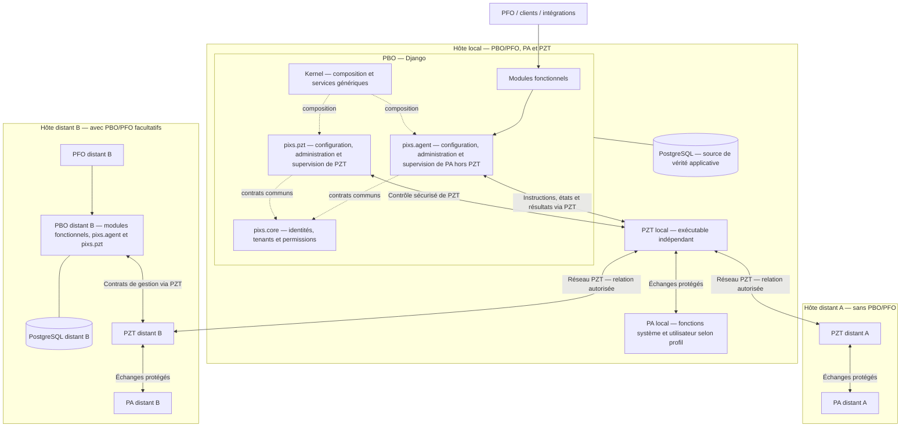
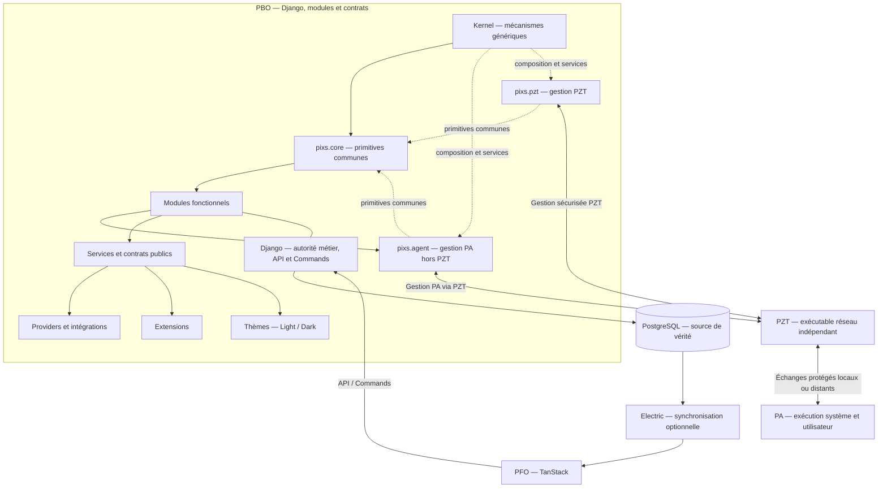
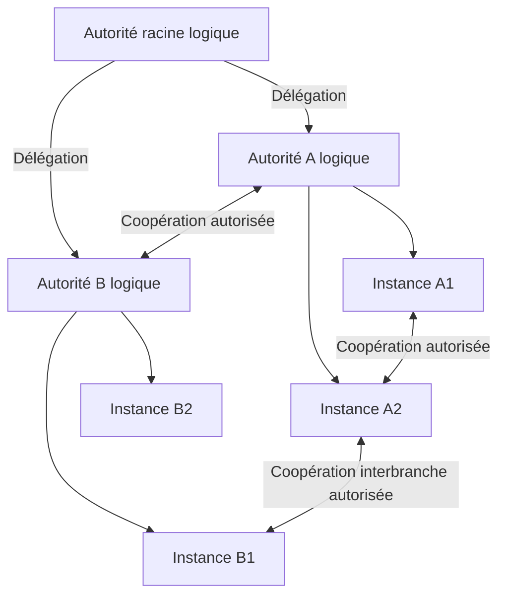

# PROJECT.md — Pixs

Ce document décrit le projet Pixs dans son ensemble.

## 1. Objet

Pixs l'Application Universselle est un framework applicatif modulaire destiné à servir de socle commun pour construire plusieurs applications et services métiers.

Pixs repose principalement sur :

```text
Backend             : Django
Source de vérité    : PostgreSQL
Frontend            : TanStack
Réactivité / Sync   : Electric lorsque nécessaire
Identité minimale   : utilisateurs et groupes via pixs.core
Autorisation        : ACL et permissions via pixs.core
Authentification    : providers indépendants, notamment OIDC et SAML
```

PostgreSQL constitue la source de vérité applicative de Pixs.

Django porte les règles métier, les commandes, les transactions, les API et l'orchestration applicative.

TanStack constitue la base du frontend.

Electric fournit, lorsque nécessaire, les mécanismes de synchronisation et de réactivité entre PostgreSQL et les clients.

`pixs.core`, module obligatoire immédiatement au-dessus du Kernel, fournit les primitives fonctionnelles de très bas niveau communes à toute installation Pixs : utilisateurs, groupes, appartenances, ACL et permissions associées.

Les annuaires, systèmes externes, protocoles d'authentification, moteurs de stockage, moteurs de recherche et autres intégrations ne font pas partie du socle fonctionnel obligatoire : ils sont apportés par des modules, providers ou extensions.

OIDC et SAML sont des exemples de providers d'authentification ; aucun provider concret n'est privilégié architecturalement.

Pixs doit être :

* entièrement modulaire et sous-modulaire ;
* doté d'un Kernel minimal et agnostique ;
* entièrement internationalisable dès sa première version ;
* entièrement thémable avec prise en charge Light et Dark ;
* accessible et responsive dès la conception ;
* extensible sans modification du Kernel ;
* API-first et indépendant de son frontend ;
* réactif lorsque la capacité le nécessite, sans imposer la réactivité partout ;
* observable, testable, déterministe et optimisable ;
* sécurisé par défaut ;
* conçu pour permettre l'ajout de modules, sous-modules, providers, extensions et thèmes.

L'idée centrale de Pixs est de séparer strictement :

```text
Kernel
Modules
Sous-modules
Contrats de services
Providers
Extensions
Themes
Intégrations externes
```

## 2. Principes architecturaux fondamentaux

Pixs repose sur les principes suivants.

### 2.1 Kernel minimal

Le Kernel représente la couche la plus basse et la plus stable de Pixs.

Il ne contient aucune logique métier propre à une application ou à un domaine fonctionnel.

Il fournit uniquement les mécanismes nécessaires au fonctionnement du framework.

Le Kernel peut connaître des concepts génériques tels que :

```text
ModuleManifest
ModuleRegistry
DependencyResolver
LifecycleManager
ServiceRegistry
EventBus
ConfigurationRegistry
ExtensionRegistry
```

Le Kernel ne doit pas connaître directement des concepts fonctionnels ou des implémentations concrètes tels que :

```text
User
Group
ACL
Organization
Directory implementation
OIDC
SAML
Document
Workflow
```

Les notions `User`, `Group` et `ACL` sont néanmoins disponibles à très bas niveau dans toute installation Pixs par l'intermédiaire de `pixs.core`, module obligatoire chargé au-dessus du Kernel. Elles ne deviennent donc pas des responsabilités internes du Kernel.

Principe :

```text
Le Kernel connaît le mécanisme.
Les modules apportent les fonctionnalités.
```

### 2.2 Tout comportement fonctionnel est fourni par un module

Toute fonctionnalité Pixs doit être fournie par un module.

Le Core n'est pas une exception architecturale.

`pixs.core` est un module Pixs fondamental et obligatoire, marqué comme requis par le système de modules.

Principe :

```text
Kernel
  ↓
mécanisme générique

pixs.core
  ↓
capacités fonctionnelles minimales

autres modules
  ↓
capacités fonctionnelles additionnelles
```

### 2.3 Dépendances explicites

Les dépendances entre composants doivent être déclarées explicitement.

Le Kernel doit pouvoir :

* découvrir les composants ;
* connaître leurs dépendances ;
* vérifier leur compatibilité ;
* détecter les dépendances manquantes ;
* détecter les cycles ;
* déterminer un ordre de chargement valide ;
* refuser une composition incohérente.

Les dépendances circulaires sont interdites.

Exemple valide :

```text
A → B → C
```

Exemple invalide :

```text
A → B → A
```

### 2.4 Contrats plutôt que dépendances fortes

Une dépendance à une capacité doit être préférée à une dépendance directe à une implémentation.

Un module doit autant que possible demander un contrat ou un service :

```text
CoreIdentityService
DirectoryProvider
AuthenticationProvider
NotificationService
StorageProvider
SearchProvider
MailProvider
```

plutôt qu'importer directement l'implémentation interne d'un autre module.

Principe :

```text
Consumer
   │
   │ requires
   ▼
Contract / Service
   │
   ├── Provider A
   ├── Provider B
   └── Provider C
```

Cette règle doit permettre de remplacer une implémentation sans modifier les modules consommateurs lorsque le contrat reste compatible.

### 2.5 Extensibilité sans modification du Kernel

L'évolution normale de Pixs doit être réalisée par ajout de :

* modules ;
* sous-modules ;
* providers ;
* extensions ;
* thèmes ;
* traductions ;

sans modification du Kernel.

Une modification du Kernel doit rester exceptionnelle et correspondre à l'évolution d'un mécanisme générique du framework.

### 2.6 Propriété des données par composant

Chaque module est propriétaire des données, modèles, migrations et invariants métier qu'il introduit. Les autres composants ne peuvent modifier l'état dont il est propriétaire qu'au travers de son interface publique explicitement exposée.

Un module ne doit pas dépendre des tables, modèles internes ou détails de persistance d'un autre module lorsque la capacité peut être obtenue par un contrat, un service ou une API explicite.

#### Gouvernance et confidentialité

Chaque composant qui introduit, dérive ou transfère des données doit déclarer un profil de gouvernance indiquant notamment le propriétaire technique, la source de vérité, les classes de données, la confidentialité, la présence éventuelle de données personnelles, les finalités, la rétention, la suppression, la conservation géographique, les consommateurs autorisés, les processeurs externes, les règles d'export et la lignée des données. Ce profil complète la propriété métier ; il ne la déplace pas vers un provider.

La confidentialité, le caractère personnel et le statut de secret sont des dimensions distinctes. Pixs prévoit les niveaux de confidentialité `PUBLIC`, `INTERNAL`, `CONFIDENTIAL` et `RESTRICTED`, ainsi que les niveaux de données personnelles `NONE`, `PERSONAL` et `SENSITIVE_PERSONAL`. Les secrets restent hors des données métier et sont toujours référencés par un mécanisme externe sécurisé. Une donnée non classifiée est traitée selon une politique restrictive et ne peut pas être exposée ou exportée vers l'extérieur avant déclaration explicite.

Les règles de gouvernance s'appliquent aussi aux dérivés : API, événements, webhooks, logs, traces, audits, recherches, projections, caches, fichiers, sauvegardes et exports. Les demandes d'accès, d'export, de rectification, d'effacement ou de restriction sont des capacités génériques, autorisées, traçables et, lorsque nécessaire, asynchrones ; elles respectent les legal holds, la rétention, les tombstones et la propagation vers les projections et providers concernés.

### 2.7 Sous-modularité récursive

Un sous-module est un composant Pixs à part entière et doit utiliser, autant que possible, les mêmes mécanismes que les modules : manifest, dépendances, configuration, lifecycle, permissions, traductions, frontend, services et extensions.

La sous-modularité ne doit pas nécessiter un second moteur parallèle au système de modules.

### 2.8 Kernel agnostique

Le Kernel connaît des mécanismes génériques et non des domaines fonctionnels ni des providers concrets. Il ne doit pas dépendre d'une implémentation particulière d'annuaire, d'authentification, de stockage, de recherche, de transport ou d'interface utilisateur.

### 2.9 Réactivité sélective

Pixs distingue conceptuellement :

```text
COMMAND  : Frontend / Client → Django → PostgreSQL
QUERY    : Client → API / lecture autorisée
REACTIVE : PostgreSQL → mécanisme de synchronisation → Client
```

La réactivité est une capacité optionnelle. Un module qui n'en a pas besoin ne doit pas dépendre d'Electric.

Une capacité offline-first peut compléter cette réactivité, mais elle reste conditionnelle et doit être activée explicitement par composant et par ressource. Elle ne transforme ni le client local ni Electric en source de vérité ou en autorité métier.

### 2.10 Optimisation par conception

Pixs doit permettre l'optimisation sans casser la modularité ni contourner les contrats. Les capacités pourront utiliser lorsque pertinent cache, lazy loading, pagination, batching, indexation, préchargement, compression, traitements asynchrones et projections.

Aucune optimisation ne doit rendre implicite une dépendance structurelle ou déplacer une règle métier autoritative hors du backend.

### 2.11 Observabilité native

Pixs doit être observable par conception. Le socle doit permettre des logs structurés, métriques, traces, health checks et diagnostics de composants.

Les informations d'observabilité doivent permettre d'identifier le composant à l'origine d'un comportement sans exposer de secret.

Les signaux d'observabilité sont compatibles avec un modèle OpenTelemetry et utilisent la propagation W3C Trace Context lorsque le transport le permet. Les logs, métriques et traces doivent pouvoir être corrélés par `trace_id`, `span_id` et `correlation_id`, sans imposer un backend ou un fournisseur de collecte. L'observabilité technique, l'audit fonctionnel et le diagnostic opérateur restent des catégories distinctes avec des accès, rétentions et niveaux de sensibilité propres.

La redaction des secrets, tokens, payloads sensibles et données personnelles est une responsabilité transverse. Les événements d'audit doivent rester structurés, persistants et contrôlables sans devenir des journaux techniques verbeux. Le diagnostic expose des états, versions, dépendances, erreurs et capacités utiles à l'exploitation, mais ne doit pas permettre une mutation métier implicite.


Les politiques de rétention sont configurables séparément pour les logs, métriques, traces, audits et diagnostics. Le framework impose la minimisation, la pseudonymisation lorsque l'identification n'est pas nécessaire et l'expiration automatique des données techniques. L'accès à des données tenant-scoped reste limité au tenant autorisé ; un accès plateforme ou inter-tenant requiert une permission explicite et un audit. Les audits sont append-only ; une obligation de suppression peut produire une anonymisation contrôlée sans réécriture silencieuse de l'historique. Un legal hold peut suspendre l'expiration selon une politique déclarée.

Les contrôles de santé distinguent `liveness`, `readiness`, `startup` et diagnostic opérateur. `liveness` indique que le processus peut répondre, `readiness` qu'il peut traiter du trafic, et `startup` que son initialisation est terminée. Les dépendances obligatoires déterminent la readiness ; une dépendance optionnelle indisponible peut produire `DEGRADED` lorsqu'un fonctionnement cohérent reste possible. Les probes sont rapides, bornées, sans mutation et ne divulguent aucun secret. Le diagnostic détaillé est réservé aux opérateurs autorisés.

### 2.12 Résilience et isolation des défaillances

La défaillance d'un provider ou d'une intégration optionnelle ne doit pas rendre indisponible l'ensemble de Pixs lorsqu'une exécution dégradée cohérente reste possible.

Les composants doivent pouvoir exposer, lorsque pertinent, des états tels que `HEALTHY`, `DEGRADED`, `FAILED` et `DISABLED`.

### 2.13 API-first

Les capacités métier destinées à être consommées par une interface doivent être exposables par des contrats/API stables et documentables. Le frontend TanStack est un client privilégié du projet, mais ne doit pas être le seul consommateur possible du backend.

HTTP/REST avec contrats OpenAPI constitue l'interface API principale de Pixs. Les Commands sont exposées comme opérations de mutation et les Queries comme opérations de lecture. WebSocket ou SSE sont réservés aux capacités réactives qui les déclarent. GraphQL ou RPC peuvent être fournis par des adapters optionnels, sans devenir des responsabilités du Kernel.

Les erreurs API suivent une enveloppe publique stable comprenant au minimum un `error_code` métier versionné, un `message` lisible, des `details` extensibles et un `correlation_id`. Des `field_errors` peuvent préciser les erreurs de validation. Le statut HTTP complète cette enveloppe, mais ne remplace pas le code d'erreur métier. Les réponses ne doivent exposer ni secret, ni trace d'exécution, ni détail privé de l'implémentation.

Les API exposent leur version majeure dans l'URL, par exemple `/api/v1/...`. Les évolutions mineures ou correctives compatibles conservent cette URL. Toute rupture de compatibilité impose une nouvelle version majeure, par exemple `/api/v2/...`, avec un contrat OpenAPI publié et versionné distinctement. Toute dépréciation doit être documentée et signalée avant le retrait d'une version ou d'une capacité.

L'authentification HTTP utilise `Authorization: Bearer` comme mécanisme principal. Les tokens OAuth2/OIDC, les API keys pour comptes de service et le mTLS pour les identités d'appareil ou certains comptes de service sont des mécanismes fournis par des providers explicites. Toute authentification valide est résolue vers une `DigitalIdentity` avant l'autorisation. Un `user_id` fourni par le client ne constitue jamais une preuve d'identité. Les endpoints anonymes doivent être explicitement déclarés publics.

Les ressources tenant-scoped exposent canoniquement le tenant dans leur chemin, par exemple `/api/v1/tenants/{tenant_id}/resources`. Le serveur doit vérifier l'appartenance de la `DigitalIdentity` au tenant avant toute lecture ou mutation. Un header tenant ou un champ du payload ne peut pas constituer la source canonique du contexte. Les routes platform-scoped sont distinctes des routes tenant-scoped. Le contexte tenant résolu doit être propagé aux Commands, Queries, Events, Jobs et audits.

Les réponses de succès utilisent une enveloppe uniforme avec `data`, `meta` et `links`. `data` contient la ressource ou le résultat, `meta` les informations complémentaires et `links` les liens de navigation ou de suivi. Les collections utilisent une pagination par curseur stable. Une Command asynchrone retourne `202` avec un `operation_id` et une URL de suivi ; elle ne doit pas présenter le résultat métier comme déjà acquis.

Les filtres et tris API sont déclarés par chaque contrat, typés et limités à une liste de champs autorisés. Le tri doit être déterministe, notamment avec un identifiant comme critère secondaire, et la taille maximale de page est imposée par le serveur. Les expressions SQL, ORM ou champs arbitraires fournis par le client sont interdites. La recherche textuelle avancée constitue une capacité distincte avec son propre contrat.

Les ressources exposées doivent pouvoir déclarer leurs règles de cache et de concurrence optimiste. `ETag` représente la version visible d'une ressource, `If-None-Match` permet une lecture conditionnelle et `If-Match` protège les mutations sensibles aux conflits. Une version obsolète produit `412 Precondition Failed`, tandis qu'un conflit métier produit `409 Conflict`. Les données sensibles ou tenant-scoped ne sont pas placées dans un cache partagé par défaut.

Les Commands HTTP rejouables utilisent l'en-tête `Idempotency-Key`, déclaré comme obligatoire ou optionnel par chaque route. Une même clé avec un payload identique restitue le résultat enregistré, y compris l'opération asynchrone associée. Une réutilisation avec un payload différent produit `409 Conflict`. La clé est portée au minimum par le tenant, l'identité numérique et le type de Command ; sa durée de conservation est documentée. Les méthodes de lecture ne reposent pas sur cet en-tête.

Les routes et capacités peuvent déclarer des limites de débit. Les quotas doivent pouvoir être dimensionnés par `DigitalIdentity`, tenant, compte de service ou adresse IP pour les routes anonymes, sans mélanger implicitement plusieurs tenants. Un dépassement répond `429 Too Many Requests` avec l'enveloppe d'erreur standard et `Retry-After` lorsque le délai de reprise est connu. Les limites d'authentification, de lecture, de mutation et de recherche coûteuse peuvent être distinctes. Le calcul et le stockage des quotas peuvent être fournis par un provider dédié.

Une limitation de débit contrôle une fréquence ou une concurrence courte ; un quota contrôle une consommation cumulée ou budgétée sur une période ou une durée de vie. Un entitlement contrôle l'accès d'une installation, d'un tenant ou d'un scope à une capacité ou à une limite contractuelle. Aucun de ces mécanismes ne remplace l'autorisation d'une identité sur une ressource, et un feature flag ne peut pas créer un entitlement.

Les webhooks sortants constituent un adapter API optionnel. Ils publient des événements issus de l'outbox après validation de la transaction, avec une enveloppe versionnée contenant notamment `event_id`, `event_type`, `event_version`, `tenant_id`, `occurred_at`, `payload` et les identifiants de corrélation. Chaque endpoint est validé, signé avec un secret géré par le système de secrets, soumis à des retries au moins une fois, et peut être suspendu, révoqué ou placé en dead-letter. Le consommateur doit pouvoir dédupliquer l'événement ; le payload ne contient que les données nécessaires.

La réception de webhooks entrants est également un adapter optionnel. Chaque provider dispose d'un endpoint ou d'une convention d'ingestion dédiée, vérifie la signature avant tout traitement et protège contre le rejeu par timestamp, identifiant externe et idempotence. Le message brut peut être conservé dans une zone technique contrôlée, puis transformé en Command ou événement interne validé. Le payload externe ne modifie jamais directement le modèle métier. L'acceptation technique peut répondre rapidement, tandis que le traitement métier est asynchrone et dispose d'une dead-letter.

La sécurité des clients navigateur est restrictive par défaut. CORS refuse les origines non déclarées et ne doit jamais combiner wildcard et credentials. Les origines, méthodes et headers autorisés sont configurables par environnement et documentés. La protection CSRF est obligatoire pour l'authentification par cookie ; l'authentification Bearer sans cookie est le mode privilégié pour les clients externes.

Les routes API déclarent des limites de taille et de durée d'exécution. Les limites peuvent différer pour JSON, multipart et uploads. Un payload trop volumineux répond `413 Content Too Large`. Une opération qui dépasse son budget doit être interrompue de manière contrôlée ou basculée vers un traitement asynchrone avec `202` et suivi ; elle ne doit pas dépendre d'un timeout implicite. Les erreurs de délai distinguent `408 Request Timeout` et `504 Gateway Timeout` selon l'origine du dépassement.

JSON encodé en UTF-8 constitue le format API principal. Les en-têtes `Content-Type` et `Accept` sont validés explicitement ; un format reçu non supporté répond `415 Unsupported Media Type` et une représentation acceptable indisponible répond `406 Not Acceptable`. Les dates sont exprimées en RFC 3339 UTC. Les identifiants et valeurs décimales doivent être transportés sans perte de précision. `Accept-Language` peut localiser les messages lisibles, mais les `error_code`, noms de champs et structures contractuelles restent stables et non localisés.

OpenAPI est la source de vérité publique des API. Les routes, schémas, statuts, enveloppes, exemples et exigences déclarés font l'objet de tests de contrat et d'un contrôle automatique de compatibilité entre versions. Les SDK clients et documentations peuvent être générés à partir de ces contrats, mais ne peuvent pas les remplacer. Une rupture non déclarée doit faire échouer le build.

Les contrats d'événements sont séparés des contrats HTTP et peuvent suivre une représentation compatible avec AsyncAPI, sans imposer de broker ni de transport au Kernel. Ils décrivent les types, versions, schémas, producteurs, consommateurs, garanties de livraison, périmètres d'ordre et politiques de replay. Les événements d'intégration destinés à l'extérieur sont versionnés indépendamment des événements de domaine internes.

Un webhook public est un adapter d'un contrat d'intégration versionné. Il doit appliquer la signature, la protection contre le rejeu, l'idempotence, les retries bornés et la dead-letter définis par ce contrat. Un webhook entrant ne modifie jamais directement les modèles métier : après vérification, il produit une Command ou un événement interne conforme.

### 2.14 Versionnement et compatibilité

Les modules, sous-modules, providers, contrats et extensions doivent pouvoir déclarer leur version et leurs contraintes de compatibilité. Une incompatibilité connue doit être détectée avant activation.

Les dimensions de version sont distinctes et ne doivent pas être déduites les unes des autres :

```text
release_version
component_version
contract_version
capability_version
manifest_schema_version
schema_version
migration_version
event_version
configuration_schema_version
data_governance_version
feature_flag_version
bulk_operation_version
sdk_version
entitlement_version
quota_policy_version
offline_capability_version
local_schema_version
sync_protocol_version
residency_policy_version
placement_policy_version
region_topology_version
```

La compatibilité doit être évaluée par une matrice explicite couvrant au minimum la release, les composants, les contrats et APIs, les schémas de données, les événements, les providers, la configuration et les clients frontend. Une entrée de matrice peut être `COMPATIBLE`, `REQUIRES_MIGRATION`, `DEPRECATED` ou `BLOCKED` ; une version plus récente n'est jamais considérée compatible par son seul numéro.

Une dépréciation de contrat public doit être annoncée dans une version mineure, documenter son remplacement éventuel et conserver le contrat compatible pendant toute la version majeure courante. Sa suppression n'est autorisée qu'à partir de la version majeure suivante, sauf exception de sécurité critique, obligation légale ou impossibilité technique majeure explicitement justifiée.

### 2.15 Migrations et réversibilité

Le lifecycle doit distinguer explicitement installation, activation, désactivation, mise à niveau, migration et désinstallation.

La désactivation d'un composant ne signifie jamais implicitement la suppression de ses données. Toute opération destructive doit être explicite et spécifiée.

Le cycle de vie des données est distinct du cycle de vie des composants. Il sépare l'état métier défini par le module, l'état de persistance, la rétention et l'état des projections ou synchronisations. La suppression logique est la stratégie par défaut des ressources métier ; la purge physique est une opération séparée, autorisée, auditée, idempotente et soumise aux conditions de rétention.

Les états communs de persistance sont conceptuellement `ACTIVE`, `ARCHIVED`, `SOFT_DELETED` et `PURGE_PENDING`. L'état `PURGED` peut être représenté par un tombstone ou un journal d'effacement lorsque cette preuve est nécessaire à la synchronisation, à la restauration ou à l'audit. Les ressources éphémères ou soumises à une obligation d'effacement immédiat peuvent déclarer une stratégie différente.

Les migrations de schéma sont orientées vers l'avant et ne doivent pas être annulées automatiquement pour simuler un rollback applicatif. Elles suivent, lorsque nécessaire, les phases `expand`, migration ou backfill reprenable, bascule compatible puis `contract`. Toute étape destructive est différée jusqu'à la fin de la fenêtre de compatibilité et fait l'objet d'une opération explicitement autorisée.

Une mise à niveau est déclenchée par une commande d'exploitation autorisée. Le démarrage peut effectuer une prévalidation et détecter une migration en attente, mais ne doit pas l'exécuter implicitement ni déclarer l'instance `ready` tant que les préconditions ne sont pas satisfaites. Le rollback applicatif n'est autorisé que si la matrice démontre la compatibilité du code avec le schéma et les données courants ; sinon, la correction vers l'avant ou la restauration vérifiée est la seule voie.

### 2.16 Sécurité par défaut

Pixs applique le principe du moindre privilège et une politique `deny by default`. L'authentification, l'identité, l'autorisation et les règles métier restent des responsabilités distinctes.

Les contrôles d'autorisation sont autoritatifs côté backend.

Chaque composant doit déclarer un profil de sécurité comprenant les données manipulées, les permissions requises, les secrets consommés, les frontières réseau, les dépendances externes et le niveau de confiance attendu. La chaîne de build doit produire un inventaire des dépendances, vérifier les secrets et les vulnérabilités, contrôler la provenance et l'intégrité des artefacts et empêcher la distribution d'un composant présentant une vulnérabilité critique connue. Une dérogation doit être explicitement acceptée, limitée dans le temps, documentée et auditée.

Une authentification, une autorisation, une signature, un secret ou un contexte tenant non vérifiable doit produire un échec fermé. Pixs ne doit jamais basculer automatiquement vers un mode permissif pour préserver la disponibilité. Une capacité optionnelle peut être isolée en mode dégradé uniquement si aucune frontière de sécurité n'est affaiblie. Les composants, providers, tokens et endpoints compromis doivent pouvoir être révoqués explicitement ; les blocages, révocations, dérogations et réactivations sont diagnostiquables et auditables.

Pixs doit pouvoir gérer les vulnérabilités et incidents par des avis de sécurité versionnés, indiquant le composant concerné, les versions affectées, la sévérité, l'impact, la correction et les mesures de mitigation. Le statut de révocation doit être vérifiable lors de l'installation, du démarrage et de la mise à niveau. Un composant compromis peut être bloqué ou désactivé par une procédure d'urgence distincte du cycle normal de compatibilité. Le suivi d'incident conserve une timeline, les corrélations, les décisions et les preuves techniques nécessaires sans conserver de secret. Les exploitants concernés doivent pouvoir être informés. La reprise doit restaurer un état sûr sans supprimer automatiquement les données métier.

La sécurité du framework inclut la validation des entrées, le moindre privilège, la séparation des secrets, la protection de la chaîne de dépendances, la limitation de l'exposition des données et la détection observable des violations. Un composant doit pouvoir déclarer ses exigences de sécurité et son état de conformité sans exposer les valeurs sensibles utilisées par son runtime.

### 2.17 Audit métier

Pixs distingue l'observabilité technique de l'audit fonctionnel. Les modules doivent pouvoir produire des événements d'audit structurés pour les actions métier significatives sans confondre ces événements avec les journaux techniques.


### 2.18 Accessibilité native

Le frontend, le Design System et les thèmes doivent être conçus dès l'origine pour l'accessibilité : navigation clavier, structure sémantique, gestion du focus, contrastes et compatibilité avec les technologies d'assistance.

Pixs vise la conformité WCAG 2.2 niveau AA pour le shell frontend, le Design System et les primitives partagées. Cette cible couvre notamment le clavier, le focus visible et non masqué, la sémantique, les lecteurs d'écran, les contrastes, les cibles interactives, le zoom, le reflow, la réduction des animations et l'authentification accessible. Les primitives doivent privilégier les éléments HTML natifs ; ARIA n'est utilisé que lorsque la sémantique native ne suffit pas. Une primitive non conforme est bloquante pour la distribution ou doit être explicitement marquée expérimentale.

### 2.19 Responsive et multi-device

Les composants d'interface ne doivent pas dépendre d'une taille d'écran fixe. Pixs doit permettre des interfaces utilisables sur différentes tailles et catégories de terminaux.

La conception responsive est mobile-first et s'adapte à l'espace disponible plutôt qu'à une liste d'appareils. Les layouts utilisent des tokens sémantiques et peuvent utiliser des container queries dans l'adapter de rendu. Les composants doivent rester compatibles avec le reflow et le zoom, sans largeur fixe implicite. Les densités `comfortable` et `compact` sont des variantes déclarées. Les tableaux, formulaires et navigations doivent préciser leur comportement sur les petits espaces, et les modules déclarent leurs contraintes minimales lorsqu'elles sont nécessaires.

### 2.20 Design System

Pixs doit disposer d'un Design System commun fournissant des primitives visuelles et des tokens sémantiques. Les thèmes Light et Dark s'appuient sur ces abstractions plutôt que sur des valeurs de présentation codées en dur dans les modules.

Le Design System est organisé en tokens sémantiques, primitives UI accessibles et adapters de rendu. Les tokens couvrent notamment couleurs, typographie, espacements, rayons, ombres, dimensions, motion et états d'interaction. Les modules utilisent les tokens et primitives publiques plutôt que des valeurs visuelles codées en dur. Le contrat du Design System est versionné et conceptuellement indépendant de TanStack et du moteur CSS ; l'adapter TanStack fournit l'implémentation frontend de référence. Les thèmes fournissent des valeurs de présentation et ne portent pas de logique métier. Les extensions peuvent composer les primitives, mais ne doivent pas les modifier globalement.

Les tokens de présentation sont sémantiques, par exemple `color.surface.default` ou `space.component.gap`, et non des valeurs visuelles directes. Les modes `light` et `dark` sont obligatoires ; un mode `high-contrast` peut être fourni comme extension compatible avec les exigences d'accessibilité. La résolution du thème suit une priorité explicite : préférence utilisateur, préférence système, puis défaut de l'installation. Le changement de thème ne doit pas nécessiter de rechargement de page. L'utilisation de CSS custom properties est possible dans l'adapter TanStack mais ne constitue pas le contrat public.

### 2.21 Testabilité architecturale

Chaque composant doit être testable aussi isolément que possible. Les contrats et providers doivent pouvoir disposer de tests de conformité communs, complétés par des tests unitaires, d'intégration et frontend selon les responsabilités du composant.

### 2.22 Déterminisme

À configuration et composants identiques, Pixs doit produire une composition déterministe. L'ordre de découverte du filesystem, l'ordre accidentel des imports ou d'autres détails non déclarés ne doivent pas modifier le résultat de composition.

### 2.23 Explicite plutôt qu'implicite

Les dépendances, providers, extensions, permissions, synchronisations, hooks, surcharges, ordres de chargement et choix d'implémentation doivent être explicables et inspectables.

Pixs doit permettre de déterminer pourquoi un composant est chargé, pourquoi un provider est sélectionné, pourquoi une route ou permission existe et pourquoi un handler est exécuté.

### 2.24 Optimisation transverse

La performance est une propriété transverse du framework et non la responsabilité d'un composant unique. Les optimisations doivent être mesurables, observables et compatibles avec les invariants de sécurité, de cohérence, de déterminisme et de modularité.

### 2.25 Modèle commun de Component

Tous les éléments extensibles de Pixs dérivent conceptuellement d'un modèle commun de `Component`. Les types de composants prévus sont `KERNEL`, `MODULE`, `SUBMODULE`, `PROVIDER`, `EXTENSION` et `THEME`. Ils utilisent autant que possible les mêmes mécanismes de manifest, identification, versionnement, dépendances, capacités, configuration, lifecycle, compatibilité et état de santé.

Les contrats, capacités et services ne sont pas des types de composants. Ils sont déclarés, implémentés ou enregistrés par les composants. Ce modèle est conceptuel et n'impose pas à ce stade une classe Python unique ni une stratégie d'héritage particulière.

### 2.26 Capacités fournies et requises

Un composant doit pouvoir déclarer explicitement les capacités qu'il fournit et celles qu'il requiert. Les dépendances obligatoires et optionnelles doivent être distinguées. Une dépendance à une capacité doit être préférée à une dépendance directe à une implémentation lorsque le besoin peut être exprimé ainsi.

```text
Component
├── requires component
├── requires capability
├── optionally requires component
├── optionally requires capability
├── provides capability
└── implements contract
```

Une dépendance obligatoire manquante invalide la composition. Une dépendance optionnelle absente n'invalide pas la composition, mais le comportement dégradé du composant doit être explicite.

### 2.27 Sélection explicite et déterministe des providers

Lorsqu'une capacité peut être satisfaite par plusieurs providers compatibles, le provider actif ne doit jamais être choisi implicitement selon l'ordre du filesystem, des imports ou de découverte.

Règle de résolution de principe :

```text
provider explicitement configuré
        ↓ sinon
provider compatible unique
        ↓ sinon
composition invalide
```

La sélection ne doit jamais dépendre de l'ordre du filesystem, des imports ou de l'installation. Plusieurs providers actifs pour une même capacité nécessitent une composition explicite, par exemple un provider composite ou un routeur déclaré.

Les composants, contrats et capacités publiques utilisent SemVer 2.0.0. Les contraintes de compatibilité sont déclarées et vérifiées avant activation. Une incompatibilité de version ou une ambiguïté de résolution doit produire un échec explicite.

### 2.28 Interface publique et implémentation privée

Chaque module doit distinguer conceptuellement son interface publique de son implémentation privée. Les contrats publics sont enregistrés, identifiés, versionnés et documentés indépendamment de leur implémentation.

Les catégories de contrats publics prévues sont :

```text
Service  → opération synchrone fournie par un composant
Command  → demande explicite de mutation
Query    → demande explicite de lecture
Event    → fait déjà survenu
Hook     → point d'extension déclaré
Schema   → structure de données ou de configuration contractuelle
API      → interface de consommation externe ou inter-composants
```

Les modèles internes, repositories et détails d'implémentation ne doivent pas être considérés comme des API stables par défaut.

### 2.29 Isolation des données entre modules

Un module ne modifie jamais directement les données privées d'un autre module. Toute interaction inter-module affectant l'état d'un autre composant doit passer par une interface publique explicitement exposée, notamment une commande, un service ou un contrat.

### 2.30 Séparation Commands / Queries / Events

Pixs distingue explicitement :

```text
Command
    → demande de mutation
    → validation métier
    → autorisation
    → transaction

Query
    → lecture autorisée
    → sans mutation métier implicite

Event
    → notification d'un fait déjà survenu
    → découplage / effets secondaires
```

Un événement ne doit pas remplacer une interaction synchrone lorsqu'une garantie transactionnelle immédiate est nécessaire.

Une `Command` est synchrone par défaut. Une exécution asynchrone doit être déclarée explicitement par le contrat et retourner un identifiant de suivi tant que le traitement n'est pas terminé.

Une Command publique doit pouvoir transporter au minimum :

```text
command_id
command_type
command_version
subject
tenant_context
payload
correlation_id
causation_id
idempotency_key éventuelle
```

Le `subject` et le `tenant_context` sont validés par Django avant toute mutation. Une réponse synchrone expose un résultat ou une erreur métier explicite ; elle ne doit pas masquer un traitement asynchrone non terminé.

Une Command peut également transporter `authentication_context`, `expected_version` et une `operation_id` lorsqu'elle est suivie de manière asynchrone. `operation_id`, `command_id`, `event_id` et `job_id` sont des identifiants distincts : une opération peut produire plusieurs Jobs et plusieurs événements. L'acteur initial reste traçable, même lorsque l'exécution est déléguée à un compte de service ou à un worker.

Les événements de domaine internes et les événements d'intégration publics sont des contrats distincts, même lorsqu'ils utilisent la même outbox. Un événement est immuable, versionné et ne constitue jamais une demande implicite de mutation. La garantie générale est `at-least-once` ; l'ordre n'est garanti que par agrégat ou partition lorsque le contrat le déclare, jamais globalement par défaut.

Les Jobs sont persistants, repris après interruption et soumis à une autorisation réévaluée au moment de leur exécution. Un worker ne peut pas utiliser un contexte d'authentification expiré ni élargir le périmètre tenant ou scope de l'acteur initial. Les retries sont limités aux erreurs rejouables ; les erreurs métier non rejouables sont orientées vers un état d'échec ou une dead-letter.

Chaque contrat public doit déclarer son identifiant canonique, sa catégorie, sa version, ses garanties, ses contraintes de compatibilité et son propriétaire. Un contrat public ne peut être modifié de manière incompatible sans nouvelle version majeure ou mécanisme de migration explicitement défini.

### 2.31 Modèle d'autorisation Subject / Resource / Action

Les contrôles applicatifs décrits dans ce cadrage suivent le régime ordinaire, sous réserve de l'exception Super Admin définie par les capacités OpenSpec `authorization` et `initial-administration`. Cette exception est une règle explicite du backend, distincte du régime des Administrateurs ordinaires et des profils structurels préparatoires.

Chaque installation dispose d'un seul compte Super Admin non nominatif, réservé au paramétrage et au secours, sans délégation ni usage comme compte de service. Son contrôle total s'applique à la plateforme et, après attribution explicite d'un accès distinct, au tenant concerné malgré ses ACL. Il n'ouvre pas implicitement les autres tenants. L'exception reste liée au compte actif sans élévation temporaire par opération.

Le Super Admin peut déroger à tous les contrôles applicatifs dans ce périmètre : ACL, règles métier, maintenance, quotas, entitlements, feature flags, gouvernance, résidence, rétention, legal holds, audit et désactivation externe. Le panneau, les API, la CLI et les traitements asynchrones demandés par ce compte offrent la même exception. Un worker conserve l'acteur initial sans utiliser les credentials du Super Admin ni devenir ce compte.

Le premier démarrage et la réactivation de secours ne requièrent aucun MFA ; le compte conserve une authentification propre et les niveaux d'assurance réellement obtenus. Le marqueur externe de désactivation peut être dérogé pour la réactivation de secours. Sans dérogation, une désactivation refuse les nouvelles actions et exécutions différées tout en laissant terminer une transaction déjà engagée. Une dérogation d'audit permet une opération sans audit persistant, sans présenter celui-ci comme réalisé.

L'autorisation repose conceptuellement sur les notions `Subject`, `Resource`, `Action` et `Context`. Les identités numériques et groupes peuvent constituer des sujets ; les modules définissent les ressources et actions qu'ils exposent à l'autorisation. Le contexte comprend notamment le tenant courant lorsque la ressource est tenant-scoped. Les ACL, rôles et permissions expriment les règles applicables à ces éléments.

Dans le régime ordinaire, Pixs applique une politique `deny by default`. Un `DENY` explicite est prioritaire sur un `ALLOW` explicite, puis le refus par défaut s'applique en l'absence d'autorisation valide. Les accès plateforme et inter-tenants doivent être explicitement accordés, contextualisés et audités.

Le moteur d'autorisation est une capacité générique, déclarative et déterministe. Il prend en charge les rôles, ACL, relations explicites entre sujets, ressources et scopes, ainsi que des contraintes contextuelles typées. Le PEP est appliqué par Django ; le moteur constitue le PDP de référence de `pixs.core`, tandis qu'un PDP externe reste un adapter optionnel et compatible. Les politiques P0 ne doivent ni exécuter de code arbitraire ni charger une expression distante.

Les modules déclarent leurs ressources, actions, relations et politiques dans leur périmètre. Une décision porte au minimum sur `Subject`, `Resource`, `Action`, `Context`, `ScopeContext`, l'assurance d'authentification et la version de politique. La propriété d'une ressource, l'appartenance à un scope, un rôle administrateur ou une relation de groupe ne constituent pas à eux seuls une autorisation : ils doivent être évalués par une politique explicite.

Les décisions positives ne peuvent pas être réutilisées pour les mutations ou actions sensibles après expiration, révocation, modification de politique, de membership, d'ACL, de scope ou d'assurance. Une indisponibilité du moteur produit un échec fermé. Les listes et recherches doivent utiliser un filtrage autorisé au niveau de la source afin de ne pas charger des données qui seraient ensuite éliminées par le frontend.

### 2.32 Modèle de scopes et de frontières d'accès

Pixs distingue la frontière technique racine `Tenant` des scopes fonctionnels éventuellement introduits par les modules. Un `Tenant` est toujours la racine d'un contexte tenant-scoped ; un scope enfant possède un parent unique et appartient au même tenant. Le modèle n'autorise pas de graphe arbitraire de scopes : les relations de parenté, d'appartenance, de visibilité et d'héritage doivent être explicites et acycliques.

Le modèle commun peut être représenté ainsi :

```text
Tenant
└── Scope enfant éventuel
    └── Scope enfant éventuel
```

`Organization`, `Workspace`, `Project` ou tout autre type de scope ne sont pas imposés par le socle. Ils sont fournis par des modules, avec un identifiant de type namespacé, leur propre modèle métier et leurs règles d'appartenance. Une `Organization` ne devient donc pas automatiquement une frontière d'isolation technique.

Une ressource possède une et une seule propriété canonique : le tenant racine lorsqu'elle est tenant-scoped, ou un scope enfant lorsqu'elle est rattachée à un périmètre plus fin. Le rattachement à un scope enfant implique toujours un `tenant_id` cohérent. Une ressource platform-scoped est explicitement hors tenant et ne peut pas être traitée comme une ressource tenant-scoped par défaut. Le partage entre scopes s'exprime par les ACL, rôles ou relations déclarées ; il ne modifie pas la propriété canonique et ne crée pas d'héritage implicite.

Le `ScopeContext` est un contexte d'exécution explicite déclarant `TENANT` ou `PLATFORM` : pour `TENANT`, `tenant_id` est obligatoire et `scope_id` est fourni lorsque le contrat de la ressource le requiert, de façon cohérente avec le même tenant ; pour `PLATFORM`, `tenant_id` et `scope_id` sont absents. Un `scope_id` sans tenant est interdit, une validation structurelle ne donne aucun droit et tout accès plateforme exige permission, contexte et audit explicites. Il est résolu avant l'autorisation, propagé aux Commands, Queries, Events, Jobs, projections, caches, fichiers, recherches, workflows, synchronisations et contributions frontend, puis traité comme immuable pendant l'opération. Un changement de scope invalide les états et caches dépendants. Aucun en-tête, identifiant de payload ou ordre de découverte ne peut élargir silencieusement ce contexte.

### 2.33 Identifiants stables inter-composants

Tout objet destiné à être référencé entre composants doit disposer d'un identifiant stable, non ambigu et indépendant autant que possible de son emplacement physique ou de l'ordre de chargement. Les entités persistées utilisent des identifiants UUIDv7. Les composants, capacités, contrats, permissions, événements, providers et points d'extension utilisent des identifiants textuels namespacés lorsque leur nature le permet. Les identifiants externes fournis par des providers restent séparés des identifiants internes Pixs.

### 2.34 Configuration déclarative, typée et validable

Chaque composant doit pouvoir déclarer le schéma de sa configuration. Les types, valeurs requises, valeurs par défaut, contraintes, secrets et validations doivent pouvoir être exprimés explicitement afin de permettre une validation avant activation.

La priorité des sources de configuration est déterministe :

```text
valeurs du schéma
        ↓
valeurs par défaut du composant
        ↓
configuration statique de l'installation
        ↓
configuration runtime de l'environnement
        ↓
références de secrets
```

Une configuration plus prioritaire remplace une configuration moins prioritaire. Une configuration invalide bloque l'activation ou le passage à l'état `ready`. Debian, Docker et l'environnement de développement doivent alimenter le même modèle de configuration Pixs.

### 2.35 États de composant distincts

Les notions `installed`, `enabled`, `configured`, `ready` et `healthy` sont distinctes et ne doivent pas être confondues. Un composant peut par exemple être installé mais désactivé, activé mais mal configuré, ou prêt mais dégradé.

Le lifecycle doit représenter explicitement les opérations `discover`, `validate`, `install`, `enable`, `configure`, `start`, `disable`, `migrate`, `upgrade`, `uninstall` et `purge`. Une configuration, dépendance ou compatibilité invalide doit empêcher l'activation ou le passage à `ready`. La purge destructive est une opération distincte explicitement demandée. Le hot reload est une capacité optionnelle et déclarée, jamais un comportement implicite.

### 2.36 Propriété et orchestration des migrations

Chaque module possède les migrations relatives aux données et modèles qu'il introduit. Leur planification, leur validation d'ordre et leur orchestration globale relèvent toutefois de Pixs afin de préserver une composition cohérente et déterministe.

Les migrations qui modifient une structure ou une politique de cycle de vie doivent préserver les états de persistance, les marqueurs de rétention, les legal holds, les tombstones et les références d'historique. Une évolution incompatible doit suivre une stratégie expand/contract versionnée afin que les anciennes et nouvelles versions ne puissent pas réintroduire une donnée supprimée ou contourner une condition de purge.

Chaque migration doit déclarer un contrat comprenant au minimum son identifiant, son module propriétaire, sa version source et cible, ses dépendances, ses préconditions et postconditions, son caractère idempotent, son caractère destructif, son mode d'exécution et sa stratégie de compensation éventuelle. Les migrations d'un module forment une chaîne versionnée ; un saut de version n'est permis que si sa compatibilité est démontrée, sinon les étapes intermédiaires sont obligatoires. Pixs résout le graphe global des migrations sans permettre à un module d'écrire directement dans les données privées d'un autre.

Chaque module déclare si sa migration peut s'exécuter `ONLINE`, en `MAINTENANCE` ou `OFFLINE`. Le zero-downtime n'est donc pas une garantie générale du framework ; une coexistence `N`/`N+1` ne peut être activée que lorsque les APIs, événements, schémas, données et providers concernés disposent d'une compatibilité transitoire explicite.

### 2.37 Django reste l'autorité métier face à Electric

Electric est un mécanisme de synchronisation et de réactivité. Il ne constitue jamais une autorité métier parallèle à Django. Toute mutation susceptible de modifier un invariant métier doit être validée par l'autorité applicative Django avant de devenir un état de référence dans PostgreSQL.

### 2.38 Stockage de fichiers et référentiels documentaires

Pixs distingue le contrat de stockage objet, les métadonnées métier et les référentiels documentaires collaboratifs. Le Kernel ne dépend d'aucun stockage concret. Les métadonnées nécessaires à l'identité, au tenant, aux relations, aux permissions, à l'audit et au cycle de vie restent gérées par Pixs ; le contenu binaire est confié à un `ObjectStorageProvider` compatible.

Les providers objet prévus peuvent notamment couvrir un filesystem local pour le développement et les tests, ainsi que des implémentations S3-compatible telles que S3, MinIO ou Ceph Object Gateway. Nextcloud n'est pas traité comme le endpoint objet de Pixs : lorsqu'il agit comme référentiel documentaire, il est intégré par un contrat `DocumentRepositoryProvider` utilisant ses interfaces publiques et configurables, telles que WebDAV ou les APIs appropriées, et n'accède jamais directement à son répertoire interne ni à son bucket primaire.

Un référentiel documentaire, notamment Nextcloud, peut être intégré selon deux modes déclarés :

```text
référentiel documentaire piloté par Pixs
    Pixs porte l'autorité métier, les permissions et le cycle de vie ;
    le DocumentRepositoryProvider conserve ou présente les documents.

référentiel documentaire externe
    Nextcloud porte les documents et peut être modifié indépendamment ;
    Pixs conserve une projection, les mappings, l'état de synchronisation
    et les décisions d'autorisation applicables.
```

Ces modes ne doivent pas être confondus. Dans le premier mode, une écriture documentaire passe par Pixs et une modification externe non autorisée est traitée comme une divergence. Dans le second, les modifications externes sont attendues et alimentent la projection et la synchronisation Pixs. La source d'autorité, le sens de synchronisation, la gestion des conflits et les règles de suppression doivent être déclarés par espace ou capacité. Un stockage objet ne doit jamais être partagé directement avec le bucket primaire exclusif d'un Nextcloud ; un référentiel documentaire externe ne doit jamais contourner l'identité numérique, le contexte tenant, l'autorisation backend ou l'audit Pixs.

La métadonnée de fichier portée par Pixs suit le cycle de vie déclaré de la ressource, indépendamment de la durée de vie des octets chez le provider. Une suppression ou une purge doit donc pouvoir propager un tombstone et une décision d'effacement au provider sans faire dépendre l'autorité métier d'un accès direct au stockage.

### 2.39 Recherche indexée

La recherche est une capacité de lecture fondée sur des projections reconstruisibles et non une source de vérité métier. Pixs doit pouvoir fournir un `SearchProvider` pour la recherche plein texte, les filtres structurés, les facettes, l'autocomplétion et, lorsque cela est pertinent, la recherche sémantique ou multilingue. Le moteur concret reste remplaçable.

Les index doivent respecter le tenant, l'identité numérique et les ACL. Une modification de permission, une suppression ou une expiration doit pouvoir invalider ou mettre à jour la projection correspondante. La cohérence éventuelle, la disponibilité dégradée et les limites de pertinence doivent être déclarées par capacité.

Une ressource `SOFT_DELETED` ou `PURGE_PENDING` ne doit pas rester visible dans une projection destinée aux lectures normales. Les tombstones et événements d'effacement doivent être propagés aux index, caches, synchronisations et projections avant qu'une reconstruction ou une reprise ne puisse republier la ressource supprimée.

Le provider de recherche est sélectionné explicitement et déterministiquement. Aucun moteur de recherche, format d'index ou algorithme de pertinence n'est imposé au Kernel. Une recherche indisponible peut être isolée en mode dégradé lorsqu'elle n'est pas une dépendance obligatoire de l'autorisation ou d'une mutation.

### 2.40 Workflows

Pixs fournit une capacité générique de workflow pour orchestrer des états, transitions, gardes, actions, délais et événements versionnés. Les modules restent propriétaires des invariants et règles métier ; un workflow ne devient pas une autorité métier parallèle. Toute transition passe par une Command, l'autorisation, une transaction et un audit.

Les workflows longs ou différés utilisent les Jobs, l'outbox et l'idempotence déjà définis. Les reprises, annulations, expirations, compensations et interventions manuelles doivent être explicites. Une définition de workflow ne doit jamais permettre l'exécution arbitraire de code ou contourner une permission.

Les définitions et instances de workflow sont persistantes, versionnées et corrélables à un sujet, un tenant et une ressource métier. La publication d'une nouvelle définition ne doit pas rendre ambiguës les instances en cours ; une migration explicite est nécessaire lorsque leur interprétation change.

### 2.41 Synchronisations

Les synchronisations externes utilisent un `SynchronizationProvider` et déclarent explicitement leur ressource, leur direction, leur source d'autorité, leur mapping, leur fréquence ou déclencheur, leur stratégie de conflit et leurs règles de suppression.

Les modes prévus sont `IMPORT`, `EXPORT`, `BIDIRECTIONAL` et `PROJECTION`. Les identifiants externes restent distincts des identifiants Pixs. Les curseurs, checkpoints, replays, retries, backoff, dead-letters, limitations de débit, verrous et états de convergence doivent être persistants et diagnostiquables. Un conflit ne doit jamais être résolu silencieusement ; une stratégie telle que `REJECT`, `MANUAL_REVIEW`, `LAST_WRITE_WINS`, `SOURCE_PRIORITY` ou `DOMAIN_MERGE` doit être déclarée par ressource.

Pixs est la source d'autorité par défaut pour ses données métier. Un référentiel externe peut être autoritatif pour un espace documentaire explicitement déclaré. Une double autorité n'est jamais implicite et exige une stratégie de convergence et de conflit propre à la ressource. Le mode d'autorité fait partie du contrat de synchronisation et doit être inspectable avant activation.

Une synchronisation est un composant identifiable, versionné et sélectionné explicitement. Elle doit pouvoir être suspendue, reprise, réinitialisée ou placée en quarantaine sans supprimer implicitement les données. Les credentials, scopes réseau, limites de débit, webhooks, politiques de suppression et règles de reprise sont déclarés et soumis au système de secrets, à l'autorisation et à l'audit.

Les providers de stockage, de référentiel documentaire, de recherche et de synchronisation doivent pouvoir être soumis à des suites de conformité communes. Un provider qui ne respecte pas les garanties déclarées ne peut pas être activé comme compatible. Une capacité optionnelle peut rester indisponible ou `DEGRADED` sans provoquer une sélection implicite d'une autre implémentation ni affaiblir les frontières de sécurité.

La synchronisation locale offline-first est distincte d'une synchronisation externe : le client local conserve une projection ou des Commands en attente, mais ne devient jamais une source d'autorité concurrente. Elle réutilise les contrats de contexte, d'idempotence, de cycle de vie, de gouvernance et de conflit sans interpréter une réplication locale comme une double autorité.

### 2.42 Providers concrets et modules métier

Pixs distingue les contrats génériques, les providers qui les implémentent et les modules qui portent les capacités fonctionnelles. La hiérarchie de confiance est explicite :

```text
Kernel / pixs.core
    contrats et capacités génériques

providers officiels Pixs
    implémentations de référence maintenues et testées par Pixs

providers externes
    implémentations tierces soumises à conformité

providers privés
    composants propres à une installation
```

Le Kernel et `pixs.core` ne dépendent d'aucun provider concret obligatoire. Un provider officiel peut être distribué comme composant versionné sans être activé implicitement. Tous les providers déclarent leurs capacités, dépendances, limites, niveau de confiance et lifecycle ; leur sélection et leur activation sont explicites.

Les modules métier suivent la même séparation : `pixs.core` fournit les primitives transverses, les modules métier Pixs fournissent des fonctionnalités génériques réutilisables et les modules externes fournissent des domaines spécifiques installables séparément. Chaque module reste propriétaire de ses modèles, migrations et invariants ; les interactions inter-modules passent par les contrats publics.

### 2.43 SDK et écosystème développeur

Pixs doit fournir un écosystème développeur fondé sur ses contrats publics, et non sur ses modèles Django ou ses implémentations privées. Les SDK officiels initiaux sont TypeScript et Python : TypeScript pour TanStack, les clients navigateur ou serveur JavaScript et les intégrateurs frontend ; Python pour Django, les scripts, les intégrations serveur et les outils d'administration.

Les SDK sont générés à partir des contrats OpenAPI, des contrats événementiels compatibles avec AsyncAPI et des schémas publics déclarés, puis peuvent être complétés par une façade ergonomique maintenue séparément. La génération, les types, les erreurs, les exemples et les versions doivent rester reproductibles. Un SDK ne doit jamais masquer une divergence du contrat ni introduire une autorité métier parallèle.

Le socle développeur doit exposer les primitives communes de transport, authentification injectable, `TenantContext`, `ScopeContext`, pagination par curseur, erreurs typées, `Idempotency-Key`, suivi des `operation_id`, `BulkOperation`, retries bornés et vérification des webhooks. Les mutations ne sont pas rejouées automatiquement sans garantie d'idempotence explicite. Le SDK navigateur ne stocke pas les tokens localement par défaut.

Un `Developer Kit` doit permettre de créer et valider des Components, modules, sous-modules, providers et extensions : manifest, contrats, capacités, scaffolding, tests de conformité et compatibilité. Une CLI officielle doit réutiliser ces mêmes validateurs pour inspecter, générer, tester et vérifier les contrats sans créer implicitement de données ou de configuration de production.

Les SDK, le Developer Kit, la CLI, les contrats et les composants possèdent des versions et des matrices de compatibilité distinctes. Les packages npm, PyPI ou autres registres sont des adapters de distribution ; aucun registre, marketplace ou mécanisme d'installation runtime de code distant n'est imposé par le Kernel. Les SDK supplémentaires et les extensions distantes restent des capacités ultérieures.

La priorité de réalisation est progressive :

```text
P0  contrats générateurs, SDK TypeScript/Python, transport, auth,
    tenant/scope, erreurs, pagination, idempotence, opérations asynchrones,
    BulkOperation et matrice de compatibilité
P1  Developer Kit, CLI complète, scaffolding, webhook/event toolkit,
    exemples, documentation interactive et tests de conformité
P2  SDK Go/Java/Kotlin, marketplace, extensions distantes et publication avancée
```

### 2.44 Quotas et entitlements

Les quotas et entitlements constituent une capacité transverse de contrôle de consommation et d'accès contractuel. Ils ne transforment pas le Kernel en système de facturation : le Kernel définit les contrats, la résolution, les limites et les contrôles, tandis qu'un module ou un `EntitlementProvider` peut fournir les droits issus d'une licence, d'un abonnement ou d'une politique d'installation.

Un entitlement est rattaché par défaut à l'installation, à la plateforme ou au tenant. Un rattachement à un scope enfant doit être explicitement déclaré et ne peut pas accorder une capacité absente du tenant. Les entitlements utilisateurs ne font pas partie du modèle par défaut. Un entitlement est versionné, borné dans le temps, révocable, auditable et résolu dans un contexte immuable ; sa présence ne constitue jamais une permission.

Un quota est une politique déclarative composée d'une dimension, d'une unité, d'une période ou durée de vie, d'une portée, d'une limite et d'une stratégie d'agrégation. Les limites applicables à l'installation, au tenant, au scope, à l'identité, à l'adresse IP ou au type d'opération s'appliquent simultanément ; une opération réussit uniquement si toutes les réservations nécessaires sont acceptées.

Les opérations de consommation utilisent une réservation persistante et idempotente : `check`, `reserve`, `commit` et `release`. La réservation peut être réconciliée avec la consommation réelle, notamment pour les Jobs et les opérations bulk. Un retry, une reprise ou une annulation ne doit pas doubler la consommation. PostgreSQL est le provider de référence pour les compteurs durables ; un provider spécialisé peut être utilisé s'il expose des garanties atomiques et persistantes équivalentes.

Une indisponibilité du contrôle d'entitlement ou de quota échoue fermé pour les mutations, les opérations coûteuses, les données protégées et les traitements bulk. Les décisions, changements de politique, réservations et dépassements sont corrélables et auditables sans exposer les données consommées. La facturation, les plans commerciaux, les dépassements payants et la tarification dynamique restent hors du Kernel et du P0.

### 2.45 Offline-first et synchronisation locale conditionnelles

Pixs peut fournir une capacité `OfflineSyncCapability` pour permettre à un composant de conserver localement des projections autorisées et, lorsque le contrat le prévoit, des Commands à soumettre ultérieurement. Cette capacité est opt-in, versionnée et résolue par composant et par ressource ; l'absence de cette capacité signifie un fonctionnement connecté ou une lecture locale non persistante selon le contrat concerné.

Une capacité offline-first doit déclarer au minimum les ressources et projections répliquées, les Commands éventuellement mises en file, les tenants et scopes autorisés, les classes de confidentialité acceptées, la rétention locale, la politique de chiffrement ou de stockage sécurisé, la fraîcheur maximale, la stratégie de révocation et d'invalidation, la version du schéma local, la version du protocole de synchronisation et la stratégie de conflit. Aucune réplication arbitraire de la base, du cache global ou des modèles privés n'est permise.

La donnée locale est une projection versionnée, potentiellement obsolète, liée au tenant, au scope, à l'identité ou à l'appareil selon le contrat. Elle expose explicitement les états `ONLINE`, `OFFLINE`, `CATCHING_UP`, `STALE`, `CONFLICT`, `REVOKED` et `PURGED`. La connectivité détectée par le client est indicative ; elle ne constitue ni une preuve d'autorisation ni une confirmation de succès métier.

Une Command créée hors ligne est une intention persistante et non une mutation confirmée. À la reconnexion, le backend réévalue l'identité, le `ScopeContext`, l'autorisation, l'entitlement, les quotas, la version de concurrence et la gouvernance avant d'exécuter la Command Django. La clé d'idempotence, le `command_id` et le `operation_id` permettent la déduplication et le suivi ; une reprise suit `at-least-once` et ne promet jamais `exactly-once`.

Les conflits sont explicites et déclarés par ressource : `REJECT`, `MANUAL_REVIEW`, `DOMAIN_MERGE` ou, seulement lorsque la perte est acceptable, `LAST_WRITE_WINS`. Une résolution locale ne peut pas confirmer définitivement un effet métier, publier un Event de domaine ou contourner l'outbox. Les événements locaux sont limités à l'interface et à l'état de synchronisation.

La persistance locale est limitée par la gouvernance des données. `PUBLIC` et `INTERNAL` sont les valeurs par défaut possibles lorsqu'une capacité les autorise ; `CONFIDENTIAL` exige une déclaration et une politique de stockage sécurisée ; `RESTRICTED` et `SENSITIVE_PERSONAL` sont refusés par défaut. Les secrets, tokens, credentials et preuves d'authentification brutes ne sont jamais stockés localement. Une donnée non publique peut exiger un bail d'accès offline borné, lié au contexte et à l'appareil, sans que ce bail remplace une autorisation serveur à la reconnexion.

Un changement de tenant ou de scope, une déconnexion, une expiration, une révocation, une suppression ou un tombstone doit invalider ou purger les projections et Commands locales concernées selon la politique de cycle de vie. Les réservations de quota, entitlements et permissions ne sont pas acquises localement ; elles sont réévaluées et éventuellement réservées côté serveur lors de la soumission. Les imports, exports, opérations bulk, purges et actions sensibles restent désactivés hors ligne par défaut.

Le socle stabilise les contrats et les points d'extension offline-first sans imposer Electric, une base navigateur, un service worker ou un provider local particulier. L'implémentation d'un provider de réplication, d'un stockage local sécurisé et des parcours UX reste conditionnelle à chaque capacité ; elle ne doit pas élargir le Kernel ni modifier les garanties de la source de vérité PostgreSQL.

La définition de ces contrats, versions et frontières de sécurité est prioritaire afin de ne pas fermer les possibilités futures des API et des modèles. L'activation fonctionnelle et le support offline d'une ressource restent une décision ultérieure, soumise à la conformité de la capacité, de sa gouvernance, de son provider local et de sa stratégie de conflit.

### 2.46 Multi-région et résidence par tenant conditionnelles

La multi-région et la résidence par tenant constituent une capacité optionnelle de gouvernance et d'exploitation. Le fonctionnement par défaut reste mono-région : un tenant possède une région principale logique et aucune réplication, sauvegarde, transformation ou bascule vers une autre région n'est implicite.

La résidence des données et leur placement technique sont deux notions complémentaires. La résidence exprime les régions autorisées ou interdites pour une classe de données et ses dérivés ; le placement détermine la région principale, les régions de réplication, de traitement, de sauvegarde et de clés de chiffrement. Le Kernel définit les contrats et vérifie les garanties, mais n'impose ni pays, ni juridiction, ni fournisseur, ni topologie.

Une `TenantPlacementPolicy` versionnée doit pouvoir déclarer la région principale logique, les régions de réplication et de traitement autorisées, les régions de sauvegarde, les régions de clés, le mode de bascule, les classes de données concernées, la politique de transfert et l'epoch de placement. Les identifiants de région sont logiques et sont mappés vers des providers et emplacements concrets par la configuration de déploiement validée.

La politique du tenant s'applique aux scopes enfants et aux ressources qui en dépendent. Un scope enfant ou une ressource peut renforcer une contrainte de résidence, mais ne peut pas l'élargir ni placer une copie hors du périmètre autorisé. Les ressources platform-scoped suivent une politique distincte et ne sont pas rattachées implicitement à la résidence d'un tenant.

PostgreSQL, les stockages objet, les réplicas, les index, les recherches, les caches, les sauvegardes, les journaux, les traces, les audits, les événements, les webhooks, les fichiers temporaires et les copies offline sont soumis à la politique de résidence lorsqu'ils contiennent ou dérivent des données du tenant. Un provider doit déclarer ses capacités de placement, de réplication, de chiffrement, de suppression, de restauration et de révocation avant d'être sélectionné.

Une ressource possède une région d'autorité unique. Les réplicas distants sont des projections ou copies non autoritatives et les écritures sont dirigées vers la région principale. Une bascule ne peut transférer l'autorité qu'avec un epoch ou mécanisme de fencing persistant, une région de secours explicitement autorisée, une compatibilité de schéma et un audit. L'actif-actif, le multi-primary et les transactions distribuées sont des capacités spécialisées ultérieures.

Le routage régional intervient après la résolution de l'identité, du tenant et du scope ; une région fournie par le client ne peut pas remplacer le contexte canonique. Une région indisponible ou une contrainte non satisfaite produit un état contrôlé ou un refus fermé. Pixs ne doit jamais basculer automatiquement vers une région interdite pour préserver la disponibilité. Les quotas, entitlements, idempotences, événements et audits restent agrégés selon leur portée métier et ne doivent pas être réinitialisés par un changement de région.

Une migration de tenant entre régions, une restauration dans une autre région ou un changement de politique de résidence sont des opérations explicites, versionnées, contrôlées, idempotentes lorsque possible et exécutées par des Jobs autorisés. Elles vérifient le placement, les copies, les sauvegardes, les clés, les tombstones, les rétentions, les contrats et la possibilité de reprise avant d'exposer la nouvelle région.

La définition des contrats de résidence, de placement, de transfert et de bascule est prioritaire pour préserver les frontières futures des données et des API. L'activation multi-région, la réplication active-passive et la migration régionale restent conditionnelles à la conformité du déploiement et des providers ; l'actif-actif reste hors du socle de référence.

## 3. Périmètre

Pixs couvre notamment :

* le Kernel du framework ;
* le système de découverte des modules ;
* le registre des modules ;
* la résolution des dépendances ;
* la validation des compositions ;
* le cycle de vie des modules ;
* les événements et hooks ;
* le registre des services et contrats ;
* le modèle commun de `Component` ;
* la déclaration et la résolution des capacités fournies et requises ;
* la sélection explicite et déterministe des providers ;
* la configuration déclarative, typée et validable du framework et des composants ;
* les permissions techniques nécessaires au framework ;
* les primitives utilisateurs, groupes, appartenances et ACL fournies par `pixs.core` ;
* l'autorisation backend et le principe du moindre privilège ;
* la capacité de multi-tenancy et l'isolation par tenant ;
* les tenants comme frontières techniques d'accès aux données ;
* la découverte des extensions ;
* le module fondamental `pixs.core` ;
* les modules fonctionnels ;
* les sous-modules ;
* les providers ;
* les extensions ;
* les modèles Django propres aux modules ;
* les migrations propres aux modules et leur orchestration globale ;
* la séparation entre interfaces publiques et implémentations privées des modules ;
* l'isolation des données entre modules ;
* les Commands, Queries, Events et Hooks ;
* les frontières transactionnelles des mutations métier ;
* les stratégies d’idempotence et de rejeu lorsque nécessaires ;
* les API et routes propres aux modules ;
* les SDK officiels TypeScript et Python dérivés des contrats publics ;
* le Developer Kit de création, validation et test des Components, modules, providers et extensions ;
* la CLI officielle et les outils de génération, compatibilité et conformité ;
* les entitlements d'installation, de plateforme, de tenant et de scope explicitement déclarés ;
* les quotas de débit, concurrence, stockage, objets, lignes, Jobs et opérations ;
* la mesure, la réservation, la réconciliation et l'audit de la consommation ;
* la capacité offline-first conditionnelle, les projections locales et les Commands différées déclarées ;
* la résidence des données, le placement régional conditionnel et les politiques par tenant ;
* les providers et topologies régionales compatibles, la réplication active-passive et les bascules contrôlées ;
* les permissions fonctionnelles propres aux modules ;
* les événements propres aux modules ;
* les traductions propres aux composants ;
* les composants frontend propres aux modules ;
* l'architecture des thèmes ;
* les primitives d'identité minimale et d'autorisation ;
* le modèle conceptuel `Subject / Resource / Action` ;
* les identifiants stables inter-composants ;
* les états distincts `installed / enabled / configured / ready / healthy` ;
* les intégrations externes apportées par modules et providers ;
* les contrats de stockage objet et de référentiel documentaire ;
* un registre et marketplace optionnel de composants signés ;
* les projections de recherche et leurs providers ;
* les workflows génériques et leur orchestration ;
* les règles métier déclaratives, versionnées et testables ;
* les synchronisations externes, mappings et stratégies de conflit ;
* les fournisseurs de modèles, agents et outils d'intelligence artificielle ;
* les contrats de cache distribué et d'invalidation ;
* la collaboration temps réel et l'édition concurrente déclarées ;
* les projections de reporting et d'analytique gouvernées ;
* les fournisseurs de secrets, leur rotation et leur révocation ;
* l'authentification par providers, notamment OIDC et SAML ;
* le provisionnement SCIM optionnel des identités et groupes ;
* le backend Django ;
* PostgreSQL comme source de vérité applicative ;
* le frontend TanStack ;
* Electric pour les besoins de synchronisation et de réactivité ;
* l'API-first ;
* l'observabilité ;
* la résilience ;
* l'audit ;
* l'accessibilité ;
* le responsive ;
* le Design System ;
* le versionnement et la compatibilité ;
* les clients mobiles et desktop fondés sur des contrats publics ;
* le déploiement progressif et l'activation graduelle contrôlée ;
* l'intégrité cryptographique optionnelle des événements d'audit ;
* la testabilité et le déterminisme ;
* l'optimisation transverse.

Pixs ne doit imposer aucun provider concret d'annuaire, d'authentification, de stockage ou d'intégration externe.

Pixs ne doit pas confondre identité minimale, autorisation, authentification et intégrations externes.

## 4. Architecture générale

Architecture conceptuelle et exemples de déploiement :



Ce schéma représente les relations logiques, sans fixer les endpoints ni les
canaux entre processus. Sur un même environnement d'exécution, le profil
local PZT utilise TLS mutuel ; entre environnements, les transports PZT
qualifiés s'appliquent. Le même serveur physique ne fusionne pas les
frontières des VM ou conteneurs. Un PBO distant peut gérer ses exécutants
locaux et des exécutants distants uniquement dans les périmètres autorisés ;
sa présence ne donne aucun droit automatique sur un autre PA ou PZT.
PFO adresse toujours ses demandes à PBO. Aucun échange PBO–PA ne contourne PZT.

Le Kernel fournit les mécanismes ; `pixs.core`, `pixs.agent`, `pixs.pzt` et les
modules fonctionnels fournissent leurs capacités via contrats publics. Les
providers, extensions et thèmes s'intègrent par les mécanismes communs ; aucun
provider concret ne bénéficie d'un statut architectural privilégié.

## 5. Backend Django

Django constitue le backend applicatif de Pixs.

Il porte notamment :

* les règles métier ;
* les modèles applicatifs ;
* les transactions ;
* les migrations ;
* les commandes ;
* les API ;
* les routes backend ;
* les permissions applicatives ;
* les services applicatifs ;
* l'intégration avec PostgreSQL ;
* l'orchestration des modules côté backend.

Les routes API publiques doivent être documentées par des contrats OpenAPI versionnés. Elles ne doivent pas exposer directement les modèles ou repositories privés des modules.

Django reste responsable des mutations métier.

Electric ne remplace pas cette responsabilité.

Principe de mutation :

```text
TanStack
   │
   │ API / Command
   ▼
Django
   │
   │ validation
   │ règles métier
   │ transaction
   ▼
PostgreSQL
```

## 6. PostgreSQL — source de vérité applicative

PostgreSQL constitue la source de vérité applicative de Pixs.

Les états métier de référence de Pixs doivent être conservés dans PostgreSQL sauf spécification explicitement contraire d'une capacité spécialisée.

En particulier, les primitives `User`, `Group`, `Membership`, `ACL` et `Permission` fournies par `pixs.core` sont persistées dans PostgreSQL.

Les entités persistées par Pixs utilisent des UUIDv7 comme identifiants internes stables. Un identifiant OIDC, SAML, LDAP ou fourni par une autre intégration ne peut pas devenir implicitement la clé interne de l'entité Pixs.

Lorsqu'ils sont pertinents, les champs communs d'une entité persistée sont :

```text
id          UUIDv7 interne et stable
created_at  horodatage UTC immuable
updated_at  horodatage UTC modifiable
version     version de concurrence optimiste
tenant_id   tenant propriétaire pour une ressource tenant-scoped
```

Pixs n'impose pas un état métier unique à toutes les entités. Chaque module doit déclarer son état métier et sa politique de cycle de vie, en distinguant au minimum la persistance, la rétention et les projections. Le `soft delete` est la stratégie par défaut des ressources métier ; une ressource éphémère ou soumise à une obligation d'effacement immédiat peut déclarer une autre stratégie. Une suppression ne doit jamais supprimer les références nécessaires à l'audit, aux tombstones ou aux invariants d'autres modules.

Les états communs de persistance sont `ACTIVE`, `ARCHIVED`, `SOFT_DELETED` et `PURGE_PENDING`. L'état `PURGED` peut être représenté par un tombstone ou un journal d'effacement lorsque cette preuve est nécessaire à la synchronisation, à la restauration ou à l'audit. Une purge physique reste une opération distincte, autorisée, auditée et exécutée de manière idempotente après vérification de la rétention et des legal holds.

Une projection éventuelle vers un système externe passe par un module/provider explicitement configuré :

```text
PostgreSQL
    │
    ▼
pixs.core
    │
    │ contrat / projection éventuelle
    ▼
External Provider
```

Une copie ou projection dans un système externe ne doit pas devenir implicitement la source de vérité de Pixs.

Les règles exactes de synchronisation, de résolution de conflit et de convergence seront définies par les spécifications des capacités concernées.

## 7. Frontend TanStack

TanStack constitue la base du frontend Pixs.

Le shell frontend expose le `ScopeContext` courant en lecture seule, avec le tenant racine et le scope enfant éventuel. Les clés de cache, projections et états d'interface doivent intégrer le scope lorsqu'il est applicable. Un changement de tenant ou de scope invalide les états dépendants ; les extensions ne peuvent pas élargir silencieusement le contexte ni remplacer l'autorisation backend.

Les modules doivent pouvoir fournir leurs propres contributions frontend.

Un module peut notamment fournir :

* routes frontend ;
* pages ;
* composants ;
* navigation ;
* formulaires ;
* traductions ;
* permissions d'affichage ;
* configuration d'interface ;
* points d'extension UI.

Ces contributions sont déclarées par le manifest du composant et enregistrées au travers de contrats frontend publics, versionnés et validés. Le shell frontend TanStack reste propriétaire du lifecycle d'interface, du routage principal, de l'authentification, du contexte tenant et du Design System. Les modules ne doivent pas injecter arbitrairement du code, modifier le shell ou contourner ses contrôles.

La résolution des contributions doit être déterministe et compatible avec le lifecycle des composants. Le chargement différé est permis lorsque la capacité le déclare. Les contrats frontend restent conceptuellement indépendants de TanStack ; un adapter TanStack fournit l'implémentation du frontend de référence. Aucune règle métier autoritative ne doit être portée par une extension frontend.

La distribution des extensions frontend repose par défaut sur une composition au build. Un module fournit ses sources ou artefacts frontend avec son manifest ; le build central résout les contributions, vérifie la compatibilité avec le shell et produit un bundle ou des chunks statiques. Le runtime ne télécharge ni n'installe de code. Les installations Debian, Docker et développement doivent produire une composition fonctionnellement équivalente. La fédération de modules distants reste un adapter optionnel futur et ne constitue pas une dépendance du Kernel.

Les extensions frontend accèdent aux données exclusivement par les contrats API publics. Elles ne doivent pas accéder directement à PostgreSQL, à l'ORM Django ou aux modèles privés. Le shell fournit conceptuellement un `QueryClient` pour les lectures et un `CommandClient` pour les mutations ; des clients typés peuvent être générés depuis OpenAPI. TanStack Query peut fournir l'adapter d'état serveur de référence. Les clés de cache doivent inclure au minimum l'API, le tenant, l'identité et les paramètres validés. Electric n'est utilisé que par les capacités réactives déclarées. Une mise à jour optimiste ne constitue pas une validation métier avant confirmation du backend.

Le shell frontend possède l'état de session, la `DigitalIdentity`, l'utilisateur éventuellement associé, le tenant courant et les permissions d'affichage. Les extensions consomment ce contexte sans lire ni décoder directement les tokens. Les tokens d'accès restent en mémoire ; lorsqu'une session navigateur nécessite un renouvellement, celui-ci s'appuie sur un mécanisme `HttpOnly`, `Secure` et `SameSite` adapté. Aucun token ne doit être stocké dans `localStorage` ou `sessionStorage`. Les guards frontend améliorent l'expérience mais ne remplacent pas l'autorisation backend. Un changement de tenant invalide les caches et états dépendants.

Chaque extension frontend possède un lifecycle observable : `DISCOVERED`, `RESOLVED`, `LOADED`, `ACTIVE`, `DEGRADED`, `FAILED` ou `DISABLED`. Une extension défaillante ne doit pas faire tomber le shell ; ses routes, menus et slots sont désactivés explicitement et son erreur est corrélée au composant dans le diagnostic. Une extension obligatoire peut bloquer le démarrage lorsqu'elle est indispensable, tandis qu'une extension optionnelle doit permettre un mode dégradé. Le lifecycle frontend reste cohérent avec celui du composant backend.

Les extensions frontend sont considérées comme du code de confiance uniquement après validation du build. Les manifests et artefacts doivent disposer d'empreintes vérifiables, les chunks statiques doivent préserver leur intégrité et la politique CSP doit interdire `eval` ainsi que les scripts inline non nécessaires. Une extension distante non signée ou non explicitement autorisée est refusée. Une extension intégrée au bundle partage le niveau de privilège du shell ; une extension nécessitant une isolation forte doit utiliser un iframe ou un adapter sandboxé. Les extensions ne peuvent pas accéder aux secrets runtime du shell.

Les extensions frontend communiquent au travers de contrats médiés par le shell. Un bus d'événements UI peut notifier ou synchroniser l'interface, mais ses événements restent distincts des événements métier backend et ne constituent jamais une autorisation. Les événements sont typés, versionnés et namespacés par composant. Une extension ne doit pas accéder directement à l'état interne d'une autre ni créer un état global mutable implicite. Les actions inter-extensions passent par des contrats publics et les mutations sensibles sont toujours validées par le backend.

Le CSR est le mode de rendu de référence pour les espaces authentifiés. Le SSR ou le streaming SSR peuvent être déclarés par les routes publiques qui nécessitent un meilleur référencement ou une première réponse rapide. Le SSG est réservé aux contenus publics et suffisamment stables. Le mode de rendu est une propriété déclarée de la route ou de la capacité et ne modifie pas les règles métier. Les pages tenant-scoped ou authentifiées ne doivent pas être pré-rendues avec des données sensibles. Une extension qui déclare SSR doit être compatible avec l'hydratation ; aucun secret ou token ne doit être injecté dans le HTML ou les bundles.

Les routes frontend possèdent un identifiant namespacé par composant et un chemin déclaré par contrat. Les collisions de routes sont bloquantes au build ; un module ne peut pas remplacer silencieusement une route du shell. Une route déclare explicitement son périmètre public, authentifié, tenant-scoped ou platform-scoped. Le shell doit supporter les deep links et les rechargements directs. Les redirections et évolutions de chemins sont versionnées, diagnostiquables et intégrées aux contributions de navigation validées.

Les dépendances frontend suivent le graphe de composants et de contrats publics. Une extension peut dépendre du shell, du Design System et de façades publiques déclarées, mais ne peut pas importer l'implémentation privée d'une autre extension. Les dépendances inter-extensions sont déclarées dans les manifests, versionnées selon SemVer et doivent former un graphe acyclique. Une dépendance optionnelle indisponible isole la capacité concernée ; une dépendance obligatoire implicite, cyclique ou incompatible bloque la composition.

Le manifest commun `component.toml` porte également les contributions frontend au moyen d'une section `[frontend]` optionnelle. Chaque contribution y déclare son type, son identifiant, sa version, son point d'entrée et ses dépendances éventuelles. La compatibilité requise avec l'API du shell est déclarée dans ce même manifest. Il n'existe pas de mécanisme de découverte frontend concurrent fondé sur un scan implicite du filesystem.

La modularité frontend est une facette déclarée des `MODULE` et `SUBMODULE` existants ; elle ne crée pas un type de composant, un registre ou un lifecycle parallèle. Un module ou sous-module peut déclarer ses propres contributions frontend, leurs contrats publics, leurs traductions et leurs dépendances. Le shell résout un graphe unique de composants et de contributions, y compris lorsqu'un sous-module possède des contributions frontend, sans déduire une contribution de l'arborescence des sources ou de celle du parent.

Un sous-module frontend reste un composant autonome soumis aux mêmes garanties qu'un module : manifest, versions, dépendances, compatibilité, lifecycle, sécurité, accessibilité et internationalisation. Il ne peut consommer que les façades frontend publiques du shell, du Design System, de son parent ou d'autres composants explicitement déclarés. Un parent ne donne accès à son état privé ni ne rend actives les contributions de ses enfants par effet de bord ; les points d'extension, routes, identifiants et politiques de fusion restent des contrats publics, namespacés et versionnés.

Le frontend ne doit pas contenir de règle métier autoritative qui contournerait le backend Django.

Les contrôles frontend améliorent l'expérience utilisateur mais ne remplacent pas les validations backend.

## 8. Electric — synchronisation et réactivité

Electric fournit une capacité de synchronisation et de réactivité lorsque celle-ci est nécessaire.

Electric ne constitue pas un passage obligatoire pour toutes les interactions frontend/backend.

Architecture de référence :

```text
                       PostgreSQL
                           │
             ┌─────────────┴─────────────┐
             │                           │
             │                           │
          Django                      Electric
     API / Commands /              Sync / Reactive
       Business logic                 queries
             │                           │
             └─────────────┬─────────────┘
                           │
                           ▼
                       TanStack
                        Frontend
```

Flux de référence pour une mutation réactive :

```text
TanStack
   │
   │ API / Command
   ▼
Django
   │
   │ règles métier + transaction
   ▼
PostgreSQL
   │
   │ changement observable
   ▼
Electric
   │
   │ synchronisation
   ▼
TanStack
```

Les usages précis d'Electric doivent être explicitement définis par les capacités qui en ont besoin.

## 9. Kernel

Le Kernel fournit les mécanismes fondamentaux du framework.

Responsabilités envisagées :

```text
Kernel
├── découverte des modules
├── registre des modules
├── manifests
├── dépendances
├── résolution de l'ordre de chargement
├── validation de composition
├── cycle de vie
├── configuration
├── événements / hooks
├── registre de services
├── registre de capacités
├── contrats
├── résolution déterministe des providers
├── permissions techniques
├── découverte des extensions
└── API internes du framework
```

Le Kernel doit permettre à Pixs de déterminer :

* quels composants existent ;
* quels composants sont activés ;
* de quels composants ils dépendent ;
* quels contrats ils requièrent ;
* quelles capacités ils requièrent et fournissent ;
* quels services ils fournissent ;
* quel provider satisfait explicitement chaque capacité lorsque nécessaire ;
* dans quel ordre ils peuvent être chargés ;
* si leur composition est valide.

Le Kernel ne sélectionne jamais un provider par défaut caché. Il applique la règle de résolution déclarative et déterministe définie par le modèle de composants.

Le modèle commun `Component` constitue la frontière de composition, de versionnement, de configuration, de sécurité et de lifecycle de tout élément extensible. Il ne constitue pas un modèle métier et ne doit pas imposer de modèle de données commun aux modules. Le Kernel applique les mécanismes communs ; chaque module, sous-module, provider, extension ou thème conserve la responsabilité de son comportement et de ses données.

## 10. Manifests

Les composants Pixs déclarent leurs métadonnées et besoins dans un manifest TOML conventionnel nommé `component.toml`. Le manifest est déclaratif, non exécutable, unique par composant et indépendant du chemin physique du composant.

Le manifest doit pouvoir représenter au minimum, lorsque pertinent :

```text
identifiant
nom
version
type de composant
dépendances
capacités requises
capacités fournies
contrats requis
services fournis
interfaces publiques exposées
permissions
routes
configuration
événements
extensions
traductions
cycle de vie
compatibilité
```

Le manifest doit également représenter explicitement les dépendances obligatoires et optionnelles, les capacités fournies et requises, les contrats implémentés et les services enregistrés. Les identifiants de composants officiels utilisent le namespace `pixs.*`. Les composants externes utilisent leur namespace fournisseur.

Le manifest est la déclaration unique et non exécutable d'un composant. Il peut également déclarer son propriétaire de données, ses migrations, ses permissions techniques, son profil de sécurité, ses points d'entrée validés, ses contributions frontend et ses contraintes de compatibilité. Une information absente du manifest ne doit pas être découverte implicitement lorsqu'elle influence la composition, la sécurité, le chargement ou l'activation.

Un manifest ne doit contenir ni logique métier, ni code à évaluer, ni secret. Les points d'entrée sont résolus après validation du composant et doivent rester dans le périmètre déclaré de celui-ci. La confiance accordée à un composant relève de sa provenance, de son intégrité, de sa signature et de la politique de l'installation ; elle ne peut pas être obtenue par une simple déclaration du manifest.

Le schéma exact du manifest sera défini par les spécifications OpenSpec correspondantes. Les composants, capacités et contrats publics utilisent SemVer 2.0.0.

Principe :

```text
manifest
   ↓
découverte
   ↓
validation
   ↓
résolution dépendances
   ↓
ordre de chargement
   ↓
activation
```

## 11. Pixs Core

`pixs.core` est le module fondamental obligatoire de Pixs et constitue la couche fonctionnelle de très bas niveau immédiatement au-dessus du Kernel.

Il fournit les primitives communes nécessaires à toute installation Pixs :

```text
pixs.core
├── users
├── digital identities
├── service accounts
├── groups
├── memberships
├── tenants
├── tenant memberships
├── scope context
├── roles
├── ACL
├── permissions communes
├── configuration générale
├── navigation
├── préférences
├── mécanismes communs d'interface
└── capacités transverses minimales
```

Les utilisateurs, identités numériques, groupes, tenants, appartenances, scopes racines, rôles et ACL sont donc natifs dans Pixs dès la composition minimale, sans être intégrés au Kernel lui-même. La capacité de multi-tenancy peut fonctionner en mode mono-tenant, mais ses frontières et invariants restent disponibles dès la première version. Les types de scopes enfants restent apportés par les modules qui en possèdent le modèle métier.

PostgreSQL constitue la source de vérité de ces primitives. L'identité numérique est le référentiel authentifiable de Pixs. Des modules spécialisés peuvent enrichir les utilisateurs, identités numériques ou comptes de service, mais ne doivent pas créer une seconde identité de référence concurrente sans spécification explicite.

Le Core ne doit pas devenir un second Kernel : il contient des primitives fonctionnelles communes, tandis que le Kernel reste limité aux mécanismes du framework.

Le Kernel traite `pixs.core` comme un module selon les mêmes mécanismes généraux que les autres modules, avec pour différence déclarative son caractère obligatoire.

## 12. Modules

Chaque grande fonctionnalité Pixs doit pouvoir être fournie sous forme de module autonome.

Exemples possibles :

```text
modules/
├── core/
├── authentication/
├── providers/
├── organizations/
├── documents/
├── notifications/
├── workflows/
└── administration/
```

Cette liste n'est pas normative.

Un module peut fournir :

* modèles Django ;
* migrations ;
* API ;
* routes ;
* services ;
* contrats ;
* permissions ;
* menus et navigation ;
* configuration ;
* événements ;
* traductions ;
* composants frontend ;
* templates ou ressources de présentation ;
* sous-modules ;
* providers ;
* extensions.

Un module doit rester aussi autonome que possible.

Il est propriétaire des modèles, migrations et données qu'il introduit. Les migrations sont définies par le module mais leur orchestration globale appartient au framework.

Les autres composants doivent utiliser ses interfaces publiques — contrats, services, commandes, requêtes, événements ou API explicitement exposés — au lieu de dépendre directement de ses détails internes. Un module ne doit jamais modifier directement les données privées d'un autre module.

L'implémentation interne d'un module n'est pas une API publique implicite.

## 13. Sous-modules

Un module peut être étendu par des sous-modules.

Le sous-module étend une capacité fournie par son module parent sans nécessiter de modification directe de celui-ci.

Architecture récursive :

```text
Pixs
   │
   ├── Kernel
   │
   └── Modules
         │
         ├── Module
         │     ├── Sous-module
         │     └── Sous-module
         │
         └── Module
```

Exemple :

```text
users
├── profile
├── avatar
├── preferences
└── delegation
```

Un sous-module est soumis, autant que possible, aux mêmes mécanismes qu'un module : manifest, dépendances, lifecycle, configuration, permissions, services, traductions, frontend et extensions.

Cette récursivité s'applique également au frontend : un sous-module peut fournir ses routes, pages, navigation, composants, formulaires, traductions et contributions aux points d'extension publics. Ces contributions ne sont pas absorbées implicitement par le parent : elles restent déclarées, versionnées, validées et composées par le shell au même titre que celles d'un module. La sous-modularité frontend ne crée ni arborescence de chargement distincte, ni accès aux implémentations privées du parent ou des frères.

La profondeur maximale et les règles d'identification seront définies ultérieurement, sans introduire de second moteur spécifique aux sous-modules.

## 14. Providers

Un provider implémente un contrat ou une capacité abstraite.

Exemples :

```text
DirectoryProvider
├── Provider A
├── Provider B
└── Remote API

AuthenticationProvider
├── Local
├── OIDC
└── SAML

StorageProvider
├── Filesystem
└── S3
```

Aucun provider concret d'annuaire, d'authentification, de stockage, de recherche ou d'intégration externe ne fait partie du socle architectural obligatoire.

Un module consommateur doit dépendre du contrat lorsque cela est possible et non de l'implémentation concrète du provider.

Plusieurs providers peuvent être disponibles pour une même capacité si la spécification de cette capacité l'autorise.

Lorsque plusieurs providers compatibles sont disponibles, le choix doit être explicite et déterministe : un provider explicitement configuré est retenu ; à défaut, un provider compatible unique peut être retenu ; si plusieurs candidats restent valides sans règle explicite de résolution, la composition est invalide.

## 15. Extensions

Une extension ajoute ou complète un comportement au travers de points d'extension explicitement exposés.

Les extensions ne doivent pas nécessiter de modification directe du Kernel ou du composant étendu.

Les mécanismes d'extension peuvent notamment concerner :

* événements ;
* hooks ;
* navigation ;
* interface utilisateur ;
* validation ;
* services ;
* configuration ;
* contributions à un module.

Les points d'extension constituent des contrats publics versionnés. Une extension doit déclarer au minimum son identifiant stable, le composant ciblé, le point d'extension utilisé, la version du contrat, ses dépendances, ses permissions, son niveau de confiance, son point d'entrée et ses conditions d'activation.

Les contributions frontend de référence sont composées au build. Le runtime ne télécharge ni n'installe de code pour activer une extension. Une extension frontend embarquée partage le niveau de confiance du shell ; une extension qui nécessite une isolation forte doit utiliser un adapter sandboxé ou un iframe disposant d'une API explicitement limitée. Les extensions distantes et le marketplace ne font pas partie du socle P0 et constituent des adapters ultérieurs soumis aux mêmes contrats, signatures, versions et contrôles de sécurité.

Une extension optionnelle indisponible ou défaillante doit pouvoir être placée en `DEGRADED`, `FAILED` ou `DISABLED` sans rendre indisponible le composant hôte lorsque celui-ci reste cohérent. Une extension obligatoire non résolue, incompatible ou non conforme doit bloquer l'activation du périmètre concerné. Une extension ne peut pas importer l'implémentation privée d'un autre composant ni modifier directement ses données.

Les points d'extension doivent être explicites, documentés, namespacés et soumis à une politique déterministe de collision. Une priorité n'est valable que si elle fait partie du contrat ; l'ordre des imports, du filesystem ou de l'installation ne constitue jamais une règle de résolution.

## 16. Services et contrats

Les services et contrats constituent le mécanisme privilégié de communication entre modules.

Architecture :

```text
Module consommateur
        │
        │ requires
        ▼
   Contract / Service
        │
        ├── Provider A
        ├── Provider B
        └── Provider C
```

Un contrat doit définir une capacité stable sans exposer inutilement les détails de son implémentation.

Les implémentations doivent pouvoir évoluer indépendamment tant qu'elles respectent leur contrat.

Le registre commun des contrats doit permettre d'identifier et de retrouver les contrats `Service`, `Command`, `Query`, `Event`, `Hook`, `Schema` et `API`. Les garanties propres à chaque catégorie doivent rester distinctes : un événement ne devient pas une commande, un hook ne devient pas une garantie transactionnelle et un schéma ne définit pas à lui seul une autorisation.

Un contrat public est versionné séparément du composant qui l'implémente. Plusieurs implémentations compatibles peuvent satisfaire un même contrat, sous réserve des règles de résolution des providers.

Les dépendances directes entre implémentations restent possibles uniquement lorsqu'elles sont explicitement justifiées et déclarées.

Le registre de services est complété par une notion de capacités fournies et requises. Le Kernel doit pouvoir déterminer quel composant fournit une capacité et vérifier qu'une capacité obligatoire dispose d'une implémentation compatible avant activation.

La compatibilité d'un contrat doit être vérifiée avant activation et lors d'une mise à niveau. Une compatibilité déclarée ne dispense pas de tests de conformité lorsque le contrat le prévoit.

### Gestion des capacités et feature flags

La gestion des capacités distingue la composition statique de l'activation runtime. Les capacités fournies et requises, leurs contrats, leurs providers et leurs dépendances déterminent si une composition est valide. Une capacité obligatoire absente, incompatible ou bloquée empêche l'activation ; une capacité optionnelle absente ou désactivée doit produire un état `DEGRADED`, `DISABLED` ou un chemin alternatif explicitement déclaré.

Un feature flag contrôle un comportement compatible à l'exécution ; il ne modifie pas implicitement le graphe de composants, les dépendances, la sélection d'un provider, les permissions, la gouvernance des données, les migrations ou les contrats publics. Les capacités et les flags restent donc deux décisions distinctes : une capacité doit être disponible avant qu'un flag puisse l'activer.

Chaque flag est namespacé, versionné et possédé par un composant. Il déclare sa finalité, sa valeur par défaut, ses dimensions de ciblage, ses dépendances, sa politique de repli, sa date d'expiration et sa politique d'audit. Les règles d'évaluation sont déclaratives, bornées et déterministes ; elles ne peuvent pas exécuter de code arbitraire.

Les flags peuvent être évalués selon l'installation ou l'environnement, le tenant et le scope enfant. Un déploiement progressif éventuel utilise une clé de cohorte déclarée et un calcul stable ; il ne dépend pas d'un tirage aléatoire par requête. Le ciblage individuel, l'expérimentation statistique et l'analyse A/B ne font pas partie du socle P2.

La configuration effective des flags est persistante, modifiable par une opération administrée, autorisée, corrélée et auditée, puis propagée aux processus `web`, `worker` et `scheduler`. Un cache local peut accélérer la lecture, mais ne constitue pas l'autorité et ne doit pas masquer une version ou une invalidation dépassée. Le frontend peut adapter sa présentation, mais le backend reste l'autorité pour toute mutation, donnée ou permission.

### Quotas et entitlements

Les entitlements expriment les capacités ou limites contractuellement disponibles pour une installation, une plateforme, un tenant ou, explicitement, un scope. Ils sont distincts des permissions, des capacités composées et des feature flags : un entitlement permet l'usage d'une capacité, mais ne donne pas à l'identité le droit d'agir sur une ressource. Les entitlements utilisateurs ne sont pas pris en charge par défaut.

Les quotas expriment une consommation mesurable, par exemple un débit, une concurrence, un nombre de requêtes, des octets, des objets, des lignes, des Jobs ou un budget d'opération. Chaque politique déclare sa dimension, son unité, sa portée, sa limite, sa période ou durée de vie, sa stratégie d'agrégation et son comportement en cas de dépassement. Les limites applicables à plusieurs niveaux sont cumulatives et ne peuvent pas être remplacées par une limite plus permissive d'un scope enfant.

Le service de quota expose conceptuellement `check`, `reserve`, `commit` et `release`. Les réservations sont atomiques, persistantes, corrélées à l'opération et idempotentes. Elles peuvent être réconciliées avec la consommation réelle ; un retry, une reprise ou une annulation ne doit pas facturer ou comptabiliser deux fois le même effet. PostgreSQL constitue la référence pour les compteurs durables ; un provider spécialisé est possible lorsqu'il garantit la même cohérence.

Les entitlements et quotas sont résolus à partir d'une source persistante et versionnée. Un `EntitlementProvider` ou un `QuotaProvider` externe peut fournir un snapshot ou une décision, mais ne modifie pas directement les modèles métier et ne devient pas l'autorité de l'autorisation. Les changements, expirations, suspensions, révocations, réservations et dépassements sont auditables. La facturation et la tarification sont hors du Kernel et peuvent être apportées par un module ou provider ultérieur.

## 17. Dépendances

Pixs distingue au minimum :

### 17.1 Dépendances techniques

Une capacité nécessite un mécanisme ou un service technique.

Exemple :

```text
provider d'annuaire externe
    ↓
requiert
Directory contract
```

Une dépendance obligatoire doit être satisfaite avant activation. Une dépendance optionnelle doit être déclarée séparément et ne peut être utilisée implicitement lorsque sa capacité est absente.

### 17.2 Dépendances fonctionnelles

Une fonctionnalité métier nécessite une autre capacité fonctionnelle.

Exemple :

```text
module Congés
    ↓
requiert
pixs.core Users / Groups
    ↓
et éventuellement
Organizations
```

### 17.3 Invariants

Les dépendances doivent être explicites.

Une dépendance manquante doit empêcher l'activation du composant concerné.

Une dépendance circulaire doit être détectée avant activation.

Le Kernel ne doit pas tenter de résoudre un cycle par un ordre implicite arbitraire.

## 18. Utilisateurs, groupes et ACL

Pixs prend en charge nativement, à très bas niveau via `pixs.core`, les notions suivantes :

```text
Core Identity / Authorization Primitives
├── User
├── DigitalIdentity
├── ServiceAccount
├── Group
├── Membership
├── Tenant
├── TenantMembership
├── Role
├── Subject
├── Resource
├── Action
├── ACL
└── Permission
```

PostgreSQL constitue la source de vérité de ces primitives.

Les scopes racines sont fournis par `pixs.core`. Les scopes enfants (`Organization`, `Workspace`, `Project` ou autre type namespacé) sont apportés par les modules qui en possèdent le modèle métier ; ils restent rattachés à un tenant et à un parent unique.

Un utilisateur peut appartenir à zéro, un ou plusieurs groupes. Un utilisateur peut être dépourvu d'identité numérique. Une identité numérique peut être liée à zéro ou un utilisateur, mais un utilisateur ne peut être lié qu'à zéro ou une identité numérique. Un compte de service est obligatoirement une identité numérique, mais une identité numérique n'est pas nécessairement un compte de service.

Un `Tenant` est la frontière technique d'isolation et de contexte d'autorisation. Une `Organization` peut représenter une entité métier, mais n'est pas nécessairement la frontière technique. Une identité numérique peut appartenir à plusieurs tenants au travers de `TenantMembership`, et une appartenance est explicitement activable, révocable et contextualisée.

Le framework doit fonctionner en mode mono-tenant comme en mode multi-tenant. Le mode mono-tenant ne supprime pas les frontières conceptuelles : il utilise un tenant courant unique ou un contexte équivalent explicitement configuré.

L'identité numérique constitue le référentiel pour l'authentification. Elle porte notamment ses méthodes d'authentification, son cycle de vie, ses identifiants externes éventuels et ses informations de révocation. Elle peut être utilisée comme `Subject` d'autorisation, y compris lorsqu'elle n'est liée à aucun utilisateur.

Les types d'identité numérique prévus sont :

```text
HUMAN      identité associée à une personne
SERVICE    identité utilisée par une application ou un processus
DEVICE     identité portée par un appareil ou équipement
FEDERATED  identité provenant d'un système externe
```

Le modèle exact devra préciser si `FEDERATED` représente un type exclusif ou une origine pouvant être combinée avec un autre type. Cette décision relève de la spécification technique sans modifier les cardinalités fondamentales.

Un `Subject` représente conceptuellement le sujet auquel une autorisation peut s'appliquer, notamment une identité numérique, un utilisateur ou un groupe. Une `Resource` représente une ressource protégée déclarée par un module, une `Action` représente une opération autorisable sur cette ressource et un `Context` représente notamment le tenant courant. Les ACL, rôles et permissions permettent d'exprimer les droits applicables à ces éléments selon les modèles définis par les spécifications.

Les groupes sont tenant-scoped par défaut. Des groupes globaux peuvent exister pour l'administration de la plateforme, mais leur prise en compte dans un tenant doit être explicitement définie et ne doit jamais être déduite implicitement.

Les modules peuvent enrichir les utilisateurs, groupes ou mécanismes d'autorisation par des profils, attributs, relations ou permissions métiers sans modifier le Kernel.

Les rôles regroupent des permissions et simplifient l'administration. Les ACL permettent des règles plus fines sur une ressource ou un périmètre. L'évaluation suit `DENY explicite`, puis `ALLOW explicite`, puis `deny by default`. Le modèle exact des ACL, leur héritage éventuel, leur granularité et leur algorithme d'évaluation seront définis par OpenSpec.

## 19. Intégrations externes et annuaires

Les annuaires et autres systèmes externes sont des capacités optionnelles apportées par des modules/providers. Aucun annuaire concret ne fait partie du cadrage central de Pixs.

Architecture de principe :

```text
PostgreSQL
source de vérité Pixs
      │
      ▼
pixs.core
Users / DigitalIdentity / Tenants / Groups / ACL
      │
      │ contrat / projection / synchronisation éventuelle
      ▼
External Provider
```

Toute projection ou synchronisation vers un système externe doit préciser explicitement le sens des flux, les données autoritaires, les transformations, les conflits, les erreurs, l'idempotence et les opérations destructives éventuelles.

Aucune synchronisation bidirectionnelle implicite ne doit être supposée.

Une projection LDAP peut être sélectionnée comme capacité optionnelle de
consultation des seules `DigitalIdentity`, `Group` et `Membership` de
`pixs.core`. PostgreSQL demeure leur source de vérité : toutes les écritures
passent par Django et une Command autorisée, puis sont projetées vers LDAP de
manière sortante, idempotente et traçable. La consultation passe par le
contrat Core, préfère LDAP lorsqu'il est disponible et suffisamment frais, et
revient à PostgreSQL lorsqu'il est indisponible ou non convergé ; cet état est
explicitement `DEGRADED` et diagnostiquable. LDAP ne porte ni ACL, ni
permission, ni décision d'autorisation, ni mécanisme de révocation, ni
authentification par cette capacité.

## 20. Authentification

L'authentification constitue une capacité indépendante des utilisateurs/groupes de référence et de l'autorisation, mais s'appuie sur l'identité numérique comme référentiel authentifiable.

```text
             Authentication Contract
                       │
          ┌────────────┼────────────┐
          │            │            │
       Local         OIDC         SAML
     Provider      Provider      Provider
```

OIDC et SAML sont des exemples de providers et non des dépendances obligatoires du framework.

Un provider d'authentification établit une identité authentifiée mais ne devient pas pour autant la source de vérité des données `User`, `Group` ou `ACL` de Pixs.
Le provider établit ou vérifie l'authentification d'une identité numérique ; il ne crée pas implicitement une relation utilisateur différente des cardinalités prévues par `pixs.core`.

Pixs normalise l'assurance obtenue sans imposer un protocole ou un fournisseur concret. L'assurance de l'identité, l'assurance de l'authentification et la confiance fédérée sont trois dimensions distinctes et doivent être évaluées séparément.

Les niveaux internes de référence sont :

```text
identity_assurance       CLAIMED | VERIFIED | PROOFED
authentication_assurance SINGLE_FACTOR | MULTI_FACTOR | PHISHING_RESISTANT
federation_trust         UNTRUSTED | TRUSTED | STRONGLY_BOUND
```

Un provider peut mapper ses claims, méthodes, preuves ou contextes d'authentification vers ces niveaux. La présence d'un claim externe ne suffit pas à augmenter l'assurance sans politique de confiance explicite. Les opérations courantes peuvent utiliser `SINGLE_FACTOR` ; les opérations d'administration, de sécurité, d'export sensible ou de suppression exigent au minimum `MULTI_FACTOR`, avec step-up si le contexte courant est insuffisant. `PHISHING_RESISTANT` est une capacité renforcée optionnelle.

Chaque authentification réussie produit un contexte d'authentification vérifié, limité dans le temps et rattaché à une `DigitalIdentity`, un provider, une session éventuelle et un `ScopeContext`. Les sessions et credentials peuvent être opaques ou autonomes selon le provider, mais la révocation, l'expiration, la fraîcheur et la réutilisation doivent rester contrôlables par le backend.

La liaison de comptes est explicite, vérifiée et auditée. Une correspondance d'adresse e-mail ne peut jamais fusionner automatiquement deux identités. Une récupération de compte invalide les sessions concernées et ne peut pas restaurer implicitement un niveau d'assurance élevé ; une récupération renforcée exige une nouvelle preuve d'identité ou une opération administrative auditée.

## 21. Séparation identité minimale / autorisation / authentification / intégrations

Pixs impose la séparation conceptuelle suivante :

```text
PIXS.CORE
├── User
├── DigitalIdentity
├── ServiceAccount
├── Group
├── Membership
├── ACL
└── Permission
      │
      ▼
 PostgreSQL
 source de vérité

AUTHENTIFICATION
└── Providers indépendants s'appuyant sur DigitalIdentity

ASSURANCE D'AUTHENTIFICATION
├── contexte d'authentification vérifié
├── niveaux d'assurance normalisés
├── step-up et fraîcheur
└── révocation, liaison et récupération

INTÉGRATIONS EXTERNES
└── Modules / Providers optionnels
```

Les données de référence Pixs restent sous l'autorité de PostgreSQL et du backend. Les providers externes peuvent authentifier, projeter, synchroniser ou enrichir selon leurs contrats sans devenir implicitement la source de vérité applicative.

## 22. Internationalisation

Pixs doit être entièrement internationalisable et disposer d'un support multilingue dès sa première version.

L'internationalisation constitue une capacité fondamentale du framework et ne doit pas être ajoutée a posteriori.

Tout composant destiné à afficher du contenu à l'utilisateur doit être conçu dès son origine pour supporter plusieurs langues.

Aucun composant ne doit introduire volontairement de texte destiné à l'utilisateur sans passer par les mécanismes d'internationalisation applicables.

Les traductions appartiennent au composant qui définit le texte.

Un module peut donc fournir ses propres catalogues :

```text
module/
└── locale/
    ├── fr/
    ├── en/
    └── ...
```

Pixs compose les traductions disponibles des composants actifs.

Principe :

```text
Composant
    │
    ├── texte fonctionnel
    │       ↓
    │   clé de traduction
    │
    └── catalogues
            ├── fr
            ├── en
            └── ...
```

Un composant Pixs ne doit jamais considérer une langue particulière comme structurellement codée dans son implémentation.

La traduction n'appartient pas au thème.

Un thème peut modifier la présentation d'un texte traduit, mais ne doit pas devenir la source de sa traduction fonctionnelle.

Les locales utilisent des identifiants Unicode/BCP 47, par exemple `fr-FR`, `en-US` ou `ar`. La résolution suit la préférence utilisateur, puis la préférence tenant, la préférence navigateur et enfin le défaut de l'installation. Les clés sont namespacées par composant et les catalogues peuvent être chargés par composant ou de manière différée. Le fallback suit une chaîne déterministe, par exemple `fr-CA` puis `fr` puis la locale par défaut.

Les messages avec pluriels, genres ou sélections utilisent un format structuré compatible avec ICU MessageFormat. Les nombres, dates, heures et devises sont formatés selon la locale. La concaténation de fragments de phrase est interdite pour les textes traduisibles. La direction d'écriture est déterminée par la locale et les interfaces doivent utiliser des propriétés de présentation compatibles avec RTL. Les locales obligatoires doivent être complètes au build ; tout fallback runtime doit être visible dans le diagnostic.

`en` est la locale canonique des catalogues du framework et la racine du fallback. La locale active par défaut reste configurable par installation, utilisateur ou tenant ; une installation peut par exemple sélectionner `fr-FR`. Aucun code métier ne doit supposer la locale canonique ou la locale active.

Le contexte de présentation sépare la locale, le fuseau horaire, le calendrier, le système de numération et la devise d'affichage. Le serveur conserve les dates et timestamps en UTC ; le fuseau d'affichage suit la préférence utilisateur, puis tenant, puis installation. Le frontend ne fait que formater l'affichage. Les calculs de périodes, échéances, montants et devises métier restent sous l'autorité du backend, et la devise d'affichage ne modifie jamais la devise métier.

## 23. Thèmes

Pixs doit être entièrement thémable.

Tout thème Pixs doit prendre en charge au minimum deux modes d'affichage :

* `light` ;
* `dark`.

Le support Light/Dark constitue une capacité fondamentale du système de thèmes et doit être prévu dès la première version de Pixs.

Un thème peut proposer des variantes supplémentaires, mais ne doit pas supprimer la capacité Light/Dark requise par Pixs.

Le changement entre les modes Light et Dark relève exclusivement de la présentation et ne doit avoir aucun impact sur la logique métier.

Un thème modifie la présentation et le branding sans modifier la logique métier.

Les thèmes fournissent des valeurs aux tokens sémantiques du Design System et ne doivent pas introduire de nouveaux accès aux données, permissions ou comportements métier. Un thème incomplet doit être refusé ou complété par les valeurs par défaut déclarées ; il ne doit pas produire silencieusement une interface illisible ou non contrastée.

Exemples :

```text
themes/
├── pixs-default/
├── pixs-dark/
└── organization/
```

Un thème peut fournir notamment :

```text
light/
├── colors/
├── components/
├── assets/
└── styles/

dark/
├── colors/
├── components/
├── assets/
└── styles/

branding/
theme manifest
overrides de présentation
```

Le mécanisme de surcharge doit rester explicite et déterministe.

Principe de priorité envisagé :

```text
theme
   ↓
module
   ↓
composant par défaut
```

Le format concret et la granularité des surcharges seront définis par OpenSpec.

Un thème ne doit pas :

* modifier les règles métier ;
* contourner les permissions ;
* modifier directement les données ;
* devenir une dépendance fonctionnelle du Kernel.

## 24. Structure initiale du projet

Une structure initiale cohérente est :

```text
pixs/
├── kernel/
│   ├── modules/
│   ├── registry/
│   ├── dependencies/
│   ├── lifecycle/
│   ├── services/
│   ├── events/
│   ├── configuration/
│   └── extensions/
│
├── modules/
│   ├── core/
│   │   ├── users/
│   │   ├── groups/
│   │   └── authorization/
│   ├── authentication/
│   ├── providers/
│   └── ...
│
├── frontend/
│   └── design-system/
│
├── themes/
│   └── default/
│
├── locale/
├── config/
└── manage.py
```

Cette arborescence constitue un cadrage initial et peut évoluer conformément aux spécifications OpenSpec validées.

Le principe invariant est que le Core reste un module :

```text
pixs.modules.core
required = true
```

et non une couche parallèle bénéficiant d'un mécanisme spécial dans le Kernel.

## 25. Architecture possible des primitives et providers

Une organisation possible est :

```text
pixs/modules/
├── core/
│   ├── users/
│   ├── groups/
│   ├── memberships/
│   ├── acl/
│   ├── permissions/
│   └── contracts/
│
├── authentication/
│   ├── contracts/
│   │   └── AuthenticationProvider
│   └── providers/
│       ├── local/
│       ├── oidc/
│       └── saml/
│
└── providers/
    ├── directory/
    ├── storage/
    ├── search/
    └── ...
```

Les providers concrets vivent hors du socle obligatoire et implémentent les contrats appropriés.

Cette structure reste indicative. Les spécifications OpenSpec détermineront la structure implémentable exacte.

## 26. Configuration

Pixs doit disposer d'un modèle de configuration explicite.

La configuration doit pouvoir distinguer :

* configuration globale du framework ;
* configuration du Kernel ;
* configuration des modules ;
* configuration des sous-modules ;
* configuration des providers ;
* configuration des thèmes ;
* secrets ;
* configuration dépendante de l'environnement.

Les valeurs par défaut, lorsqu'elles existent, doivent être documentées.

La configuration d'un composant doit pouvoir être décrite par un schéma déclaratif et validable représentant au minimum, lorsque pertinent : identifiant de clé, type, caractère requis, valeur par défaut, caractère secret et contraintes de validation.

Les secrets ne doivent pas être codés en dur dans le dépôt ni exposés dans les journaux.

La configuration ne doit pas devenir un moyen implicite de contourner la validation des dépendances ou des contrats.

Le format définitif de configuration n'est pas fixé par ce premier cadrage.

Les adaptateurs de distribution peuvent fournir les valeurs, mais ne doivent pas créer une configuration fonctionnelle parallèle au modèle commun de Pixs. La source effective d'une valeur doit être inspectable sans révéler les secrets.

Les secrets sont représentés par des références de configuration et sont résolus au runtime par un contrat `SecretProvider`. Ils ne doivent jamais être stockés dans Git, les manifests, les artefacts, les ressources frontend, les journaux, les traces ou les audits. La rotation et la validation des secrets doivent être supportées lorsque le provider le permet.

Les feature flags constituent une configuration runtime spécialisée et versionnée, distincte des valeurs statiques de composition. Leur modification ne doit pas nécessiter de reconstruire l'artefact, mais doit passer par une opération d'administration autorisée et auditée. Une valeur absente, invalide ou périmée ne peut produire un comportement plus permissif que la politique de repli déclarée.

## 27. Permissions, ACL et autorisations

Pixs fournit via `pixs.core` un modèle extensible d'autorisation fondé sur des identités numériques, utilisateurs, groupes, appartenances, tenants, rôles, ACL et permissions.

Le contexte d'autorisation utilise le `ScopeContext` résolu explicitement : `tenant_id` est obligatoire pour une opération tenant-scoped et `scope_id` précise le périmètre enfant lorsque le contrat le prévoit. Une ressource possède une propriété canonique unique ; le partage et l'héritage entre scopes ne sont effectifs que lorsqu'une règle d'ACL, de rôle ou de relation les déclare explicitement.

Le Kernel fournit uniquement les mécanismes techniques génériques nécessaires à l'enregistrement et à l'évaluation des capacités déclarées ; les primitives fonctionnelles d'autorisation vivent dans `pixs.core`.

Les permissions fonctionnelles appartiennent aux modules qui définissent les actions concernées. Un `Subject` représente le sujet évalué par l'autorisation, une `Resource` la ressource protégée, une `Action` l'opération autorisable et un `Context` le contexte d'évaluation, notamment le tenant courant. Le Core fournit le modèle commun ; les modules métiers déclarent leurs propres ressources et actions sans introduire leur logique métier dans le Kernel.

Le moteur expose conceptuellement deux opérations complémentaires : une décision unitaire `authorize` et un filtrage `filter_authorized` pour les collections, recherches et projections. Le filtrage doit être appliqué au plus près de la source de données avant pagination ou exposition d'une projection. Les décisions sensibles peuvent également produire des obligations, par exemple un step-up, un audit renforcé ou une confirmation explicite ; une obligation non satisfaite transforme la décision en refus.

Les politiques sont versionnées, persistées transactionnellement et administrées par des opérations elles-mêmes autorisées et auditables. Une modification de politique, de rôle, d'ACL, de membership ou de relation incrémente une version ou un epoch d'autorisation afin d'invalider les décisions positives concernées. Les groupes imbriqués sont permis uniquement dans un graphe acyclique et borné. Le contexte d'acteur et de délégation peut être transporté pour la traçabilité, mais aucune impersonation ou élévation break-glass n'est active implicitement.

```text
Kernel
    → mécanismes génériques

pixs.core
    → User / DigitalIdentity / ServiceAccount
    → Group / Membership / Tenant / TenantMembership
    → Role / ACL / Permission
    → Authorization Engine / Policy Registry
    → modèle Subject / Resource / Action / Context

Module métier
    → ressources protégées et actions autorisables
    → permissions fonctionnelles
```

Les thèmes et le frontend peuvent utiliser les permissions pour adapter l'affichage mais ne constituent jamais l'autorité de contrôle.

Le backend applique une politique `deny by default` et reste autoritaire pour les contrôles d'accès aux opérations métier. Un `DENY` explicite est prioritaire sur un `ALLOW` explicite, puis le refus par défaut s'applique.

Toute ressource tenant-scoped doit être évaluée dans un contexte tenant explicite. Les requêtes, commandes, synchronisations, caches et projections ne doivent pas pouvoir franchir silencieusement cette frontière.

Les identités d'administration plateforme peuvent accéder à plusieurs tenants uniquement au travers d'une permission explicite, d'un contexte d'accès explicite et d'un audit obligatoire. Un accès inter-tenant ne constitue jamais un bypass implicite des ACL.

Les cardinalités d'identité sont obligatoires : une identité numérique est liée à au plus un utilisateur et un utilisateur est lié à au plus une identité numérique. Un compte de service ne peut exister sans identité numérique. Une identité numérique peut appartenir à plusieurs tenants, mais chaque appartenance doit être explicitement représentée.

## 28. Commands, Queries, événements et hooks

Pixs distingue les interactions de commande, de lecture et de notification.

Les rôles conceptuels sont distincts :

```text
Command
    → demande que quelque chose soit fait / mutation explicite

Query
    → demande que quelque chose soit lu

Event
    → notification qu’un fait s’est produit

Hook
    → point d’extension explicitement proposé
```

Un hook ne constitue donc pas implicitement un événement métier, une commande ou une requête.

Pixs fournit un contrat générique de `Job` pour les traitements immédiats, différés, planifiés, périodiques, déclenchés par un événement ou exécutant une Command asynchrone. Un Job n'est jamais une autorité métier : toute mutation passe par une Command.

Un Job conserve son identité, sa version, son payload, son sujet, son contexte tenant, ses corrélations, sa planification, ses tentatives et son état. Il suit une garantie `at-least-once` et doit pouvoir être repris après redémarrage.

Un Job doit également conserver son `operation_id` éventuel, son échéance d'exécution, son nombre maximal de tentatives, son lease, son propriétaire d'exécution et sa dernière erreur diagnostiquable. Le scheduler et les workers utilisent une source persistante ; la perte d'un lease doit permettre une reprise sans supposer une exécution unique. Les effets externes utilisent une clé d'idempotence ou une déduplication adaptée.

Les notifications sont déclenchées par un événement métier ou une Command validée, puis traitées par un `NotificationJob` et un `NotificationService`. Les canaux `IN_APP`, `EMAIL`, `PUSH`, `SMS` et `WEBHOOK` sont des capacités indépendantes fournies par des providers sélectionnés explicitement.

Les notifications respectent les préférences et consentements applicables, distinguent les messages transactionnels, de sécurité et marketing, utilisent des modèles traduits et versionnés et conservent un état de livraison. Elles ne doivent pas être envoyées avant la validation de la transaction métier.

Une `Command` exprime une demande explicite de mutation et passe par les validations métier, l'autorisation et la transaction applicative nécessaires. Une `Query` exprime une lecture autorisée et ne doit pas provoquer implicitement une mutation métier. Un `Event` exprime un fait déjà survenu et permet notamment le découplage ou le déclenchement d'effets secondaires.

Les Commands synchrones et asynchrones utilisent le même contrat fonctionnel. Leur différence porte sur la garantie de complétion et le mode de suivi, pas sur l'autorité métier ni les contrôles d'autorisation.

Les événements métier produits par une mutation transactionnelle doivent utiliser une outbox transactionnelle lorsque leur publication est nécessaire. La mutation métier et l'écriture de l'événement dans l'outbox doivent appartenir à la même transaction PostgreSQL. L'outbox est une capacité générique hors du Kernel ; PostgreSQL en constitue l'implémentation de référence initiale.

La livraison des événements suit une garantie `at-least-once`. Les consommateurs doivent pouvoir traiter un même événement plusieurs fois. Le système prévoit des retries, un backoff, un état d'échec ou une dead-letter après épuisement et ne promet pas une livraison `exactly-once` de bout en bout.

Les consommateurs persistants doivent disposer d'une inbox ou d'un mécanisme équivalent de déduplication, indexé au minimum par consommateur et `event_id`. L'enregistrement de la consommation et la mise en file d'un Job doivent être atomiques lorsqu'ils utilisent la même source de vérité. Une reprise ne doit pas republier un événement ou exécuter un effet secondaire déjà confirmé.

Toute Command susceptible d'être rejouée doit pouvoir utiliser une `idempotency_key`. La déduplication est évaluée au minimum dans le périmètre `tenant_id`, `subject_id`, `command_type` et `idempotency_key`. Une même clé associée à un payload différent doit produire une erreur explicite.

Une `Query` est une lecture autorisée sans mutation métier implicite. Elle ne doit pas créer de ressource, publier d'événement métier, modifier un compteur fonctionnel, déclencher une migration ou contourner le contexte tenant. Les effets techniques tels que cache, métriques et traces sont permis lorsqu'ils ne modifient pas l'état métier.

Pixs doit également fournir un mécanisme d'événements ou de hooks permettant de découpler certaines interactions entre composants.

Un module peut notamment :

* exposer ou traiter une commande ;
* exposer ou traiter une requête ;
* publier un événement ;
* écouter un événement ;
* déclarer des hooks ;
* fournir des handlers.

Les événements ne doivent pas masquer des dépendances structurelles obligatoires ni remplacer une interaction synchrone lorsqu'une garantie transactionnelle immédiate est requise.

Une dépendance nécessaire au fonctionnement d'un composant doit rester explicitement déclarée même si la communication utilise un bus d'événements.

Les règles transactionnelles et les garanties de livraison seront précisées par les spécifications concernées.

## 29. Cycle de vie des composants

Le Kernel doit pouvoir gérer un cycle de vie explicite des composants.

Les états sont organisés selon des dimensions distinctes et ne doivent pas être réduits à un enum unique. Les phases de composition de référence sont :

```text
DISCOVERED
    ↓
VALIDATED
    ↓
RESOLVED
    ↓
LOADED
    ↓
ACTIVE
```

`DISCOVERED` signifie que le composant est identifié, `VALIDATED` que son manifest et ses préconditions sont valides, `RESOLVED` que ses dépendances et contrats sont satisfaits, `LOADED` que ses artefacts déclarés sont disponibles et `ACTIVE` qu'il est exposé par la composition. Une composition invalide ne doit pas progresser vers `ACTIVE`.

Les états d'installation et d'exploitation sont indépendants :

```text
INSTALLED
ENABLED
CONFIGURED
READY
```

L'état de santé et de disponibilité est également indépendant :

```text
HEALTHY
DEGRADED
FAILED
DISABLED
```

Les transitions de lifecycle doivent être validées avant exécution lorsque cela est possible. Une défaillance ne doit pas entraîner implicitement la suppression des données ni masquer un état partiellement activé. Une mise à niveau doit vérifier la compatibilité de la composition avant d'appliquer ses migrations.

Le lifecycle doit également représenter, lorsque nécessaire :

```text
désactivation
désinstallation
migration
mise à niveau
```

Les migrations restent la propriété du module qui introduit les données ou modèles concernés, mais leur orchestration globale, leur ordre et leur cohérence appartiennent à Pixs.

Une composition invalide ne doit pas être activée partiellement lorsque l'invalidité peut être détectée avant activation.

## 30. Validation architecturale

Avant activation d'une composition Pixs, le Kernel doit pouvoir vérifier au minimum :

* unicité des identifiants de composants ;
* validité des manifests ;
* présence des dépendances obligatoires ;
* absence de dépendances circulaires ;
* compatibilité des versions lorsque les contraintes sont définies ;
* disponibilité des contrats requis ;
* compatibilité des versions de contrats publics ;
* cohérence des providers ;
* présence de `pixs.core` ;
* cohérence de la configuration nécessaire au chargement ;
* validité des points d'extension et de leurs versions ;
* absence de collision non déclarée entre contributions ;
* compatibilité du niveau de confiance et des permissions déclarées ;
* présence et intégrité des points d'entrée nécessaires.

En cas d'incohérence bloquante, Pixs doit refuser une activation ambiguë ou partielle.

Les règles détaillées seront définies par les spécifications OpenSpec.

## 31. Principes de conception

Le cap architectural de Pixs repose sur les principes de premier ordre suivants.

1. **Modular-first** — toute fonctionnalité est isolée dans un composant responsable ; chaque module est propriétaire de ses données.
2. **Recursive sub-modularity** — les sous-modules utilisent autant que possible les mêmes mécanismes que les modules.
3. **Minimal and agnostic Kernel** — le Kernel ne contient que des mécanismes génériques et ne connaît aucun provider concret.
4. **Reactive-capable, not reactive-everything** — la réactivité est disponible lorsque nécessaire mais n'est jamais imposée universellement.
5. **Performance by design** — cache, lazy loading, pagination, batching, indexation et asynchronisme peuvent être utilisés sans casser les contrats.
6. **Observable by design** — logs structurés, métriques, traces, health checks et diagnostics sont des capacités natives.
7. **Resilient by design** — les défaillances optionnelles sont isolées et un mode dégradé cohérent est préféré à une panne globale lorsque possible.
8. **API-first** — le backend expose des interfaces stables et le frontend n'est pas le seul consommateur possible.
9. **Versioned and compatible** — composants et contrats déclarent versions et compatibilités ; les incompatibilités connues sont détectées avant activation.
10. **Lifecycle-safe** — installation, activation, désactivation, migration, mise à niveau et désinstallation sont distinctes ; aucune suppression de données n'est implicite.
11. **Secure by default** — moindre privilège, `deny by default`, secrets externes et autorisation backend.
12. **Auditable** — l'audit métier est distinct des logs techniques et peut être produit par les modules.
13. **Accessibility-first** — accessibilité intégrée au frontend, aux composants et aux thèmes dès l'origine.
14. **Responsive / multi-device** — aucune interface ne dépend structurellement d'une taille d'écran fixe.
15. **Design-system driven** — les modules utilisent des primitives et tokens sémantiques communs ; Light/Dark sont des modes fondamentaux.
16. **Testable by architecture** — modules isolables, contrats testables et providers soumis à des tests de conformité lorsque pertinent.
17. **Deterministic** — à composition et configuration identiques, le comportement structurel et l'ordre de chargement sont déterministes.
18. **Explicit over implicit** — dépendances, providers, permissions, hooks, synchronisations et surcharges sont déclarés, inspectables et explicables.
19. **Optimization is transverse** — les performances sont mesurées et optimisées transversalement sans sacrifier sécurité, cohérence, modularité ou déterminisme.

Ces principes complètent les exigences de support multilingue natif, de Light/Dark, de PostgreSQL comme source de vérité et de Django comme autorité métier.

## 32. Invariants architecturaux

Les invariants suivants constituent le cap architectural initial de Pixs :

1. PostgreSQL est la source de vérité applicative de Pixs pour les données possédées par Pixs ; toute exception concernant une capacité spécialisée doit être explicitement spécifiée.
2. Django est l'autorité pour les règles métier, commandes, transactions et contrôles d'autorisation.
3. Le Kernel ne contient aucune logique métier et ne connaît aucun provider concret.
4. `pixs.core` est un module obligatoire immédiatement au-dessus du Kernel.
5. `pixs.core` fournit nativement les primitives `User`, `DigitalIdentity`, `Group`, `Membership`, `Tenant`, `TenantMembership`, `Role`, `ACL` et `Permission`.
6. Toute capacité fonctionnelle autre que celles fournies par `pixs.core` est apportée par un module ou un sous-module.
7. Chaque module est propriétaire des données, modèles, migrations et invariants métier qu'il introduit ; les autres composants ne peuvent les modifier qu'au travers de son interface publique.
8. Les dépendances entre composants sont explicites et les dépendances circulaires sont interdites.
9. Les contrats sont préférés aux dépendances directes entre implémentations.
10. Les sous-modules utilisent le système de composants commun et ne disposent pas d'un moteur architectural parallèle.
11. Aucun provider concret d'annuaire, d'authentification, de stockage ou d'intégration externe n'est obligatoire ni privilégié.
12. L'authentification, les utilisateurs/groupes de référence et l'autorisation sont des responsabilités distinctes.
13. Un `Tenant` constitue une frontière technique d'isolation et de contexte d'autorisation ; le mode mono-tenant reste compatible avec ce modèle.
14. Une identité numérique peut appartenir à plusieurs tenants au travers d'appartenances explicites, activables et révocables.
15. Toute ressource tenant-scoped est protégée par un contexte tenant explicite ; aucun accès inter-tenant n'est implicite.
16. L'autorisation applique `DENY explicite`, puis `ALLOW explicite`, puis `deny by default`.
17. Les rôles regroupent des permissions et les ACL permettent des règles fines ; ils restent évalués côté backend.
18. Un accès d'administration plateforme ou inter-tenant requiert une permission explicite, un contexte explicite et un audit.
19. Electric est exclusivement un mécanisme de synchronisation et de réactivité ; Django reste l'autorité applicative pour toute mutation affectant un invariant métier, une autorisation ou une transaction. Electric reste optionnel par capacité.
20. Le frontend ne constitue pas l'autorité des règles métier ni des permissions.
21. Le backend suit un principe API-first et doit pouvoir servir d'autres clients que le frontend TanStack.
22. Le support multilingue est natif et présent dès la première version de Pixs.
23. Les traductions appartiennent aux composants qui introduisent les textes.
24. Tout thème Pixs prend en charge au minimum les modes Light et Dark.
25. Les interfaces sont conçues pour l'accessibilité et le responsive.
26. Le Design System fournit les primitives et tokens de présentation communs.
27. La composition de Pixs est déterministe à configuration et composants identiques.
28. Une composition invalide ou incompatible doit être détectée avant activation lorsqu'elle peut l'être.
29. La désactivation d'un composant n'entraîne jamais implicitement la suppression de ses données.
30. Les providers et contrats doivent être testables indépendamment et peuvent définir des tests de conformité.
31. Pixs doit fournir des capacités d'observabilité, de health check et de diagnostic par composant.
32. Les défaillances de composants optionnels doivent être isolables lorsque l'architecture permet un fonctionnement dégradé.
33. L'audit métier est distinct de la journalisation technique.
34. Les secrets restent externes au code et ne doivent pas apparaître dans les journaux, traces ou audits.
35. Les optimisations doivent rester compatibles avec la modularité, la sécurité, la cohérence et le déterminisme.
36. L'extension normale de Pixs se fait par modules, sous-modules, providers, extensions, thèmes et traductions, sans modification du Kernel.
37. Tous les éléments extensibles dérivent conceptuellement d'un modèle commun de `Component`.
38. Les capacités fournies et requises par les composants sont déclarées explicitement.
39. Le choix d'un provider est explicite et déterministe ; aucun ordre accidentel de découverte ou d'import ne décide implicitement du provider actif.
40. Les interfaces publiques d'un module sont distinctes de son implémentation privée.
41. Un module ne modifie jamais directement les données privées d'un autre module.
42. `Commands`, `Queries` et `Events` ont des responsabilités distinctes : mutation, lecture et notification d'un fait survenu.
43. L'autorisation repose conceptuellement sur `Subject / Resource / Action / Context`, complétés par les ACL, rôles et permissions.
44. Tous les objets inter-composants disposent d'identifiants stables et non ambigus.
45. La configuration des composants est déclarative, typée et validable avant activation lorsque cela est possible.
46. Les états `installed / enabled / configured / ready / healthy` sont distincts.
47. Les migrations sont possédées par les modules mais orchestrées globalement par Pixs.
48. Toute mutation métier cohérente est réalisée dans une frontière transactionnelle explicitement définie ; aucun événement indiquant qu’un fait est acquis ne doit être considéré comme définitif avant la validation de la transaction correspondante.
49. Toute opération susceptible d’être rejouée doit définir une stratégie d’idempotence ou garantir explicitement qu’elle ne peut pas être rejouée.
50. Pixs doit préférer un échec explicite et diagnostiquable à une résolution implicite, ambiguë ou non déterministe lorsqu’une précondition architecturale n’est pas satisfaite.
51. Toute évolution incompatible d’une interface publique, d’un contrat ou d’un identifiant inter-composants doit être explicitement versionnée et ne peut être introduite comme une modification transparente.
52. `Tenant` est la racine technique d'un `ScopeContext` ; tout scope enfant appartient à un tenant et possède un parent unique.
53. Toute ressource possède une propriété canonique unique ; `scope_id` ne peut être utilisé sans `tenant_id` cohérent et une ressource platform-scoped est explicitement hors tenant.
54. Le contexte de scope est explicite, immuable pendant l'opération et propagé aux traitements et caches concernés ; aucun héritage ou élargissement d'accès n'est implicite.
55. `DigitalIdentity` est la référence Pixs de l'authentification ; un provider ne devient jamais la source de vérité des utilisateurs, groupes, appartenances, ACL ou permissions.
56. Toute authentification réussie produit un contexte vérifié, limité dans le temps, rattaché à une `DigitalIdentity` et associé au `ScopeContext` applicable.
57. L'assurance de l'identité, l'assurance de l'authentification et la confiance fédérée sont distinctes, normalisées par Pixs et mappées explicitement depuis les providers.
58. Une opération exigeant une assurance supérieure doit être refusée ou soumise à un step-up ; aucune baisse silencieuse d'assurance ne peut autoriser une action sensible.
59. La liaison de comptes est explicite, vérifiée et auditée ; une correspondance d'adresse e-mail ne fusionne jamais automatiquement deux identités.
60. Une récupération de compte invalide les sessions concernées et ne restaure pas implicitement un niveau d'assurance élevé.
61. Les identités `SERVICE` et `DEVICE` utilisent les mêmes principes d'identité et d'assurance, avec des méthodes d'authentification adaptées et explicitement déclarées.
62. Le moteur d'autorisation est déclaratif, déterministe et sans exécution de code arbitraire ; Django reste le PEP et `pixs.core` fournit le PDP de référence.
63. La décision suit `DENY explicite`, puis `ALLOW explicite`, puis `deny by default`, sans permission implicite issue de la propriété, d'un scope parent ou d'un rôle administrateur.
64. Les modules déclarent leurs ressources, actions, relations et politiques ; le moteur ne connaît pas leurs implémentations privées.
65. Les décisions sensibles vérifient le `ScopeContext`, l'`AuthenticationContext`, la fraîcheur, la révocation et la version de politique avant toute mutation ou exposition.
66. Les décisions positives ne sont jamais réutilisées après une modification de politique, ACL, rôle, membership, scope, révocation ou assurance.
67. Les listes, recherches et projections appliquent le filtrage autorisé à la source et ne reposent pas sur un filtrage frontend.
68. Les groupes imbriqués restent acycliques et bornés ; toute délégation ou élévation est explicite, limitée et auditée.
69. Chaque module est propriétaire de l'état métier, de la politique de cycle de vie, des migrations et des invariants des données qu'il introduit.
70. Les états métier, de persistance, de rétention et de projection ou synchronisation sont distincts et ne se remplacent pas implicitement.
71. Le `soft delete` est la stratégie par défaut des ressources métier ; toute purge est explicite, autorisée, auditée, idempotente et exécutée par un Job.
72. Un tombstone ou un journal d'effacement durable empêche la résurrection d'une ressource dans les caches, index, projections, synchronisations et restaurations.
73. Les suppressions en cascade inter-modules sont interdites par défaut ; elles passent par un contrat public ou une Command explicite du module propriétaire.
74. Toute politique de cycle de vie déclare au minimum la rétention, la stratégie de suppression, la restauration, les conditions de purge, les legal holds, la cascade et l'historique.
75. La concurrence optimiste et l'historique sont activables selon la capacité ; l'event sourcing n'est pas une obligation générale du framework.
76. Les sauvegardes ont une rétention propre et toute restauration respecte les tombstones et décisions d'effacement applicables sans résurrection silencieuse.
77. Les versions de release, composant, contrat, capacité, manifest, schéma, migration, événement, configuration, gouvernance des données, feature flag et opération de masse sont distinctes et explicitement corrélées.
78. Chaque migration est possédée par le module qui possède les données et déclare son contrat, ses dépendances, ses préconditions, ses postconditions, son idempotence et son caractère destructif.
79. Les migrations forment une chaîne versionnée par module et sont résolues dans un graphe global déterministe ; un saut non démontré et toute dépendance circulaire sont refusés.
80. Les migrations de schéma sont forward-only par défaut et aucun downgrade automatique de la base ne peut être utilisé comme rollback applicatif.
81. Les migrations suivent, lorsque nécessaire, une séquence `expand`, migration ou backfill, bascule compatible puis `contract`, avec toute étape destructive différée après la fenêtre de compatibilité.
82. Une mise à niveau exige une prévalidation et une opération d'exploitation explicitement autorisée ; une instance avec des migrations bloquantes ne peut pas devenir `ready`.
83. La matrice de compatibilité identifie explicitement les combinaisons compatibles, nécessitant une migration, dépréciées ou bloquées.
84. Un rollback applicatif n'est permis que si la compatibilité avec le schéma et les données courants est démontrée ; sinon la correction vers l'avant ou la restauration vérifiée est utilisée.
85. Le mode `ONLINE`, `MAINTENANCE` ou `OFFLINE` d'une migration est déclaré ; le zero-downtime n'est pas une garantie implicite du framework.
86. Les API, événements, configurations, providers et clients frontend conservent leur compatibilité pendant la fenêtre déclarée ou sont explicitement versionnés et migrés.
87. Une `Command` exprime une intention de mutation ; elle ne doit pas être remplacée par un événement, un hook ou un Job implicite.
88. Un `Event` représente un fait validé et immuable ; il est publié après commit lorsqu'il est issu d'une mutation transactionnelle.
89. Un `Job` est une unité de travail persistante, rejouable et observable ; il ne constitue jamais une autorité métier parallèle à Django.
90. Les Commands, Events et Jobs utilisent des identifiants distincts ; `operation_id`, `command_id`, `event_id` et `job_id` ne sont jamais confondus.
91. Les Commands, Events et Jobs propagent l'acteur, le `DigitalIdentity`, le `ScopeContext`, le tenant, le scope, la corrélation et la causalité lorsque ces informations sont applicables.
92. La livraison des événements et l'exécution des Jobs sont garanties `at-least-once` ; l'exécution `exactly-once` n'est pas promise de bout en bout.
93. Les consommateurs d'événements et les handlers de Jobs sont idempotents ou déclarent explicitement leurs limites ; une déduplication persistante est utilisée lorsque nécessaire.
94. L'ordre est garanti uniquement selon le périmètre déclaré, notamment par agrégat ou partition ; aucun ordre global n'est implicite.
95. Une outbox transactionnelle relie une mutation métier validée et l'événement à publier ; une inbox ou un mécanisme équivalent protège les consommateurs contre les replays.
96. Les retries distinguent les erreurs techniques rejouables des erreurs métier non rejouables et sont bornés par une politique explicite ; l'épuisement conduit à un état diagnostiquable ou une dead-letter.
97. Les leases du scheduler et des workers sont persistants ; leur perte permet une reprise contrôlée sans dépendre de la mémoire ou du filesystem local.
98. L'autorisation est vérifiée lors de la création et de l'exécution d'un Job ; un worker n'utilise pas un contexte d'authentification expiré et ne peut élargir le périmètre de l'acteur initial.
99. Les événements de domaine internes et d'intégration publics sont versionnés et contractuellement distincts, même lorsqu'ils partagent le même mécanisme de transport.
100. OpenAPI est la source normative des contrats HTTP ; les SDK, clients et documentations sont des artefacts dérivés et ne peuvent pas masquer une divergence.
101. Une rupture d'API impose une nouvelle version majeure ; les évolutions additives restent compatibles pendant la fenêtre de support déclarée.
102. Les contrats d'événements sont distincts des contrats HTTP et peuvent être décrits par une représentation AsyncAPI-compatible sans imposer de broker ou de transport.
103. Un événement public ne révèle ni modèle privé, ni secret, ni donnée non nécessaire à son consommateur.
104. Un webhook est un adapter versionné et signé d'un contrat d'intégration ; un webhook entrant doit être vérifié et transformé avant toute mutation métier.
105. L'authentification, l'autorisation, le tenant, le scope et l'idempotence sont vérifiés à la frontière API et propagés aux opérations et événements selon leur périmètre.
106. Une rupture de contrat détectée par le build ou le runtime bloque l'activation plutôt que de sélectionner silencieusement un schéma ou un provider incompatible.
107. Un même artefact Pixs peut être exécuté selon les profils `web`, `worker` et `scheduler`, avec une configuration de rôle explicite et sans variante fonctionnelle cachée.
108. Le rôle `web` est le seul rôle d'exécution exposé au trafic public par défaut ; les workers, schedulers et interfaces de coordination restent privés.
109. Le runtime applicatif est stateless : aucune donnée nécessaire à l'autorité métier, à l'idempotence, à la reprise ou à la coordination ne dépend de la mémoire ou du filesystem local d'un processus.
110. Les Jobs, outbox, inbox, files, leases, checkpoints, sessions durables et états de reprise utilisent une persistance ou un provider explicitement déclaré et compatible avec les mêmes garanties.
111. Le scheduler coordonne ses déclenchements par un lease persistant, borné et renouvelable ; la perte ou l'expiration d'un lease empêche l'ancien détenteur de continuer comme autorité.
112. Une installation mono-instance et une exécution multi-instance conservent les mêmes contrats, règles d'autorisation, garanties d'idempotence et frontières de données.
113. Systemd, le runtime de conteneurs et les orchestrateurs éventuels sont des adapters d'exploitation ; aucun ne devient une autorité métier ou une dépendance obligatoire du Kernel.
114. La haute disponibilité de PostgreSQL, des stockages externes et des sauvegardes est déclarée par le déploiement et ne peut pas être déduite de la réplication des processus Pixs.
115. Chaque composant qui introduit, dérive ou transfère des données déclare un profil de gouvernance versionné, avec un propriétaire technique, une source de vérité, des consommateurs et une lignée explicites.
116. La confidentialité, le caractère personnel et le statut de secret sont des dimensions orthogonales ; les secrets ne sont jamais traités comme des données métier ordinaires.
117. Une donnée non classifiée applique une politique restrictive et ne peut pas être exposée ou exportée vers l'extérieur avant déclaration explicite de sa gouvernance.
118. Les finalités, règles de rétention et suppression, contraintes de résidence ou de transfert et processeurs externes sont déclarés lorsqu'ils s'appliquent ; aucune région, juridiction ou implémentation de provider n'est imposée par le Kernel.
119. Les demandes génériques relatives aux données sont des Commands autorisées, auditées et idempotentes ; leur traitement respecte les legal holds, la rétention, les tombstones et la propagation aux dérivés et providers concernés.
120. La classification et les obligations de confidentialité sont propagées aux APIs, événements, webhooks, logs, traces, audits, recherches, projections, caches, fichiers, sauvegardes et exports selon le périmètre déclaré.
121. Un composant ne peut pas placer un secret, une donnée personnelle réelle ou une donnée protégée dans un artefact, un manifest, un exemple, un log ou un diagnostic sans justification et mécanisme de protection explicitement déclarés.
122. Les capacités fournies et requises, leurs contrats, leurs providers et leurs dépendances sont résolus dans la composition ; un feature flag ne peut pas remplacer cette résolution.
123. Une capacité obligatoire absente, incompatible ou bloquée empêche l'activation ; une capacité optionnelle indisponible reste isolée et son repli est explicitement déclaré.
124. Un feature flag est une politique runtime versionnée, namespacée et possédée ; il ne peut pas contourner une permission, une frontière de scope, une gouvernance de données, une migration ou un contrat.
125. Les règles d'évaluation des flags sont déclaratives, bornées et déterministes ; leur résultat dépend uniquement des dimensions de ciblage déclarées et d'une configuration persistante versionnée.
126. Les changements de flags sont des opérations administratives autorisées, corrélées, auditables et réversibles lorsque cela est possible ; un cache local ne constitue jamais l'autorité.
127. Une valeur de flag absente, invalide ou périmée échoue fermé pour les permissions, mutations, données et contrats ; un repli permissif n'est possible que pour une capacité non sensible explicitement déclarée.
128. Les affectations de flags ne sont pas embarquées dans les artefacts de distribution ; un même artefact doit pouvoir être promu entre environnements avec une configuration runtime différente.
129. Les imports, exports et opérations en masse utilisent un contrat `BulkOperation` versionné, persistant et suivi par un `operation_id` distinct des Jobs qui l'exécutent.
130. Un import passe par un staging privé, une validation de format, taille, type, checksum et mapping, puis appelle exclusivement les Commands du module propriétaire ; il ne modifie jamais directement les modèles privés d'un autre module.
131. Les formats de référence sont `CSV` et `NDJSON` ; tout format supplémentaire est fourni par un adapter déclaré avec ses limites et garanties de validation.
132. Les modes d'import `VALIDATE_ONLY`, `ATOMIC`, `ATOMIC_PER_CHUNK` et `BEST_EFFORT` sont explicites ; les conflits sont rejetés par défaut et les stratégies alternatives sont déclarées par capacité.
133. Un export applique l'autorisation et `filter_authorized` à la source, utilise une projection et des champs déclarés et s'appuie sur un snapshot logique ou un watermark ; ni un cache ni un index ne devient une source d'autorité.
134. Les opérations longues sont exécutées par des Jobs persistants au-delà d'un seuil configurable ; leurs états, checkpoints, retries, annulation, expiration et résultats sont observables et repris sans promesse `exactly-once`.
135. Les fichiers de staging, de résultat et de rejet sont privés, tenant-scoped, scope-aware, soumis à la gouvernance, à la rétention et à la révocation ; ils ne sont pas conservés dans le filesystem local d'un processus.
136. Les secrets, données non classifiées et données protégées dont les obligations ne sont pas résolues sont refusés dans les imports, exports, rapports, événements et logs ; les opérations sont auditables sans divulguer leur contenu sensible.
137. Une opération rejouée avec la même clé et le même contenu restitue l'état ou le résultat persistant ; une divergence de contenu produit un conflit explicite et les événements de progression ou de résultat sont versionnés et minimisés.
138. Les SDK et outils développeur consomment exclusivement les contrats publics versionnés et ne peuvent pas importer, exposer ou stabiliser les modèles, repositories ou détails privés d'un module.
139. Les SDK officiels initiaux sont TypeScript et Python ; leur version, leurs dépendances, leur compatibilité d'API et leur génération sont distinctes des versions de composants et de contrats.
140. La génération des SDK, des types, des clients, des exemples et de la documentation est déterministe et échoue lorsqu'elle détecte une divergence avec OpenAPI, AsyncAPI ou un schéma public.
141. Les clients SDK propagent explicitement l'identité fournie, le `TenantContext`, le `ScopeContext`, la corrélation et l'idempotence ; aucune valeur de payload ou de contexte local ne peut élargir le périmètre autorisé.
142. Un SDK ne rejoue automatiquement une mutation que si le contrat et la clé d'idempotence permettent de garantir ce comportement ; les retries techniques restent bornés, observables et compatibles avec `at-least-once`.
143. Les SDK exposent des erreurs typées, la pagination, les opérations asynchrones, les `BulkOperation` et les événements selon les contrats publiés ; ils ne transforment pas un traitement en cours en succès acquis.
144. Le Developer Kit, la CLI et les tests de conformité réutilisent les validateurs de manifests, contrats, capacités, permissions et compatibilités ; ils ne créent pas implicitement de données, identité ou configuration de production.
145. Le SDK navigateur ne persiste pas les tokens ou credentials localement par défaut ; les secrets sont fournis par une interface d'authentification externe et ne figurent ni dans les exemples, ni dans les logs, ni dans les artefacts.
146. Les packages npm, PyPI et autres canaux de distribution sont des adapters versionnés ; le Kernel ne dépend d'aucun registry, marketplace, téléchargement runtime ou installation dynamique de code.
147. Un entitlement contrôle la disponibilité contractuelle d'une capacité ou d'une limite ; il ne constitue ni une permission, ni un feature flag, ni une preuve d'identité.
148. Les entitlements sont rattachés par défaut à l'installation, la plateforme ou le tenant ; un rattachement à un scope enfant doit être explicite et ne peut pas accorder une capacité absente du tenant.
149. Les entitlements utilisateurs ne sont pas implicites ; toute exception doit être déclarée par un contrat et rester soumise à l'autorisation de l'identité.
150. Un quota déclare une dimension, une unité, une portée, une limite, une période ou durée de vie et une stratégie d'agrégation ; une limitation de débit et un quota cumulé restent distingués.
151. Les limites applicables à plusieurs portées ou dimensions sont évaluées simultanément ; une opération ne peut pas contourner une limite d'installation, de tenant, de scope, d'identité, d'adresse IP ou de type d'opération.
152. Les réservations de quota sont persistantes, atomiques et idempotentes ; `check`, `reserve`, `commit` et `release` ne doivent pas produire de double consommation lors d'un retry, d'une reprise ou d'une annulation.
153. Les compteurs durables et snapshots d'entitlements sont versionnés, corrélés et soumis à une politique de rétention ; un provider spécialisé ne peut être compatible qu'avec des garanties équivalentes à la référence PostgreSQL.
154. Une indisponibilité ou une incohérence du contrôle d'entitlement ou de quota échoue fermé pour les mutations, opérations coûteuses, données protégées et traitements bulk ; elle ne produit pas d'accès ou de consommation positive implicite.
155. Les quotas et entitlements sont appliqués côté backend avant l'exécution et réévalués pour les Jobs, Commands asynchrones, exports et imports ; le frontend et le SDK ne peuvent pas remplacer cette décision.
156. Les opérations bulk réservent et réconcilient les unités pertinentes, notamment octets, lignes, concurrence et Jobs ; une annulation libère ce qui n'a pas été consommé et ne prétend pas annuler un effet déjà validé.
157. Les décisions, changements de politiques, réservations, consommations, expirations et dépassements sont auditables et minimisés ; les données de consommation ne doivent pas divulguer de secret ou de contenu métier non nécessaire.
158. L'offline-first est une capacité opt-in, versionnée et déclarée par composant et par ressource ; son absence ne dégrade pas le fonctionnement connecté ni les garanties du Kernel.
159. Une projection locale n'est jamais une source de vérité, une autorité métier ou une décision d'autorisation ; Electric et les autres mécanismes de synchronisation restent des adapters optionnels.
160. Une Command créée hors ligne reste une intention non confirmée ; sa soumission réévalue côté serveur l'identité, le `ScopeContext`, l'autorisation, l'entitlement, les quotas, la concurrence et la gouvernance.
161. Les réplications et files locales portent des versions, checkpoints, clés d'idempotence et états de reprise persistants ; elles tolèrent les replays sans promettre `exactly-once` ni produire deux effets métier confirmés.
162. Les conflits offline sont explicites et déclarés par ressource ; aucune résolution locale ne peut publier un Event de domaine, contourner l'outbox ou modifier directement une donnée privée.
163. La persistance locale respecte la gouvernance : `CONFIDENTIAL` exige une politique déclarée et sécurisée, `RESTRICTED` et `SENSITIVE_PERSONAL` sont refusés par défaut et les secrets, tokens, credentials et preuves brutes ne sont jamais stockés localement.
164. Une expiration, révocation, suppression, tombstone, déconnexion ou changement de tenant/scope invalide ou purge les projections et intentions locales concernées selon le cycle de vie déclaré.
165. Les entitlements, permissions et quotas ne sont jamais acquis localement ; les imports, exports, opérations bulk, purges et actions sensibles sont désactivés hors ligne par défaut.
166. Les schémas locaux et protocoles de synchronisation sont versionnés et compatibles avec la matrice de release ; un changement incompatible bloque l'activation ou impose une migration locale explicite.
167. La multi-région et la résidence par tenant sont des capacités optionnelles ; le comportement par défaut est mono-région sans réplication ou transfert inter-région implicite.
168. Les identifiants de région sont logiques et séparés des providers, pays, juridictions et topologies concrètes ; le Kernel ne choisit pas implicitement un emplacement.
169. Une `TenantPlacementPolicy` versionnée déclare les régions autorisées pour le primaire, les réplicas, le traitement, les sauvegardes et les clés, ainsi que le mode de bascule et l'epoch de placement.
170. La politique de résidence du tenant s'applique aux scopes enfants et aux ressources dérivées ; un enfant ou un composant peut la restreindre, mais jamais l'élargir.
171. Toute donnée tenant-scoped et tout dérivé contenant cette donnée, notamment réplique, index, cache, sauvegarde, log, trace, événement, webhook et copie offline, respecte la même politique de résidence.
172. Une ressource ne possède qu'une région d'autorité à la fois ; un replica distant, un cache ou une projection ne devient jamais une source de vérité par réplication.
173. Le routage régional est résolu après l'identité, le tenant et le scope ; une région fournie par le client ne peut pas modifier le contexte canonique ou contourner l'autorisation.
174. Une bascule exige une région de secours autorisée, un mécanisme persistant de fencing ou d'epoch, une compatibilité de contrats et de schémas et un audit ; elle ne doit pas créer de split-brain.
175. Une région indisponible ou une contrainte de résidence non satisfaite échoue fermé ou produit un état contrôlé ; aucune bascule vers une région interdite n'est automatique.
176. Les quotas, entitlements, idempotences, événements et audits conservent leur portée métier lors d'une réplication, d'une bascule ou d'une migration et ne sont pas réinitialisés par la région d'exécution.
177. Les migrations de tenant, restaurations inter-régions et changements de politique sont des opérations explicites, versionnées, reprenables et auditées ; l'actif-actif et le multi-primary ne sont pas des garanties du socle.

## 33. Critères d'acceptation architecturaux initiaux

### Kernel sans métier

Une installation minimale doit pouvoir charger le Kernel sans modèle fonctionnel, provider concret, utilisateur, groupe ou ACL dans le Kernel lui-même.

### Core obligatoire et primitives bas niveau

Une composition Pixs sans `pixs.core` est invalide. Une composition minimale avec `pixs.core` doit exposer les primitives utilisateurs, identités numériques, groupes, appartenances, tenants, rôles, ACL et permissions.

### Multi-tenancy

Une identité numérique doit pouvoir appartenir à plusieurs tenants par des appartenances explicites. Une ressource tenant-scoped ne doit jamais être lue ou modifiée sans contexte tenant valide. Le mode mono-tenant doit rester supporté sans supprimer ces invariants.

### Modèle de scopes

Un `ScopeContext` doit identifier le tenant racine et, lorsque nécessaire, un scope enfant à parent unique. Les types de scopes enfants sont fournis par les modules, avec des règles d'appartenance et de visibilité explicites. Une ressource doit avoir une propriété canonique unique, le rattachement à un scope enfant doit rester cohérent avec son tenant et aucun accès parent, descendant, partagé ou inter-tenant ne doit être déduit sans règle déclarée.

### Isolation et topologie

L'isolation fonctionnelle doit rester équivalente lorsque la persistance utilise une topologie partagée ou une topologie isolée. Le backend doit contrôler le contexte ; une isolation PostgreSQL complémentaire peut être activée lorsque la topologie et le provider la supportent.

### Topologie d'exploitation

La topologie de référence doit utiliser un même artefact Pixs et trois profils d'exécution explicites : `web`, `worker` et `scheduler`. Le développement peut regrouper ces profils ; la production doit pouvoir les séparer. Le rôle `web` est le seul exposé au trafic public. Les rôles `worker` et `scheduler` restent privés et utilisent des états persistants pour les Jobs, événements, notifications, synchronisations et leases.

Pixs doit rester stateless au niveau des processus. Les verrous, files, déduplications, checkpoints, sessions durables et états nécessaires à la reprise ne doivent pas dépendre de la mémoire ou du filesystem local. PostgreSQL est la persistance de référence ; un provider de coordination ou de file peut être utilisé s'il respecte les mêmes garanties, sans imposer de broker ou d'orchestrateur au Kernel.

Une installation mono-instance et une montée en charge horizontale des rôles `web` et `worker` doivent être compatibles avec les mêmes contrats métier. Le scheduler doit utiliser un lease persistant avec expiration et protection contre la reprise d'un lease périmé. La haute disponibilité de PostgreSQL, des stockages externes et des sauvegardes relève du déploiement et ne constitue pas une dépendance fonctionnelle du Kernel.

### Autorisation tenant-scoped

L'évaluation d'une autorisation doit prendre en compte `Subject`, `Resource`, `Action` et `Context`. Un `DENY` explicite doit être prioritaire sur un `ALLOW`, puis le refus par défaut doit s'appliquer. Un accès plateforme ou inter-tenant doit être explicitement autorisé et audité.

### Module supplémentaire

L'ajout d'un module valide doit pouvoir être réalisé sans modification du Kernel.

### Sous-module

Un sous-module valide doit pouvoir être découvert, validé et chargé par les mécanismes communs de composants sans moteur parallèle spécifique.

### Module frontend et sous-module frontend

Un module ou sous-module qui déclare des contributions frontend doit être composé par le shell à partir du même manifest et du même graphe de dépendances que le composant correspondant. Ses routes, identifiants de navigation, traductions, points d'extension et dépendances doivent être namespacés, versionnés et vérifiés avant exposition. Une contribution optionnelle défaillante doit être isolée ; une dépendance frontend obligatoire absente, cyclique, incompatible ou en collision doit bloquer uniquement le périmètre de composition concerné, sans sélection implicite ni chargement de code distant.

### Propriété des données

Un module consommateur doit pouvoir utiliser la capacité d'un autre module par contrat/service/API sans dépendre directement de ses tables internes lorsque le contrat existe.

### Dépendances

Une dépendance obligatoire absente, un cycle ou une incompatibilité de version connue doit être détecté avant activation.

### Provider interchangeable

Un module consommant un contrat doit pouvoir utiliser une autre implémentation compatible sans dépendre directement de son code interne. Aucun provider concret ne doit être requis par le Kernel ou `pixs.core` sauf spécification explicite d'une capacité distincte.

### Authentification

L'utilisation d'un provider d'authentification ne doit pas déplacer implicitement la source de vérité des `User`, `DigitalIdentity`, `Group` ou `ACL` hors de PostgreSQL.

### Identité et assurance d'authentification

Une authentification valide doit produire un contexte rattaché à une `DigitalIdentity`, à un provider explicitement approuvé, à une période de validité et au `ScopeContext` applicable. Le contexte doit exposer séparément l'assurance de l'identité, l'assurance de l'authentification et la confiance fédérée. Une opération sensible doit exiger `MULTI_FACTOR` au minimum et déclencher un step-up lorsque nécessaire. Les tests doivent également couvrir l'expiration, la révocation, la rotation, le rejeu, la liaison explicite de comptes et la récupération sans élévation implicite.

### Moteur d'autorisation

Le moteur doit fournir une décision unitaire et un filtrage autorisé pour les collections. Il doit appliquer les politiques déclaratives des modules, évaluer explicitement le sujet, la ressource, l'action, le `ScopeContext` et l'`AuthenticationContext`, respecter `DENY explicite` puis `ALLOW explicite` puis `deny by default`, refuser les décisions périmées et échouer fermé lorsqu'il est indisponible. Les tests doivent couvrir les conflits, les groupes imbriqués acycliques et bornés, les changements de politiques, l'invalidation des caches, les obligations de step-up et l'absence de fuite dans les listes et projections.

### API-first

Une capacité exposée au frontend doit pouvoir être consommée par un autre client autorisé via une interface backend documentable sans dépendre du code interne de TanStack.

Chaque API publique doit disposer d'un contrat OpenAPI versionné, testable et indépendant de ses implémentations internes. Une évolution additive reste compatible dans la version majeure supportée ; une rupture de contrat impose une nouvelle version majeure et une période de coexistence explicitement déclarée lorsque cela est nécessaire.

Les événements consommables hors du module producteur doivent disposer d'un contrat versionné séparé du contrat HTTP, décrivant au minimum leur type, leur version, leur schéma, leur producteur, leurs consommateurs, leur ordre et leur politique de rejeu. Un webhook public doit être un adapter explicite de ce contrat d'intégration ; il ne doit ni exposer un événement de domaine interne, ni permettre à un message entrant de contourner les vérifications d'authentification, de tenant, de scope, d'autorisation et d'idempotence.

### Réactivité

Une mutation métier doit être validée et transactionnée par Django puis peut devenir visible de manière réactive via Electric lorsque la capacité concernée l'utilise. Un module non réactif ne doit pas dépendre d'Electric.

### Résilience

La défaillance d'un provider optionnel doit pouvoir être représentée et diagnostiquée sans rendre automatiquement toute l'application indisponible lorsqu'un mode dégradé cohérent est possible.

### Observabilité

Chaque composant doit pouvoir être identifié dans les logs et diagnostics sans exposition de secrets.

### Audit

Une action métier auditable doit pouvoir produire un événement d'audit distinct des logs techniques.

### Support multilingue

Une installation Pixs minimale doit pouvoir utiliser plusieurs langues sans modification du Kernel. Un module doit pouvoir apporter ses propres traductions via le mécanisme commun.

### Modes Light / Dark

Tout thème Pixs valide doit fournir une présentation fonctionnelle dans les modes Light et Dark sans modifier règles métier, permissions ou données.

### Accessibilité et responsive

Les composants du Design System et les contributions frontend doivent pouvoir être utilisés au clavier, exposer une structure sémantique appropriée et rester fonctionnels sur différentes tailles d'écran.

### Déterminisme

Deux compositions disposant des mêmes composants, versions et configuration doivent produire le même graphe de dépendances et le même ordre de chargement résolu.

### Lifecycle et données

La désactivation d'un module ne doit pas supprimer ses données. Toute suppression doit relever d'une opération explicite distincte.

### Cycle de vie des données

Les états métier, de persistance, de rétention et de projection doivent rester distincts. Le `soft delete` est la stratégie par défaut des ressources métier, sauf stratégie différente déclarée par le module. Une purge physique doit être explicitement autorisée, auditée, idempotente et exécutée par un Job après vérification de la rétention, des legal holds, des références et des projections concernées.

Les politiques de cycle de vie doivent déclarer au minimum la durée de rétention, la stratégie de suppression, la possibilité de restauration, les conditions de purge, le support des legal holds, la politique de cascade et la politique d'historique. Les cascades inter-modules sont interdites par défaut : elles passent par un contrat public ou une Command explicite du module propriétaire.

Un tombstone ou un journal d'effacement doit empêcher la résurrection d'une ressource dans un cache, un index, une projection, une synchronisation ou une restauration. Les sauvegardes ont une rétention propre et toute restauration doit réappliquer les tombstones et décisions d'effacement applicables. Les références `tenant_id` et `scope_id` restent cohérentes dans ces artefacts lorsque la ressource est contextualisée.

### Gouvernance des données et confidentialité

Chaque composant qui introduit, dérive ou transfère des données doit fournir un `DataGovernanceProfile` versionné. Le profil identifie la source de vérité, le propriétaire technique, les classes de données, la confidentialité, la présence de données personnelles, les finalités, la rétention, la suppression, les consommateurs autorisés, les processeurs externes, les contraintes de résidence ou de transfert, la politique d'export et la lignée vers les projections ou copies dérivées.

Les dimensions `PUBLIC`, `INTERNAL`, `CONFIDENTIAL` et `RESTRICTED` décrivent la confidentialité ; `NONE`, `PERSONAL` et `SENSITIVE_PERSONAL` décrivent les données personnelles. Le statut de secret est séparé et un secret reste hors des données métier. Une donnée non classifiée peut être conservée sous politique restrictive, mais son exposition externe, son export, sa publication événementielle ou son transfert à un provider doit être refusé tant que la déclaration nécessaire n'est pas présente.

Pixs fournit une capacité générique de `DataSubjectRequest` pour l'accès, l'export ou la portabilité, la rectification, l'effacement et la restriction. La demande est soumise à l'authentification et à l'autorisation applicables, peut être traitée de manière asynchrone, produit un audit et doit coordonner la source de vérité, les projections, caches, fichiers, sauvegardes et providers. Le framework ne fixe pas de régime juridique particulier et ne rend pas le consentement universellement obligatoire : chaque module déclare les obligations qui lui sont applicables.

Les restrictions de résidence et de transfert sont déclaratives et optionnelles. Lorsqu'elles existent, aucun flux sortant ne peut être activé sans consommateur ou processeur déclaré, garantie de transport et de chiffrement documentée, localisation compatible et mécanisme d'effacement ou de révocation vérifiable.

### Migrations et compatibilité

Une migration doit pouvoir être inspectée avant exécution sous la forme d'un plan indiquant la release source et cible, les modules concernés, les versions de schéma et de contrats, les dépendances, les préconditions, les risques de verrouillage ou d'interruption, les étapes destructives, les vérifications attendues et la stratégie de reprise. Une migration échouée doit rester diagnostiquable et ne doit pas laisser une composition partiellement activée.

Les tests doivent couvrir une mise à niveau depuis la release immédiatement précédente, l'application des migrations intermédiaires nécessaires, la coexistence éventuelle de `N` et `N+1`, l'incompatibilité d'un contrat, le refus d'un downgrade automatique et le refus d'un rollback lorsque le schéma courant n'est pas compatible. Les données, événements, configurations, tombstones, tenants, scopes, ACL et permissions doivent rester cohérents pendant toute la transition.

### Tests de contrats

Deux providers implémentant le même contrat doivent pouvoir être soumis à une suite commune de tests de conformité lorsque le contrat le prévoit.

### Optimisation

Une optimisation de cache, lazy loading, batching ou traitement asynchrone ne doit pas contourner les validations métier, permissions, contrats ou dépendances déclarées.

### Modèle commun de Component

Un module, sous-module, provider, extension ou thème doit pouvoir être identifié, versionné et validé par les mécanismes communs de composants sans introduire un moteur parallèle spécifique à son type.

Le modèle commun doit séparer les états de composition, d'installation et de santé. Une composition ne doit pas devenir `ACTIVE` tant que son manifest, ses dépendances, ses contrats, ses points d'entrée et ses contraintes de sécurité ne sont pas validés.

### Contrats d'extension

Une extension doit pouvoir être enregistrée auprès d'un point d'extension public, versionné et namespacé sans modifier le Kernel ou l'implémentation privée du composant hôte. Une contribution obligatoire non résolue ou incompatible doit bloquer l'activation du périmètre concerné ; une contribution optionnelle doit pouvoir être isolée et diagnostiquée.

Les extensions frontend de référence doivent être composées au build. Une extension ne doit pas télécharger, installer ou évaluer du code distant implicitement au runtime. Toute contribution doit être résolue de manière déterministe et respecter les contrats, permissions, limites de confiance et APIs publiques déclarés.

### Capacités requises et fournies

Une capacité obligatoire absente doit être détectée avant activation. Un composant doit pouvoir déclarer une capacité sans dépendre du chemin interne de son implémentation.

### Sélection déterministe d'un provider

Si plusieurs providers compatibles existent sans provider explicitement configuré ni règle produisant un candidat unique, Pixs doit refuser une sélection arbitraire.

### Gestion des capacités et feature flags

La composition doit distinguer les capacités fournies et requises, les providers sélectionnés, les états du composant et l'activation d'un comportement runtime. Une capacité obligatoire absente, incompatible ou bloquée doit empêcher l'activation ; une capacité optionnelle indisponible doit rester isolée et produire un état ou un chemin de repli déclaré.

Un feature flag doit être identifié, versionné, possédé, audité et associé à une finalité, une valeur par défaut, un périmètre de ciblage, une expiration et une politique de repli. Son évaluation doit être déterministe dans le contexte de l'installation, de l'environnement, du tenant et du scope lorsque ces dimensions sont déclarées. Un déploiement progressif utilise une cohorte stable et non un tirage aléatoire par requête.

Un flag ne peut ni contourner une autorisation, ni élargir un scope, ni modifier une gouvernance de données, ni rendre compatible une migration ou un contrat incompatible. Une indisponibilité ou une invalidité de flag doit échouer fermé pour les permissions, mutations, données et contrats ; un repli est permis uniquement lorsqu'il est explicitement déclaré pour une fonctionnalité non sensible. Le frontend ne peut pas remplacer l'évaluation backend.

### Import, export et opérations en masse

Les imports, exports et opérations en masse partagent un contrat `BulkOperation` versionné, suivi par `operation_id` et raccordé aux Jobs persistants lorsque le traitement dépasse le seuil synchrone déclaré. Cette capacité ne constitue pas une autorité métier parallèle : un import appelle les Commands du module propriétaire et un export lit une projection autorisée de sa source de vérité.

Un import doit passer par un staging privé, vérifier le type, la taille et le checksum, valider un mapping versionné et les champs autorisés, puis produire un rapport de validation ou de rejets. Les formats de référence sont `CSV` et `NDJSON` ; les adapters XLSX, Parquet ou fournisseur restent optionnels. `VALIDATE_ONLY`, `ATOMIC`, `ATOMIC_PER_CHUNK` et `BEST_EFFORT` sont des modes explicites ; `ATOMIC_PER_CHUNK` est le mode pratique par défaut pour les gros volumes et `BEST_EFFORT` doit être justifié par le module. Les conflits sont rejetés par défaut et `CREATE_ONLY`, `UPDATE_ONLY` ou `UPSERT` doivent être déclarés.

Un export doit appliquer l'autorisation et `filter_authorized` à la source, utiliser une projection et des champs déclarés, établir un snapshot logique ou un watermark, puis produire un fichier privé temporaire et un manifeste. Les résultats, rejets, checkpoints et références d'objet sont tenant-scoped, scope-aware, gouvernés, auditables, idempotents lorsque la capacité le permet, expirables et révocables. Les données non classifiées, les secrets et les données protégées dont les obligations ne sont pas résolues ne peuvent pas être exportés.

Les tests doivent couvrir les transitions d'état, la validation de staging, les mappings autorisés et versionnés, les modes de commit, les conflits, les reprises par checkpoint, les retries, l'annulation coopérative, les limites de taille et de concurrence et la dead-letter. Ils doivent aussi démontrer qu'un export ne dépasse ni le tenant ni le scope autorisé, que le filtrage est effectué à la source, que le snapshot ou watermark est traçable, que les fichiers sont privés et expirables et que les résultats et rejets respectent la gouvernance des données.

### API publique d'un module

Un module consommateur doit pouvoir utiliser l'interface publique d'un autre module sans importer ses détails internes. Une modification de l'implémentation privée qui préserve le contrat public ne doit pas imposer de dépendance structurelle au consommateur.

### Isolation des données inter-modules

Une mutation portant sur les données possédées par un autre module doit passer par une interface publique de ce module et ne doit pas écrire directement dans ses tables ou modèles privés.

### Commands, Queries et Events

Une commande peut muter l'état après validation ; une requête de lecture ne doit pas introduire de mutation métier implicite ; un événement représente un fait déjà survenu et ne remplace pas une garantie transactionnelle synchrone nécessaire.

Une Command asynchrone doit retourner un `operation_id` distinct du `job_id` et permettre de suivre un résultat ou une erreur persistante. Un événement issu d'une mutation doit être absent de l'outbox si la transaction correspondante échoue. Un consommateur rejoué ne doit pas produire deux effets métier confirmés.

Les événements doivent pouvoir être classés comme événements de domaine internes ou événements d'intégration publics, disposer d'une version et respecter le périmètre d'ordre déclaré. Les Jobs doivent pouvoir être arrêtés, repris, réessayés et placés en dead-letter sans perdre leur contexte tenant, leur acteur initial, leur corrélation ou leur état diagnostique.

Une Command synchrone retourne le résultat de la transaction ; une Command asynchrone retourne un `operation_id` et ne présente pas la mutation comme acquise avant son exécution. Le suivi de l'opération reste distinct des Jobs qu'elle peut créer.

Un événement de domaine interne ou d'intégration public est immuable, versionné et publié après validation de la transaction. Les consommateurs doivent accepter les replays selon la garantie `at-least-once`, sans déduire une mutation implicite du seul fait de recevoir l'événement.

Un Job est persisté avant son exécution, dispose d'un état, d'un lease, d'une politique de retry, d'une échéance et d'une stratégie de dead-letter. Les opérations longues et les effets externes utilisent un Job lorsque leur reprise, leur planification ou leur isolation le nécessite.

### Contrats API et événements

Les contrats HTTP et événementiels doivent rester consommables par des clients et des modules indépendants du Kernel. Les schémas publics, exemples, erreurs, versions et garanties déclarées doivent être vérifiables au build ; les SDK, webhooks et autres adapters sont dérivés de ces contrats et ne peuvent pas en modifier silencieusement la sémantique.

### SDK et écosystème développeur

Les SDK TypeScript et Python doivent être générés de manière reproductible à partir des contrats publics, rester compatibles avec la matrice de versions déclarée et fournir les types, erreurs, pagination, authentification injectable, `TenantContext`, `ScopeContext`, idempotence, opérations asynchrones, `BulkOperation` et corrélation nécessaires. Une divergence entre un contrat et un SDK doit bloquer la génération ou la validation plutôt que produire un client partiellement compatible.

Le Developer Kit doit permettre de créer, valider et tester un Component, un module, un provider ou une extension sans accès aux implémentations privées. La CLI doit réutiliser les mêmes validateurs pour générer des clients, vérifier les manifests, contrôler la compatibilité et lancer les suites de conformité. Les exemples compilables, les contrats et les fixtures doivent être versionnés, reproductibles et exempts de secrets ou de données de production.

Les tests doivent vérifier l'authentification injectable, la propagation du tenant et du scope, la pagination par curseur, les erreurs typées, les clés d'idempotence, les retries bornés, le suivi des `operation_id`, les imports/exports bulk et la vérification des webhooks. Ils doivent confirmer qu'un SDK ne peut ni contourner l'autorisation backend, ni élargir un scope, ni réintroduire une donnée confidentielle dans un log ou une erreur.

### Quotas et entitlements

Les tests doivent distinguer une capacité absente, un entitlement absent ou expiré, une permission refusée et un quota dépassé. Ils doivent vérifier la résolution par installation, plateforme, tenant et scope, l'absence d'entitlement utilisateur implicite, l'impossibilité pour un scope enfant d'élargir le droit du tenant et la réévaluation après expiration, suspension, révocation ou invalidation.

Ils doivent couvrir les quotas de débit, de concurrence, de requêtes, de stockage, d'objets, de lignes, de Jobs et d'opérations, avec des unités et périodes déclarées. Les limites applicables à plusieurs dimensions doivent être cumulatives. Les tests doivent démontrer l'atomicité et l'idempotence de `check`, `reserve`, `commit` et `release`, l'absence de double consommation lors d'un retry ou d'une reprise, la réconciliation entre estimation et consommation réelle et la libération contrôlée après annulation.

Les traitements bulk, Commands asynchrones, Jobs, exports et imports doivent être refusés lorsque leur entitlement ou leur quota n'est pas valide. Les dépassements récupérables doivent produire une réponse stable, notamment `429` et `Retry-After` lorsqu'il est connu ; une indisponibilité du provider doit échouer fermé pour les opérations protégées. Les compteurs, décisions, changements et dépassements doivent rester persistants, corrélables, auditables et exempts de données sensibles.

### Offline-first et synchronisation locale conditionnelles

Les tests doivent vérifier qu'une capacité offline-first n'est disponible que lorsqu'elle est explicitement déclarée, compatible, activée et autorisée pour la ressource, le tenant et le scope concernés. Une capacité absente ou indisponible doit conserver un comportement connecté cohérent sans activer implicitement une réplication locale.

Ils doivent couvrir les projections locales versionnées, les états `ONLINE`, `OFFLINE`, `CATCHING_UP`, `STALE`, `CONFLICT`, `REVOKED` et `PURGED`, les limites de fraîcheur, les checkpoints, les pertes de connexion, les redémarrages du client, les reprises, les messages dupliqués ou reçus dans le désordre et la reconstruction de la projection sans modification de la source de vérité.

Une Command créée hors ligne doit rester provisoire jusqu'à sa validation serveur. Les tests doivent démontrer la réévaluation de l'identité, du `ScopeContext`, de l'autorisation, de l'entitlement, du quota, de la concurrence et de la gouvernance à la reconnexion, ainsi que l'idempotence par `command_id` ou `Idempotency-Key`. Un retry ou une reprise ne doit pas confirmer deux fois le même effet métier.

Les tests doivent couvrir les conflits `REJECT`, `MANUAL_REVIEW`, `DOMAIN_MERGE` et, lorsque déclaré, `LAST_WRITE_WINS`, sans résolution silencieuse ni événement métier local. Ils doivent confirmer la propagation des tombstones, révocations, changements de tenant ou de scope, expirations et suppressions, ainsi que l'invalidation ou purge des données et Commands locales concernées.

La conformité doit vérifier les politiques de stockage local par classification, l'absence par défaut de `RESTRICTED` et `SENSITIVE_PERSONAL`, l'exigence explicite pour `CONFIDENTIAL`, l'absence de secrets, tokens, credentials et preuves brutes, la rétention, l'effacement et l'isolation entre utilisateurs, appareils, tenants et scopes. Les imports, exports, opérations bulk, purges et actions sensibles doivent être refusés hors ligne par défaut.

### Multi-région et résidence par tenant conditionnelles

Les tests doivent vérifier que le fonctionnement par défaut est mono-région, qu'une `TenantPlacementPolicy` est versionnée et qu'aucune réplication, sauvegarde, transformation, copie offline ou bascule inter-région n'est activée sans une politique compatible et une configuration de déploiement validée.

Ils doivent couvrir la résolution de la région principale, des régions de traitement, de réplication, de sauvegarde et de clés, l'héritage vers les scopes enfants, la possibilité de renforcer une contrainte sans l'élargir et la séparation des ressources platform-scoped. Les identifiants de région logiques doivent rester indépendants des providers et emplacements concrets.

La validation doit inclure PostgreSQL, les stockages objet, réplicas, index, caches, fichiers temporaires, sauvegardes, logs, traces, audits, événements, webhooks et copies offline. Aucun dérivé ne doit être placé dans une région interdite, et une donnée sans politique de résidence résolue doit appliquer le comportement restrictif prévu.

Les scénarios de routage doivent vérifier que l'identité, le tenant et le scope sont résolus avant le placement, qu'une valeur de région fournie par le client est ignorée ou rejetée lorsqu'elle contredit le contexte canonique et qu'une requête ne peut pas franchir une frontière régionale par un cache, une projection ou un provider.

Les scénarios de réplication active-passive doivent couvrir la cohérence des contrats et schémas, les checkpoints, les versions, les rétentions, les tombstones, les quotas, les entitlements, les événements et les idempotences. Une bascule doit utiliser un epoch ou fencing persistant, empêcher l'ancien primaire d'écrire et produire un audit ; un désaccord ou un risque de split-brain doit bloquer la bascule.

Les tests doivent refuser une région de secours non autorisée, un transfert sans chiffrement ou processor déclaré, une sauvegarde restaurée hors périmètre, une migration partielle et toute bascule automatique vers une région interdite. Une région indisponible doit produire un état contrôlé ou une indisponibilité explicite plutôt qu'une violation de résidence.

L'actif-actif, le multi-primary et les transactions distribuées doivent rester hors des tests de conformité de base et nécessiter une capacité spécialisée. Les migrations de tenant, restaurations inter-régions et changements de politique doivent être autorisés, idempotents, reprenables et vérifiés avant exposition aux utilisateurs.

### Subject / Resource / Action

Un module doit pouvoir déclarer une ressource et des actions autorisables sans obliger `pixs.core` à connaître le domaine métier de cette ressource. Les utilisateurs et groupes peuvent être évalués comme sujets selon les règles d'autorisation définies.

### Identifiants inter-composants

Deux objets inter-composants distincts ne doivent pas devenir ambigus à cause de leur ordre de chargement ou de leur emplacement physique. Les références publiques utilisent des identifiants stables.

### Configuration déclarative

Une configuration invalide au regard du schéma déclaré d'un composant doit pouvoir être détectée avant que ce composant soit considéré comme `ready`, lorsque cette validation est réalisable statiquement.

### États de lifecycle distincts

Un composant installé mais désactivé, activé mais non configuré, ou configuré mais non sain doit pouvoir être représenté sans assimiler ces états entre eux.

### Orchestration des migrations

Les migrations d'un module restent définies avec ce module, tandis que Pixs doit pouvoir en déterminer un ordre global cohérent avant leur exécution.

### Autorité métier Django / Electric

Une mutation reçue ou propagée par un mécanisme réactif ne doit pas contourner les règles métier, autorisations et transactions sous l'autorité de Django.

### Frontière transactionnelle

Un événement affirmant qu’une mutation métier est acquise ne doit pas être considéré comme définitif si la transaction correspondante n’a pas été validée.

### Idempotence et rejeu

Une opération pouvant être rejouée doit pouvoir démontrer son idempotence ou déclarer explicitement qu’elle n’est pas rejouable.

### Échec explicite

Une précondition architecturale ambiguë ou insatisfaite ne doit pas être résolue par un comportement implicite ou non déterministe ; Pixs doit produire un échec explicite et diagnostiquable.

### Évolution des interfaces publiques

Une modification incompatible d’un contrat, d’une interface publique ou d’un identifiant inter-composants doit être détectable comme une évolution versionnée et ne doit pas être présentée comme transparente aux consommateurs.

## 34. OpenSpec

Pixs est spécifié par capacités. Cette section et la [synthèse du README](README.md#openspec) constituent le suivi documentaire à entretenir pendant toute la vie du logiciel ; les spécifications canoniques restent la source de vérité.

### Suivi des spécifications et des changes

#### État de référence au 17 octobre 2026

Le canon dans [openspec/specs/](openspec/specs/) recense **78 capacités, 724 exigences et 824 scénarios**. Ce comptage porte sur les spécifications canoniques. La séparation PA/PZT et les modules pixs.agent/pixs.pzt, validés le 17 octobre, ajoutent sept exigences et douze scénarios nets au canon. Les deltas de PA10 tracent cette intégration déjà effectuée ; les autres deltas proposés ne sont pas comptés avant adoption.

Chaque exigence est reliée à un statut, des références, un écart ou une limite identifié et des lots proposés. La [correspondance globale](openspec/changes/define-first-installable-pbo-profile/couverture-preparation-globale.md) donne accès aux exigences et aux dossiers préparés. La matrice statique du 16 octobre 2026 reste conservée. L’[audit du 17 octobre des 94 exigences NE](openspec/changes/define-first-installable-pbo-profile/audit-ne-94.json) ajoute une surcouche de suivi : 10 appuis partiels et 84 couvertures non démontrées dans les sources consultées. Leur statut fonctionnel n’est pas réévalué par l’audit transversal suivant. Le tableau conserve cet instantané de 717 exigences avant PA10 ; les sept nouvelles exigences de gestion/séparation ne disposent d’aucune preuve produit :

| Statut de suivi | Exigences | Signification |
| --- | ---: | --- |
| L | 79 | Source locale ciblée identifiée ; qualification non réexécutée. |
| P | 285 | Couverture partielle du domaine ; intégration à compléter. |
| ND | 353 | Couverture produit non démontrée dans le périmètre consulté. |
| NE | 0 | Les 94 anciennes lignes NE ont reçu une analyse statique ; aucune qualification intégrée n’est déduite. |
| **Total** | **717** | **Aucun de ces statuts ne constitue un verdict de qualification actuel.** |

L’analyse est statique : présence de code, tests disponibles et archivage ne prouvent pas à eux seuls un fonctionnement intégré. Les niveaux unitaire, intégration réelle et conformité restent distincts ; les preuves d’installation, de sécurité, de reprise et de qualification du produit doivent être exécutées et conservées.

#### Plan de la première composition installable

Le rapport initial proposait **20 lots candidats C00–C19**, avec dépendances et critères de sortie pour le premier P0. Ils sont maintenant matérialisés en changes préparés. Le [plan global](openspec/changes/define-first-installable-pbo-profile/plan-global-preparation.md) contient désormais **107 changes préparés**, après N01/N02, N03–N06 et le nouveau lot PA10 de séparation PA/PZT et gestion pixs.agent :

| Périmètre | Changes ouverts |
| --- | ---: |
| Premier P0, C00–C19, N01 et N03–N06 | 25 |
| Pixs Agent et séparation PA/PZT | 10 |
| PZT actif et contrats techniques | 26 |
| Compléments Bulk | 11 |
| Capacités supplémentaires sélectionnables | 32 |
| Clarification native/hors ligne N02 | 1 |
| Distribution Docker | 1 |
| Recette étendue | 1 |
| **Total** | **107** |

Les dossiers hors premier P0 ne sont pas tous requis pour une installation P0 : leur sélection dépend du profil et de ses dépendances obligatoires. Leur préparation ne les active pas et ne vaut pas autorisation de les implémenter. Les décisions encore ouvertes figurent dans le [registre de conception et de qualification](openspec/changes/define-first-installable-pbo-profile/arbitrages-preparation-globale.md).

Les premières priorités sont :

1. Confirmer le profil de première livraison décrit par [C00](openspec/changes/define-first-installable-pbo-profile/proposal.md) et l’applicabilité des obligations PZT/DNS. Les modules essentiels restent présents côté PBO même sans réseau actif.
2. Livrer les secrets runtime, les primitives Core persistantes et l’audit durable, puis l’authentification et l’autorisation intégrées : C01, C02, C05, puis C03 et C04.
3. Relier API, composition réelle, installation, traitements persistants et gouvernance : C06–C10, selon leurs dépendances.
4. Compléter interface modulaire, langues, thèmes, accessibilité, administration, modules essentiels, exploitation et restauration : C11–C16. Intégrer aussi N01 urgence, N04 entrée web et N05 réadmission après restauration selon leurs contrats, avant construction et recette.
5. Fournir les vérifications de confiance N03 avant installation, construire le paquet Debian C18, puis qualifier la composition distribuée en C17 avec le kit minimal N06. C19 conserve support, preuves finales et préparation de publication, sans modification implicite de l’artefact qualifié.

Au présent relevé, les **1 056 tâches de réalisation sont non cochées**, dont quatre tâches futures PA10 ; les cinq tâches documentaires PA10 sont comptées séparément. L’[audit transversal P0](openspec/changes/define-first-installable-pbo-profile/audit-transversal-p0.md) documente 17 parcours/interfaces, la vérification des références des 717 exigences et quatre nouveaux changes validés : N03 confiance avant installation, N04 entrée web, N05 réadmission après restauration et N06 kit minimal de conformité. Le rattachement préalable de 351 exigences à des lots P0 et de 366 à d’autres lots ne suffit pas à prouver leur applicabilité ou leur couverture ; les clauses conditionnelles restent à vérifier par rôle. Ce contrôle ne constitue pas un nouvel audit fonctionnel exhaustif des 623 exigences hors ancien périmètre NE.

Les contrôles stricts actuels valident les **107 changes** ; le strict global reste en exit 1 avec les quatre avertissements de longueur préexistants. Les **95 tests unitaires existants exécutés pendant l’audit transversal** vérifient des primitives et validateurs ; ils ne qualifient pas la composition installable. Les [contrôles locaux](reports/audit-transversal-p0-2026-10-17/RAPPORT.md) conservent commandes, résultats et limites. Les validations antérieures des 100 puis 102 dossiers et les 124 unités de l’audit NE restent des preuves historiques distinctes.

Les compteurs canoniques ci-dessus ont été revérifiés dans les fichiers de cadrage. PA10 est déjà intégré dans ces compteurs ; ses deltas ne constituent pas une seconde augmentation du canon. Les deltas ouverts C00/N02/N04/N05 proposent **13 exigences ajoutées, 2 exigences existantes modifiées et 25 scénarios supplémentaires nets**, sans nouvelle capacité. Si tous étaient intégrés sans modification, la projection serait de **78 capacités, 737 exigences et 849 scénarios** ; elle ne remplace pas le canon courant **78/724/824**. Aucun delta n’est synchronisé par ces audits.

Les décisions de providers, serveur/session/transport, schémas détaillés, paramètres, budgets, support et mécanismes de confiance restent à valider avant réalisation. Les autres écarts transversaux complètent les dossiers propriétaires existants ; aucune option PA, réseau PZT, Docker, SDK complet, Bulk ou client natif n’est activée implicitement.

#### Ratio d’avancement affiché dans le README

Pour le suivi de la première version initiale, le ratio demandé utilise tous les changes présents :

```text
total = changes archivés + changes ouverts
avancement OpenSpec (%) = 100 × changes archivés / total
```

Au 17 octobre 2026 : **135 archivés + 107 ouverts = 242 changes**, soit **55,79 %** après arrondi à deux décimales. Les archivés sont les dossiers de changes sous `openspec/changes/archive/` ; les ouverts sont les dossiers directement sous `openspec/changes/`, hors `archive` et dossiers techniques masqués.

Ce ratio est un indicateur global non pondéré de clôture des changes. Il inclut les archives documentaires, les contrats préparatoires et les capacités hors premier P0 ; il ne mesure ni l’effort restant, ni la proportion de fonctions utilisables, ni la qualification de cette composition. Il peut diminuer lorsque de nouveaux changes sont créés. Une valeur de 100 % ne dispense jamais des critères de livraison, des tests et des preuves de qualification. En l’absence de changes, afficher « non calculable », sans annoncer 100 %.

#### Entretien pendant la vie du logiciel

L’auteur de chaque évolution OpenSpec doit actualiser cette section et la synthèse du README dans le même travail documentaire, puis en faire vérifier la cohérence :

- Après création, archivage ou autre modification autorisée de l’inventaire des changes, recompter ouverts et archivés, recalculer le ratio et dater les deux relevés.
- Après ajout, modification, synchronisation ou retrait autorisé d’une spécification, recompter capacités, exigences et scénarios dans le canon courant ; distinguer les deltas encore proposés.
- Après nouvelle analyse ou recette, mettre à jour les statuts, écarts, références et preuves concernés, sans transformer une absence de preuve en absence d’implémentation ni une préparation en réussite.
- Après modification du plan ou du profil de livraison, revoir dépendances, priorités, sélection des capacités et périmètre annoncé du ratio. Pour les versions suivantes, distinguer le plan de la version de l’historique global des archives.
- Après archivage ou déplacement autorisé d’un document de suivi, actualiser ses liens ; conserver les dates et résultats historiques des preuves au lieu de les présenter comme actuels.

Le README conserve une présentation simple et concise ; PROJECT.md porte la méthode, les limites et les détails. Les exigences normatives restent dans OpenSpec, sans copie divergente dans ces synthèses. Aucune actualisation automatique ou périodique n’est mise en place par cette règle d’entretien.

### Convention normative RFC 2119

Les exigences normatives vérifiables de Pixs sont écrites en français et utilisent exclusivement les mots-clés RFC 2119 en majuscules : `MUST`, `MUST NOT`, `SHOULD`, `SHOULD NOT` et `MAY`. `MUST` et `MUST NOT` expriment une obligation ou une interdiction ; `SHOULD` et `SHOULD NOT` une recommandation dont tout écart doit être justifié ; `MAY` une possibilité explicitement optionnelle. Une interdiction s'écrit exclusivement `MUST NOT` ou `SHOULD NOT` : les formes hybrides telles que `NE MUST` et `NE SHOULD` ne sont pas valides. Les variantes françaises ou en minuscules dans un texte explicatif ne constituent pas des mots-clés RFC 2119.

Les spécifications OpenSpec portent les exigences comportementales testables et font foi pour leur formulation normative. `PROJECT.md` fixe les invariants architecturaux ; lorsqu'il formule une nouvelle exigence vérifiable, celle-ci doit être reprise dans OpenSpec avec les mots-clés RFC 2119 avant toute implémentation.

La décomposition OpenSpec active est :

```text
openspec/specs/
├── kernel/
│   └── spec.md
├── component-model/
│   └── spec.md
├── reference-runtime/
│   └── spec.md
├── reference-composition/
│   └── spec.md
├── pixs-agent/
│   └── spec.md
├── pzt/
│   └── spec.md
├── initial-application-bootstrap/
│   └── spec.md
├── initial-administration/
│   └── spec.md
├── contracts/
│   └── spec.md
├── extension-contracts/
│   └── spec.md
├── providers/
│   └── spec.md
├── modules/
│   └── spec.md
├── capabilities/
│   └── spec.md
├── feature-flags/
│   └── spec.md
├── dependencies/
│   └── spec.md
├── lifecycle/
│   └── spec.md
├── architecture-decisions/
│   └── spec.md
├── migrations/
│   └── spec.md
├── services/
│   └── spec.md
├── interactions/
│   └── spec.md
├── events/
│   └── spec.md
├── jobs/
│   └── spec.md
├── notifications/
│   └── spec.md
├── configuration/
│   └── spec.md
├── secrets-providers/
│   └── spec.md
├── security/
│   └── spec.md
├── core/
│   └── spec.md
├── scope-context/
│   └── spec.md
├── data-lifecycle/
│   └── spec.md
├── data-governance/
│   └── spec.md
├── object-storage/
│   └── spec.md
├── document-repositories/
│   └── spec.md
├── search/
│   └── spec.md
├── distributed-cache/
│   └── spec.md
├── reporting-analytics/
│   └── spec.md
├── workflows/
│   └── spec.md
├── business-rules/
│   └── spec.md
├── external-synchronization/
│   └── spec.md
├── directory-projections/
│   └── spec.md
├── scim-provisioning/
│   └── spec.md
├── bulk-operations/
│   └── spec.md
├── authorization/
│   └── spec.md
├── authorization-engine/
│   └── spec.md
├── quotas-entitlements/
│   └── spec.md
├── authentication/
│   └── spec.md
├── identity-assurance/
│   └── spec.md
├── internationalization/
│   └── spec.md
├── themes/
│   └── spec.md
├── frontend/
│   └── spec.md
├── synchronization/
│   └── spec.md
├── realtime-collaboration/
│   └── spec.md
├── offline-first/
│   └── spec.md
├── regional-residency/
│   └── spec.md
├── api/
│   └── spec.md
├── sdk-ecosystem/
│   └── spec.md
├── developer-experience/
│   └── spec.md
├── native-clients/
│   └── spec.md
├── ai-agents/
│   └── spec.md
├── observability/
│   └── spec.md
├── service-objectives/
│   └── spec.md
├── resilience/
│   └── spec.md
├── audit/
│   └── spec.md
├── audit-integrity/
│   └── spec.md
├── accessibility/
│   └── spec.md
├── design-system/
│   └── spec.md
├── compatibility/
│   └── spec.md
├── testing/
│   └── spec.md
├── performance/
│   └── spec.md
├── runtime/
│   └── spec.md
├── installation-provisioning/
│   └── spec.md
├── operations/
│   └── spec.md
├── backup-disaster-recovery/
│   └── spec.md
├── deb-package/
│   └── spec.md
├── docker-image/
│   └── spec.md
├── artifact-publication/
│   └── spec.md
├── component-registry/
│   └── spec.md
├── progressive-deployment/
│   └── spec.md
└── release-management/
    └── spec.md
```

Cette décomposition est un point de départ et non une structure définitive.

### 34.1 Répartition conceptuelle envisagée

```text
kernel
├── mécanismes fondamentaux
├── registre
├── découverte
└── orchestration générique

component-model
├── identité stable
├── types de composants
├── propriétés communes
└── états communs

contracts
├── catégories de contrats
├── identifiants et versions
├── garanties publiques
└── compatibilité et dépréciation

extension-contracts
├── points d'extension publics
├── contributions backend et frontend
├── versions et dépendances
├── collisions et résolution
└── confiance, isolation et lifecycle

providers
├── déclarations et sélection explicite
├── niveau de confiance et provenance
├── conformité contractuelle versionnée
└── activation, dégradation et diagnostic

modules
├── manifest
├── identité d'un module
├── API publique / implémentation privée
├── propriété des données et migrations
├── chargement
└── extensions structurelles

capabilities
├── capacités fournies
├── capacités requises
├── résolution des providers
└── sélection déterministe

feature-flags
├── définitions et affectations runtime
├── ciblage installation / environnement / tenant / scope
├── évaluation déterministe et repli
└── versionnement, expiration et audit

dependencies
├── dépendances déclarées
├── résolution
├── ordre
└── détection des cycles

architecture-decisions
├── décisions contextualisées et traçables
├── états et remplacements
└── primauté d'OpenSpec

lifecycle
├── validation
├── chargement
├── activation
└── désactivation

migrations
├── contrats et versions de migration
├── planification et dépendances
├── compatibilité et coexistence
└── reprise, compensation et contraction

services
├── contrats
├── registre de services
└── providers

interactions
├── commands
├── queries
└── frontières transactionnelles

events
├── événements
├── hooks
└── handlers

jobs
├── exécution persistante
├── planification et leases
├── retries et dead-letters
└── reprise et idempotence

notifications
├── contrats de notification
├── préférences, canaux et destinataires
├── asynchronisme, retries et déduplication
└── audit et confidentialité

configuration
├── configuration globale
├── configuration par composant
├── schémas typés et validation
├── défauts
└── secrets

secrets-providers
├── références externes et identité de workload
├── contrôle d'accès, rotation et révocation
└── audit minimisé et échec fermé

security
├── références et rotation des secrets
├── frontières de confiance et durcissement
├── signature, provenance et SBOM des artefacts
└── diagnostics sans exposition de données sensibles

core
└── capacités communes obligatoires

scope-context
├── Tenant racine et scopes enfants
├── ScopeContext explicite
├── propriété canonique des ressources
└── appartenance, visibilité et héritage déclarés

data-lifecycle
├── états de persistance et de rétention
├── suppression, purge et restauration
├── tombstones, projections et synchronisations
└── migrations, historique et sauvegardes

data-governance
├── profils de gouvernance et propriété technique
├── classification, données personnelles et secrets
├── finalités, lignée, rétention et transferts
├── demandes d'accès, d'export, de rectification, d'effacement et de restriction
└── propagation des obligations aux dérivés et providers

object-storage
├── contrat ObjectStorageProvider
├── métadonnées, versions et checksums
├── isolation tenant, rétention et suppression
└── conformité des adapters

document-repositories
├── contrat DocumentRepositoryProvider
├── modes piloté par Pixs et externe
├── mappings, conflits et checkpoints
└── conformité des adapters, dont Nextcloud

search
├── contrat SearchProvider et projections dérivées
├── indexation, reconstruction et suppression
├── filtrage autorisé, requêtes et pagination
└── conformité des adapters

distributed-cache
├── CacheProvider et données dérivées reconstruisibles
├── clés tenant/scope-aware, fraîcheur et invalidation
└── dégradation et protection contre l'avalanche

reporting-analytics
├── projections et couche sémantique versionnée
├── rapports, tableaux de bord et exports asynchrones
└── autorisation, gouvernance, résidence et lignée

workflows
├── définitions et instances versionnées
├── transitions, gardes et autorisation
├── délais, reprise et intervention manuelle
└── migrations et compatibilité des instances actives

business-rules
├── décisions métier déclaratives et versionnées
├── tests, explications et audit
└── frontière avec autorisation, workflows et Commands propriétaires

external-synchronization
├── contrat SynchronizationProvider
├── import, export, bidirectionnel et projection
├── autorité, mappings, checkpoints et conflits
└── webhooks, replays, reprise et conformité des adapters

directory-projections
├── projection d'annuaire LDAP optionnelle depuis pixs.core
├── autorité PostgreSQL, mapping et convergence sortante
├── consultation fraîche avec repli PostgreSQL
└── isolement des ACL, autorisations et authentification

scim-provisioning
├── provider SCIM optionnel et mapping versionné
├── ingestion authentifiée vers les Commands de pixs.core
└── idempotence, déprovisionnement et confidentialité

bulk-operations
├── contrat BulkOperation, variantes et états
├── staging, formats, mappings et validations d'import
├── projections, snapshots, manifestes et fichiers d'export
└── reprise, idempotence, quotas, expiration et audit

authorization
├── users / groups comme sujets
├── Subject / Resource / Action
├── ACL / permissions
└── évaluation des autorisations

authorization-engine
├── PDP / PEP / Policy Administration
├── politiques déclaratives et versionnées
├── décisions et obligations
├── filtrage autorisé
└── cache, cohérence et invalidation

quotas-entitlements
├── entitlements d'installation, plateforme, tenant et scope
├── politiques de quota, dimensions, unités et périodes
├── réservations, consommation, réconciliation et libération
└── providers, expiration, audit et échec fermé

authentication
├── AuthenticationProvider
├── Local
├── OIDC
└── SAML

identity-assurance
├── AuthenticationContext
├── niveaux d'assurance normalisés
├── confiance des providers
├── step-up et fraîcheur
└── révocation, liaison et récupération

internationalization
├── catalogues
├── résolution
└── composition des traductions

themes
├── thèmes
├── branding
└── surcharges de présentation

frontend
├── TanStack
├── routes
└── contributions UI

synchronization
├── Electric
├── réactivité
└── synchronisation frontend

realtime-collaboration
├── sessions, présence et participants autorisés
├── convergence CRDT ou OT par adapter déclaré
└── reconnexion, révocation et audit

offline-first
├── capacité opt-in et ressources éligibles
├── projections locales et schéma versionné
├── Commands différées, reconnexion et idempotence
└── conflits, révocation, rétention et purge

regional-residency
├── politique de résidence et placement par tenant
├── régions logiques et capacités des providers
├── réplication, bascule et migrations régionales
└── transferts, sauvegardes, dérivés et conformité

api
├── contrats HTTP / API
├── versionnement
└── documentation

sdk-ecosystem
├── SDK TypeScript et Python
├── génération contractuelle et compatibilité
├── transport, auth, tenant/scope, erreurs et opérations
├── Developer Kit, CLI et scaffolding
└── tests de conformité, exemples et distribution

developer-experience
├── parcours local reproductible
├── scaffolding sans activation implicite
└── diagnostics sans fuite

native-clients
├── SDK et contrats publics pour mobile et desktop
├── stockage sécurisé, notifications et liens profonds
└── offline-first, révocation et intégrations de plateforme

ai-agents
├── providers de modèles, agents et outils autorisés
├── prompts, évaluations, budgets et audit
└── récupération gouvernée et Commands médiées

observability
├── logs structurés
├── métriques / traces
└── health / diagnostics

resilience
├── isolation des défaillances
├── états de santé
└── fonctionnement dégradé

audit
├── événements métier
├── acteur / action / cible
└── traçabilité fonctionnelle

audit-integrity
├── chaînage, scellement, signature ou WORM optionnels
├── preuves et exports vérifiables
└── compatibilité avec confidentialité, rétention et effacement

accessibility
├── clavier / focus
├── sémantique
└── technologies d'assistance

design-system
├── tokens sémantiques
├── composants communs
└── Light / Dark

compatibility
├── versions
├── contraintes
└── validation de compatibilité

testing
├── tests unitaires
├── tests d'intégration
└── tests de conformité des contrats

performance
├── mesure
├── optimisation
└── budgets / objectifs futurs

service-objectives
├── objectifs versionnés par release ou profil
├── seuils et méthodes de mesure explicites
└── preuve reproductible ou diagnostic d'insatisfaction

runtime
├── profils web / worker / scheduler
├── composition et démarrage de l'application
├── coordination persistante et leases
└── exposition, arrêt et reprise contrôlés

reference-runtime
├── pile Django / PostgreSQL / TanStack
├── absence de sélection cachée
└── adapters futurs explicitement spécifiés

reference-composition
├── socle P0 obligatoire
├── capacités hors P0 explicites
└── preuve reproductible de validation

installation-provisioning
├── états et opérations de provisionnement d'installation
├── configuration, secrets et opérateur initial vérifiés
└── création de tenant, reprise et audit contrôlés

operations
├── interface de management et opérations persistantes
├── planification, confirmation et idempotence
├── maintenance, lecture seule et drainage
└── health, diagnostic et audit opérateur

backup-disaster-recovery
├── politiques RPO/RTO et périmètres de sauvegarde
├── restauration isolée, réconciliation et reprise
├── réapplication des rétentions et tombstones
└── preuves de restauration et audit

deb-package
├── composition et installation Debian
├── configuration, services et lifecycle
└── validation et mise à niveau du paquet

docker-image
├── composition OCI/Docker reproductible
├── image de base, exécution et configuration
└── health checks, persistance et validation

artifact-publication
├── canaux, immutabilité et métadonnées
├── signature, provenance et SBOM
└── validation de l'installation hors ligne

component-registry
├── catalogue, recherche et sources privées ou hors ligne
├── installation vérifiée et révocation contrôlée
└── résolution déterministe sans activation implicite

progressive-deployment
├── révisions et stratégies canary ou blue/green déclarées
├── health gates, routage progressif et arrêt de promotion
└── retour arrière compatible, orchestré et audité

release-management
├── versions, compatibilité et support
├── plans d'upgrade et de rollback autorisé
├── coexistence N/N+1 et migrations
└── validation, activation et retrait de release
```

Les spécifications OpenSpec actives constituent la référence détaillée des comportements implémentables.

## 35. Ordre architectural initial des capacités

Pour la conception et la rédaction progressive des spécifications, l'ordre conceptuel initial envisagé est :

```text
kernel
    ↓
component-model
    ↓
contracts
    ↓
extension-contracts
    ↓
capabilities
    ↓
feature-flags
    ↓
dependencies
    ↓
lifecycle
    ↓
migrations
    ↓
modules
    ↓
providers
    ↓
services
    ↓
interactions
    ↓
events
    ↓
jobs
    ↓
notifications
    ↓
configuration
    ↓
secrets-providers
    ↓
security
    ↓
core
    ↓
scope-context
    ↓
data-lifecycle
    ↓
data-governance
    ↓
object-storage
    ↓
document-repositories
    ↓
search
    ↓
distributed-cache
    ↓
reporting-analytics
    ↓
workflows
    ↓
business-rules
    ↓
external-synchronization
    ↓
directory-projections
    ↓
scim-provisioning
    ↓
regional-residency
    ↓
bulk-operations
    ↓
authorization
    ↓
authentication
    ↓
identity-assurance
    ↓
authorization-engine
    ↓
quotas-entitlements
    ↓
internationalization
    ↓
themes
    ↓
frontend
    ↓
synchronization
    ↓
realtime-collaboration
    ↓
offline-first
    ↓
api
    ↓
sdk-ecosystem
    ↓
native-clients
    ↓
ai-agents
    ↓
observability
    ↓
resilience
    ↓
audit
    ↓
audit-integrity
    ↓
accessibility
    ↓
design-system
    ↓
compatibility
    ↓
testing
    ↓
performance
    ↓
runtime
    ↓
installation-provisioning
    ↓
operations
    ↓
backup-disaster-recovery
    ↓
deb-package
    ↓
docker-image
    ↓
artifact-publication
    ↓
component-registry
    ↓
progressive-deployment
    ↓
release-management
```

Cet ordre exprime des dépendances de conception.

Il ne définit pas nécessairement :

* l'ordre d'import Python ;
* l'ordre de démarrage des processus ;
* l'ordre d'exécution des migrations ;
* l'ordre de rendu frontend.

Ces ordres devront être définis par les capacités correspondantes.

## 36. Points volontairement laissés ouverts

Ce premier cadrage ne fixe pas encore :

* le schéma exact du manifest TOML `component.toml` ;
* les détails d'implémentation du modèle commun de `Component` ;
* la syntaxe exacte des identifiants stables inter-composants ;
* le mécanisme exact de découverte des modules ;
* la représentation technique détaillée des capacités fournies/requises ;
* le contrat du registre de capacités, les états de disponibilité et les règles entre capacités obligatoires et optionnelles ;
* le schéma des feature flags, leurs propriétaires, finalités, expirations, affectations et opérations d'administration ;
* les dimensions de ciblage installation, environnement, tenant et scope, ainsi que la clé de cohorte éventuelle ;
* les règles de repli, d'échec fermé, de cache, d'invalidation et de propagation aux processus `web`, `worker` et `scheduler` ;
* les garanties de compatibilité des flags avec les permissions, la gouvernance des données, les migrations, les API, les événements et les Jobs ;
* les détails d'implémentation de la sélection des providers ;
* la stratégie de packaging Python des modules ;
* la stratégie de packaging frontend ;
* le mécanisme précis de versionnement et compatibilité des modules ;
* la profondeur autorisée des sous-modules ;
* le protocole technique détaillé des contrats d'extension ;
* les formats d'enregistrement et de validation des contributions ;
* les API exactes du Service Registry et du Capability Registry ;
* le mécanisme concret de Command/Query dispatch ;
* l'implémentation exacte de l'Event Bus ;
* les garanties exactes de publication des événements par rapport aux frontières transactionnelles ;
* les stratégies concrètes d’idempotence et de rejeu ;
* le protocole exact d'activation et désactivation ;
* la structure finale de `pixs.core` ;
* le modèle détaillé des utilisateurs, groupes, appartenances, tenants, scopes et ACL ;
* les types de scopes enfants, leurs règles d'appartenance et leurs politiques de visibilité ou d'héritage ;
* la représentation technique du `ScopeContext`, la propriété canonique des ressources et les règles platform-scoped ;
* le provider d'isolation et la stratégie de déploiement PostgreSQL équivalente entre topologies ;
* le modèle concret de `Subject / Resource / Action / Context` et les namespaces de permissions ;
* le schéma exact des politiques, de leurs versions, priorités, obligations et epochs d'invalidation ;
* le contrat détaillé des décisions unitaires et du filtrage `filter_authorized` ;
* les règles de résolution des groupes imbriqués, de délégation et d'élévation contrôlée ;
* les garanties de cohérence et de cache du PDP local ou d'un provider externe ;
* les états métier, de persistance, de rétention et de projection des données ;
* le schéma des politiques de cycle de vie et les règles de suppression, purge, restauration et legal hold ;
* les formats de tombstones, de journal d'effacement et leur propagation aux index, caches et synchronisations ;
* les règles de cascade inter-modules, d'historique et le périmètre d'un éventuel event sourcing spécialisé ;
* la rétention des sauvegardes et la réapplication des effacements lors d'une restauration ;
* le schéma versionné du `DataGovernanceProfile`, les propriétaires techniques et les sources de vérité ;
* la taxonomie de confidentialité, de données personnelles et de secrets, ainsi que le comportement par défaut des données non classifiées ;
* les finalités, la lignée, les consommateurs, processeurs, contraintes de résidence ou de transfert et politiques d'export ;
* le contrat générique de `DataSubjectRequest`, son autorisation, son traitement asynchrone, son audit et sa propagation aux dérivés ;
* les contrôles de confidentialité applicables aux APIs, événements, webhooks, observabilité, recherches, caches, fichiers, sauvegardes et exports ;
* le contrat `BulkOperation`, ses états, versions, variantes `IMPORT`/`EXPORT` et son rattachement aux `operation_id` et Jobs persistants ;
* les formats `CSV` et `NDJSON`, les adapters optionnels, le staging privé, les mappings versionnés, les contrôles de taille, type et checksum et les rapports de rejets ;
* les modes `VALIDATE_ONLY`, `ATOMIC`, `ATOMIC_PER_CHUNK` et `BEST_EFFORT`, les stratégies de conflit, les clés de déduplication, les checkpoints, l'annulation et les retries ;
* les projections d'export, le filtrage `filter_authorized`, les snapshots ou watermarks, les manifestes, les références temporaires, la rétention, la révocation et la purge ;
* les quotas, limites de concurrence et seuils d'asynchronisme, les contrats d'API et d'événements, l'audit et la propagation du tenant, du scope et des obligations de gouvernance ;
* les règles exactes de projection et synchronisation avec les providers externes ;
* les règles de conflit et convergence avec les systèmes externes ;
* le contrat `TenantPlacementPolicy`, le `ResidencyContext`, les régions logiques, les versions, les epochs et les états de placement ;
* les règles d'héritage de résidence du tenant vers les scopes enfants, les ressources platform-scoped et les classes de données ;
* les capacités des providers régionaux pour le placement, la réplication, le chiffrement, les clés, les sauvegardes, la suppression, la restauration et la révocation ;
* le routage régional après résolution de l'identité, du tenant et du scope, ainsi que les refus de transfert ou de région non autorisée ;
* les garanties de primaire unique, de fencing, de bascule active-passive, de split-brain, de quotas, d'idempotence et d'agrégation inter-régions ;
* les migrations de tenant, restaurations inter-régions, changements de politique et le périmètre des copies offline, logs, traces, caches, index, événements et webhooks ;
* les conditions exactes d'une éventuelle topologie active-active ou multi-primary, qui restent hors du socle de référence ;
* les bibliothèques Django exactes utilisées pour OIDC et SAML ;
* la représentation détaillée de l'`AuthenticationContext` et des sessions ;
* le mapping des claims, méthodes et preuves vers les niveaux d'assurance internes ;
* les politiques détaillées de step-up, de fraîcheur, de révocation, de rotation et de détection du rejeu ;
* les parcours de liaison de comptes et de récupération avec preuve renforcée ;
* le mécanisme exact de composition TanStack ;
* la granularité d'utilisation d'Electric ;
* le contrat `OfflineSyncCapability`, les ressources et Commands éligibles, les états locaux et les politiques de fraîcheur ;
* les contrats `LocalReplica`, `OfflineCommand` et, lorsque nécessaire, `OfflineAccessLease`, ainsi que leurs identifiants, versions, checkpoints et rétention ;
* la stratégie de stockage local, d'isolation appareil/utilisateur/tenant/scope, de chiffrement, d'effacement et de non-persistance des secrets ;
* le protocole de reconnexion, de réévaluation serveur, de soumission idempotente et de réconciliation avec PostgreSQL, l'outbox et les Jobs ;
* les stratégies de conflit, de reprise, de révocation, de tombstone et de purge pour les projections et intentions locales ;
* les règles de compatibilité des schémas locaux et protocoles de synchronisation entre releases ;
* le format exact des thèmes ;
* le système exact de surcharge UI ;
* le modèle détaillé des ACL et permissions ;
* les objectifs mesurables de performance ;
* le format détaillé des événements d'audit ;
* les conventions d'observabilité ;
* les modalités de qualification de la cible WCAG 2.2 AA déjà définie au §2.18 et par la capacité OpenSpec `accessibility` ;
* les règles exactes du Design System ;
* le schéma concret de configuration déclarative des composants ;
* le modèle technique exact des états `installed / enabled / configured / ready / healthy` ;
* la stratégie d'orchestration globale des migrations ;
* le contrat exact des migrations, leur chaîne de versions, leurs états d'exécution et leur idempotence ;
* la matrice de compatibilité entre releases, composants, contrats, schémas, événements, providers, configuration et clients ;
* la politique des versions supportées, des sauts de version et des périodes de coexistence `N`/`N+1` ;
* les modes `ONLINE`, `MAINTENANCE` et `OFFLINE`, ainsi que les mécanismes de compensation et de reprise ;
* les enveloppes exactes des Commands, Events, Jobs et opérations asynchrones ;
* le modèle Inbox/Outbox, la déduplication persistante et les garanties de livraison ;
* les règles d'ordre par agrégat ou partition, les leases, les retries et les dead-letters ;
* la distinction exacte entre événements de domaine internes et événements d'intégration publics ;
* le schéma exact des contrats OpenAPI, des enveloppes d'erreur et du suivi des opérations asynchrones ;
* la représentation AsyncAPI-compatible, les canaux et l'enregistrement des producteurs et consommateurs ;
* les règles de transformation des événements de domaine en événements d'intégration et en webhooks ;
* le périmètre exact des SDK TypeScript et Python, leurs transports, façades, mécanismes d'authentification et de propagation du tenant et du scope ;
* la stratégie de génération à partir d'OpenAPI, AsyncAPI et JSON Schema, la séparation entre code généré et façades maintenues et les règles de reproductibilité ;
* les commandes de la CLI, le scaffolding du Developer Kit, les validateurs de manifests et contrats et les suites de conformité des Components, modules, providers et extensions ;
* le versionnement `sdk_version`, la matrice de compatibilité avec les APIs et contrats, les packages et canaux de distribution et la politique de support des SDK ;
* les règles de stockage des credentials, de retries, d'idempotence, de gestion des erreurs, de suivi des opérations et de vérification des webhooks dans les SDK ;
* le modèle exact des `Entitlement`, `EntitlementContext` et `EntitlementDecision`, leurs portées, priorités, héritages, états, expirations, révocations et sources ;
* le modèle exact des `QuotaPolicy`, `QuotaBucket`, `QuotaReservation` et `UsageRecord`, leurs dimensions, unités, périodes, agrégations et politiques de réconciliation ;
* les contrats `EntitlementProvider` et `QuotaProvider`, la référence PostgreSQL, les providers spécialisés, leurs garanties atomiques, leurs caches et leur comportement en indisponibilité ;
* l'ordre de décision entre capacité composée, entitlement, autorisation, feature flag et quota, ainsi que les codes d'erreur, réponses `429`, `Retry-After` et diagnostics ;
* les règles de réservation et de consommation pour les API, les Jobs, les Commands asynchrones, les imports, les exports et les opérations bulk, notamment après retry, reprise ou annulation ;
* le périmètre des compteurs de consommation, leur rétention, leur confidentialité, leur agrégation et les vues d'administration, sans introduire de facturation dans le Kernel ;
* le serveur applicatif et les unités de service définitives pour les profils `web`, `worker` et `scheduler` ;
* le contrat exact du provider de coordination, de files et de leases persistants ;
* les frontières réseau, l'exposition publique et la séparation de l'interface d'exploitation ;
* les capacités minimales de haute disponibilité des dépendances persistantes et leur responsabilité de déploiement ;
* le mode de déploiement final de Pixs ;
* les détails de construction et de qualification de la composition Docker
  PBO/PFO/PA/PZT sans binaire utilisateur PA, dont le contenu cible est désormais fixé.

Ces éléments restent des choix d'implémentation ou d'exploitation. Lorsqu'ils modifient un comportement normatif, ils doivent faire l'objet d'une décision explicite puis d'une évolution OpenSpec approuvée.

## 37. Modèle final



Les déploiements locaux et les deux exemples distants, avec ou sans PBO/PFO,
sont détaillés au §4. Les flèches sont des relations logiques, sans imposer les
endpoints de réalisation ni transférer les décisions métier à PA ou PZT.

Le modèle final sépare explicitement le Kernel, les primitives très bas niveau du Core, les fonctionnalités fournies par les modules, les contrats, les providers, les extensions, les thèmes, la source de vérité PostgreSQL, le backend Django, la synchronisation réactive optionnelle et le frontend TanStack, ainsi que PA/PZT et leurs modules de gestion distincts.

La gouvernance des données et la confidentialité constituent une capacité transverse : elles suivent la propriété des composants et s'appliquent à la source de vérité comme à ses dérivés, sans transformer un provider, un canal de transport ou une topologie de déploiement en autorité métier.

Les imports, exports et opérations en masse réutilisent l'autorité Django, les Commands, l'outbox, les Jobs persistants et les providers de stockage déclarés. Ils ne créent ni accès direct aux modèles privés, ni contournement de l'autorisation, des scopes, du cycle de vie ou de la gouvernance des données.

Les SDK et outils développeur consomment les contrats publics de Pixs et réutilisent les mêmes règles d'identité, de tenant, de scope, d'autorisation, d'idempotence et de versionnement. Ils facilitent l'intégration et l'extension de Pixs sans devenir une seconde autorité métier ni stabiliser les implémentations privées.

Les entitlements et quotas complètent cette chaîne sans remplacer l'autorisation : les premiers déterminent les capacités contractuellement disponibles, les seconds contrôlent la consommation effective. Leurs décisions sont évaluées côté backend, persistantes, versionnées, auditables et compatibles avec les API, SDK, Jobs et opérations bulk.

La résidence et le placement régional complètent la gouvernance sans déplacer l'autorité métier : la politique du tenant détermine les emplacements admissibles, les providers et les copies dérivées, tandis que PostgreSQL/Django reste l'autorité par région et par ressource. La réplication, la bascule et les transferts restent explicites, contrôlés et conditionnels.

La disponibilité des capacités relève de la composition, tandis que les feature flags pilotent uniquement des comportements runtime compatibles. Les deux mécanismes restent déterministes, auditables et indépendants des permissions et de l'autorité métier.

Aucun provider concret d'annuaire ou d'intégration externe n'appartient au socle obligatoire.

## 38. Chaîne de développement

La contribution suit les règles du dépôt et les évolutions OpenSpec applicables.
Les outils employés pour concevoir, développer et réviser Pixs ne font pas partie
de son architecture ni de ses artefacts distribuables.

## 39. Environnement de développement et exécution locale

Pixs peut être exécuté directement pour le développement. Ce mode ne constitue
pas une variante fonctionnelle : les invariants architecturaux, contrats,
contrôles d'autorisation et frontières entre composants restent identiques.
Les modalités techniques de construction et d'exécution sont définies dans
`BUILD.md` et par les capacités OpenSpec concernées.

## 40. Packaging et distribution

Pixs prévoit deux formats de distribution : des paquets Debian et une image
Docker. Un paquet Debian contient PBO/PFO ; un paquet indépendant contient
les trois binaires PA et le binaire indépendant PZT. L’image Docker contient
PBO/PFO, les deux binaires PA système/événements et PZT, sans binaire utilisateur PA. Ces compositions déclarées restent
corrélables à la release, sans modifier le Kernel, pixs.core, les contrats
publics ou les règles métier. Leur détail relève de BUILD.md §46.

Les détails de construction, de configuration, d'exécution, de mise à niveau,
de reprise et de publication de ces artefacts relèvent de `BUILD.md` et des
capacités OpenSpec dédiées. Les secrets, données persistantes et services
externes restent hors des artefacts lorsque leur nature l'exige.

## 41. Capacités optionnelles d'extension de plateforme

Les capacités suivantes étendent Pixs sans modifier la frontière du Kernel ni
imposer un fournisseur concret. Elles utilisent les manifests, contrats,
providers, scopes, autorisations, gouvernances et cycles de vie communs.

### 41.1 Écosystème de composants

Un registre de composants peut cataloguer, rechercher, distribuer, installer,
révoquer et retirer des modules, providers et extensions signés. Il complète
la publication d'artefacts : une installation commence avec des sources privées
ou hors ligne signées ; un marketplace public reste un adapter ultérieur et
n'est jamais obligatoire.

### 41.2 Règles, intelligence artificielle et collaboration

Un moteur de règles métier fournit un DSL déclaratif restreint, versionné et
testable, sans évaluation de code arbitraire au runtime. Il est distinct de
l'autorisation et des workflows. Les capacités d'intelligence artificielle et
d'agents sont désactivées par défaut et reposent, après activation explicite,
sur des providers déclarés, des outils médiés par Commands, des prompts
versionnés et une politique stricte de sortie des données. La collaboration
temps réel est une capacité déclarée séparée de la synchronisation réactive :
CRDT et OT restent des adapters sans référence imposée, jusqu'à l'identification
des premières ressources collaboratives.

### 41.3 Données dérivées et analytique

Le cache distribué et les projections de reporting ou d'analytique sont des
dérivés reconstruisibles. Ils doivent être partitionnés par tenant et scope,
autorisés, gouvernés et invalidés de manière déterministe ; PostgreSQL demeure
la source de vérité. Les tableaux de bord, rapports et exports utilisent des
contrats publics, des vues de lecture et des politiques de confidentialité.

### 41.4 Sécurité, identité et livraison

Les secrets sont obtenus par des providers externes référencés, audités et liés
à une identité de workload ; les credentials courts sont préférés aux secrets
statiques et aucun secret n'est placé dans un artefact ou un manifest. SCIM est
un provider optionnel de provisionnement d'identités et de groupes, distinct de
la projection LDAP. Le déploiement progressif peut orchestrer canary,
blue/green, activation graduelle, health gates et retour arrière compatible.
L'audit commence par un chaînage vérifiable avec scellement externe optionnel ;
une conservation WORM n'est activée que lorsqu'un déploiement la requiert, sans
confondre intégrité et autorisation.

### 41.5 Clients natifs

Les clients mobiles et desktop consomment les mêmes contrats publics que le
frontend web. Ils peuvent fournir stockage local chiffré, notifications push,
liens profonds et intégrations système, mais ne contournent ni l'autorisation
backend, ni les règles de synchronisation offline-first, ni la gouvernance.

## 42. Runtime de référence et composition P0

Pixs définit Django, PostgreSQL et TanStack comme son runtime applicatif de
référence unique pour PBO/PFO. Les binaires PA constituent une couche
exécutable distincte, décrite au §43, sans devenir un runtime métier alternatif. Son agnosticisme concerne les domaines métier, les contrats, les
providers et les intégrations ; il ne promet pas une interchangeabilité du
backend ou du frontend de référence. Le Kernel reste portable par ses contrats,
ce qui permet des adapters futurs explicitement spécifiés sans les imposer au
socle.

Le projet devra toujours suivre la dernière version stable officielle supportée
par Django et adapter l'ensemble de son code, de son runtime Python et de ses
dépendances aux besoins de cette version. Chaque dépendance Python devra suivre
sa dernière version disponible compatible ; les versions ou plages imposées par
Django auront priorité sur la dernière version du paquet. La politique
obligatoire, le relevé
horodaté et les éventuels écarts de migration sont précisés dans
[TECHNICAL.md § 41.1](TECHNICAL.md#411-politique-de-version-django) et la capacité
OpenSpec `reference-runtime`.

La composition P0 est le socle sécurisé et composable : Kernel, manifests,
dépendances, configuration, lifecycle, modules, `pixs.core`, tenant et scope,
identité minimale, autorisation, APIs et contrats publics, migrations, runtime,
installation, sécurité, secrets, audit, observabilité, gouvernance, cycle de
vie des données, tests de conformité et composant d'exemple. Les autres
capacités restent spécifiées, mais ne sont pas obligatoires pour une composition
P0 valide. La composition cible de PBO inclut également le module essentiel
PZT, même lorsque le réseau est désactivé ; cette évolution sera formalisée
dans OpenSpec avant son implémentation, sans déclarer le P0 actuel complet.

Les extensions déclarent l'un des niveaux de confiance `PLATFORM`, `TRUSTED`,
`SANDBOXED` ou `DEVELOPMENT`. Le niveau autorise uniquement les frontières et
permissions explicitement prévues par les contrats ; `DEVELOPMENT` est interdit
en production et une extension `SANDBOXED` n'obtient aucune capacité hors de
son API limitée.

Chaque décision d'architecture qui précise un choix ouvert est versionnée,
liée aux spécifications concernées et ne modifie une exigence normative qu'au
travers d'une évolution OpenSpec approuvée. Les releases et profils de
déploiement déclarent des objectifs de service vérifiables — disponibilité,
latence, invalidation, reprise et compatibilité — sans imposer de seuil chiffré
universel.

## 43. Pixs Agent — architecture et responsabilités

Le cadrage PA/PZT est intégré aux fichiers officiels du projet le 10 octobre
2026. Les capacités OpenSpec pixs-agent et pzt déclarent désormais cette cible :
aucun binaire PA, réseau PZT, paquet Debian ou image Docker n'est déclaré
implémenté, testé ou publié par cette intégration documentaire.

La séparation validée le 17 octobre 2026 définit quatre composants : Pixs
Backoffice (PBO), Pixs Frontoffice (PFO), Pixs Agent (PA) et PZT.
PA comprend exactement trois binaires dédiés, compilés avec Nuitka depuis
Python via C. PZT est le composant réseau indépendant, avec son propre binaire
compilé avec Cython. Versions et compatibilité restent à qualifier.
PBO conserve Django et PostgreSQL ; PA et PZT ne deviennent ni un runtime
Django alternatif ni une autorité métier.

Cette décision remplace le rattachement antérieur du binaire PZT à PA.
Les quatre exécutables distribués et leurs sept modes au total sont conservés :
six modes appartiennent à PA et `pzt-daemon` appartient exclusivement à PZT.

| Composant et binaire par responsabilité | Modes fonctionnels | Paquet Debian commun PA/PZT | Image Docker Pixs |
| --- | --- | --- | --- |
| PA — démon système | system-daemon | Inclus | Inclus |
| PA — événements système | system-start et system-stop | Inclus : cycle de l'hôte | Inclus : cycle du conteneur |
| PA — sessions utilisateur | session-start, session-stop et session-daemon | Inclus | Exclu |
| PZT — exécutable réseau indépendant | pzt-daemon | Inclus | Inclus |

Le paquet Debian commun PA/PZT reste indépendant du paquet PBO/PFO. Docker
contient PBO/PFO, deux binaires PA et PZT, sans binaire utilisateur PA.
La séparation des composants ne change ni le nombre des exécutables distribués
ni les exclusions des modes de session dans Docker. PZT est le nom du composant
et du binaire réseau ; casse du fichier, chemins, options CLI, noms de paquets,
versions et architectures restent à spécifier avant réalisation.

Dans PBO, `pixs.agent` configure, administre et supervise l'ensemble de PA hors
PZT. `pixs.pzt`, module officiel essentiel, configure, administre, visualise,
supervise et monitore PZT. PA et PZT exécutent leurs opérations respectives,
collectent leurs observations et rapportent les états réellement appliqués.
Leurs instructions, résultats et identités d'exécutants restent distincts.
PBO peut être local ou distant ; tous ses échanges avec PA passent par PZT,
y compris lorsque les processus partagent un hôte.

Les modes de session existants sont regroupés dans le seul binaire utilisateur.
Cette répartition ne transforme pas le démon système en processus de session
et ne donne pas aux traitements utilisateur les privilèges système.

Les détails de fonctionnement et les 174 références de décision sont dans
[TECHNICAL.md](TECHNICAL.md#42-pixs-agent-et-séparation-des-binaires).
La distribution et la recette sont dans
[BUILD.md](BUILD.md#46-distribution-des-binaires-pa-et-pzt).

### 43.1 Synthèse des décisions validées

Cette synthèse rassemble les décisions déjà reçues. Le détail, les dates,
les limites et les recettes restent dans le registre A01–A12 et ses
sous-sections du registre intégré commun à PA et PZT dans TECHNICAL.md §44.
PZT et ZTP désignent le même réseau Pixs.

| Domaine | Fonctionnement retenu | Références détaillées |
| --- | --- | --- |
| Responsabilités | PZT indépendant exécute le réseau sous gestion de `pixs.pzt`. `pixs.agent` configure, administre et supervise PA hors PZT. PBO peut être local ou distant ; les exécutants rapportent leurs états observés. | Répartition permanente des responsabilités PZT |
| Base réseau | WireGuard constitue la base logicielle ; les fonctions inspirées de NetBird sont redéveloppées dans Pixs. Backends natifs privilégiés, espace utilisateur pour les profils qualifiés qui le nécessitent. | A01 ; Base WireGuard |
| Plateformes et exécution | PA est prévu sur Linux et Windows physiques ou en VM, Docker et LXC sous Proxmox. Six modes PA et un mode PZT restent répartis entre trois binaires PA et PZT indépendant ; pzt-daemon est lancé sans délai et assure PZT si celui-ci est activé/configuré, sinon se ferme. La chaîne cible Python vers C puis binaire reste à qualifier. | Modes d'exécution ; Plateformes |
| Amorçage et contrôle local | Admission par TLS d'amorçage PZT avec ancrage préalable. PBO–PA passe toujours par PZT, même cohébergés ; TLS mutuel local admis sans WireGuard local obligatoire. VM et conteneurs conservent leurs frontières propres. | A02 ; A03 ; A11a–A11b |
| Gestion du réseau | pzt-daemon possède les ressources PZT de son périmètre ; les autres modes lui adressent leurs demandes. Filtrage natif nftables Linux et Windows Filtering Platform, sans écraser les ressources de l'opérateur hors mandat. | A04 ; A04a–A04b |
| Validité et panne | Modèle hybride : autorisations bornées, contrôles en ligne selon classe, retrait connu sans attendre l'expiration, protection indépendante de l’exécutant PZT. Objectifs initiaux : révocation en 5 s si joignable et fermeture après panne en 10 s, à démontrer par profil. | A05 ; A05b |
| Adressage et DNS | IPv4/IPv6 implémentés ; IPv6 PZT simplement désactivable et désactivé par défaut sur les nouveaux périmètres sans choix explicite. DNS essentiel administré dans PBO, service exécuté sous pilotage PA désignés, autres PA clients ; DoT protégé, cache borné, noms stables et alias CNAME directs. | A06 ; A06b–A06k |
| Contrats et suivi | Commandes et lectures HTTP/JSON versionnées ; état complet et deltas métier ordonnés. WebSocket de référence et SSE complémentaire, sélection déterministe administrée et qualifiée, sans entretenir deux canaux permanents. | A07a–A07d ; A07c2 |
| Chemins et passerelles | Direct prioritaire, découverte ICE/STUN ; relais QUIC DATAGRAM avec secours WSS. Profil passerelle ultérieur après le socle, sources conservées sans NAT automatique, principale et secours avec un seul actif par périmètre cohérent. | A08a–A08c ; A09a–A09c |
| Identité et attestation | Identités de services distinctes sur transport partagé ; certificats X.509 et liaison WireGuard JWS. Profils TPM/mesures d'intégrité explicitement déclarés, preuves fraîches et références signées/versionnées ; hôte, invité et conteneur ne partagent pas implicitement leur confiance. | A10a–A10f |
| TLS et choix de chiffrement | TLS 1.3, sans 0-RTT. PBO choisit explicitement AES-256-GCM ou ChaCha20-Poly1305 pour les canaux TLS concernés ; migration coordonnée, bornée et vérifiée. Le chiffrement natif WireGuard reste celui de WireGuard. | A10g–A10h9 |
| Certificats et PKI | Certificats TLS 24 h, renouvellement à 16 h et chevauchement maximal 5 min ; nouvelle clé ECDSA P-256 à chaque renouvellement. PKI privée, émetteurs par autorité logique, clés et secours distincts, profils de protection déclarés. | A10i–A10i16 |
| Racine et récupération | Racine hors ligne : 7300 jours, anticipation à 5840 jours et marge 1460 jours ; nouvelle paire à chaque succession normale. Coexistence normale des ancrages plafonnée à 30 jours. Deux sauvegardes chiffrées hors ligne séparées et deux moyens de récupération, opération par une personne habilitée. | A10i17–A10i38, dont A10i22 B et A10i36 B |
| Exécution bornée et reprise | Budgets finis, capacité explicite, idempotence, état technique durable/protégé et fermeture vérifiable. Réconciliation autoritative après effet ou réponse inconnus ; aucun réessai aveugle, compteur remis à zéro ou droit réintroduit par restauration. | A10i39–A10i81 |
| Télémétrie et intégrité | Pour les profils de collecte concernés : logs 7 jours, métriques 30 jours, traces 24 h ; purge par travaux bornés et manifestes vérifiés. Incident et réarmement explicites, dossier contrôlé à chaque usage, suivi par événements sur canal mutualisé, rejeu nominal 1 h, reprise par état courant. | A10i82–A10i126, dont A10i91 B et A10i113 B |
| Admission et autorités | Admission sous mandat, jeton individuel à usage unique, pairs éphémères à échéance contrôlée. PostgreSQL fait autorité par périmètre, un primaire d'écriture admissible ; Django porte les décisions applicatives. Redondance synchrone et promotion après exclusion, signatures individuelles JWS compact Ed25519, nouvelle clé opérationnelle après perte. | A11a–A11c ; A12a–A12g, dont A12e B |

Les plafonds de l'auxiliaire temporel, des messages, des dossiers, des
manifestes ou des tampons concernent uniquement les traitements désignés
par leurs décisions. Ils ne constituent pas un plafond global CPU/RAM du
PA ou du PBO. Les rétentions techniques, des commandes, des dossiers et
de l'audit sont distinctes ; la fenêtre de rejeu de 1 h ne les remplace pas.

Les contrôles applicatifs décrits s'appliquent sous réserve de l'exception
Super Admin déjà définie par OpenSpec authorization, initial-administration
et audit, dans le seul périmètre reconnu. Aucun transfert à un worker ou
autre compte, aucun accès implicite à un autre tenant et aucun fait de
preuve inventé ; contrats structurels et d'exécution restent distincts.

Une mention ancienne « à arbitrer » ne rouvre pas une option ensuite
explicitement validée dans le registre. Les modalités encore ouvertes
sont inventoriées dans la revue de clôture ; une synthèse ne choisit ni
une bibliothèque ni une valeur absente, et ne déclare aucune plateforme qualifiée.
Les cadrages intégrés restent des documents de conception :
cette consolidation ne constitue pas une implémentation ou une recette.

### 43.2 Positionnement des quatre composants

| Composant | Abréviation conventionnelle | Responsabilité dans le cadrage |
| --- | --- | --- |
| Pixs Frontoffice | PFO | Interface utilisateur et interactions avec les capacités exposées par Pixs Backoffice. |
| Pixs Backoffice | PBO | Autorité Django/PostgreSQL, API et orchestration ; gestion PA hors PZT par pixs.agent et gestion PZT par pixs.pzt. |
| Pixs Agent | PA | Exécution système et utilisateur hors PZT, collecte et résultats réels sous gestion de pixs.agent. |
| PZT | PZT | Exécution réseau indépendante de PA, sous gestion de pixs.pzt ; colivraison avec PA. |

Les dénominations Pixs Agent, Pixs Backoffice et Pixs Frontoffice sont
conservées avec PA, PBO et PFO ; PZT désigne désormais aussi le quatrième
composant exécutable indépendant. Le rôle d'appui de PA respecte leurs
frontières de responsabilité ; le détail fonctionnel de PBO et PFO reste
défini par les spécifications Pixs existantes.

Dans ce cadrage, PZT désigne le réseau Zéro Trust Pixs, nommé ZTP dans
[Cadrage technique PZT](TECHNICAL.md#43-réseau-pzt-contrats-et-garanties-techniques). Ces deux sigles renvoient au même réseau ;
PZT est le sigle utilisé dans le présent cadrage.

Pixs Agent peut être installé sur une machine ou dans un conteneur sans
Pixs Frontoffice ni Pixs Backoffice. Leur présence locale ne modifie pas les
contrôles d'identité et d'autorisation. L'agent ne requiert pas un navigateur
pour fonctionner.

L'indépendance d'installation ne signifie pas que toute opération est possible
sans réseau. Les opérations locales et celles nécessitant un échange avec
Pixs Backoffice sont distinguées dans leur contrat.

#### 43.2.1 Pilotage par les modules de PBO et appui à PFO

Le module `pixs.agent` fournit la configuration, l'administration et la
supervision des trois binaires PA et de leurs six modes, hors PZT. Il possède
ses données de gestion, contrats publics, permissions, contributions frontend
et lifecycle. Les autres modules utilisent ces contrats pour solliciter PA et
suivre les états ; ils restent propriétaires de leurs règles et opérations métier.
`pixs.agent` ne configure ni n'administre l'exécutable PZT.

Le module officiel essentiel `pixs.pzt` prend le nom canonique du module PZT
antérieur. Il possède les données et contrats de gestion du réseau et contrôle
le binaire indépendant PZT. Il conserve configuration, administration,
visualisation, supervision et monitoring même lorsque le réseau est désactivé.
Il n'absorbe pas les opérations système ou utilisateur de PA.

Ces deux modules utilisent les mécanismes normaux de composition et les
primitives de `pixs.core` par contrats publics. Le Kernel ne contient aucune
logique propre à PA/PZT ; `pixs.core` ne devient pas une passerelle de transport.
`pixs.agent` utilise PZT pour tous les échanges PBO–PA ; `pixs.pzt` utilise
les interfaces sécurisées PZT pour son contrôle. Les garanties réseau
n'accordent aucun droit métier supplémentaire. Les contrats concrets restent
à qualifier avant code, sans nom de service ou endpoint inventé.

PFO présente les informations et adresse ses demandes à PBO. PBO applique
les contrôles applicatifs avant de transmettre une instruction à PA via PZT.
Une liaison directe PFO–PA ne fait pas partie de ce contrat ; elle nécessiterait
un cadrage distinct préservant les mêmes frontières d'autorisation.

### 43.3 Besoin exprimé

Le besoin initial couvre les éléments suivants :

- un logiciel développé en Python, compilé en passant par du C pour produire
  les trois binaires PA et le binaire indépendant PZT, et rechercher de meilleures performances ;
- un déploiement sur un système d'exploitation ou dans un conteneur ;
- un fonctionnement en arrière-plan pour les activités permanentes ;
- une relation avec différentes instances Pixs via le réseau Zéro Trust Pixs ;
- le passage obligatoire par PZT de toute communication entre PBO et PA,
  même sur le même hôte ou dans le même conteneur ;
- des opérations ponctuelles au démarrage et à l'arrêt du système, avec des
  droits système ;
- un démon système lancé après un délai suivant le démarrage ;
- un démon PZT lancé sans délai au démarrage du système ou du conteneur,
  assurant la convergence et la réconciliation de PZT si celui-ci est activé
  et configuré sur ce composant PZT, et se fermant sinon ;
- des opérations ponctuelles à l'ouverture et à la fermeture d'une session
  graphique, avec les droits de l'utilisateur ;
- un démon de session lancé après un délai suivant l'ouverture de la session ;
- des activités de fonctionnement, paramétrage, contrôle, surveillance et
  suivi des dérives, dans le contexte système ou utilisateur concerné.

Les sections suivantes décrivent les exigences du cadrage pour répondre à ce besoin.
Les propositions de mécanismes concrets et les modalités non arrêtées sont
signalées à leur emplacement et dans le tableau des arbitrages.

## 44. PZT : module pixs.pzt et exécutable indépendant

PZT et ZTP désignent le même réseau Zéro Trust Pixs, fondé sur le logiciel
WireGuard et sur des capacités inspirées de NetBird redéveloppées dans Pixs.
Aucune brique ni compatibilité interne NetBird n'est intégrée implicitement.

Côté PBO, `pixs.pzt` est le module officiel essentiel, composé et protégé par les
mécanismes normaux des modules, au-dessus du Kernel et de pixs.core. Son
caractère essentiel ne dépend pas de l'activation du réseau : désactiver PZT
n'enlève pas son module de configuration et de supervision de PBO.
Le réseau activé est toujours exécuté par le binaire indépendant PZT, distinct de PA.

### 44.1 Objet et périmètre

ZTP assure l'identification des pairs, leur rattachement aux autorités,
l'autorisation de leurs communications, la découverte des destinations et le
transport chiffré. Sa granularité va de la machine complète aux services
applicatifs d'une instance Pixs.

Une position dans la hiérarchie, une appartenance au réseau, une adresse IP ou
un certificat valide ne donnent pas, à eux seuls, accès aux ressources.
Chaque communication est couverte par une autorisation vérifiable émanant
d'une autorité compétente.

Le réseau possède ses propres mécanismes de sécurité. Son fonctionnement ne
dépend pas obligatoirement d'un SSO externe, d'un cloud, d'un VPN supplémentaire
ou d'un service mesh. Des protections complémentaires peuvent s'y superposer
sans remplacer ses contrôles ni élargir ses permissions.

Le nom Zéro Trust Pixs et son sigle ZTP désignent cette architecture Pixs.
Aucun choix du produit ZeroTier n'est effectué.

### 44.2 Modes de fonctionnement

| Mode | Fonctionnement |
| --- | --- |
| Autonome | Une seule instance Pixs, indépendante des autres instances, assure sa propre gouvernance, son administration et ses opérations métier. |
| Zéro Trust Pixs (ZTP) | Plusieurs instances participent à un réseau gouverné, avec autorités hiérarchiques, délégations explicites et coopération autorisée entre pairs. |

Le mode autonome conserve les règles de sécurité de Pixs. L'autonomie décrit
l'absence de dépendance à une autorité Pixs extérieure ; les dépendances
techniques nécessaires au service restent déclarées et exploitées dans son
périmètre.

Dans le mode ZTP, chaque instance conserve ses responsabilités locales,
ses contrôles applicatifs et l'autorité sur les ressources qui lui sont
attribuées. Elle respecte les contraintes communes et les mandats reçus.

Le passage d'un mode à l'autre est explicite. Une coupure, une révocation ou
une perte de quorum ne déclenche pas un retour automatique au mode autonome.
La procédure d'adhésion ou de retrait reste à spécifier.

### 44.3 Vocabulaire

| Terme | Sens dans ce document |
| --- | --- |
| Zéro Trust Pixs (ZTP) | Le réseau sécurisé Pixs et ses mécanismes de communication et d'autorité. |
| PZT | Sigle employé dans le cadrage du PA pour le même réseau ; ZTP reste le sigle de ce document. |
| Pixs Agent (PA) | Le composant d’exécution système et utilisateur hors PZT, administré par `pixs.agent`. |
| PZT, exécutable | Le composant réseau indépendant, administré par `pixs.pzt`, distribué avec PA. |
| `pixs.agent` | Le module PBO de configuration, administration et supervision de PA hors PZT. |
| `pixs.pzt` | Le module essentiel PBO de configuration, administration et supervision de PZT. |
| Pixs Backoffice (PBO) | Le composant qui contrôle et configure le PA dans le périmètre autorisé. |
| Instance Pixs | Une installation logique Pixs ; elle peut comporter plusieurs processus ou services. |
| Pair | Une entité communicante identifiée : machine, environnement isolé, instance ou service. |
| Autorité logique | Une responsabilité de gouvernance, éventuellement assurée par plusieurs membres actifs. |
| Membre d'autorité | Un composant participant au fonctionnement d'une même autorité logique. |
| Tranche | Un niveau de l'organisation verticale ; son appartenance ne crée aucun droit automatique. |
| Groupe de coopération | Un ensemble de pairs autorisés à collaborer pour une finalité et un périmètre précis. |
| Délégation | Un mandat limité autorisant un bénéficiaire à exercer certains pouvoirs. |
| Autorisation de communication | Une décision couvrant une relation entre pairs et les services concernés. |
| Relais | Un service acheminant les échanges lorsque le chemin direct est indisponible. |

L'identité d'un pair reste distincte de son adresse de connexion. Un déplacement
réseau ne modifie pas automatiquement son identité, sa tranche ou ses droits.

### 44.4 Modèle des identités ZTP

L'installation Pixs, l'autorité logique, le membre d'autorité, le PA, le composant PZT, le pair
et le service exposé possèdent des références distinctes et stables. Les
entités persistées par Pixs utilisent les UUIDv7 prévus par le projet ; les
composants, capacités et contrats utilisent leurs identifiants namespacés.
Les identifiants de transport et empreintes cryptographiques restent séparés
de ces références.

Les mappings vers les DigitalIdentity Pixs sont explicites, déterministes et
auditables. Une identité de machine ou de service n'implique pas la présence
d'un utilisateur humain. Le renouvellement d'une clé ne change pas
automatiquement l'identité ; un certificat ne fusionne pas deux identités.
Un pair distant ne peut pas imposer un tenant ou un scope local.

L'assurance d'identité, l'assurance d'authentification et la confiance fédérée
restent distinctes. La possession d'une clé n'accorde pas automatiquement une
assurance multifacteur. Les opérations de gestion sensibles du PBO exigent
l'assurance et la fraîcheur déclarées, avec step-up ou refus lorsque nécessaire.
La représentation détaillée des identités et de leurs mappings reste à spécifier.

### 44.5 Exécution et contrôle de ZTP

#### 44.5.1 Répartition permanente des responsabilités PZT

Règle actualisée et validée le 17 octobre 2026 : le fonctionnement
opérationnel de PZT est toujours assuré par le binaire indépendant PZT, dans les rôles qui lui sont attribués, notamment par son mode
`pzt-daemon` pour les fonctions permanentes. PZT pilote WireGuard et les
adapters de plateforme qualifiés ; cette règle conserve les backends natifs
et la séparation des services selon leurs rôles.

La configuration, la visualisation, la supervision et le monitoring de PZT
sont toujours assurés par Pixs Backoffice (PBO), au travers de son module
officiel essentiel `pixs.pzt` et de ses sous-modules. PBO porte les interfaces de gestion,
les vues de topologie et d'état, le suivi des métriques, diagnostics et
alertes, ainsi que les actions autorisées. PZT collecte les informations
réseau locales, exécute les contrôles et rapporte les états réellement observés.

Cette répartition s'applique à tous les environnements PA prévus :
machines physiques et VM Linux/Windows, Docker et LXC sous Proxmox.
PBO peut être local ou distant ; sa présence sur chaque machine PA n'est
pas requise. Même si PBO et PA partagent un hôte, PZT reste exécuté par son binaire indépendant
et tous leurs échanges de configuration, d'état et de monitoring passent
par PZT selon les contrôles applicables.

L'indisponibilité de PBO ne transfère pas ses responsabilités à PA.
PA poursuit uniquement les fonctions déjà autorisées et encore valides,
selon les règles de continuité existantes. PBO distingue le dernier état
connu daté d'un état courant confirmé et signale une supervision indisponible
ou des mesures périmées ; aucune disponibilité ou conformité n'est inventée.
Le provisionnement et la reprise strictement internes au PA conservent
leurs procédures autorisées distinctes.

Le composant PZT assure l'exécution de ZTP. Selon les rôles qui lui sont attribués, il
porte les fonctions de communication entre pairs et les services de contrôle
ou de transport décrits dans ce document. Ses capacités effectives restent
limitées par sa configuration, son identité et ses mandats.

Le PBO contrôle et configure PZT via `pixs.pzt` : il permet de gérer les rôles, les
paramètres et les politiques applicables, ainsi que de consulter l'état
d'exécution et les diagnostics autorisés. Les actions effectuées depuis le
PBO respectent les trois politiques complémentaires et la chaîne d'autorité.

| Élément | Responsabilité |
| --- | --- |
| ZTP | Définir le fonctionnement du réseau et ses garanties. |
| PZT indépendant | Exécuter les fonctions ZTP autorisées et appliquer la configuration reçue depuis `pixs.pzt`. |
| PA | Exécuter les fonctions système/utilisateur hors PZT, sous gestion de `pixs.agent`. |
| PBO | Assurer la configuration, la visualisation, la supervision et le monitoring de ZTP, via `pixs.pzt`, et gérer PA hors PZT via `pixs.agent`, dans le périmètre autorisé. |

Le PBO constitue le point de contrôle et de configuration ; son utilisation
ne vaut pas, à elle seule, autorisation d'une opération. Les décisions restent
rattachées à l'autorité compétente et aux permissions de l'acteur. Chaque exécutant
vérifie les instructions et leurs mandats avant de les appliquer.

Le backend Django du PBO autorise les opérations de gestion. Les services
d'autorité ZTP exécutés par PZT valident les communications dans leur
mandat ; les exécutants PZT destinataires appliquent les décisions vérifiables. Une
instruction de gestion acceptée par le PBO ne remplace pas la validation
réseau requise par l'autorité compétente.

Les opérations métier restent autorisées par Django chez le destinataire.
Le PA ne devient pas une seconde autorité métier et une permission de
communication ne vaut pas permission applicative.

Tous les échanges entre PBO et PA passent par ZTP, dans les deux sens et
pour les six modes PA. Le contrôle du composant PZT conserve ses interfaces
sécurisées propres. Les échanges PBO–PA couvrent les instructions,
configurations, opérations d'administration, états, diagnostics, événements
et résultats, même sur le même hôte ou dans le même conteneur.

Un transport local fait partie de ZTP et applique identification,
authentification mutuelle, autorisation, chiffrement, validité, protection
contre le rejeu et traçabilité. Il n'impose pas un détour par un relais distant.
Le choix A03, option A validée par le développeur le 5 octobre 2026, retient
TLS mutuel intégré à ZTP pour PBO et PA sur le même hôte d'exécution : même
OS hôte, même VM ou même conteneur selon le profil. Ce transport local porte
les échanges courants sans exiger un tunnel WireGuard local. Des VM ou
conteneurs distincts sur un même serveur physique conservent leurs frontières
réseau ; leur cohébergement ne suffit pas à appliquer ce profil local.
L'endpoint, sa portée d'écoute et les mécanismes d'isolation restent à
qualifier selon la plateforme. TLS mutuel ne remplace pas les contrôles
d'autorisation, d'attestation et de révocation de ZTP.
Une socket Unix, la boucle locale ou un fichier ne peuvent pas servir de canal
PBO–PA hors ZTP. Les permissions système sont complémentaires aux contrôles ZTP.

Si ZTP est indisponible, non initialisé ou non vérifiable, la communication
PBO–PA concernée est bloquée sans repli hors ZTP. Le séquencement d'amorçage,
les modalités du TLS mutuel local et la répartition des services restent à
spécifier.

### 44.6 Module pixs.pzt côté PBO

Le pilotage de ZTP côté PBO est fourni par le module officiel essentiel `pixs.pzt`,
utilisant le système normal de modules. Il possède ses propres responsabilités,
contrats publics, données de gestion, migrations, permissions, contributions
frontend et cycle de vie.

Le module ZTP n'est pas intégré au Kernel ni absorbé par pixs.core. Le Kernel
fournit les mécanismes génériques de composition ; pixs.core fournit les
identités, tenants, scopes et permissions communes que le module consomme
par leurs contrats publics. ZTP ne crée pas de référentiel d'identité Pixs
concurrent.

Le module porte la représentation et le pilotage des autorités, des délégations,
des politiques, des configurations PZT, des opérations de contrôle réseau et de
leur suivi. Le composant PZT conserve l'exécution des fonctions réseau et des services
ZTP correspondant à ses rôles. Cette séparation ne déplace pas l'exécution
des communications dans le PBO.

Les autres opérations système ou utilisateur restent possédées par les
modules qui les définissent et utilisent les contrats publics de `pixs.agent`,
avec communication via PZT.
Le module réseau ne devient pas propriétaire de toutes les opérations locales.
PFO adresse ses demandes à PBO, qui les autorise avant transmission via ZTP ;
une liaison directe PFO–PA exige un cadrage distinct.

#### 44.6.1 Caractère obligatoire et protection

Le module `pixs.pzt` est essentiel dans toute composition PBO. Une composition
PBO sans ce module est invalide, même lorsque le réseau est désactivé.
Son caractère obligatoire
est déclaré et vérifié par les mécanismes génériques de composition, sans
traitement fonctionnel spécifique de ZTP dans le Kernel.

Le socle essentiel PZT ne peut pas être retiré de la composition PBO.
L'activation ou la désactivation du réseau suit une procédure explicite et
contrôlée ; elle ne supprime pas les fonctions de configuration et de
supervision du module. Les dérogations applicatives suivent OpenSpec sans
modifier les contrats structurels de composition.

Cette protection reste compatible avec les mises à jour, migrations,
réparations et mesures de quarantaine autorisées. La suspension d'un transport
ou l'isolement d'un pair ne supprime pas le socle de contrôle. Une panne produit
un état diagnostiquable et suspend les fonctions concernées selon leurs
garanties, sans fonctionnement permissif ni abandon des contraintes du réseau.

Pour toute installation autonome utilisant ZTP, sa configuration, sa
visualisation, sa supervision et son monitoring relèvent d'un PBO local ou
distant disposant de `pixs.pzt`. Un PZT sans PBO local peut exécuter les fonctions
déjà configurées et encore autorisées ; il ne remplace pas ce module PBO.
PA et PZT sans PBO local ne deviennent pas un PBO ; toute composition
PBO conserve son module essentiel `pixs.pzt` même lorsque le réseau est désactivé.

#### 44.6.2 Enrichissement par sous-modularité

Le module `pixs.pzt` comprend un socle stable de pilotage et de contrats avec PZT.
Ses capacités sont enrichies par des sous-modules utilisant les mécanismes
Pixs habituels : manifests, dépendances, lifecycle, services, permissions,
configuration et contributions frontend déclarées.

Le découpage envisagé est le suivant ; ses frontières exactes restent à préciser :

```text
pixs.pzt côté PBO
├── Socle de pilotage et contrats PZT
├── Autorités et délégations
├── Politiques et autorisations
├── Gestion des exécutants PZT
├── Découverte et relais
├── Topologie et supervision
└── Extensions spécialisées
```

Les sous-modules enrichissent le module par ses interfaces publiques, sans
modifier directement son implémentation privée ou celle d'un autre composant.
Ils ne peuvent ni supprimer les contrôles obligatoires, ni élargir implicitement
les permissions. Une capacité nécessaire à un rôle déclaré reste requise,
même si son implémentation est portée par un sous-module.

#### 44.6.3 Administration locale et reprise

Un accès d'administration local authentifié et protégé permet de diagnostiquer
et réparer ZTP lorsque ses communications distantes sont indisponibles. Le
contrôle PBO–PA utilise un transport local intégré à ZTP et conserve ses
permissions, contrôles et audit ; il ne dépend pas exclusivement d'un chemin
distant, mais ne contourne jamais ZTP.

Si les fonctions ZTP locales nécessaires sont elles-mêmes indisponibles,
le contrôle PBO–PA reste bloqué. Les opérations d'amorçage ou de reprise
strictement internes au PA et les adapters de plateforme déclarés sont
spécifiés séparément, avec leur autorisation ; ils ne créent pas un canal
alternatif PBO–PA. Aucun accès local hors ZTP n'est activé implicitement.

Les identifiants `pixs.agent` et `pixs.pzt` sont validés. Les mécanismes exacts
de protection du lifecycle, l'accès local de reprise et les contrats concrets
PBO–PA/PZT restent à spécifier et qualifier avant implémentation.

### 44.7 Trois politiques complémentaires

Les trois politiques sont complémentaires. Leur attribution est explicite ;
aucune ne donne automatiquement les pouvoirs des deux autres.

| Politique | Pouvoirs possibles | Limites |
| --- | --- | --- |
| Gouvernance et délégation | Définir les contraintes communes, enrôler dans un périmètre, attribuer ou révoquer des mandats et encadrer les échanges. | La position hiérarchique ne vaut pas accès général aux données ou aux machines. |
| Administration | Consulter la santé, distribuer une configuration autorisée, organiser les mises à jour, gérer les modules, renouveler les identités et mettre en quarantaine. | Chaque opération possède un périmètre et un contrôle ; un accès système général ne découle pas de cette politique. |
| Opérations métier | Consulter des projections autorisées, traiter des ressources, approuver des opérations et coordonner des workflows. | Les règles métier, tenant, scope, confidentialité et propriété des données continuent à s'appliquer. |

Une autorité régionale peut disposer des trois politiques avec des périmètres
différents. Un service de maintenance peut recevoir uniquement un mandat
d'administration. Un pair métier peut coopérer sans gouverner ni administrer
son destinataire.

Le pouvoir d'administration peut affecter indirectement les données, notamment
lorsqu'il permet de changer le logiciel ou les permissions. Les opérations
modifiant les contrôles de sécurité demandent donc une protection spécifique.
La séparation des identités techniques utilisées pour ces pouvoirs est une
proposition de conception à préciser.

### 44.8 Organisation verticale et horizontale

La structure retenue superpose un arbre de gouvernance et un graphe de
coopération. Une instance rattachée possède un parent logique unique ; les
rattachements sont sans cycle. Le nombre de niveaux reste adaptable.



Les relations horizontales couvrent les pairs d'une même tranche et peuvent
relier des branches différentes sur un périmètre autorisé. Les permissions
peuvent être différentes dans les deux sens. Une instance peut participer à
plusieurs groupes de coopération.

Le niveau organisationnel et le niveau de sécurité sont distincts. Les rôles
d'identité, d'administration et de traitement métier peuvent être isolés sans
imposer un nombre fixe de tranches ou un classement universel des instances.

L'arbre des autorités ne se confond pas avec la hiérarchie des scopes métier
de Pixs. Un rattachement au réseau ne crée ni tenant, ni appartenance, ni accès
intertenant implicite.

### 44.9 Règles de délégation

Une délégation identifie son émetteur, son bénéficiaire, les actions permises,
les cibles, le périmètre, la période de validité et le droit éventuel de
redélégation. Elle possède une identité stable, une version et un état
vérifiable de validité ou de révocation.

Une autorité ne transmet que les pouvoirs qu'elle détient et qu'elle est
autorisée à déléguer. Les contraintes obligatoires d'un ancêtre restent
applicables ; un descendant peut les renforcer sans les affaiblir.

Le destinataire contrôle le mandat avant d'exécuter une instruction, même si
l'émetteur est son parent. Les refus explicites et les limites de périmètre
restent applicables. Une délégation valide ne remplace pas une vérification
d'identité ou une autorisation métier.

Un changement de parent, de tranche ou de groupe réévalue les droits concernés.
Les versions de politiques et de délégations utilisées sont traçables.

### 44.10 Lifecycle et profils ZTP

L'installation, l'activation, la configuration, la readiness et la santé sont
des dimensions distinctes. Le rattachement au réseau, la disponibilité des
capacités et la quarantaine sont également représentés explicitement, sans
les réduire à un état global ambigu.

Chaque profil déclare ses rôles, capacités obligatoires et optionnelles,
contrats, dépendances, limites et frontières réseau. Les rôles de pair,
d'autorité, de découverte, de rendez-vous et de relais ne sont pas activés
implicitement par la présence d'un composant ou d'un fichier.

Les contrôles distinguent liveness, startup, readiness et diagnostic opérateur.
Ils sont rapides, bornés, sans mutation métier et sans secret. Une capacité
obligatoire non vérifiable ne devient pas prête ; une capacité optionnelle
indisponible peut être isolée avec un état dégradé explicite.

Une panne de transport ne masque pas l'état du contrôle local. La maintenance
et la quarantaine peuvent cibler un composant, service ou capacité déclaré,
avec drainage borné, opérations permises et conditions de sortie vérifiées.
La reprise ne réactive pas un rôle ou un accès révoqué. Les états précis et
les profils distribuables restent à spécifier.

### 44.11 Interface PBO

Le module et ses sous-modules déclarent leurs contributions frontend dans
leurs manifests communs. Routes, navigation, formulaires et points d'extension
restent namespacés, versionnés, composés au build et soumis aux contrats du
shell TanStack. L'interface ne charge pas implicitement du code distant pour
activer une contribution.

Les textes sont traduits par les catalogues du composant propriétaire, avec
le catalogue canonique anglais prévu par Pixs. L'interface utilise le Design
System, les modes Light et Dark, le responsive et la cible WCAG 2.2 AA.
Une vue de topologie graphique possède une alternative lisible et accessible,
notamment sous forme de liste ou de tableau, permettant les mêmes opérations.

Les permissions d'affichage ne remplacent pas les contrôles Django. Les clés
de cache et états de l'interface respectent l'identité, le tenant et le scope ;
un changement de contexte invalide les données dépendantes. L'état demandé,
l'état appliqué et les opérations en cours sont présentés distinctement,
sans afficher de clé privée ni de token brut.
