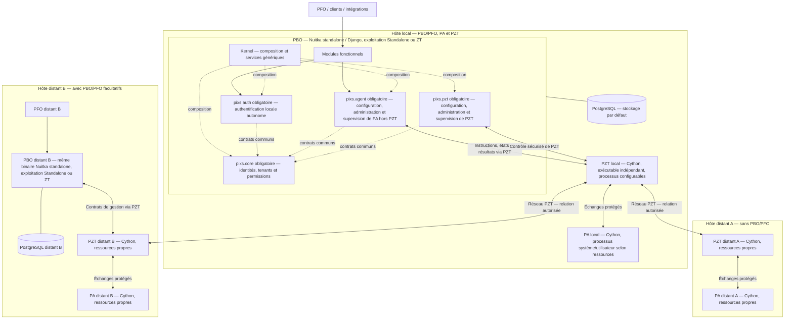

# Pixs l'Application Universelle

**Version initiale — avancement OpenSpec : 58,52 %** — 158 changes archivés sur 270 au total, dont 112 ouverts. Relevé du 21 octobre 2026.

Ce ratio suit les changes, sans mesurer leur taille ni remplacer une qualification fonctionnelle. [Méthode et suivi détaillé](PROJECT.md#34-openspec).

> Un socle applicatif modulaire, sécurisé et API-first pour construire des applications et services métiers durables.

Pixs l'Application Universelle est un framework applicatif conçu pour composer plusieurs applications et services métiers à partir de composants indépendants. Il sépare strictement le mécanisme du framework des fonctionnalités de domaine, afin de pouvoir faire évoluer une installation par ajout de modules, providers, extensions ou thèmes, sans modifier son noyau.

## État du projet

Le dépôt contient les cadrages, les spécifications OpenSpec et une implémentation partielle : mécanismes du Kernel, services Core persistants, authentification locale et sessions, adapters d'autorisation et d'audit, adaptateurs Django et shell TanStack/React. Des modèles et migrations Django représentent aussi les snapshots de fanions et les travaux. Ces jalons ne démontrent pas une composition P0 complète ni un service prêt pour la production.

Les réalisations locales [Auth C03](openspec/changes/archive/2026-10-21-add-initial-authentication-and-sessions/VALIDATION.md) et [autorisation/Super Admin C04](openspec/changes/archive/2026-10-21-integrate-runtime-authorization-and-super-admin/VALIDATION.md) disposent de qualifications bornées rapportées le 21 octobre 2026. Elles couvrent leurs services et adapters propriétaires ; les parcours intégrés, l'activation de la composition et sa qualification installée restent à établir avec les composants concernés. Ces preuves datées ne constituent pas une nouvelle exécution de tests ni une disponibilité P0.

Le dépôt ne publie pas encore de release, de paquet Debian ni d'image Docker utilisable. Les commandes et paramètres des jalons de développement ne constituent pas encore une interface de déploiement définitive. Les limites et parcours de ces jalons sont décrits dans [la documentation backend](src/pixs/backend/README.md) et [la documentation frontend](frontend/README.md).

Cette documentation présente le périmètre cible du projet sans anticiper ces choix d'implémentation.

Toute composition PBO, dont le profil initial P0, comprend quatre modules obligatoires au-dessus du Kernel : `pixs.core` pour les primitives communes d'identité et de droits, `pixs.auth` pour l'authentification locale autonome, `pixs.agent` pour la gestion PA hors PZT et `pixs.pzt` pour la gestion du réseau exécuté par le binaire indépendant PZT. Les trois derniers consomment les contrats publics Core ; leur ordre de chargement résulte des dépendances déclarées. Ils restent composés même réseau désactivé ou sans exécutant PA/PZT ; le module DNS essentiel et les autres capacités exigées par le profil complètent ce socle. Cette obligation architecturale ne démontre pas leur disponibilité fonctionnelle.

L'orientation adoptée le 21 octobre 2026 retient un **binaire PBO commun compilé avec Nuitka en mode standalone** : Kernel, Core, Auth, Agent et module PZT dans une même application modulaire. Il peut lancer plusieurs processus par rôle selon une configuration de ressources explicite. Les exécutables PA/PZT restent indépendants et disposent de leurs propres plans de processus selon leur environnement. Cette décision est [intégrée dans OpenSpec](openspec/changes/define-common-pbo-binary-and-resource-profiles/proposal.md), sans binaire construit ni performance qualifiée par cette adoption.

Le mode de compilation **Nuitka standalone** est distinct des modes d'exploitation PBO **Standalone** (instance autonome sans autorité Pixs extérieure) et **ZT** (participation autorisée au réseau gouverné via PZT). Le même exécutable et ses bibliothèques/ressources servent les deux modes ; un fichier autoextractible onefile n'est pas requis. L'activation du transport PZT reste distincte : un PBO Standalone peut l'utiliser pour joindre ses PA autorisés. Si ce transport manque, les échanges concernés restent bloqués, sans repli hors PZT ni retour automatique de ZT vers Standalone. Dans PBO, Cython reste réservé aux optimisations ciblées justifiées par profilage et mesures de gain/non-régression, avec contrats, sécurité et maintenabilité préservés. Les trois binaires PA et le binaire indépendant PZT sont compilés avec Cython.

## OpenSpec

OpenSpec décrit ce que Pixs doit faire et les situations à vérifier : **78 capacités, 831 exigences et 986 scénarios**, recomptés au 21 octobre 2026 après adoption du binaire PBO commun, des profils de ressources et de N02. La décision de binaire commun, complétée par Nuitka standalone, les modes d’exploitation et Cython ciblé dans PBO, a ajouté 19 exigences et 35 scénarios à l’état de 812 exigences et 948 scénarios observé avant modification. La [frontière N02 entre coffre natif et données hors ligne](openspec/changes/clarify-native-credentials-and-offline-storage-boundary/proposal.md) modifie deux exigences et ajoute trois scénarios, sans nouvelle capacité ni réalisation produit ; ses qualifications runtime restent à faire et le change reste ouvert.

L’inventaire historique du 19 octobre recensait **116 changes ouverts**, dont **27 rattachés au premier socle installable P0** : les 24 précédents et trois dossiers Auth proposés pour son extension. Le profil structurel [EntitlementSubjectType](openspec/changes/archive/2026-10-19-add-initial-entitlement-subject-type-v1/proposal.md), archivé le 19 octobre, reste distinct de la réalisation du moteur d’entitlements. Les matrices historiques relient les exigences examinées au travail prévu, aux écarts et aux références disponibles ; elles ne constituent pas une évaluation fonctionnelle actuelle des 781 exigences. La séparation PA/PZT et les modules de gestion PBO sont intégrés au canon. Les deltas encore proposés restent distincts du canon courant.

Huit changes préparent [pixs.auth essentiel indépendant et autonome sur PostgreSQL par défaut](openspec/changes/define-essential-autonomous-auth-module/proposal.md), les méthodes locales/MFA, la forge d’identité, le rôle fournisseur d’identité, OpenLDAP propre, KDC propre, Active Directory propre (`pixs.auth.directory.ad`) et les sources externes installables séparément. Le [catalogue](openspec/changes/define-essential-autonomous-auth-module/design.md) précise sous-modules, frontières Core/Auth et dépendances. Les trois deltas d'architecture essentielle sont adoptés au canon le 20 octobre 2026 : neuf exigences ajoutées, une modifiée et treize scénarios supplémentaires nets. Les sept autres dossiers proposent encore sept capacités nouvelles, 35 exigences ajoutées et 54 scénarios supplémentaires nets ; les 73 tâches restent non cochées. Aucun code ni service n'est produit par cette adoption.

Un [complément de stockage Core réversible](openspec/changes/add-reversible-core-directory-storage/proposal.md) prépare le choix postinstallation PostgreSQL vers OpenLDAP interne puis le retour depuis les données LDAP courantes pour utilisateurs, groupes et ACL, avec leurs relations nécessaires. Il distingue stockage de référence et projection de consultation ; les décisions restent dans Pixs. Ses 12 exigences ajoutées, cinq modifiées, 16 scénarios supplémentaires nets et dix tâches de réalisation restent proposés, sans migration réelle ni synchronisation du canon.

Le [registre consolidé des neuf changes](openspec/changes/define-essential-autonomous-auth-module/requirements.md) relie chaque déclaration à son dossier propriétaire et à ses deltas. Les 83 tâches de réalisation restent non cochées ; la préparation complète des documents n'annonce aucune disponibilité fonctionnelle.

Le cadrage C02 du 19 octobre conservé ci-dessous décrit la préparation historique. L’invocation 1CISMP1 a ensuite autorisé la réalisation du seul C02, archivé le 20 octobre 2026. Les [preuves locales et limites](openspec/changes/archive/2026-10-20-add-core-postgres-services/VALIDATION.md) couvrent modèles, migration PostgreSQL propriétaire, services, QUERY et raccordement fermé R01 : 346 tests purs, cinq recettes PostgreSQL réelles (14/20/46/62/58 cas) et 12 indicateurs de migration réussis. Les 18 empreintes canoniques contrôlées restent identiques ; aucune nouvelle exigence ni scénario canonique. L’activation intégrée attend les garanties C03–C10 et la qualification C17/C18/C19 ; aucune disponibilité P0 n’est déduite. Les statistiques postarchive et le gate de ce RUN sont suivis séparément.

Le propriétaire d’audit C05 dispose de ses [interfaces PostgreSQL](src/pixs/core/audit_sink.py), de la migration Core `0002_core_audit` et des procédures de consultation, minimisation et maintenance contrôlée. Sa recette locale couvre 224 tests de régression et 35 scénarios PostgreSQL réels, dont transfert C01 scellé, services Core ordinaires et réconciliation D14 historique. Les preuves sont dans `VALIDATION.md` du change `add-durable-minimized-audit` ; les owners Auth/C4/C10/Jobs restent synthétiques dans cette recette. La composition C08 et la qualification C17/C18/C19 restent requises. Archivage, statistiques et gate du RUN sont suivis séparément.

La [préparation C02 des primitives Core persistantes](openspec/changes/archive/2026-10-20-add-core-postgres-services/design.md) relie 72 exigences existantes à 89 références de scénarios et à 12 vérifications futures. Le [contrat documentaire R01 avec l’installateur C08](openspec/changes/add-installation-and-first-configuration/design.md) précise l’autorité d’amorçage, les refus et dix cas de recette, sans session préalable du compte futur ni permission métier déduite de C01. Ces rattachements et cas de recette ne s’ajoutent pas au canon et ne représentent pas des tests exécutés. D01–D04 restent adoptés en option A ; aucune implémentation ni production de code n’est autorisée par ces validations. Le [suivi détaillé](PROJECT.md#34-openspec) conserve les comptes et leurs limites.

Le profil C00 a été adopté et archivé le 18 octobre 2026. C01 a été archivé le 19 octobre : il fournit le provider systemd et l’audit d’amorçage, avec une [qualification fonctionnelle bornée](openspec/changes/archive/2026-10-19-add-pbo-runtime-secret-provider/STATISTIQUES.md). Ces preuves historiques ne démontrent ni la reprise PostgreSQL C05/C08 ni une composition P0 installable et qualifiée.

Deux changes documentaires préparent la [protection des secrets d’amorçage liée à l’hôte et au TPM2, avec récupération testée](openspec/changes/qualify-pbo-bootstrap-secrets-host-tpm2/proposal.md), et le [coffre indépendant pour les secrets d’exploitation distribués](openspec/changes/add-distributed-runtime-secret-vault/proposal.md). Ils n’ajoutent aucun code et ne synchronisent pas leurs deltas au canon. Le coffre reste conditionnel à la sélection d’une composition distribuée.

Les priorités sont de finaliser les données et la sécurité, l’installation et l’interface, puis les tests et la livraison. Le [suivi OpenSpec dans PROJECT.md](PROJECT.md#34-openspec) détaille les étapes et les décisions restantes. Cette synthèse et le ratio en tête de page sont à actualiser pendant toute la vie de Pixs, au fil des changes et de leurs preuves.

## En bref

| Domaine | Choix d'architecture |
| --- | --- |
| Backend | Django porte les règles métier, transactions, commandes et API. |
| Données | PostgreSQL par défaut ; option proposée de migration postinstallation des utilisateurs, groupes et ACL vers OpenLDAP interne, avec retour vérifié vers PostgreSQL. |
| Frontend | TanStack est la base de l'interface web. |
| Réactivité | Electric est optionnel et intervient seulement lorsque la synchronisation est nécessaire. |
| Identité et droits | Module obligatoire `pixs.core` : utilisateurs, groupes, appartenances, tenants, ACL et permissions. |
| Gestion PA | Module obligatoire `pixs.agent` : configuration, administration et supervision de PA hors PZT, échanges via PZT. |
| Gestion réseau | Module obligatoire `pixs.pzt` : configuration, administration, visualisation, supervision et monitoring de l'exécutable réseau PZT indépendant. |
| Authentification | Module obligatoire `pixs.auth`, indépendant de Core, local autonome sur PostgreSQL par défaut ; IdP et services propres OpenLDAP/KDC activables, sources externes installables séparément. |
| API | HTTP/REST et contrats OpenAPI versionnés sont l'interface publique principale. |

## Architecture

Ce schéma représente les relations logiques, sans fixer les endpoints ni les
canaux entre processus. Sur un même environnement d'exécution, le profil
local PZT utilise TLS mutuel ; entre environnements, les transports PZT
qualifiés s'appliquent. Le même serveur physique ne fusionne pas les
frontières des VM ou conteneurs. Un PBO distant peut gérer ses exécutants
locaux et des exécutants distants uniquement dans les périmètres autorisés ;
sa présence ne donne aucun droit automatique sur un autre PA ou PZT.
PFO adresse toujours ses demandes à PBO. Aucun échange PBO–PA ne contourne PZT.

Le Kernel reste minimal et agnostique : il fournit les mécanismes de composition, de dépendances, de cycle de vie, de services, d'événements, de configuration et d'extensions. Les comportements fonctionnels, y compris ceux du socle obligatoire `pixs.core`, `pixs.auth`, `pixs.agent` et `pixs.pzt`, sont apportés par des modules. Le schéma est une synthèse : le module DNS essentiel et les capacités complémentaires du profil restent requis selon OpenSpec.

Un composant déclare son identité, sa version, ses dépendances, ses capacités et ses contrats dans un manifest `component.toml`. Les composants communiquent de préférence par des contrats publics versionnés, plutôt que par des dépendances vers leurs implémentations internes.

## Capacités visées

- Applications modulaires et sous-modules composables récursivement.
- Multi-tenancy explicite : tenant racine, scopes enfants et autorisations propagés à chaque opération.
- Authentification par providers et autorisation côté backend, selon le principe *deny by default*.
- APIs REST versionnées, documentées par OpenAPI, avec commandes, requêtes, erreurs stables et idempotence lorsque nécessaire.
- Interface internationale, responsive, accessible (objectif WCAG 2.2 AA) et thémable en clair comme en sombre.
- Synchronisation réactive et capacités offline-first uniquement lorsqu'elles sont déclarées par un composant.
- Observabilité native : logs structurés, métriques, traces, contrôles de santé et diagnostic opérateur.
- Gouvernance des données, audit, rétention, suppression contrôlée, résidence régionale et reprise après sinistre.

## Principes essentiels

**Modularité.** Les modules possèdent leurs données, invariants et migrations. Ils ne modifient pas directement les données internes d'un autre composant.

**Sécurité.** Les secrets ne sont jamais présents dans un manifest, un artefact, une image, un paquet ou un journal. Dans le régime ordinaire, toute authentification, autorisation ou configuration non vérifiable échoue de manière fermée.

**Paramétrage et secours.** La cible prévoit un Super Admin unique par installation, non nominatif, sans délégation ni usage comme compte de service. Son contrôle total couvre la plateforme et chaque tenant explicitement accordé, malgré ses ACL. Tous les contrôles applicatifs sont dérogeables pour ce compte, audit et désactivation externe compris, dans le panneau, les API, la CLI et ses traitements asynchrones. Aucun MFA n'est requis au premier démarrage ni à la réactivation de secours. Une désactivation non dérogée laisse terminer une transaction engagée et refuse les nouvelles actions. Cette exception est [spécifiée par OpenSpec](openspec/specs/authorization/spec.md) ; les [adapters Core C04](openspec/changes/archive/2026-10-21-integrate-runtime-authorization-and-super-admin/VALIDATION.md) en réalisent la reconnaissance, les accords tenant et les dérogations explicites. Les parcours intégrés du panneau, des API, de la CLI et des traitements asynchrones restent à qualifier dans la composition avec leurs composants propriétaires.

**Déterminisme.** À composants, versions et configuration identiques, la composition, l'ordre de chargement et les diagnostics doivent être reproductibles.

**Évolutivité maîtrisée.** Les versions, contrats, migrations et compatibilités sont validés avant activation ou mise à niveau. Une migration ne devient pas un retour arrière implicite.

**Django stable courant.** Le projet devra suivre la dernière version stable officielle supportée par Django et adapter son code, son runtime et toutes ses dépendances à ses besoins. Chaque dépendance Python devra suivre sa dernière version compatible ; les versions ou plages imposées par Django auront priorité. Le [relevé horodaté et l'état de migration](TECHNICAL.md#411-politique-de-version-django) précisent la cible et les validations encore nécessaires.

**Réactivité sous contrôle.** Django reste l'autorité métier et les données proviennent du stockage déclaré : PostgreSQL par défaut, ou OpenLDAP interne pour un périmètre Core explicitement migré. Le client local et les mécanismes de synchronisation ne deviennent jamais une source de vérité.

## Exécution et déploiement cibles

Pixs prévoit l’exécution directe pour le développement, deux paquets Debian
indépendants — PBO/PFO et PA/PZT — et une image Docker contenant PBO/PFO, PA et PZT.
Le paquet PA/PZT livre trois binaires PA et un binaire PZT ; Docker livre deux binaires PA et PZT
et exclut le binaire utilisateur et ses modes de session. Les garanties restent
communes aux capacités déclarées de chaque composition.

Le binaire PBO commun regroupe Kernel, `pixs.core`, `pixs.auth`, `pixs.agent`
et `pixs.pzt`, avec les autres composants sélectionnés. Il peut démarrer plusieurs
processus d'un même rôle, selon le plan de ressources configuré ; PA et PZT
conservent leurs exécutables et leurs cycles de vie distincts :

- `web` reçoit le trafic applicatif ;
- `worker` exécute les travaux asynchrones ;
- `scheduler` planifie les traitements avec une coordination persistante.

En production, ces profils peuvent être exécutés séparément. Le plan borne processus, concurrence, CPU, mémoire, files et connexions PostgreSQL selon les ressources réellement accordées à la machine, VM, conteneur ou service. La détection peut proposer un dimensionnement ; son application exige une configuration versionnée ou une politique préautorisée et bornée. Plusieurs schedulers gardent une coordination par bail persistant. Seul `web` est destiné à une exposition publique par défaut ; les workers, schedulers, systèmes de coordination et interfaces de gestion restent privés ou protégés.

Les plans PA/PZT utilisent les ressources de leur propre environnement, même avec un PBO distant. Ils conservent les modes PA, l'isolation des sessions, les événements bornés et un propriétaire réseau PZT unique par périmètre. Ressources détectées, budgets accordés, configuration demandée/effective et état appliqué sont distingués. Un budget insuffisant entraîne un refus ou l'état sûr prévu, sans réduire les garanties de sécurité. Les superviseurs appliquent les limites et le lifecycle ; les performances restent à mesurer sur chaque profil.

### Image Docker

L’image cible est reproductible, sans état et sans secret. Elle contient le binaire
PBO commun, les ressources frontend PFO, deux binaires PA — démon système et événements de démarrage/arrêt du
conteneur — et le binaire indépendant PZT. Elle exclut le binaire utilisateur PA. PostgreSQL,
configuration effective, secrets et données persistantes restent externes.
La présence d’un binaire ne vaut ni activation ni privilège d’exécution.

Le conteneur sélectionne un rôle applicatif PBO explicite et peut démarrer plusieurs processus de ce rôle dans son budget ; les processus PA/PZT éventuellement cohébergés sont déclarés et supervisés séparément. Son système de fichiers inscriptible est éphémère, ses sondes distinguent démarrage, vivacité et disponibilité, et son arrêt draine les traitements en cours de façon contrôlée.

### Paquet Debian

Le paquet PBO/PFO contient le binaire PBO commun et les ressources frontend PFO.
Il reste indépendant du paquet commun PA/PZT. Ce dernier contient
quatre exécutables : trois binaires PA — démon système, événements de démarrage/arrêt
de l’hôte et sessions utilisateur — et le binaire indépendant PZT. La configuration administrée reste
séparée du code immuable et préservée lors des mises à niveau. Les noms et
versions des paquets restent à spécifier.

Les services système ne sont que des adaptateurs d'exploitation : ils démarrent, arrêtent et supervisent les profils Pixs, sans porter de logique métier. Une installation, une mise à niveau, une désinstallation et une purge explicite restent des opérations distinctes ; aucune ne doit supprimer les données métier implicitement.

### Pixs Agent et PZT

Pixs comprend quatre composants : PBO, PFO, PA et PZT. Dans PBO, `pixs.agent`,
obligatoire au même titre que `pixs.core`, `pixs.auth` et `pixs.pzt`,
assure la configuration, l’administration et la supervision de toutes les fonctions
PA hors PZT. Les modules fonctionnels restent propriétaires de leurs opérations
et sollicitent PA par ses contrats publics, avec instructions, états et résultats.
Le module officiel essentiel `pixs.pzt` assure la configuration, l’administration,
la visualisation, la supervision et le monitoring de PZT. Il conserve ce rôle
lorsque le réseau est désactivé.

`pixs.agent` reste lui aussi composé lorsque le réseau est désactivé ou que PA
est absent ; ses états distinguent configuration souhaitée, absence d'exécutant
et état appliqué, sans annoncer de disponibilité non vérifiée.

PZT est désormais un exécutable indépendant de PA, fondé sur WireGuard ;
`pixs.agent` ne l’administre pas. Les capacités inspirées de NetBird sont
redéveloppées dans Pixs. PA et PZT restent distribués ensemble ; ils peuvent
fonctionner sans PBO/PFO locaux et joindre un PBO distant autorisé. Tous les
échanges PBO–PA passent par PZT, y compris localement. Le contrôle PBO–PZT
utilise les interfaces sécurisées de PZT, sans canal de substitution.

Ces capacités sont cadrées dans PROJECT.md §43–§44, TECHNICAL.md §42–§45 et
BUILD.md §46–§47 et déclarées par [pixs-agent](openspec/specs/pixs-agent/spec.md)
et [pzt](openspec/specs/pzt/spec.md). Nuitka standalone est retenu pour PBO ; les trois binaires
PA et le binaire PZT sont compilés avec Cython. Seules les spécifications sont rédigées : implémentation,
qualification et artefacts restent à réaliser.

## Configuration de déploiement

Les noms définitifs des options ne sont pas encore spécifiés. Les déploiements Docker et Debian configureront néanmoins les mêmes domaines, validés par les schémas déclarés des composants.

| Domaine | Configuration attendue |
| --- | --- |
| Profil runtime | Rôle `web`, `worker` ou `scheduler`, avec ses limites et son exposition réseau. |
| Composition | Modules, sous-modules, extensions, versions, capacités requises et providers sélectionnés. |
| Persistance | Connexion PostgreSQL, migrations planifiées et stockage persistant nécessaire aux capacités activées. |
| Périmètre | Mode mono-tenant ou multi-tenant, topologie de scopes et accès d'administration plateforme. |
| Identité | Providers approuvés, politiques de confiance, niveaux d'assurance, sessions et règles de step-up. |
| Autorisation | Politiques, rôles, ACL, permissions techniques et frontières réseau déclarées. |
| Réactivité | Capacités de synchronisation, fraîcheur, cohérence et mode dégradé lorsqu'elles sont activées. |
| Services externes | Stockage, recherche, notifications, webhooks et autres providers explicitement sélectionnés. |
| Interface | Thème, langues, contributions frontend et feature flags déclarés. |
| Exploitation | Santé, diagnostic autorisé, logs, métriques, traces, rétention et alertes. |
| Sécurité | Références de secrets, certificats ou identifiants fournis par un mécanisme runtime contrôlé. |

La résolution suit une hiérarchie déterministe : schéma du composant, valeurs par défaut, configuration statique, configuration runtime, puis références de secrets. Une valeur invalide ou ambiguë empêche l'activation au lieu de démarrer en mode dégradé silencieux.

Dans Docker, ces options pourront être apportées par des variables d'environnement, des fichiers montés, une configuration externe ou le mécanisme de secrets de l'orchestrateur. Dans Debian, elles seront fournies par la configuration système et les mécanismes runtime correspondants. Dans les deux cas, les secrets restent hors des artefacts et sont fournis uniquement par référence ou accès contrôlé.

## Documentation de référence

Les documents suivants font foi pour la conception et les exigences détaillées :

- [PROJECT.md](PROJECT.md) — objectif, architecture et invariants de Pixs ;
- [TECHNICAL.md](TECHNICAL.md) — cadrage technique, contrats et modèles transverses ;
- [BUILD.md](BUILD.md) — construction, packaging et exploitation ;
- [OpenSpec](openspec/specs/) — exigences fonctionnelles et techniques vérifiables ;
- [AGENTS.md](AGENTS.md) — règles de contribution au dépôt.

## Licence

Pixs est distribué sous la [WTFPL v2](LICENSE).
