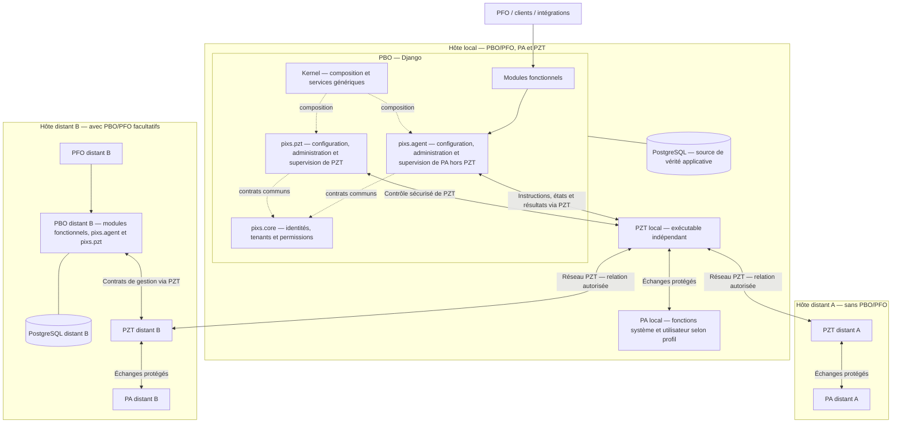

# Pixs

**Version initiale — avancement OpenSpec : 55,79 %** — 135 changes archivés sur 242 au total, dont 107 ouverts. Relevé du 17 octobre 2026.

Ce ratio suit les changes, sans mesurer leur taille ni remplacer une qualification fonctionnelle. [Méthode et suivi détaillé](PROJECT.md#34-openspec).

> Un socle applicatif modulaire, sécurisé et API-first pour construire des applications et services métiers durables.

Pixs l'Application Universsel est un framework applicatif conçu pour composer plusieurs applications et services métiers à partir de composants indépendants. Il sépare strictement le mécanisme du framework des fonctionnalités de domaine, afin de pouvoir faire évoluer une installation par ajout de modules, providers, extensions ou thèmes, sans modifier son noyau.

## État du projet

Le dépôt contient les cadrages, les spécifications OpenSpec et une implémentation initiale partielle : mécanismes du Kernel, primitives Core, adaptateurs Django et shell TanStack/React. Des modèles et migrations Django représentent les snapshots de fanions et les travaux. Ces jalons ne démontrent pas une composition P0 complète ni un service prêt pour la production.

Le dépôt ne publie pas encore de release, de paquet Debian ni d'image Docker utilisable. Les commandes et paramètres des jalons de développement ne constituent pas encore une interface de déploiement définitive. Les limites et parcours de ces jalons sont décrits dans [la documentation backend](src/pixs/backend/README.md) et [la documentation frontend](frontend/README.md).

Cette documentation présente le périmètre cible du projet sans anticiper ces choix d'implémentation.

## OpenSpec

OpenSpec décrit ce que Pixs doit faire et les situations à vérifier : **78 capacités, 724 exigences et 824 scénarios**, recensés au 17 octobre 2026.

Les **107 changes ouverts sont préparés**, dont **25 pour le premier socle installable P0**. Chaque exigence est reliée au travail prévu, aux écarts et aux références disponibles. Ce suivi est une analyse des documents et du code ; il ne prouve pas le bon fonctionnement du logiciel. Les audits de couverture et de parcours ont précisé les écarts, sans implémentation. La séparation PA/PZT et les modules de gestion PBO ont été intégrés au canon sur validation explicite ; leurs deltas en conservent la trace. Les autres ajouts proposés restent séparés du canon ci-dessus.

Les priorités sont de finaliser les données et la sécurité, l’installation et l’interface, puis les tests et la livraison. Le [suivi OpenSpec dans PROJECT.md](PROJECT.md#34-openspec) détaille les étapes et les décisions restantes. Cette synthèse et le ratio en tête de page sont à actualiser pendant toute la vie de Pixs, au fil des changes et de leurs preuves.

## En bref

| Domaine | Choix d'architecture |
| --- | --- |
| Backend | Django porte les règles métier, transactions, commandes et API. |
| Données | PostgreSQL est la source de vérité applicative. |
| Frontend | TanStack est la base de l'interface web. |
| Réactivité | Electric est optionnel et intervient seulement lorsque la synchronisation est nécessaire. |
| Identité et droits | `pixs.core` apporte utilisateurs, groupes, appartenances, ACL et permissions. |
| Gestion des exécutants | `pixs.agent` gère PA hors PZT ; `pixs.pzt` gère l’exécutable réseau PZT indépendant. |
| Authentification | Des providers indépendants peuvent fournir OIDC, SAML ou d'autres mécanismes. |
| API | HTTP/REST et contrats OpenAPI versionnés sont l'interface publique principale. |

## Architecture

Ce schéma représente les relations logiques, sans fixer les endpoints ni les
canaux entre processus. Sur un même environnement d'exécution, le profil
local PZT utilise TLS mutuel ; entre environnements, les transports PZT
qualifiés s'appliquent. Le même serveur physique ne fusionne pas les
frontières des VM ou conteneurs. Un PBO distant peut gérer ses exécutants
locaux et des exécutants distants uniquement dans les périmètres autorisés ;
sa présence ne donne aucun droit automatique sur un autre PA ou PZT.
PFO adresse toujours ses demandes à PBO. Aucun échange PBO–PA ne contourne PZT.

Le Kernel reste minimal et agnostique : il fournit les mécanismes de composition, de dépendances, de cycle de vie, de services, d'événements, de configuration et d'extensions. Les comportements fonctionnels, y compris ceux de `pixs.core`, sont apportés par des modules.

Un composant déclare son identité, sa version, ses dépendances, ses capacités et ses contrats dans un manifest `component.toml`. Les composants communiquent de préférence par des contrats publics versionnés, plutôt que par des dépendances vers leurs implémentations internes.

## Capacités visées

- Applications modulaires et sous-modules composables récursivement.
- Multi-tenancy explicite : tenant racine, scopes enfants et autorisations propagés à chaque opération.
- Authentification par providers et autorisation côté backend, selon le principe *deny by default*.
- APIs REST versionnées, documentées par OpenAPI, avec commandes, requêtes, erreurs stables et idempotence lorsque nécessaire.
- Interface internationale, responsive, accessible (objectif WCAG 2.2 AA) et thémable en clair comme en sombre.
- Synchronisation réactive et capacités offline-first uniquement lorsqu'elles sont déclarées par un composant.
- Observabilité native : logs structurés, métriques, traces, contrôles de santé et diagnostic opérateur.
- Gouvernance des données, audit, rétention, suppression contrôlée, résidence régionale et reprise après sinistre.

## Principes essentiels

**Modularité.** Les modules possèdent leurs données, invariants et migrations. Ils ne modifient pas directement les données internes d'un autre composant.

**Sécurité.** Les secrets ne sont jamais présents dans un manifest, un artefact, une image, un paquet ou un journal. Dans le régime ordinaire, toute authentification, autorisation ou configuration non vérifiable échoue de manière fermée.

**Paramétrage et secours.** La cible prévoit un Super Admin unique par installation, non nominatif, sans délégation ni usage comme compte de service. Son contrôle total couvre la plateforme et chaque tenant explicitement accordé, malgré ses ACL. Tous les contrôles applicatifs sont dérogeables pour ce compte, audit et désactivation externe compris, dans le panneau, les API, la CLI et ses traitements asynchrones. Aucun MFA n'est requis au premier démarrage ni à la réactivation de secours. Une désactivation non dérogée laisse terminer une transaction engagée et refuse les nouvelles actions. Cette exception est [spécifiée par OpenSpec](openspec/specs/authorization/spec.md) ; son implémentation reste à réaliser.

**Déterminisme.** À composants, versions et configuration identiques, la composition, l'ordre de chargement et les diagnostics doivent être reproductibles.

**Évolutivité maîtrisée.** Les versions, contrats, migrations et compatibilités sont validés avant activation ou mise à niveau. Une migration ne devient pas un retour arrière implicite.

**Django stable courant.** Le projet devra suivre la dernière version stable officielle supportée par Django et adapter son code, son runtime et toutes ses dépendances à ses besoins. Chaque dépendance Python devra suivre sa dernière version compatible ; les versions ou plages imposées par Django auront priorité. Le [relevé horodaté et l'état de migration](TECHNICAL.md#411-politique-de-version-django) précisent la cible et les validations encore nécessaires.

**Réactivité sous contrôle.** PostgreSQL et Django restent les autorités métier ; le client local et les mécanismes de synchronisation ne deviennent jamais une source de vérité.

## Exécution et déploiement cibles

Pixs prévoit l’exécution directe pour le développement, deux paquets Debian
indépendants — PBO/PFO et PA/PZT — et une image Docker contenant PBO/PFO, PA et PZT.
Le paquet PA/PZT livre trois binaires PA et un binaire PZT ; Docker livre deux binaires PA et PZT
et exclut le binaire utilisateur et ses modes de session. Les garanties restent
communes aux capacités déclarées de chaque composition.

Le runtime applicatif PBO d’un même artefact peut être lancé selon un profil
explicitement configuré ; PA et PZT ont leurs cycles de vie distincts :

- `web` reçoit le trafic applicatif ;
- `worker` exécute les travaux asynchrones ;
- `scheduler` planifie les traitements avec une coordination persistante.

En production, ces profils peuvent être exécutés séparément. Seul `web` est destiné à une exposition publique par défaut ; les workers, schedulers, systèmes de coordination et interfaces de gestion restent privés ou protégés.

### Image Docker

L’image cible est reproductible, sans état et sans secret. Elle contient PBO,
PFO, deux binaires PA — démon système et événements de démarrage/arrêt du
conteneur — et le binaire indépendant PZT. Elle exclut le binaire utilisateur PA. PostgreSQL,
configuration effective, secrets et données persistantes restent externes.
La présence d’un binaire ne vaut ni activation ni privilège d’exécution.

Le conteneur reçoit un unique profil d'exécution. Son système de fichiers inscriptible est éphémère, ses sondes distinguent démarrage, vivacité et disponibilité, et son arrêt draine les traitements en cours de façon contrôlée.

### Paquet Debian

Le paquet PBO/PFO et le paquet commun PA/PZT sont indépendants. Ce dernier contient
quatre exécutables : trois binaires PA — démon système, événements de démarrage/arrêt
de l’hôte et sessions utilisateur — et le binaire indépendant PZT. La configuration administrée reste
séparée du code immuable et préservée lors des mises à niveau. Les noms et
versions des paquets restent à spécifier.

Les services système ne sont que des adaptateurs d'exploitation : ils démarrent, arrêtent et supervisent les profils Pixs, sans porter de logique métier. Une installation, une mise à niveau, une désinstallation et une purge explicite restent des opérations distinctes ; aucune ne doit supprimer les données métier implicitement.

### Pixs Agent et PZT

Pixs comprend quatre composants : PBO, PFO, PA et PZT. Dans PBO, `pixs.agent`
assure la configuration, l’administration et la supervision de toutes les fonctions
PA hors PZT. Les modules fonctionnels restent propriétaires de leurs opérations
et sollicitent PA par ses contrats publics, avec instructions, états et résultats.
Le module officiel essentiel `pixs.pzt` assure la configuration, l’administration,
la visualisation, la supervision et le monitoring de PZT. Il conserve ce rôle
lorsque le réseau est désactivé.

PZT est désormais un exécutable indépendant de PA, fondé sur WireGuard ;
`pixs.agent` ne l’administre pas. Les capacités inspirées de NetBird sont
redéveloppées dans Pixs. PA et PZT restent distribués ensemble ; ils peuvent
fonctionner sans PBO/PFO locaux et joindre un PBO distant autorisé. Tous les
échanges PBO–PA passent par PZT, y compris localement. Le contrôle PBO–PZT
utilise les interfaces sécurisées de PZT, sans canal de substitution.

Ces capacités sont cadrées dans PROJECT.md §43–§44, TECHNICAL.md §42–§45 et
BUILD.md §46–§47 et déclarées par [pixs-agent](openspec/specs/pixs-agent/spec.md)
et [pzt](openspec/specs/pzt/spec.md). Nuitka reste retenu pour les trois binaires
PA et Cython pour PZT. Seules les spécifications sont rédigées : implémentation,
qualification et artefacts restent à réaliser.

## Configuration de déploiement

Les noms définitifs des options ne sont pas encore spécifiés. Les déploiements Docker et Debian configureront néanmoins les mêmes domaines, validés par les schémas déclarés des composants.

| Domaine | Configuration attendue |
| --- | --- |
| Profil runtime | Rôle `web`, `worker` ou `scheduler`, avec ses limites et son exposition réseau. |
| Composition | Modules, sous-modules, extensions, versions, capacités requises et providers sélectionnés. |
| Persistance | Connexion PostgreSQL, migrations planifiées et stockage persistant nécessaire aux capacités activées. |
| Périmètre | Mode mono-tenant ou multi-tenant, topologie de scopes et accès d'administration plateforme. |
| Identité | Providers approuvés, politiques de confiance, niveaux d'assurance, sessions et règles de step-up. |
| Autorisation | Politiques, rôles, ACL, permissions techniques et frontières réseau déclarées. |
| Réactivité | Capacités de synchronisation, fraîcheur, cohérence et mode dégradé lorsqu'elles sont activées. |
| Services externes | Stockage, recherche, notifications, webhooks et autres providers explicitement sélectionnés. |
| Interface | Thème, langues, contributions frontend et feature flags déclarés. |
| Exploitation | Santé, diagnostic autorisé, logs, métriques, traces, rétention et alertes. |
| Sécurité | Références de secrets, certificats ou identifiants fournis par un mécanisme runtime contrôlé. |

La résolution suit une hiérarchie déterministe : schéma du composant, valeurs par défaut, configuration statique, configuration runtime, puis références de secrets. Une valeur invalide ou ambiguë empêche l'activation au lieu de démarrer en mode dégradé silencieux.

Dans Docker, ces options pourront être apportées par des variables d'environnement, des fichiers montés, une configuration externe ou le mécanisme de secrets de l'orchestrateur. Dans Debian, elles seront fournies par la configuration système et les mécanismes runtime correspondants. Dans les deux cas, les secrets restent hors des artefacts et sont fournis uniquement par référence ou accès contrôlé.

## Documentation de référence

Les documents suivants font foi pour la conception et les exigences détaillées :

- [PROJECT.md](PROJECT.md) — objectif, architecture et invariants de Pixs ;
- [TECHNICAL.md](TECHNICAL.md) — cadrage technique, contrats et modèles transverses ;
- [BUILD.md](BUILD.md) — construction, packaging et exploitation ;
- [OpenSpec](openspec/specs/) — exigences fonctionnelles et techniques vérifiables ;
- [AGENTS.md](AGENTS.md) — règles de contribution au dépôt.

## Licence

Pixs est distribué sous la [WTFPL v2](LICENSE).
