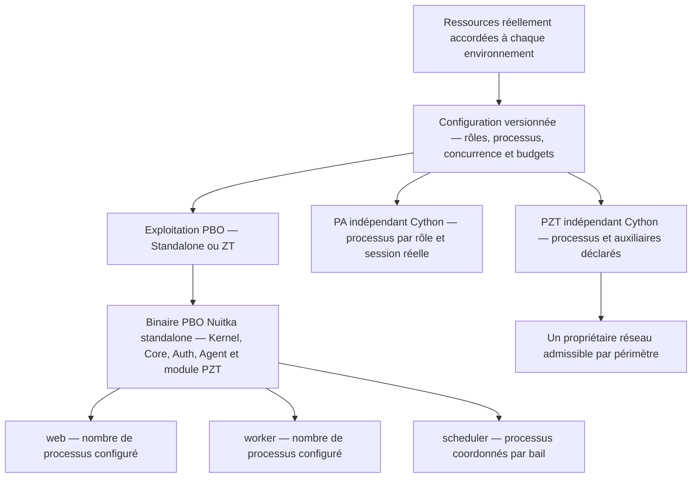
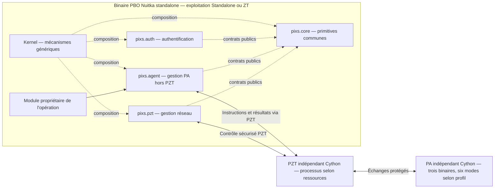

# TECHNICAL.md — Pixs l'Application Universelle

Ce document précise les décisions techniques transverses du projet. Il complète `PROJECT.md` sans remplacer les spécifications OpenSpec, qui définissent les comportements implémentables.

Le socle fonctionnel obligatoire de PBO comprend `pixs.core`, `pixs.auth`, `pixs.agent` et `pixs.pzt`, composés au-dessus du Kernel par les mécanismes communs. Core porte les primitives partagées ; Auth porte l'authentification locale autonome ; Agent gère PA hors PZT ; le module PZT gère l'exécutable réseau indépendant. Leurs dépendances publiques déterminent l'ordre de chargement, sans priorité implicite avant Core. La désactivation réseau ne retire pas ces modules ni le module DNS essentiel et ne dispense pas des autres capacités requises par le profil.

## Convention normative RFC 2119

Les exigences techniques vérifiables sont formulées dans OpenSpec en prose française avec les mots-clés RFC 2119 `MUST`, `MUST NOT`, `SHOULD`, `SHOULD NOT` et `MAY`, toujours en majuscules. Les clauses `MUST` et `MUST NOT` sont obligatoires ; `SHOULD` et `SHOULD NOT` nécessitent une justification explicite en cas d'écart ; `MAY` désigne une capacité optionnelle. Une négation normative doit utiliser la forme canonique `MUST NOT` ou `SHOULD NOT`, jamais une construction hybride comme `NE MUST` ou `NE SHOULD`. Une formulation française ou en minuscules hors spécification ne possède pas cette force normative.

Les choix de ce document qui deviennent observables, testables ou nécessaires à l'interopérabilité doivent être transférés dans la capacité OpenSpec concernée. Aucun détail technique ne peut affaiblir une exigence RFC 2119 déjà validée.

Les contrôles applicatifs runtime décrits dans ce document s'appliquent sous réserve de l'exception Super Admin définie par `authorization` et `initial-administration`, précisée au §12.7. Les contrats et profils structurels préparatoires conservent leurs garanties.

## 1. Identité numérique

L'identité numérique est le référentiel technique de l'authentification Pixs. Elle est distincte de l'utilisateur, du groupe et du provider d'authentification.

```text
Utilisateur 0..1 ─── 0..1 Identité numérique
Compte de service 1 ─── 1 Identité numérique
```

Contraintes obligatoires :

* une identité numérique est liée à zéro ou un utilisateur ;
* un utilisateur est lié à zéro ou une identité numérique ;
* une identité numérique peut exister sans utilisateur ;
* un utilisateur peut exister sans identité numérique ;
* un compte de service est obligatoirement une identité numérique ;
* une identité numérique peut être un compte de service, mais ce n'est pas obligatoire ;
* une identité numérique porte les méthodes d'authentification et les informations de révocation ;
* une identité numérique peut être utilisée comme `Subject` d'autorisation.

Les identifiants internes stables de l'utilisateur (`User`) et de l'identité numérique (`DigitalIdentity`) sont des UUIDv7 dans le profil minimal v1 défini par `openspec/specs/core/spec.md`. La liaison explicite est unique dans chaque sens ; une référence absente ou une association violant cette cardinalité est refusée. Un compte de service est représenté par une identité de type `SERVICE`, y compris sans utilisateur lié.

Le lien entre un utilisateur et une identité numérique ne doit pas être déduit d'un identifiant fourni par un provider externe. Il doit être représenté explicitement dans la source de vérité Pixs.

L'assurance est portée par des événements et contextes d'authentification, pas par le seul type de l'identité. Pixs distingue au minimum :

```text
identity_assurance       CLAIMED | VERIFIED | PROOFED
authentication_assurance SINGLE_FACTOR | MULTI_FACTOR | PHISHING_RESISTANT
federation_trust         UNTRUSTED | TRUSTED | STRONGLY_BOUND
```

Ces niveaux sont des sémantiques internes et peuvent être mappés par un provider depuis OIDC, SAML, WebAuthn, mTLS ou un mécanisme local. Un mapping doit déclarer les preuves acceptées, son niveau maximal et ses conditions de validité ; un claim absent, ambigu, expiré ou non vérifiable ne peut pas augmenter l'assurance.

## 2. Types d'identité numérique

Le profil minimal v1 accepte exclusivement les types explicites suivants :

```text
HUMAN      identité associée à une personne
SERVICE    identité utilisée par une application ou un processus
DEVICE     identité portée par un appareil ou équipement
FEDERATED  identité provenant d'un système externe
```

Le type décrit la catégorie fonctionnelle exposée par Pixs. Le mode de provisionnement ou le provider d'authentification ne doit pas être confondu avec le type lorsque la conception détaillée nécessitera plusieurs dimensions.

Le profil minimal v1 exige un état explicite parmi les valeurs suivantes :

```text
ACTIVE
SUSPENDED
REVOKED
EXPIRED
```

Un identifiant non UUIDv7, un type inconnu ou un état inconnu est refusé par la validation du profil v1. La validation structurelle ne définit pas de transitions d'état ni de règles temporelles implicites.

Les méthodes d'authentification, identifiants externes, dates d'activation et d'expiration, ainsi que les changements d'état doivent être rattachés à l'identité numérique et auditables.

## 3. Frontières de responsabilité

```text
Utilisateur
  └── données de personne ou de contexte métier

pixs.core / Identité numérique
  ├── identité canonique et état de référence
  ├── liens, groupes, appartenances et droits
  └── sujet d'autorisation possible

pixs.auth / référence à l'identité Core
  ├── justificatifs et méthodes d'authentification
  ├── politiques, contexte, sessions et tokens
  ├── MFA, récupération et révocation des accès dérivés
  └── enrôlement, émission d'identité et services gérés

pixs.agent / contrats publics Core et échanges via PZT
  ├── configuration, administration et supervision de PA hors PZT
  └── instructions, états et résultats sans propriété des opérations métier

pixs.pzt / contrats publics Core
  ├── configuration, administration, visualisation et supervision de PZT
  └── monitoring réseau ; exécution par le binaire indépendant PZT

Provider d'authentification
  └── vérification ou établissement de l'authentification
```

Un provider OIDC, SAML, LDAP ou local peut authentifier une identité numérique, mais ne devient pas automatiquement la source de vérité des utilisateurs, groupes, ACL ou permissions Pixs.

Les quatre modules sont obligatoires dans PBO, même réseau désactivé ou sans exécutant PA/PZT. `pixs.auth`, `pixs.agent` et `pixs.pzt` consomment les contrats publics d'identité et de permissions de Core ; ni le Kernel ni Core n'absorbent leurs responsabilités propres. Une fixture structurelle isolée n'est pas une composition applicative.

Le cadrage cible Auth du 19 octobre 2026 précise cette répartition via un module essentiel indépendant ; les trois deltas d'architecture adoptés et les propositions restantes sont distingués au §4.4. Il n'impose aucun déplacement du code ni des contrats structurels existants.

Le backend Django reste l'autorité pour les règles métier, les mutations et l'autorisation. PostgreSQL reste le stockage applicatif par défaut ; les garanties de transaction du provider Core OpenLDAP proposé au §34.2 nécessitent leur qualification propre.

Le complément proposé du 19 octobre 2026 distingue ce stockage par défaut d'une option de stockage Core OpenLDAP interne, décrite au §34.2. Après migration engagée, LDAP devient le stockage de référence du seul périmètre Core concerné ; les garanties de mutation restent à qualifier. Auth et les autres domaines conservent leurs stockages déclarés. Cette exception proposée ne modifie pas le canon courant.

Le premier socle du profil identité v1 se limite aux modèles et validateurs structurels sans authentification réelle, persistance ou provider concret. Leur validation ne crée aucune session et n'accorde aucun accès. Elle ne prouve ni une mutation persistante ni un audit durable et ne dispense pas les mutations réelles des exigences applicables de persistance, d'autorisation et d'audit.

Le provider ne peut établir qu'un niveau d'assurance couvert par sa configuration de confiance. L'identifiant externe canonique est le triplet `(provider_id, issuer, subject)` ; une adresse e-mail, un nom affiché ou une claim non vérifiée ne constitue pas une clé de rapprochement. La liaison avec une identité existante est une opération explicite, vérifiée, idempotente et auditée.

## 4. Articulation avec OpenSpec et choix techniques ouverts

Le cadrage C02 du 19 octobre conservé ci-dessous décrit la préparation historique. L’invocation 1CISMP1 a ensuite autorisé la réalisation du seul C02, archivé le 20 octobre 2026. Les [preuves locales et limites](openspec/changes/archive/2026-10-20-add-core-postgres-services/VALIDATION.md) couvrent modèles, migration PostgreSQL propriétaire, services, QUERY et raccordement fermé R01 : 346 tests purs, cinq recettes PostgreSQL réelles (14/20/46/62/58 cas) et 12 indicateurs de migration réussis. Les 18 empreintes canoniques contrôlées restent identiques ; aucune nouvelle exigence ni scénario canonique. L’activation intégrée attend les garanties C03–C10 et la qualification C17/C18/C19 ; aucune disponibilité P0 n’est déduite. Les statistiques postarchive et le gate de ce RUN sont suivis séparément.

La réalisation propriétaire C05 fournit `CoreAuditEvent`, la migration `0002_core_audit`, `PostgresAuditParticipant`, `PostgresAuditSink` et les procédures de lecture/maintenance. Politique et classification sont explicites ; le stage participe au xid PostgreSQL du propriétaire et la réconciliation utilise un alias indépendant vers la même base. D14 peut conserver l’instant du retrait via `stage_observation` et un vérificateur propriétaire courant ; `confirm_observation` ne réinsère rien et ne confère aucun droit. Les [interfaces C05](src/pixs/core/audit_sink.py) sont éprouvées par 224 régressions et 35 scénarios PG16.14 réels, avec owners Auth/C4/C10/Jobs synthétiques. Cette preuve locale ne qualifie pas leur runtime ni la composition P0 ; voir `VALIDATION.md` du change `add-durable-minimized-audit`.

Les orientations de conception C02 D01–D04 sont adoptées en option A le 19 octobre 2026 : réutilisation de `PixsCoreConfig` et du label `pixs_core` pour les modèles/migrations Core dédiés, contrats versionnés par domaine, transactions Django avec contraintes PostgreSQL et verrous ciblés déterministes, politique restrictive avant classification et suppression logique par défaut des ressources métier. La [conception C02](openspec/changes/archive/2026-10-20-add-core-postgres-services/design.md) précise propriété, interfaces et preuves attendues. Les schémas physiques, signatures, paramètres de politique et recettes restent à détailler dans ces orientations ; les éléments ouverts ci-dessous ne rouvrent pas ces choix acquis. Cette adoption est exclusivement documentaire et n’autorise aucune implémentation, production de code ou migration ; les contrats purs et le canon restent inchangés.

Le [complément documentaire R01 de C08](openspec/changes/add-installation-and-first-configuration/design.md) précise la preuve de l’opérateur pré-session, la décision liée au plan d’installation et les écritures Core contrôlées par C02. Le compte à créer n’est pas un acteur déjà authentifié ; C03/C04 fournissent le sujet et l’autorisation conformes au canon sans exiger une session existante de ce compte. UID 0, les credentials PostgreSQL, les saisies de mot de passe ou un reçu C01 ne suffisent pas. C01 conserve ses seules actions techniques ; le journal C01 ne remplace pas l’audit des mutations Core. Preuves, plan et installation sont liés, les effets sont fermés et la reprise distingue rollback, commit confirmé et issue inconnue. Si un mécanisme ne peut satisfaire le canon, la branche reste refusée jusqu’à clarification autorisée, sans exception locale inventée. R01 documente les informations et critères attendus ; il ne sélectionne aucun provider ni n’autorise du code.

Les spécifications OpenSpec actives définissent les exigences normatives applicables aux domaines ci-dessous. La présente liste ne les duplique pas : elle recense les choix techniques concrets qui restent volontairement ouverts pour l'implémentation ou qui devront être précisés par une évolution OpenSpec si leur décision modifie un comportement normatif :

* l'intégration persistante du profil identité minimal v1 défini par `openspec/specs/core/spec.md` et les sections 1 à 3 ci-dessus ;
* les sessions, tokens et méthodes d'authentification ;
* le modèle d'`AuthenticationContext`, des preuves et des niveaux d'assurance ;
* la révocation immédiate ou différée ;
* le step-up, la fraîcheur maximale et les exigences d'assurance par action ;
* le provisionnement et le déprovisionnement fédérés ;
* le mapping des identifiants externes ;
* la confiance des issuers, audiences, algorithmes, clés et claims des providers ;
* l'audit des authentifications et changements d'état ;
* la liaison explicite de comptes et la récupération sans élévation implicite ;
* les règles d'autorisation applicables aux identités sans utilisateur ;
* le schéma des politiques, selectors, conditions, obligations et versions ;
* les contrats `authorize` et `filter_authorized` ainsi que les décisions groupées ;
* les règles de priorité `DENY`/`ALLOW`, de cohérence, de cache et d'invalidation ;
* la résolution bornée des groupes imbriqués et la traçabilité acteur/délégation ;
* les règles de migration depuis une éventuelle représentation utilisateur historique.
* les états métier, de persistance, de rétention et de projection des données ;
* le schéma des politiques de cycle de vie, de suppression logique, de purge, de restauration et de legal hold ;
* les tombstones, le journal d'effacement et leur propagation aux caches, index, projections et synchronisations ;
* les garanties de cascade inter-modules, d'historique, de concurrence et de sauvegarde ;
* le schéma versionné du `DataGovernanceProfile`, les propriétaires techniques et les sources de vérité ;
* la taxonomie de confidentialité, de données personnelles et de secrets, ainsi que le comportement des données non classifiées ;
* les finalités, la lignée, les consommateurs, processeurs, contraintes de résidence ou de transfert et politiques d'export ;
* le contrat générique de `DataSubjectRequest`, son autorisation, son traitement asynchrone, son audit et sa propagation aux dérivés ;
* les obligations de confidentialité applicables aux APIs, événements, webhooks, observabilité, recherches, caches, fichiers, sauvegardes et exports ;
* le descripteur de capacité, le registre de résolution et les états distincts de disponibilité ;
* le schéma des feature flags, des affectations et des décisions d'évaluation ;
* les dimensions de ciblage, la cohorte déterministe, la priorité, le repli, l'expiration et l'invalidation des flags ;
* les règles d'application des flags aux APIs, événements, Jobs, frontend, permissions, données, migrations et providers ;
* le contrat versionné de `BulkOperation`, ses états, ses variantes `IMPORT` et `EXPORT` et son rattachement aux `operation_id` et Jobs persistants ;
* les formats de référence, les mappings versionnés, le staging privé, les checksums, les modes de commit et les stratégies de conflit des imports ;
* les projections autorisées, les snapshots ou watermarks, les manifestes, la rétention et les références temporaires des exports ;
* les quotas, seuils d'asynchronisme, checkpoints, annulation, retries, dead-letter, audit et propagation du tenant, du scope et de la gouvernance ;
* le périmètre des SDK TypeScript et Python, leurs transports, façades, mécanismes d'authentification et support des opérations synchrones, asynchrones et bulk ;
* la génération déterministe depuis OpenAPI, les contrats événementiels compatibles avec AsyncAPI et JSON Schema, la séparation entre code généré et façades maintenues et la matrice de compatibilité des SDK ;
* le Developer Kit, la CLI, le scaffolding, les validateurs de manifests et les suites de conformité pour les Components, modules, providers et extensions ;
* les règles de propagation du tenant, du scope, de la corrélation, de l'idempotence, des erreurs et des limites dans les clients SDK ;
* la gestion injectable des credentials, l'absence de persistance locale des tokens navigateur, la vérification des webhooks et les canaux de distribution des packages ;
* le modèle des entitlements, de leur contexte, de leurs décisions, de leurs états, de leurs portées, de leurs expirations et de leurs révocations ;
* le modèle des politiques de quota, buckets, unités, périodes, agrégations, consommations et réservations ;
* les contrats `EntitlementProvider` et `QuotaProvider`, la source de vérité, les garanties atomiques, la cohérence des caches et le comportement en indisponibilité ;
* l'ordre de résolution entre capacité, entitlement, autorisation, feature flag et quota, ainsi que les réponses d'erreur et diagnostics associés ;
* les règles de réservation, réconciliation et libération pour les APIs, Jobs, Commands asynchrones, imports, exports et opérations bulk ;
* la rétention, la confidentialité, l'agrégation et l'audit des décisions et données de consommation, sans introduire de facturation dans le Kernel ;
* le contrat `OfflineSyncCapability`, les ressources et Commands éligibles, les états locaux et les limites de fraîcheur ;
* les modèles `LocalReplica`, `OfflineCommand` et, lorsque nécessaire, `OfflineAccessLease`, leurs versions, checkpoints, idempotence et rétention ;
* le provider de stockage local, l'isolation appareil/utilisateur/tenant/scope, le chiffrement, l'effacement et la séparation du coffre natif sécurisé des projections, caches et files selon N02 adopté ;
* le protocole de reconnexion, de réévaluation serveur, de réconciliation avec PostgreSQL, l'outbox et les Jobs, ainsi que les stratégies de conflit et de révocation ;
* les règles de compatibilité des schémas locaux et protocoles de synchronisation entre releases, sans imposer Electric, une base navigateur ou un service worker ;
* le contrat `TenantPlacementPolicy`, le `ResidencyContext`, les régions logiques, les versions, les epochs et les états de placement ;
* les règles d'héritage entre tenant, scopes enfants, ressources et classes de données, ainsi que la séparation des ressources platform-scoped ;
* les contrats de placement, réplication, chiffrement, clés, sauvegarde, restauration, suppression et révocation des providers régionaux ;
* le routage après résolution de l'identité, du tenant et du scope, les transferts inter-régions et les erreurs de région ou de résidence ;
* les garanties de primaire unique, fencing, bascule active-passive, split-brain, cohérence, quotas et idempotence entre régions ;
* les migrations de tenant, restaurations inter-régions et changements de politique, y compris les logs, traces, caches, index, événements, webhooks et copies offline ;
* les conditions d'une éventuelle topologie active-active ou multi-primary, qui ne fait pas partie de la référence du Kernel ;

Ces exigences ne doivent pas introduire de relation plusieurs-à-plusieurs entre utilisateurs et identités numériques sans décision architecturale explicite.

### 4.1 Modèle d'assurance d'authentification

Une authentification réussie produit un `AuthenticationContext` vérifié et limité dans le temps. Il est distinct de la `DigitalIdentity`, de la session et du credential utilisés pour l'établir.

```text
AuthenticationContext
├── digital_identity_id
├── provider_id
├── issuer
├── external_subject
├── authentication_time
├── expires_at
├── authentication_methods
├── identity_assurance
├── authentication_assurance
├── federation_trust
├── session_id éventuel
├── credential_id éventuel
└── ScopeContext
```

Les trois dimensions d'assurance sont évaluées séparément :

```text
identity_assurance       CLAIMED | VERIFIED | PROOFED
authentication_assurance SINGLE_FACTOR | MULTI_FACTOR | PHISHING_RESISTANT
federation_trust         UNTRUSTED | TRUSTED | STRONGLY_BOUND
```

Ces niveaux sont des sémantiques internes. Un provider doit déclarer le mapping de ses méthodes, claims, preuves et contextes vers ces niveaux, ainsi que le niveau maximal qu'il est autorisé à produire. `amr`, `acr`, le contexte SAML, la possession d'une clé ou une attestation ne sont jamais interprétés sans cette politique.

Le contexte est immuable pendant une opération et associé au `ScopeContext` résolu. Une autorisation sensible doit vérifier l'identité, l'expiration, la fraîcheur, la révocation, le niveau d'assurance requis et le périmètre de scope avant d'exécuter la Command. Si le niveau est insuffisant, le backend refuse l'opération ou déclenche un step-up explicite ; le frontend ne peut pas simuler cette élévation.

### 4.2 Confiance des providers et identifiants externes

La confiance d'un provider est configurée explicitement par installation, plateforme ou tenant selon le besoin. Elle doit au minimum contrôler `provider_id`, `issuer`, `audience`, algorithmes acceptés, clés de signature, fenêtre temporelle, mapping des identifiants, claims obligatoires, niveau d'assurance maximal et conditions de révocation. La découverte, la présence dans un package ou la seule validité cryptographique d'un token ne suffit pas à établir la confiance applicative.

L'identifiant externe canonique est le triplet `(provider_id, issuer, subject)`. Le mapping vers une `DigitalIdentity` est déterministe et auditable. Une adresse e-mail, un nom affiché ou une claim non vérifiée ne constitue pas une clé de rapprochement. Une liaison de comptes exige la preuve des deux côtés, une confirmation explicite, une vérification d'unicité et un audit.

### 4.3 Sessions, facteurs et récupération

Une session représente une période d'accès et conserve une référence vers le contexte d'authentification, son expiration, son état, sa dernière authentification, sa fraîcheur et son périmètre. Le contrat accepte une session opaque côté serveur ou un artefact autonome validé par le backend, sans imposer une topologie de session aux providers.

Les tokens d'accès sont bornés par la politique du provider. Les mécanismes de renouvellement doivent supporter la rotation, la détection de réutilisation et la révocation. Une révocation d'identité, de credential, de session, de provider ou de politique de confiance doit invalider les contextes concernés sans supprimer l'identité de référence ni les données métier. Les événements de révocation, expiration, verrouillage, step-up, liaison et récupération sont auditables et ne journalisent jamais les secrets.

Le framework ne rend pas un mot de passe obligatoire. Un provider local peut fournir des credentials, tandis que des providers OIDC, SAML, WebAuthn, mTLS, device ou workload identity peuvent fournir d'autres méthodes. Les identités `SERVICE` et `DEVICE` déclarent une méthode adaptée, une durée de validité, des limites de périmètre et des règles de rotation. Une API key seule produit au plus une assurance de base, sauf politique explicite contraire.

La récupération révoque les sessions concernées, remplace ou invalide le credential compromis et ne restaure pas automatiquement `VERIFIED`, `PROOFED`, `MULTI_FACTOR` ou `PHISHING_RESISTANT` sans nouvelle preuve ou intervention administrative autorisée.

### 4.3.1 Décisions de sessions locales du 20 octobre 2026

La [conception C03](openspec/changes/archive/2026-10-21-add-initial-authentication-and-sessions/design.md) consigne D01–D17. Les deltas des décisions C03/C04/C05 et les deux clauses de sessions N04 sont adoptés et synchronisés dans le canon le 20 octobre 2026, sans code ni qualification produit. Les autres propositions N04 restent distinctes.

| Sujet | Profil retenu |
|---|---|
| Web et API | Session serveur à cookie protégé inaccessible au JavaScript sur façade web explicitement déclarée, avec CSRF ; API standard/CLI en Bearer opaque. Aucun jeton navigateur persistant accessible au JavaScript par défaut. |
| Durées ordinaires | Utilisateur : 60 minutes d’inactivité / 12 heures absolues ; administration ordinaire : 15 minutes / 2 heures. Fraîcheur sensible : moins de 5 minutes et assurance requise réellement obtenue. |
| Accès et renouvellement | Accès API/CLI de 15 minutes au plus, borné par validité restante ; renouvellement automatique rotatif à usage unique, empreintes seules côté serveur. Aucun renouvellement ne repousse plafond absolu, fraîcheur ou, à lui seul, délai d’inactivité. |
| Concurrence et retrait | Plafonds configurables par défaut de 5 sessions ordinaires / 2 d’administration ordinaire, remplacement explicite sans fermeture silencieuse ; réutilisation suspecte : session concernée et dérivés révoqués ; changement de mot de passe/récupération/compromission : révocation globale et nouvelle connexion sans assurance restaurée implicitement. |
| Interfaces | Authentification, sessions et justificatifs par interfaces spécialisées typées/versionnées du même module, données propriétaires et références Core par contrats publics/UUID. |
| Hachage | Argon2id via Django/argon2-cffi. Réutilisation OpenLDAP qualifiée pour le seul profil D11 Debian 13/2.6.10+dfsg-1 par adaptation d’enveloppe sans affaiblissement, copie ou activation implicite. PostgreSQL stocke l’empreinte applicative ; l’authentification de ses comptes techniques reste distincte. |
| Audit | Création/renouvellement et audit C05 requis dans une transaction PostgreSQL commune par ports propriétaires. Le delta C05 adopté définit le retrait d’accès Auth prioritaire si seul l’audit échoue, avec retrait durable, échec signalé et réconciliation, sans nouvel accès ni audit inventé. |
| Amorçage R01 | Clé publique personnelle préautorisée, mapping et politique d’installation explicites ; signature Ed25519 via cryptography liée au plan/installation/actions ; autorisation finale de 10 minutes à usage unique consommée avec le commit, sans session préalable du compte cible ni extension de C01. |
| CLI interactive | Trousseau système disponible et qualifié, sinon jeton de renouvellement en mémoire du processus seulement ; aucun repli automatique en fichier clair ni compte de service créé. |

Les valeurs de politique sont configurables et leurs origines exposées aux administrateurs autorisés. Les exceptions canoniques du seul Super Admin restent préservées. La réponse perdue d’une rotation ne justifie pas une seconde émission ; un secret nouveau stocké seulement sous empreinte peut imposer une nouvelle authentification.

C03 qualifie le profil local le 21 octobre 2026 : Python 3.14.8, Django 6.1.2, PostgreSQL 16.14, argon2-cffi 25.1.0 et cryptography 50.0.2 ; Argon2id v19, m=102400 Kio, t=2, p=8. Le banc Debian 13/OpenLDAP 2.6.10+dfsg-1 réussit quatre tests via les fonctions de production, sans service durable. Les 116 tests unitaires et 243 cas PostgreSQL couvrent contrats, concurrence, activité serveur, R01, audit et les façades. Le trousseau natif OpenCode non qualifié conduit au mode mémoire sans fichier clair. Les autres versions Python déclarées n’ont pas été exécutées. Les preuves et limites sont dans la validation C03 ; aucune activation C06/C07/C08/C10 ou P0 globale n’est déduite.

### 4.4 Module essentiel pixs.auth et PostgreSQL par défaut — proposition du 19 octobre 2026

Le [change d'architecture](openspec/changes/define-essential-autonomous-auth-module/proposal.md) prépare `pixs.auth` indépendant et essentiel dans les compositions applicatives, dont P0. Ses trois deltas sont adoptés et intégrés au canon le 20 octobre 2026 ; les autres dossiers Auth conservent leurs propositions distinctes. Cette adoption documentaire n'ajoutait aucun code, manifest produit, migration ou dépendance installée. C03 réalise ensuite le module local et sa migration propriétaire, qualifiés le 21 octobre 2026 ; les fixtures structurelles non applicatives restent distinctes des compositions concernées.

La dépendance va de `pixs.auth` vers les contrats publics `pixs.core`. Core conserve l'autorité des identités numériques, utilisateurs, liens, tenants, groupes, appartenances, rôles, ACL et permissions. Auth possède justificatifs, références de moyens, mappings d'authentification, politiques, contextes, sessions et dossiers d'enrôlement ; ses tables et migrations sont distinctes, sans accès privé inter-modules. Plusieurs moyens ou sources peuvent viser une identité sans modifier les cardinalités User/DigitalIdentity.

**Par défaut, `pixs.auth` s'appuie sur PostgreSQL.** Son profil local n'exige ni LDAP, ni Kerberos, ni fournisseur externe, ni Internet. Les empreintes de mots de passe, références, états et métadonnées nécessaires sont persistés sous protection adaptée ; clés privées, graines MFA et secrets réversibles suivent les contrats de secrets sans valeurs en clair dans les tables métier. Le choix PostgreSQL ne transforme pas la base métier en coffre d'amorçage et ne remplace pas C01/SecretProvider.

Le catalogue proposé inclut le local (`password`, `webauthn`, `totp`, `recovery`), l'enrôlement, les émetteurs OIDC/SAML, la gestion d'OpenLDAP, la gestion du KDC et les sources externes séparées. Les méthodes locales et le parcours minimal d'enrôlement appartiennent à la composition standard cible ; leur usage est fixé par politique. Les adaptateurs matériels restent extensibles. Visage/empreinte digitale sont vérifiés de préférence localement via l'authentificateur WebAuthn, sans collecte des données biométriques par Pixs.

Le rôle IdP/OP émet vers des clients approuvés et conserve sujet, audience, assurance, validité et attributs minimisés. Il ne requiert pas de source externe. Les connecteurs `pixs.auth.sources.ldap`, `.kerberos`, `.oidc`, `.saml` ou autres sont absents de l'installation standard et ajoutés explicitement, sans découverte valant confiance.

Le sous-module optionnel `pixs.auth.directory.ad` gère un domaine Active Directory propre sous plan explicite, sans activation par défaut ni connecteur externe obligatoire. Les responsabilités annuaire/Kerberos/DNS, noms, endpoints et droits techniques sont coordonnés avec les autres services. SID et objectGUID sont mappés explicitement aux identités Core ; aucun rôle de domaine ne crée de privilège Pixs. PostgreSQL reste le stockage par défaut Auth, sans être imposé comme stockage natif du contrôleur. L'implémentation, la plateforme et le niveau de compatibilité sont à qualifier ; aucun domaine existant n'est adopté implicitement. Le [change AD](openspec/changes/add-auth-managed-active-directory/design.md) précise frontières et recette.

Les sous-modules de gestion d'OpenLDAP et du KDC peuvent provisionner, configurer, démarrer, arrêter et superviser les propres services de Pixs. Ils ne sont pas des connecteurs externes. Les services sont distincts de Django et non requis/non démarrés par défaut. Le KDC peut fonctionner seul ; une dépendance à OpenLDAP n'existe que si son backend sélectionné l'exige. Stockages techniques natifs, secrets, placement, transport, comptes OS, sauvegardes et réadmission sont déclarés et qualifiés avant activation. Aucun backend PostgreSQL natif pour slapd/KDC n'est supposé.

La projection `directory-projections` reste limitée à la consultation. Toute authentification LDAP est une capacité séparée, même dans le même processus OpenLDAP. Un repli de lecture PostgreSQL ne constitue jamais un repli d'authentification. Aucun hash local n'est supposé convertible en clé Kerberos ni propagé arbitrairement ; l'enrôlement des moyens propres suit un contrat qualifié.

Les politiques Auth sont typées, versionnées, résolues par plateforme/tenant/scope applicable et présentent origine/valeur effective. Elles encadrent méthodes, MFA, fraîcheur, sessions, récupération, confiance et sources. La panne d'une source n'abaisse pas l'assurance ni n'active un mot de passe local. Révocation d'émission, validité résiduelle des tickets et effet sur les clients tiers restent distingués ; aucune invalidation universelle instantanée n'est supposée. L'exception Super Admin canonique et son authentification propre sont préservées.

Le [catalogue des changes](openspec/changes/define-essential-autonomous-auth-module/design.md) donne les dépendances et recettes futures. C03 conserve connexion et sessions ; C02 conserve les données Core ; C08 conserve le provisionnement et R01. Les contrats locaux spécialisés, paramètres, transports et bibliothèques de C03 sont réalisés/qualifiés ; les autres profils de services du catalogue restent à détailler dans leurs changes propres, sans rouvrir le choix PostgreSQL par défaut.

Le catalogue est complété par le [choix de stockage Core réversible](openspec/changes/add-reversible-core-directory-storage/design.md), détaillé au §34.2. Les mentions PostgreSQL pour le référentiel Core décrivent son état initial ; le provider engagé après migration porte ensuite les utilisateurs, groupes et ACL du périmètre concerné. Les sessions et justificatifs Auth restent dans leur domaine de persistance propre.

## 5. Modèle commun de composant

Tout élément extensible de Pixs utilise conceptuellement le modèle commun `Component`.

Les types de composants sont :

```text
KERNEL
MODULE
SUBMODULE
PROVIDER
EXTENSION
THEME
```

Les contrats, capacités et services ne sont pas des types de composants. Un composant peut fournir une capacité, implémenter un contrat ou enregistrer un service.

Chaque composant doit disposer d'un identifiant canonique stable, d'un type, d'une version, d'un manifest, de dépendances déclarées et d'un état de lifecycle inspectable.

`Component` décrit une frontière de composition et de gouvernance, pas une entité métier. Le modèle commun est appliqué aux modules, sous-modules, providers, extensions et thèmes sans imposer à ces composants une persistance, une structure de données ou une implémentation d'exécution identique. Les propriétés communes concernent uniquement l'identification, la composition, les contrats, les capacités, la configuration, la sécurité, le lifecycle et le diagnostic.

## 6. Identifiants et manifests

Le manifest de chaque composant est un fichier TOML nommé `component.toml`.

Les identifiants officiels utilisent le namespace réservé `pixs.*`. Les composants externes utilisent un namespace fournisseur.

```text
pixs.core
pixs.auth
pixs.agent
pixs.pzt
pixs.authentication.oidc
acme.crm
acme.storage.s3
```

L'identifiant canonique est indépendant du chemin physique, du nom de paquet, de l'ordre de découverte et de l'implémentation Python. Un renommage d'identifiant constitue une évolution incompatible.

Le manifest doit pouvoir décrire au minimum :

* l'identifiant canonique ;
* le type de composant ;
* la version SemVer ;
* les dépendances obligatoires et optionnelles ;
* les capacités requises et fournies ;
* les contrats implémentés ;
* les services enregistrés ;
* la configuration et son schéma ;
* la compatibilité déclarée ;
* les contributions publiques du composant.

Lorsqu'ils sont pertinents, le manifest doit également référencer le propriétaire des données, les migrations, le profil de sécurité, les permissions techniques, les frontières réseau, les points d'entrée autorisés, les contributions frontend et les définitions de capacités ou de feature flags fournies par le composant. Le manifest est déclaratif, non exécutable et unique par composant. Il ne peut contenir ni secret, ni logique métier, ni expression à évaluer.

Les points d'entrée sont résolus uniquement après validation du manifest et doivent rester dans le périmètre déclaré du composant. Une simple présence sur le filesystem, une importabilité Python ou une dépendance transitive ne suffit pas à enregistrer un composant ou une contribution.

Exemple conceptuel :

```toml
schema_version = "1"
id = "pixs.authentication.oidc"
type = "PROVIDER"
version = "1.0.0"

[dependencies]
components = ["pixs.core >=1.0.0 <2.0.0"]
capabilities = ["authentication >=1.0.0 <2.0.0"]

[optional_dependencies]
capabilities = ["audit"]

[provides]
capabilities = [{id = "authentication.oidc", version = "1.0.0", contracts = ["pixs.authentication.contract"], criticality = "REQUIRED", fallback = "none"}]

[implements]
contracts = [{id = "pixs.authentication.contract", version = "1.0.0"}]
```

Référence normative : le schéma des capacités et contrats est défini par la
spécification `component-model`, la grammaire des comparateurs par la
spécification `dependencies` (les attestations de conformité exigent des
versions exactes), la résolution par les spécifications `capabilities` et
`compatibility`.

## 7. Dépendances et résolution

Une dépendance obligatoire absente, incompatible ou cyclique invalide la composition. Une dépendance optionnelle absente n'invalide pas la composition, mais le composant doit déclarer un comportement cohérent sans cette capacité.

La résolution d'un provider suit exclusivement cette règle :

```text
provider explicitement configuré
        ↓ sinon
provider compatible unique
        ↓ sinon
composition invalide
```

La sélection ne doit jamais dépendre de l'ordre du filesystem, des imports ou de l'installation. Plusieurs providers pour une même capacité nécessitent une composition explicite, par exemple un provider composite ou un routeur déclaré.

Les composants, contrats et capacités publiques utilisent SemVer 2.0.0. Les contraintes de compatibilité sont vérifiées avant activation. Les versions de composant, de contrat, de capacité et de schéma de manifest sont conceptuellement distinctes.

### 7.1 Descripteur et disponibilité d'une capacité

Les capacités fournies et requises sont résolues au niveau de la composition, avant l'activation du composant qui les consomme. Le registre de capacités ne dépend ni du chemin physique, ni de l'ordre de découverte, ni d'un flag runtime.

```text
CapabilityDescriptor
├── capability_id
├── capability_version
├── owner_component
├── contract_refs
├── provider_ref éventuel
├── requiredness       REQUIRED | OPTIONAL
├── configuration_ref éventuelle
└── fallback_policy éventuelle
```

La disponibilité d'une capacité est une dimension distincte du lifecycle du composant :

```text
DECLARED → RESOLVED → AVAILABLE
                         ├── DEGRADED
                         ├── DISABLED
                         └── BLOCKED
```

`RESOLVED` signifie que le contrat, le provider et les dépendances sont déterminés ; `AVAILABLE` signifie que la capacité peut être utilisée ; `DEGRADED`, `DISABLED` et `BLOCKED` exposent respectivement une garantie réduite, une désactivation explicite ou une impossibilité bloquante. Une capacité obligatoire qui n'est pas `AVAILABLE` empêche l'activation ou le passage à `ready`. Une capacité optionnelle doit déclarer le comportement attendu dans les autres états.

### 7.2 Feature flags runtime

Un feature flag est une politique de sélection d'un comportement déjà présent dans l'artefact et compatible avec les contrats déclarés. Il ne constitue ni une permission, ni une dépendance, ni un mécanisme de migration, ni une sélection implicite de provider.

```text
FeatureFlagDefinition
├── flag_id
├── flag_version
├── owner_component
├── purpose
├── value_schema       BOOLEAN | VARIANT
├── default_value
├── targeting_dimensions
├── cohort_key éventuelle
├── prerequisites
├── fallback_policy
├── expires_at
└── audit_policy
```

Les affectations runtime sont séparées de la définition :

```text
FeatureFlagAssignment
├── flag_id
├── selector             INSTALLATION | ENVIRONMENT | TENANT | SCOPE
├── selector_value
├── value ou variant
├── valid_from / valid_until
├── configuration_version
└── updated_by
```

Le contexte d'évaluation comprend uniquement les dimensions déclarées par le flag. Le socle P2 prend en charge l'installation ou l'environnement, le tenant et le scope enfant ; le ciblage individuel et l'expérimentation statistique ne sont pas des primitives natives. La priorité d'une affectation est déterministe, du périmètre général vers le périmètre le plus spécifique, et aucune relation de scope ou de tenant n'est élargie implicitement.

Un déploiement progressif utilise une `cohort_key` déclarée et un calcul stable. Il ne doit pas tirer un résultat aléatoire à chaque requête. Les règles sont déclaratives, bornées et sans expression ou code arbitraire à exécuter. La cohorte est résolue par une configuration canonique serveur distincte de la définition existante : `cohort_key`, `subject_dimension`, `threshold_basis_points` et `configuration_version`. La dimension du sujet est explicitement déclarée parmi INSTALLATION, ENVIRONMENT, TENANT ou SCOPE et doit appartenir aux dimensions du fanion ; l'identité provient du contexte serveur, sans ciblage individuel ni extension de périmètre. Le seuil entier de 0 à 10000 compare un bucket stable de 0 à 9999 par la condition `bucket < threshold_basis_points`. Le bucket dépend de la clé, de la dimension et de l'identité canonique, pas de l'instant de requête ni du seuil ; l'algorithme déterministe sera choisi et documenté dans le design d'implémentation. La configuration et l'identité du sujet sont validées avant toute évaluation d'affectation soumise à une cohorte. Une règle non résolue ou invalide, une identité absente ou une version incompatible avec la configuration canonique attendue bloque cette évaluation avant la sélection de valeur, sans défaut implicite de configuration. Hors d'une cohorte valide, la valeur affectée est exclue et le repli R3 pour ABSENT s'applique ; aucune permission n'en découle. Sans cohorte déclarée, l'évaluation existante est conservée.

La source de vérité des affectations est persistante et versionnée. Les processus peuvent conserver un cache local borné, mais doivent vérifier sa durée de validité et son numéro de configuration ; une invalidation ou une mise à jour ne peut pas être masquée par un cache périmé. Les changements de flags sont des opérations administratives authentifiées, autorisées, corrélées et auditables, sans être embarqués dans un paquet Debian, une image Docker ou un bundle frontend.

Une valeur absente, invalide ou périmée applique la politique de repli déclarée. Son vocabulaire d'exécution est borné à DENY et DEFAULT : DENY refuse l'opération sans exposer de valeur de fanion ; DEFAULT applique la valeur par défaut validée de la définition uniquement pour une fonctionnalité non sensible. Une permission, une mutation, une donnée protégée ou un contrat est toujours refusé sur valeur absente, invalide ou périmée, quelle que soit la politique déclarée. Une référence inconnue ou incompatible est refusée sans valeur et n'est jamais convertie en alias implicite. La classification sensible ou non sensible provient du contexte applicatif canonique côté serveur, jamais du client ni du frontend. Le frontend peut adapter son affichage, mais le backend réévalue toujours le fanion avant toute mutation ou exposition protégée. La validation structurelle peut conserver les références opaques existantes ; les contraintes du vocabulaire sont vérifiées à l'exécution, sans renommage ni alias automatique.

Les Commands évaluent le flag au point où le comportement est exécuté. Un Job ou un handler d'événement réévalue la configuration au moment de son exécution ; lorsqu'une opération exige de conserver la sémantique choisie à sa création, sa version de flag et sa valeur sont persistées dans son contrat d'opération. Une évolution de schéma ou de contrat doit rester compatible indépendamment de l'état du flag.

Le lifecycle d'un flag est distinct du lifecycle d'un composant :

```text
DRAFT → ACTIVE → PAUSED → EXPIRED → RETIRED
```

L'expiration d'une définition est atteinte lorsque expires_at est inférieur ou égal à l'instant de référence UTC fourni par le contexte applicatif canonique côté serveur. L'évaluateur reçoit cet instant explicitement ; il ne choisit pas l'horloge ni un instant fourni par le client. Les valeurs déjà affectées sont alors traitées comme périmées, même lorsque leur fenêtre propre reste valide, et la politique de repli déclarée s'applique. L'expiration bloque les nouvelles affectations et produit un diagnostic ; elle ne supprime pas implicitement le code, les données ou les contrats. La retraite d'un flag exige une décision de nettoyage ou de migration explicitement validée.

## 8. Contrats publics

Les contrats publics sont des interfaces stables entre composants Pixs. Ils sont enregistrés séparément des composants qui les implémentent.

Les catégories de contrats sont :

```text
SERVICE  opération synchrone fournie par un composant
COMMAND  demande explicite de mutation
QUERY    demande explicite de lecture
EVENT    fait déjà survenu
HOOK     point d'extension déclaré
SCHEMA   structure de données ou de configuration contractuelle
API      interface de consommation externe ou inter-composants
```

Chaque contrat public doit disposer d'un identifiant canonique stable, d'une catégorie, d'une version, d'un composant propriétaire et de garanties documentées. L'implémentation privée d'un composant ne constitue pas un contrat public par défaut.

Les catégories ne sont pas interchangeables : un `EVENT` ne remplace pas un `COMMAND`, un `HOOK` ne constitue pas une garantie transactionnelle et un `SCHEMA` ne définit pas à lui seul une règle d'autorisation.

### 8.1 Contrat d'extension

Une extension est une contribution à un point d'extension public d'un composant cible. Le point d'extension possède un identifiant namespacé, une catégorie, une version, un schéma de contribution, un propriétaire et des garanties documentées. Les catégories d'extension peuvent notamment être `SERVICE`, `COMMAND`, `QUERY`, `EVENT`, `HOOK`, `ROUTE`, `NAVIGATION`, `UI_SLOT`, `VALIDATION` ou `CONFIGURATION`.

Une contribution doit déclarer au minimum son identifiant stable, son composant cible, le point d'extension utilisé, la version du contrat, son point d'entrée, ses dépendances, ses permissions, son niveau de confiance et ses conditions d'activation. Les collisions sont refusées par défaut ; lorsqu'une composition autorise plusieurs contributions, sa politique de fusion, de priorité et d'ordre doit être explicitement déclarée et déterministe.

Une extension ne peut pas importer une implémentation privée, modifier directement les données d'un autre composant ou transformer un événement, un hook ou une contribution d'interface en autorisation métier. Les mutations sensibles restent des Commands évaluées par Django.

Les extensions backend chargées dans le processus sont considérées comme du code de confiance après validation de l'artefact et de la composition. Les extensions frontend de référence sont composées au build et utilisent les APIs publiques du shell. Le chargement distant, l'installation runtime et l'évaluation dynamique de code sont interdits par défaut. Une extension non pleinement fiable doit utiliser un adapter d'isolation, tel qu'un sandbox ou un iframe, avec une API explicitement limitée.

## 9. Versionnement des contrats

Les contrats publics utilisent SemVer 2.0.0 indépendamment de la version du composant qui les implémente.

```text
release_version
component_version
contract_version
capability_version
manifest_schema_version
schema_version
migration_version
event_version
api_version
configuration_schema_version
data_governance_version
feature_flag_version
bulk_operation_version
sdk_version
entitlement_version
quota_policy_version
offline_capability_version
local_schema_version
sync_protocol_version
residency_policy_version
placement_policy_version
region_topology_version
```

Ces versions peuvent évoluer séparément. Une correction interne compatible peut modifier la version du composant sans modifier la version du contrat. Une release est corrélée à une composition précise de ces versions, mais ne les remplace pas.

Une évolution est considérée comme majeure lorsqu'elle modifie de manière incompatible, notamment :

* l'identifiant ou la catégorie du contrat ;
* les entrées ou sorties obligatoires ;
* les garanties d'erreur ou de transaction ;
* les règles de livraison ou d'ordre des événements ;
* la sémantique observable par le consommateur.

Une évolution rétrocompatible peut ajouter un élément optionnel ou corriger un comportement sans modifier les garanties publiques. Elle relève alors d'une version mineure ou corrective selon son impact.

## 10. Compatibilité et dépréciation

Un composant consommateur doit déclarer les contraintes de version des contrats dont il dépend. Le Kernel doit vérifier ces contraintes avant activation et lors d'une mise à niveau.

```text
contract = "pixs.authentication.contract >=1.0.0 <2.0.0"
```

Une incompatibilité connue doit produire un échec explicite. Pixs ne doit pas supposer qu'une implémentation est compatible uniquement parce qu'elle porte un nom proche ou une version plus récente.

Une dépréciation doit être annoncée dans une version mineure, documenter son remplacement éventuel et conserver le contrat compatible pendant toute la version majeure courante. Sa suppression n'est autorisée qu'à partir de la version majeure suivante, sauf exception de sécurité critique, obligation légale ou impossibilité technique majeure explicitement justifiée.

Un contrat peut prolonger volontairement sa période de dépréciation. La durée n'est pas exprimée en mois afin de rester indépendante du rythme de publication des applications.

Les composants implémentant un contrat peuvent être soumis à une suite de tests de conformité commune. La compatibilité déclarative et la conformité comportementale sont complémentaires et ne doivent pas être confondues.

La compatibilité globale est représentée par une matrice calculée avant activation ou mise à niveau :

```text
CompatibilityMatrix
├── release / runtime
├── composants et capacités
├── contrats et APIs
├── schémas et migrations de données
├── événements
├── providers
├── configuration
└── clients frontend

état : COMPATIBLE | REQUIRES_MIGRATION | DEPRECATED | BLOCKED
```

Une version plus récente n'est compatible que si ses garanties sont démontrées pour le consommateur concerné. La release courante doit être compatible avec la release immédiatement précédente ; un chemin depuis une release plus ancienne passe par les migrations intermédiaires déclarées. Un saut de version non déclaré, une dépendance non résolue ou une période de coexistence non démontrée bloque l'activation.

### 10.1 Contrat et exécution des migrations

Les migrations sont définies et possédées par le module qui possède les données. Une migration expose conceptuellement :

```text
migration_id
module_id
version_source
version_cible
dependencies
preconditions
postconditions
idempotent
destructive
execution_mode      ONLINE | MAINTENANCE | OFFLINE
compensation_policy
```

Les migrations d'un module forment une chaîne versionnée. Le planificateur global résout les dépendances entre modules dans un graphe déterministe, sans écriture directe dans les données privées d'un autre module. Un saut n'est accepté que si une migration de compatibilité explicite le permet.

Le plan de mise à niveau suit, lorsque nécessaire, les phases suivantes :

```text
PRECHECK
    ↓
EXPAND
    ↓
MIGRATE / BACKFILL reprenable
    ↓
SWITCH compatible
    ↓
fenêtre de coexistence N / N+1
    ↓
CONTRACT différée et destructive
```

Les opérations de backfill doivent être reprenables, idempotentes, bornées et observables. Une étape destructive ne peut être exécutée qu'après vérification des consommateurs actifs, de la période de dépréciation et des sauvegardes ou procédures de restauration applicables.

L'exécution est déclenchée par une commande d'exploitation autorisée et conserve un état persistant, au minimum `PLANNED`, `PRECHECKED`, `RUNNING`, `PAUSED`, `SUCCEEDED`, `FAILED` ou `BLOCKED`. Un échec ne doit pas laisser croire que la composition est activée. Le démarrage peut effectuer le `PRECHECK`, mais ne doit pas exécuter une migration en attente ni déclarer `ready` une instance dont la migration bloquante n'est pas terminée.

Les migrations de schéma sont forward-only par défaut. Un rollback applicatif n'est autorisé que si la matrice de compatibilité prouve que le code précédent accepte le schéma et les données actuels ; sinon, Pixs applique une correction vers l'avant ou une restauration vérifiée. Aucun downgrade automatique de la base ne doit être lancé pour masquer un échec de release.

## 11. Multi-tenancy

`Tenant` est la frontière technique d'isolation des données et du contexte d'autorisation. `Organization` peut représenter une entité métier, mais ne constitue pas nécessairement une frontière technique.

Le modèle commun expose un type logique `Scope` et un `ScopeContext`. `Tenant` est le scope racine obligatoire ; un scope enfant possède un parent unique, appartient au même tenant et ne peut former de cycle. Les types `Organization`, `Workspace`, `Project` ou équivalents sont des types namespacés fournis par les modules qui en possèdent le modèle métier. Le Core ne doit pas transformer un type métier en frontière d'isolation sans déclaration explicite.

Une ressource a une propriété canonique unique. Pour une ressource tenant-scoped, `tenant_id` identifie le tenant racine et `scope_id`, lorsqu'il est renseigné, identifie le scope enfant propriétaire. `scope_id` ne peut jamais référencer un scope d'un autre tenant. Une ressource platform-scoped est explicitement hors tenant et hors scope ; elle ne doit pas être rendue accessible dans un contexte tenant par défaut. Le partage, la délégation et l'héritage entre scopes passent par des ACL, rôles ou relations déclarés et ne changent pas la propriété canonique.

Le modèle doit supporter :

```text
DigitalIdentity N ─── N Tenant
          via TenantMembership
```

Une appartenance doit être explicitement représentée, activable, révocable et contextualisée. Une identité numérique peut appartenir à plusieurs tenants. Les comptes de service suivent le même modèle d'appartenance, sans nécessiter d'utilisateur humain.

Pixs doit supporter le mode mono-tenant et le mode multi-tenant. Le mode mono-tenant ne supprime pas les invariants tenant-scoped ; il utilise un tenant courant unique ou un contexte équivalent explicitement configuré.

Les groupes sont tenant-scoped par défaut. Les groupes globaux sont réservés aux besoins de plateforme et leur utilisation dans un tenant doit être explicitement déclarée.

L'implémentation de référence initiale utilise une base PostgreSQL partagée avec un schéma commun et des références explicites `tenant_id`/`scope_id`. Django applique les contrôles d'isolation et d'autorisation ; la Row-Level Security PostgreSQL peut fournir une défense en profondeur lorsque le provider et la topologie la supportent. Une évolution vers un schéma par tenant, une base par tenant ou une isolation régionale doit conserver les mêmes contrats fonctionnels et ne peut pas être codée dans les modules métiers.

## 12. Autorisation et contexte

L'évaluation d'une autorisation utilise les éléments suivants :

```text
Subject  → identité numérique, utilisateur ou groupe
Resource → ressource protégée
Action   → opération demandée
    Context  → ScopeContext courant et autres contraintes applicables
```

Les rôles regroupent des permissions. Les ACL permettent des règles fines sur une ressource ou un périmètre. Les modules déclarent leurs ressources et actions sans déplacer la logique métier dans le Kernel.

L'algorithme de décision est :

```text
DENY explicite
      ↓ sinon
ALLOW explicite
      ↓ sinon
deny by default
```

Toute ressource tenant-scoped doit être évaluée avec un `ScopeContext` valide : `tenant_id` est obligatoire et `scope_id` est fourni lorsque le contrat de la ressource le requiert. Le contexte est résolu avant l'autorisation, immuable pendant l'opération et propagé aux Commands, Queries, Events, Jobs, projections, caches, fichiers, recherches, workflows, synchronisations et audits. Les accès plateforme et inter-tenants nécessitent une permission explicite, un contexte d'accès explicite et un événement d'audit. Ils ne constituent jamais un bypass silencieux des ACL. Un accès à un scope parent ou descendant n'est pas implicite.

Le backend Django est l'autorité d'évaluation. Le frontend, les caches, les projections et Electric peuvent refléter une décision mais ne peuvent pas l'autoriser à la place du backend.

### 12.1 Modèle de politique

Le moteur de référence de `pixs.core` est un PDP déclaratif. Django joue le rôle de PEP à la frontière des API, Commands, Queries, Jobs, fichiers, recherches et opérations d'exploitation. Une interface d'administration des politiques joue le rôle de PAP ; ses propres opérations sont soumises à l'autorisation, au step-up lorsque requis et à l'audit. Un PDP externe peut être utilisé comme adapter, mais il doit respecter le même contrat de décision et ne peut pas devenir obligatoire pour le Kernel.

Une politique doit pouvoir exprimer au minimum :

```text
policy_id
policy_version
owner_component
effect                 DENY | ALLOW
subject_selector
resource_selector
action_selector
scope_selector
conditions typées
obligations éventuelles
valid_from / valid_until éventuels
```

Les selectors, conditions et obligations sont déclaratifs, versionnés, bornés et validables. Ils ne doivent ni exécuter de code arbitraire, ni charger une expression distante, ni accéder directement à une table privée d'un module. Les modules restent propriétaires de leurs ressources, actions, relations et politiques fonctionnelles.

L'évaluation suit strictement `DENY explicite`, puis `ALLOW explicite`, puis `deny by default`. Un `DENY` correspondant à un sujet, une ressource, une action et un périmètre valide prévaut sur tout `ALLOW`. La propriété d'une ressource, l'appartenance à un groupe, un rôle administrateur ou la présence dans un scope parent ne sont que des attributs ou relations évaluables ; ils ne créent pas d'autorisation implicite.

### 12.2 Contrat de décision et filtrage

Le profil préparatoire distinct d’invocation du port pour une projection d’audit valide v1 est défini dans `openspec/specs/authorization-engine/spec.md` et sa portée limitée dans `openspec/specs/audit/spec.md` ; son acquittement ne prouve ni persistance ni autorisation d’accès.

Le contrat `authorize` retourne conceptuellement :

```text
decision_id
effect                   ALLOW | DENY
reason_code
policy_version
obligations éventuelles
evaluated_at
expires_at éventuel
```

Le motif détaillé et la trace d'évaluation sont réservés aux diagnostics autorisés. La frontière publique expose une erreur stable et minimale, sans révéler les politiques privées, les attributs sensibles ou les raisons exploitables d'un refus.

Le contrat `filter_authorized` traduit la même décision en contrainte appliquée à la source de données avant pagination, projection, recherche ou export. Il est obligatoire pour les collections et ne peut pas être remplacé par un filtrage frontend. Une opération groupée doit pouvoir retourner des décisions par ressource ou échouer en bloc selon le contrat de la capacité.

### 12.3 Cohérence, cache et invalidation

Une mutation et toute action sensible réévaluent la politique courante, l'`AuthenticationContext`, le `ScopeContext`, la révocation et la fraîcheur requise. Une décision `ALLOW` périmée ne doit jamais autoriser l'opération. Les caches de lecture, lorsqu'ils sont permis, sont indexés par sujet, ressource, action, tenant, scope, assurance et version ou epoch de politique ; ils sont invalidés après modification d'une politique, ACL, rôle, membership, scope, révocation ou assurance.

Une indisponibilité du PDP produit un refus fermé pour les mutations, les actions sensibles et les données protégées. Un mode dégradé pour des lectures publiques ou explicitement non sensibles doit être déclaré par la capacité et ne peut pas être généralisé par le runtime.

### 12.4 Groupes, délégation et élévation

La résolution des groupes imbriqués doit utiliser un graphe acyclique, borné et détectable avant activation. Un cycle, une profondeur excessive ou une relation ambiguë produit un refus ou une composition invalide selon le moment de détection.

Le contexte de décision peut distinguer l'acteur effectif, le sujet représenté et l'éventuel délégant afin de préserver la traçabilité. Une délégation, une impersonation ou une élévation break-glass doit être explicitement accordée, limitée dans le temps, liée à un périmètre, soumise au niveau d'assurance requis et auditée. Le compte fonctionnel Super Admin du §12.7 constitue l'exception permanente explicitement prévue ; aucun autre rôle permanent de contournement ne doit être créé par défaut.

### 12.5 Profil PDP minimal v1

Le profil minimal v1 est une évaluation pure : les obligations restent déclaratives et ne simulent pas l'audit effectif du PEP. Référence canonique : `openspec/specs/authorization-engine/spec.md`, exigence Profil PDP minimal fermé v1.

Les sélecteurs utilisent l'égalité ou des ensembles finis d'identifiants déclarés, sans wildcard, préfixe ni héritage ; les conditions sont conjonctives eq et in typées, distinctes des seuils minima des trois dimensions de la section 4.1 ; tout fait ou type absent ou inconnu produit un refus fermé. La seule obligation est AUDIT ; toute obligation inconnue est invalide ; les obligations des ALLOW applicables sont unies de façon triée et dédupliquée ; aucun accès n'est accordé avant satisfaction par le PEP et les refus sont audités.

Le temps est UTC fiable injecté avec intervalles [from, until) ; l'expires_at d'un ALLOW est le minimum de now plus TTL, expiration de l'authentification, auth_time plus fraîcheur maximale requise, et prochaine transition autrement correspondante même DENY futur ; toute mutation et toute action sensible sont réévaluées. Les contextes d'authentification proviennent de la chaîne backend exclusivement, sans valeur de booléen client comme preuve, avec expiration, révocation et périmètre vérifiés. La plateforme exige contexte, politique et audit explicites ; l'intertenant est refusé uniquement dans le profil minimal, le contrat général explicite restant préservé. Les limites positives restent configurées sans valeur par défaut inventée.

### 12.6 Profil préparatoire source-filter-plan-v1

Le profil `source-filter-plan-v1` est une préparation mémoire au filtrage autorisé. Il ne modifie ni le profil PDP minimal v1 ni les signatures existantes. Référence normative : `openspec/specs/authorization-engine/spec.md`, exigence Profil préparatoire fermé source-filter-plan-v1.

Le lot est immuable et homogène : même sujet, même action, même ScopeContext et même correlation que l'en-tête, identifiants ressource et décision uniques, candidats et catalogue déclarés selon le profil PDP v1. Le paramètre `max_filter_requests` est un entier strictement positif explicitement configuré, sans défaut ; le lot vide à en-tête valide est admis.

Chaque ressource est évaluée par l'opération existante `authorize` sur un seul snapshot validé, avec les mêmes ports backend de confiance et une horloge UTC fiable capturée une fois pour le lot. Les DENY et les faits inconnus ne deviennent jamais candidats.

Le plan est déclaratif et immuable : sujet, action, contexte, version snapshot (`epoch` plus tuple trié `policy_id` et version), `evaluated_at` UTC, `resource_ids` triés et dédupliqués des seuls ALLOW, union AUDIT des seuls ALLOW, `expires_at` minimum de ces décisions, vide et à None en l'absence de ALLOW.

Tout lot mal formé, inconnu, hétérogène, dupliqué, hors limite, avec erreur de port ou temps non fiable échoue fermé sans identifiant autorisé ; aucun élément n'est ignoré et aucun plan positif partiel n'est fourni après erreur.

La réévaluation avant mutation et action sensible et l'invalidation après changement de politique, ACL, rôle, appartenance, périmètre, révocation ou assurance restent obligatoires pour l'usage futur. Le plan ne prouve pas la fraîcheur au runtime, ne vaut ni jeton d'accès ni preuve d'AUDIT honorée, et n'effectue aucun filtrage frontend ni lecture métier, pagination, export ou SQL.

Les exigences générales de PEP Django, de filtrage à la source et d'audit réel restent intégralement applicables à l'adaptateur futur. Les tests du profil utilisent exclusivement des ports et doubles mémoire et ne prouvent pas le P0 global. Aucune dépendance nouvelle n'est introduite par ce profil.

### 12.7 Compte fonctionnel Super Admin

Le compte Super Admin est unique par installation, non nominatif et réservé au paramétrage et au secours. Il ne peut déléguer son exception ni servir de compte de service. Son identité numérique est explicite, son authentification lui est propre et son exception reste attachée au compte actif sans élévation temporaire par opération.

La capacité `authorization` définit sa priorité sur tous les contrôles applicatifs : ACL et refus explicites, règles métier, maintenance, quotas, entitlements, feature flags, gouvernance, résidence, rétention, legal holds, audit et désactivation externe. Son contrôle total porte sur la plateforme ; chaque tenant requiert un accord d'accès explicite distinct avant de bénéficier du même contrôle malgré ses ACL. Le ScopeContext et la propriété canonique restent explicites ; un autre tenant n'est pas ouvert implicitement.

La même exception s'applique au panneau, aux API, à la CLI et aux Jobs demandés par ce compte. Le worker transporte l'acteur initial et son périmètre, sans utiliser les credentials du Super Admin ni s'authentifier comme ce compte. Ce traitement applicatif futur reste distinct du PDP minimal v1 et de `source-filter-plan-v1` : leurs signatures, faits, obligations et résultats ne sont pas modifiés ni interprétés comme une preuve de cette exception.

Le MFA n'est pas requis au premier démarrage ni à la réactivation de secours. Une exemption ne crée pas de preuve multifacteur ni de niveau d'assurance artificiel. Le marqueur externe peut être dérogé pour le secours ; sans dérogation, sa désactivation refuse les nouveaux accès, actions et exécutions différées, en laissant terminer une transaction déjà engagée. L'audit est également dérogeable et son absence ne vaut jamais preuve d'audit réalisé. Les règles des autres comptes restent inchangées.

Cette section décrit la cible spécifiée ; elle ne prouve ni l'implémentation du compte et de ses dérogations, ni une disponibilité de production.

## 13. Identifiants des données

Les entités persistées par Pixs utilisent UUIDv7 comme identifiants internes.

```text
entity_id    → UUIDv7
component_id → identifiant textuel namespacé
contract_id  → identifiant textuel namespacé
external_id  → identifiant fourni par un provider, séparé
```

Les UUIDv7 sont générés indépendamment d'un compteur local de base de données. Ils sont stables, globalement uniques et adaptés aux références inter-modules et aux index persistants.

Un identifiant externe OIDC, SAML, LDAP ou autre ne doit jamais être utilisé implicitement comme identifiant interne Pixs. Le mapping entre identifiant externe et entité Pixs doit être explicite, unique selon le provider et auditable.

Les identifiants de composants et de contrats restent des chaînes namespacées, par exemple `pixs.core` ou `pixs.authentication.contract`. Un renommage d'identifiant constitue une évolution incompatible et doit être traité comme telle.

## 14. Champs communs et cycle de vie des données

Une entité persistée doit utiliser, lorsque ces informations sont pertinentes :

```text
id          UUIDv7 interne et stable
created_at  horodatage UTC immuable
updated_at  horodatage UTC modifiable
version     compteur de concurrence optimiste
    tenant_id   UUIDv7 du tenant racine si la ressource est tenant-scoped
    scope_id    UUIDv7 du scope enfant propriétaire lorsque la ressource n'est pas portée directement par le tenant
```

Les horodatages doivent être générés et interprétés en UTC. Le champ `version` permet de détecter les mises à jour concurrentes sans faire de la dernière écriture une résolution implicite.

Le `soft delete` n'est pas une obligation globale du framework. Le module propriétaire doit déclarer la stratégie applicable : suppression physique, marqueur de suppression, archivage ou conservation définitive. Toute suppression doit respecter les références inter-modules, les obligations d'audit et les règles de rétention.

Une entité tenant-scoped doit posséder une référence explicite vers son tenant racine. Lorsqu'elle est rattachée à un scope enfant, elle doit conserver un `scope_id` cohérent avec ce tenant. Une entité platform-scoped doit être déclarée comme telle et ne doit pas recevoir de scope par défaut. Le contexte tenant ou scope d'une requête ne doit pas être déduit uniquement d'un identifiant fourni par le client.

### 14.1 Dimensions du cycle de vie

Le cycle de vie d'une donnée comporte plusieurs dimensions qui ne doivent pas être confondues :

```text
état métier       défini par le module propriétaire
persistance       ACTIVE | ARCHIVED | SOFT_DELETED | PURGE_PENDING
rétention         RETAINED | LEGAL_HOLD | ELIGIBLE_FOR_PURGE
projection        état dérivé, reconstruisible ou synchronisé
```

Le module reste propriétaire de l'état métier, de ses invariants et de la politique déclarée. Pixs fournit les mécanismes communs de marquage, filtrage, rétention, tombstone, purge, restauration, historique et propagation. `PURGED` n'est pas nécessairement conservé comme une ligne métier : un tombstone ou un journal d'effacement durable doit toutefois être conservé lorsque cela est requis pour empêcher une résurrection ou démontrer l'effacement.

Une politique de cycle de vie expose conceptuellement :

```text
retention_period
deletion_strategy       SOFT_DELETE | PHYSICAL_DELETE | ARCHIVE | IMMUTABLE
restore_allowed
purge_conditions
legal_hold_supported
cascade_policy          RESTRICT par défaut
history_policy
```

Le schéma exact est défini par la capacité concernée et peut ajouter une politique de synchronisation ou de classification. Une ressource métier utilise `SOFT_DELETE` par défaut. Les requêtes normales excluent les états `SOFT_DELETED` et `PURGE_PENDING` ; une restauration est une Command explicite, autorisée, auditée et soumise à la version de concurrence. Les données éphémères ou soumises à une obligation d'effacement immédiat doivent déclarer leurs garanties spécifiques.

### 14.2 Suppression, rétention et purge

La suppression logique met à jour la ressource et ses métadonnées de cycle de vie dans une frontière transactionnelle. Les références nécessaires à l'audit, à la synchronisation et au tombstone ne doivent pas être supprimées prématurément. La décision de purge vérifie au minimum la fin de la rétention, l'absence de legal hold, les références bloquantes, la politique du module propriétaire et l'état des projections ou synchronisations concernées.

La purge physique est exécutée par un Job explicitement autorisé. Elle est idempotente, rejouable et observable ; une reprise ne doit ni réintroduire une donnée ni contourner une condition de rétention. Les suppressions inter-modules suivent `RESTRICT` par défaut. Une cascade doit être un contrat public ou une Command du module propriétaire, avec une politique, une corrélation et un audit propres ; une cascade SQL implicite entre propriétaires de modules est interdite.

### 14.3 Tombstones, projections et restauration

Un tombstone doit identifier sans payload sensible la ressource effacée, sa version de suppression, son instant, son tenant et son scope lorsque ces dimensions s'appliquent, ainsi que les informations nécessaires à la rétention, à la synchronisation et à la déduplication. Il est propagé par l'outbox ou le mécanisme de synchronisation déclaré vers les caches, index, projections, providers externes et consommateurs concernés. Une reconstruction doit consulter ces tombstones avant de republier une ressource.

Le profil préparatoire interne tombstone-v1 est défini par le requirement « Profil structurel préparatoire de tombstone v1 » de openspec/specs/data-lifecycle/spec.md. Il fixe uniquement une représentation mémoire immuable et sa validation structurelle ; il ne réalise aucune suppression, persistance, propagation ou restauration et ne remplace aucune des garanties précédentes.

Les sauvegardes ont une rétention indépendante de celle des données en ligne. Une restauration doit rejouer ou réconcilier le journal d'effacement et les tombstones applicables avant de rendre les données disponibles ; elle ne doit pas restaurer silencieusement une ressource supprimée. La purge physique d'une sauvegarde suit la politique de sauvegarde et les obligations de legal hold, sans faire de la sauvegarde une source de vérité applicative.

Les octets conservés par un `ObjectStorageProvider` suivent la décision portée par la métadonnée Pixs, mais peuvent avoir une durée de vie technique distincte. La suppression ou la purge doit donc coordonner la métadonnée, le tombstone et le provider, sans accès direct aux stockages privés d'un référentiel documentaire externe.

### 14.4 Concurrence et historique

Les mutations de cycle de vie utilisent `version` ou un mécanisme équivalent de concurrence optimiste lorsque la ressource est mutable. L'historique des transitions, décisions de rétention et purges est activé selon la `history_policy` et doit rester distinct des logs techniques. L'event sourcing est une capacité spécialisée optionnelle ; il n'est pas requis pour les ressources ordinaires et ne doit pas devenir une seconde source de vérité par défaut.

### 14.5 Gouvernance des données et confidentialité

Le cycle de vie décrit ce qui arrive à une donnée ; la gouvernance décrit ce qu'elle est, pourquoi elle est traitée, qui peut la recevoir et quelles obligations suivent ses copies. Chaque composant qui introduit, dérive ou transfère une donnée doit publier un profil de gouvernance versionné et possédé par le composant.

```text
DataGovernanceProfile
├── profile_version
├── data_asset_id
├── owner_component
├── source_of_truth
├── data_classes
├── confidentiality
├── personal_data
├── purpose_refs
├── retention_policy
├── deletion_policy
├── residency_constraints éventuelles
├── authorized_consumers
├── processor_refs éventuelles
├── export_policy
└── lineage
```

`source_of_truth` identifie le composant et le contrat autoritatifs ; `lineage` décrit les projections, index, caches, fichiers, sauvegardes, événements et synchronisations dérivés. Un dérivé ne devient pas une nouvelle source de vérité par copie. Le profil doit être attaché à la donnée ou à l'opération lorsque le format le permet et doit être conservé lors d'un changement de provider.

Les classifications sont orthogonales :

```text
confidentiality  PUBLIC | INTERNAL | CONFIDENTIAL | RESTRICTED
personal_data    NONE | PERSONAL | SENSITIVE_PERSONAL
secret           hors données métier, toujours référencé extérieurement
```

L'absence de classification n'est pas une permission implicite : elle applique la politique la plus restrictive. Une donnée non classifiée peut être persistée pour permettre une activation contrôlée, mais tout export, événement d'intégration, webhook, transfert à un provider ou exposition externe doit être refusé tant que la déclaration nécessaire n'est pas validée. Les classes métier et les finalités restent déclarées par le composant propriétaire ; Pixs ne leur impose pas de taxonomie de domaine.

La classification et les obligations associées doivent être prises en compte dans les APIs, événements, webhooks, logs, traces, audits, recherches, projections, caches, fichiers, sauvegardes et exports. Le moteur d'autorisation peut compléter sa décision par des obligations de masquage, de minimisation, d'interdiction d'export ou de rétention réduite ; ces obligations doivent être exécutées par le point d'application concerné et rester auditables.

Les providers externes ne sont pas propriétaires des données Pixs. Leur contrat doit déclarer, lorsque applicable, les garanties de transport, de chiffrement au repos, de localisation, de rétention, de suppression, de restitution, de versionnement et de révocation. Les clés et credentials sont fournis par références externes et ne figurent ni dans le profil, ni dans les manifests, ni dans les artefacts ou signaux techniques.

Les contraintes de résidence et de transfert sont optionnelles et déclaratives. Lorsqu'une contrainte existe, un flux sortant doit identifier son consommateur ou processeur, son but, sa classe de données, sa destination logique, ses garanties de transport et son mécanisme de suppression ou de révocation. Le contrat ne fixe ni région, ni fournisseur, ni topologie de déploiement ; la composition est refusée si une garantie déclarée n'est pas satisfaite.

### 14.6 Demandes relatives aux données

`DataSubjectRequest` est un contrat générique permettant à un module d'exposer, selon sa politique, les opérations `ACCESS`, `EXPORT`, `RECTIFY`, `ERASE` et `RESTRICT`.

```text
DataSubjectRequest
├── request_id
├── operation
├── subject_reference
├── tenant_id / scope_id éventuels
├── requested_by
├── status
├── policy_version
├── operation_id éventuel
├── legal_hold_decision éventuelle
└── result_reference éventuelle
```

La demande est une Command : elle vérifie l'identité, le `ScopeContext`, l'autorisation, la politique du module et la concurrence avant toute mutation. Elle peut être asynchrone et doit exposer un `operation_id` lorsque son traitement dépasse la requête. Son exécution est idempotente, auditée et ne modifie jamais directement les tables privées d'un autre module.

Le traitement doit coordonner la source de vérité, les projections, caches, index, fichiers, sauvegardes et providers déclarés. Il doit distinguer une restriction ou un effacement logique d'une purge physique, respecter la rétention et les legal holds et propager les tombstones ou décisions d'effacement sans exposer de payload sensible. Le framework ne déduit pas une obligation juridique ou un mécanisme de consentement à partir du seul nom de l'opération ; le module déclare les règles qui lui sont applicables.

### 14.7 Multi-région et résidence par tenant conditionnelles

La multi-région et la résidence sont des capacités optionnelles de gouvernance et d'exploitation. La référence Pixs reste mono-région : un tenant possède une région principale logique et aucune réplication, sauvegarde, transformation, bascule ou copie inter-région n'est activée implicitement. Les contraintes existantes de `DataGovernanceProfile` sont complétées par une politique de placement opérationnelle, sans imposer une région, un pays, une juridiction, un cloud ou une topologie au Kernel.

La résidence décrit les emplacements admissibles pour une classe de données et ses dérivés ; le placement décrit l'emplacement effectif du primaire, des réplicas, des traitements, des sauvegardes et des clés. Les identifiants de région sont logiques et leur correspondance avec un provider, une zone ou un emplacement physique est fournie par la configuration de déploiement validée.

Le contrat logique de placement est le suivant :

```text
TenantPlacementPolicy
├── tenant_id
├── placement_policy_version
├── home_region
├── allowed_replica_regions
├── allowed_processing_regions
├── allowed_backup_regions
├── allowed_key_regions
├── allowed_offline_copy_policy éventuelle
├── failover_mode        SINGLE_REGION | ACTIVE_PASSIVE
├── region_epoch
├── transfer_policy
├── status               ACTIVE | PENDING | MIGRATING | DEGRADED | BLOCKED
└── revision
```

La politique s'applique au tenant, à ses scopes enfants et aux ressources qui en dépendent. Un scope enfant ou un `DataGovernanceProfile` peut renforcer la contrainte, mais ne peut pas autoriser une région interdite par le tenant. Les ressources platform-scoped ont une politique séparée. Une ressource tenant-scoped possède une seule région d'autorité à un instant donné ; les réplicas distants, caches, index et projections restent non autoritatifs.

Le contexte régional est distinct du `ScopeContext` mais doit lui être corrélé :

```text
ResidencyContext
├── request_region éventuelle
├── tenant_home_region
├── data_region
├── residency_policy_version
├── placement_policy_version
├── region_epoch
├── data_class
├── transfer_allowed
└── processor_reference éventuelle
```

Le routage résout d'abord l'identité, le tenant et le scope, puis le `ResidencyContext` et le placement. Une région fournie par le client ne peut pas remplacer le contexte canonique. Les écritures sont dirigées vers la région primaire ; les lectures d'un replica indiquent leur fraîcheur et ne peuvent pas être utilisées pour confirmer une mutation, une autorisation ou un entitlement. Les quotas, idempotences, événements et audits conservent leur portée métier et ne sont pas réinitialisés par la région d'exécution.

Un `RegionalPlacementProvider` doit déclarer ses capacités et garanties de placement, de réplication, de chiffrement au repos et en transit, de gestion des clés, de suppression, de restauration, de révocation, de rétention et de transfert. La sélection est déterministe et la composition est bloquée lorsqu'une politique de résidence ne peut pas être démontrée. Les données et dérivés concernés incluent PostgreSQL, les objets, WAL et sauvegardes, réplicas, recherches, caches, fichiers temporaires, logs, traces, audits, événements, webhooks et copies offline.

La réplication active-passive peut être proposée par une capacité conforme. Une bascule exige une région de secours autorisée, une compatibilité de schéma et de contrats, un checkpoint vérifiable, un epoch ou fencing persistant empêchant l'ancien primaire d'écrire, ainsi qu'un audit. Une perte de contact, un désaccord d'epoch ou un risque de split-brain doit bloquer la bascule. L'actif-actif, le multi-primary et les transactions distribuées ne sont pas des garanties du socle et nécessitent une capacité spécialisée.

Une région indisponible ou un transfert non autorisé produit un état contrôlé, par exemple `REGION_UNAVAILABLE`, `PLACEMENT_UNSATISFIED`, `TRANSFER_FORBIDDEN` ou `FAILOVER_REQUIRED`, et ne doit pas déclencher un repli vers une région interdite. Une migration de tenant, une restauration inter-région ou une modification de politique est une opération explicite, versionnée, idempotente lorsque possible, reprenable et auditée. Les sauvegardes et restaurations doivent conserver les tombstones, rétentions, legal holds, clés, mappings, événements, Jobs, idempotences et obligations de gouvernance.

Les copies offline sont traitées comme des copies supplémentaires : leur présence doit être autorisée par la politique du tenant et le `DataGovernanceProfile`. Une copie locale ne doit pas permettre de contourner la résidence, la révocation, la suppression, le changement de scope ou l'expiration d'un accès. Les services de support, télémétrie et diagnostic appliquent les mêmes règles de minimisation et de transfert.

## 15. Exécution des Commands

Une Command est synchrone par défaut. Le mode asynchrone doit être déclaré explicitement dans le contrat public de la Command.

Une Command publique doit pouvoir transporter :

```text
command_id
command_type
command_version
subject
authentication_context éventuel
tenant_context
payload
correlation_id
causation_id
idempotency_key éventuelle
expected_version éventuelle
operation_id éventuel
```

Le dispatcher doit valider le type, la version, l'identité appelante, le contexte d'authentification, le contexte tenant, le payload, la version attendue et l'autorisation avant d'appeler le handler métier. Le handler exécute la mutation dans la frontière transactionnelle définie par le module propriétaire.

Une Command synchrone retourne un résultat ou une erreur métier après décision de la transaction. Une Command asynchrone persiste son opération et le ou les Jobs nécessaires dans la même frontière transactionnelle lorsque cela est possible, retourne un `operation_id` distinct du `job_id` et ne doit pas présenter la mutation comme acquise avant l'exécution et la validation correspondantes.

Les identifiants de corrélation et de causalité servent au suivi technique et fonctionnel. Ils ne remplacent pas l'identité numérique, le contexte tenant ou la clé d'idempotence.

### 15.1 Import, export et opérations en masse

`BulkOperation` est le contrat commun des traitements d'import et d'export. Il fournit un suivi persistant et ne devient jamais une autorité métier parallèle : les imports mutateurs utilisent les Commands du module propriétaire et les exports lisent des projections autorisées de la source de vérité.

```text
BulkOperation
├── operation_id
├── bulk_type             IMPORT | EXPORT
├── bulk_version
├── requested_by
├── tenant_context
├── scope_context éventuel
├── input_reference / output_reference
├── format
├── mapping_version éventuelle
├── commit_mode éventuel
├── source_snapshot ou watermark éventuel
├── idempotency_key éventuelle
├── progress
├── checkpoint éventuel
├── result_reference éventuelle
├── status
└── expires_at éventuel
```

Les états communs sont :

```text
REQUESTED
STAGED
VALIDATING
READY
RUNNING
COMPLETED
COMPLETED_WITH_ERRORS
FAILED
CANCELLED
EXPIRED
```

Ces dix noms constituent le vocabulaire structurel préparatoire BulkOperationState v1
fixé par l'exigence « Vocabulaire structurel BulkOperationState v1 » de
`openspec/specs/bulk-operations/spec.md` ; ce relevé demeure descriptif et ne ferme
aucun comportement d'exécution.

Les opérations qui dépassent le seuil d'exécution synchrone déclaré par la configuration sont asynchrones, exécutées par un ou plusieurs Jobs et suivies par `operation_id`. Le seuil n'est pas fixé par le Kernel. Une opération courte peut rester synchrone uniquement si le contrat garantit le même contrôle d'autorisation, d'idempotence et de gouvernance.

Le profil interne préparatoire BulkJobLink v1, limité au couple explicite operation_id/job_id, est défini par openspec/specs/bulk-operations/spec.md ; sa validation structurelle ne prouve ni rattachement effectif, cardinalité globale, persistance ni autorisation.

Le profil interne préparatoire BulkOperationHeader v1 ferme seulement les champs operation_id, bulk_type et bulk_version selon openspec/specs/bulk-operations/spec.md ; sa validation pure ne constitue ni contrat BulkOperation complet, persistance, autorisation ni preuve de compatibilité.

Le profil interne préparatoire BulkOperationStatus v1 ferme seulement le couple explicite operation_id/status selon openspec/specs/bulk-operations/spec.md ; sa validation pure ne prouve ni rattachement réel, transition, terminalité, persistance ni autorisation.

Le profil interne préparatoire BulkScopeLink v1 ferme seulement le couple explicite operation_id/scope_context_reference selon openspec/specs/bulk-operations/spec.md ; ses références opaques ne sont ni résolues ni interprétées et ne prouvent aucun rattachement réel, contexte PLATFORM, tenant global, cohérence tenant/scope, autorisation, propagation ou persistance. Il ne dépend pas d'un contexte concret de pixs.core.

Le profil interne préparatoire BulkOperationFormat v1 ferme seulement le couple explicite operation_id/format selon openspec/specs/bulk-operations/spec.md ; le format est limité aux membres canoniques BulkReferenceFormat CSV et NDJSON, sans parsing, conversion, résolution d'adaptateur, validation de contenu, compatibilité, autorisation ou persistance. Les formats étendus déclarés restent hors de ce profil et soumis au contrat général.

Le profil interne préparatoire BulkOperationConflict v1 ferme seulement le couple explicite operation_id/conflict_strategy selon openspec/specs/bulk-operations/spec.md, avec les membres canoniques BulkConflictStrategy REJECT, CREATE_ONLY, UPDATE_ONLY et UPSERT ; il ne choisit ni n’applique une stratégie et n’établit aucune résolution de conflit, mutation, idempotence, autorisation ou persistance. Le rejet des conflits par défaut du contrat général d’import reste applicable.

Le profil interne préparatoire BulkOperationCommitMode v1 ferme seulement le couple explicite operation_id/commit_mode selon openspec/specs/bulk-operations/spec.md, avec les membres canoniques BulkCommitMode VALIDATE_ONLY, ATOMIC, ATOMIC_PER_CHUNK et BEST_EFFORT ; sa validation pure ne choisit ni n’applique un mode et ne réalise aucune transaction, mutation, découpage, staging, autorisation, persistance ou opération d’import/export. Les exigences générales bulk restent applicables.

Le profil interne préparatoire BulkTenantLink v1 ferme seulement le couple explicite operation_id/tenant_context_reference selon openspec/specs/bulk-operations/spec.md ; ses références opaques ne sont ni résolues ni interprétées et ne prouvent aucun rattachement réel, contexte PLATFORM, cohérence tenant/scope, autorisation, propagation ou persistance. Il ne dépend pas d’un TenantContext concret de pixs.core ; les exigences générales bulk et d’isolation tenant restent applicables.

Le socle interne préparatoire BulkOperationRecord v1 et son validateur de valeurs stockées sont définis par openspec/specs/bulk-operations/spec.md ; les neuf champs, leurs trois nullabilités explicites et la clé primaire locale concernent seulement la préparation de persistance. Ce socle ne constitue ni le contrat BulkOperation complet, ni une exécution, une autorisation, une association Job ou une résolution de contexte tenant/scope.

Le contrat Runtime Bulk v1 issu du lot RSMP-BULK-EXECUTION-V1 couvre une première exécution entièrement asynchrone, explicitement liée à un tenant : imports CSV/NDJSON dans les quatre modes déclarés et exports CSV/NDJSON. Ses clauses B01–B14, ses annexes logiques et ses matrices sont définies par les capacités OpenSpec bulk-operations, jobs, object-storage, interactions et events ; elles constituent la référence normative.

Le modèle préparatoire à neuf champs reste inchangé. Une extension de persistance liée un-à-un porte les 27 champs d’exécution approuvés, les valeurs explicites de progression et la révision. Les ports sont déclarés et composés côté serveur ; les références stockées ne constituent jamais une preuve d’autorisation. Les contrôles applicatifs restent sous réserve des exceptions canoniques authorization et initial-administration, sans contrôle dérogé présenté comme effectivement réalisé.

La résolution de gouvernance Bulk v1 est définie par GovernanceResolutionV1 dans openspec/specs/bulk-operations/spec.md : resolution_version 1.0.0, decision RESOLVED/DENY/UNAVAILABLE, resolved_context ServerContextRefsV1, policy à trois clés avec limits PolicyV1, profile DataGovernanceProfile existant et obligations en tuple explicite. RESOLVED suppose une résolution effective du port serveur composé, liée à l'autorité courante et capturée immuable ; DENY/UNAVAILABLE imposent les quatre données résolues à None sans contexte exploitable ni repli. La validation structurelle d'un profil ne prouve jamais cette résolution. Ce relevé demeure descriptif et ne prouve aucun provider de production opérationnel.

Ce premier runtime fixe le staging privé immuable avec SHA-256, le parsing UTF-8 et les mappings versionnés, les transitions, les Jobs par phase, les baux, les checkpoints SQL atomiques, l’idempotence durable, l’outbox générique du runtime et les résultats privés gouvernés. Les limites et durées sont fournies par une politique serveur versionnée, sans valeur numérique globale implicite. Les profils Kernel conservent leurs limites préparatoires ; les ports et tables logiques ne prouvent pas un provider de production opérationnel.

Le RSMP ne réalise aucune implémentation. Les contrats HTTP publics, providers de production concrets, installations de dépendances, déploiements et extensions PA/PZT restent hors du lot. Les changes d’implémentation conformes au canon validé s’enchaînent ensuite selon CISMP, avec validations applicables, archivage unique et STATISTIQUES.md distinct par archive.

Les formats de référence du socle sont `CSV` et `NDJSON`. Le contrat reste extensible par des adapters pour XLSX, Parquet ou un format fournisseur ; un format supplémentaire doit déclarer son schéma, ses limites, son encodage, son mapping et ses garanties de validation. Un fichier important est stocké dans un `ObjectStorageProvider` privé et non conservé dans la mémoire d'un processus ou dans le filesystem local.

#### Import

Un import suit une phase de staging avant toute mutation :

```text
upload privé
    ↓
checksum, taille et type
    ↓
validation du schéma et du mapping
    ↓
prévisualisation ou VALIDATE_ONLY éventuel
    ↓
Commands du module propriétaire
    ↓
résultats, rejets et audit
```

Le fichier source est privé, soumis aux contrôles de taille, type, checksum, classification et éventuelle quarantaine. Le mapping est versionné ; les champs inconnus, ambigus ou non autorisés sont rejetés par défaut. Le tenant et le scope cible proviennent du contexte autorisé et ne peuvent pas être élargis par une valeur de payload. Une ressource d'un autre module est modifiée uniquement par son contrat public.

Le contrat doit distinguer les modes suivants :

```text
VALIDATE_ONLY       aucune mutation
ATOMIC              tout ou rien lorsque le module et la taille le permettent
ATOMIC_PER_CHUNK    validation et commit par unité de reprise
BEST_EFFORT         succès et rejets par élément, explicitement autorisé
```

`ATOMIC_PER_CHUNK` est le mode pratique par défaut pour les gros imports. `BEST_EFFORT` n'est accepté que si le module déclare les invariants préservés et fournit un rapport de rejets. Les conflits utilisent `REJECT` par défaut ; `CREATE_ONLY`, `UPDATE_ONLY` ou `UPSERT` doivent être explicitement autorisés par le module et le contrat d'import.

Les quatre noms `REJECT`, `CREATE_ONLY`, `UPDATE_ONLY` et `UPSERT` constituent le
vocabulaire structurel préparatoire BulkConflictStrategy v1 fixé par l'exigence
« Vocabulaire structurel BulkConflictStrategy v1 » de
`openspec/specs/bulk-operations/spec.md` ; ce relevé demeure descriptif, ne choisit
aucune stratégie et ne ferme aucun comportement d'exécution.

Chaque élément ou unité de reprise doit disposer d'une clé de déduplication lorsque la capacité le permet. Une même opération ou clé d'idempotence avec le même contenu restitue l'état ou le résultat persistant ; un contenu différent produit un conflit. Les checkpoints sont persistants, bornés et repris sans promettre `exactly-once`. L'annulation est coopérative et ne prétend pas annuler les chunks déjà validés.

#### Export

Un export est une lecture autorisée et contrôlée :

```text
demande autorisée
    ↓
projection et champs déclarés
    ↓
filter_authorized à la source
    ↓
snapshot logique ou watermark
    ↓
génération asynchrone
    ↓
fichier privé temporaire + manifeste
```

L'export n'utilise pas un index ou un cache comme source d'autorité. Les champs, relations, filtres, tris et périmètres sont déclarés par le module ; une sélection arbitraire de colonnes ou un `SELECT *` ne constitue pas un contrat d'export. Le snapshot logique ou le watermark doit permettre de diagnostiquer la cohérence du résultat sans maintenir une transaction longue lorsque cela n'est pas viable.

Le manifeste de résultat peut porter le format, la version du mapping, le périmètre tenant/scope, le snapshot ou watermark, le nombre d'éléments, le checksum, la classification, l'expiration et une référence de téléchargement. Le fichier est privé par défaut, accessible uniquement après nouvelle vérification des permissions et au moyen d'une référence ou URL temporaire contrôlée. La rétention du fichier, sa révocation et sa purge suivent la politique de gouvernance et de cycle de vie.

Les imports et exports doivent appliquer les profils de gouvernance des données. Une donnée non classifiée, une donnée protégée sans obligation résolue ou un flux sortant non déclaré doit être refusé. Les secrets ne peuvent jamais être importés depuis un fichier utilisateur ni inclus dans un export, un rapport de rejets, un événement ou un log. Les opérations relatives aux données personnelles peuvent réutiliser ce contrat, mais restent soumises aux règles propres à `DataSubjectRequest`.

Les événements de progression, de complétion, d'échec et de rejet sont versionnés et minimisés. Une mutation importée produit les événements métier requis par le module au travers de l'outbox ; l'opération de masse ne doit pas remplacer un événement par un payload agrégé ambigu. Les résultats, erreurs, checkpoints et références de fichiers sont persistants, corrélés, auditables et supprimés ou anonymisés selon les politiques applicables.

## 16. Outbox transactionnelle

Lorsqu'une mutation métier doit produire un événement publiable, le module ou service applicatif écrit l'événement dans une outbox au sein de la même transaction PostgreSQL que la mutation.

```text
Django
  ├── mutation métier
  └── événement dans l'outbox
          ↓ même transaction
        commit
          ↓
   publication asynchrone
```

Un événement présent dans l'outbox représente un événement dont la transaction métier a été validée. Un événement ne doit pas être publié avant ce commit lorsqu'il affirme qu'un fait métier est acquis.

L'outbox est une capacité générique du runtime et non une responsabilité du Kernel. Son contrat doit permettre au provider de persistance de garantir l'enregistrement transactionnel, la lecture des événements à publier, la reprise après interruption et le suivi de l'état de publication.

PostgreSQL est l'implémentation de référence initiale, mais le contrat ne doit pas empêcher un provider compatible lorsque les mêmes garanties sont conservées.

Les mutations de cycle de vie qui doivent être propagées écrivent dans la même frontière transactionnelle le changement de ressource, le tombstone éventuel et l'événement d'effacement. Un consommateur ne doit pas reconstruire une projection ou republier une ressource supprimée à partir d'un événement antérieur sans vérifier la version de suppression et le journal d'effacement.

Les événements de domaine internes et les événements d'intégration publics sont des contrats distincts. Ils peuvent partager l'outbox et le mécanisme de livraison, mais leur audience, leur schéma, leur politique de compatibilité et leur contenu sont déclarés séparément. Un événement d'intégration ne doit pas exposer un modèle privé ou un payload plus large que nécessaire.

## 17. Livraison des événements

La garantie de livraison des événements est `at-least-once`.

Un publisher doit pouvoir représenter au minimum :

```text
PENDING
PUBLISHED
RETRYING
FAILED
DEAD_LETTER
```

Après une erreur temporaire, la publication peut être retentée selon une stratégie de backoff. Après épuisement de la politique de retry, l'événement doit rester diagnostiquable dans un état d'échec ou être déplacé dans une dead-letter explicitement gérée.

Les consommateurs doivent être conçus pour supporter la réception multiple d'un même événement. Pixs ne promet pas `exactly-once` de bout en bout, notamment lorsqu'un événement est transmis à un système externe.

Une enveloppe d'événement doit pouvoir porter au minimum :

```text
event_id
event_type
event_version
producer_component
occurred_at
subject
tenant_context éventuel
correlation_id
causation_id éventuel
payload
```

L'ordre n'est garanti que selon le périmètre déclaré, par exemple un `aggregate_id` ou une partition. Une inbox ou une déduplication persistante, indexée au minimum par consommateur et `event_id`, doit protéger les effets secondaires. Un événement ne doit être considéré comme consommé qu'après l'enregistrement de cet état et de ses effets selon la frontière transactionnelle déclarée.

## 18. Idempotence des Commands

Toute Command susceptible d'être rejouée doit déclarer ou accepter une `idempotency_key`.

La déduplication utilise au minimum la clé composée suivante :

```text
tenant_id
subject_id
command_type
idempotency_key
```

Lorsque cette clé a déjà été traitée, le système doit retourner le résultat enregistré ou un état de traitement cohérent, sans exécuter une seconde fois la mutation. Une réutilisation de la même clé avec un payload différent est une erreur de conflit d'idempotence.

La conservation des clés, empreintes de payload, résultats et états de traitement doit être suffisamment durable pour couvrir la fenêtre de rejeu définie par la capacité concernée. La déduplication ne doit pas dépendre uniquement d'un cache mémoire.

Pour les événements, l'inbox ou le mécanisme équivalent conserve au minimum le consommateur, `event_id`, la version traitée, l'état de consommation, l'empreinte utile et les références de corrélation. Lorsque l'événement déclenche un Job dans la même source persistante, l'enregistrement de consommation et la création du Job doivent appartenir à une frontière transactionnelle commune. Un effet externe doit utiliser une clé d'idempotence ou une stratégie de déduplication propre au provider.

## 19. Queries

Une Query est une opération de lecture autorisée. Elle doit vérifier l'identité ou le sujet appelant, le contexte tenant et les permissions applicables avant de retourner une projection ou un résultat.

Une Query ne doit pas modifier l'état métier, publier un événement métier, créer implicitement une ressource, modifier un compteur fonctionnel, déclencher une migration ou contourner une ACL. Les caches, métriques et traces sont des effets techniques autorisés lorsqu'ils ne deviennent pas une source de vérité métier.

Une Query peut retourner des données projetées ou issues d'un index, mais la projection doit respecter les permissions et le contexte tenant du demandeur. Une donnée mise en cache ne doit jamais être servie à un sujet ou tenant non autorisé.

Les collections et recherches doivent utiliser `filter_authorized` ou un contrat équivalent afin que l'autorisation soit appliquée avant pagination et sérialisation. Une projection ou un index ne peut pas reconstituer une permission à partir d'un résultat déjà filtré ni servir une décision positive périmée.

Les requêtes normales excluent les ressources `SOFT_DELETED` et `PURGE_PENDING`, y compris lorsqu'elles utilisent un cache, un index ou une projection. Les lectures d'administration des données supprimées doivent être explicites, autorisées et auditées ; elles ne doivent pas exposer un payload effacé lorsque la politique l'interdit.

## 20. Configuration

Chaque composant déclare un schéma de configuration typé, validable et versionnable. Le schéma peut définir le type, le caractère requis, la valeur par défaut, les contraintes, le caractère secret et les règles de validation.

La résolution des valeurs suit cet ordre :

```text
schéma
  ↓
défaut du composant
  ↓
configuration statique de l'installation
  ↓
configuration runtime
  ↓
référence de secret
```

La source la plus prioritaire remplace la source la moins prioritaire. Une valeur fournie par une source non déclarée ne doit pas être prise en compte implicitement. Une configuration invalide doit empêcher l'activation ou le passage à `ready`.

Les adaptateurs Debian, Docker et développement local peuvent avoir des formats d'entrée différents, mais doivent produire le même modèle de configuration validé. La valeur effective peut être diagnostiquée par sa source et son statut sans exposer sa valeur lorsqu'elle est secrète.

Les feature flags sont une configuration runtime spécialisée, versionnée séparément de la configuration statique de composition. Les affectations peuvent varier entre installations, environnements, tenants et scopes sans reconstruire l'artefact. Elles doivent être modifiées par un contrat d'administration autorisé et audité ; leur source, leur version, leur durée de validité et leur statut doivent rester inspectables sans exposer de donnée sensible.

## 21. Secrets

Un secret est représenté par une référence et non par sa valeur dans la configuration fonctionnelle.

```text
Configuration
  └── référence de secret
          ↓
      SecretProvider
          ↓
       valeur en mémoire
```

Le contrat `SecretProvider` doit rester indépendant du mécanisme de stockage. Des providers peuvent utiliser un fichier protégé, une variable d'environnement, un secret Docker ou un gestionnaire externe.

Un secret doit être chargé au runtime, validé avant l'activation ou le passage à `ready` lorsque nécessaire, et ne doit apparaître dans aucun log, trace, audit, message d'erreur, manifest ou artefact. La rotation doit être supportée lorsque le provider et le composant consommateur le permettent.

Le runtime doit éviter de conserver les secrets plus longtemps que nécessaire et doit limiter leur exposition aux composants autorisés.

### 21.1 Protection des secrets d’amorçage PBO

Orientation validée le 19 octobre 2026 : pour le profil Debian local, conserver le transport C01 `LoadCredentialEncrypted` et protéger les sources persistantes par le mode explicitement combiné `host+tpm2`, lorsque la plateforme est compatible. Cette spécialisation ne change pas l’indépendance du contrat `SecretProvider` ni les choix des autres profils. Les contrôles d’identité native, de politique, de validité, d’audit, d’arrêt attesté, de rotation et de révocation C01 restent applicables.

Le mode combiné nécessite le TPM d’origine et la clé hôte de l’installation. L’absence de TPM compatible ne doit pas déclencher un repli automatique vers `host` seul ou `null` ; une autre protection nécessite un choix et une qualification distincts. Le type de TPM physique/transmis/vTPM, les versions, la protection de la clé hôte, la politique de mesures de démarrage et sa transition lors des mises à jour doivent être déclarés et qualifiés. Aucun PCR, chemin de production ou mécanisme de secours n’est réputé choisi par les fixtures C01.

La récupération doit être testée avec l’ancien hôte et son TPM indisponibles : réémission ou récupération protégée indépendante, puis chiffrement pour les facteurs du nouvel hôte et réadmission des références et consommateurs. Copier les ciphertexts et la clé hôte ne suffit pas à prouver cette reprise. Le secours doit être protégé séparément de ses clés d’ouverture, avec autorité, accès, rétention et RPO/RTO déclarés, sans secret dans le dépôt ou les preuves. Les effets d’un changement de secret de signature ou d’accès base relèvent de leurs contrats propriétaires ; une sauvegarde ne réactive pas une version révoquée.

Le chiffrement au repos ne démontre pas une résistance à un hôte ou consommateur compromis pouvant lire les valeurs en mémoire. La protection des dumps, du swap et des diagnostics ainsi que les limites du vTPM font partie de la revue de déploiement. Le harnais C01 en mode `null` a qualifié un transport fonctionnel ; il ne qualifie pas ces garanties cryptographiques de production.

Le change [qualify-pbo-bootstrap-secrets-host-tpm2](openspec/changes/qualify-pbo-bootstrap-secrets-host-tpm2/proposal.md) prépare les deltas de `secrets-providers`, `backup-disaster-recovery` et `reference-composition`, sans code ni essai matériel pendant cette étape.

### 21.2 Coffre des secrets d’exploitation distribués

Pour une composition distribuée explicitement sélectionnée, les quelques secrets locaux nécessaires à l’amorçage sont distingués des secrets d’exploitation gérés par un coffre dédié indépendant de la base métier Pixs. L’ouverture, l’autorisation initiale et la récupération de ce coffre ne doivent pas dépendre d’un secret disponible seulement dans la base dont il fournit l’accès. Son stockage et sa chaîne de déverrouillage disposent de leurs propres protections, accès et procédures de reprise.

Chaque service reçoit une identité de workload et les seuls droits nécessaires à ses références, finalités et périmètres. Les credentials courts compatibles, le renouvellement sous politique courante, la révocation bornée et l’audit minimisé restent obligatoires selon le canon. Un jeton administrateur global partagé n’est pas une identité d’exploitation acceptable. L’identité du serveur et la confidentialité/intégrité du transport sont vérifiées ; aucune clé d’ouverture du coffre n’est placée dans la base métier, l’artefact ou les journaux.

Une panne du coffre bloque les nouvelles résolutions obligatoires. Les credentials déjà remis ne restent utilisables que dans leurs bornes et avec les garanties de révocation prouvées, sans prolongation par cache ni repli implicite vers LDAP, une table métier ou un fichier en clair. Disponibilité, sauvegarde et restauration isolée du coffre, récupération des clés, RPO/RTO et effets des révocations sont qualifiés avant admission du profil concerné.

Le produit, sa version, son backend, la méthode d’authentification et de protection des clés, les durées et la topologie restent à décider avant réalisation. OpenBao est une référence d’étude, pas un choix imposé. Le change [add-distributed-runtime-secret-vault](openspec/changes/add-distributed-runtime-secret-vault/proposal.md) prépare les deltas de `secrets-providers` et `reference-composition`. Cette préparation n’active aucun profil distribué et n’ajoute pas de coffre obligatoire au P0 initial local. Les garanties restent à implémenter et qualifier ; les deltas ne sont pas synchronisés au canon à cette étape.

## 22. Lifecycle des composants

Les états de lifecycle sont des dimensions distinctes et ne doivent pas être réduits à un enum unique. Les phases de composition de référence sont :

```text
DISCOVERED
    ↓
VALIDATED
    ↓
RESOLVED
    ↓
LOADED
    ↓
ACTIVE
```

`DISCOVERED` signifie que le composant est identifié, `VALIDATED` que son manifest et ses préconditions sont valides, `RESOLVED` que ses dépendances et contrats sont satisfaits, `LOADED` que ses artefacts déclarés sont disponibles et `ACTIVE` qu'il est exposé par la composition.

Les états d'installation et d'exploitation sont indépendants :

```text
INSTALLED
ENABLED
CONFIGURED
READY
```

L'état de santé et de disponibilité est également indépendant :

```text
HEALTHY
DEGRADED
FAILED
DISABLED
```

Les opérations supportées sont explicitement représentées :

```text
discover → validate → install → enable → configure → start → ready
                                      └──────────────→ health check

disable
migrate
upgrade
uninstall
purge explicite
```

Une configuration, dépendance, contrat, contribution, point d'entrée ou contrainte de compatibilité invalide doit empêcher l'activation ou le passage à `ready`. Une défaillance doit rester observable et ne doit pas supprimer implicitement les données. Une extension optionnelle peut être isolée en `DEGRADED`, `FAILED` ou `DISABLED` ; une extension obligatoire non résolue ou incompatible bloque le périmètre concerné.

Une mise à niveau valide la composition, les contrats et les migrations avant activation de la nouvelle version. La purge est distincte de la désinstallation et nécessite une autorisation explicite. Le hot reload n'est permis que lorsqu'une capacité le déclare et en définit les garanties.

## 23. Jobs asynchrones

Le contrat générique `Job` représente un traitement pouvant être immédiat, différé, planifié, périodique, déclenché par un événement ou utilisé pour exécuter une Command asynchrone.

Un Job porte au minimum :

```text
job_id
job_type
job_version
payload
subject
tenant_context
correlation_id
causation_id
idempotency_key éventuelle
operation_id éventuel
scheduled_at éventuel
available_at éventuel
attempt_count
max_attempts éventuel
timeout éventuel
priority éventuelle
lease_owner éventuel
lease_expires_at éventuel
executor_identity éventuelle
last_error éventuelle
result_reference éventuelle
```

Ses états sont :

```text
PENDING
SCHEDULED
RUNNING
SUCCEEDED
RETRYING
FAILED
PAUSED
CANCELLED
DEAD_LETTER
```

Un Job n'est pas une autorité métier. Toute mutation déclenchée par un Job passe par une Command, avec validation, autorisation et transaction Django. Les handlers doivent être idempotents ou déclarer explicitement leurs limites. Les Jobs périodiques doivent être déclarés et versionnés. `operation_id` reste distinct de `job_id` : une opération peut produire plusieurs Jobs, et un Job peut être repris sans créer une nouvelle opération.

Les données nécessaires à la reprise — état, tentatives, échéances, résultats, leases et erreurs diagnostiquables — doivent être persistantes et compatibles avec la garantie `at-least-once`. Un worker acquiert un lease avec expiration et renouvellement bornés ; la perte du lease rend le Job reprenable après vérification de son état. Le scheduler utilise lui aussi un lease persistant et ne doit pas dépendre de la mémoire ou du filesystem local.

L'autorisation est évaluée à la mise en file puis réévaluée à l'exécution. Le Job conserve l'acteur initial, le `DigitalIdentity`, l'`AuthenticationContext` utile à l'audit et le `ScopeContext`, mais ne réutilise pas un contexte d'authentification expiré. Le worker ou le compte de service est l'exécuteur technique et ne peut pas élargir le périmètre de l'acteur initial.

Les erreurs métier non rejouables sont orientées vers `FAILED`, `CANCELLED` ou `DEAD_LETTER` selon le contrat. Les erreurs techniques temporaires peuvent utiliser un backoff et un nombre maximal de tentatives. Une reprise manuelle ou une replanification doit être explicitement autorisée, corrélée et auditée.

Le profil préparatoire `JobDeduplicationReferenceV1` et ses limites sont définis dans `openspec/specs/jobs/spec.md`. Sa validation purement structurelle ne réalise aucune déduplication persistante et ne remplace pas les garanties runtime des Jobs.

## 24. Notifications

Le flux générique d'une notification est :

```text
Event métier
    ↓
NotificationJob
    ↓
NotificationService
    ↓
ChannelProvider
```

Les canaux prévus sont :

```text
IN_APP
EMAIL
PUSH
SMS
WEBHOOK
```

Les canaux sont des capacités indépendantes. Aucun provider concret n'est imposé et la sélection suit les règles de résolution déterministe des providers.

Une notification doit pouvoir porter son identifiant, son type, sa version de modèle, son sujet, son contexte tenant, son canal, son destinataire, sa corrélation et sa clé de déduplication. Les modèles sont traduisibles et versionnés.

Les préférences et consentements doivent être évalués avant l'envoi. Les notifications transactionnelles et de sécurité peuvent suivre des règles distinctes des notifications marketing, mais cette distinction doit être explicite.

Les états de livraison sont :

```text
QUEUED
SENDING
SENT
DELIVERED
FAILED
CANCELLED
```

La livraison suit `at-least-once`, avec retries, backoff et déduplication. Une notification ne doit pas être envoyée avant le commit de la transaction métier qui la justifie. Le contenu d'une notification ne doit pas exposer de secret. Les notifications sensibles doivent être auditables.

Le profil préparatoire `NotificationDeduplicationReferenceV1`, défini dans la capacité OpenSpec `notifications`, porte seulement les références opaques `deduplication_key` et `perimeter_reference` ; il ne réalise aucune déduplication persistante.

## 25. Contrat API

HTTP/REST est le protocole API principal de Pixs. Les contrats d'API sont décrits par OpenAPI et versionnés indépendamment des implémentations Django ou TanStack.

Les routes tenant-scoped conservent le tenant dans leur chemin canonique, par exemple `/api/v1/tenants/{tenant_id}/resources`. Lorsqu'une ressource est portée par un scope enfant, le contrat doit déclarer comment le scope est résolu et, lorsque cela améliore la lisibilité ou l'unicité de la ressource, exposer un chemin explicitement scope-scoped. Un header, un champ de payload ou un paramètre non déclaré ne peut pas remplacer le `ScopeContext` canonique. Les routes platform-scoped restent distinctes.

Chaque route ou action sensible doit déclarer le niveau minimal d'`authentication_assurance`, d'`identity_assurance` et de `federation_trust`, ainsi que la fraîcheur maximale du contexte. Une exigence supérieure déclenche un step-up ou un refus explicite ; une permission d'affichage frontend ne peut pas satisfaire cette exigence.

Les Commands sont exposées comme opérations de mutation et les Queries comme opérations de lecture. Chaque route doit déclarer son contrat, son schéma d'entrée, son schéma de sortie, ses erreurs, ses exigences d'authentification, son `ScopeContext` et ses permissions.

Les erreurs publiques utilisent une enveloppe stable inspirée de Problem Details :

```json
{
  "error_code": "AUTHORIZATION_DENIED",
  "message": "Action non autorisée.",
  "details": {},
  "field_errors": [],
  "correlation_id": "..."
}
```

`error_code` est le code métier stable et versionné. `message` est destiné à la lecture humaine et ne constitue pas le contrat principal. `details` permet des informations structurées extensibles et `field_errors` est optionnel pour les validations d'entrée. Le statut HTTP décrit la classe de réponse de transport et complète l'enveloppe sans remplacer `error_code`. `correlation_id` doit permettre de relier la réponse aux traces, journaux et diagnostics autorisés.

Une réponse d'erreur ne doit contenir ni secret, ni stack trace, ni identifiant interne non nécessaire, ni détail de persistance. Les erreurs d'infrastructure doivent être normalisées par la frontière API et ne doivent pas révéler l'implémentation privée du module.

La version majeure d'une API est portée par son chemin public (`/api/v1/...`). Une évolution mineure ou corrective compatible ne change pas ce chemin et doit rester compatible avec le contrat de la version majeure. Une modification incompatible publie une nouvelle version majeure et son propre document OpenAPI. Les versions majeures peuvent coexister pendant une période de dépréciation explicitement documentée ; le retrait doit préciser la version cible, l'échéance et le remplacement éventuel.

L'authentification HTTP standard est portée par l'en-tête `Authorization: Bearer`. Un provider peut valider un token OAuth2/OIDC JWT ou opaque et doit produire un `AuthenticationContext` rattaché à une `DigitalIdentity`, avec ses niveaux d'assurance, sa validité et sa révocabilité. Les API keys sont réservées aux mécanismes explicitement déclarés pour les comptes de service et produisent au plus une assurance de base. Le mTLS peut être utilisé pour les identités `DEVICE` ou les comptes de service lorsque le provider le prend en charge.

Le profil local choisi par C03 le 20 octobre 2026 retient les jetons opaques pour cette API et la CLI. Une façade web explicitement déclarée utilise les sessions serveur à cookie protégé et CSRF ; elle ne rend pas les cookies implicitement acceptables sur les routes Bearer. Les deux clauses de sessions du [delta N04](openspec/changes/define-p0-web-serving-and-security-boundary/specs/api/spec.md), adoptées au canon le 20 octobre 2026, définissent cette séparation ; chemins, attributs complets du cookie et transport restent à qualifier avant réalisation, sans exposition réseau supplémentaire par cette décision.

L'autorisation ne doit être évaluée qu'après résolution de l'identité numérique, de l'`AuthenticationContext`, du `ScopeContext` et du contexte de requête. Un identifiant d'utilisateur présent dans le payload ou les paramètres ne modifie jamais le sujet authentifié. Une route sans authentification doit déclarer explicitement son caractère public dans son contrat API et appliquer malgré tout ses règles de validation et de limitation.

Pour une ressource tenant-scoped, le contexte canonique est porté par le chemin, par exemple `/api/v1/tenants/{tenant_id}/resources`. La frontière API résout ce tenant, vérifie la `TenantMembership` de la `DigitalIdentity` et transmet un contexte tenant immuable aux Commands, Queries, Events, Jobs et écritures d'audit. Un header tenant ou une valeur fournie dans le payload peut être rejeté ou traité comme une incohérence ; il ne remplace jamais le chemin canonique. Les routes platform-scoped ne doivent pas être implicitement rattachées à un tenant.

Les réponses JSON de succès utilisent l'enveloppe suivante :

```json
{
  "data": {},
  "meta": {},
  "links": {}
}
```

`data` contient la ressource, la collection ou le résultat de la Command. `meta` porte les informations complémentaires, notamment l'état de pagination, et `links` porte les liens de navigation ou de suivi. Les collections doivent utiliser un curseur opaque, stable et lié aux critères de tri déclarés ; un curseur ne doit pas révéler la requête interne ni permettre de franchir une frontière tenant. Une Command asynchrone répond avec `202 Accepted`, un `operation_id` et une URL de suivi vers l'état persistant de l'opération. La réponse ne doit pas exposer directement un modèle Django ou une structure de persistance.

Les paramètres de filtre et de tri font partie du contrat OpenAPI et doivent être validés avant l'exécution de la Query. Chaque module déclare les champs filtrables, les opérateurs autorisés, les types et les champs triables. Le tri doit être total et stable, avec un critère secondaire déterministe tel que l'identifiant UUIDv7. La taille de page est plafonnée côté serveur et le curseur encode uniquement un état de pagination validé. Le client ne peut pas fournir de fragment SQL, d'expression ORM ou de nom de champ non déclaré. Une recherche textuelle, sémantique ou plein texte est une capacité séparée, avec ses propres limites, index et garanties.

Une ressource qui expose sa version de concurrence peut produire un `ETag` stable dérivé de cette version. `If-None-Match` permet de répondre `304 Not Modified` pour une lecture conditionnelle lorsque le cache est autorisé. `If-Match` doit être exigé pour les mutations où une écriture obsolète risquerait d'écraser une modification concurrente ; l'échec de la précondition répond `412 Precondition Failed`. Un conflit métier distinct répond `409 Conflict`. Les règles `Cache-Control`, la portée du cache et la sensibilité des données doivent être déclarées par route. Un cache partagé ne doit pas être utilisé implicitement pour une réponse sensible ou tenant-scoped.

Une route qui expose une Command rejouable doit déclarer l'en-tête `Idempotency-Key` et préciser s'il est obligatoire. La frontière API calcule l'identité de la demande avec le contexte `tenant_id`, `subject_id`, `command_type` et la clé, conformément à la convention générale d'idempotence. Pour une clé déjà traitée avec le même payload, elle restitue le statut, les en-têtes pertinents et le corps enregistrés, ou l'état persistant de l'opération asynchrone. Un payload différent pour la même clé répond `409 Conflict`. L'enregistrement d'idempotence doit être persistant, lié au tenant et soumis à une politique de rétention documentée. `GET`, `HEAD` et `OPTIONS` ne doivent pas dépendre de cette clé.

La limitation de débit est une capacité déclarée par route, méthode ou type d'opération. La clé de quota doit respecter le contexte de sécurité : identité numérique et tenant lorsqu'ils sont connus, compte de service pour ses consommations propres, ou adresse IP uniquement pour une route anonyme. Un provider peut appliquer plusieurs fenêtres ou algorithmes, mais doit exposer un refus uniforme `429 Too Many Requests`, l'enveloppe d'erreur API et `Retry-After` lorsque possible. Les quotas ne doivent pas permettre à un tenant ou une identité de consommer silencieusement la capacité d'un autre. Les opérations d'authentification, de recherche coûteuse, de mutation et de lecture peuvent avoir des politiques différentes.

Un adapter webhook peut consommer les événements publiables de l'outbox après le commit de la transaction source. L'enveloppe externe doit être versionnée et contenir au minimum `event_id`, `event_type`, `event_version`, `tenant_id` lorsque pertinent, `occurred_at`, `payload`, `correlation_id` et `causation_id` lorsque disponibles. Chaque endpoint possède une configuration, une destination validée et un secret référencé par le système de secrets. La signature doit couvrir le contenu transmis et des informations permettant d'empêcher ou de détecter le rejeu. La livraison est `at-least-once` : les tentatives, délais, réponses, échecs et dead-letters sont persistants et diagnostiquables. Une rotation de secret doit permettre une période de transition contrôlée. Un payload webhook ne doit pas exposer de donnée sensible qui n'est pas nécessaire au consommateur.

Un adapter d'ingestion reçoit les webhooks entrants sur une frontière séparée de l'API métier. Il vérifie la signature, la fenêtre temporelle et l'identifiant externe avant d'accepter le message. L'identifiant du provider et l'empreinte du payload sont enregistrés dans un mécanisme d'idempotence adapté afin de détecter les replays et les incohérences. Le message brut, lorsqu'il est conservé pour diagnostic, doit être soumis à une rétention, une protection d'accès et une politique de minimisation des données. Après validation, l'adapter produit une Command ou un événement interne versionné ; il ne modifie pas directement les modèles métier. L'identité numérique, le tenant et le provider d'origine doivent être résolus explicitement, sans confiance implicite dans un champ du payload. Les messages invalides, non rattachables ou définitivement échoués sont diagnostiquables et orientés vers une dead-letter.

CORS est refusé par défaut. Les origines, méthodes, headers et credentials autorisés doivent être déclarés par environnement ; `*` est interdit lorsqu'une réponse autorise les credentials. Les pré-requêtes doivent être évaluées avec les mêmes frontières d'authentification, de tenant et de rate limiting que les requêtes réelles. Une authentification par cookie active la protection CSRF et les attributs de cookie adaptés. Une authentification Bearer sans cookie ne doit pas être traitée comme une session CSRF, mais reste soumise à CORS, à l'authentification et à l'autorisation normales.

Chaque route déclare un budget de taille de requête, de taille de réponse et de durée d'exécution, avec des valeurs distinctes lorsque le transport reçoit du JSON, du multipart ou un upload. La frontière API rejette un corps supérieur à sa limite avec `413 Content Too Large` avant de lancer la logique métier. Un traitement qui dépasse son budget doit être annulé proprement lorsque cela est possible ; s'il est intrinsèquement long, il doit être exposé comme une Command asynchrone répondant `202 Accepted` et fournissant un suivi persistant. `408 Request Timeout` décrit un délai d'attente côté requête ou client, tandis que `504 Gateway Timeout` décrit un délai d'attente d'une dépendance ou d'un intermédiaire. Les limites doivent être observables sans enregistrer le contenu sensible du payload.

Le format par défaut des échanges est `application/json; charset=utf-8`. La frontière API doit vérifier `Content-Type` pour les corps reçus et `Accept` pour la représentation demandée. Elle répond `415 Unsupported Media Type` lorsqu'elle ne peut pas lire le format envoyé et `406 Not Acceptable` lorsqu'elle ne peut pas produire une représentation acceptée. Les dates et timestamps sont sérialisés en RFC 3339 avec une référence UTC. Les UUID, identifiants externes et nombres décimaux doivent conserver leur précision et leur représentation contractuelle. `Accept-Language` peut sélectionner une traduction de `message` ou d'un contenu destiné à l'humain ; il ne modifie ni `error_code`, ni les noms de propriétés, ni la forme OpenAPI. Une route ne doit pas changer silencieusement de contrat selon le frontend appelant.

OpenAPI constitue la source de vérité des contrats API publics. Un test de contrat doit vérifier au minimum les routes, méthodes, paramètres, schémas d'entrée et de sortie, statuts HTTP, enveloppes de succès et d'erreur, exigences d'authentification, contexte tenant et limites déclarées. Les exemples de requêtes et réponses sont versionnés avec le contrat. Un contrôle de compatibilité compare toute évolution à la version majeure publiée et bloque les ruptures qui ne sont pas accompagnées d'une nouvelle version majeure. Les SDK, clients typés et documentations générés sont des artefacts dérivés et ne doivent pas être modifiés pour masquer une divergence du contrat.

Les contrats d'événements sont versionnés séparément des contrats HTTP. Une représentation compatible avec AsyncAPI peut décrire les types, versions, schémas, producteurs, consommateurs, canaux, ordre, garanties de livraison et politiques de rejeu sans imposer de broker ni de transport au Kernel. Les événements d'intégration publics sont dérivés de contrats explicites et ne doivent pas exposer les modèles privés, secrets ou données non nécessaires à leurs consommateurs. Les webhooks sortants sont des adapters de ces événements ; les webhooks entrants passent par une frontière d'ingestion qui vérifie signature, fraîcheur, identifiant externe et rejeu avant de produire une Command ou un événement interne.

WebSocket et SSE sont des transports optionnels réservés aux capacités réactives. GraphQL et RPC peuvent être ajoutés comme adapters compatibles, mais ne sont pas requis par le Kernel ni par le contrat API principal.

Une API ne doit jamais exposer directement les modèles privés, repositories ou détails de persistance d'un module. Elle utilise les interfaces publiques, Commands, Queries, services et schémas déclarés.

### 25.1 SDK et Developer Kit

Les SDK officiels initiaux sont TypeScript et Python. Ils sont des clients des contrats publics et non des projections des modèles Django. La génération s'appuie sur les documents OpenAPI, les contrats événementiels compatibles avec AsyncAPI et les JSON Schemas publics ; les types, clients bas niveau, exemples et métadonnées de contrat sont produits de manière déterministe. Une façade ergonomique peut être maintenue au-dessus du code généré, mais elle ne peut pas modifier la sémantique, les garanties ou les versions du contrat source.

```text
contrats OpenAPI / AsyncAPI / JSON Schema
                    ↓
        validation et compatibilité
                    ↓
          génération déterministe
                    ↓
        client typé bas niveau
                    ↓
       façade ergonomique optionnelle
```

Le client partagé doit fournir, lorsque le contrat le prévoit, le transport HTTP ou événementiel, les erreurs typées, les enveloppes `data`/`meta`/`links`, la pagination par curseur, le `TenantContext`, le `ScopeContext`, la corrélation, les `Idempotency-Key`, le suivi des `operation_id` et des `BulkOperation`, ainsi que les limites et budgets déclarés. Le contexte de tenant et de scope est fourni explicitement, immuable pendant la requête et ne peut pas être remplacé par un champ de payload ou une valeur globale cachée.

L'authentification est injectée par un provider ou une fonction de résolution de credential. Le SDK ne devient pas une autorité d'identité et ne doit pas imposer un mécanisme de stockage des tokens. Dans le navigateur, les tokens et credentials ne sont pas persistés localement par défaut ; une application qui choisit une persistance doit l'assumer explicitement et respecter les règles de sécurité du projet. Les SDK serveur peuvent utiliser des credentials de service ou des flux OAuth selon les contrats et providers déclarés, sans afficher les secrets.

Une mutation n'est automatiquement rejouée que si une clé d'idempotence et le contrat l'autorisent. Les retries sont bornés, soumis à un backoff déclaré et distinguent les erreurs techniques rejouables des erreurs métier. Un traitement asynchrone reste dans un état en cours tant que le suivi persistant ne confirme pas son résultat ; le SDK ne transforme pas un `202` en succès métier. Les webhooks entrants et sortants disposent d'un utilitaire de signature, de vérification de fraîcheur et de détection du rejeu lorsque le contrat le prévoit.

Le Developer Kit est distinct des clients runtime. Il fournit le scaffolding, la validation du `component.toml`, la génération des contrats et clients, la vérification des capacités et dépendances, le contrôle des imports publics, la compatibilité SemVer et les tests de conformité. La CLI officielle réutilise ces bibliothèques pour les commandes de création, inspection, validation, génération, test, compatibilité et diagnostic ; ses sorties et codes d'erreur sont stables et ne contiennent pas de secret.

Les packages SDK et outils sont versionnés par `sdk_version`, avec des contraintes de compatibilité explicites envers les versions d'API, de contrats, de composants et de schémas. La publication vers npm, PyPI ou un autre registry est un adapter ; elle ne doit pas être nécessaire pour construire ou exécuter Pixs, et une installation runtime de code distant est interdite par défaut. Les fixtures, exemples et rapports de conformité sont synthétiques, reproductibles et dépourvus de données de production.

### 25.2 Quotas et entitlements

Un entitlement exprime la disponibilité contractuelle d'une capacité ou d'une limite pour un sujet de déploiement. Un quota exprime une consommation quantitative autorisée. Ils sont distincts de la capacité composée, de l'autorisation, de l'authentification et du feature flag : un entitlement ne prouve pas l'identité, un quota ne donne pas de permission et un flag ne peut pas créer un entitlement.

Le Kernel ne porte pas la facturation, les abonnements ou les plans commerciaux. Il définit les contrats de résolution et d'application. Un `EntitlementProvider` peut fournir un snapshot ou une décision issue d'une licence, d'un abonnement, d'une politique d'installation ou d'un système externe ; il doit être versionné, corrélé, révocable et ne peut pas écrire directement dans les modèles métier Pixs.

Le modèle logique d'un entitlement est le suivant :

```text
Entitlement
├── entitlement_id
├── entitlement_key
├── subject_type       INSTALLATION | PLATFORM | TENANT | SCOPE
├── subject_id
├── tenant_id éventuel
├── scope_id éventuel
├── value ou limite contractuelle
├── status              SCHEDULED | ACTIVE | EXPIRED | SUSPENDED | REVOKED
├── source_reference
├── entitlement_version
├── valid_from
├── expires_at éventuel
└── revision
```

Les entitlements sont rattachés par défaut à l'installation, à la plateforme ou au tenant. Un rattachement à un scope enfant est possible uniquement si le contrat le prévoit explicitement et ne peut pas élargir les capacités du tenant. Les entitlements utilisateurs ne sont pas une dimension implicite. La décision expose conceptuellement `allowed`, la cause, la version, la portée et la période de validité, sans révéler la politique commerciale ou des données confidentielles à un appelant non autorisé.

Une politique de quota doit déclarer au minimum :

```text
QuotaPolicy
├── quota_id
├── quota_policy_version
├── dimension          REQUESTS | RATE | CONCURRENCY | BYTES | OBJECTS | ROWS | JOBS | OPERATION_COST
├── unit
├── subject_scope      INSTALLATION | PLATFORM | TENANT | SCOPE | IDENTITY | IP | OPERATION
├── limit
├── period ou lifetime
├── aggregation        COUNTER | WINDOW | CONCURRENCY | RESERVATION
├── reset_at éventuel
└── status
```

Les unités sont explicites et doivent éviter les flottants ambigus pour les compteurs et coûts. Les limites de débit ou de concurrence courte sont distinguées des quotas cumulés sur une fenêtre ou une durée de vie. Plusieurs politiques peuvent s'appliquer à une même opération ; elles sont évaluées simultanément et l'opération est refusée dès qu'une limite applicable n'est pas disponible.

Le `QuotaProvider` expose conceptuellement les opérations suivantes :

```text
check(context, request)       → décision sans réservation
reserve(context, request)     → réservation atomique
commit(reservation, actual)   → consommation effective
release(reservation, unused)  → libération contrôlée
```

Une réservation possède un identifiant stable, une clé d'idempotence, une opération, un contexte tenant/scope, une estimation, un état, une échéance et une référence de politique. `reserve`, `commit` et `release` doivent être persistants et idempotents. Une même clé avec une demande différente produit un conflit explicite. Un retry, une reprise ou une annulation ne doit pas doubler la consommation ; la différence entre estimation et usage réel est réconciliée selon la politique.

PostgreSQL constitue le provider de référence pour les compteurs durables, décisions et réservations. Un provider spécialisé de haute fréquence est autorisé s'il garantit l'atomicité, la persistance, la déduplication, l'expiration, la reprise et la cohérence tenant/scope nécessaires. Un cache local peut accélérer une lecture d'entitlement ou de politique avec une durée et une invalidation bornées, mais il ne constitue jamais l'autorité et ne peut pas maintenir une décision après expiration, suspension ou révocation.

La résolution d'une opération suit conceptuellement :

```text
capacité composée et disponible
              ↓
entitlement valide
              ↓
autorisation de l'identité sur la ressource
              ↓
feature flag compatible, s'il s'applique
              ↓
réservation des quotas nécessaires
              ↓
exécution et réconciliation
```

Une indisponibilité, incohérence ou expiration échoue fermé pour les mutations, actions sensibles, opérations coûteuses, données protégées, Jobs et opérations bulk. Un dépassement récupérable peut répondre `429 Too Many Requests` avec un `Retry-After` lorsque le renouvellement est connu ; un entitlement absent ou révoqué utilise un code d'erreur distinct. Les réponses et SDK ne doivent exposer que la décision et les limites nécessaires au consommateur autorisé.

Les APIs, Commands asynchrones, Jobs, imports et exports vérifient les entitlements et quotas à la création puis au point d'exécution lorsque la durée ou la consommation le justifie. Une opération bulk réserve notamment les octets, lignes, concurrence et Jobs nécessaires ; elle libère les réservations non consommées et conserve l'audit des unités effectivement engagées. Les compteurs, décisions et références de réservation portent le `ScopeContext`, l'acteur, la corrélation et la causalité applicables sans conserver le payload sensible.

### 25.3 Offline-first et synchronisation locale conditionnelles

L'offline-first est une capacité optionnelle exposée par un contrat `OfflineSyncCapability`. Elle est déclarée et résolue par composant, ressource, tenant et scope ; elle ne constitue pas un mode global du runtime et son absence ne modifie pas le comportement connecté. Le contrat ne doit pas imposer Electric, une base navigateur, IndexedDB, un service worker ou un provider local particulier.

Une capacité offline-first déclare au minimum :

```text
OfflineSyncCapability
├── capability_id
├── capability_version
├── resource_types
├── read_projections
├── command_types éventuels
├── allowed_tenant_scopes
├── allowed_confidentiality
├── local_retention
├── encryption_policy
├── offline_access_lease_policy éventuelle
├── max_staleness
├── local_schema_version
├── sync_protocol_version
├── conflict_policy
└── revocation_invalidation_policy
```

Les projections locales sont des répliques non autoritatives. Elles sont liées au contexte déclaré et peuvent porter les états `ONLINE`, `OFFLINE`, `CATCHING_UP`, `STALE`, `CONFLICT`, `REVOKED` et `PURGED`. Elles doivent conserver un curseur ou watermark serveur, une version de projection, une date de dernière synchronisation et une échéance de fraîcheur lorsque ces informations sont nécessaires à la décision d'affichage. La connectivité détectée par le client n'est qu'un signal de transport.

Le modèle logique d'une réplique locale est le suivant :

```text
LocalReplica
├── replica_id
├── subject_reference
├── device_reference éventuelle
├── TenantContext
├── ScopeContext
├── projection_version
├── local_schema_version
├── server_cursor éventuel
├── last_sync_at éventuel
├── stale_at éventuel
├── status
└── revision
```

Le modèle logique d'une Command créée hors ligne est le suivant :

```text
OfflineCommand
├── offline_command_id
├── command_type
├── command_version
├── operation_id éventuel
├── idempotency_key
├── actor_reference
├── TenantContext
├── ScopeContext
├── payload_reference ou payload chiffré selon la politique
├── payload_digest
├── created_at
├── expires_at éventuel
├── state              PENDING | SUBMITTED | APPLIED | REJECTED | CONFLICT | EXPIRED | REVOKED
└── last_sync_error éventuel
```

Une `OfflineCommand` est une intention et non une mutation confirmée. Le client peut afficher un état provisoire, mais seul le backend peut produire l'effet métier, l'Event de domaine et l'entrée d'outbox correspondants. À la reconnexion, le serveur authentifie à nouveau l'appel, résout le `ScopeContext`, réévalue l'autorisation, l'entitlement, les quotas, la concurrence et la gouvernance, puis appelle la Command Django du module propriétaire. Un `AuthenticationContext` ou une permission expiré ne peut pas être réutilisé comme preuve.

La soumission utilise une clé d'idempotence et un identifiant stables. Les retries, replays, redémarrages et pertes de connexion suivent `at-least-once` ; ils ne doivent pas produire deux effets métier confirmés. Une opération ne peut être marquée `APPLIED` qu'après confirmation serveur. Les Events locaux restent limités à l'interface, au suivi de synchronisation et aux états provisoires ; ils ne remplacent ni l'Event Bus, ni l'inbox/outbox, ni les garanties transactionnelles.

La synchronisation locale suit conceptuellement :

```text
snapshot / changements autorisés du serveur
                ↓
        LocalReplica versionnée
                ↓
     lecture éventuellement STALE
                ↓
OfflineCommand PENDING éventuelle
                ↓ reconnexion
authentification + ScopeContext + autorisation
                ↓
entitlement + quota + concurrence + gouvernance
                ↓
       Command Django / PostgreSQL
                ↓
     Event / outbox / projection
                ↓
      checkpoint et réconciliation
```

Les conflits sont déclarés par ressource et ne sont jamais résolus silencieusement. Les stratégies permises sont `REJECT`, `MANUAL_REVIEW`, `DOMAIN_MERGE` et, lorsque la perte est acceptable et documentée, `LAST_WRITE_WINS`. Une résolution locale ne peut pas publier un Event de domaine, élargir un scope, prolonger un entitlement ou confirmer une réservation de quota.

La persistance locale respecte le `DataGovernanceProfile`. `PUBLIC` et `INTERNAL` peuvent être autorisés par défaut lorsque la capacité le déclare ; `CONFIDENTIAL` exige une politique de stockage sécurisée et explicite. Le stockage local des données `RESTRICTED` est interdit, y compris hors réplique ou dans un stockage chiffré ; `SENSITIVE_PERSONAL` reste refusé par défaut. Selon N02 adopté et synchronisé le 21 octobre 2026, les secrets, jetons et credentials sont conservés uniquement dans le coffre natif sécurisé déclaré par la plateforme, séparé des projections, caches, index et files hors ligne. Un coffre indisponible n'autorise aucun repli non protégé ; les exports et sauvegardes hors ligne ne copient pas son contenu. Cette exception ne couvre pas les données `RESTRICTED` et les preuves d'authentification brutes restent interdites en stockage local. Une projection non publique peut exiger un `OfflineAccessLease` borné, lié au sujet, à l'appareil, au tenant et au scope, sans remplacer la réévaluation serveur.

Un changement de tenant ou de scope, une déconnexion, une expiration, une révocation, un tombstone, une demande d'effacement ou une expiration de rétention doit invalider ou purger les répliques et Commands concernées. Les caches locaux ne doivent pas masquer une révocation ou une version dépassée. Les quotas et entitlements sont résolus côté serveur à la soumission ; les imports, exports, opérations bulk, purges et actions sensibles sont refusés hors ligne par défaut.

La synchronisation locale est distincte d'une synchronisation externe. Elle ne crée pas de mode `EXTERNAL` ou `EXPLICIT_BIDIRECTIONAL` et ne confère pas au client local une autorité concurrente. Electric peut fournir un transport de changements pour une capacité compatible, mais les mêmes contrats de source de vérité, d'autorisation, de cycle de vie, de gouvernance et de conflit restent applicables.

## 26. Extension frontend

Le frontend de référence utilise TanStack, mais les frontières d'extension sont définies par des contrats frontend publics et versionnés plutôt que par les imports ou l'arborescence interne du shell.

Le shell expose également un `ScopeContext` en lecture seule, comprenant le tenant racine et le scope enfant éventuel. Les clés de cache, projections et états locaux doivent intégrer ce contexte lorsqu'il est applicable. Un changement de tenant ou de scope annule ou invalide les données dépendantes avant d'exposer le nouveau contexte ; une extension ne peut pas le modifier ni élargir son périmètre.

Un composant peut déclarer dans son manifest des contributions de types suivants :

```text
ROUTE          route frontend et exigences d'accès
PAGE           page ou écran rattaché à une route
NAVIGATION     entrée de navigation
COMPONENT      composant réutilisable
FORM           formulaire et schéma de présentation
TRANSLATION    ressources de traduction
UI_PERMISSION  visibilité ou activation d'un élément
UI_SLOT        point d'insertion déclaré par le shell
```

Chaque contribution possède un identifiant stable, un propriétaire, une version de contrat, des dépendances éventuelles et des conditions d'activation. Le registre frontend valide les identifiants, les versions, les collisions, les permissions d'affichage, les exigences de module et la compatibilité avec le shell avant exposition.

Le profil lexical préparatoire `FrontendContributionId v1`, défini dans `openspec/specs/frontend/spec.md`, vérifie uniquement la syntaxe d’un identifiant à segments séparés par des points. Il ne définit aucun champ de manifest et ne prouve ni la propriété du namespace (dont `pixs.*`), ni l’unicité ou l’activation d’une contribution.

La modularité frontend est portée par les composants `MODULE` et `SUBMODULE` du modèle commun ; aucun type `FRONTEND_MODULE`, `FRONTEND_SUBMODULE`, registre ou lifecycle distinct ne doit être introduit. La section `[frontend]` d'un manifest exprime une facette du composant propriétaire. Un sous-module qui porte une facette frontend reste donc découvert, validé, résolu et diagnostiqué par les mécanismes communs, avec la même relation de parenté, les mêmes contraintes SemVer et les mêmes états que sa partie non frontend.

Un sous-module frontend déclare ses propres contributions, points d'entrée, contrats, traductions et dépendances. Il consomme uniquement les façades publiques du shell, du Design System, de son parent ou d'autres composants explicitement requis. Le parent ne rend ni une contribution enfant active ni son état accessible par convention d'arborescence ; toute intégration entre parent et enfant passe par une contribution, un slot, un service frontend ou un contrat UI public, namespacé et versionné.

Le shell conserve la responsabilité du lifecycle d'interface, du routage global, de l'authentification, du contexte tenant, de la gestion des erreurs, du chargement, du Design System et des garde-fous de sécurité. Une extension peut demander une donnée ou une action au travers des APIs, Commands, Queries et contrats UI publics ; elle ne peut pas modifier directement l'état métier, les ACL ou les modèles backend.

La résolution des contributions doit être déterministe, indépendante de l'ordre des imports et reproductible entre développement, build et runtime. Le lazy loading est une optimisation déclarée par la contribution et ne doit pas modifier les règles d'autorisation. Un adapter TanStack traduit les contrats frontend génériques en routes, composants et mécanismes de chargement propres à TanStack.

La résolution parcourt le graphe complet des modules et sous-modules qui déclarent une facette frontend. Elle vérifie les dépendances de composant et de contribution, les façades publiques, les contraintes de version, les collisions et la compatibilité avec le shell avant de produire une composition unique. Un sous-module optionnel non résolu ne retire que les contributions qui en dépendent ; un sous-module ou une contribution obligatoire non résolu rend le périmètre concerné non composable. L'ordre de découverte, le chemin physique et les imports ne constituent jamais des règles de rattachement ou de priorité.

La distribution de référence est une composition au build. Le composant frontend d'un module est livré avec ses sources ou artefacts, son manifest et ses contraintes de compatibilité avec le shell. Le build résout les contributions et génère les bundles ou chunks nécessaires dans l'artefact Pixs. Le runtime ne doit pas exécuter de téléchargement, d'installation de dépendance ou d'évaluation de code distant pour activer une extension. Le lazy loading ne fait que différer le chargement d'un chunk déjà livré. Un adapter de module distant pourra définir une autre stratégie, mais devra conserver les contrats, signatures, versions, permissions et garanties de sécurité du registre frontend.

Les extensions frontend consomment uniquement les API publiques versionnées. Le shell expose deux abstractions distinctes :

```text
QueryClient    lecture via Query et API publiques
CommandClient  mutation via Command et API publiques
```

Toute clé de cache frontend doit intégrer le scope lorsqu'il est applicable, en plus du tenant, de l'identité, de la ressource et des paramètres validés.

Un adapter peut générer les clients typés à partir d'OpenAPI. TanStack Query peut implémenter la gestion de l'état serveur, du cache, de l'invalidation et des retries, mais ne devient pas la source de vérité métier. Une clé de cache doit être déterminée par la version d'API, le tenant, l'identité lorsque pertinente, la ressource, les filtres, le tri et les autres paramètres validés. Une réponse ou projection Electric ne peut être utilisée que si la capacité déclare la réactivité et ne peut jamais remplacer la vérification d'autorisation backend. Les mutations optimistes représentent un état d'interface provisoire et doivent être réconciliées avec le résultat de la Command.

Le shell expose un contexte de session en lecture seule aux extensions :

```text
DigitalIdentity   identité authentifiée ou absence d'identité
User              utilisateur associé éventuellement
Tenant            tenant courant ou contexte plateforme
ScopeContext      tenant racine et scope enfant éventuel
Authentication    niveaux d'assurance et fraîcheur exposables
UIPermissions     permissions utiles à l'affichage
SessionState      initialisation, active, expirée, révoquée, erreur
```

Une extension ne doit pas accéder aux tokens bruts, les décoder ou les persister. Le token d'accès peut rester en mémoire pendant la session ; le renouvellement navigateur utilise, lorsque nécessaire, une session de renouvellement portée par un cookie `HttpOnly`, `Secure` et `SameSite` compatible avec la politique CSRF. `localStorage` et `sessionStorage` ne doivent pas contenir de token d'accès ou de renouvellement. Les guards de route et permissions UI sont des optimisations d'expérience, jamais des décisions d'autorisation. Lorsqu'un tenant ou un scope courant change, le shell doit annuler ou invalider les requêtes, caches, projections et états locaux liés à l'ancien contexte avant d'exposer le nouveau. Le niveau d'assurance peut être affiché ou utilisé pour guider un step-up, mais ne constitue jamais une décision d'autorisation côté frontend.

Le registre et le shell suivent le lifecycle propre à chaque extension :

```text
DISCOVERED → RESOLVED → LOADED → ACTIVE
                              ├→ DEGRADED
                              ├→ FAILED
                              └→ DISABLED
```

`DISCOVERED` signifie que la contribution est connue, `RESOLVED` qu'elle est compatible et sélectionnée, `LOADED` que ses artefacts sont disponibles et `ACTIVE` qu'elle est exposée. `DEGRADED` indique qu'une capacité non essentielle n'est pas disponible ; `FAILED` indique une erreur d'initialisation ou d'exécution ; `DISABLED` indique une désactivation explicite ou résultant d'une dépendance. Une extension obligatoire en `FAILED` ou `DISABLED` peut empêcher le shell de devenir `ready`. Une extension optionnelle doit être isolée par une boundary d'erreur, retirer ses contributions invalides et laisser le reste de l'interface fonctionner. Les transitions, raisons, versions et corrélations sont observables sans exposer de secret.

Le build frontend établit la confiance des extensions avant distribution. Le manifest, les dépendances et les artefacts doivent être associés à des empreintes vérifiables et à une provenance traçable. Le shell applique une CSP restrictive, interdit l'évaluation dynamique de code et limite les scripts inline aux exceptions explicitement nécessaires. Les bundles et chunks chargés doivent être protégés contre une substitution non prévue. Un adapter d'extension distante doit vérifier l'autorisation, la version, la provenance, la signature ou l'intégrité et la compatibilité avant chargement ; l'activation distante ne peut pas être implicite. Une extension embarquée dans le bundle possède les privilèges du shell et ne doit donc pas être traitée comme isolée. Pour du code non pleinement fiable, l'isolation doit être fournie par un iframe ou un sandbox avec une API minimale, sans accès aux secrets, au stockage de session ou aux APIs privées du shell.

Les extensions disposent d'un bus UI fourni par le shell pour les notifications et synchronisations d'interface. Un événement UI public doit disposer d'un identifiant namespacé, d'une version, d'un schéma de payload, d'un producteur, de consommateurs autorisés et de garanties documentées concernant l'ordre, la répétition et la durée de vie. Le bus UI ne remplace pas le bus d'événements métier, l'outbox ou les Commands backend. Une extension peut publier un événement d'affichage ou demander une action publique au shell, mais le shell doit refuser les actions non déclarées et le backend doit réévaluer toute permission sensible. Le partage d'état se fait par contrats de lecture ou d'action ; un store global mutable accessible à toutes les extensions est interdit par défaut.

Le shell distingue les modes de rendu suivants :

```text
CSR       rendu client, mode de référence pour les espaces authentifiés
SSR       rendu serveur ponctuel pour une route déclarée
STREAMING rendu serveur progressif lorsqu'il est supporté par le shell
SSG       génération statique pour un contenu public et stable
```

Une route déclare son mode de rendu, ses besoins d'hydratation et les données autorisées au pré-rendu. Le CSR ne doit pas être traité comme une garantie d'autorisation. Le SSR et le streaming ne doivent pas sérialiser de token, secret, permission sensible ou donnée tenant dans le HTML au-delà de ce qui est explicitement nécessaire au contexte courant. Le SSG ne peut consommer que des données publiques, versionnées et compatibles avec la durée de validité de l'artefact. Une extension qui déclare SSR ou streaming doit être déterministe entre rendu serveur et hydratation client, ou déclarer précisément ses limites.

Une contribution de routage doit déclarer un `route_id` namespacé, son chemin, son composant de rendu, son mode de rendu, son périmètre d'accès, ses paramètres, ses redirections éventuelles, ses exigences de navigation et sa version de contrat. Le registre refuse deux chemins ou identifiants incompatibles et interdit à un module de masquer une route du shell sans override public explicitement versionné. Les routes `PUBLIC`, `AUTHENTICATED`, `TENANT_SCOPED` et `PLATFORM_SCOPED` sont des catégories distinctes. Le serveur ou l'adapter de distribution doit renvoyer le shell approprié pour un deep link, puis laisser le routeur valider le contexte et les permissions d'affichage. Les changements de chemin doivent fournir une redirection ou une stratégie de migration documentée ; ils ne doivent pas casser silencieusement les liens enregistrés.

Le graphe de dépendances frontend doit respecter les dépendances de composants, mais il ne doit pas exposer leurs implémentations privées. Les imports autorisés sont ceux du shell, du Design System, des APIs frontend communes et des façades publiques d'extensions explicitement déclarées. Une façade est un contrat de contribution ou de service frontend versionné ; elle ne doit pas rendre accessible un store privé ou un token. Le registre vérifie les dépendances obligatoires et optionnelles, les contraintes SemVer et l'absence de cycle avant résolution. Une dépendance optionnelle manquante place seulement la contribution concernée en `DEGRADED` ou `DISABLED` selon sa déclaration ; une dépendance obligatoire non résolue empêche `ACTIVE`.

Le manifest `component.toml` est la source déclarative unique du composant backend et frontend. Sa section optionnelle `[frontend]` peut préciser l'activation frontend, la version minimale ou compatible de l'API du shell et la liste des contributions. Une contribution doit au minimum déclarer :

```text
type       type de contribution frontend
id         identifiant namespacé stable
entry      point d'entrée résolu dans le composant
version    version du contrat de contribution
requires   contrats ou contributions requis, lorsque nécessaire
```

Les chemins d'entrée sont résolus relativement au composant après validation du manifest. La présence d'un fichier ou d'un répertoire frontend ne suffit pas à l'enregistrer. Le schéma du manifest et celui de la section frontend sont versionnés séparément des composants et des contrats d'interface.

Exemple conceptuel :

```toml
[frontend]
enabled = true
shell_api = "^1.0.0"

[[frontend.contributions]]
type = "ROUTE"
id = "acme.crm.contacts"
entry = "frontend/routes/contacts"
version = "1.0.0"
```

Les permissions d'affichage sont des indications d'interface et ne constituent jamais une autorisation. Toute action sensible doit être refusée ou acceptée par le backend Django selon le `Subject`, la ressource, l'action et le contexte tenant.

## 27. Design System

Le Design System est un contrat frontend public composé de trois niveaux :

```text
Tokens sémantiques
        ↓
Primitives UI accessibles
        ↓
Adapters de rendu
```

Les tokens sémantiques décrivent les intentions de présentation plutôt que des valeurs directement codées dans les modules : couleurs de surface et de contenu, typographie, espacements, dimensions, rayons, élévations, motion et états d'interaction. Une primitive expose une API stable, des variantes déclarées, des états d'accessibilité et des comportements testables. Un adapter traduit ce contrat vers TanStack et le moteur de rendu ou de styles sélectionné.

Le contrat, les tokens et les primitives sont versionnés indépendamment des thèmes et des modules consommateurs. Un module ne doit pas dépendre de la structure CSS privée, d'un sélecteur interne ou d'un composant non public. Il peut composer les primitives et définir des variantes locales dans son périmètre, mais ne doit pas modifier globalement une primitive partagée. Le Design System ne porte aucune règle métier ni autorisation.

Le niveau cible d'accessibilité du shell et des primitives est WCAG 2.2 AA. Une primitive doit documenter sa structure sémantique, son nom accessible, ses rôles et états, son ordre de tabulation, sa gestion du focus, ses messages d'erreur, ses contrastes, son comportement au zoom et son comportement avec la réduction des mouvements. Les composants interactifs doivent fonctionner au clavier et avec les technologies d'assistance. Les éléments HTML natifs sont préférés ; ARIA ne doit pas recréer ou contredire une sémantique native. L'automatisation peut détecter une partie des défauts, mais la validation inclut des parcours manuels au clavier et avec des technologies d'assistance. Une primitive non conforme ne doit pas être publiée comme stable.

Le responsive est mobile-first et fondé sur les contraintes de l'espace de rendu. Une primitive déclare ses dimensions minimales, ses règles de reflow, ses variantes de densité et son comportement lorsqu'une zone devient étroite. Les breakpoints sont des tokens sémantiques de layout ; un adapter peut utiliser des media queries ou container queries sans exposer ce choix comme une dépendance du contrat. Les tableaux doivent proposer une stratégie déclarée pour les petits écrans, par exemple défilement contrôlé, réduction de colonnes ou représentation en cartes. Les formulaires et navigations doivent préserver l'ordre, le focus, la lisibilité et l'accès aux actions à travers les tailles d'affichage. Une extension ne doit pas supposer une largeur, hauteur ou orientation fixe.

Les tokens doivent exprimer une intention sémantique et disposer d'un type, d'une valeur par défaut, de contraintes et, lorsque nécessaire, d'une valeur par mode. Les modes obligatoires sont `light` et `dark`. Un thème `high-contrast` peut ajouter des valeurs destinées à renforcer la perception et la lisibilité, mais il ne peut pas supprimer les garanties minimales des primitives. La résolution suit l'ordre `préférence utilisateur → préférence système → défaut d'installation`. Le shell doit pouvoir appliquer un changement de thème sans recharger la page et exposer le thème courant en lecture seule aux extensions. Un adapter peut matérialiser les tokens en variables CSS, objets de style ou autre mécanisme, mais les identifiants et garanties du contrat restent indépendants de cette représentation.

## 28. Internationalisation

Les locales du frontend utilisent des identifiants Unicode/BCP 47 canoniques. Le shell résout la locale selon l'ordre suivant :

```text
préférence utilisateur
        ↓ sinon
préférence tenant
        ↓ sinon
préférence navigateur
        ↓ sinon
défaut de l'installation
```

Les catalogues sont attachés au composant qui possède le texte et les clés sont namespacées afin d'éviter les collisions. Un module peut fournir plusieurs catalogues et déclarer les locales obligatoires ou optionnelles. Le fallback d'une locale suit une chaîne déterministe, par exemple `fr-CA → fr → locale par défaut`. Le chargement différé est permis, mais une interface ne doit pas présenter une clé brute sans état diagnostiquable.

Les messages dynamiques utilisent un format structuré compatible avec ICU MessageFormat pour les variables, pluriels, sélections et genres. Les nombres, dates, heures et devises doivent être formatés par les données de locale et non par des chaînes codées en dur. La concaténation de phrases ou de fragments traduisibles est interdite. Les messages accessibles, les labels, les descriptions, les erreurs et les annonces de statut passent par le même mécanisme.

La direction d'écriture est dérivée de la locale. Les composants doivent utiliser des propriétés logiques et supporter le passage entre LTR et RTL sans modifier leur logique métier. Une locale obligatoire manquante, une clé dupliquée ou une ressource invalide doit échouer la validation du composant. Un fallback runtime autorisé doit être journalisé dans le diagnostic sans exposer de donnée sensible.

`en` est la locale canonique des catalogues et la racine de fallback du framework. La locale par défaut d'une installation est une configuration, et peut être `fr-FR`, `en-US` ou une autre locale supportée. La présence d'un catalogue canonique `en` ne dispense pas de déclarer les locales obligatoires d'un composant. Les clés, paramètres, catégories grammaticales et structures ICU restent identiques entre les traductions.

Le shell expose un `PresentationContext` distinct du contexte métier :

```text
locale
timezone
calendar
numbering_system
display_currency
```

Chaque dimension possède sa propre résolution et sa propre validation. Le fuseau de présentation suit la préférence utilisateur, puis tenant, puis installation ; l'absence de préférence ne doit pas faire dépendre le contrat de l'horloge locale du navigateur. Les instants persistés et échangés restent en UTC, avec une conversion explicite pour l'affichage. Le calendrier, le système de numération et la devise d'affichage ne changent pas le calendrier métier, la précision des montants, la devise comptable ou les calculs d'échéance. Une extension consomme ce contexte en lecture seule et ne peut pas l'utiliser pour contourner une règle backend.

## 29. Observabilité, sécurité et diagnostic

Pixs distingue trois catégories :

```text
Observabilité technique  logs, métriques et traces d'exécution
Audit fonctionnel        événements persistants d'actions métier ou de sécurité
Diagnostic opérateur     état, composition, santé et raisons d'échec
```

Les signaux techniques utilisent un modèle compatible OpenTelemetry sans imposer de collecteur ou de backend concret. Les signaux HTTP, Commands, Queries, Events, Jobs, notifications et webhooks doivent propager le contexte lorsqu'ils restent dans un même parcours d'exécution. La propagation inter-composants utilise W3C Trace Context lorsque le transport le permet. Un contexte peut contenir :

```text
trace_id
span_id
parent_span_id éventuel
correlation_id
causation_id éventuel
component_id
component_version
operation
tenant_id lorsque nécessaire et autorisé
subject_reference pseudonymisée lorsque nécessaire et autorisée
```

`trace_id` et `span_id` identifient le parcours technique ; `correlation_id` identifie le parcours applicatif et peut survivre à plusieurs traitements asynchrones ; `causation_id` relie une exécution à l'événement ou à la Command qui l'a provoquée. Aucun de ces identifiants ne remplace l'identité numérique, le contexte tenant ou une preuve d'autorisation.

Les logs sont structurés, horodatés en UTC, associés au composant et à l'opération et classés par niveau. Ils ne doivent pas contenir par défaut de payload complet, token, secret, mot de passe, clé privée, données d'authentification ou contenu personnel non nécessaire. Les logs peuvent contenir une référence technique redacted ou pseudonymisée lorsque le diagnostic le justifie. Les valeurs contrôlées par un utilisateur doivent être bornées et encodées afin de ne pas falsifier la structure du journal.

Les métriques utilisent des noms et unités stables ainsi que des labels à cardinalité bornée. Les identifiants utilisateur, tenant, requête ou ressource ne doivent pas devenir des labels métriques par défaut. Les traces peuvent contenir des attributs supplémentaires soumis aux mêmes règles de minimisation, redaction et contrôle d'accès que les logs.

L'audit fonctionnel est séparé des logs techniques. Un événement d'audit doit pouvoir représenter au minimum :

```text
audit_id
occurred_at
subject ou actor_reference
tenant_id lorsque pertinent
action
resource_type
resource_id
outcome
reason ou error_code éventuel
correlation_id
causation_id éventuel
component_id et component_version
```

L'audit des authentifications, changements d'identité, autorisations sensibles, accès inter-tenants, mutations métier significatives, modifications de configuration et opérations destructives doit être persistant, contrôlé et soumis à une politique de rétention. Les valeurs avant/après sont limitées aux champs nécessaires, redacted lorsqu'elles sont sensibles et ne doivent pas transformer l'audit en copie de la base métier.

Le profil structurel préparatoire interne d'occultation de champ v1 est défini par le requirement « Profil structurel préparatoire d'occultation de champ d'audit v1 » de `openspec/specs/audit/spec.md` ; il fixe uniquement une représentation mémoire immuable et sa validation structurelle, et ne réalise ni n'affaibit aucune occultation, pseudonymisation ou minimisation effective.

Le diagnostic est une capacité de lecture destinée à l'exploitation et au support autorisé. Il peut exposer l'identité et la version du composant, son lifecycle, ses dépendances résolues, ses contrats et versions, ses capacités, ses limites, ses derniers états de santé, ses compteurs d'erreur et les raisons d'un état `DEGRADED`, `FAILED` ou `DISABLED`. Il ne doit pas exposer de secret, de token, de payload sensible, de requête complète ou de commande destructive. Les actions de diagnostic doivent être sans effet métier par défaut ; toute action de réparation ou de reconfiguration passe par une opération explicitement autorisée et auditée.

Les probes runtime sont séparées :

```text
liveness   processus capable de répondre
startup    initialisation et composition terminées
readiness  traitement du trafic autorisé
diagnostic état détaillé réservé à l'exploitation
```

`liveness` ne doit pas échouer uniquement parce qu'une dépendance métier est indisponible. `startup` ne devient positif qu'après validation des préconditions nécessaires, de la composition et des migrations autorisées. `readiness` vérifie les dépendances obligatoires, les contrats actifs, la configuration effective et les ressources indispensables au trafic. Une dépendance optionnelle absente peut laisser la capacité en `DEGRADED` si ses limites sont explicites ; elle ne doit pas masquer une défaillance de sécurité ou d'isolation. Les probes doivent avoir un délai et un coût bornés, ne pas modifier l'état métier et produire des signaux corrélables sans contenu sensible. Les endpoints ou rapports détaillés de diagnostic doivent exiger l'identité, le tenant et les permissions adaptés.

La redaction est appliquée à la frontière de production des signaux, et non uniquement lors de leur exportation. Chaque composant doit pouvoir déclarer les champs sensibles de ses événements et erreurs. Une collecte indisponible ne doit pas bloquer une mutation métier conforme, mais la perte de télémétrie doit être signalée par un état ou une métrique technique. Les échantillonnages, seuils, rétentions et destinations sont configurables sans modifier la sémantique des contrats métier.

La rétention et l'accès sont définis par catégorie de signal :

```text
logs        données techniques à durée courte ou contrôlée
métriques   agrégats à conservation configurable
traces      échantillons détaillés à rétention limitée
audit       événements fonctionnels persistants et append-only
diagnostic  état courant et historique technique limité
```

Chaque politique déclare la durée, la portée tenant, les rôles autorisés, les conditions de pseudonymisation, les règles d'export et le comportement en cas de legal hold. Les logs, métriques et traces ne doivent pas conserver une identité, un tenant ou un payload lorsqu'une agrégation ou une référence pseudonymisée suffit. Les diagnostics tenant-scoped ne sont visibles que dans le contexte autorisé ; un accès plateforme ou inter-tenant doit être explicitement autorisé, corrélé et audité.

L'audit est append-only dans son usage normal. Lorsqu'une obligation de suppression ou de minimisation s'applique, le système doit utiliser une procédure explicite et auditable d'anonymisation ou de purge de champs autorisés, sans présenter une réécriture silencieuse comme un événement nouveau. L'expiration des données techniques est automatique lorsque la politique le permet. Une collecte ou une rétention indisponible est diagnostiquée, mais ne doit pas créer une autorisation ou bloquer une mutation métier conforme.

Chaque composant possède un profil de sécurité déclaratif comprenant au minimum :

```text
data_classes       classes de données manipulées
permissions        permissions requises
secret_references  secrets consommés par référence
network_boundaries entrées, sorties et dépendances réseau
dependencies       dépendances runtime et build
trust_level        niveau de confiance attendu
security_controls  contrôles requis ou fournis
```

Le profil ne doit pas contenir de valeur secrète. Il permet de vérifier qu'un composant ne demande pas une permission, un secret ou une sortie réseau non déclarés. Les dépendances doivent être inventoriées dans un SBOM et soumises à une politique de vulnérabilité. Les artefacts doivent être associés à une provenance vérifiable, une empreinte et, lorsque la distribution l'exige, une signature. La vérification de l'artefact doit pouvoir confirmer la source, la version, le processus de build et les entrées principales.

Le socle de build couvre le scan de secrets, l'analyse statique, la vérification des dépendances et de leurs vulnérabilités, le scan des images ou paquets, la génération du SBOM, la vérification des signatures et le contrôle de provenance. Une vulnérabilité critique connue bloque la distribution sauf dérogation limitée, documentée et auditée conforme au canon `security`. Une vulnérabilité élevée peut uniquement faire l'objet d'une dérogation explicite avec justification, responsable, échéance, mesures compensatoires et audit. Les résultats de sécurité sont diagnostiquables sans exposer les détails exploitables ou les données sensibles.

Les contrôles de sécurité utilisent une politique fail-closed pour les décisions d'identité, d'autorisation, de signature, de secret, de contexte tenant, d'intégrité d'artefact et de validation de provider. Une information absente, expirée, incohérente ou indémontrable ne doit pas être interprétée comme un accord. Une capacité optionnelle peut passer à `DEGRADED` ou `DISABLED` si son isolement ne permet aucun accès ou traitement non autorisé. Le runtime doit pouvoir révoquer un composant, un provider, un token, une clé de webhook ou un endpoint sans supprimer implicitement les données métier. Les transitions de blocage, révocation, dérogation et réactivation portent une cause, une corrélation, un acteur autorisé et un événement d'audit ; le diagnostic expose l'état et la référence sans publier le secret ou le détail exploitable.

La politique fail-closed s'applique également à un niveau d'assurance absent, expiré, non mappé ou inférieur au niveau requis. Un échec de vérification ou de step-up ne doit jamais être converti en assurance inférieure acceptée pour une action sensible. Les diagnostics peuvent exposer le niveau et la cause du refus, mais jamais le token, la preuve ou le credential.

Les décisions d'autorisation sensibles, les changements de politiques, de rôles, d'ACL, de memberships, de scopes, les révocations, les step-up et les élévations contrôlées doivent produire un audit corrélable. Les autorisations courantes ne doivent pas nécessairement journaliser chaque succès ; les refus et événements de sécurité doivent rester observables sans exposer les attributs, payloads ou politiques confidentiels.

Un avis de sécurité public ou interne doit identifier le composant, la version ou plage de versions affectée, la sévérité, la surface concernée, l'impact, la correction, la mitigation, le statut de révocation et les conditions de retour à un état sûr. Les avis et décisions de sécurité sont eux-mêmes versionnés et auditables. L'installation, le démarrage et la mise à niveau doivent vérifier les révocations et pouvoir refuser un artefact ou une composition compromise. Une procédure d'urgence peut suspendre, désactiver ou remplacer un composant sans attendre une évolution fonctionnelle ordinaire, mais elle ne doit pas contourner l'audit, l'autorisation ni les migrations nécessaires.

Un `SecurityIncident` doit pouvoir relier un avis, une timeline, les composants et versions impliqués, les signaux corrélés, les décisions, les mesures de confinement, les notifications et la récupération. Les preuves techniques sont minimisées, protégées et rétentées selon la politique applicable. La récupération doit privilégier l'isolement, la révocation, la restauration vérifiée et la reprise progressive ; elle ne doit pas purger automatiquement les données métier. Les tests de reprise doivent pouvoir être exécutés sans reproduire un secret ou exposer une donnée de production.

## 30. Stockage objet et fichiers

Le stockage binaire est exposé par un contrat public `ObjectStorageProvider`. Il sépare les octets, les métadonnées Pixs, les relations métier et les règles d'autorisation. Le contrat ne doit imposer ni fournisseur, ni protocole, ni topologie de déploiement.

Un objet de fichier Pixs possède conceptuellement au minimum :

```text
file_id                 UUIDv7 stable
tenant_id               lorsque l'objet est tenant-scoped
owner_reference         sujet ou module propriétaire
name                    nom d'affichage contrôlé
media_type              type déclaré et type détecté éventuel
size                    taille validée
checksum                empreinte du contenu
provider_id             provider objet sélectionné
object_reference        référence opaque du provider
version                 version métier ou technique
state                   état du cycle de vie
retention_policy        politique de conservation éventuelle
```

PostgreSQL reste la source de vérité des métadonnées, relations, permissions, états, mappings et opérations Pixs. Le provider conserve les octets et doit pouvoir vérifier leur taille et leur checksum. Les identifiants, chemins internes et URLs du provider ne constituent pas des identifiants métier Pixs.

Les providers de référence peuvent être un filesystem local pour le développement et les tests, ainsi que des implémentations S3-compatible comme S3, MinIO ou Ceph Object Gateway. Un provider peut proposer la création réservée, l'upload direct ou multipart, la reprise, la finalisation, la lecture contrôlée, une URL temporaire, le contrôle d'intégrité, la suppression différée et la récupération d'état.

Les états de référence sont :

```text
PENDING
UPLOADING
QUARANTINED
AVAILABLE
FAILED
DELETED
EXPIRED
```

Un objet finalisé est immuable par défaut. Un remplacement crée une nouvelle version ou un nouvel objet relié explicitement à la ressource métier. La suppression logique, l'expiration, la purge physique et la récupération sont distinctes, soumises aux permissions, à la rétention, aux éventuels legal holds et à l'audit. Les objets orphelins et les divergences entre métadonnées et provider doivent être détectables et réparables par une opération explicite.

La métadonnée Pixs est l'autorité de l'état de cycle de vie de l'objet. Un tombstone doit être conservé et propagé avant une reconstruction ou une reprise qui pourrait republier l'objet. La durée de rétention des octets peut différer de celle de la métadonnée, mais cette différence doit être déclarée et ne doit pas permettre la résurrection d'une référence supprimée.

Les fichiers sont privés par défaut. L'accès passe par une API autorisée ou par une URL temporaire générée après résolution de l'identité numérique, du tenant et des permissions. Les secrets du provider sont référencés par le système de secrets et ne doivent apparaître ni dans les métadonnées, ni les logs, ni les traces, ni les URLs générées. Une opération longue ou externe passe par un `Command` ou un `Job` et ne rend pas le fichier disponible avant la finalisation et les validations nécessaires.

## 31. Référentiels documentaires et Nextcloud

Un référentiel documentaire collaboratif est exposé par un contrat distinct, `DocumentRepositoryProvider`. Il ne doit pas être confondu avec `ObjectStorageProvider` : il porte des documents, dossiers, versions, partages, verrous et modifications externes selon les garanties du système intégré.

L'adapter Nextcloud peut connecter une instance locale ou distante au moyen d'une configuration d'endpoint et de credentials gérés par le système de secrets. Il utilise ses interfaces publiques, notamment WebDAV, OCS ou les APIs appropriées, valide la connexion et n'accède jamais directement au répertoire interne de données ou au bucket primaire de Nextcloud.

Nextcloud peut être utilisé comme :

```text
référentiel documentaire piloté dans Pixs
    Pixs porte le modèle métier et l'autorité applicative ;
    Nextcloud fournit la conservation ou la présentation documentaire ;
    les écritures passent par Pixs et son autorisation.

référentiel documentaire externe
    Nextcloud peut être modifié indépendamment ;
    Pixs conserve une projection, les mappings et l'état de synchronisation.
```

Si Nextcloud utilise un stockage objet S3-compatible comme stockage primaire, ce bucket est considéré comme exclusivement géré par Nextcloud. Pixs ne doit pas y accéder directement. Une même infrastructure objet peut être utilisée avec des buckets, credentials et espaces séparés. Les références Nextcloud, identifiants externes, versions et `ETag` restent distincts des `file_id` et versions Pixs.

Dans le mode piloté par Pixs, une écriture documentaire est initiée par une Command autorisée et le référentiel externe est une dépendance de conservation ou de présentation. Une modification externe inattendue devient une divergence diagnostiquable et ne remplace pas silencieusement l'état Pixs. Dans le mode externe, les modifications distantes sont normales ; elles sont importées selon le mapping, le contexte tenant, la politique d'autorité et la stratégie de conflit déclarés.

Le mode, la source d'autorité, le sens de synchronisation, la stratégie de conflit et les règles de suppression sont déclarés par espace documentaire ou capacité. Une modification externe ne devient pas automatiquement une mutation métier acceptée : elle est vérifiée, rattachée à une identité ou un provider, dédupliquée, autorisée lorsque nécessaire, puis transformée en Command ou événement interne versionné.

## 32. Recherche et projections

La recherche est exposée par un contrat public `SearchProvider`. Elle repose sur des projections reconstrusibles et ne constitue jamais la source de vérité métier. PostgreSQL ou le référentiel propriétaire reste l'autorité ; l'index est un artefact dérivé, versionné et supprimable/reconstructible.

Le provider actif est résolu explicitement et déterministiquement selon les capacités déclarées. Le contrat ne dépend pas d'un moteur particulier, d'un format d'index ou d'un algorithme de pertinence. Plusieurs providers de recherche nécessitent une composition déclarée, par exemple une fédération ou un routeur, et ne peuvent pas être sélectionnés selon l'ordre de découverte.

Le contrat peut couvrir :

```text
full_text
structured_filters
facets
sorting
cursor_pagination
autocomplete
locale_aware_analysis
semantic_search optionnelle
```

Les champs filtrables, triables et recherchables sont déclarés par la ressource. Les requêtes ne peuvent pas fournir de fragment SQL, ORM, expression d'index ou champ non déclaré. Le tri, le curseur, le score et les limites doivent être documentés par le contrat API.

Les index doivent intégrer ou vérifier le contexte de sécurité : tenant, identité numérique, ACL, état de publication, expiration et suppression. Une modification d'autorisation doit pouvoir invalider ou mettre à jour les documents concernés. Une défense en profondeur peut filtrer à nouveau lors de la requête, mais l'index ne doit pas être considéré comme une frontière d'autorisation suffisante à lui seul.

La construction ou la mise à jour d'une projection est déclenchée par des événements, des Jobs ou une commande de reconstruction. Elle suit une garantie au moins une fois et doit être idempotente. Un retard d'indexation doit être observable ; l'état `STALE`, une fenêtre de fraîcheur ou une cohérence éventuelle doivent être déclarés. Une panne de recherche peut produire un mode dégradé lorsque la recherche n'est pas une dépendance obligatoire de la mutation ou de l'autorisation.

Une Query de recherche est soumise aux mêmes validations d'identité, de tenant, d'ACL, de pagination, de limitation de débit et de redaction qu'une Query classique. Le score, le classement et la fraîcheur sont des propriétés du contrat de recherche ; ils ne doivent pas être interprétés comme une décision d'autorisation ou comme une preuve de complétude des données.

## 33. Workflows

Le runtime de workflow fournit une capacité générique et versionnée, sans posséder les invariants propres aux modules métier. Une définition peut contenir des états, transitions, gardes, actions, délais, événements, annulations et conditions de reprise.

Les définitions publiées et les instances actives sont persistantes dans PostgreSQL ou dans le provider de persistance autoritatif déclaré par Pixs. L'état courant, la version interprétée, le sujet, le contexte tenant, les références métier et l'historique nécessaire à la reprise ne doivent pas dépendre de la mémoire d'un worker ou d'un fichier local éphémère.

```text
WorkflowDefinition
    definition_id
    definition_version
    states
    transitions
    guards
    actions
    timers

WorkflowInstance
    instance_id
    definition_version
    subject
    tenant_context
    current_state
    context_reference
    pending_actions
    history_reference
```

Une transition est une Command soumise à l'identité numérique, au tenant, aux permissions et aux invariants du module propriétaire. La transition et la mise à jour de l'état du workflow doivent respecter une frontière transactionnelle explicite. Les effets asynchrones utilisent l'outbox et les Jobs ; ils ne doivent pas rendre la transition acquise avant que la garantie déclarée ne soit satisfaite.

Les états, transitions et gardes doivent être déterministes à définition, contexte et entrée identiques. Les actions exécutables sont des handlers déclarés par des capacités ou contrats publics ; une définition de workflow ne peut pas charger un module arbitraire, exécuter une expression non contrôlée ou recevoir un accès implicite à une ressource d'un autre module.

Les workflows longs doivent prévoir la reprise, les retries, les timeouts, l'annulation, l'intervention manuelle, la compensation éventuelle et la dead-letter. Les handlers sont idempotents ou déclarent leurs limites. Une définition ne doit pas permettre l'exécution arbitraire de code, l'accès implicite à un module ou le contournement d'une ACL.

Les versions de définition restent disponibles pour les instances en cours selon une politique déclarée. Une migration de workflow est distincte d'une migration de données métier et doit être versionnée, testée, autorisée et auditée. Les transitions significatives, erreurs, délais, actions manuelles et changements de définition produisent des événements d'audit adaptés.

## 34. Synchronisations externes

Une synchronisation est exposée par un contrat `SynchronizationProvider` et par un moteur d'orchestration générique. Le provider traduit les API, événements et identifiants d'un système externe ; le moteur gère les mappings, checkpoints, retries, conflits, audit et diagnostic.

Chaque synchronisation déclare :

```text
resource_type
mode                 IMPORT | EXPORT | BIDIRECTIONAL | PROJECTION
source_of_truth
authority_mode       PIXS | EXTERNAL | EXPLICIT_BIDIRECTIONAL
direction
external_scope
mapping_version
trigger              webhook | polling | schedule | command
conflict_strategy
deletion_policy
consistency_target
```

Les identifiants externes sont stockés dans une table ou ressource de mapping unique selon le provider, le compte externe, le tenant et la ressource. Ils ne remplacent jamais les identifiants internes. Les cursors, checkpoints, `ETag`, versions externes, timestamps de dernière observation, états de convergence et empreintes de payload sont persistants lorsque nécessaires à la reprise ou à l'idempotence.

Les modes d'exécution suivent `at-least-once`. Les messages peuvent être rejoués et les handlers doivent être idempotents. Les échecs passent par un backoff, une limite de tentatives, une dead-letter et une action de reprise explicite. Les quotas et limites du provider sont respectés. Aucune synchronisation ne suppose une transaction distribuée ou une garantie `exactly-once` de bout en bout.

Les conflits sont explicitement traités par une stratégie déclarée, par exemple `REJECT`, `MANUAL_REVIEW`, `LAST_WRITE_WINS`, `SOURCE_PRIORITY` ou `DOMAIN_MERGE`. `LAST_WRITE_WINS` n'est autorisé que pour une ressource dont la perte d'une modification concurrente est acceptable. Une modification ou suppression distante ne doit jamais écraser silencieusement une donnée Pixs autoritative.

Pixs est la source d'autorité par défaut pour ses données métier. `PIXS` signifie que les mutations autoritatives sont décidées par Pixs et que l'externe est une destination, une copie ou une projection. `EXTERNAL` signifie que le référentiel distant peut décider de l'état de la ressource et que Pixs en conserve une projection contrôlée. `EXPLICIT_BIDIRECTIONAL` est réservé aux ressources dont la convergence et la perte potentielle d'une modification sont spécifiées ; il exige une stratégie de conflit et de suppression explicite. Une valeur absente ou ambiguë ne doit jamais être interprétée comme une double autorité permissive.

Un référentiel externe peut être autoritatif pour un espace documentaire déclaré. Une double autorité n'est jamais implicite ; elle doit disposer d'une stratégie de convergence et de conflit propre à la ressource. Toute modification importée qui affecte un invariant métier passe par une Command, une autorisation, une idempotence et un audit.

Le provider et la configuration de synchronisation sont résolus explicitement et déterministiquement. Une synchronisation possède un état opérationnel distinct de l'état des données :

```text
PENDING
RUNNING
PAUSED
DEGRADED
FAILED
CONVERGED
QUARANTINED
```

La suspension, la reprise, la réinitialisation du checkpoint, la résolution manuelle d'un conflit et la sortie de quarantaine sont des opérations autorisées et auditées. Une réinitialisation ne doit pas entraîner une suppression ou une duplication non maîtrisée ; elle doit préciser le périmètre, le curseur de départ et la stratégie de rejeu.

Les credentials, scopes, endpoints, certificats, clés de signature et limites du provider sont configurés par référence au système de secrets et ne doivent pas être déduits d'un payload externe. Les webhooks entrants vérifient la signature, la fenêtre de rejeu, l'identifiant externe et l'empreinte du message avant de créer une Command ou un événement interne. Les appels sortants utilisent l'outbox, des retries bornés et une dead-letter. Les événements et erreurs de synchronisation propagent les corrélations, le tenant et le provider sans exposer de secret ou de payload inutile.

### 34.1 Projection LDAP des primitives Core

Un `DirectoryProjectionProvider` peut projeter en lecture les identités
numériques, groupes et appartenances de `pixs.core` vers LDAP. Il est toujours
configuré avec `authority_mode` `PIXS` et une direction sortante ; LDAP n'est
ni une source de mutation, ni un moteur d'autorisation, ni un provider
d'authentification par effet de cette projection. Les ACL, permissions,
mécanismes de révocation et décisions ne sont pas délégués à LDAP.

Le provider déclare le mapping versionné, l'allowlist d'attributs, les tenants
et scopes, les limites de fraîcheur et la politique de suppression. Les
identifiants canoniques Pixs restent stables ; le DN LDAP et les identifiants
externes sont des mappings persistants du provider. Les données non classifiées
ou hors périmètre ne sont pas exportées.

La façade de consultation de `pixs.core` reste l'unique point d'accès des
consommateurs. Elle vérifie l'autorisation et le `ScopeContext`, lit LDAP
seulement lorsque le provider déclaré est disponible et convergé dans la limite
de fraîcheur, puis lit PostgreSQL en cas d'indisponibilité ou de retard. Après
une mutation confirmée, elle privilégie PostgreSQL jusqu'à confirmation de la
projection. Le repli produit un état `DEGRADED` corrélé ; il ne peut ni exposer
une donnée hors périmètre ni élargir une autorisation.

### 34.2 Stockage Core OpenLDAP interne et retour PostgreSQL

Le [change de stockage Core réversible](openspec/changes/add-reversible-core-directory-storage/design.md) complète le cadrage : PostgreSQL reste le stockage initial des utilisateurs, groupes et ACL ; OpenLDAP interne peut devenir leur stockage de référence après une opération postinstallation autorisée. Le retour vers PostgreSQL est obligatoire et migre l'état LDAP courant, avec toutes les mutations, suppressions et révocations intervenues depuis l'aller.

Core garde la propriété logique, les UUID, schémas, liens et contrats ; Auth gère le service OpenLDAP. Le provider de stockage est lié par contrat public sans dépendance privée ni cycle Core/Auth. Les ACL applicatives sont stockées sous schéma versionné et évaluées par Pixs ; les ACL techniques LDAP ne les remplacent pas. Aucun accès direct au backend ne devient une API métier.

Le plan couvre un ensemble cohérent de données et relations, sa représentation complète, les contrôles d'unicité/intégrité, l'audit, la concurrence, la sauvegarde et le retour. La bascule ferme les écritures concurrentes lors de la réconciliation finale, valide les données et engage durablement une génération unique. Les anciens écrivains sont refusés ; caches, contextes et traitements différés sont réévalués. Une issue inconnue est réconciliée avant reprise ; aucun compteur ou ancien état ne vaut preuve de bascule.

La projection du §34.1 garde PostgreSQL autoritatif et son repli de consultation. En mode stockage LDAP autoritatif, ce flux/repli ne s'applique plus au même périmètre et doit être désactivé ou reconfiguré sans boucle. Une indisponibilité LDAP ne rend pas l'ancienne copie PostgreSQL utilisable comme référence. L'ancienne copie est conservée protégée et non autoritative ; sa purge est un acte distinct.

Les garanties multi-objets LDAP, l'idempotence, l'audit/outbox, le filtrage et les mutations croisant données Core LDAP et données métier PostgreSQL doivent être qualifiés avant code ; aucune équivalence SQL ni transaction atomique inter-stores n'est présumée. C02 D03-A reste acquis pour le provider PostgreSQL initial. Sessions Auth, credentials, secrets, audit et coordination ne sont pas déplacés par cette option ; AD et sources externes restent hors sélection comme stockage Core.

## 35. Conformité des providers et capacités du point 12

Les contrats `ObjectStorageProvider`, `DocumentRepositoryProvider`, `SearchProvider` et `SynchronizationProvider` doivent disposer d'une suite de conformité versionnée. Cette suite vérifie les garanties du contrat, indépendamment de la technologie du provider. Le runtime ne doit pas déclarer compatible un provider dont la conformité obligatoire est absente, expirée ou échouée.

Les providers de persistance, stockage, recherche, synchronisation et référentiels documentaires doivent préserver les invariants de scope : propagation du `ScopeContext`, propriété canonique, cohérence `tenant_id`/`scope_id`, absence de fuite entre tenants ou scopes et refus des accès hors périmètre. Les tests doivent être exécutables avec la topologie PostgreSQL de référence et avec toute topologie isolée déclarée compatible. Une différence de topologie ne peut pas modifier silencieusement les règles d'autorisation, de partage, de projection ou de suppression.

La conformité couvre au minimum :

```text
contrat et version
capacités déclarées
tenant et autorisation
identifiants et mappings
états et lifecycle
idempotence et rejeu
reprise et interruption
erreurs et limites
audit et observabilité
secrets et scopes
```

Les tests doivent distinguer les garanties obligatoires des capacités optionnelles. Une capacité optionnelle absente ou indisponible peut produire `DEGRADED` ou `DISABLED` si elle reste isolée et si aucune mutation, autorisation ou donnée n'est implicitement perdue. Une incompatibilité de contrat, une ambiguïté de provider, un défaut d'isolation tenant ou une violation de sécurité bloque l'activation.

## 36. Packaging, upgrade et exploitation

`BUILD.md` définit intégralement la construction, le packaging, le déploiement,
les mises à niveau et l'exploitation des artefacts Pixs. Les garanties
normatives associées sont portées par les capacités OpenSpec concernées.
Ce document ne duplique pas leurs modalités techniques.

## 37. Sauvegarde et reprise après sinistre

Les détails de sauvegarde, de restauration, de reprise et de publication sont
définis dans `BUILD.md`, en cohérence avec les capacités OpenSpec de cycle de
vie, de sauvegarde, de compatibilité et de release.

## 38. Interface d'exploitation

L'interface d'exploitation, les opérations de management et l'état
`MAINTENANCE` sont définis dans `BUILD.md` et par la capacité OpenSpec
`operations`. Ils restent distincts de l'API métier.

## 39. Providers concrets et modules métier

Les providers et modules métier sont des `Component` versionnés. Leur manifest doit déclarer leurs capacités fournies et requises, contrats implémentés, dépendances, configuration, compatibilité, lifecycle, niveau de confiance et tests de conformité applicables.

Les niveaux de confiance sont :

```text
PLATFORM     composant maintenu dans l'écosystème Pixs
TRUSTED      composant tiers signé, vérifié et autorisé par contrat public
SANDBOXED    contribution isolée avec APIs et permissions limitées
DEVELOPMENT  composant réservé au développement local
```

Le niveau de confiance est distinct du type de composant et ne doit pas
masquer une implémentation métier ou un provider concret. Un composant
`PLATFORM` reste soumis à son versionnement, lifecycle, configuration,
signature et sélection. Un composant `DEVELOPMENT` ne peut pas être utilisé en
production ; un composant `SANDBOXED` n'accède qu'aux APIs et permissions
explicitement accordées. Les composants `TRUSTED` et `SANDBOXED` doivent
respecter les contrats publics et garanties de sécurité qu'ils déclarent.

Le resolver ne doit jamais activer automatiquement un provider parce qu'il est présent sur le filesystem, importable ou livré dans l'image. La résolution suit la configuration explicite, puis un candidat compatible unique ; plusieurs candidats ou l'absence d'un provider requis produisent une composition invalide. Un fallback concret doit être déclaré comme une composition ou une politique de capacité et ne peut pas être déduit silencieusement.

`pixs.core` fournit les primitives transverses — identité, tenant, autorisation, configuration, lifecycle, contrats et persistance commune — sans porter les invariants d'un domaine métier particulier. Un module métier possède ses modèles, migrations, permissions, Commands, Queries, Events et invariants. Un autre module ne peut pas écrire directement ses tables ou importer son implémentation privée ; il utilise ses interfaces publiques.

Un module métier peut requérir un provider ou une capacité concrète, mais cette dépendance doit être déclarée, versionnée et justifiée. Les providers d'intégration externe restent des adapters : ils traduisent un protocole ou un service sans déplacer automatiquement la source de vérité métier hors de Pixs.

## 40. Capacités d'extension de plateforme

### 40.1 Registres et fournisseurs de composants

Un `ComponentRegistryProvider` peut fournir un catalogue, la recherche, la
résolution d'une version, la récupération, l'installation, la révocation et le
retrait de composants signés. Il ne remplace pas le résolveur local, ne choisit
pas un composant implicitement et commence par les sources privées ou hors ligne
déclarées. Un marketplace public reste un adapter optionnel. La provenance, la
signature, le SBOM, la compatibilité et le niveau de confiance sont vérifiés
avant installation ou activation.

### 40.2 Règles, IA et collaboration

Un `BusinessRuleProvider` évalue un DSL déclaratif restreint, versionné,
testable et audité. Il ne peut pas évaluer du code arbitraire au runtime et est
séparé du PDP d'autorisation et du moteur de workflow ; une règle ne peut pas
accorder un droit sans contrôle d'autorisation.

Les fournisseurs IA et agents sont désactivés par défaut et déclarent leurs
capacités de modèle, outils, mémoire et récupération. Les prompts, évaluations,
budgets, appels et usages de données sont versionnés, gouvernés et audités. Les
outils exécutés par un agent passent par des Commands ou contrats autorisés ;
un fournisseur de modèle ne reçoit que les données que le `ScopeContext`, la
gouvernance, la finalité et une politique stricte de sortie autorisent.

La collaboration temps réel utilise un contrat distinct de la synchronisation
de projections. Une session collaborative porte son périmètre, ses participants,
ses droits, ses opérations et son état de convergence. CRDT et OT sont des
adapters possibles, sans référence retenue avant l'identification des premières
ressources collaboratives ; ils ne valident jamais seuls une mutation métier.

### 40.3 Caches, analytique et clients natifs

Un `CacheProvider` peut conserver des données dérivées uniquement. Ses clés,
tags et invalidations incluent le tenant, le scope, l'identité lorsque requis,
la version et la classification. Les protections contre stampede, les TTL, les
états de fraîcheur et l'échec dégradé restent déclarés ; aucune lecture de cache
ne contourne l'autorisation ni ne devient une source de vérité.

Les projections analytiques, la couche sémantique et les rapports sont des
composants propriétaires de leurs dérivés. Leurs requêtes et exports passent
par un filtrage autorisé à la source et conservent la résidence, la rétention,
la minimisation et la lignée de la donnée.

Les SDK de clients natifs gardent une séparation entre transport, stockage
sécurisé local et intégrations de plateforme. Les notifications push, liens
profonds et informations d'appareil sont des adapters explicitement déclarés ;
aucun credential de session n'est exposé à un stockage non sécurisé.

### 40.4 Secrets, SCIM, déploiement et preuves d'audit

Un `SecretProvider` ne retourne des secrets qu'au runtime selon une référence,
une identité de workload et une politique déclarée. Il privilégie des
credentials courts et fournit rotation, révocation, durée de vie, audit et
erreurs non divulguantes. Le contenu d'un secret ne peut pas être journalisé,
sérialisé dans un rapport ou incorporé à un artefact.

Un provider SCIM traduit le provisionnement externe vers les Commands de
`pixs.core`, avec signature ou authentification du fournisseur, idempotence,
mapping explicite, désactivation contrôlée et audit. Il ne crée aucune relation
d'autorisation implicite.

Le déploiement progressif coordonne des révisions compatibles à partir de
health gates et de métriques déclarées. Il ne contourne ni les migrations, ni
les validations de release, ni les politiques de feature flags. Les preuves
d'intégrité d'audit utilisent d'abord un chaînage vérifiable et peuvent ajouter
un scellement externe ; un stockage WORM reste une politique de déploiement
optionnelle. Elles sont vérifiables, versionnées et ne rendent pas les données
personnelles ou les secrets immuables au-delà de leur régime légal.

## 41. Runtime de référence, P0 et objectifs de service

Le runtime de référence est Django, PostgreSQL et TanStack. Les contrats du
Kernel préservent l'extensibilité des domaines, providers et intégrations, mais
aucune abstraction multi-runtime ne fait partie du P0. Un adapter de runtime
futur doit être spécifié, versionné et validé sans modifier implicitement les
garanties du runtime de référence.

### 41.1 Politique de version Django

Le projet devra toujours se caler sur la dernière version stable officielle
encore supportée par le projet Django, y compris ses mises à jour correctives,
mineures et majeures. Une version LTS antérieure ne remplace pas cette cible.
Les préversions et la branche de développement sont exclues de cette règle.

Pixs devra faire évoluer l'intégralité de son code, ses migrations, ses tests,
son runtime Python et ses dépendances directes et transitives selon les besoins
de cette version stable. Les déclarations de compatibilité, le packaging et les
cadrages devront suivre ces adaptations. Une incompatibilité devra être traitée
comme un travail de migration, sans maintenir implicitement une ancienne cible
Django pour préserver des contraintes devenues obsolètes.

La version cible devra être vérifiée dans les sources officielles Django à
chaque nouvelle version stable et avant toute qualification de release. Ce
relevé devra être actualisé avec la version, l'horodatage de vérification, son
fuseau et la source officielle. Les versions effectivement qualifiées devront
être fixées exactement pour rendre les builds reproductibles ; les installations
et mises à niveau resteront explicites et validées par les contrôles applicables.

#### Règle n° 2 — versions des dépendances Python

Les dépendances Python nécessaires au projet, directes et transitives, devront
se caler sur leur dernière version disponible compatible avec la stable Django
ciblée et avec l'ensemble du graphe installé dans l'environnement du projet.
Lorsqu'une version exacte ou une plage supportée est indiquée par Django,
cette contrainte devra prévaloir sur la dernière version disponible du paquet.
Une version exacte imposée devra être respectée ; dans une plage autorisée,
la version admissible la plus récente devra être retenue, sans confondre une
borne minimale avec un verrouillage exact. En l'absence de contrainte explicite
Django, la dernière version compatible devra être qualifiée par les métadonnées
et les tests applicables.

La qualification devra conserver les sources et les versions retenues, vérifier
les dépendances directes et transitives ensemble et signaler toute incompatibilité
restante. Le projet devra adapter son code et son environnement pour résoudre
ces incompatibilités. Il ne devra pas installer de force une dépendance refusée
par Django ni revenir à un ancien Django pour adopter un paquet plus récent.

#### Compatibilité avec le Python actuel du projet

Toute évolution de version d'une dépendance Python devra être supportée par
la version actuelle de Python du projet, déclarée dans `DEVOPS.md`.
La qualification devra vérifier ses contraintes `Requires-Python`, les wheels
applicables et les tests sur cet interpréteur.

En cas d'incompatibilité avec ce Python actuel, l'évolution devra rester
suspendue jusqu'à la validation ou au refus explicite du développeur. Lui seul
pourra décider de cette évolution et, si nécessaire, d'un changement de version
de Python. Les agents ne devront ni valider cette exception à sa place, ni
forcer l'installation, ni masquer le conflit en changeant implicitement la
cible. La solution explicitement retenue devra être techniquement qualifiée
avant son installation ; une validation humaine ne constitue pas une preuve
de compatibilité.

#### Relevé de la version stable officielle

| Élément | Valeur vérifiée |
| --- | --- |
| Dernière version stable officielle supportée | **Django 6.1.2** |
| Horodatage de vérification UTC | **2026-10-09T08:53:16Z** |
| Heure locale de vérification | **09/10/2026 à 10:53:16 — Europe/Paris (UTC+02:00)** |
| Source officielle | [Téléchargement et versions supportées Django](https://www.djangoproject.com/download/) |
| Versions Python supportées par Django 6.1 | 3.12, 3.13 et 3.14 — [FAQ officielle](https://docs.djangoproject.com/en/6.1/faq/install/#what-python-version-can-i-use-with-django) |

Cet horodatage correspond à la consultation des sources, pas à la date de
publication de Django ni à une installation dans Pixs. Le relevé est un constat
daté ; la politique porte sur la stable courante et ne fige pas Django à 6.1.2.

État historique qualifié le 03/10/2026 : `pyproject.toml` déclarait `Django==6.1.1`,
`psycopg[binary]==3.3.6`, `asgiref==3.12.1`, `sqlparse==0.6.0` et
`requires-python = ">=3.12"`. L'extra `binary` impose `psycopg-binary==3.3.6`.
Ces cinq versions étaient installées ; le graphe de dépendances et
`pip check` étaient conformes. Les suites existantes passaient sur **Python 3.14.8** :
**736 tests UNIT et 185 tests INTEGRATION**, sans échec ni test ignoré.
L'interpréteur a conservé sa version et son empreinte. La compatibilité déclarée
Python >=3.12 suit les prérequis Django ; elle ne constitue pas un changement
de l'interpréteur installé. Cette qualification porte sur les dépendances et
les tests existants, sans démontrer un runtime opérationnel, un P0 complet ou
une readiness de production. Les décisions archivées restent historiques et
les versions retenues restent soumises aux règles de suivi de la stable courante.

Qualification locale du 09/10/2026 : le venv de référence est désormais
`/home/devops/datas/pixs/.venv`. Il contient `Django==6.1.2`,
`psycopg[binary]==3.3.6`, `psycopg-binary==3.3.6`, `asgiref==3.12.1` et
`sqlparse==0.6.0`, avec `pip==26.2.1` conservé comme outil. Les versions et
contraintes ont été vérifiées dans les métadonnées officielles
[Django](https://pypi.org/pypi/Django/6.1.2/json),
[psycopg](https://pypi.org/pypi/psycopg/3.3.6/json),
[psycopg-binary](https://pypi.org/pypi/psycopg-binary/3.3.6/json),
[asgiref](https://pypi.org/pypi/asgiref/3.12.1/json) et
[sqlparse](https://pypi.org/pypi/sqlparse/0.6.0/json).
Les cinq wheels compatibles ont été contrôlées par SHA-256 puis installées
hors ligne avec vérification des empreintes, d'abord dans un venv temporaire,
puis dans `.venv` à son emplacement définitif.

Sur cet environnement définitif, `pip check`, **1 101 tests UNIT et 219 tests
INTEGRATION** réussissent, sans échec ni test ignoré. Les deux harnais existants
des snapshots de fanions et des travaux réussissent également leurs migrations,
lectures/écritures, contraintes et nettoyages sur un serveur PostgreSQL **17.11**
temporaire, accessible uniquement par socket Unix privé dans le projet.
Leur configuration est synthétique ; aucun `project.env` réel ni donnée
applicative existante n'est utilisé. Cette preuve ne qualifie pas le serveur
PostgreSQL déclaré dans `DEVOPS.md` ni un déploiement de production.
Python **3.14.8** et son exécutable restent inchangés, avec l'empreinte SHA-256
`95c70d70bac479ad11d7e2cdfa85d298eafd548fa131a27b2d04973d98803982`.
Après ces contrôles, l'ancien venv `.venv-backend-foundation` et les artefacts
temporaires de qualification ont été purgés ; le serveur PostgreSQL temporaire
a été arrêté avant son retrait.
Le relevé généré `DEVOPS.md` du 09/10/2026 à 08:39:22 UTC précède cette migration
et sera actualisé lors de sa prochaine génération.

La règle n° 2 s'applique à toutes les dépendances Python sans exception,
**psycopg compris**. La version psycopg 3.3.6 qualifiée dans ce relevé est un état
daté, pas un verrou permanent ni une dérogation. Toute évolution devra suivre
la priorité des contraintes Django et rester cohérente avec l'ensemble des
dépendances Python installées ; le pin historique 3.3.5 ne justifie à lui seul
aucun retour arrière.

Le profil P0 impose les capacités de composition, `pixs.core`, `pixs.auth`
avec sa capacité locale autonome PostgreSQL, contexte de
périmètre, autorisation, API, migrations, runtime, provisionnement, sécurité,
secrets, audit, observabilité, gouvernance, cycle de vie des données, tests
de conformité et composant d'exemple. Une capacité non P0 doit déclarer son
absence ou son état `DISABLED` sans affaiblir ce socle. Le profil initial PBO
compose aussi obligatoirement `pixs.agent`, `pixs.pzt` et le module DNS essentiel,
même réseau désactivé, selon `reference-composition` et `reference-runtime`.
Cette obligation de composition ne vaut ni présence d'un exécutant PA/PZT,
ni réseau actif, ni qualification du P0.

Une décision d'architecture contient son identifiant, son état, son contexte,
les alternatives considérées, ses conséquences, ses spécifications affectées
et sa date de réévaluation éventuelle. Les objectifs de service sont déclarés
par release ou profil : disponibilité, latence, fraîcheur d'invalidation,
reprise et compatibilité. Leurs seuils sont explicites, versionnés et vérifiés ;
aucun seuil universel n'est déduit du runtime.

### 41.2 Binaire PBO commun et profils de ressources

L'orientation du 21 octobre 2026 retient un binaire PBO commun contenant le Kernel, `pixs.core`, `pixs.auth`, `pixs.agent`, `pixs.pzt` et les composants sélectionnés. La séparation des modules reste fonctionnelle : contrats publics, propriété des données, migrations, permissions et dépendances sont conservés. Les appels internes à un processus ne nécessitent pas de transport interprocessus. Le Kernel ne devient pas une passerelle obligatoire pour chaque appel.

Le même binaire supporte plusieurs processus selon les rôles `web`, `worker`, `scheduler` et les rôles supplémentaires explicitement spécifiés. Chaque processus active le rôle déclaré et les fonctions nécessaires sans retirer le socle obligatoire de sa composition ni démarrer les exécutants PA/PZT. Les communications et coordinations interprocessus conservent leurs contrats sécurisés et leur persistance de référence ; la mémoire partagée d'un processus n'est pas une autorité durable.

Le mode de compilation Nuitka `standalone` est distinct des modes d'exploitation PBO **Standalone** et **ZT**. Standalone désigne une instance autonome sans autorité Pixs extérieure ; ZT désigne sa participation autorisée au réseau gouverné via PZT. Le même exécutable, ses bibliothèques, son runtime et ses ressources servent les deux modes ; onefile n'est pas le profil retenu. L'activation de PZT est distincte du choix de mode : Standalone peut utiliser ce transport pour les échanges PBO–PA autorisés. Un profil sans réseau activé n'invente pas de résultat PA ; aucun transport absent ou invalide n'ouvre de canal alternatif. pixs.pzt reste essentiel dans les deux modes, sans retour autonome automatique après panne ou révocation.

Cython dans PBO reste limité à des optimisations ciblées fondées sur un profilage et une comparaison mesurée, avec critères de gain et de non-régression définis avant recette. Les mesures comparent code fonctionnel, données, environnement, configuration et charge ; elles couvrent mémoire, CPU, latence ou débit pertinents, contrats, sécurité et maintenabilité. Les imports dynamiques Django, commandes, migrations, catalogues et ressources doivent aussi être qualifiés dans la distribution Nuitka. Cette restriction propre à PBO ne concerne pas les trois binaires PA ni le binaire indépendant PZT, tous compilés avec Cython.

Le plan de ressources est versionné par composant, rôle et environnement. Il distingue capacités détectées, budgets accordés, configuration demandée/effective et état appliqué observé. Il borne nombres de processus, concurrence, files, buffers, CPU, mémoire et connexions. L'admission tient compte des quotas effectifs, de la somme des réplicas, des dépendances et d'une marge système déclarée ; le matériel physique seul ne constitue pas le budget d'une VM ou d'un conteneur.

Une proposition automatique de dimensionnement n'est appliquée que sous configuration explicite ou politique préautorisée et bornée. Les variations de ressources sont diagnostiquées sans adaptation silencieuse. L'application passe par le lifecycle et la supervision déclarés, avec autorisation, drain, reprise et vérification. Les schedulers concurrents respectent le bail et la clôture de péremption ; les workers respectent idempotence et limites cumulées PostgreSQL.

Les trois binaires PA et le binaire indépendant PZT gardent des plans propres à leur environnement, local ou distant. Des processus auxiliaires peuvent être prévus sous rôles et canaux qualifiés, sans mode nouveau implicite. Les événements PA restent bornés, les sessions réelles isolées et le propriétaire réseau PZT unique par périmètre. Le nombre de binaires livrés ne fixe pas le nombre de processus actifs.

La qualification vérifie ressources, saturation, reprise et garanties temporelles de sécurité avant admission du profil. Une insuffisance entraîne refus ou comportement sûr, sans prolongation de droit ni repli hors PZT. Nuitka en mode standalone est retenu pour PBO. Ses versions et options, les noms/CLI, schémas et valeurs exactes, le chargement des extensions et les performances multicœurs restent à qualifier. Cython est retenu pour les trois binaires PA et conservé pour le binaire PZT ; aucun outil n'est installé et aucune option Python sans GIL n'est adoptée ici.



Ce schéma décrit les rôles et budgets, sans fixer de valeur numérique ni de canal de communication. Les nombres de processus restent soumis à la qualification et au lifecycle de chaque profil.

Les exigences sont intégrées dans `reference-runtime`, `runtime`, `pixs-agent`, `pzt`, `deb-package`, `docker-image` et `reference-composition`, avec trace dans [le change de binaire commun et ressources](openspec/changes/define-common-pbo-binary-and-resource-profiles/design.md). Cette adoption ne construit ni ne lance de binaire.

## 42. Pixs Agent et séparation des binaires

Ce chapitre porte les modalités techniques de PA et son articulation avec PZT ;
PROJECT.md §43–§44 définit les responsabilités et BUILD.md §46–§47 la distribution.
La séparation validée le 17 octobre 2026 définit trois binaires PA compilés
avec Cython, pour six modes système/utilisateur, et le binaire indépendant
PZT compilé avec Cython, pour `pzt-daemon`. Le binaire de sessions PA reste
absent de Docker. PA et PZT sont distribués ensemble, sans confondre leurs
composants, identités, contrats, droits ou cycles de vie.

Dans PBO, `pixs.agent`, obligatoire au même titre que `pixs.core`, `pixs.auth`
et `pixs.pzt`, assure configuration, administration et supervision de
PA hors PZT ; `pixs.pzt`, nom canonique du module essentiel PZT, assure celles
de PZT, avec visualisation et monitoring. Les modules fonctionnels conservent
leurs opérations et consomment les contrats publics de `pixs.agent`.
Le Kernel résout les services génériques ; `pixs.core` fournit les primitives
communes d'identité et de permissions. Aucun des deux ne porte le transport PA.

Les instructions, configurations et états PBO–PA passent exclusivement par
PZT, localement comme à distance. Le contrôle PBO–PZT passe par les interfaces
sécurisées PZT. Les canaux entre PA, PZT ou auxiliaires sont déclarés, protégés
et qualifiés, avec appelant, cible et autorisation vérifiés ; la colivraison
n'accorde aucun privilège implicite. Les canaux entre binaires PA ne fournissent
aucun chemin PBO–PA hors PZT. Le binaire PZT gère les ressources réseau de son
périmètre ; les binaires PA gèrent leurs fonctions système ou utilisateur.

Le runtime Django/PostgreSQL/TanStack reste celui de PBO/PFO. Les états techniques
locaux PA et PZT requis pour la reprise restent distincts, bornés, protégés et
sans autorité métier. La capacité pixs-agent définit PA et sa gestion par
`pixs.agent` ; pzt définit PZT et sa gestion par `pixs.pzt`.
Aucune implémentation n'est réalisée ; profils et valeurs non validés restent
ouverts. La décision du 17 octobre remplace le rattachement antérieur de PZT à
PA, sans modifier le contenu des distributions ni les garanties de sécurité.


### 42.0 Contrats de gestion et frontières d'exécution



Les flèches représentent des contrats logiques, sans imposer un endpoint ou un
canal entre processus. Les schémas de topologie dans PROJECT.md §4 montrent
le PA/PZT local et les deux cas distants, avec ou sans PBO/PFO locaux.
Ce schéma se limite à la gestion des exécutants ; `pixs.core` et `pixs.auth`
restent obligatoires dans PBO, avec les dépendances Core définies au §3.
Les fonctions d'authentification ne sont pas déplacées vers PA ou PZT.

### 42.1 Composition et catalogue des capacités

Chaque capacité embarquée dans PA possède un identifiant stable, un
composant propriétaire, une version, des contrats publics, des dépendances,
un schéma de configuration, un profil de sécurité et des permissions
déclarées. Les opérations système et utilisateur font partie d'un catalogue
versionné dont les entrées sont rattachées à ces capacités.

La composition utilise les métadonnées et mécanismes communs de composants
Pixs, notamment les manifests `component.toml` lorsque le composant les
requiert. Son graphe, ses contrats, ses points d'entrée, ses dépendances et
ses contraintes de sécurité sont vérifiés avant activation. Une sélection
ambiguë ou une capacité obligatoire incompatible bloque le périmètre concerné.

La première réalisation utilise une composition au build. L'ajout de code
exécutable nécessite une nouvelle distribution vérifiée ; les messages PBO–PA
sélectionnent uniquement des opérations déjà livrées et autorisées. Aucun
chargement implicite de code distant n'est admis.

Cette composition ne remplace pas le runtime Django de PBO et n'impose pas
à PA d'embarquer Django ou PostgreSQL. Les garanties des trois binaires PA et du binaire PZT sont
déclarées par pixs-agent et pzt, sans variante cachée du runtime de référence ;
leur implémentation nécessitera un change distinct.

### 42.2 Capacités réseau PZT fondées sur WireGuard

WireGuard est utilisé comme logiciel de transport IP authentifié et chiffré.
PZT pilote une implémentation éprouvée selon un adapter de plateforme qualifié ;
il ne réimplémente pas sa cryptographie. Les fonctions complémentaires sont
développées dans PZT et PA. Les briques, clients, serveurs et code NetBird ne
sont pas intégrés ; sa documentation sert de référence de capacités, sans
compatibilité implicite avec ses API, formats ou protocoles internes.

Le [cadrage technique PZT](TECHNICAL.md#43-réseau-pzt-contrats-et-garanties-techniques) décrit les garanties communes, les références
officielles et le registre A01 à A12. Ce cadrage décrit leur application par PZT et leur consommation par PA.
L'usage de bibliothèques indépendantes reste soumis à qualification et à la
politique de dépendances Pixs. A01, A02 option A pour l'amorçage et A03
option A pour le transport local sur le même hôte d'exécution sont validés
par le développeur le 5 octobre 2026. Leurs modalités de réalisation restent
à préciser et qualifier.

| Capacité de PZT | Responsabilité d'exécution | Contrôle et preuve attendus |
| --- | --- | --- |
| Adapter WireGuard | Configurer interfaces, pairs, endpoints, MTU et paramètres du backend. | État réel conforme au plan autorisé ; clés privées protégées. |
| Carte réseau | Vérifier et appliquer les versions, relations et décisions destinées au PA. | Refus des états non vérifiables ; resynchronisation après rupture de séquence. |
| Politiques réseau | Appliquer le filtrage entrant, sortant et transféré du profil. | Refus par défaut ; AllowedIPs et routes distincts des permissions de service et métier. |
| Connectivité | Négocier les chemins autorisés, sélectionner le direct ou un relais et gérer les changements. | Identités et permissions maintenues ; état direct/relayé rapporté. |
| Adressage et DNS | Appliquer adresses, routes, zones et règles de résolution déclarées. | Collisions détectées ; états invalidés retirés ; coexistence avec l'hôte. |
| Enrôlement | Produire les éléments publics et preuves et suivre admission, renouvellement et retrait. | Idempotence ; aucun secret exposé ; droits bornés avant admission. |
| Posture et TPM | Collecter les informations autorisées et produire les attestations requises. | Origine, fraîcheur et confiance distinctes ; une déclaration n'est pas une attestation matérielle. |
| Réconciliation et révocation | Comparer l'état souhaité et appliqué, retirer les accès invalidés et reprendre après interruption. | Confirmation ou écart explicite ; pas de résurrection d'accès révoqué. |
| Passerelle, si déclarée | Transférer les flux autorisés vers les ressources sans PA. | Accès aux ressources et aux services de la passerelle distincts ; protection du dernier segment déclarée. |
| Contrôle ou relais, si déclaré | Exécuter les services d'autorité, découverte, rendez-vous ou relais du rôle attribué. | Mandat propre au rôle ; aucun pouvoir déduit du mode système. |

#### 42.2.1 Backend et séparation des privilèges

Le périmètre demandé couvre Linux et Windows sur machines physiques et
virtuelles, ainsi que Docker et LXC sous Proxmox. A01, validé par le
développeur le 5 octobre 2026, privilégie le backend WireGuard du noyau Linux
et un backend natif Windows, dont WireGuardNT reste le candidat à qualifier.
Le traitement en espace utilisateur est retenu pour les profils qui le
nécessitent, après qualification. Ce choix couvre toutes les cibles demandées ;
il ne constitue pas une preuve de compatibilité de chaque environnement.

PA conserve la chaîne Python, génération C et compilation native, avec un
artefact pour chaque cible OS/CPU ; le backend WireGuard traite les paquets.
Les interfaces et dépendances du pilotage Linux et Windows sont qualifiées
séparément. Pour chaque profil en espace utilisateur, la nécessité, les
versions et les dépendances restent à préciser ; il ne dispense pas des
droits d'accès aux interfaces virtuelles et du filtrage requis.

Les adapters déclarent les interfaces de pilotage du noyau, routage, DNS
et filtrage, les privilèges nécessaires et les ressources gérées par PA.
Les mécanismes de filtrage sont retenus dans A04b, option A validée par le
développeur le 5 octobre 2026 : nftables sous Linux et Windows Filtering
Platform sous Windows, avec adapters PA et contrat commun de politiques PZT.
Les adapters traduisent les règles, vérifient l'état appliqué et identifient
les ressources PZT séparément des règles de l'opérateur. La coexistence,
les versions, bibliothèques, Netlink, outils système et interfaces exactes
restent à préciser et qualifier ; aucun remplacement global du pare-feu
existant n'est autorisé implicitement. Le choix ne prouve pas l'équivalence
des capacités par OS ni la protection après panne, qui relève de A05.
Aucun adapter n'accepte de commande shell libre reçue du réseau.
Les profils hôte, Docker et LXC distinguent namespace, TPM et périmètre
administré ; aucun montage, capacité ou accès à l'hôte n'est ajouté implicitement.

#### 42.2.2 Propriété des ressources et coexistence des modes

Chaque interface, route, règle et ressource DNS administrée possède un
propriétaire explicite. Les écritures concurrentes sont contrôlées et le
retrait ne supprime pas les éléments de l'opérateur ou d'un autre composant.
Une dérive est diagnostiquée ; sa correction exige une autorisation propre.

A04a, option A validée par le développeur le 5 octobre 2026, confie à
`pzt-daemon` la gestion permanente des interfaces WireGuard, routes, règles
de filtrage et ressources DNS PZT de son périmètre. Les six autres modes
lui soumettent leurs demandes autorisées sans modifier directement ces
ressources. Le propriétaire est identifié par périmètre ; un PA en conteneur
n'obtient aucun pouvoir implicite sur l'hôte Proxmox ou une autre instance.
Les sessions gardent leurs
identités distinctes et ne reçoivent pas les clés ou privilèges système.
Le mécanisme strictement interne entre invocations, son authentification,
ses permissions et sa traçabilité restent à spécifier. Il ne crée aucun canal
PBO–PA hors PZT. L'indisponibilité de `pzt-daemon` n'autorise aucune prise
de contrôle implicite des ressources par les autres modes. La protection
des accès actifs et la reprise après panne relèvent de A05. A04b retient
les mécanismes natifs de filtrage décrits ci-dessus ; leur réalisation
reste à qualifier pour chaque profil Linux, Windows, Docker et LXC.

#### 42.2.3 Amorçage, contrôle local et clés

L'amorçage prépare les liaisons de clés et les preuves nécessaires au premier
tunnel. A02, option A validée par le développeur le 5 octobre 2026, retient
un canal TLS authentifié intégré à PZT, limité à l'enrôlement, aux preuves
d'attestation requises et aux paramètres publics WireGuard. PA vérifie
l'autorité à partir d'un ancrage de confiance provisionné avant le premier
contact, puis présente ses justificatifs. Les preuves requises sont vérifiées
avant admission et activation des communications courantes : WireGuard
interhôtes ou TLS mutuel dans le profil local validé dans A03.
L'attente d'admission n'accorde aucun accès métier. Les formats, versions TLS,
bibliothèques et modalités de provisionnement restent à spécifier ; aucun
certificat client déjà délivré n'est supposé avant l'enrôlement. Reprise et
renouvellement respectent ces garanties sans ouvrir un contrôle général
hors du transport courant.

A03, option A validée par le développeur le 5 octobre 2026, retient TLS
mutuel intégré à PZT pour PBO et PA sur le même hôte d'exécution : même OS
hôte, même VM ou même conteneur selon le profil. Les échanges locaux
courants utilisent ce transport sans exiger un tunnel WireGuard local.
Des VM ou conteneurs distincts sur un même serveur physique conservent
leurs frontières réseau ; leur cohébergement ne suffit pas à appliquer
ce profil. L'endpoint, sa portée d'écoute et les mécanismes d'isolation
restent à qualifier selon la plateforme. PA applique aussi les permissions,
l'attestation, la révocation et l'audit PZT ; TLS mutuel ne les remplace pas.

PA distingue identité stable, certificat PZT, clé WireGuard et clé d'attestation
TPM. A10b, option A validée le 5 octobre 2026, retient l'identité X.509 et
une liaison publique WireGuard séparée, JSON typé/versionné signé en JWS.
Les valeurs privées restent dans les périmètres protégés déclarés. La
non-exportabilité de la clé d'attestation ne prouve pas que la clé WireGuard
réside dans le TPM ; sa protection et sa résidence dans le backend sont
qualifiées séparément. Le mapping entre connexion logique PZT, tunnel,
canal de contrôle et renouvellement WireGuard suit A10c, option A validée
le 5 octobre 2026 : preuve fraîche à chaque connexion ou reconnexion PZT,
puis sur événement ou expiration. Résultat PA réutilisé par les services
dans sa portée encore valide, avec leurs contrôles propres et les preuves
supplémentaires requises ; aucun renouvellement WireGuard ne prolonge
l'attestation ou les permissions.

A10d, option A validée le 5 octobre 2026, retient des profils physiques,
passthrough/vTPM et attestation de l'hôte liée au PA pour les conteneurs,
avec provenance et couverture qualifiées, sans équivalence de confiance
implicite. Sans source admise accessible et preuve vérifiable, admission
bloquée ; amorçage A02 limité, sans gestion PBO–PA ni accès métier. Aucun
repli automatique vers un profil moins exigeant ; TPM logiciel de test
sans admission implicite dans les périmètres de production.

A10e, option A validée le 5 octobre 2026, fixe les mesures ciblées : chaîne
de confiance/démarrage, PA réellement chargé, runtime, dépendances,
collecteur, politiques et paramètres de sécurité requis. Les mécanismes
Linux/Windows et les liaisons VM/conteneur restent à qualifier ; hash
déclaré, signature de paquet ou image seule ne couvre pas ce socle.
A10f validé retient des manifestes signés/versionnés et une transition
bornée entre ensembles de références approuvés, sans référence révoquée
réintroduite ni permissions prolongées.

#### 42.2.4 Adressage overlay et familles IP

A06a, option A validée par le développeur le 5 octobre 2026, retient IPv4
et IPv6 dès le socle PA/PZT : contrats, adresses, routes, filtrage et
qualification prennent en charge les deux familles. Chaque profil active
IPv4, IPv6 ou les deux selon sa configuration explicite ; une famille
non activée n'ouvre aucun accès PZT. Les adresses overlay sont distinctes
des endpoints du transport physique ; aucune connexion Internet IPv6 n'est
imposée. Un réglage unique « IPv6 activé » du périmètre PZT permet la
désactivation simple demandée par le développeur. PBO présente ce réglage
persisté et versionné avec ses permissions, états souhaité/appliqué et écarts.
A06d A validé le 6 octobre 2026 : IPv6 initialement désactivé pour les nouveaux
périmètres sans choix explicite, activation autorisée simple, profils existants
et hôte préservés. Lorsque désactivé, PA retire uniquement les
adresses, routes, annonces et autorisations IPv6 qu'il gère pour PZT,
cesse de publier les AAAA propres à PZT et ferme les échanges IPv6 concernés.
Il ne sélectionne plus d'endpoint IPv6 pour WireGuard ni les canaux TLS
d'amorçage ou locaux. L'IPv6 de l'hôte et les ressources de l'opérateur
ne sont pas désactivés ou modifiés implicitement.

La continuité exige une voie IPv4 autorisée ; sinon les accès concernés
restent bloqués avec diagnostic, sans repli hors PZT ni activation implicite
d'IPv4. Le retrait suit un plan vérifié, couvre les sessions existantes et
n'est pas annoncé réussi avant preuve de l'état appliqué. La réactivation
réconcilie les permissions, routes et preuves courantes sans restaurer des
droits périmés. PA applique les mêmes permissions, posture et révocation sur les
deux chemins, sans repli hors PZT. A06b, option A validée par le développeur
le 5 octobre 2026, retient le plan privé configurable et les allocations
par l'autorité compétente détaillés ci-dessous. PA applique les allocations
autorisées et vérifie les conflits du profil sans choisir seul un préfixe.
A06c, option B validée le 5 octobre 2026, retient le DNS Pixs développé et
géré par un module essentiel PBO, utilisable par PZT et tous les PA selon
leurs permissions ; PA applique les configurations autorisées du profil.

#### 42.2.5 Révocation, panne et diagnostic réseau

Une configuration WireGuard n'expire pas automatiquement avec un mandat PZT.
PA applique les retraits aux pairs, filtres, routes, noms et états de connexion
concernés. A05a, option A validée par le développeur le 5 octobre 2026,
retient le modèle hybride : après perte du contact avec l'autorité, seules
les permissions déjà accordées, encore vérifiables et réutilisables selon
leur classe subsistent jusqu'à leur échéance, sans renouvellement implicite
ni période de grâce. Une révocation connue s'applique dans le délai déclaré
sans attendre l'expiration ; les classes exigeant une décision en ligne la
conservent.

Une protection indépendante du processus PA garantit les expirations et
fermetures préautorisées lorsque PA est arrêté ou planté et que le noyau
conserve ses ressources. Elle n'accorde aucun accès, ne renouvelle aucune
permission et ne prend pas la gestion générale des ressources de `pzt-daemon`.
Sa réalisation, son propre comportement après panne et les délais A05b sont
à qualifier. Le profil n'est pas qualifié avant preuve de ces garanties.
Le redémarrage exige une réconciliation vérifiée et ne réactive aucun accès
expiré ou révoqué ; reprise et compensation restent bornées.

Les changements réseau suivent un plan et une application sans fenêtre
permissive, vérifiée par postcondition. Le canal de contrôle est vérifié avant
retrait de l'ancien chemin selon le plan autorisé. Une application partielle
n'est pas un succès et sa reprise n'élargit pas les permissions.

Les diagnostics distinguent tunnel configuré, dernier handshake, destination
joignable, service disponible et opération autorisée. Un handshake récent
ne prouve ni la readiness ni la réussite métier. Les mesures de chemin,
route, DNS, posture, fraîcheur et révocation respectent les permissions de
consultation et ne publient jamais de clé privée ou de jeton.

### 42.3 Modes d'exécution

Les six modes PA et le mode PZT sont répartis entre les quatre exécutables définis dans
PROJECT.md §43 et BUILD.md §46. Le contexte
et le mode sont explicites ; ils ne sont pas déduits de la présence d'un
Pixs Backoffice local. Les noms techniques ci-dessous sont proposés et les
options de ligne de commande restent à spécifier.

| Mode proposé | Déclencheur | Durée | Droits | Finalité |
| --- | --- | --- | --- | --- |
| `system-start` | Démarrage du système ou du conteneur | Ponctuelle | Système | Opérations liées au démarrage. |
| `system-stop` | Arrêt contrôlé du système ou du conteneur | Ponctuelle et bornée | Système | Opérations liées à l'arrêt. |
| `system-daemon` | Démarrage du système ou du conteneur, après délai | Permanente | Système | Fonctionnement, paramétrage, contrôle, surveillance et dérives. |
| `session-start` | Ouverture d'une session graphique | Ponctuelle | Utilisateur de la session | Opérations liées à l'ouverture. |
| `session-stop` | Fermeture contrôlée d'une session graphique | Ponctuelle et bornée | Utilisateur de la session | Opérations liées à la fermeture. |
| `session-daemon` | Ouverture d'une session graphique, après délai | Permanente, limitée à la session | Utilisateur de la session | Fonctionnement, paramétrage, contrôle, surveillance et dérives. |
| `pzt-daemon` | Démarrage du système ou du conteneur, sans délai | Permanente | Système | Assure la convergence et la réconciliation de PZT si celui-ci est activé et configuré sur ce composant PZT, sinon se ferme. |

Une invocation ponctuelle produit un résultat et se termine. Un démon reste
actif jusqu'à son arrêt, son échec ou la disparition de son contexte. Les
modes sont activables séparément dans le profil de déploiement.

#### 42.3.1 Amorçage et provisionnement

Avant le premier échange PBO–PA, une procédure explicite de provisionnement
établit la configuration minimale de PA, son identité technique, les ancrages
de confiance et les références de secrets nécessaires à PZT. Ces éléments
sont fournis au déploiement et restent hors du binaire et des artefacts de
distribution. Leur origine, leur intégrité et les permissions de l'opérateur
de provisionnement sont vérifiables et auditables.

Cette procédure est distincte d'un échange de contrôle PBO–PA. Elle ne peut
pas servir de canal continu de commandes par fichiers contournant PZT.
Le premier PBO rencontré n'est jamais approuvé automatiquement ; aucun
compte administrateur, secret commun ou droit de production par défaut n'est
créé implicitement.

Le provisionnement expose un état non provisionné, en cours, prêt ou échoué.
Une interruption reprend depuis un état durable sans dupliquer une identité
ou une autorisation. Une référence de secret ou un ancrage de confiance
invalide bloque les communications et les opérations qui en dépendent.

L'initialisation minimale nécessaire à PZT est distinguée de l'activation
différée des activités permanentes de fonctionnement et de surveillance.
Le septième mode `pzt-daemon` démarre sans délai pour assurer la convergence
et la réconciliation de PZT lorsque celui-ci est activé et configuré sur ce composant PZT ;
sinon, il se ferme. Les délais de `system-daemon` et de `session-daemon` sont
préservés. Le séquencement exact de l'initialisation minimale PZT et les
préconditions de chaque mode restent à qualifier dans l'adaptateur de plateforme.

Sans PBO joignable, PA peut uniquement initialiser les capacités et réaliser
les opérations locales explicitement provisionnées, éligibles et encore
autorisées. Il ne s'attribue pas de mandat ni de nouvelle autonomie de gouvernance.

#### 42.3.2 Délais et préconditions de démarrage

Les délais de `system-daemon` et de `session-daemon` sont indépendants,
configurables et non négatifs. Aucune valeur numérique n'est fixée par le cadrage initial.
Le mode `pzt-daemon` n'est pas soumis à ces délais ; son démarrage sans délai
ne dispense pas des préconditions et contrôles d'autorisation applicables.

**Proposition :** mesurer le délai système depuis le début du cycle de
démarrage concerné et le délai utilisateur depuis l'ouverture de la session
graphique concernée. L'adaptateur de plateforme définit un événement
observable et une mesure monotone, indépendante des corrections de l'heure.

Un délai écoulé ne prouve pas la disponibilité du réseau, des fichiers ou
des services nécessaires. Chaque opération déclare ses préconditions et
une attente maximale. Une précondition absente conduit à un état explicite
d'attente, d'indisponibilité ou d'échec.

L'arrêt du système ou de la session pendant le délai annule le démarrage
différé. La reprise après un redémarrage du seul processus démon doit être
spécifiée sans être confondue avec un nouveau démarrage du système ou une
nouvelle ouverture de session.

#### 42.3.3 Arrêt et fermeture de session

Les opérations d'arrêt sont conçues pour des événements contrôlés. Une panne
électrique, un arrêt forcé ou la destruction immédiate du processus ne permet
pas de garantir leur exécution. Une opération interrompue reste incomplète ;
elle n'est jamais déclarée réussie par déduction.

L'intégration définit l'ordre entre le démon, l'instance ponctuelle d'arrêt
et les dépendances nécessaires. Elle évite qu'une action d'arrêt soit exécutée
deux fois ou concurrence une action permanente incompatible.

Les opérations de fermeture disposent d'une durée maximale. Elles ne doivent
pas suspendre indéfiniment l'arrêt du système ou la déconnexion. Si le réseau
est déjà indisponible, le résultat local suit la politique de reprise prévue.

L'ordre d'arrêt conserve PZT tant que les échanges nécessaires avec PBO restent
possibles dans le budget d'arrêt. Les nouvelles opérations incompatibles
avec la fermeture sont refusées et les traitements en cours sont drainés
ou interrompus selon leur contrat avant l'arrêt des dépendances concernées.
Les instances de session restent limitées à la durée de leur session réelle.

L'impossibilité de transmettre un résultat ne permet pas un canal hors PZT.
Un résultat technique conservé pour reprise reste distingué d'un résultat
reçu et confirmé par PBO. Une extinction brutale ne crée aucune preuve
d'exécution ou de livraison.

Dans Docker, le processus principal reçoit un signal d'arrêt puis peut être
tué à l'expiration du délai. L'intégration doit donc propager le signal à
Pixs Agent et réserver un budget suffisant à ses opérations de fermeture.
Ce fonctionnement est décrit par la [documentation Docker sur l'arrêt des
conteneurs](https://docs.docker.com/reference/cli/docker/container/stop/).

#### 42.3.4 Sessions graphiques et concurrence

Une session graphique est identifiée séparément du compte utilisateur.
Plusieurs utilisateurs, ou plusieurs sessions d'un même utilisateur, peuvent
être actifs simultanément. Les états et les actions sont isolés par session.

La fermeture d'une session arrête son démon sans arrêter ceux des autres
sessions. Le verrouillage de l'écran et la suspension de la machine ne sont
pas assimilés à une fermeture de session.

**Proposition :** commencer par une instance du démon système PA par cible
et une instance permanente par session graphique, dans le binaire utilisateur.
Le binaire PZT constitue une instance distincte lorsqu'il est activé/configuré. Un mécanisme local empêche
les doublons dans ce périmètre sans devenir une autorité métier Pixs.

Un gestionnaire de services utilisateur peut avoir une durée de vie différente
de celle d'une session graphique. Le futur adaptateur doit prouver le lien
avec la session réelle. L'autostart XDG couvre le lancement à l'ouverture du
bureau ; un mécanisme de fermeture doit être spécifié séparément.
Voir la [spécification Desktop Application Autostart](https://specifications.freedesktop.org/autostart/latest/).

### 42.4 Opérations locales et suivi des dérives

Chaque opération déclare un identifiant, une version, son contexte, ses
paramètres validés, ses cibles, ses privilèges nécessaires, ses préconditions,
son délai maximal et son résultat attendu. Son caractère idempotent, sa
politique de reprise et ses effets de bord sont explicites.

Les familles fonctionnelles proposées sont :

| Famille | Résultat attendu |
| --- | --- |
| Fonctionnement | Vérifier les préconditions et réaliser une activité locale autorisée. |
| Paramétrage | Appliquer une configuration approuvée dans un périmètre déclaré. |
| Contrôle | Comparer un état observé à une règle ou à une configuration attendue. |
| Surveillance | Suivre périodiquement des signaux déclarés et produire des événements. |
| Dérive | Identifier un écart, sa référence, sa date de détection et son impact. |

Le catalogue exact des opérations reste à définir. Les exemples de gestion
de services, de fichiers ou de paramètres système ne valent pas autorisation
de les implémenter ou de les exécuter.

**Proposition :** la détection d'une dérive produit d'abord un constat.
Une correction automatique est une capacité distincte, désactivée tant
qu'une politique explicite ne l'autorise pas. Elle possède ses propres
contrôles, critères de réussite, limites et stratégie de compensation.

Les actions sont sélectionnées dans un catalogue déclaré et livré par une
chaîne de distribution contrôlée. Un message réseau ne permet pas, à lui
seul, de télécharger du code, d'évaluer du Python ou d'ouvrir un shell avec
des droits système.

#### 42.4.1 Préparation et application des opérations sensibles

L'observation, la génération d'un plan et son application sont des opérations
distinctes. Le plan versionné identifie les changements, les ressources
affectées, les privilèges, les risques, les préconditions, les validations
attendues et la compensation éventuelle. Il porte une durée de validité et
une référence à l'état ou à la version de configuration observée.

Une modification sensible exige une confirmation autorisée ou une étape
d'application distincte de la préparation du plan. Au moment de l'application,
PA contrôle le mandat, les obligations et l'état courant de la cible.
Un plan expiré ou devenu obsolète est refusé jusqu'à nouvelle validation.
Une simulation ou un diagnostic ne réalise aucune mutation système ou métier.

La correction automatique d'une dérive reste une capacité distincte et
explicitement autorisée. Ses limites de fréquence, de tentatives, de concurrence
et de périmètre empêchent une boucle de corrections. Une compensation est
prévue uniquement lorsque ses effets et sa faisabilité sont déclarés ;
elle ne vaut pas promesse de retour arrière universel.

#### 42.4.2 Protection du contrôle pendant une reconfiguration réseau

Une opération modifiant le réseau ou PZT décrit son impact sur le canal de
contrôle. Son plan prévoit une validation de la nouvelle connectivité et,
lorsque cela est possible, une compensation préautorisée avec un déclencheur
et une durée bornés. Le comportement en cas de perte de contact est fixé
avant l'application.

Une compensation ne réactive jamais une identité révoquée, un mandat expiré
ou une permission supprimée. Une perte de contrôle sans compensation sûre
produit un état explicite à traiter par la procédure de reprise. Aucun canal
PBO–PA hors PZT n'est ouvert pour masquer l'échec.

#### 42.4.3 Réception et preuve de l'exécution

Le contrat distingue une instruction reçue, validée, en cours, réussie,
échouée, interrompue ou dont le résultat est indéterminé. Ces états décrivent
l'exécution technique de PA ; la confirmation applicative par PBO et la
livraison du résultat sont des dimensions séparées. Un accusé de réception
ne constitue pas une preuve d'application ou de réussite.

Les identifiants d'instruction, de Command, d'opération et de Job, lorsqu'ils
existent, restent distincts, corrélés et stables pendant les reprises.
La clé d'idempotence, l'empreinte du contenu, les tentatives et les preuves
utiles sont conservées selon une fenêtre de rejeu déclarée. Une même clé
avec un contenu différent produit un conflit.

Un crash après un effet système et avant l'enregistrement du résultat laisse
un résultat indéterminé. PA vérifie la postcondition lorsque le contrat le
permet, ou demande une intervention autorisée ; il ne rejoue pas aveuglément
une action dangereuse. La garantie ne promet pas `exactly-once` de bout en bout.

### 42.5 Droits système et droits utilisateur

Les quatre modes système disposent des droits nécessaires à leurs opérations
système. Le détail du compte d'exécution, des capacités et des modalités de
séparation des privilèges reste à spécifier. Un fonctionnement sous `root`
doit être justifié par les opérations concernées et leur environnement.

Les trois modes utilisateur s'exécutent avec les droits de l'utilisateur
de la session. Ils ne s'élèvent pas implicitement et ne modifient pas les
ressources d'un autre utilisateur ou du système sans un contrat distinct
explicitement autorisé.

La configuration, les états, les identités techniques et les communications
locales des deux contextes sont séparés. Si un canal entre processus est
nécessaire, il vérifie l'identité de l'appelant et l'autorisation de l'action.
Une donnée fournie par une session ne constitue pas une commande privilégiée.
Lorsqu'un tel canal relie PBO et PA, il passe obligatoirement par PZT.

Les privilèges dans un conteneur s'appliquent à son périmètre déclaré.
Ils ne confèrent aucun droit implicite sur l'hôte. Les montages, capacités
et accès à l'hôte nécessaires doivent être inventoriés et validés.

#### 42.5.1 Séparation des fonctions et des privilèges

Les fonctions de communication PZT, de surveillance et d'exécution privilégiée
possèdent des frontières explicites. Chaque fonction reçoit uniquement les
secrets, ressources, fichiers et capacités système nécessaires. Les instances
de session ne reçoivent ni les clés réservées au contexte système ni ses
permissions d'exécution.

Les trois binaires PA et le binaire indépendant PZT séparent les fonctions ; leur
isolation, leurs comptes et leurs canaux internes restent à qualifier.
La séparation des exécutables ne justifie aucun cumul implicite de droits.
Les comptes, canaux locaux internes et ressources partagées sont déclarés
et contrôlés selon le profil.

### 42.6 Relation avec Pixs Backoffice et le réseau PZT

Pixs Agent communique avec une ou plusieurs instances Pixs explicitement
autorisées. Chaque relation possède un périmètre, des capacités et des
versions de contrat identifiables. Plusieurs connexions ne signifient pas
que plusieurs Pixs Backoffice peuvent administrer librement la même cible.

Le cadrage réseau intégré à PROJECT.md §44 et TECHNICAL.md §43–§44
décrit les orientations PZT ; il reste une cible de conception à spécifier.
PA consomme le transport du composant indépendant PZT. `pixs.agent` gère PA ;
`pixs.pzt` contrôle et configure PZT dans le périmètre autorisé. Ce rôle ne lui attribue pas automatiquement
les pouvoirs d'autorité, de certification, de relais ou de Pixs Backoffice.

#### 42.6.1 Répartition permanente des responsabilités PZT

La décision validée le 17 octobre 2026 sépare les exécutants : PA exécute ses
fonctions système et utilisateur sous gestion de `pixs.agent` ; PZT exécute
les fonctions réseau sous gestion de `pixs.pzt`. Le mode `pzt-daemon` appartient
au seul composant PZT et pilote WireGuard et les adapters qualifiés.

`pixs.agent` conserve la configuration souhaitée et les opérations de gestion
PA hors PZT. Il suit les capacités, versions, lifecycle, instructions, états
appliqués, diagnostics, maintenance et quarantaine de PA. Les modules métier
restent propriétaires de leurs opérations ; leurs requêtes passent par ses
contrats publics. La réception d'une instruction ne prouve pas son exécution.

`pixs.pzt` possède les données et contrats de gestion PZT, ses interfaces de
configuration, administration, visualisation, supervision et monitoring. Il
n'administre pas les autres fonctions de PA. PZT collecte et rapporte les
états réseau réellement observés ; PA rapporte ceux de ses fonctions propres.
Les dépendances de transport ne transfèrent ni propriété métier ni autorité.

PBO peut être local ou distant. PA/PZT peuvent être installés sans PBO/PFO
locaux, ou cohabiter avec eux sur un hôte distant. Les relations entre plusieurs
PBO restent bornées par leurs autorités et mandats ; aucune priorité ne se
déduit de la proximité. Les deux topologies distantes sont dessinées dans
PROJECT.md §4 et README.md.

Si PBO est indisponible, PA et PZT poursuivent seulement leurs fonctions déjà
autorisées et encore valides. Les modules PBO distinguent le dernier état connu
daté d'un état courant confirmé. Si PZT est indisponible, les échanges PBO–PA
concernés restent bloqués sans substitution ; les procédures opérateur de
provisionnement/réparation restent distinctes et explicitement autorisées.

#### 42.6.2 Passage obligatoire par PZT

Toute communication entre un PBO et un PA doit passer par PZT, dans les
deux sens et pour chacun des six modes PA ; le mode PZT garde son contrôle sécurisé propre. Cette obligation couvre
les instructions, la configuration, l'administration, les consultations
d'état, les diagnostics, les événements et les résultats d'opérations.

Elle s'applique entre machines distantes, sur le même hôte et dans le même
conteneur. La proximité, un compte système commun ou des permissions locales
ne constituent aucune exemption. Un canal direct entre PBO et PA contournant
PZT est interdit, y compris via une socket Unix, une adresse de boucle locale
ou des fichiers utilisés comme canal d'échange.

Le transport TLS mutuel local validé dans A03 est intégré à PZT et applique ses garanties
d'identification, d'authentification mutuelle, d'autorisation, de chiffrement,
de validité, de protection contre le rejeu et de traçabilité. Ses endpoints
et leur isolation restent à qualifier ; le passage par PZT n'impose pas
un détour par un relais distant.
Les permissions du système d'exploitation restent des protections
complémentaires et ne remplacent pas les contrôles PZT.

Si le canal PZT requis est indisponible ou si ses preuves ne sont pas
vérifiables, la communication concernée est bloquée avec un diagnostic
explicite. Aucun repli vers un canal local hors PZT n'est autorisé.

Le provisionnement et l'initialisation décrits dans la section Amorçage et
provisionnement établissent les prérequis de ce canal. Leur séquencement
technique reste à spécifier sans canal d'amorçage PBO–PA contournant PZT.

Les exigences de communication de PA sont les suivantes :

- enrôlement explicite et identité technique propre ;
- vérification de l'identité attendue du correspondant ;
- échanges authentifiés et chiffrés, y compris via un relais autorisé ;
- autorisation du canal distincte de l'autorisation des opérations ;
- contrôle de l'émetteur, de la cible, de l'action, du périmètre, de la validité
  et de la fraîcheur avant exécution ;
- révocation, renouvellement et rotation selon la politique réseau applicable ;
- protection contre le rejeu et corrélation des demandes et des résultats ;
- refus lorsque les preuves requises sont absentes, invalides ou périmées.

Une appartenance au réseau, un certificat valide ou la présence locale de
Pixs Backoffice ne suffisent pas à autoriser une action.

L'identité du système, celle du processus agent, l'utilisateur local et
l'identité applicative Pixs sont distingués. Leur association éventuelle
est explicite ; un identifiant local ne crée pas une permission Pixs.

#### 42.6.3 Contrat des instructions de contrôle

Chaque instruction PBO–PA expose, lorsque applicable à l'opération :

- l'identité vérifiée du PBO émetteur, l'acteur initial et l'exécuteur technique ;
- l'identifiant de l'instruction, l'opération demandée et sa version de contrat ;
- la cible canonique et le contexte de plateforme, de tenant ou de scope ;
- les paramètres typés, bornés et validés ;
- la référence du mandat, son émetteur, ses actions, ses limites et sa validité ;
- les versions de politique et de délégation, les exigences de fraîcheur,
  d'assurance et les obligations applicables ;
- les références de corrélation, de causalité et de suivi, ainsi que la clé
  d'idempotence et la référence du plan lorsqu'elles sont requises.

PA vérifie l'identité attendue, le destinataire, la cible, le contenu et les
preuves au moment de l'exécution, y compris après attente ou reprise.
Une permission de surveillance ne permet pas une reconfiguration. L'acteur
initial reste traçable sans élargissement de son périmètre par l'exécuteur.

Les autorisations de canal PZT, les décisions applicatives de PBO et les
permissions techniques d'exécution restent distinctes. PBO conserve l'autorité
métier Django ; les contrôles de PA appliquent le mandat et les limites de
l'exécution locale sans constituer une autorité métier concurrente.

Une opération modifiant les protections de PA ou PZT exige les obligations
renforcées déclarées par la politique, notamment une confirmation, une assurance
supérieure ou une décision en ligne lorsqu'elles sont requises. Une obligation
non satisfaite bloque l'action. Les détails de format et le protocole concret
seront définis par les contrats publics et l'évolution OpenSpec correspondante.

Les instants de validité des mandats sont exprimés en UTC selon une source
de temps et des tolérances déclarées par PZT. Un temps non fiable ou une
validité temporelle non vérifiable bloque l'opération concernée. Les mesures
monotones des délais de démarrage et d'arrêt ne remplacent pas cette référence
temporelle d'autorisation.

#### 42.6.4 Plusieurs instances Pixs et conflits

**Proposition :** commencer avec une autorité d'administration explicite
par ressource ou périmètre, et des délégations bornées pour les autres
instances. Les autres modèles restent à arbitrer.

Des instructions contradictoires ou concurrentes ne sont pas résolues
par le dernier message reçu. L'agent bloque les actions incompatibles,
conserve un diagnostic et applique une politique de priorité validée.
L'isolation des relations empêche une instance d'accéder aux configurations,
résultats ou identités d'une autre sans autorisation explicite.

#### 42.6.5 Contrats et autorité applicative

Pixs Backoffice conserve les règles métier, l'autorisation applicative et
la source de vérité PostgreSQL. Pixs Agent réalise l'exécution locale et
les contrôles techniques prévus par le contrat ; il ne confirme pas de son
propre chef une mutation métier Pixs.

Les échanges applicatifs passent par des contrats publics versionnés.
L'agent n'accède pas directement aux tables PostgreSQL d'une instance Pixs.
Les règles d'API, d'identité, de tenant, de scope et de confidentialité
continuent de s'appliquer. Un canal Zero Trust ne contourne aucune limitation
intertenant existante.

Le protocole de réception des instructions, de livraison des résultats et
de diffusion des configurations reste à définir. Les versions incompatibles
conduisent à un refus explicite des capacités concernées.

### 42.7 Indisponibilité réseau et reprise

L'absence de Pixs Backoffice local est un déploiement normal. Une instance
distante indisponible est une situation distincte, diagnostiquée par relation.

Seules les opérations locales explicitement éligibles, dont la configuration
et les autorisations demeurent vérifiables, peuvent être exécutées.
Une action requérant une autorisation en ligne reste bloquée. Une perte réseau
ne déclenche ni un mode permissif ni une nouvelle autonomie de gouvernance.
Une opération strictement interne à PA, sans échange avec PBO, reste distincte
d'une communication PBO–PA. Son éventuelle éligibilité locale n'autorise jamais
un contournement de PZT pour recevoir une instruction ou transmettre un résultat.

#### 42.7.1 Reprise locale de PZT

L'indisponibilité du réseau distant est distincte de celle de PZT dans son
ensemble. Un profil local de PZT permet le diagnostic et la réparation depuis
PBO lorsque ce profil reste disponible et que les identités, permissions,
preuves de validité et exigences de fraîcheur sont vérifiables. Il conserve
l'authentification mutuelle, le chiffrement, la protection contre le rejeu et
l'audit ; il ne dépend pas exclusivement d'un relais ou d'une autorité distante.
Une opération exigeant une décision en ligne indisponible reste bloquée.

Cette distinction précise l'administration locale de reprise décrite par le
cadrage PZT sans créer d'exemption au passage obligatoire par PZT. Si PZT lui-même
est entièrement indisponible, aucun échange PBO–PA n'est possible. Une éventuelle
réparation par un opérateur système suit une procédure distincte, explicitement
autorisée et auditée, qui ne constitue pas une communication PBO–PA ni un canal
local de contrôle de substitution.

#### 42.7.2 Propriété et persistance des états

| Catégorie | Autorité et conservation |
| --- | --- |
| État métier et décisions de référence | PBO et la persistance autoritative Pixs, avec les contrats et contrôles applicables. |
| État de contrôle PZT | Propriétaire et source autoritative définis selon le cadrage PZT ; les politiques, délégations et révocations ne sont pas des décisions locales indépendantes de PA. |
| État technique local de PA | Exécution, déduplication, résultats en attente, configuration appliquée et reprise, selon un contrat de persistance dédié. |
| Secrets d'identité | Fournisseur runtime protégé, accessible aux seuls composants autorisés, avec rotation et révocation. |

Le contrat de persistance technique déclare les états conservés, leur
durabilité, les limites de stockage, la rétention, le contrôle d'accès,
les protections d'intégrité et les conditions de restauration. En conteneur,
un état nécessaire à la reprise ne dépend pas d'un filesystem éphémère.
Les garanties et le provider local restent à spécifier explicitement avant
implémentation ; ils ne modifient pas implicitement les exigences stateless
du runtime PBO.

Les projections et intentions métier restent soumises à `offline-first` et
ne deviennent pas des décisions confirmées. Les clés techniques nécessaires
à l'identité de PA sont résolues par références via le fournisseur de secrets ;
elles ne sont jamais intégrées à ces projections, au journal d'exécution ou
aux résultats en attente.

La persistance technique locale ne remplace pas l'état autoritatif des services
PZT. La gestion PBO et les fonctions d'autorité exécutées par PA ne décident
pas indépendamment de la validité d'un même mandat. Leur coordination et un
éventuel stockage spécialisé restent soumis au contrat PZT et à une capacité
explicitement spécifiée et validée.

Un stockage plein, indisponible ou corrompu produit un diagnostic explicite.
Une opération nécessitant une preuve durable d'autorisation, d'exécution,
d'audit ou de déduplication est bloquée si cette garantie ne peut être tenue.
Les capacités indépendantes peuvent rester disponibles uniquement selon
leur contrat et sans perte silencieuse ni repli permissif.

Une restauration ne réintroduit pas un droit révoqué ou un mandat expiré.
La validité, la fraîcheur, la configuration et les postconditions sont
réévaluées avant reprise ; un état trop ancien ou non vérifiable est bloqué.

La reprise distingue les opérations non commencées, en cours, interrompues
et terminées. Un résultat inconnu n'est pas assimilé à un succès ni à une
preuve d'absence d'effet. Les retries sont bornés et n'engagent pas une action
non idempotente sans stratégie de reprise validée.

### 42.8 Configuration et observabilité

La configuration est externe au binaire, typée, versionnée et validée avant
activation. Les valeurs effectives suivent la hiérarchie de configuration
Pixs. Les domaines à spécifier comprennent :

- les modes activés et les cibles système ou session ;
- les délais de démarrage et les préconditions ;
- les relations avec les instances Pixs et les références d'identité ;
- les opérations autorisées, les fréquences et les limites de concurrence ;
- les durées maximales, les retries et les politiques d'arrêt ;
- les budgets de ressources, la rétention et les possibilités de reprise.

Les noms de clés, les formats et leurs valeurs par défaut ne sont pas figés
par ce document. Les secrets sont fournis par référence via un mécanisme
runtime protégé ; ils ne figurent ni dans le binaire ni dans les journaux.

#### 42.8.1 Configuration souhaitée et configuration appliquée

PBO conserve la configuration souhaitée ; PA rapporte celle effectivement
appliquée, sa version, son résultat et les écarts. Une configuration envoyée
ou reçue n'est pas présentée comme appliquée avant confirmation vérifiable.

L'application contrôle l'autorisation, le schéma, la compatibilité, les
préconditions et la version de concurrence attendue. Le contrat fixe sa
frontière d'application et les états intermédiaires. Un conflit, une application
partielle ou une interruption restent diagnostiquables et suivent la politique
de reprise, sans restauration d'une configuration devenue interdite.
Un feature flag ne retire pas une capacité requise et ne modifie pas
implicitement les permissions, providers ou contraintes PZT.

#### 42.8.2 Santé et diagnostic

Les diagnostics distinguent le démarrage, la vivacité, la capacité à exécuter
les opérations et la connexion à chaque instance Pixs. Un démon vivant peut
être dégradé ou incapable d'exécuter une opération protégée.

Les événements techniques portent au minimum les références du composant,
du mode, de la cible, de l'opération et de la corrélation, ainsi que le résultat
et la cause d'un refus ou d'un échec. Les références de session et d'utilisateur
sont minimisées ou pseudonymisées. Aucune donnée personnelle ou sensible n'est
exposée dans les diagnostics génériques.

#### 42.8.3 Maintenance et quarantaine

Les profils déclarent un fonctionnement normal, un mode de surveillance seule,
une maintenance et une quarantaine avec leurs portées, opérations permises,
interdites et conditions de sortie. Ces états n'accordent aucun nouveau droit.
Une maintenance draine les traitements dans une durée bornée et refuse les
nouvelles modifications incompatibles avec sa portée.

La quarantaine peut limiter les communications et suspendre des opérations
sans supprimer les données ni le socle requis de pilotage PZT. Les fonctions
de diagnostic ou de reprise restent accessibles uniquement selon les permissions
et le profil PZT autorisés. La sortie réévalue identité, mandats, composition,
configuration, dépendances et santé avant réactivation.

#### 42.8.4 Audit et interfaces d'exploitation

Les actions privilégiées et les événements de sécurité produisent un audit
distinct des logs techniques, avec acteur initial, exécuteur, référence du
mandat, action, cible, périmètre, versions utiles, horodatage UTC, résultat
et corrélation. L'audit est durable, protégé et append-only dans son usage
normal, avec rétention et accès séparés des autres signaux. Une obligation
d'audit doit être satisfaite avant d'autoriser l'action concernée.

Les logs, métriques et traces utilisent des structures compatibles avec
l'observabilité Pixs et propagent le contexte W3C lorsque le transport le
permet. Les sondes de démarrage, vivacité et disponibilité restent distinctes,
bornées et sans mutation ; leurs détails ne sont accessibles qu'aux opérateurs
autorisés.

Les interfaces non interactives fournissent des erreurs structurées et des
codes de sortie stables. Les messages humains sont internationalisables dès
la première réalisation, avec catalogues appartenant au composant et locale
canonique `en`. Les codes, noms de champs et structures contractuelles restent
non localisés. La CLI et les façades d'administration utilisent les mêmes
contrats ; lorsqu'elles relient PBO à PA, leurs échanges passent par PZT.

## 43. Réseau PZT, contrats et garanties techniques

Les fonctions réseau sont exécutées par le binaire indépendant PZT sous les rôles
et mandats attribués. Le module essentiel `pixs.pzt` de PBO assure gestion,
configuration, visualisation, supervision et monitoring. Les contrôles
applicatifs suivent les exceptions OpenSpec déjà définies, sans inventer
un audit, un contrôle ou un effet absent.

Les backends WireGuard natifs sont pilotés par PZT ; le découpage des binaires
ne réimplémente pas la cryptographie et ne contourne aucune frontière
Linux, Windows, VM, Docker ou LXC sous Proxmox.

### 43.1 Base WireGuard et développement propre à Pixs

WireGuard, en tant que logiciel, est la base retenue pour le transport IP
authentifié et chiffré entre pairs ZTP. Le protocole cryptographique n'est pas
réimplémenté dans Pixs. Le backend, les versions et les interfaces de pilotage
restent à qualifier pour chaque plateforme et profil.

ZTP développe ses propres fonctions d'enrôlement, de gestion des pairs,
d'autorisation, de distribution des configurations, de découverte, de
rendez-vous, de relais, d'adressage, de DNS, de posture et de supervision.
NetBird sert de référence documentaire pour les capacités retenues ; ses
agents, serveurs, briques et code ne sont pas intégrés. Aucune compatibilité
avec ses API, protocoles internes ou formats n'est exigée implicitement.
La réutilisation de bibliothèques standards indépendantes de NetBird reste
soumise aux choix techniques et à la politique de dépendances Pixs.

Le plan de contrôle associe les décisions de gestion du PBO et les décisions
des autorités compétentes selon les frontières déjà décrites. PZT exécute
les fonctions de contrôle qui correspondent à ses rôles déclarés et applique
le plan de données WireGuard. Le trafic métier ne traverse pas obligatoirement
le PBO ni une autorité. Une carte réseau autorisée ne crée pas un maillage
intégral et ne confère pas de droit métier.

Tous les composants nécessaires sont exploitables sur l'infrastructure de
l'opérateur : autorités, certification, découverte, rendez-vous, relais,
résolution de noms et références temporelles. Aucun service NetBird, cloud
éditeur ou SSO extérieur n'est nécessaire au fonctionnement du réseau.
Les dépendances externes facultatives sont déclarées et leur indisponibilité
n'élargit jamais les accès. L'autonomie est qualifiée au démarrage à froid,
à l'enrôlement, au renouvellement et au basculement, avec les services de
l'éditeur injoignables.

#### 43.1.1 Plateformes d'exécution du PA

Le périmètre précisé par le développeur le 5 octobre 2026 couvre PA sur
machines physiques Linux et Windows, VM Linux et Windows, Docker et LXC
sous Proxmox. Les garanties ZTP restent communes ; backends, filtrage, DNS,
privilèges et attestation sont qualifiés par plateforme et profil. Cela
n'impose pas Windows comme plateforme de PBO ni tous les rôles d'autorité
sur chaque cible. La matrice détaillée figure dans le cadrage PA.

Le choix A01, validé par le développeur le 5 octobre 2026, privilégie les
backends natifs : WireGuard du noyau Linux et backend natif Windows, dont
WireGuardNT reste le candidat à qualifier. L'espace utilisateur est retenu
pour les profils qui le nécessitent, après qualification. Une VM utilise
le noyau de son invité ; un conteneur Linux
partage celui de son hôte effectif. Docker dans une VM et Docker dans LXC
ont des frontières distinctes. Le placement exact, les versions Proxmox et
les profils privilégiés ou non privilégiés restent à préciser. Un backend
en espace utilisateur ne contourne pas les permissions nécessaires au tunnel.

Le TPM de l'hôte, le passthrough TPM et le vTPM sont distingués. Snapshot,
clone, restauration ou migration réévaluent les identités et preuves requises ;
aucune copie de configuration n'accorde automatiquement une identité admise.
Les conditions de confiance des profils virtualisés restent dans A10.

#### 43.1.2 Capacités de référence et adaptation ZTP

La documentation officielle a été consultée le 5 octobre 2026. Cette matrice
identifie des capacités à spécifier ; elle ne promet ni parité générale avec
NetBird ni prise en charge de tous ses clients et plateformes.

| Référence fonctionnelle | Exigence propre à ZTP | Référence officielle |
| --- | --- | --- |
| Gestion et distribution des pairs | Inventaire et carte réseau limitée aux relations autorisées, versionnée et réconciliée. | [Architecture NetBird](https://docs.netbird.io/about-netbird/how-netbird-works) |
| Groupes et politiques d'accès | Sélection explicite des sources, destinations, directions, protocoles et ports, sous les délégations ZTP et les permissions Pixs. | [Politiques NetBird](https://docs.netbird.io/manage/access-control/manage-network-access) |
| Enrôlement automatisé | Jetons à validité et usages bornés, admission contrôlée et identités permanentes ou éphémères. | [Enrôlement NetBird](https://docs.netbird.io/manage/peers/register-machines-using-setup-keys) |
| Connectivité directe et relayée | Recherche de chemins autorisés et relais ZTP transportant les paquets WireGuard sans les déchiffrer. | [Connectivité NetBird](https://docs.netbird.io/about-netbird/understanding-nat-and-connectivity) |
| DNS privé | Zones et résolveurs administrés, résolution par domaine et visibilité bornée par les politiques. | [DNS NetBird](https://docs.netbird.io/manage/dns) |
| Ressources et passerelles | Accès explicite à une IP, un préfixe ou un domaine sans PA sur la ressource finale. | [Networks NetBird](https://docs.netbird.io/manage/networks) |
| Posture | Évaluation des versions et conditions de sécurité déclarées, distincte de l'attestation TPM. | [Posture NetBird](https://docs.netbird.io/manage/access-control/posture-checks) |
| Redondance de routage | Sélection et basculement entre passerelles, avec effets sur les sessions documentés. | [Passerelles NetBird](https://docs.netbird.io/manage/networks/how-routing-peers-work) |

Le socle de rédaction couvre les pairs, politiques, connectivité, DNS,
posture, réconciliation et révocation. Les passerelles et ressources sans PA
constituent un profil de réseau étendu dont l'inclusion dans la première
réalisation reste à arbitrer. Les sorties Internet globales, accès SSH,
reverse proxies publics et intégrations EDR/MDM restent des extensions
à cadrer séparément ; cette intégration ne les active pas.

### 43.2 Articulation avec le cadrage du PA

Le cadrage PA de TECHNICAL.md §42 décrit trois binaires PA et un exécutable
PZT indépendant, distribués ensemble et utilisables sans PBO/PFO ni navigateur
local. Leurs cycles de vie, propriétaires de configuration et identités restent
distincts ; PZT n'est plus un mode ou un sous-binaire de PA.

Les six modes PA sont system-start, system-stop, system-daemon, session-start,
session-stop et session-daemon. Le mode `pzt-daemon` appartient à PZT.
Les fonctions de session PA sont absentes de Docker. Les rôles réseau de pair,
d'autorité, de découverte ou de relais relèvent des capacités autorisées de PZT ;
un mode système ne confère aucun de ces pouvoirs implicitement.

Les identités, états et permissions des contextes système et utilisateur sont
séparés. Une session graphique est distinguée du compte utilisateur ; plusieurs
sessions concurrentes restent isolées. Le contrat rattache les opérations et
communications au mode, à la cible et à la session lorsque celle-ci s'applique.

Les délais de lancement de system-daemon et de session-daemon, les préconditions
et les budgets d'arrêt sont déclarés. Le mode `pzt-daemon` démarre sans délai
au démarrage du système ou du conteneur, avec les droits système. Il assure
la convergence et la réconciliation de ZTP lorsque celui-ci est activé et
configuré sur ce composant PZT ; sinon, il se ferme. Son démarrage sans délai ne dispense
pas des préconditions et contrôles d'autorisation applicables et ne modifie
pas les délais des deux autres démons.
Le séquencement garantit que les fonctions ZTP nécessaires sont
disponibles pour les échanges des invocations ponctuelles et permanentes.
Le provisionnement établit explicitement la configuration minimale, l'identité,
les ancrages et les références de secrets avant le premier échange PBO–PA.
Il ne sert pas de canal continu de commandes par fichiers. L'initialisation
minimale ZTP reste distincte des activités différées des démons ; son
séquencement avec `pzt-daemon` et les autres modes reste à qualifier dans
l'adaptateur de plateforme.

L'arrêt conserve ZTP tant que les échanges requis restent possibles dans
le budget déclaré, puis draine ou interrompt les traitements selon leur contrat.
Un arrêt forcé ne vaut pas preuve d'exécution d'une opération de fermeture.
Une indisponibilité du réseau pendant l'arrêt produit un résultat explicite
et suit la politique de reprise définie.

Les opérations locales sont sélectionnées dans un catalogue déclaré et livré
par une chaîne contrôlée. La détection d'une dérive reste distincte de sa
correction ; celle-ci exige une politique et une autorisation propres. Une
instruction reçue via ZTP ne suffit pas à télécharger du code, évaluer du
Python ou ouvrir un shell privilégié.

Les états techniques locaux éventuellement nécessaires au PA sont déclarés,
bornés, protégés et soumis à rétention. Ils ne deviennent pas une source
d'autorité métier et ne remplacent pas les états autoritatifs ZTP. Une opération
interne au PA, sans échange PBO, reste distincte d'une communication PBO–PA ;
elle n'autorise aucun canal de contournement ni succès métier déduit localement.

La composition des capacités PA est réalisée au build et utilise les
métadonnées et contrats Pixs applicables. Elle n'impose pas aux binaires PA
d'embarquer Django ou PostgreSQL. Le stockage technique de reprise possède
son contrat de durabilité et ne dépend pas d'un filesystem éphémère lorsque
la reprise est requise. Un stockage plein, indisponible ou corrompu bloque
les opérations dont la preuve durable ne peut être tenue.

### 43.3 Contrats et compatibilités

Des contrats publics distincts définissent la configuration, les instructions
de contrôle, les rapports d'état, la découverte, les autorisations et les
révocations. Chaque contrat possède un propriétaire, un identifiant, une
version, des schémas, des erreurs stables et des garanties documentées.

Les versions du cadrage, de pixs.agent, de pixs.pzt, de PA, de PZT, du protocole ZTP, des schémas de
configuration et des politiques sont distinctes. Une matrice de compatibilité
vérifie les composants, capacités, contrats, événements, providers et données
concernés avant activation ou mise à niveau. Une version plus récente n'est
pas présumée compatible.

Pour le cadrage en version x.y.z, un incrément de 0.1.0 augmente la composante
mineure et conserve les autres composantes : x.(y+1).z. La consolidation
présente fait ainsi passer le cadrage de 0.2.0 à 0.3.0.

Les API de gestion PBO suivent les contrats OpenAPI Pixs, leurs enveloppes de
succès et d'erreur et leur versionnement. Le protocole entre exécutants PZT peut employer
un transport adapté avec ses propres schémas documentés. Les événements de
contrôle sont versionnés séparément des contrats HTTP.

Les mises à jour progressives prévoient une coexistence explicite des versions
supportées. Une combinaison incompatible est refusée sans abaisser les
exigences de sécurité. Les migrations restent contrôlées et aucun downgrade
automatique du schéma ne simule un rollback. Les versions admises et les
formats exacts des contrats restent à définir avant implémentation.

Le contrat d'instruction de contrôle précise l'émetteur PBO vérifié, l'acteur
initial, l'exécuteur technique, la cible canonique, le contexte, l'opération
et sa version, les paramètres typés et bornés, le mandat et sa validité,
les versions de politique et de délégation, les obligations et les références
de suivi. L'exécutant ciblé PA ou PZT vérifie ces éléments à l'exécution, y compris après attente ou
reprise. Une permission de surveillance ne vaut pas permission de modification.

La réception, la validation, l'exécution technique, la livraison du résultat
et sa confirmation applicative sont des dimensions distinctes. Un accusé de
réception ne prouve pas la réussite. Après un effet système dont le résultat
est indéterminé, la reprise vérifie la postcondition si le contrat le permet
ou requiert une intervention autorisée, sans rejeu aveugle.

### 43.4 Configuration demandée et configuration appliquée

Le PBO conserve la configuration souhaitée par module propriétaire. Chaque
exécutant PA ou PZT rapporte sa configuration
effectivement appliquée, sa version, son résultat et les écarts diagnostiquables.
Une configuration envoyée ou reçue n'est pas présentée comme appliquée avant
confirmation vérifiable de son application.

Les configurations possèdent un schéma typé et versionné. Leur résolution
respecte les sources et priorités communes Pixs : schéma, défauts du composant,
configuration statique, configuration runtime, puis références de secrets.
Les formats Debian, Docker et développement alimentent ce même modèle.

L'application vérifie les préconditions, la compatibilité, l'autorisation et
la version de concurrence attendue. Une configuration périmée ou conflictuelle
est refusée explicitement. Le contrat définit la frontière d'application,
les états intermédiaires et le comportement après application partielle ou
interruption. La reprise ne restaure pas une ancienne configuration interdite.

Un feature flag ne peut ni retirer une capacité requise, ni modifier
implicitement les permissions, les providers ou les contraintes du réseau.

Une reconfiguration affectant ZTP prévoit dans son plan la validation du
nouveau canal de contrôle et le comportement en cas de perte de contact.
Une compensation préautorisée peut être prévue lorsque sa faisabilité,
son déclencheur et sa durée sont déclarés. Elle ne réactive jamais une identité
révoquée, un mandat expiré ou une permission supprimée. Sans compensation sûre,
l'échec reste explicite et suit la procédure de reprise, sans canal hors ZTP.

### 43.5 Opérations de gestion persistantes

L'enrôlement, le changement de parent, la révocation, la reconfiguration,
la maintenance et les mises à niveau sont des opérations contrôlées. Elles
portent un plan, un identifiant d'opération, un acteur, un périmètre, une
version, une corrélation, une clé d'idempotence et un résultat persistant.
Les mutations sensibles séparent la préparation du plan et son application
confirmée ou explicitement autorisée.

Les mutations de gestion possédées par le module PBO passent par ses Commands
autorisées et leurs frontières transactionnelles Django. Les instructions
vers le PA conservent le mandat et l'identité de l'acteur initial. La CLI,
l'interface PBO et les façades non interactives consomment les mêmes contrats.

Les traitements longs utilisent des opérations suivies et des Jobs persistants
avec checkpoints, retries bornés et états d'échec diagnostiquables. L'autorisation
est réévaluée à l'exécution. Les identifiants d'opération, de Command, d'événement
et de Job restent distincts.

Un rejeu identique restitue l'état ou le résultat enregistré sans double effet ;
un contenu divergent produit un conflit. Les événements confirmant une mutation
sont publiés après son engagement, avec outbox et déduplication lorsqu'elles
sont requises. La livraison générale suit at-least-once sans promesse
exactly-once de bout en bout.

### 43.6 Autorités multimaîtres et synchronisation

L'autorité racine et les sous-autorités peuvent fonctionner en multimaître.
Plusieurs membres actifs représentent une même autorité logique et
synchronisent leur état. Le parent unique désigne cette autorité logique,
sans imposer une machine unique.

L'état partagé comprend les rattachements, identités publiques, délégations,
politiques, autorisations, révocations et décisions nécessaires à leur
exercice. La gestion des clés privées de signature est traitée séparément de
la réplication ordinaire des données.

Chaque état de contrôle ZTP identifie son propriétaire, sa source autoritative,
son mécanisme d'engagement et ses projections. Cela couvre notamment les
politiques, délégations, rattachements et révocations, qui sont eux-mêmes des
données de référence. La base du PBO et l'état des autorités ne peuvent pas
décider indépendamment de la validité d'un même mandat.

A12a, option A validée le 5 octobre 2026, coordonne les états de contrôle
PZT dans PostgreSQL, source autoritative déclarée par périmètre d'autorité.
Django conserve l'autorisation métier ; mutations, idempotences et outbox
partagent la frontière transactionnelle. Un seul primaire admissible à
l'écriture à un instant donné ; répliques et caches sans décision autonome.
Aucun autre journal autoritatif de contrôle retenu. A12b, option A validée
le 5 octobre 2026, impose la réplication synchrone des décisions critiques
dans les profils redondants et une bascule contrôlée après exclusion de
l'ancien primaire et vérification du candidat. Perte des copies requises
sans confirmation substituée locale ; topologie, copies, contrôleur et
budgets restent à qualifier. A12c, option A validée le 5 octobre 2026,
retient une signature de membre habilité, clé/certificat propres et reçu
lié à engagement/mandat/époque. A12d A validé le 6 octobre 2026 : reçus et
permissions JSON typés/versionnés signés en JWS compact, avec usages
distincts ; schémas/paramètres à définir et Ed25519 A12e B validé le 6 octobre 2026.

Le multimaître des autorités ne signifie pas que les données métier Pixs
deviennent multimaîtres. Leurs règles de persistance, de propriété et de
placement restent celles des spécifications applicables.

A12a retient plusieurs membres de service actifs, capables de recevoir
les demandes via les contrats autorisés, avec engagement cohérent dans
la même source PostgreSQL. Des bases locales indépendantes ne peuvent
pas engager des décisions concurrentes sur le même périmètre. Les
mécanismes de coordination d'une promotion restent à qualifier en A12b.

Une synchronisation ultérieure avec priorité au dernier horodatage n'est pas
une règle suffisante pour résoudre un conflit entre révocation et attribution
de droits. L'ordre des décisions, leur validation et la protection contre une
autorité périmée restent à spécifier.

A12a interdit de confirmer de nouveaux changements critiques sans source
admissible et engagement vérifiable. Les opérations antérieures exigent
mandat, fraîcheur et validité encore vérifiables ; aucun retour au mode
autonome ni prolongation. A12b retient la durabilité synchrone requise et
la promotion contrôlée ; seuils, copies, propagation et disponibilité du
profil redondant restent à qualifier.

Le consensus protège la cohérence ; il ne suffit pas à protéger contre un
signataire compromis. Les règles de signature, de révocation d'un membre et
de preuve d'engagement des décisions suivent A12c A validé : une signature
habilitée avec clé/certificat propres, vérification d'engagement durable et
mandat courant ; confiance dans le signataire, sans preuve publique du
commit PostgreSQL par la seule signature. Format JWS compact A12d A
validé le 6 octobre 2026 ; Ed25519 A12e B validé le 6 octobre 2026.

### 43.7 Chaîne de certification et identités

La confiance cryptographique repose sur une chaîne de certification ancrée
dans les autorités racines et déléguée aux autorités intermédiaires.
L'enrôlement établit explicitement les ancrages de confiance avant les échanges.
La découverte d'une autorité ne suffit pas à lui accorder confiance.

Chaque pair dispose d'une identité propre et d'une clé privée protégée. Le
certificat rattache l'identité à une autorité reconnue ; les permissions de
communication sont portées par une décision distincte et vérifiable.

L'authentification mutuelle vérifie l'identité attendue, la chaîne, les usages
admis, les contraintes des autorités, la validité et la révocation selon la
politique applicable. La preuve de possession de la clé est nécessaire.

La rotation, le renouvellement, la révocation et la récupération sont prévus
pour les pairs comme pour les autorités. Aucun secret n'est publié dans la
découverte, les journaux ou les messages d'audit.

La racine logique peut être représentée par plusieurs membres, mais cela ne
valide pas une copie non contrôlée de sa clé sur chacun d'eux. A12c A
validé retient des signataires individuels délégués avec une signature
habilitée, sans clé racine partagée ni collecte obligatoire de cosignatures.
Les clés opérationnelles ont un certificat dédié et un mandat borné, sans
pouvoir implicite de certification. A12d A validé le 6 octobre 2026 :
reçus/permissions JSON signés JWS compact ; Ed25519 A12e B validé le 6 octobre 2026.
A12f A validé le 6 octobre 2026 : protection logicielle autorisée ou matérielle
exigée selon politique approuvée ; A12g A validé le 6 octobre 2026 : nouvelle clé et reprovisionnement autorisé
après perte, sans restauration de sauvegarde de la clé privée opérationnelle.
A10b, option A validée le 5 octobre 2026, retient
X.509 pour l'identité PZT/TLS et une liaison WireGuard séparée, JSON typé
et versionné signé asymétriquement en JWS. Algorithmes, profils et
sérialisation restent à spécifier ; cette décision ne fixe pas les formats
d'attestation TPM ou les signatures multimaîtres. La cryptographie du
transport reste celle de l'implémentation WireGuard retenue.

#### 43.7.1 Enrôlement et protection des clés

L'enrôlement définit l'établissement initial de confiance, la preuve d'identité,
les préconditions, le mandat et la mise en service contrôlée. La présence
d'une configuration, d'une adresse découverte ou d'un artefact ne crée pas
automatiquement un compte administrateur, un rattachement ou une confiance.
Une reprise réutilise l'opération persistante sans dupliquer l'identité.

La protection des clés, leur rotation et la récupération après compromission
font partie des procédures d'exploitation. Les configurations du PBO utilisent
des références de secrets ou des interfaces de signature contrôlées ; les
clés privées ne sont pas exposées dans le frontend, les API de consultation,
les rapports, les manifests, les paquets ou les images.

Les accès aux secrets ou fonctions de signature sont liés à une identité
de workload et à une politique déclarée. Une référence indisponible ou une
permission non vérifiable bloque la fonction protégée concernée. Les procédures
de renouvellement, de changement d'ancrage et de reprise précisent leurs
conditions de sécurité sans transformer la découverte en source de confiance.

#### 43.7.2 Intégration du PA et attestation TPM de l'hôte

L'identité stable Pixs, le certificat d'identité ZTP, la clé publique
WireGuard et la clé d'attestation TPM sont des éléments distincts. Leur
association est vérifiée, versionnée et auditée ; A10b retient un certificat
X.509 et une liaison publique séparée signée JWS. Le certificat ne participe
pas directement au handshake WireGuard ; il établit la confiance dans la
liaison identité–clé que le contrôle ZTP distribue aux pairs autorisés.
Une rotation de clé WireGuard ne recrée pas l'identité Pixs et la révocation
de son ancienne liaison entraîne le retrait des accès correspondants.

La clé WireGuard est générée localement et sa valeur privée reste dans le
périmètre d'exécution autorisé. Le backend retenu précise son accès et sa
protection. La non-exportabilité de la clé d'attestation TPM ne prouve pas
que la clé privée WireGuard reste dans le TPM : le stockage protégé, le
déverrouillage éventuel et la résidence en mémoire sont qualifiés séparément.

Le protocole d'intégration d'un PA au réseau ZTP enregistre la clé publique
TPM de référence de l'hôte ainsi que son nom d'hôte. Ces informations sont
rattachées explicitement à l'identité stable du PA et de son hôte, avec le
rôle de la clé, sa provenance vérifiée et les justificatifs de confiance
nécessaires. Le nom d'hôte est une métadonnée contrôlée ; il ne constitue
ni une identité cryptographique, ni une preuve d'intégrité à lui seul.

La clé publique sert à vérifier les preuves TPM requises lors de chaque
connexion ou reconnexion du PA à ZTP. La clé d'identité du TPM et la clé
d'attestation utilisée pour signer ces preuves sont distinguées lorsque
leurs rôles diffèrent ; leur liaison est vérifiée à l'enrôlement. La clé
privée d'attestation est créée dans le TPM et non exportable. Le PBO reçoit
les éléments publics et les preuves, jamais cette clé privée.

Chaque vérification utilise un défi aléatoire frais et une preuve liée au
PA, à l'hôte et à la connexion concernée, afin de refuser le rejeu d'une
ancienne réponse. Une signature valide prouve l'utilisation de la clé
correspondante ; elle ne démontre pas, à elle seule, l'intégrité du PA.
La vérification d'intégrité exige une attestation des mesures des binaires
PA requis par le rôle et de leur environnement déclaré, collectées par une chaîne
de mesure de confiance, protégées par le TPM et confrontées aux références
approuvées. Une empreinte simplement déclarée ou signée par le PA ne suffit
pas. La preuve ne couvre que les éléments et états effectivement mesurés.

Ce contrôle complète le protocole d'authentification du PA à ZTP sans le
remplacer, le surclasser ou affaiblir ses exigences. Une attestation valide
ne dispense jamais de l'authentification, des contrôles de certificat,
de révocation, de délégation et d'autorisation applicables. Une preuve
d'intégrité requise absente, périmée, rejouée, invalide ou non vérifiable
bloque la connexion ou reconnexion concernée et produit un diagnostic
et un audit sans secret.

A10c, option A validée le 5 octobre 2026, précise l'association PZT
PA–interlocuteur–contexte–génération, la nouvelle preuve à sa connexion ou
reconnexion, puis sur événement ou expiration de fraîcheur. Les services
utilisent son résultat dans sa portée encore valide, avec leurs contrôles
propres et toute preuve supplémentaire exigée. Les renouvellements
WireGuard ne renouvellent ni l'attestation ni les permissions.

Pour un PA dans Docker ou LXC, le protocole distingue le nom du conteneur
du nom de l'hôte portant le TPM et vérifie la liaison PA–conteneur–hôte.
Le partage du TPM ne fusionne pas les identités des PA. Un changement
d'hôte, de clé ou de nom d'hôte suit une mise à jour contrôlée du rattachement,
sans remplacement automatique sur simple déclaration du PA.

Les formats de preuves, le choix et la liaison des clés TPM, les mesures
couvrant effectivement le PA et leurs références restent à qualifier.
A10e, option A validée le 5 octobre 2026, fixe le socle ciblé : démarrage
et composants de confiance, PA réellement chargé, runtime, dépendances,
collecteur, politiques et paramètres de sécurité requis. Les mécanismes
Linux/Windows et les liaisons en VM/conteneur doivent démontrer cette
couverture ; A10f validé retient des manifestes signés/versionnés et une
transition progressive bornée entre ensembles de références approuvés,
sans maintien de références révoquées ni prolongation des permissions.
A10d, option A validée le 5 octobre 2026,
retient des profils TPM physique, passthrough/vTPM ou attestation de l'hôte
liée au PA pour les conteneurs, avec provenance, mesures et niveaux de
confiance distincts et qualifiés. Sans source admise accessible et preuves
vérifiables, l'admission est bloquée ; amorçage A02 limité, sans gestion
PBO–PA ni accès métier. Les fixtures TPM logiciel restent isolées des
périmètres de production. La politique ne réduit pas ses exigences après
une panne et un vTPM ne vaut pas implicitement un ancrage physique.

### 43.8 Services de contrôle et de transport

| Service | Responsabilité |
| --- | --- |
| Autorité | Enrôler, déléguer, valider les relations et gérer leur révocation. |
| Certification | Émettre et renouveler les justificatifs d'identité dans un mandat autorisé. |
| Découverte | Enregistrer et résoudre les pairs et services accessibles selon la politique. |
| Rendez-vous | Aider les pairs autorisés à déterminer leurs chemins de connexion possibles. |
| Relais | Acheminer le trafic chiffré lorsque la communication directe est impossible. |
| Adressage et DNS | Gérer les adresses overlay, les noms et la résolution dans les périmètres autorisés. |
| Passerelle | Acheminer les flux autorisés vers des ressources sans PA selon un profil de réseau étendu déclaré. |
| PZT indépendant | Exécuter ZTP selon ses rôles, présenter les identités des pairs, vérifier les permissions et établir les canaux. |
| Pixs Agent (PA) | Exécuter les opérations système/utilisateur hors PZT sous gestion de pixs.agent. |
| Pixs Backoffice (PBO) | Gérer PA via pixs.agent et PZT via pixs.pzt dans le périmètre autorisé. |

La découverte et le relais peuvent comporter plusieurs services répartis.
Leur emplacement ne leur donne aucun pouvoir d'autorité implicite. Les rôles
peuvent être cohébergés sans confondre leurs permissions.

Les services de contrôle possèdent eux aussi des identités certifiées et des
communications authentifiées et chiffrées. La réplication de leur état respecte
la confidentialité et les règles de résidence applicables.

### 43.9 Découverte et établissement des communications

#### 43.9.1 Inventaire et carte réseau autorisée

L'inventaire de contrôle associe l'identité stable, les liaisons de clés
publiques, les adresses overlay, les capacités, les groupes, les services,
les profils, les versions et les états d'admission. Les données privées de
connexion et de posture respectent les règles de minimisation et de rétention.

Chaque exécutant PZT reçoit une carte réseau limitée à ses relations autorisées. Elle
identifie l'autorité compétente, le destinataire, la version et la validité,
les pairs joignables, leurs clés publiques vérifiées, leurs chemins candidats,
les routes et les décisions applicables. Elle ne révèle pas toute la topologie
ni les informations privées des branches étrangères au mandat.

La distribution prévoit un état initial, les changements de version et la
réconciliation après coupure. Une séquence manquante déclenche une resynchronisation
contrôlée ; un état périmé, contradictoire ou non vérifiable n'est pas appliqué.
A07a, option A validée le 5 octobre 2026, retient HTTP/JSON avec contrats
OpenAPI versionnés pour le contrôle. A07b, option A validée le 5 octobre
2026, retient un snapshot initial et des deltas ordonnés, avec reprise complète
en cas de désynchronisation. A07c, option B validée le 5 octobre 2026,
retient WebSocket/JSON pour les notifications et retours de suivi ; les API
HTTP de commande et de lecture sont conservées. A07d, option A validée
le 5 octobre 2026, retient les opérations métier JSON typées pour les deltas ;
les schémas et preuves restent à préciser. L'accusé de réception ne prouve pas que
les tunnels, routes et filtres sont effectivement configurés.

#### 43.9.2 Parcours d'établissement

La découverte ne révèle que les informations accessibles au demandeur. Elle
publie l'identité du service, ses caractéristiques nécessaires à la connexion
et des informations de joignabilité bornées dans le temps. Elle ne constitue
pas un annuaire public de toute la topologie.

Une communication suit le parcours de référence suivant :

1. Le pair demande une destination et un service identifiés.
2. L'autorité compétente valide la relation, en ligne ou par une autorisation
   signée encore valide selon le profil de sensibilité.
3. La découverte ou le rendez-vous fournit les chemins candidats autorisés.
4. Les pairs s'authentifient mutuellement et vérifient les permissions.
5. Ils privilégient un chemin direct compatible avec les contraintes déclarées.
6. Si le direct échoue, ils utilisent un relais autorisé.
7. Ils renouvellent les preuves nécessaires ou ferment la communication lorsque
   ses conditions cessent d'être satisfaites.

La recherche de connectivité ne contourne pas les règles du réseau sous-jacent
et n'accorde pas de nouvelles permissions. Un changement d'adresse ou de
chemin conserve les contrôles d'identité et d'autorisation.

A09a, option A validée le 5 octobre 2026, retient ICE/STUN avec signalisation
propre à PZT et sondes techniques bornées ; l'intégration au chemin UDP
WireGuard reste à qualifier. A09b, option A validée le 5 octobre 2026,
retient les relais UDP prioritaires avec secours WSS ; A09c, option A validée
le 5 octobre 2026, fixe QUIC avec DATAGRAM pour les liaisons PZT–relais UDP.

La recherche de chemins reprend les capacités de rendez-vous et de traversée
de NAT documentées par NetBird, avec un protocole et une implémentation propres
à ZTP. Les candidats de connectivité ne sont distribués qu'après autorisation.
Les services de découverte de chemins sont auto-hébergés et leurs messages
sont protégés contre l'usurpation et le rejeu selon un contrat à qualifier.
Le roaming WireGuard ne remplace pas la réévaluation d'une condition de
politique dépendant du réseau physique ou de la posture.

#### 43.9.3 Amorçage et identité du contrôle

Le premier tunnel nécessite la connaissance vérifiée des clés des pairs.
L'amorçage établit les ancrages, le mandat d'admission, la liaison de clé
WireGuard et les preuves d'attestation requises avant l'accès courant.
Il ne repose ni sur la confiance dans le premier serveur rencontré ni sur
une admission générale au réseau.

Le choix A02, option A validée par le développeur le 5 octobre 2026, retient
un canal TLS authentifié intégré à ZTP, restreint à l'enrôlement, aux preuves
d'attestation requises et à l'échange des paramètres publics WireGuard.
Le PA dispose d'un ancrage de confiance provisionné avant le premier contact
et vérifie l'autorité avant de lui transmettre ses justificatifs d'admission.
Les preuves d'identité et d'attestation requises sont vérifiées avant admission
et activation des communications courantes : WireGuard interhôtes ou
TLS mutuel dans le profil local validé dans A03.

Le profil précise la preuve d'identité initiale du PA, l'émetteur admis,
les opérations accessibles et les limites. Les formats, versions TLS,
bibliothèques et modalités de provisionnement restent à spécifier ; cette
décision ne suppose pas un certificat client déjà délivré avant l'enrôlement.
Le canal ne crée aucun échange PBO–PA hors ZTP et n'autorise aucun accès métier
avant admission. La reprise et le renouvellement respectent ces mêmes garanties
et ne deviennent pas un canal de contrôle général hors du transport courant.

La connexion logique ZTP, le tunnel WireGuard, le canal de contrôle et le
renouvellement cryptographique sont des événements distincts. Le mapping
vers les vérifications TPM et la reconnexion reste à décider dans A10 ; cette
distinction n'exempte aucune connexion ou reconnexion ZTP du contrôle requis.

### 43.10 Enrôlement automatisé et pairs éphémères

A11a, option A validée le 5 octobre 2026, permet l'admission automatique
sous mandat préalable explicite. Chaque demande vérifie identité, contexte,
preuves A10 et conditions courantes ; hors mandat ou privilège supplémentaire,
arbitrage opérateur requis sans dispense de preuve. Aucune gestion PBO–PA
ni exposition métier avant admission confirmée. A11b, option A validée le
5 octobre 2026, retient un jeton à usage unique par nouvelle instance PA ;
l'émission individuelle pour un lot est automatisable sous mandat.
A11c, option A validée le 5 octobre 2026, fixe une échéance de vie finie
par génération de pair éphémère, renouvelable par décision autorisée.
Schémas, durées, limites, stockage et qualification restent à préciser.

Un jeton d'enrôlement possède un émetteur autorisé, un périmètre, une durée,
un usage unique consommé à l'engagement autoritatif et des conditions
d'admission. La reprise authentifiée d'une même opération retrouve son
résultat sans double identité, consommation ni réactivation des droits.
Il sert uniquement
à l'admission prévue et ne remplace ni l'attestation, ni le certificat, ni
l'autorisation de communication. Aucun secret partagé sans limite n'est
fourni par défaut. Sa consommation concurrente respecte l'atomicité et
l'idempotence et son contenu n'est exposé ni dans les diagnostics ni dans
les lignes de commande journalisées.

La révocation ou l'expiration du jeton interdit les nouveaux enrôlements.
Le retrait des pairs déjà admis est une opération de révocation distincte,
explicite et traçable. Les affectations initiales à des groupes ne confèrent
que les permissions autorisées dans le mandat d'admission.

Un pair est éphémère selon son profil et son mandat, quelle que soit sa
plateforme. Son échéance ne glisse pas sur heartbeat ou reconnexion ;
son renouvellement avant échéance reste soumis aux contrôles courants.
Expiration sans renouvellement confirmé, fin de charge autorisée ou
révocation entraîne le blocage puis le retrait contrôlé des cartes, routes
et noms, avec audit et tombstones. Aucune VM, aucun conteneur ou volume
n'est supprimé par ce retrait réseau. Reprise sans résurrection ; après
retrait, nouvelle admission/génération avec nouveau jeton A11b et preuves
A10. Durées, budgets de nettoyage et coordination A12 restent à qualifier.

### 43.11 Adressage et résolution de noms

Le plan d'adressage overlay est configurable, distinct des réseaux physiques
et rattaché au domaine réseau déclaré. Il garantit l'unicité dans le périmètre
où elle est requise et détecte les collisions, chevauchements et boucles.
Il ne reprend pas automatiquement la plage CGNAT de NetBird. A06a, option A
validée par le développeur le 5 octobre 2026, retient IPv4 et IPv6 dès le
socle : contrats, adresses, routes, filtrage et qualification prennent en
charge les deux familles. Chaque profil active IPv4, IPv6 ou les deux selon
sa configuration explicite ; une famille non activée n'ouvre aucun accès PZT.
La famille des adresses overlay est distincte de celle des endpoints du
transport physique ; aucune connexion Internet IPv6 n'est imposée.
Le développeur précise que la prise en charge IPv6 doit être simplement
désactivable dans PZT. Un réglage unique « IPv6 activé », présenté par le
module PBO dans le périmètre administré, contrôle l'usage IPv6 de ce PZT.
Sa valeur est persistée et versionnée ; PBO distingue l'état souhaité de
l'état appliqué et rapporte les écarts. Le réglage respecte les permissions
et délégations du périmètre ; A06d A validé le 6 octobre 2026 initialise IPv6 à désactivé pour les nouveaux
périmètres sans choix explicite, avec activation autorisée simple, sans
écrasement de configuration existante ni modification IPv6 hôte.

Lorsqu'il est désactivé, PZT retire ses adresses, routes, annonces et
autorisations IPv6, cesse de publier ses propres enregistrements AAAA et
ferme ses échanges IPv6 concernés. Il ne sélectionne plus d'endpoint IPv6
pour WireGuard, TLS d'amorçage ou TLS mutuel local. Le retrait concerne
uniquement les ressources PZT gérées ; l'IPv6 du système hôte et les ressources
de l'opérateur ne sont pas désactivés ou modifiés implicitement. Une voie
IPv4 autorisée est nécessaire à la continuité ; à défaut, les accès concernés
restent bloqués avec diagnostic explicite, sans repli hors PZT ni activation
implicite d'IPv4. La désactivation suit un plan vérifié et contrôle les sessions
existantes ; l'interface n'affiche pas un succès avant preuve du retrait.
La réactivation demande la réconciliation et la validation des permissions,
routes et preuves courantes, sans restaurer des droits périmés.

Les deux chemins appliquent les mêmes exigences de permission, de posture
et de révocation, sans repli hors PZT. A06b, option A validée par le
développeur le 5 octobre 2026, retient un plan privé configurable et
l'allocation automatique par l'autorité compétente, avec contrôles de
collisions. L'interconnexion de domaines doit respecter le plan et
les permissions déclarés. Un chevauchement non résolu bloque la route concernée.

Le DNS privé fournit les noms de pairs et de services autorisés, les zones,
résolveurs, règles par domaine et délais de fraîcheur déclarés. Un nom DNS
n'est pas une preuve d'identité ; sa résolution est confrontée à la destination
et à la liaison de clé attendues. Les changements retirent les noms et routes
invalidés sans maintenir silencieusement un accès supprimé.

Les réponses et caches respectent la visibilité par contexte et la rétention.
Les modes de résolution administrés ou laissés au système sont explicites
et leur coexistence est qualifiée. La gestion du DNS ne remplace pas sans
mandat les paramètres de l'hôte ni n'impose un résolveur public. A06c,
option B validée le 5 octobre 2026, retient un DNS Pixs développé et géré
par un module essentiel PBO, disponible à PZT et tous les PA selon leurs
permissions. Les contrats de publication et de consommation, le cycle de
vie et les limites de continuité sont précisés dans A06c ; placement,
interfaces et délais restent à définir et à qualifier.

### 43.12 Politiques réseau et posture

Une politique décrit ses sources et destinations canoniques, les groupes
ou selectors autorisés, le service, la direction, les protocoles, les ports,
le contexte, la validité et les conditions de posture. Les groupes réseau
ne créent pas automatiquement des appartenances ou droits métier Pixs.
Le refus explicite prévaut, puis l'autorisation explicite, puis le refus
par défaut. La création d'une instance ou d'un groupe n'ouvre aucun maillage
général. Les directions d'initiation et le trafic de réponse sont spécifiés.

Les AllowedIPs WireGuard associent les adresses aux clés des pairs ; ils
ne constituent pas une autorisation par port ou par service applicatif.
PZT applique les contrôles complémentaires sur les flux entrants,
sortants et transférés selon le profil et vérifie leur état réel. Une règle
autorisant une ressource derrière une passerelle n'autorise pas les services
locaux de la passerelle. Les états de connexion existants sont invalidés
conformément aux délais de révocation, sans exception générale pour les
flux déjà établis. A04b, option A validée par le développeur le 5 octobre
2026, retient nftables sous Linux et Windows Filtering Platform sous Windows,
pilotés par des adapters PZT avec un contrat commun de politiques PZT.
Chaque adapter traduit les règles et vérifie leur application effective sur
les flux de son profil. Les ressources PZT sont identifiées séparément et
leur coexistence avec les règles de l'opérateur est qualifiée ; aucun
remplacement global du pare-feu existant n'est autorisé implicitement.
Les versions, bibliothèques, interfaces de pilotage, privilèges et frontières
Docker/LXC restent à préciser et qualifier. Cette décision ne prouve pas
l'équivalence des capacités des deux plateformes ni la fermeture après panne,
qui relève de A05.

A04a, option A validée par le développeur le 5 octobre 2026, confie à
`pzt-daemon` la gestion permanente des interfaces WireGuard, routes, règles
de filtrage et ressources DNS PZT de son périmètre. Les six autres modes
du PA lui soumettent leurs demandes autorisées sans modifier directement
ces ressources. Un propriétaire est identifié par périmètre ; cette décision
n'accorde aucun droit implicite sur un hôte ou sur les ressources d'une autre
instance. Les ressources administrées par l'opérateur restent distinctes.
Les demandes internes sont authentifiées, autorisées et traçables selon un
contrat à spécifier. L'indisponibilité du propriétaire n'autorise aucune
prise de contrôle implicite par un autre mode ; A05 précise la protection
des accès actifs et la reprise après panne.

La posture peut porter sur la version du PA, le système, la présence de
protections requises et le contexte réseau. Chaque donnée indique son origine,
son niveau de confiance et sa fraîcheur. Une information rapportée par PA
n'est pas présentée comme une mesure matériellement attestée. Les évaluations
à l'admission, après modification et pendant les sessions respectent les
délais déclarés ; une preuve requise absente ou non vérifiable bloque l'accès
concerné. La posture complète l'attestation TPM sans la remplacer.

A05a, option A validée par le développeur le 5 octobre 2026, retient le
modèle hybride avec autorisations de durée bornée et protection indépendante
du processus PZT. Après perte du contact avec l'autorité, seules les permissions
déjà accordées, encore vérifiables et réutilisables selon leur classe restent
applicables jusqu'à leur échéance, sans renouvellement implicite ni période
de grâce. Une révocation connue est appliquée dans le délai déclaré sans
attendre l'expiration. Les classes exigeant une décision en ligne la conservent.

Un profil qualifie l'expiration et la révocation même si PZT est arrêté ou
planté alors que les tunnels et filtres du noyau subsistent. Le mécanisme
indépendant applique uniquement les expirations, retraits ou fermetures
préautorisés du périmètre PZT ; il n'accorde aucun accès, ne renouvelle aucune
permission et ne prend pas la gestion générale des ressources de `pzt-daemon`.
Sa réalisation, son propre comportement après panne et les délais A05b sont
à qualifier. Le redémarrage ne réactive aucun accès expiré ou révoqué et
nécessite une réconciliation vérifiée. Aucune expiration automatique des
configurations WireGuard n'est présumée.

### 43.13 Passerelles et ressources sans PA

Un rôle explicite permet d'accéder à des ressources déclarées par IP, préfixe
ou domaine depuis l'overlay, sans PA sur leur destination finale. L'annonce
d'une route et sa distribution ne valent pas permission d'accès. Les droits
de consommer et de fournir une ressource sont vérifiés séparément. Une
passerelle ne devient ni une autorité ni un relais par sa seule présence.

Le relais transporte le tunnel chiffré entre ses pairs ; la passerelle termine
un tunnel puis transfère des paquets vers une autre ressource. Le chiffrement
WireGuard couvre alors le segment jusqu'à la passerelle. La protection du
dernier segment et l'authentification du service final sont déclarées ; si
le profil exige le chiffrement jusqu'à la ressource, une protection applicative
ou un pair WireGuard à destination est nécessaire. L'attestation de la
passerelle ne constitue pas celle de l'équipement sans PA.

A08b, option A validée le 5 octobre 2026, conserve les adresses sources
PZT sans NAT vers les ressources ; les chemins aller et les routes de retour
via la passerelle compétente sont vérifiés avant exposition. Le profil
spécifie aussi les frontières de confiance et la traçabilité. Les routes
larges exigent un mandat explicite. Les règles contre le contournement, les
chevauchements et les boucles couvrent aussi IPv6 lorsqu'il est activé.

Plusieurs passerelles peuvent desservir une ressource. La sélection tient
compte des contraintes du profil et n'est pas confondue avec un équilibrage
de charge. Les conséquences du changement de passerelle sur les routes
retour et les sessions sont documentées et testées. Leur redondance ne
remplace pas le consensus des autorités. A08a, option A validée le 5 octobre
2026, réserve leur livraison à un profil ultérieur après qualification du
socle initial. A08c, option A validée le 5 octobre 2026, retient une
principale et des secours, une seule active par périmètre de routage cohérent,
avec sélection déterministe et basculement autorisé vérifiant les retours.

### 43.14 Validation hybride selon la sensibilité

Le principe validé combine une décision en ligne et des autorisations signées
de courte durée selon la sensibilité. Chaque communication possède une preuve
d'autorisation d'une autorité compétente ; chaque paquet ne nécessite pas
une consultation centrale.

| Profil proposé | Validation |
| --- | --- |
| Courant | Autorisation signée courte, vérifiée localement par les pairs. |
| Protégé | Autorisation courte avec exigences renforcées de fraîcheur, de révocation et de renouvellement. |
| Critique | Décision en ligne avant la session ou l'opération concernée ; une approbation collective peut être requise par la politique. |

Les profils Courant, Protégé et Critique et leurs premiers objectifs de
délai sont retenus dans A05b, premier jet validé par le développeur le
5 octobre 2026. L'affectation précise des communications, les seuils de
sensibilité et la durée d'exécution des mandats restent à spécifier. Les
objectifs validés doivent encore être démontrés par qualification.

Le contenu proposé d'une autorisation comprend : émetteur, bénéficiaire,
destination, service, direction, périmètre, conditions, validité, identifiant
unique, versions de politique et de délégation, et liaison à l'identité
cryptographique du bénéficiaire. Son format reste à définir.

Une autorisation de canal ne remplace pas le contrôle des opérations qui y
circulent. Une opération critique peut nécessiter une nouvelle décision même
si le canal existe déjà. Les protections contre le rejeu et les changements
de contexte sont prévues dans le futur protocole.

Une autorisation courte borne la durée d'accès ; elle ne garantit pas seule
une révocation immédiate. Les sessions persistantes ne prolongent pas
indéfiniment une permission expirée. Une fraîcheur ou une révocation non
vérifiable conduit au refus de l'opération concernée.

#### 43.14.1 Révocation et référence temporelle

La politique définit la propagation des révocations, l'invalidation des caches,
la fermeture des sessions et la réévaluation des instructions en attente.
Une preuve conservée localement ne prolonge pas silencieusement un accès
révoqué, une délégation expirée ou une version de politique dépassée.

Les instants contractuels sont exprimés en UTC. La source de temps, les écarts
tolérés, les fenêtres de validité et la fraîcheur maximale sont déclarés.
Un temps non fiable ou des conditions temporelles non vérifiables conduisent
au refus de l'opération concernée, sans période de grâce permissive implicite.

Les mesures monotones des délais de lancement ou durées d'arrêt du PA sont
distinctes des instants UTC de validité des mandats. Elles ne remplacent pas
la référence temporelle nécessaire à l'autorisation.

Les délais maximaux de propagation, d'invalidation, de renouvellement et de
fermeture des accès sont des objectifs explicites par profil. Leur qualification
couvre aussi les partitions, les redémarrages et les connexions persistantes.

### 43.15 Chiffrement et relais

Les échanges de données et de contrôle entre pairs sont authentifiés et
chiffrés, y compris les communications des autorités, la signalisation de
découverte et de rendez-vous, et la synchronisation. Les données restent
chiffrées de bout en bout entre les pairs destinataires, y compris lorsqu'un
relais est utilisé. Le profil technique A09a validé encadre séparément les
sondes ICE/STUN avant tunnel : métadonnées minimales, contrôles applicables
et essais bornés, sans données métier, clés privées ou commandes PBO–PA.
Il n'autorise aucun autre canal de données ou de contrôle en clair.

Le relais ne dispose pas des clés permettant de lire les données transportées.
Il peut observer les métadonnées nécessaires à l'acheminement ; leur exposition
et leur rétention sont limitées. Le passage du direct au relais ne change ni
les identités, ni le périmètre autorisé.

L'accès aux relais est contrôlé afin qu'ils ne deviennent pas des services
ouverts de transit. Leur sélection tient compte de la disponibilité, du chemin,
de la capacité et des contraintes de résidence.

Le protocole réutilise des primitives cryptographiques et des bibliothèques
éprouvées. L'authentification mutuelle, le renouvellement des clés de session
et la confidentialité persistante après compromission ultérieure d'une clé
font partie du design à préciser ; aucune cryptographie propriétaire n'est
retenue dans cette rédaction.

Le relais ZTP transfère les paquets WireGuard sans disposer des clés privées
des pairs. Son autorisation de transport est liée aux identités, au périmètre
et à une validité bornée. Un repli sur TCP ou WebSocket transporte ces paquets
via un adapter ZTP à qualifier ; WireGuard n'offre pas nativement un mode TCP.
A09a, option A validée, retient ICE/STUN ; A09b, option A validée, retient
UDP prioritaire avec secours WSS pour les relais. A09c, option A validée,
retient QUIC avec DATAGRAM pour leur transport UDP. Aucune brique NetBird
de signalisation ou de relais n'est utilisée
pour leur réalisation.

### 43.16 Granularité des pairs

| Granularité | Périmètre d'exposition |
| --- | --- |
| Machine | Les interfaces ou réseaux explicitement déclarés de l'hôte. |
| VM ou conteneur | Un environnement isolé identifié. |
| Instance Pixs | Les capacités réseau déclarées d'une installation. |
| Service applicatif | Un service précisément identifié, avec ses relations propres. |

Le contrôle réseau d'une machine peut limiter les destinations et protocoles,
mais ne prouve pas l'identité de chaque application qu'elle héberge.
L'identification d'un service exige une identité distincte et un point de
contrôle adapté : intégration au service, proxy ou agent avec identification
vérifiée du processus. Un numéro de port ou une étiquette déclarée par le
client ne suffit pas. PZT porte ou coordonne ce point de contrôle selon
le mode d'intégration retenu.

A10a, option A validée le 5 octobre 2026, mutualise le transport WireGuard
entre services d'un même environnement d'exécution et d'un périmètre PZT
compatible, avec identités, permissions et contrôles distincts. La granularité
service ne requiert pas systématiquement un pair dédié. VM, conteneurs,
installations et périmètres de confiance restent séparés ; aucune clé
globale n'est partagée entre les instances PA ou PZT d'un hôte.

L'isolation d'un service dépend aussi de la frontière fournie par l'hôte.
Le réseau ne promet pas de protéger un service contre un administrateur qui
contrôle entièrement son environnement d'exécution.

Les permissions de transport et les permissions métier restent distinctes.
Le droit de joindre une API n'autorise pas toutes ses actions ni toutes les
données qu'elle peut traiter.

### 43.17 Privilèges et exposition réseau

Chaque profil déclare ses interfaces, ports, protocoles, réseaux exposés et
privilèges système nécessaires. Les frontières d'accès sont vérifiées avant
mise en service. Un profil nouveau ne rend pas publics les workers, schedulers,
stores de coordination ou interfaces de management existants.

L'exécution utilise le moindre privilège. Les fonctions nécessitant des droits
système élevés sont limitées, justifiées et isolées autant que possible.
L'API PBO ne reçoit pas automatiquement les privilèges réseau de PZT. Le
contrôle d'une machine n'accorde pas une exécution arbitraire de commandes
système hors des opérations et mandats déclarés.

La distribution précise les droits, ressources persistantes et adaptations
nécessaires pour Debian, Docker et le développement. Les choix du runtime PA
et de son déploiement restent explicites ; ils ne remplacent pas la pile
applicative de référence Django, PostgreSQL et TanStack du PBO.

### 43.18 Intégration avec Pixs et ses données

Le destinataire conserve l'évaluation applicative des droits par Django.
L'identité distante est résolue explicitement vers le contexte d'identité
Pixs et son périmètre. Un tenant ou scope transmis par un pair ne devient pas
automatiquement une référence canonique locale.

Les échanges métier utilisent des contrats déclarés. La propriété des
ressources, les règles de confidentialité, de résidence, de suppression et
d'audit suivent les données et leurs projections. Le réseau ne crée pas de
réplication générale ou d'accès SQL interinstance implicite.

Le profil PDP minimal v1 actuel refuse l'intertenant. Le réseau ne contourne
pas cette limite ; une capacité métier nécessitant des échanges intertenants
demande un cadrage OpenSpec adapté et une autorisation distincte.

Les profils web, worker et scheduler conservent leurs frontières d'exposition.
Les nouveaux services de contrôle sont explicitement déclarés et protégés ;
leur présence ne rend pas publics les services privés existants.

Le placement côté PBO est fixé par le module officiel ZTP décrit ci-dessus.
Le détail des sous-modules, providers et profils d'exécution de PA/PZT reste à
définir en respectant le Kernel agnostique. WireGuard est la base logicielle
du transport IP. Les orchestrateurs, stores de consensus, adapters et autres
outils ne sont pas imposés implicitement au Kernel ou au socle Pixs ; leurs
choix suivent les arbitrages et profils déclarés.

La qualification des déploiements distingue PA/PZT sans PBO local, le cohébergement PBO–PA
sur un hôte, les conteneurs séparés et le conteneur commun. Un conteneur commun
exige un profil et un adapter explicitement validés ; il ne découle pas d'un
lancement implicite des rôles PBO. Chaque profil précise ses modes, comptes,
signaux, budgets d'arrêt, persistance et capacités désactivées. Un profil non
qualifié n'est pas présenté comme supporté.

### 43.19 Limites et quotas

Les enrôlements, requêtes de découverte, sessions, débits des relais, tailles
des messages et profondeurs de délégation sont bornés par des politiques
déclarées. Chaque limite précise son unité, son périmètre, sa période ou sa
durée, sa stratégie d'agrégation et le comportement en cas de dépassement.

Une autorisation ne donne pas une capacité de consommation illimitée. Les
limites applicables à plusieurs périmètres sont cumulatives. Les quotas
durables et réservations utilisent les garanties persistantes, atomiques
et idempotentes prévues par Pixs, avec réconciliation après reprise ou annulation.
Le comptage réseau de haute fréquence dispose d'un contrat adapté, sans
transformer chaque paquet en transaction applicative obligatoire.

Les refus et indisponibilités produisent des erreurs stables et diagnostiquables.
Un quota ou un entitlement ne remplace pas l'autorisation et un contrôle non
vérifiable n'accorde pas une consommation protégée implicite. Les valeurs
et méthodes de mesure restent à définir par profil.

### 43.20 Performance et observabilité

La priorité est un chemin direct entre pairs autorisés, sans transit métier
obligatoire par les autorités. Les autorisations réutilisables restent bornées
par les exigences de sécurité ; la performance ne justifie pas un repli
permissif.

WireGuard est la base logicielle retenue pour le transport IP. QUIC avec
TLS 1.3 peut être étudié comme protocole applicatif au-dessus de ce transport,
sans devenir une base concurrente implicite. ICE, STUN et TURN constituent
des références de connectivité ; les mécanismes ZTP sont développés dans Pixs
et leurs bibliothèques, encapsulations et combinaisons restent à qualifier.
Aucune supériorité de performance n'est démontrée à ce stade.

Les mesures prévues couvrent latence d'autorisation et d'établissement, débit,
CPU, mémoire, pertes, MTU, proportion de chemins directs, capacité des relais,
temps de convergence et délai de révocation. Les objectifs chiffrés restent
à fixer par release ou profil. Chaque objectif précise son périmètre, sa
méthode, son seuil, sa période d'évaluation et sa version. La qualification
produit une preuve reproductible ou un diagnostic d'insatisfaction ; une
mesure locale ne constitue pas une garantie générale du réseau.

Les objectifs couvrent également la disponibilité, la reprise et la
compatibilité. Aucun seuil universel n'est déduit du runtime ou inventé
pour l'ensemble des déploiements.

Les diagnostics distinguent refus de politique, identité invalide, autorisation
expirée, perte de quorum, destination indisponible et recours au relais.
Ils permettent la corrélation des décisions sans exposer de clé, de jeton,
de secret ou de donnée personnelle dans les journaux techniques.

Les métriques, traces et journaux techniques sont distincts du diagnostic
opérateur et de l'audit fonctionnel persistant. La corrélation relie le PBO,
les autorités et les PA, avec trace_id, correlation_id et causalité lorsque
pertinents ; la propagation suit W3C Trace Context lorsque le transport
le permet. Ces références ne constituent jamais une preuve d'identité.

Les métriques emploient des labels à cardinalité bornée. Les signaux respectent
la minimisation, la pseudonymisation et des rétentions séparées ; les accès
tenant-scoped ou plateforme restent explicitement autorisés. L'audit des
opérations de gestion et de sécurité conserve l'acteur, le périmètre, les
versions utiles, la décision et le résultat sans copier les payloads sensibles.
Une panne de collecte technique est diagnostiquée et ne supprime pas une
obligation d'audit requise pour autoriser une opération.

## 44. Registre intégré des décisions PA et PZT

Ce registre conserve une seule entrée par référence A01–A12 détaillée.
Il reprend les 174 fiches communes ; les 100 fiches identiques des deux
sources sont dédupliquées et les 74 applications PA distinctes sont rattachées
à leur fiche canonique. Les options, dates et limites restent conservées.

La décision du 17 octobre 2026 remplace le découpage du 10 octobre : trois
binaires PA et un binaire PZT indépendant, gérés respectivement par `pixs.agent`
et `pixs.pzt`, restent colivrés. Les fiches A01–A12 gardent leurs identifiants,
dates, valeurs et garanties. Dans leurs formulations héritées, le propriétaire
ou exécutant réseau PZT précédemment nommé « PA » désigne désormais PZT.
Cela couvre WireGuard, filtrage, découverte, relais, convergence et révocation.
Cette correspondance ne fusionne pas les identités : les mentions de PA pour
ses fonctions propres, ses sessions, l'hôte, les preuves TPM ou les services
non transférés gardent leur objet. Les liaisons d'identités, clés et preuves
PA/PZT doivent être explicites et qualifiées ; aucun transfert de secret ni
admission automatique ne découle de la séparation ou de la colivraison.
Aucun autre choix technique n'est rouvert. Les recommandations et valeurs à
qualifier ne deviennent ni des décisions d'implémentation ni des mesures.

### 44.PZT Présentation et état des décisions PZT

#### 44.PZT.1 Registre des choix WireGuard et capacités inspirées de NetBird

Le développeur a validé WireGuard comme base logicielle et le développement
propre à PZT/PA des capacités inspirées de NetBird. A01 est validé le
5 octobre 2026 : priorité aux backends natifs par OS et espace utilisateur
pour les profils qui le nécessitent. Cette décision ne valide pas les
versions, dépendances, privilèges ou résultats de qualification. A02, option A,
est validé le 5 octobre 2026 : canal TLS d'amorçage intégré à PZT, limité à
l'admission et aux preuves requises, avec ancrage de confiance préalable.
A03, option A, est validé le 5 octobre 2026 : TLS mutuel intégré à PZT pour
PBO et PA sur le même hôte d'exécution, avec maintien des contrôles PZT.
Les frontières distinctes des VM et conteneurs restent prises en compte.
A04a, option A, est validé le 5 octobre 2026 : `pzt-daemon` possède la gestion
permanente des ressources réseau PZT de son périmètre ; les autres modes
lui soumettent leurs demandes autorisées. A04b, option A, est validé le
5 octobre 2026 : nftables sous Linux et Windows Filtering Platform sous
Windows, adapters PA et contrat commun. Les interfaces et dépendances
exactes ainsi que les profils de coexistence restent à qualifier. A05a,
option A, est validé le 5 octobre 2026 : modèle hybride, autorisations bornées,
révocation connue sans attente d'expiration et protection indépendante de PA.
A05b est validé comme premier jet le 5 octobre 2026 : durées et objectifs
de renouvellement par classe, révocation en 5 secondes maximum si le PA
est joignable et fermeture de protection en 10 secondes maximum après panne.
Ces objectifs restent à qualifier sur chaque profil. A06a, option A, est
validé le 5 octobre 2026 : IPv4/IPv6 dès le socle et familles activées par
profil, avec réglage unique pour désactiver l'usage IPv6 de PZT sans modifier
l'IPv6 de l'hôte. A06b, option A, est validé le 5 octobre 2026 : pools privés
configurables et allocation par l'autorité compétente, avec contrôle des
collisions. A06c, option B, est validé le 5 octobre 2026 : DNS Pixs géré
par un module essentiel PBO, utilisable par PZT et tous les PA selon leurs
permissions. Exécution A06e, DoT A06f et cache/TTL A06g validés ;
placement concret, suffixes et bibliothèques restent à qualifier.
A07a, option A, est validé le 5 octobre 2026 : contrôle HTTP/JSON avec
contrats OpenAPI versionnés pour PBO–PA et PA–PA. A07b, option A, est validé
le 5 octobre 2026 : snapshot initial, deltas ordonnés et reprise complète
en cas de désynchronisation. A07c, option B, est validé le 5 octobre
2026 : notifications et retours de suivi WebSocket/JSON, API HTTP conservées.
A07d option A est validée le 5 octobre 2026 pour les deltas JSON typés.
Les autres arbitrages sont présentés avec leurs alternatives pour le débat
au fil de la rédaction. Toute décision reçue est reportée dans le registre intégré commun à PA et PZT,
avec sa date, son périmètre et ses conséquences ; une présélection de l'interface
ou l'absence de réponse ne vaut jamais validation.

| Référence et état | Alternatives et conséquences | Décision ou recommandation et statut |
| --- | --- | --- |
| A01 — Backend — validé le 5 octobre 2026 | Périmètre : Linux et Windows physiques et VM, Docker/LXC sous Proxmox. Versions, intégration et droits sont qualifiés séparément ; la décision ne prouve pas la compatibilité d'un profil. | Décision validée : priorité au noyau Linux et au backend natif Windows, dont WireGuardNT reste le candidat à qualifier ; espace utilisateur pour les profils qui le nécessitent, sans contournement des restrictions des conteneurs. |
| A02 — Amorçage — option A validée le 5 octobre 2026 | TLS authentifié intégré à PZT et limité à l'admission, retenu ; alternative du pair WireGuard préprovisionné non retenue comme mode d'amorçage de référence. | Décision validée : TLS d'amorçage intégré à PZT, ancrage de confiance préalable, preuves requises et paramètres publics WireGuard ; aucun accès métier avant admission. Formats, versions, bibliothèques et provisionnement restent à spécifier. |
| A03 — Transport local — option A validée le 5 octobre 2026 | TLS mutuel intégré à PZT retenu pour PBO et PA sur le même hôte d'exécution ; WireGuard local n'est pas exigé pour ce profil. | Décision validée : authentification mutuelle, permissions, attestation, révocation et audit PZT maintenus ; WireGuard interhôtes. VM et conteneurs distincts ne deviennent pas un même hôte d'exécution par cohébergement ; endpoints et isolation à qualifier. |
| A04 — Filtrage et propriété — A04a et A04b option A validées le 5 octobre 2026 | A04a : gestion permanente par pzt-daemon. A04b : adapters nftables Linux et Windows Filtering Platform Windows avec contrat commun ; le pilotage d'une couche pare-feu existante n'est pas retenu comme mécanisme de référence. | Décisions validées : un propriétaire par périmètre PZT et demandes autorisées des six autres modes sans écritures directes ; filtrage natif par OS, ressources PZT distinctes des règles de l'opérateur. Interfaces, dépendances, privilèges, coexistence et isolation restent à qualifier. |
| A05 — Expiration et panne — A05a option A et A05b premier jet validés le 5 octobre 2026 | Modèle hybride, autorisations de durée bornée et protection indépendante du processus PA ; objectifs initiaux par sensibilité détaillés ci-dessous. | Expiration opposable même après crash, révocation connue sans attente d'expiration, contrôle en ligne selon la classe et aucun élargissement par le mécanisme indépendant. Réalisation et objectifs A05b validés restent à qualifier. |
| A06 — Adressage et DNS — A06a/A06b A, A06c B et A06d/A06e/A06f/A06g/A06h/A06i/A06j/A06k A validés | IPv4/IPv6 dès le socle, IPv6 initialement désactivé sans choix explicite sur nouveaux périmètres, activation simple ; configurations existantes/hôte préservés. Plan privé configurable ; module essentiel PBO administrant le DNS, service distinct piloté par PA désignés, autres PA clients. | A06a/A06b A et A06c B validés le 5 octobre 2026 ; A06d/A06e/A06f/A06g/A06h/A06i/A06j/A06k A validés le 6 octobre 2026. Pools RFC 1918/ULA /48, collisions bloquantes, droits/vues, contrats publics et caches/retraits bornés, absence de repli public maintenus. A06f A validée : DoT strict, mTLS/contexte PZT ; administration HTTP/JSON distincte. A06g A validée : cache privé borné, plafonds initiaux 30 s positif/5 s négatif, invalidation connue immédiate. A06h A validée : serveurs ordonnés avec secours, bascule technique bornée et contrôles courants. A06i A validée : nom technique stable généré, alias lisibles facultatifs et publication/retrait contrôlés. A06j A validée : suffixe explicite au provisionnement, sans domaine public obligatoire ou valeur concrète adoptée. A06k A validée : alias CNAME directs vers nom technique, contexte/validités/retrait contrôlés, sans copies A/AAAA indépendantes sur alias. Ports, adapters, TLS, limites, mémoire de cache, topologie/redondance et budgets à qualifier. |
| A07 — Contrats du contrôle — A07a/A07b option A et A07c option B validées le 5 octobre 2026, extension adaptative validée en principe ; A07c2 option A validée le 5 octobre 2026 ; A07d option A validée le 5 octobre 2026 | A07a : HTTP/JSON avec OpenAPI PBO–PA et PA–PA. A07b : snapshot initial, deltas ordonnés et reprise complète. A07c : WebSocket/JSON de référence, support SSE complémentaire et adaptation déterministe validés en principe ; commandes et lectures restent HTTP. A07c2 : table de règles prioritaires et seuils explicites pour sélectionner le mode, valeurs à calibrer. A07d : opérations métier JSON typées avec schémas versionnés retenues. | Décisions validées : contrats versionnés, idempotence, déduplication et reprise sans résurrection ni prolongation des droits ; curseurs distincts des preuves d'application, consommation et délais A05b à qualifier. Décision A07c2 option A validée le 5 octobre 2026 : règles prioritaires, seuils de bascule/retour distincts et stabilité, aucun contournement de sécurité ; valeurs et consommation à qualifier. Décision A07d option A validée le 5 octobre 2026 : opérations métier JSON typées, validation sémantique et audit ; catalogue, schémas et bibliothèques à définir et qualifier. |
| A08 — Passerelles — A08a/A08b/A08c options A validées le 5 octobre 2026 | A08a : socle initial entre PA admis avec contrôle PBO, puis profil passerelle ultérieur. A08b : sources conservées sans NAT et routes retour vérifiées. A08c : principale avec secours, une seule active par périmètre de routage cohérent. | Contrats et garanties conservés, livraison après qualification du socle. Sources conservées, retours vérifiés et aucun NAT automatique. Sélection déterministe, basculement autorisé et convergence des retours ; stabilité, refus des mandats obsolètes et échéances A05 maintenus. Coordination A12, plateformes, interfaces, privilèges, délais et continuité des sessions à qualifier. |
| A09 — Connectivité et relais — A09a/A09b/A09c options A validées le 5 octobre 2026 | A09a : ICE/STUN et signalisation PZT. A09b : UDP prioritaire avec secours WSS/TCP. A09c : QUIC protégé par TLS avec DATAGRAM pour les liaisons PA–relais UDP ; DTLS non retenu comme référence. | Direct prioritaire, signalisation protégée, sondes encadrées, permissions bornées, sélection déterministe et chiffrement WireGuard maintenus. DATAGRAM sans retransmission automatique et contrôle de congestion QUIC ; aucun stream fiable substitué aux paquets. Support négocié, cadrage, MTU, reprise, bibliothèques et consommation à qualifier. |
| A10 — Identités, clés et attestation — A10a–A10f A validés le 5 octobre 2026 ; A10g A et choix PBO A10h validés le 6 octobre 2026 ; A10h2 A validée le 6 octobre 2026 ; A10h3 A validée le 6 octobre 2026 ; A10h4 A validée le 6 octobre 2026 ; A10h5 A validée le 6 octobre 2026 ; A10h6 A validée le 6 octobre 2026 ; A10h7 A validée le 6 octobre 2026 ; A10h8 A validée le 6 octobre 2026 ; A10h9 A validée le 6 octobre 2026 ; A10i A validée le 6 octobre 2026 ; A10i2 A validée le 6 octobre 2026 ; A10i3 A validée le 6 octobre 2026 ; A10i4 A validée le 6 octobre 2026 ; A10i5 A validée le 6 octobre 2026 ; A10i6 A validée le 6 octobre 2026 ; A10i7 A validée le 6 octobre 2026 ; A10i8 A validée le 6 octobre 2026 ; A10i9 A validée le 6 octobre 2026 ; A10i10 A validée le 6 octobre 2026 ; A10i11 A validée le 6 octobre 2026 ; A10i12 A validée le 6 octobre 2026 ; A10i13 A validée le 7 octobre 2026 ; A10i14 A validée le 7 octobre 2026 ; A10i15 A validée le 7 octobre 2026 ; A10i16 A validée le 7 octobre 2026 ; A10i17 choix du développeur validé le 7 octobre 2026 ; A10i18 A validée le 7 octobre 2026 ; A10i19 A validée le 7 octobre 2026 ; A10i20 A validée le 7 octobre 2026 ; A10i21 A validée le 7 octobre 2026 ; A10i22 B validée le 7 octobre 2026 ; A10i23 A validée le 7 octobre 2026 ; A10i24 A validée le 7 octobre 2026 ; A10i25 A validée le 7 octobre 2026 ; A10i26 A validée le 7 octobre 2026 ; A10i27 A validée le 7 octobre 2026 ; A10i28 A validée le 7 octobre 2026 ; A10i29 A validée le 7 octobre 2026 ; A10i30 A validée le 7 octobre 2026 ; A10i31 A validée le 7 octobre 2026 ; A10i32 A validée le 7 octobre 2026 ; A10i33 A validée le 7 octobre 2026 ; A10i34 A validée le 7 octobre 2026 ; A10i35 A validée le 7 octobre 2026 ; A10i36 B validée le 7 octobre 2026 ; A10i37 A validée le 7 octobre 2026 ; A10i38 A validée le 7 octobre 2026 ; A10i39 A validée le 8 octobre 2026 ; A10i40 A validée le 8 octobre 2026 ; A10i41 A validée le 8 octobre 2026 ; A10i42 A validée le 8 octobre 2026 ; A10i43 A validée le 8 octobre 2026 ; A10i44 A validée le 8 octobre 2026 ; A10i45 A validée le 8 octobre 2026 ; A10i46 A validée le 8 octobre 2026 ; A10i47 A validée le 8 octobre 2026 ; A10i48 A validée le 8 octobre 2026 ; A10i49 A validée le 8 octobre 2026 ; A10i50 A validée le 8 octobre 2026 ; A10i51 A validée le 8 octobre 2026 ; A10i52 A validée le 8 octobre 2026 ; A10i53 A validée le 8 octobre 2026 ; A10i54 A validée le 8 octobre 2026 ; lot A10i55–A10i57 A validé le 8 octobre 2026 ; lot A10i58–A10i60 A validé le 8 octobre 2026 ; lot A10i61–A10i63 A validé le 8 octobre 2026 ; lot A10i64–A10i66 A validé le 8 octobre 2026 ; lot A10i67–A10i69 A validé le 8 octobre 2026 ; lot A10i70–A10i72 A validé le 9 octobre 2026 ; lot A10i73–A10i75 A validé le 9 octobre 2026 ; lot A10i76–A10i78 A validé le 9 octobre 2026 ; lot A10i79–A10i81 A validé le 9 octobre 2026 ; lot A10i82–A10i84 A validé le 9 octobre 2026 ; lot A10i85–A10i87 A validé le 9 octobre 2026 ; lot A10i88–A10i90 A validé le 9 octobre 2026 ; lot A10i91–A10i93 B/A/A validé le 9 octobre 2026 ; lot A10i94–A10i96 A validé le 9 octobre 2026 ; lot A10i97–A10i99 A validé le 9 octobre 2026 ; lot A10i100–A10i102 A validé le 9 octobre 2026 ; lot A10i103–A10i105 A validé le 9 octobre 2026 ; lot A10i106–A10i108 A validé le 9 octobre 2026 ; lot A10i109–A10i111 A validé le 9 octobre 2026 ; lot A10i112–A10i114 A/B/A validé le 9 octobre 2026 ; lot A10i115–A10i117 A validé le 9 octobre 2026 ; lot A10i118–A10i120 A validé le 9 octobre 2026 ; lot A10i121–A10i123 A validé le 9 octobre 2026 ; lot A10i124–A10i126 A validé le 10 octobre 2026 | Transport partagé, X.509/JWS, attestation par association PA, profils TPM distincts, mesures ciblées et manifestes de références signés/versionnés avec transition bornée, retenus. | Couverture qualifiée, ensembles de références cohérents, retrait à échéance, révocation et anti-rejeu ; aucune prolongation des droits. Formats, paramètres, signatures, coordination A12 et budgets restent à qualifier. A10g A validée : TLS 1.3 exclusivement, contrôles courants et 0-RTT désactivé. A10h choix du développeur validé : choix explicite PBO AES-256-GCM ou ChaCha20-Poly1305 sur TLS/TCP, sans AES-128 ou sélection automatique ; WireGuard/QUIC inchangés. A10h2 A validée : valeur globale avec dérogations autorisées par profil/périmètre, héritage déterministe et valeur effective vérifiée. A10h3 A validée : ChaCha20-Poly1305 proposé aux nouveaux périmètres, AES-256-GCM toujours sélectionnable, existant/dérogations préservés. A10h4 A validée : préparation, engagement versionné, reconnexion contrôlée et preuve d’application ; sécurité courante et reprise autorisée conservées. A10h5 A validée : unités indivisibles calculées par PBO depuis dépendances vérifiées, plan visible et incohérences bloquantes. A10h6 A validée : une unité à la fois, preuve d’application avant la suivante, mandat courant et suspension sur échec/incertitude. A10h7 A validée : budgets finis par phase/unité et échéance globale, validités courantes prioritaires, dépassement sans prolongation. A10h8 A validée : tentatives transitoires bornées sous mandat préalable, contrôles courants et budgets conservés ; aucune reprise automatique après échec définitif. A10h9 A validée : temporisation exponentielle plafonnée avec dispersion déterministe bornée, compteurs/budgets conservés. A10i A validée : renouvellement TLS anticipé sous politique/mandat préalable, contrôles à chaque émission et retrait à expiration. A10i2 A validée : nouvelle paire TLS indépendante à chaque renouvellement normal, identité stable maintenue et clé privée non transmise au PBO. A10i3 A validée : chevauchement de credentials autorisé/borné, nouvelle association prouvée et retrait à échéance sans grâce pour l’ancien invalide. A10i4 A validée : premier jet 24 h, renouvellement à 16 h si durée nominale entière, chevauchement maximal 5 minutes, paramètres PBO et qualification requis. A10i5 A validée : clé TLS ECDSA P-256 et signature ecdsa_secp256r1_sha256, usages/clés opérationnels séparés et providers à qualifier. A10i6 A validée : PKI privée dédiée PZT, racine protégée hors ligne et intermédiaires en ligne, décisions Django conservées et clés CA hors PA ordinaire. A10i7 A validée : émetteur dédié par autorité logique habilitée, clé CA propre et émetteurs/périmètres explicitement contrôlés, sans CA par membre. A10i8 A validée : profils logiciel protégé autorisé ou matériel non exportable exigé par politique, sans repli ou matériel CA imposé aux PA ordinaires. A10i9 A validée : nouvelle clé CA indépendante et recertification/reprovisionnement après perte, sans restauration de clé privée perdue, migration autorisée et état courant réconcilié. A10i10 A validée : secours CA indépendant pré-certifié/inactif, une génération admissible pour émission, activation autorisée et exclusion vérifiée. A10i11 A validée : bascule automatisable sous mandat préalable et critères techniques vérifiés, décision Django/engagement courant, exclusion et état admissibles. A10i12 A validée : exclusion active extérieure au processus CA, inhibition persistante ou arrêt sans redémarrage, preuve actuelle vérifiée par Django et périmètre autorisé. A10i13 A validée : méthode d’exclusion définie par profil, inhibition matérielle qualifiée ou arrêt contrôlé du signataire, preuve commune et aucune escalade implicite. A10i14 A validée : clés CA ECDSA P-256 et signatures X.509 SHA-256, racine/intermédiaires, usages séparés et qualification des chaînes sans repli. A10i15 A validée : nouvelle paire CA intermédiaire indépendante à chaque renouvellement normal, certification racine autorisée, transition/exclusion et références contrôlées. A10i16 A validée : intermédiaires 365 jours, préparation dès 240 jours, marge nominale 125 jours, dates/résiduel et qualification contrôlés. A10i17 choix du développeur validé : racine 7300 jours (20 années nominales), préparation 5840 jours (16 années nominales), marge 1460 jours, admissibilité d’ancrage explicite. A10i18 A validée : nouvelle paire racine indépendante à chaque succession normale, procédure hors ligne, ancrage provisionné avec preuve et migration autorisée. A10i19 A validée : coexistence autorisée/versionnée/bornée des ancrages, migration progressive prouvée, une génération d’émission et retrait à échéance. A10i20 A validée : plafond nominal 30 jours, début commun engagé sans remise à zéro, retrait anticipé prouvé et validités propres conservées. A10i21 A validée : sauvegarde privée racine protégée/chiffrée/hors ligne, récupération autorisée bornée sans compromission suspectée, intermédiaires sans ancienne clé restaurée. A10i22 B validée : une personne explicitement habilitée par opération, mandat fini, contrôles et audit conservés, sans double approbation. A10i23 A validée : deux copies privées racine chiffrées/hors ligne sur supports et lieux distincts, moyens séparés, contrôle individuel A10i22 B conservé. A10i24 A validée : clé de protection aléatoire indépendante, garde séparée, moyens récupérables et profil qualifié, sans dérivation de phrase secrète. A10i25 A validée : clé de protection commune dédiée aux deux copies d’une génération racine, récupération redondante requise, contrôle individuel conservé. A10i26 A validée : deux moyens complets protégés/hors ligne, chacun utilisable sans l’autre, supports/lieux distincts et plan fini de récupération. A10i27 A validée : AES-256-GCM, clé 256 bits, tag entier 128 bits, nonce 96 bits unique et AAD liées, qualification requise sans repli KWP. A10i28 A validée : préfixe fixe 32 bits/compteur 64 bits, allocation commune hors ligne, réservation durable sans réemploi et progression prouvée. A10i29 A validée : témoin hors ligne indépendant, dernière réservation durable et preuve fraîche liées à clé/contexte, reprise qualifiée sans nonce réattribué. A10i30 A validée : journal du témoin lié à ancrage matériel monotone qualifié, liaison et preuve courante hors snapshots, sans repli stockage seul. A10i31 A validée : nouvelle clé de protection aléatoire et nouveau témoin/ancrage après perte définitive/reset/remplacement, ancienne clé interdite aux nouveaux chiffrements et racine admissible inchangée. A10i32 A validée : préparer/vérifier/engager/retirer par étapes idempotentes reprenables, deux copies et deux moyens vérifiés avant engagement, état incertain réconcilié. A10i33 A validée : assainissement contrôlé sans conservation volontaire après engagement vérifié, preuves et cibles anciennes seules, aucune destruction présumée. A10i34 A validée : méthode qualifiée par profil, CE si conditions prouvées sinon purge/destruction adaptées, assurance et cibles protégées sans repli moindre. A10i35 A validée : dossier structuré/versionné lié par empreinte à reçu de clôture JWS/Ed25519 A12, intégrité exportable sans efficacité présumée, contrôle individuel conservé. A10i36 B validée : SHA-384 entier/48 octets pour empreinte documentaire, octets exacts, profil et reçu signés contrôlés, sans repli SHA-256. A10i37 A validée : SHA-384 encodé Base64url sans remplissage/64 caractères, alphabet et décodage strict 48 octets sans repli hexadécimal. A10i38 A validée : dossier JSON UTF-8 typé/versionné, manifeste de pièces séparées identifiées/typées/tailles/SHA-384 Base64url, reçu extérieur et export complet vérifié. A10i39 A validée : plafonds configurables 1 Mio JSON/64 pièces/16 Mio par pièce/128 Mio dossier+pièces/profondeur 16, simultanés et traitement borné sans troncature. A10i40 A validée : 1 dossier actif par instance, tampon 256 Kio, 30 s par pièce et 180 s par validation automatique, budgets configurables sans cérémonie humaine bornée. A10i41 A validée : capacité indisponible sans file de dossiers ni travail différé implicitement accepté, idempotence/état courant et concurrence conservés. A10i42 A validée : relances automatiques sous mandat, 3 soumissions initiale incluse/attentes 5 puis 10 s/fenêtre 30 s, capacité explicitement non admise seule, incertitude bloquante. A10i43 A validée : réconciliation automatique autoritative 3 requêtes/attentes 2 puis 5 s/15 s, état en cours/clôturé restitué et introuvable sans preuve terminale insuffisant. A10i44 A validée : marqueur durable de fermeture par tentative, admission/fermeture coordonnés dans PG, commande autorisée distincte de consultation et admission gagnante préservée. A10i45 A validée : marqueurs individuels durables sans compaction automatique, retrait sous preuve de fin de rejeu/audit, sans purge aux seuls délais 15/30 s. A10i46 A validée : minimum configurable 24 h après fermeture durable, retrait autorisé seulement sous preuve de fin de rejeu/audit et contrôles courants, sans purge forcée. A10i47 A validée : tuple opération/cycle/numéro 1–3, cycle mandaté/dossier/version et échéance contrôlés, sans nouvelle identité ou rang par rejeu. A10i48 A validée : échéance fixe au plus T0+30 s à création active autoritative, entrées prêtes et engagement confirmé avant soumission, accusé sans recalcul. A10i49 A validée : U0/U(t) qualifiés finis jusqu’à 1 s, D<=T0−U0+30 s et t+U(t)<D, contrôle au point d’admission, incertitude sans grâce ni zéro par défaut. A10i50 A validée : adaptateurs système par profil, infrastructure approuvée et lecture UTC/borne/qualité/âge, sans disciplineur PZT ou statut synchronisé suffisant. A10i51 A validée : lecture cohérente temps/qualité par création et contrôle, sans réemploi antérieur entre décisions ni nouvelle synchronisation réseau exigée, source ancienne non rajeunie par lecture. A10i52 A validée : 250 ms par acquisition/2 au maximum/1 s global/preuve âgée de 600 s au plus, borne U<=1 s indépendante, profils et annulation qualifiés. A10i53 A validée : API native/IPC documentée structurée, lecture seule, types/unités/version/borne qualifiés, sans recours implicite CLI ou privilège. A10i54 A validée : auxiliaire local isolé, un par instance/une acquisition, données tardives refusées et fin effective avant remplacement, aucune accumulation. Lot A10i55–A10i57 A validé : auxiliaire à demande/réutilisé/repos 300 s, IPC JSON UTF-8 16 Kio et compte dédié minimal. Lot A10i58–A10i60 A validé : IPC local natif avec accès/identités qualifiés, plafonds auxiliaire 64 Mio/50 % d’un cœur et métriques agrégées/journaux transitions-erreurs, audit obligatoire conservé. Lot A10i61–A10i63 A validé : trame avec longueur 4 octets/JSON 16 Kio, schéma fermé par version et recréation à demande limitée à 3 tentatives/600 s avant blocage/réarmement. Lot A10i64–A10i66 A validé : entiers int64/uint64 en chaînes décimales canoniques, complexité JSON IPC 8 niveaux/32 membres/32 éléments et état technique local durable protégé, sans vérité métier locale. Lot A10i67–A10i69 A validé : état technique courant en document JSON fermé/versionné, stockage total état/publication 256 Kio et dimensions métriques stables/finies, corrélation et audit conservés. Lot A10i70–A10i72 A validé : candidat JSON synchronisé/remplacement atomique/métadonnées durables, verrou OS exclusif sur objet stable et 64 séries ordinaires plus 1 débordement, qualifications/anti-retour et audit conservés. Lot A10i73–A10i75 A validé : reprise du parent au même démarrage OS sous continuité prouvée, tampon métrique 256 Kio de charges utiles et intervalle périodique nominal 30 s, audit et contrôle de preuve conservés. Lot A10i76–A10i78 A validé : cycle métrique 5 s globales, pipeline unique et aucune file/cycle non lancé si export occupé, tampon/qualifications/audit conservés. Lot A10i79–A10i81 A validé : cumulatif compatible pour sommes/histogrammes, première erreur puis résumé nominal 30 s et alerte après 3 occasions défavorables, sans diagnostic/sécurité/audit différés. Lot A10i82–A10i84 A validé : rétentions nominales configurables aux nouveaux profils logs 7 jours, métriques 30 jours, traces 24 h, existant/audit métier conservés et purge sans âge suffisant seul. Lot A10i85–A10i87 A validé : cadence nominale de purge télémétrie 24 h, lots de 1 000 sources et budget global actif 60 s, Jobs/autorisation/audit/rétentions conservés. Lot A10i88–A10i90 A validé : point de reprise par lot confirmé, réessai technique 2 tentatives initiale comprise/attente 1 s dans 60 s et un travail global actif par autorité, sans commit incertain ou bail expiré présumés sûrs. Lot A10i91–A10i93 validé : A10i91 B bail nominal 60 s/renouvellement 20 s sans budget global prolongé, A10i92 A rotation de classes, A10i93 A alerte après 2 observations qualifiées de reliquat. Lot A10i94–A10i96 A validé : audit d'effets par lot/manifeste durable, 3 travaux en attente/un par classe hors actif unique, métadonnées terminales 14 jours sous contrôles de retrait/reprise/anti-rejeu/audit. Lot A10i97–A10i99 A validé : manifeste JSON UTF-8 fermé/versionné, SHA-384 entier/48 octets sur octets exacts et plafond 128 Kio/version-phase, audit complet sans troncature. Lot A10i100–A10i102 A validé : Base64url sans remplissage/64 ASCII pour SHA-384, complexité manifeste 8/32/1 000 et préfixe déterministe sous réserve d'audit de toutes phases avant effet, aucun reste perdu. Lot A10i103–A10i105 A validé : production JSON JCS RFC 8785 sous schéma qualifié, ordre première persistance/ID-génération et revalidation/recalcul à chaque usage sans cache, droits et audit courants conservés. Lot A10i106–A10i108 A validé : borne stable versionnée/parcours par lots, conservation du manifeste liée à audit/holds/références, anomalie confinée sous preuve sinon blocage global. Lot A10i109–A10i111 A validé : commande PBO de réarmement par opérateur habilité/preuves courantes, original protégé/marquage distinct sans copie automatique, alerte persistante sans rappel périodique et sans budgets/droits réinitialisés. Lot A10i112–A10i114 validé : A10i112 A dossier structuré/versionné lié aux preuves/commande/audit, A10i113 B budget serveur global 60 s, A10i114 A refus de version obsolète/nouvelle soumission explicite. Lot A10i115–A10i117 A validé : réarmement une commande active sans file par autorité, dossier JSON UTF-8 fermé/versionné JCS et plafond 64 Kio, délai 60 s A10i113 B et preuves courantes conservés. Lot A10i118–A10i120 A validé : dossier lié par SHA-384 entier/Base64url externe, complexité 8/32/64 et conservation héritant audit/holds/références ; articulation avec exception Super Admin OpenSpec rappelée, aucun fait absent inventé. lot A10i121–A10i123 A validé le 9 octobre 2026 : engagement autoritatif atomique de l'état et des références applicables, vérification du dossier à chaque usage sans cache de résultat, suivi événementiel versionné avec réconciliation autoritative ; dérogations Super Admin selon OpenSpec, aucun audit ou contrôle absent présenté comme réalisé. lot A10i124–A10i126 A validé le 10 octobre 2026 : canal de notification autorisé mutualisé, fenêtre nominale de rejeu de 1 heure distincte des rétentions d'audit et reprise par état autoritatif courant puis flux cohérent, sans nouvelle commande. Revue de clôture ajoutée : aucun choix A/B soumis en attente, modalités restantes inventoriées et regroupement proposé en trois dossiers, sans validation d'implémentation. |
| A11 — Admission et éphémères — A11a/A11b/A11c options A validées le 5 octobre 2026 | Admission sous mandat avec arbitrage hors mandat ; jeton individuel à usage unique et émission automatisable ; échéance de vie finie des pairs éphémères avec renouvellement autorisé, retenus. | Contrôles A02/A10/A05, engagement atomique/idempotent et reprise sans double effet maintenus ; retrait par génération sans résurrection ni destruction de l'hôte. Durées, limites, schémas, budgets et concurrence A12 à qualifier. |
| A12 — État autoritatif et multimaître — A12a–A12d A, A12e B et A12f–A12g A validés | PostgreSQL par autorité, durabilité synchrone, promotion contrôlée et signataires individuels habilités ; reçus/permissions JSON signés JWS compact Ed25519. Protection logicielle autorisée ou matérielle exigée selon politique ; nouvelle clé et reprovisionnement autorisé après perte. | A12a–A12c A validés le 5 octobre 2026 ; A12d A, A12e B et A12f–A12g A validés le 6 octobre 2026. Engagement/mandat/époque et types distincts, confiance sans preuve publique du commit par seule signature. Pas de restauration de sauvegarde de clé opérationnelle perdue ni d'ancienne habilitation ; redémarrage normal distinct. Provider/certificat/JWS, procédures, schémas, paramètres, autres algorithmes et budgets à qualifier ; aucun repli non autorisé ni réutilisation de clé entre usages. |

### 44.PA Présentation et état des décisions PA

Le registre canonique A01 à A12 figure dans
[les points à arbitrer du cadrage PZT](TECHNICAL.md#44-registre-intégré-des-décisions-pa-et-pzt).
Les décisions sont communes à PA/PZT et consignées dans le registre intégré après
réponse explicite du développeur. WireGuard comme logiciel de base et le
développement propre à Pixs des capacités inspirées de NetBird sont validés.
A01 est validé le 5 octobre 2026 : priorité aux backends natifs par OS et
espace utilisateur pour les profils qui le nécessitent. Les versions,
dépendances et privilèges restent à qualifier. A02, option A, est validé le
5 octobre 2026 : TLS d'amorçage intégré à PZT, admission restreinte et ancrage
de confiance préalable. A03, option A, est validé le 5 octobre 2026 : TLS
mutuel intégré à PZT sur le même hôte d'exécution, avec maintien des contrôles
PZT et des frontières des VM et conteneurs. A04a, option A, est validé le
5 octobre 2026 : `pzt-daemon` gère les ressources réseau PZT de son périmètre,
les autres modes soumettent leurs demandes autorisées. A04b, option A,
est validé le 5 octobre 2026 : nftables sous Linux et Windows Filtering
Platform sous Windows, adapters PA et contrat commun. A05a, option A,
est validé le 5 octobre 2026 : autorisations bornées, révocation connue sans
attente d'expiration et protection indépendante de PA. A05b est validé
comme premier jet le 5 octobre 2026 ; les objectifs ci-dessous restent
à qualifier sur chaque profil. A06a, option A, est validé le 5 octobre
2026 : IPv4/IPv6 dès le socle, familles activées par profil et réglage unique
pour désactiver l'usage IPv6 de PZT sans modifier l'IPv6 de l'hôte. A06b,
option A, est validé le 5 octobre 2026 : plan privé configurable et allocations
par l'autorité compétente, avec contrôles de collisions. A06c, option B,
est validé le 5 octobre 2026 : DNS Pixs géré par un module essentiel PBO,
utilisable par PZT et tous les PA selon leurs permissions. Exécution A06e, DoT A06f et cache/TTL A06g validés ; placement concret,
suffixes et bibliothèques à qualifier. A07a, option A, est validé
le 5 octobre 2026 : contrôle HTTP/JSON avec contrats OpenAPI versionnés
pour PBO–PA et PA–PA. A07b, option A, est validé le 5 octobre 2026 :
snapshot initial, deltas ordonnés et reprise complète en cas de
désynchronisation. A07c, option B, est validé le 5 octobre
2026 : notifications et retours de suivi WebSocket/JSON, API HTTP conservées.
A07d option A est validée le 5 octobre 2026 pour les deltas JSON typés.
Les autres choix sont présentés pour la suite du débat.

| Référence | Choix technique ou décision | Conséquence propre au PA | État |
| --- | --- | --- | --- |
| A01 | Priorité au noyau Linux et au backend natif Windows, dont WireGuardNT reste le candidat à qualifier ; espace utilisateur pour les profils qui le nécessitent. | Matrice physique/VM Linux et Windows, Docker/LXC Proxmox ; qualification distincte des versions, dépendances, droits et isolation, sans contournement des restrictions des conteneurs. | Validé le 5 octobre 2026. |
| A02 | Canal TLS d'amorçage authentifié intégré à PZT, limité à l'admission, aux preuves requises et aux paramètres publics WireGuard. | Ancrage de confiance préalable, vérification des preuves avant admission et accès courant sur WireGuard ; formats, versions, bibliothèques et provisionnement à spécifier. | Option A validée le 5 octobre 2026. |
| A03 | TLS mutuel local intégré à PZT pour PBO et PA sur le même hôte d'exécution. | Contrôles PZT maintenus ; VM/conteneurs distincts conservent leurs frontières réseau. Endpoints et isolation à qualifier selon le profil. | Option A validée le 5 octobre 2026. |
| A04 | A04a : gestion permanente par pzt-daemon. A04b : adapters nftables Linux et Windows Filtering Platform Windows avec contrat commun. | Un propriétaire par périmètre PZT ; les six autres modes soumettent leurs demandes autorisées sans écritures directes. Ressources PZT distinctes des règles de l'opérateur ; interfaces, dépendances, privilèges, coexistence et isolation à qualifier. | A04a et A04b option A validées le 5 octobre 2026. |
| A05 | Modèle hybride, autorisations de durée bornée et protection indépendante de PA ; objectifs initiaux par sensibilité détaillés ci-dessous. | Expiration après crash, révocation connue sans attente d'expiration et contrôle en ligne selon la classe ; protection limitée aux retraits et fermetures préautorisés. Réalisation et objectifs A05b à qualifier. | A05a option A et A05b premier jet validés le 5 octobre 2026. |
| A06 | IPv4/IPv6 dès le socle, IPv6 initialement désactivé sans choix explicite sur nouveaux périmètres, activation simple ; configurations existantes/hôte préservés. Plan privé configurable ; module essentiel PBO administrant le DNS, service distinct piloté par PA désignés. | PA ordinaires clients/adapters via PZT, sans serveur ou vue globale implicites, sans SQL direct ou repli public ; RFC 1918/ULA /48, collisions bloquantes et caches/retraits bornés maintenus. A06f A validée : DoT strict, mTLS/contexte PZT ; administration HTTP/JSON distincte. A06g A validée : cache privé borné, plafonds initiaux 30 s positif/5 s négatif, invalidation connue immédiate. A06h A validée : serveurs ordonnés avec secours, bascule technique bornée et contrôles courants. A06i A validée : nom technique stable généré, alias lisibles facultatifs et publication/retrait contrôlés. A06j A validée : suffixe explicite au provisionnement, sans domaine public obligatoire ou valeur concrète adoptée. A06k A validée : alias CNAME directs vers nom technique, contexte/validités/retrait contrôlés, sans copies A/AAAA indépendantes sur alias. Ports, adapters, TLS, limites, mémoire de cache, topologie/redondance et budgets à qualifier. | A06a/A06b A et A06c B validés le 5 octobre 2026 ; A06d/A06e/A06f/A06g/A06h/A06i/A06j/A06k A validés le 6 octobre 2026. |
| A07 | A07a : contrôle HTTP/JSON avec OpenAPI. A07b : snapshot initial et deltas ordonnés avec reprise complète. A07c : WebSocket/JSON de référence, support SSE complémentaire et adaptation déterministe validés en principe ; commandes et lectures restent HTTP. A07c2 : table de règles prioritaires et seuils explicites pour sélectionner le mode, valeurs à calibrer. A07d : opérations métier JSON typées avec schémas versionnés retenues. | Contrats versionnés, validation et déduplication ; reprise sans prolongation des permissions, curseurs distincts des preuves d'application, clients, ressources et délais A05b à qualifier. Décision A07c2 option A validée le 5 octobre 2026 : règles prioritaires, seuils de bascule/retour distincts et stabilité, aucun contournement de sécurité ; valeurs et consommation à qualifier. Décision A07d option A validée le 5 octobre 2026 : opérations métier JSON typées, validation sémantique et audit. | A07a/A07b option A et A07c option B validées le 5 octobre 2026, extension adaptative validée en principe ; A07c2 option A validée le 5 octobre 2026 ; A07d option A validée le 5 octobre 2026. |
| A08 | A08a : socle initial entre PA admis avec contrôle PBO, puis profil passerelle ultérieur. A08b : sources conservées sans NAT et routes retour vérifiées. A08c : principale avec secours, une seule active par périmètre de routage cohérent. | Contrats et garanties conservés, livraison après qualification du socle. Retours vérifiés sans NAT automatique, sélection déterministe et basculement autorisé avec convergence des retours ; stabilité, refus des mandats obsolètes et échéances A05 maintenus. Coordination A12, interfaces, plateformes, privilèges, délais et continuité des sessions à qualifier. | A08a/A08b/A08c options A validées le 5 octobre 2026. |
| A09 | A09a : ICE/STUN et signalisation PZT. A09b : UDP prioritaire avec secours WSS/TCP. A09c : QUIC protégé par TLS avec DATAGRAM pour les liaisons PA–relais UDP. | Sondes, mapping WireGuard et backends à qualifier ; sélection déterministe, permissions bornées et transport de paquets distinct des notifications JSON. DATAGRAM sans retransmission automatique et contrôle de congestion QUIC ; support négocié, cadrage, MTU, reprise et consommation à qualifier. | A09a/A09b/A09c options A validées le 5 octobre 2026. |
| A10 | Transport partagé, X.509/JWS, attestation par association PA, profils TPM distincts, mesures ciblées et manifestes signés/versionnés avec transition bornée, retenus. | Garanties A04/A05 et couverture qualifiée maintenues ; ensembles cohérents, retrait à échéance, révocation et anti-rejeu. Formats, signatures, paramètres, coordination A12 et budgets à qualifier. A10g A validée : TLS 1.3 exclusivement, contrôles courants et 0-RTT désactivé. A10h choix du développeur validé : choix explicite PBO AES-256-GCM ou ChaCha20-Poly1305 sur TLS/TCP, sans AES-128 ou sélection automatique ; WireGuard/QUIC inchangés. A10h2 A validée : valeur globale avec dérogations autorisées par profil/périmètre, héritage déterministe et valeur effective vérifiée. A10h3 A validée : ChaCha20-Poly1305 proposé aux nouveaux périmètres, AES-256-GCM toujours sélectionnable, existant/dérogations préservés. A10h4 A validée : préparation, engagement versionné, reconnexion contrôlée et preuve d’application ; sécurité courante et reprise autorisée conservées. A10h5 A validée : unités indivisibles calculées par PBO depuis dépendances vérifiées, plan visible et incohérences bloquantes. A10h6 A validée : une unité à la fois, preuve d’application avant la suivante, mandat courant et suspension sur échec/incertitude. A10h7 A validée : budgets finis par phase/unité et échéance globale, validités courantes prioritaires, dépassement sans prolongation. A10h8 A validée : tentatives transitoires bornées sous mandat préalable, contrôles courants et budgets conservés ; aucune reprise automatique après échec définitif. A10h9 A validée : temporisation exponentielle plafonnée avec dispersion déterministe bornée, compteurs/budgets conservés. A10i A validée : renouvellement TLS anticipé sous politique/mandat préalable, contrôles à chaque émission et retrait à expiration. A10i2 A validée : nouvelle paire TLS indépendante à chaque renouvellement normal, identité stable maintenue et clé privée non transmise au PBO. A10i3 A validée : chevauchement de credentials autorisé/borné, nouvelle association prouvée et retrait à échéance sans grâce pour l’ancien invalide. A10i4 A validée : premier jet 24 h, renouvellement à 16 h si durée nominale entière, chevauchement maximal 5 minutes, paramètres PBO et qualification requis. A10i5 A validée : clé TLS ECDSA P-256 et signature ecdsa_secp256r1_sha256, usages/clés opérationnels séparés et providers à qualifier. A10i6 A validée : PKI privée dédiée PZT, racine protégée hors ligne et intermédiaires en ligne, décisions Django conservées et clés CA hors PA ordinaire. A10i7 A validée : émetteur dédié par autorité logique habilitée, clé CA propre et émetteurs/périmètres explicitement contrôlés, sans CA par membre. A10i8 A validée : profils logiciel protégé autorisé ou matériel non exportable exigé par politique, sans repli ou matériel CA imposé aux PA ordinaires. A10i9 A validée : nouvelle clé CA indépendante et recertification/reprovisionnement après perte, sans restauration de clé privée perdue, migration autorisée et état courant réconcilié. A10i10 A validée : secours CA indépendant pré-certifié/inactif, une génération admissible pour émission, activation autorisée et exclusion vérifiée. A10i11 A validée : bascule automatisable sous mandat préalable et critères techniques vérifiés, décision Django/engagement courant, exclusion et état admissibles. A10i12 A validée : exclusion active extérieure au processus CA, inhibition persistante ou arrêt sans redémarrage, preuve actuelle vérifiée par Django et périmètre autorisé. A10i13 A validée : méthode d’exclusion définie par profil, inhibition matérielle qualifiée ou arrêt contrôlé du signataire, preuve commune et aucune escalade implicite. A10i14 A validée : clés CA ECDSA P-256 et signatures X.509 SHA-256, racine/intermédiaires, usages séparés et qualification des chaînes sans repli. A10i15 A validée : nouvelle paire CA intermédiaire indépendante à chaque renouvellement normal, certification racine autorisée, transition/exclusion et références contrôlées. A10i16 A validée : intermédiaires 365 jours, préparation dès 240 jours, marge nominale 125 jours, dates/résiduel et qualification contrôlés. A10i17 choix du développeur validé : racine 7300 jours (20 années nominales), préparation 5840 jours (16 années nominales), marge 1460 jours, admissibilité d’ancrage explicite. A10i18 A validée : nouvelle paire racine indépendante à chaque succession normale, procédure hors ligne, ancrage provisionné avec preuve et migration autorisée. A10i19 A validée : coexistence autorisée/versionnée/bornée des ancrages, migration progressive prouvée, une génération d’émission et retrait à échéance. A10i20 A validée : plafond nominal 30 jours, début commun engagé sans remise à zéro, retrait anticipé prouvé et validités propres conservées. A10i21 A validée : sauvegarde privée racine protégée/chiffrée/hors ligne, récupération autorisée bornée sans compromission suspectée, intermédiaires sans ancienne clé restaurée. A10i22 B validée : une personne explicitement habilitée par opération, mandat fini, contrôles et audit conservés, sans double approbation. A10i23 A validée : deux copies privées racine chiffrées/hors ligne sur supports et lieux distincts, moyens séparés, contrôle individuel A10i22 B conservé. A10i24 A validée : clé de protection aléatoire indépendante, garde séparée, moyens récupérables et profil qualifié, sans dérivation de phrase secrète. A10i25 A validée : clé de protection commune dédiée aux deux copies d’une génération racine, récupération redondante requise, contrôle individuel conservé. A10i26 A validée : deux moyens complets protégés/hors ligne, chacun utilisable sans l’autre, supports/lieux distincts et plan fini de récupération. A10i27 A validée : AES-256-GCM, clé 256 bits, tag entier 128 bits, nonce 96 bits unique et AAD liées, qualification requise sans repli KWP. A10i28 A validée : préfixe fixe 32 bits/compteur 64 bits, allocation commune hors ligne, réservation durable sans réemploi et progression prouvée. A10i29 A validée : témoin hors ligne indépendant, dernière réservation durable et preuve fraîche liées à clé/contexte, reprise qualifiée sans nonce réattribué. A10i30 A validée : journal du témoin lié à ancrage matériel monotone qualifié, liaison et preuve courante hors snapshots, sans repli stockage seul. A10i31 A validée : nouvelle clé de protection aléatoire et nouveau témoin/ancrage après perte définitive/reset/remplacement, ancienne clé interdite aux nouveaux chiffrements et racine admissible inchangée. A10i32 A validée : préparer/vérifier/engager/retirer par étapes idempotentes reprenables, deux copies et deux moyens vérifiés avant engagement, état incertain réconcilié. A10i33 A validée : assainissement contrôlé sans conservation volontaire après engagement vérifié, preuves et cibles anciennes seules, aucune destruction présumée. A10i34 A validée : méthode qualifiée par profil, CE si conditions prouvées sinon purge/destruction adaptées, assurance et cibles protégées sans repli moindre. A10i35 A validée : dossier structuré/versionné lié par empreinte à reçu de clôture JWS/Ed25519 A12, intégrité exportable sans efficacité présumée, contrôle individuel conservé. A10i36 B validée : SHA-384 entier/48 octets pour empreinte documentaire, octets exacts, profil et reçu signés contrôlés, sans repli SHA-256. A10i37 A validée : SHA-384 encodé Base64url sans remplissage/64 caractères, alphabet et décodage strict 48 octets sans repli hexadécimal. A10i38 A validée : dossier JSON UTF-8 typé/versionné, manifeste de pièces séparées identifiées/typées/tailles/SHA-384 Base64url, reçu extérieur et export complet vérifié. A10i39 A validée : plafonds configurables 1 Mio JSON/64 pièces/16 Mio par pièce/128 Mio dossier+pièces/profondeur 16, simultanés et traitement borné sans troncature. A10i40 A validée : 1 dossier actif par instance, tampon 256 Kio, 30 s par pièce et 180 s par validation automatique, budgets configurables sans cérémonie humaine bornée. A10i41 A validée : capacité indisponible sans file de dossiers ni travail différé implicitement accepté, idempotence/état courant et concurrence conservés. A10i42 A validée : relances automatiques sous mandat, 3 soumissions initiale incluse/attentes 5 puis 10 s/fenêtre 30 s, capacité explicitement non admise seule, incertitude bloquante. A10i43 A validée : réconciliation automatique autoritative 3 requêtes/attentes 2 puis 5 s/15 s, état en cours/clôturé restitué et introuvable sans preuve terminale insuffisant. A10i44 A validée : marqueur durable de fermeture par tentative, admission/fermeture coordonnés dans PG, commande autorisée distincte de consultation et admission gagnante préservée. A10i45 A validée : marqueurs individuels durables sans compaction automatique, retrait sous preuve de fin de rejeu/audit, sans purge aux seuls délais 15/30 s. A10i46 A validée : minimum configurable 24 h après fermeture durable, retrait autorisé seulement sous preuve de fin de rejeu/audit et contrôles courants, sans purge forcée. A10i47 A validée : tuple opération/cycle/numéro 1–3, cycle mandaté/dossier/version et échéance contrôlés, sans nouvelle identité ou rang par rejeu. A10i48 A validée : échéance fixe au plus T0+30 s à création active autoritative, entrées prêtes et engagement confirmé avant soumission, accusé sans recalcul. A10i49 A validée : U0/U(t) qualifiés finis jusqu’à 1 s, D<=T0−U0+30 s et t+U(t)<D, contrôle au point d’admission, incertitude sans grâce ni zéro par défaut. A10i50 A validée : adaptateurs système par profil, infrastructure approuvée et lecture UTC/borne/qualité/âge, sans disciplineur PZT ou statut synchronisé suffisant. A10i51 A validée : lecture cohérente temps/qualité par création et contrôle, sans réemploi antérieur entre décisions ni nouvelle synchronisation réseau exigée, source ancienne non rajeunie par lecture. A10i52 A validée : 250 ms par acquisition/2 au maximum/1 s global/preuve âgée de 600 s au plus, borne U<=1 s indépendante, profils et annulation qualifiés. A10i53 A validée : API native/IPC documentée structurée, lecture seule, types/unités/version/borne qualifiés, sans recours implicite CLI ou privilège. A10i54 A validée : auxiliaire local isolé, un par instance/une acquisition, données tardives refusées et fin effective avant remplacement, aucune accumulation. Lot A10i55–A10i57 A validé : auxiliaire à demande/réutilisé/repos 300 s, IPC JSON UTF-8 16 Kio et compte dédié minimal. Lot A10i58–A10i60 A validé : IPC local natif avec accès/identités qualifiés, plafonds auxiliaire 64 Mio/50 % d’un cœur et métriques agrégées/journaux transitions-erreurs, audit obligatoire conservé. Lot A10i61–A10i63 A validé : trame avec longueur 4 octets/JSON 16 Kio, schéma fermé par version et recréation à demande limitée à 3 tentatives/600 s avant blocage/réarmement. Lot A10i64–A10i66 A validé : entiers int64/uint64 en chaînes décimales canoniques, complexité JSON IPC 8 niveaux/32 membres/32 éléments et état technique local durable protégé, sans vérité métier locale. Lot A10i67–A10i69 A validé : état technique courant en document JSON fermé/versionné, stockage total état/publication 256 Kio et dimensions métriques stables/finies, corrélation et audit conservés. Lot A10i70–A10i72 A validé : candidat JSON synchronisé/remplacement atomique/métadonnées durables, verrou OS exclusif sur objet stable et 64 séries ordinaires plus 1 débordement, qualifications/anti-retour et audit conservés. Lot A10i73–A10i75 A validé : reprise du parent au même démarrage OS sous continuité prouvée, tampon métrique 256 Kio de charges utiles et intervalle périodique nominal 30 s, audit et contrôle de preuve conservés. Lot A10i76–A10i78 A validé : cycle métrique 5 s globales, pipeline unique et aucune file/cycle non lancé si export occupé, tampon/qualifications/audit conservés. Lot A10i79–A10i81 A validé : cumulatif compatible pour sommes/histogrammes, première erreur puis résumé nominal 30 s et alerte après 3 occasions défavorables, sans diagnostic/sécurité/audit différés. Lot A10i82–A10i84 A validé : rétentions nominales configurables aux nouveaux profils logs 7 jours, métriques 30 jours, traces 24 h, existant/audit métier conservés et purge sans âge suffisant seul. Lot A10i85–A10i87 A validé : cadence nominale de purge télémétrie 24 h, lots de 1 000 sources et budget global actif 60 s, Jobs/autorisation/audit/rétentions conservés. Lot A10i88–A10i90 A validé : point de reprise par lot confirmé, réessai technique 2 tentatives initiale comprise/attente 1 s dans 60 s et un travail global actif par autorité, sans commit incertain ou bail expiré présumés sûrs. Lot A10i91–A10i93 validé : A10i91 B bail nominal 60 s/renouvellement 20 s sans budget global prolongé, A10i92 A rotation de classes, A10i93 A alerte après 2 observations qualifiées de reliquat. Lot A10i94–A10i96 A validé : audit d'effets par lot/manifeste durable, 3 travaux en attente/un par classe hors actif unique, métadonnées terminales 14 jours sous contrôles de retrait/reprise/anti-rejeu/audit. Lot A10i97–A10i99 A validé : manifeste JSON UTF-8 fermé/versionné, SHA-384 entier/48 octets sur octets exacts et plafond 128 Kio/version-phase, audit complet sans troncature. Lot A10i100–A10i102 A validé : Base64url sans remplissage/64 ASCII pour SHA-384, complexité manifeste 8/32/1 000 et préfixe déterministe sous réserve d'audit de toutes phases avant effet, aucun reste perdu. Lot A10i103–A10i105 A validé : production JSON JCS RFC 8785 sous schéma qualifié, ordre première persistance/ID-génération et revalidation/recalcul à chaque usage sans cache, droits et audit courants conservés. Lot A10i106–A10i108 A validé : borne stable versionnée/parcours par lots, conservation du manifeste liée à audit/holds/références, anomalie confinée sous preuve sinon blocage global. Lot A10i109–A10i111 A validé : commande PBO de réarmement par opérateur habilité/preuves courantes, original protégé/marquage distinct sans copie automatique, alerte persistante sans rappel périodique et sans budgets/droits réinitialisés. Lot A10i112–A10i114 validé : A10i112 A dossier structuré/versionné lié aux preuves/commande/audit, A10i113 B budget serveur global 60 s, A10i114 A refus de version obsolète/nouvelle soumission explicite. Lot A10i115–A10i117 A validé : réarmement une commande active sans file par autorité, dossier JSON UTF-8 fermé/versionné JCS et plafond 64 Kio, délai 60 s A10i113 B et preuves courantes conservés. Lot A10i118–A10i120 A validé : dossier lié par SHA-384 entier/Base64url externe, complexité 8/32/64 et conservation héritant audit/holds/références ; articulation avec exception Super Admin OpenSpec rappelée, aucun fait absent inventé. lot A10i121–A10i123 A validé le 9 octobre 2026 : engagement autoritatif atomique de l'état et des références applicables, vérification du dossier à chaque usage sans cache de résultat, suivi événementiel versionné avec réconciliation autoritative ; dérogations Super Admin selon OpenSpec, aucun audit ou contrôle absent présenté comme réalisé. lot A10i124–A10i126 A validé le 10 octobre 2026 : canal de notification autorisé mutualisé, fenêtre nominale de rejeu de 1 heure distincte des rétentions d'audit et reprise par état autoritatif courant puis flux cohérent, sans nouvelle commande. Revue de clôture ajoutée : aucun choix A/B soumis en attente, modalités restantes inventoriées et regroupement proposé en trois dossiers, sans validation d'implémentation. | A10a–A10f option A validée le 5 octobre 2026 ; A10g A et choix PBO A10h validés le 6 octobre 2026 ; A10h2 A validée le 6 octobre 2026 ; A10h3 A validée le 6 octobre 2026 ; A10h4 A validée le 6 octobre 2026 ; A10h5 A validée le 6 octobre 2026 ; A10h6 A validée le 6 octobre 2026 ; A10h7 A validée le 6 octobre 2026 ; A10h8 A validée le 6 octobre 2026 ; A10h9 A validée le 6 octobre 2026 ; A10i A validée le 6 octobre 2026 ; A10i2 A validée le 6 octobre 2026 ; A10i3 A validée le 6 octobre 2026 ; A10i4 A validée le 6 octobre 2026 ; A10i5 A validée le 6 octobre 2026 ; A10i6 A validée le 6 octobre 2026 ; A10i7 A validée le 6 octobre 2026 ; A10i8 A validée le 6 octobre 2026 ; A10i9 A validée le 6 octobre 2026 ; A10i10 A validée le 6 octobre 2026 ; A10i11 A validée le 6 octobre 2026 ; A10i12 A validée le 6 octobre 2026 ; A10i13 A validée le 7 octobre 2026 ; A10i14 A validée le 7 octobre 2026 ; A10i15 A validée le 7 octobre 2026 ; A10i16 A validée le 7 octobre 2026 ; A10i17 choix du développeur validé le 7 octobre 2026 ; A10i18 A validée le 7 octobre 2026 ; A10i19 A validée le 7 octobre 2026 ; A10i20 A validée le 7 octobre 2026 ; A10i21 A validée le 7 octobre 2026 ; A10i22 B validée le 7 octobre 2026 ; A10i23 A validée le 7 octobre 2026 ; A10i24 A validée le 7 octobre 2026 ; A10i25 A validée le 7 octobre 2026 ; A10i26 A validée le 7 octobre 2026 ; A10i27 A validée le 7 octobre 2026 ; A10i28 A validée le 7 octobre 2026 ; A10i29 A validée le 7 octobre 2026 ; A10i30 A validée le 7 octobre 2026 ; A10i31 A validée le 7 octobre 2026 ; A10i32 A validée le 7 octobre 2026 ; A10i33 A validée le 7 octobre 2026 ; A10i34 A validée le 7 octobre 2026 ; A10i35 A validée le 7 octobre 2026 ; A10i36 B validée le 7 octobre 2026 ; A10i37 A validée le 7 octobre 2026 ; A10i38 A validée le 7 octobre 2026 ; A10i39 A validée le 8 octobre 2026 ; A10i40 A validée le 8 octobre 2026 ; A10i41 A validée le 8 octobre 2026 ; A10i42 A validée le 8 octobre 2026 ; A10i43 A validée le 8 octobre 2026 ; A10i44 A validée le 8 octobre 2026 ; A10i45 A validée le 8 octobre 2026 ; A10i46 A validée le 8 octobre 2026 ; A10i47 A validée le 8 octobre 2026 ; A10i48 A validée le 8 octobre 2026 ; A10i49 A validée le 8 octobre 2026 ; A10i50 A validée le 8 octobre 2026 ; A10i51 A validée le 8 octobre 2026 ; A10i52 A validée le 8 octobre 2026 ; A10i53 A validée le 8 octobre 2026 ; A10i54 A validée le 8 octobre 2026 ; lot A10i55–A10i57 A validé le 8 octobre 2026 ; lot A10i58–A10i60 A validé le 8 octobre 2026 ; lot A10i61–A10i63 A validé le 8 octobre 2026 ; lot A10i64–A10i66 A validé le 8 octobre 2026 ; lot A10i67–A10i69 A validé le 8 octobre 2026 ; lot A10i70–A10i72 A validé le 9 octobre 2026 ; lot A10i73–A10i75 A validé le 9 octobre 2026 ; lot A10i76–A10i78 A validé le 9 octobre 2026 ; lot A10i79–A10i81 A validé le 9 octobre 2026 ; lot A10i82–A10i84 A validé le 9 octobre 2026 ; lot A10i85–A10i87 A validé le 9 octobre 2026 ; lot A10i88–A10i90 A validé le 9 octobre 2026 ; lot A10i91–A10i93 B/A/A validé le 9 octobre 2026 ; lot A10i94–A10i96 A validé le 9 octobre 2026 ; lot A10i97–A10i99 A validé le 9 octobre 2026 ; lot A10i100–A10i102 A validé le 9 octobre 2026 ; lot A10i103–A10i105 A validé le 9 octobre 2026 ; lot A10i106–A10i108 A validé le 9 octobre 2026 ; lot A10i109–A10i111 A validé le 9 octobre 2026 ; lot A10i112–A10i114 A/B/A validé le 9 octobre 2026 ; lot A10i115–A10i117 A validé le 9 octobre 2026 ; lot A10i118–A10i120 A validé le 9 octobre 2026 ; lot A10i121–A10i123 A validé le 9 octobre 2026 ; lot A10i124–A10i126 A validé le 10 octobre 2026. |
| A11 | Admission sous mandat avec arbitrage hors mandat ; jeton individuel à usage unique et émission automatisable ; échéance de vie finie des pairs éphémères avec renouvellement autorisé, retenus. | Contrôles A02/A10/A05, engagement atomique/idempotent et reprise sans double effet maintenus ; retrait par génération sans résurrection ni destruction de l'hôte. Durées, limites, schémas, budgets et concurrence A12 à qualifier. | A11a/A11b/A11c options A validées le 5 octobre 2026. |
| A12 | PostgreSQL par autorité, durabilité synchrone, promotion contrôlée et signataire individuel ; reçus/permissions JSON signés JWS compact Ed25519. Protection logicielle autorisée ou matérielle exigée selon politique ; nouvelle clé et reprovisionnement autorisé après perte. | Engagement unique, contrôles courants et types distincts, PA sans SQL/base embarquée ni rôle de signataire imposé. Pas de restauration de sauvegarde de clé opérationnelle perdue ni d'ancienne habilitation ; redémarrage normal distinct. Provider/certificat/JWS, procédures, schémas, paramètres et budgets à qualifier ; aucun repli non autorisé ni réutilisation de clé entre usages. | A12a–A12c A validés le 5 octobre 2026 ; A12d A, A12e B et A12f–A12g A validés le 6 octobre 2026. |

### A05b — Objectifs initiaux validés, qualification requise

Le développeur a validé le premier jet ci-dessous le 5 octobre 2026. Ces
valeurs sont les objectifs initiaux du cadrage, à mesurer sur chaque profil ;
elles ne sont ni des performances démontrées ni des valeurs imposées par
WireGuard ou NetBird. Elles sont des paramètres documentés par profil dans
les limites retenues ; leur modification nécessite une décision explicite.
L'affectation détaillée des communications aux classes reste à spécifier.

| Cas | Objectif initial validé | Portée et mesure |
| --- | --- | --- |
| Courant | Validité maximale 5 minutes ; renouvellement visé toutes les 60 secondes. | Du début de validité émis par l'autorité à la fin effective de l'accès ; pas de prolongation hors ligne. |
| Protégé | Validité maximale 60 secondes ; renouvellement visé toutes les 20 secondes. | Même borne ; conditions renforcées du profil maintenues. |
| Critique | Décision en ligne pour la session ou l'opération protégée selon la politique ; aucun nouveau lancement hors ligne. | Le canal préexistant ne vaut pas autorisation ; durée d'exécution et interruption déclarées dans le mandat. |
| Révocation, PA joignable | Fermeture des accès concernés en 5 secondes maximum. | De l'engagement autoritatif de la révocation à sa prise d'effet ; objectif valable sur un chemin de contrôle qualifié. En partition, les échéances et exigences de fraîcheur restent opposables. |
| Crash ou blocage de PA | Fermeture de protection en 10 secondes maximum. | De la perte de fonctionnement de PA à la fermeture effective ; détection et action du mécanisme indépendant incluses. Une échéance antérieure reste prioritaire. |

Les renouvellements exigent une nouvelle décision valide ; la répétition d'une
ancienne preuve ne remet pas un compteur à zéro. L'expiration n'ajoute aucune
période de grâce. L'UTC contractuel et la confiance temporelle restent requis.
Pause, reprise, snapshot et restauration doivent empêcher la réactivation
d'un accès périmé avant toute reprise des échanges. Un profil qui ne démontre
pas les délais retenus n'est pas déclaré conforme ; leur modification exige
une décision explicite documentée.

#### Application au PA — A05b

Le développeur a validé le premier jet ci-dessous le 5 octobre 2026, commun
avec le cadrage PZT. Ces objectifs doivent être mesurés sur chaque profil Linux,
Windows, VM, Docker et LXC ; aucune performance n'est présumée démontrée.
Ils sont des paramètres documentés par profil dans les limites retenues ;
leur modification nécessite une décision explicite. L'affectation détaillée
des communications aux classes reste à spécifier.

| Cas | Objectif initial validé | Portée et mesure |
| --- | --- | --- |
| Courant | Validité maximale 5 minutes ; renouvellement visé toutes les 60 secondes. | Du début de validité émis par l'autorité à la fin effective de l'accès ; pas de prolongation hors ligne. |
| Protégé | Validité maximale 60 secondes ; renouvellement visé toutes les 20 secondes. | Même borne ; conditions renforcées du profil maintenues. |
| Critique | Décision en ligne pour la session ou l'opération protégée selon la politique ; aucun nouveau lancement hors ligne. | Le canal préexistant ne vaut pas autorisation ; durée d'exécution et interruption déclarées dans le mandat. |
| Révocation, PA joignable | Fermeture des accès concernés en 5 secondes maximum. | De l'engagement autoritatif de la révocation à sa prise d'effet ; objectif valable sur un chemin de contrôle qualifié. En partition, les échéances et exigences de fraîcheur restent opposables. |
| Crash ou blocage de PA | Fermeture de protection en 10 secondes maximum. | De la perte de fonctionnement de PA à la fermeture effective ; détection et action du mécanisme indépendant incluses. Une échéance antérieure reste prioritaire. |

PA ne prolonge aucune échéance en rejouant une preuve et n'ajoute aucune
période de grâce. Pause, reprise, snapshot et restauration doivent empêcher
la réactivation d'un accès périmé avant toute reprise des échanges. La confiance
temporelle reste requise ; un profil sans preuve des délais retenus n'est pas
déclaré conforme. Leur modification exige une décision explicite documentée.

### A06b — Plan privé et allocation validés, qualification requise

L'option A, validée par le développeur le 5 octobre 2026, combine un plan
privé configurable et des allocations automatiques par l'autorité compétente.
Les pools IPv4 sont choisis dans
les plages privées [RFC 1918](https://www.rfc-editor.org/rfc/rfc1918) et validés
par l'opérateur, sans sous-réseau identique imposé à toutes les installations.
Pour IPv6, un préfixe ULA /48 est généré par domaine selon
[RFC 4193](https://www.rfc-editor.org/rfc/rfc4193), ou fourni par l'opérateur ;
la génération ne constitue pas une preuve d'absence de collision. Lorsque
IPv6 est désactivé pour ce PZT, aucune allocation IPv6 n'est activée sur PA.

Les allocations sont tracées, liées aux identités admises et conservées selon
le cycle de vie déclaré. Les vérifications couvrent les réseaux connus des
hôtes, LAN, VPN, Docker/LXC et les préfixes des domaines interconnectés avant
application des routes ; elles ne prétendent pas connaître tous les réseaux
externes. Un conflit bloque le périmètre concerné et appelle un plan explicite,
sans renumérotation, traduction d'adresses ou modification de l'hôte implicites.
La taille des pools IPv4, le découpage IPv6, la persistance, les délégations
d'allocation et la résolution des conflits restent à préciser ; A12 fixe
la cohérence autoritative requise.

Le provisionnement manuel de chaque adresse n'est pas retenu comme mode
de référence. Les contrôles de collisions et de permissions restent
obligatoires ; les pools concrets et la réalisation restent à qualifier.

#### Application au PA — A06b

L'option A, validée par le développeur le 5 octobre 2026 dans le registre intégré commun à PA et PZT,
prévoit des pools IPv4
[RFC 1918](https://www.rfc-editor.org/rfc/rfc1918) choisis et validés par
l'opérateur, et un préfixe IPv6 ULA /48 par domaine généré selon
[RFC 4193](https://www.rfc-editor.org/rfc/rfc4193) ou fourni. L'autorité
compétente alloue les adresses dans ce plan ; PA applique seulement les
allocations autorisées et vérifie les conflits avec les réseaux connus de
son profil et des domaines interconnectés. Une génération ULA ne dispense
pas de ces vérifications. Lorsque IPv6 est désactivé pour ce PZT, aucune
allocation IPv6 n'est activée sur PA. Un conflit bloque le périmètre concerné sans
renumérotation, NAT ou modification implicite de l'hôte. La persistance,
les délégations, tailles et découpages restent à préciser, avec A12 pour
la cohérence autoritative.

Le provisionnement manuel de chaque adresse n'est pas retenu comme mode
de référence. Les pools concrets, la réalisation et les contrôles de conflits
restent à qualifier ; le réglage IPv6 A06a demeure applicable.

### A06c — DNS Pixs géré par un module essentiel PBO, option B validée

L'option B est validée par le développeur le 5 octobre 2026 avec la précision
suivante : un DNS géré sera développé pour Pixs sous forme de module essentiel
du PBO, utilisable par PZT et par tous les PA. Le module administre les zones,
les enregistrements, les vues, les règles de résolution et leur cycle de vie.
Il possède ses données et expose des contrats publics versionnés au module
PZT ; aucun accès aux tables privées d'un autre module n'est admis. Sa capacité
DNS et ses dépendances obligatoires sont déclarées dans la composition des
profils qui l'utilisent ; une dépendance essentielle manquante bloque leur
activation ou leur readiness selon le contrat. Le Kernel conserve ses
responsabilités génériques. L'identifiant du module, les rôles d'exécution et leur qualification
restent à qualifier ; A06e A validé le 6 octobre 2026 retient un service DNS
distinct du processus PBO, piloté par PA désignés, même hôte possible.
Topologie/redondance et interfaces à préciser ; DoT A06f et cache/TTL A06g
validés, sélection ordonnée/secours A06h et nommage A06i A validés ;
suffixe explicite A06j et alias CNAME A06k A validés.

Tous les PA admis peuvent utiliser ce service dans leur périmètre autorisé
via PZT. La consultation, la publication, la modification et le retrait sont
des permissions distinctes ; être client DNS ne rend pas un PA administrateur
ou serveur DNS. Le module PZT publie et retire ses noms par les contrats
publics du module DNS, avec origine, contexte, version et audit. Les changements
administrés par PBO sont exécutés par les PA aux rôles déclarés et contrôlés
par les preuves d'état appliqué. Un échec ou une application partielle reste
visible et ne vaut pas succès. Les vues limitent la découverte aux noms
permis ; une résolution n'accorde aucun accès réseau ou métier et ne remplace
pas la vérification de l'identité et de la clé de destination.

Les adapters PA dirigent les requêtes des zones PZT vers le service DNS Pixs.
Les autres noms utilisent le DNS habituel du profil, sauf configuration
administrée explicitement. Développer un résolveur autonome dans chaque PA
n'est pas le mécanisme de référence retenu. Les interfaces Linux, Windows,
Docker et LXC, permissions et frontières d'écoute sont qualifiées séparément.
Les domaines de routage de [systemd-resolved](https://systemd.io/RESOLVED-VPNS/)
et les [règles NRPT Windows](https://learn.microsoft.com/en-us/powershell/module/dnsclient/add-dnsclientnrptrule)
restent des candidats. [Docker distingue le DNS hérité et son DNS embarqué](https://docs.docker.com/engine/network/#dns-services)
selon le profil réseau. Aucune interface, bibliothèque ou modification des
paramètres de l'hôte ou du conteneur n'est choisie implicitement.

Une panne DNS ne dirige pas les noms privés vers un résolveur public. Les
caches gérés ne servent aucun état au-delà de sa validité déclarée ; retraits,
révocations et désactivation IPv6 invalident les enregistrements et caches
PZT concernés, dont les AAAA propres à PZT. Les caches des applications sont
qualifiés séparément ; leur présence ne prolonge jamais une autorisation
réseau. L'indisponibilité du PBO n'autorise aucune nouvelle publication ni
prolongation : le service ne peut continuer sur son dernier état vérifié que
dans les limites déclarées, à qualifier. L'amorçage A02 doit disposer de
références d'endpoints et d'ancrages provisionnés sans dépendance circulaire
au DNS privé encore indisponible. Suffixes, paramètres de cache A06g,
protocoles DNS amont, persistance,
réplication et comportement des applications avec résolveur propre restent
à définir ; l'absence de fuite doit être démontrée.

#### Application au PA — A06c

L'option B est validée par le développeur le 5 octobre 2026 : un DNS géré
sera développé pour Pixs dans un module essentiel du PBO et utilisé par
PZT et tous les PA. PBO administre ses zones, vues, enregistrements et règles
par les contrats publics du module DNS. Le module PZT utilise ces contrats
pour publier ou retirer ses noms ; il n'accède pas aux données privées du
module DNS. Les dépendances essentielles et leur effet sur l'activation et
la readiness sont déclarés pour les profils consommateurs. L'identifiant
du module, les rôles d'exécution et leur qualification restent ouverts ;
A06e A validé le 6 octobre 2026 retient un service DNS distinct du processus
PBO, piloté par PA désignés, même hôte possible ; topologie/redondance et
interfaces à préciser, DoT A06f, cache/TTL A06g et sélection ordonnée/secours
A06h, nommage A06i, suffixe explicite A06j et alias CNAME A06k A validés.
Le Kernel reste générique.

Chaque PA admis peut consommer le DNS dans son contexte autorisé via PZT.
Les droits de consultation sont distincts des droits de publication et
d'administration. Le rôle client ne confère ni un rôle serveur ni une
visibilité sur tous les autres pairs. PA applique les configurations et
retraits autorisés de son périmètre et rapporte l'état réellement appliqué,
les erreurs et les applications partielles. Une résolution ne vaut jamais
autorisation de communication ; l'identité et la clé de destination restent
vérifiées indépendamment.

Des adapters dirigent les requêtes des zones PZT vers le service DNS Pixs ;
les autres noms conservent le DNS habituel sauf configuration explicite.
Un résolveur autonome développé dans chaque PA n'est pas retenu comme
mécanisme de référence. Les mécanismes Linux, Windows, Docker et LXC,
permissions et frontières d'écoute sont qualifiés séparément : domaines
de routage systemd-resolved et règles NRPT restent des candidats, et les
profils Docker distinguent DNS hérité et DNS embarqué. Aucun service système,
montage ou droit du conteneur n'est modifié implicitement.

Une panne DNS ou une preuve requise non vérifiable n'entraîne aucun repli
des noms privés vers un DNS public. Les caches gérés respectent leur validité ;
retraits, révocations et désactivation IPv6 invalident les enregistrements et
caches PZT concernés, dont les AAAA propres à PZT. Les caches des applications
ne prolongent aucun accès réseau. Une panne du PBO ne permet aucune nouvelle
publication ou prolongation ; une continuité sur le dernier état vérifié du
service reste limitée par le contrat et à qualifier. L'amorçage utilise les
références d'endpoints et ancrages provisionnés sans attendre un DNS privé
encore inaccessible. Suffixes, paramètres de cache A06g, protocoles DNS amont,
bibliothèques, persistance,
réplication et comportement des applications avec résolveur propre restent
à préciser ; l'absence de fuite doit être démontrée.

### A06d — Valeur initiale du réglage IPv6 PZT — option A validée le 6 octobre 2026

L'option A validée initialise le réglage unique « IPv6 activé » A06a à
désactivé lors de la création d'un nouveau périmètre sans valeur choisie
explicitement, dans une configuration initialisée et approuvée. Le défaut
est persisté et versionné. IPv6 reste implémenté et testé dès le socle ;
activation explicite autorisée depuis PBO ou les contrats de configuration
PZT, y compris dès le provisionnement d'un profil nécessitant IPv6.
Aucun écrasement de configuration existante ni migration forcée ; ce défaut
ne remplace pas au runtime un état manquant, corrompu ou non vérifiable.

L'activation ne crée ni allocation, route ni permission depuis le seul
réglage : familles configurées, adapters qualifiés, routes/endpoints,
droits et preuves courants restent requis. Aucun Internet IPv6 imposé,
chemin IPv6 garanti, gain CPU/RAM chiffré ou sécurité cryptographique
supérieure présumés. La désactivation simple A06a reste disponible.

La portée conserve la distinction overlay/transport : adresses, routes,
autorisations IPv6 PZT, publication AAAA propre au PZT, endpoints
WireGuard/TLS, candidats ICE/STUN et transports vers les relais. Réglage
désactivé : aucun de ces chemins IPv6 n'est utilisé, y compris après
résolution DNS ou roaming WireGuard. IPv6 hôte, autres applications et
réseaux de l'opérateur inchangés ; aucun sysctl, registre Windows, droit
Proxmox, montage ou privilège du conteneur implicite. Une continuité IPv4
requiert son propre profil et une voie autorisée ; sinon blocage diagnostiqué,
sans activation implicite IPv4/IPv6 ni sortie de PZT.

Changements ultérieurs autorisés, engagés et réconciliés ; PBO expose
valeur souhaitée/appliquée et écarts, sans succès avant preuve de l'état
appliqué. Une restauration ne réactive ni famille ni droits retirés.
Aucune bascule dynamique du réglage pour améliorer la connectivité ;
A07c2 ne permet pas de modifier les familles IP. Schéma de configuration,
héritage des périmètres, mécanismes de retrait et budgets à préciser.
Qualification Linux/Windows physiques/VM, Docker/LXC Proxmox : création
sans choix, IPv6 explicite, profil existant, changement/retrait, endpoints
IPv6, absence de voie IPv4, configuration invalide, DNS/caches, roaming,
restauration et absence de modification hôte.

[WireGuard distingue AllowedIPs et Endpoint](https://git.zx2c4.com/wireguard-tools/about/src/man/wg.8) ;
ce réglage global est un contrat PZT à qualifier dans ses adapters.
A06d, option A, est validé le 6 octobre 2026 ; paramètres et qualification
restent à préciser.

#### Application au PA — A06d

L'option A validée initialise « IPv6 activé » A06a à désactivé à la création
d'un nouveau périmètre sans choix explicite, dans une configuration
initialisée/approuvée, avec valeur persistée/versionnée. IPv6 reste
implémenté/testé ; activation explicite autorisée par PBO/contrats PZT,
y compris dès provisionnement. Aucun écrasement de profil existant ou
migration forcée, ni défaut au runtime sur état manquant/corrompu/non vérifiable.

Réglage sans droit, allocation ou route implicite ; usage selon familles,
adapters, routes/endpoints, droits et preuves courants, sans Internet IPv6
imposé, voie garantie, gain CPU/RAM ou sécurité cryptographique supérieure
présumés. Désactivation simple maintenue.

Portée A06a overlay et transport : ressources IPv6 PZT, AAAA propres,
endpoints WireGuard/TLS, candidats ICE/STUN et relais. Désactivé : chemins
IPv6 exclus, y compris DNS/roaming WireGuard ; IPv6 hôte/autres applications/
opérateur inchangé, sans sysctl, registre, accès Proxmox, montage ou
privilège implicite. Voie IPv4 autorisée/configurée requise pour continuité ;
sinon blocage sans activation implicite ou sortie de PZT.
Changements autorisés engagés/réconciliés avec preuve de l'état appliqué ;
souhaité/appliqué et écarts visibles PBO. Restauration sans ancienne famille
ou droits réactivés ; pas de bascule dynamique du réglage pour connectivité
ni via A07c2. Schémas, héritage, retrait et budgets à préciser ; qualification
Linux/Windows physique/VM, Docker/LXC Proxmox : création sans choix,
IPv6 explicite, profil existant, retrait, endpoints IPv6, absence de voie IPv4,
configuration invalide, DNS/caches, roaming, restauration et hôte inchangé.
Source WireGuard dans le cadrage PZT. A06d, option A, est validé le 6 octobre 2026 ;
paramètres et qualification restent à préciser.

### A06e — Exécution du service DNS Pixs — option A validée le 6 octobre 2026

L'option A validée retient un service DNS distinct du processus PBO, avec
lifecycle propre, exécuté et surveillé sous pilotage de PA désignés par
un rôle/mandat explicite. Le module essentiel PBO A06c B reste propriétaire
des données DNS, des zones/vues, de l'administration et des contrats publics
utilisés par PZT et tous les PA. L'implémentation du service appartient au
module DNS Pixs ; PA pilote déploiement/lifecycle autorisés, sans logique DNS
dans le Kernel ou le PA générique. Aucun serveur ou résolveur autonome
imposé à chaque PA client.

Placement sur le même hôte que PBO ou sur un autre périmètre qualifié
possible, sans machine supplémentaire obligatoire. Budgets et redémarrage
DNS propres ; unité de service distincte à exploiter. Administration et
publication restent dans le module PBO ; le service consomme uniquement
ses contrats publics autorisés, sans SQL direct PA vers tables métier Pixs.
Consommer le DNS ne confère ni rôle serveur, ni publication, ni vue globale.
Les états servis suivent les contrats du module DNS et leur validité.

Contrôle/publication et accès DNS via PZT dans le contexte autorisé,
y compris même hôte A03 ; aucun port/socket de gestion PBO–PA non protégé.
Transport DoT validé A06f, ports/adapters à qualifier ; placement
sans permission d'écoute, privilège ou montage implicite. PBO indisponible :
aucune nouvelle publication/prolongation ; le service peut servir le dernier
état autorisé uniquement dans les bornes A06c et sous permissions/preuves
courantes, sans autorité autonome ni continuité illimitée. Noms privés
non résolubles sans repli public, caches bornés et retraits/AAAA A06d respectés.

Redondance et répartition des vues ouvertes ; sélection ordonnée/secours
A06h A validée,
même hôte/stockage sans domaine de panne indépendant présumé. Amorçage A02
sans dépendance circulaire à un DNS privé encore inaccessible. Identifiants,
contrats, topologie/copies, persistance technique, budgets de cache A06g et budgets
CPU/RAM/latence à préciser, sans gain ou disponibilité chiffrés garantis.
Recette par rôle Linux/Windows physiques/VM, Docker/LXC Proxmox : serveur/
client distincts, droits/vues, démarrage/arrêt PBO et DNS, état expiré,
retrait/restauration, absence de fuite/SQL/privilège implicites.

[NetBird documente la gestion DNS et les nameservers distribués aux pairs](https://docs.netbird.io/manage/dns).
Référence fonctionnelle sans choix d'architecture Pixs ni intégration de
brique NetBird. A06e, option A, est validé le 6 octobre 2026 ; paramètres
et qualification restent à préciser.

#### Application au PA — A06e

L'option A validée retient un service DNS distinct du processus PBO,
lifecycle propre, exécuté/surveillé sous pilotage de PA désignés par rôle/
mandat. Module essentiel PBO propriétaire des données, zones/vues,
administration et contrats publics A06c B conservé ; code du service dans
le module DNS Pixs, PA pilote déploiement/lifecycle autorisés, sans logique
DNS dans Kernel/PA générique ni serveur/résolveur imposé à chaque PA client.

Même hôte PBO ou autre périmètre qualifié possible, sans machine
supplémentaire obligatoire ; budgets/redémarrage propres et unité de
service distincte à exploiter. Administration/publication PBO et contrats
publics autorisés, sans SQL direct PA vers tables Pixs. PA ordinaires
clients/adapters sans rôle serveur, publication ou vue globale implicites.
États servis selon contrats DNS et validité courante.

Contrôle/publication et accès DNS par PZT, y compris même hôte A03, sans
contournement local de gestion PBO–PA. Transport DoT validé A06f,
ports/adapters à qualifier ; aucune écoute, droit ou montage implicite.
PBO absent sans nouvelle publication/prolongation ; dernier état autorisé
servable dans les bornes A06c sous contrôles courants, sans autorité locale
autonome ni continuité illimitée. Noms privés sans repli public, caches
bornés, retraits/AAAA A06d, amorçage A02 sans dépendance circulaire.

Sélection ordonnée/secours A06h A validée ; redondance/vues, contrats, copies,
état technique et budgets de cache A06g à préciser ; même hôte/stockage sans indépendance
de panne présumée. Qualification par rôle/cible Linux/Windows physique/VM,
Docker/LXC Proxmox : client/serveur, droits/vues, pannes PBO/DNS, état expiré,
retrait/restauration et absence de fuite/SQL/privilège implicites, sans gain
CPU/RAM ou disponibilité garantis. Référence NetBird dans le cadrage PZT,
sans intégration de ses briques. A06e, option A, est validé le 6 octobre 2026 ;
paramètres et qualification restent à préciser.

### A06f — Transport des requêtes DNS PZT — option A validée le 6 octobre 2026

L'option A validée retient DNS sur TLS/TCP (DoT, RFC 7858) pour les
requêtes/réponses entre clients PA/PBO PZT et service DNS A06e. Administration
et publication HTTP/JSON A07 distinctes ; module essentiel PBO propriétaire
A06c, PA ordinaires clients/adapters sans résolveur autonome complet imposé.
Messages DNS standard avec cadrage DoT, sans conversion en commande JSON.

Profil strict d'authentification et de confidentialité RFC 8310, renforcé
par identité mutuelle et autorisation du contexte PZT. TLS obligatoire dès
l'établissement, sans mode opportuniste ; endpoints provisionnés/autorisés,
sans redirection ni serveur appris hors configuration. Réutilisation bornée
des connexions sous permissions/preuves/fraîcheur courantes. Pas de couche
HTTP pour ces requêtes, sans gain CPU/RAM/latence garanti ; clients natifs
ou adapters Linux/Windows à qualifier selon les supports réellement retenus.

Bibliothèques TLS/DNS éprouvées, chaîne/ancrage, identité/usages et contexte
vérifiés ; vue liée au contexte authentifié, jamais au nom ou à la seule IP.
PKI/TLS A10b distincts d'Ed25519 opérationnel A12e ; aucun algorithme/version
TLS sélectionné implicitement. WireGuard interhôtes A01, TLS mutuel même
hôte A03 et contrôles A05 conservés. Échec d'authentification, permission
expirée ou provider incapable : refus sans bascule automatique vers DoH,
DNS UDP/TCP en clair ou résolveur public. IPv6 A06d désactivé exclut aussi
les endpoints DNS IPv6 PZT.

Tailles/parsing, concurrence, connexions et retries bornés ; corrélation
requête/réponse vérifiée, diagnostics sans requêtes, credentials ou noms
privés. Cache DNS sans permission/validité A06c prolongée ni habilitation
par résolution. Adapters minimaux vers OS/applications à qualifier : interface
locale, contrôle du contexte et routage des zones privées restent ouverts,
sans gestion PBO–PA hors PZT ni ouverture d'écoute implicite. Amorçage A02
avec endpoints/ancrages provisionnés, sans dépendance circulaire au DNS privé.

Mesurer initialisation et requêtes sur connexions réutilisées, CPU/RAM,
latence/débit, TLS dans WireGuard et coût des adapters. Ports, limites,
schémas de vue, bibliothèques/versions, profils TLS, comportement OS et
protocoles amont restent à préciser ; cache/TTL A06g A validé.
Recette Linux/Windows physiques/VM, Docker/LXC Proxmox : formats, vue/contexte,
certificat invalide, expiration/révocation, endpoint inconnu/provider absent,
cache/retrait, absence de fuite, IPv6 désactivé, panne et reprise bornée.

[DoT est défini par RFC 7858](https://datatracker.ietf.org/doc/html/rfc7858)
et [ses profils de confidentialité par RFC 8310](https://www.rfc-editor.org/rfc/rfc8310.html#section-5).
Ces références ne qualifient aucun adapter PZT. A06f, option A, est validé
le 6 octobre 2026 ; paramètres et qualification restent à préciser.

#### Application au PA — A06f

L'option A validée retient DNS sur TLS/TCP (DoT RFC 7858) pour les
requêtes/réponses PA/PBO PZT vers service DNS A06e. Administration/publication
HTTP/JSON A07 et propriétaire essentiel PBO A06c conservés ; messages DNS
standard cadrés DoT, sans commande JSON ni résolveur autonome imposé à chaque PA.

Profil strict RFC 8310 renforcé par identité mutuelle et autorisation PZT,
TLS obligatoire dès l'établissement, sans mode opportuniste. Endpoints
provisionnés/autorisés, sans redirection ou serveur appris hors configuration.
Connexions réutilisées bornées sous permissions/preuves/fraîcheur valides ;
pas de couche HTTP, sans gain CPU/RAM/latence garanti. Clients/adapters OS
et plateformes à qualifier.

Bibliothèques TLS/DNS éprouvées, chaîne/ancrage, identité/usages et contexte
courants ; vue liée au contexte vérifié, pas au nom ou à la seule IP.
PKI/TLS A10b distincts d'Ed25519 A12e, sans algorithme/version TLS implicite.
WireGuard interhôtes A01, TLS mutuel même hôte A03 et contrôles A05 maintenus.
Échec sécurité, permission expirée ou provider absent : refus sans bascule
vers DoH, DNS en clair ou repli public ; endpoints IPv6 exclus si A06d désactivé.

Parsing/tailles, concurrence, connexions et retries bornés, corrélation
requête/réponse ; diagnostics sans requêtes, credentials ou noms privés.
Cache DNS sans permission/validité prolongée ni droit par résolution.
Adapters minimaux OS/applications à qualifier, interface locale/contexte/
routage des zones ouverts sans gestion PBO–PA hors PZT ni écoute implicite.
Amorçage A02 sans dépendance circulaire au DNS privé.

Mesurer initialisation/requêtes réutilisées, CPU/RAM/latence/débit, TLS dans
WireGuard et adapters ; ports, limites, vues, bibliothèques/versions/TLS,
OS et amonts à préciser. Cache/TTL A06g A validé. Recette
par rôle/cible : formats, contexte/vue, certificat invalide, expiration/
révocation, endpoint inconnu/provider absent, cache/retrait, absence de fuite,
IPv6 désactivé, panne/reprise bornée. Sources dans le cadrage PZT. A06f, option A,
est validé le 6 octobre 2026 ; paramètres et qualification restent à préciser.

### A06g — Politique de cache et TTL DNS — option A validée le 6 octobre 2026

Le choix concerne les réponses des zones privées gérées par le module DNS
PBO A06c et leurs caches dans les couches PZT/PA maîtrisées. Il ne fixe ni
les TTL de zones publiques amont, ni la durée d'autorisation A05, ni celle
de l'état servi A06e. Pas de résolveur autonome complet imposé à chaque PA ;
réutilisation des capacités OS/adapters seulement après qualification.

L'option A validée retient un cache court, borné et isolé par vue/contexte
autorisé. Plafonds initiaux de TTL : 30 secondes pour une réponse positive et 5 secondes pour
une réponse négative NXDOMAIN/NODATA légitime. TTL effectif au plus égal au
minimum du plafond, du TTL restant des données et des durées restantes de
validité de l'état/vue et des permissions/preuves applicables à la réponse.
Arrondi inférieur en secondes ; TTL zéro possible pour une réponse encore
valide, aucun service après expiration. Réutilisation sans réinitialisation
du délai, et contrôles de sécurité courants avant chaque réponse maîtrisée.
Plafonds initiaux validés pour Pixs, pas imposés par les RFC ni performances
mesurées ; paramètres soumis à politique approuvée, augmentation nécessitant
validation.

Cache négatif seulement pour une absence établie dans la vue autorisée et
courante, avec SOA et borne au minimum des TTL SOA/SOA.MINIMUM conformément
à RFC 2308, puis plafond de 5 secondes et validités PZT. Échec mTLS,
permission refusée, panne ou état expiré ne deviennent pas une réponse
NXDOMAIN/NODATA cacheable. Clés conformes aux réponses DNS, incluant au
minimum vue/contexte, nom normalisé et classe, type quand applicable ;
aucun partage entre périmètres ou permissions incompatibles. Entrées et
mémoire bornées ; budgets et mécanisme d'éviction restent à qualifier.

Le cache ne requiert ni requête Django/SQL par résolution ni prolongation
de l'état A06e. OS/applications peuvent garder une adresse ou une connexion :
comportement et respect des TTL à qualifier, sans purge universelle garantie.

Retrait/révocation connu, changement de vue ou désactivation IPv6
invalident immédiatement les données concernées dans les couches maîtrisées,
sans attente du TTL ; publication connue d'un nom invalide son cache négatif.
Purge distante/application non maîtrisée non garantie ; contrôle d'accès A05
indépendant du DNS et toujours applicable même avec adresse conservée.
Panne DNS/PBO sans réponse périmée au-delà du TTL/validité, sans repli public
pour noms privés ni renouvellement implicite. Restauration/snapshot ou recul
d'horloge ne réinitialisent pas les durées ni un retrait/révocation connu ;
absence de validité temporelle démontrable entraîne refus du cache concerné.

Ce choix vise à réduire les requêtes répétées, avec mémoire de cache
supplémentaire et propagation bornée par TTL hors invalidation connue.
Comparer CPU/RAM/latence et charge réelles sans gain global promis.
Recette par rôle Linux/Windows physiques/VM, Docker/LXC Proxmox : TTL zéro,
expiration sans délai glissant, négatif/SOA, isolement des vues, droits retirés,
publication/retrait, AAAA/IPv6, panne, restauration et mémoire bornée.

[La RFC 1035 définit le TTL et le non-cache pour TTL zéro](https://datatracker.ietf.org/doc/html/rfc1035#section-3.2.1) ;
[la RFC 2308 encadre les réponses négatives et leur expiration](https://datatracker.ietf.org/doc/html/rfc2308#section-5).
A06g, option A et plafonds initiaux 30/5 secondes, est validé le 6 octobre
2026 ; budgets et qualification restent à préciser.

#### Application au PA — A06g

Réponses des zones privées PBO A06c et caches PZT/PA maîtrisés seulement ;
ni TTL publics amont, ni autorisations A05 ou validité de l'état A06e modifiés.
Pas de résolveur complet imposé à chaque PA, capacités OS/adapters à qualifier.

L'option A validée retient un cache court borné, isolé par vue/contexte
autorisé. Plafonds initiaux : positif 30 secondes, négatif NXDOMAIN/NODATA légitime 5 secondes.
TTL effectif limité au minimum du plafond, du TTL restant des données et
des validités restantes de l'état/vue et des permissions/preuves applicables.
Arrondi inférieur, TTL zéro pour donnée encore valide possible, refus après
expiration ; hits sans délai réinitialisé, contrôles courants avant réponse
maîtrisée. Plafonds Pixs initiaux validés, pas imposés par RFC ni mesurés ;
politique approuvée et validation requise pour augmenter les plafonds.

Négatif seulement pour absence établie dans vue autorisée/courante, avec SOA,
minimum TTL SOA/SOA.MINIMUM RFC 2308 puis plafond 5 secondes/validités PZT.
Refus mTLS/droits, panne ou état expiré sans faux NXDOMAIN/NODATA cacheable.
Clés DNS incluant vue/contexte, nom normalisé, classe et type applicable ;
aucun partage incompatible. Nombre d'entrées/mémoire bornés, budgets/éviction
à qualifier. Aucun SQL PA ou requête Django par résolution imposés, ni état
A06e prolongé. OS/applications pouvant conserver adresse/connexion, respect
des TTL à qualifier sans purge universelle garantie.

Retrait/révocation connu, vue modifiée ou IPv6 désactivé : invalidation
immédiate dans couches maîtrisées ; nom publié connu invalide son cache
négatif. Purge distante/application non garantie ; A05 protège l'accès même
avec IP conservée. Panne sans réponse périmée ni repli public pour noms privés,
sans renouvellement implicite ; restauration/snapshot/recul d'horloge sans
réinitialisation des durées ni des retraits/révocations connus. Validité
temporelle non démontrable : cache concerné refusé.

Choix visant à limiter requêtes répétées, avec mémoire supplémentaire
et propagation bornée par TTL hors invalidation connue. CPU/RAM/latence/
charge à mesurer. Recette par rôle/cible : TTL zéro, expiration sans délai
glissant, négatif/SOA, vues, droits retirés, publication/retrait, AAAA/IPv6,
panne, restauration et mémoire bornée. Sources dans cadrage PZT. A06g, option A
et plafonds initiaux 30/5 secondes, est validé le 6 octobre 2026 ; budgets
et qualification restent à préciser.

### A06h — Sélection des serveurs DNS PZT — option A validée le 6 octobre 2026

Le choix porte sur la sélection côté client des endpoints DNS DoT A06f
servant une même vue autorisée. Il ne désigne pas le primaire PostgreSQL A12,
ne délègue aucune autorité de publication au DNS et n'impose ni nombre de
machines ni service DNS à chaque PA. PBO/module DNS publie par contrats
publics une configuration versionnée : endpoints, identités attendues,
vues/périmètres et priorités ; aucun serveur appris depuis une réponse DNS,
un DHCP externe ou une redirection pour remplacer cette liste PZT.

L'option A validée retient une liste ordonnée avec serveur préféré et secours,
une seule destination sollicitée à la fois par requête non satisfaite par
cache valide. Le client conserve le serveur préféré tant qu'il est admissible
et utilisable ; passage au suivant seulement après erreur technique admissible
et contrôles courants. Retour au préféré après stabilité vérifiée, avec seuils
et temporisation explicites à qualifier, sans oscillation ni sondes illimitées.
Ces priorités sont celles du client pour sa vue ; elles n'interdisent pas aux
services DNS autorisés de répondre à d'autres clients. Un endpoint unique
reste un profil possible, sans disponibilité redondante présumée.

La sélection et l'utilisation exigent identité mTLS, rôle DNS autorisé,
preuves/permissions et état de vue valides. Compatibilité de version/époque et
retraits déjà connus vérifiée par les contrats publics de contrôle ; pas de
retour à un état plus ancien que la borne connue du client ni réactivation
d'un droit retiré. Aucune signature propriétaire ajoutée aux messages DNS
standard par ce choix. Fraîcheur globale instantanée non promise : les limites
de l'état A06e et du cache A06g demeurent applicables.

Un refus de sécurité, une permission expirée ou un état non vérifiable bloque
la requête concernée ; il n'est pas reclassé en panne pour obtenir une réponse
autorisée ailleurs. Une réponse NXDOMAIN/NODATA valide n'entraîne pas de recherche
d'un résultat différent chez les secours. Délais, essais, connexions et sondes
bornés ; serveurs épuisés sans repli public, clair, DoH ou IPv6 désactivé A06d.
Bascule sans prolongation de TTL, permission, preuve ou validité de l'état ;
cache isolé par contexte et invalidé si la vue devient incompatible.

Ce choix retient priorité/secours côté client, sans répartition active
systématique des requêtes entre serveurs. Ni gain CPU/RAM ni continuité DNS
garantis : copies, mise à jour des vues, domaines
de panne, contrôle de disponibilité et budgets restent à qualifier. Plusieurs
services sur le même hôte/stockage ne constituent pas des pannes indépendantes.
Recette Linux/Windows physiques/VM, Docker/LXC Proxmox : panne technique,
retour stable, refus mTLS/droits, état obsolète, retrait connu, négatif valide,
cache/TTL, ensemble vide et absence de fuite ou bascule non autorisée.

[NetBird documente la distribution de nameservers et le routage par domaine](https://docs.netbird.io/manage/dns#key-concepts).
Référence fonctionnelle seulement ; priorité/secours est un choix Pixs,
sans reprise de briques NetBird. A06h, option A, est validé le 6 octobre 2026 ;
seuils, délais, topologie et qualification restent à préciser.

#### Application au PA — A06h

Sélection client des endpoints DoT A06f pour une même vue autorisée ; ni
primaire PostgreSQL A12, ni nouvelle autorité DNS/publication, ni serveur
imposé à chaque PA. Liste versionnée publiée par contrats publics PBO/DNS :
endpoints, identités attendues, vues/périmètres/priorités. Aucun remplacement
par serveur appris via réponse DNS, DHCP externe ou redirection.

L'option A validée retient préféré et secours ordonnés, une destination à la
fois par requête hors cache valide. Préféré conservé tant qu'admissible/utilisable,
suivant après erreur technique admissible et contrôles courants ; retour
après stabilité vérifiée, seuils/temporisation à qualifier, sans oscillation
ou sondes illimitées. Priorité côté client, sans empêcher un service autorisé
de répondre à d'autres clients ; endpoint unique possible, sans redondance.

Sélection/utilisation : mTLS, rôle, contexte, preuves/permissions et vue valides,
version/époque compatibles et retraits connus contrôlés via contrats publics.
Pas de retour sous la borne d'état connue ni droit retiré réactivé, pas de
signature DNS propriétaire implicite ; validités A06e/A06g maintenues,
sans fraîcheur globale instantanée promise. Refus sécurité, permission expirée
ou état non vérifiable bloque la requête, sans recherche d'une autorisation
ailleurs ; NXDOMAIN/NODATA valide sans tentative d'obtenir un autre résultat.
Essais/délais/connexions/sondes bornés, aucun repli public/clair/DoH ou IPv6
interdit. Bascule sans TTL/permission/preuve/état prolongés ; cache isolé,
invalidé si vue incompatible.

Priorité/secours retenus, sans répartition active systématique des requêtes.
CPU/RAM/continuité à qualifier, copies/vues/domaines de panne/budgets ouverts ;
même hôte/stockage sans indépendance de panne présumée. Recette par rôle/cible :
panne technique, retour stable, refus mTLS/droits, état obsolète/retrait connu,
négatif valide, cache/TTL, ensemble vide et absence de fuite/bascule non autorisée.
Source NetBird fonctionnelle dans cadrage PZT, sans intégration de ses briques.
A06h, option A, est validé le 6 octobre 2026 ; seuils, délais, topologie et
qualification restent à préciser.

### A06i — Nommage DNS des instances PA — option A validée le 6 octobre 2026

Le choix porte sur les noms des instances PA admises publiés dans les vues
privées A06c ; aucune modification du hostname OS, suffixe public, domaine
de recherche ou nom de service implicite. Suffixes et organisation des zones
restent à choisir explicitement. La résolution n'accorde ni identité,
ni preuve d'état, ni droit réseau/métier.

L'option A validée retient un nom technique stable généré à partir de
l'identifiant de l'instance admise et de son périmètre, avec alias lisibles
facultatifs administrés par PBO. Correspondance enregistrée par le module
DNS, format de label opaque à préciser, sans secret, nom d'utilisateur,
adresse MAC, hostname découvert ou clé privée dans la dérivation. Unicité
vérifiée à l'engagement, pas supposée depuis un hash ou un identifiant tronqué.
Le nom reste stable tant que l'identifiant de l'instance et le périmètre
restent identiques ; IP, clé ou certificat peuvent changer sans renommer
l'instance, seulement après changements autorisés et vérifiés. Nouvelle
identité d'instance, notamment clone/remplacement, sans reprise automatique
du nom technique précédent. Aucun alias obligatoire pour l'admission automatisée.

Nom absent/invalide/en conflit : publication refusée et état DNS non prêt
visible selon contrat du profil, sans annulation supposée de l'admission
déjà engagée. Les conventions et réservations des alias restent administrées.

Attribution/réservation et publication via contrats publics du module
DNS, permissions distinctes de la seule admission, unicité dans la zone/vue
pertinente, contexte/version/audit et idempotence sous coordination A12.
Admission engagée ne vaut pas publication DNS appliquée ; workflow ordonné
et preuve de publication/retrait, sans transaction SQL PA intermodules.
Alias, changement de cible ou renommage soumis aux mêmes contrôles ; aucun
écrasement, extension de vue, cible hors périmètre ou droit réseau implicite.
Alias CNAME directs A06k A validés ; autres types et format de label ouverts.
Boucles refusées, validité et TTL A06g respectés.

Comparaison des noms sans distinction de casse, syntaxe de labels compatible
avec clients qualifiés, limites DNS : 63 octets par label et 255 octets pour
le nom au format fil complet. Retrait/expiration/révocation A11c : noms et
alias concernés retirés/invalidation des caches maîtrisés, sans attente du
TTL pour un retrait connu. Réaffectation d'un alias à une autre instance
uniquement par nouvelle opération autorisée après retrait de l'ancienne
association ; cache applicatif non purgable universellement, A05 reste le
garde d'accès. Reprise/snapshot sans ancienne association réactivée.
Noms existants préservés, migration/renommage seulement explicitement autorisés.

Le choix vise automatisation et stabilité sans rendre un alias humain
obligatoire ni remplacer le nom technique par un nom lisible imposé.
CPU/RAM, volumétrie des noms/alias, mécanismes de réservation, persistance
des retraits et budgets à qualifier, sans gain chiffré promis. Recette par
rôle Linux/Windows physiques/VM, Docker/LXC Proxmox : concurrence/casse,
collision, changement d'IP/clé, clone, alias interdit, boucle, publication
partielle, retrait, restauration, IPv6/AAAA et absence de fuite entre vues.

[NetBird documente l'attribution automatique de noms de pairs](https://docs.netbird.io/manage/dns#automatic-peer-domain-names) ;
[la RFC 1035 fixe les limites de taille des noms DNS](https://datatracker.ietf.org/doc/html/rfc1035#section-2.3.4).
Références fonctionnelles/protocole, sans convention de nommage NetBird ni
brique reprise. A06i, option A, est validé le 6 octobre 2026 ; format,
valeurs de suffixes et qualification à préciser. Mode explicite A06j A validé ;
Alias CNAME directs A06k A validés.

#### Application au PA — A06i

Noms des instances admises dans vues privées A06c ; hostname OS, suffixe,
domaine de recherche ou nom de service non modifiés implicitement. Suffixes/
zones à choisir ; résolution sans identité/preuve/droit supplémentaires.

L'option A validée retient un nom technique stable généré depuis identifiant
d'instance admise et périmètre, alias lisibles facultatifs administrés par PBO.
Correspondance module DNS persistée, format opaque à préciser ; ni secret,
nom d'utilisateur, MAC, hostname découvert ou clé privée dans la dérivation.
Unicité vérifiée à l'engagement, jamais supposée par hash/troncature. Nom
stable pour même identifiant/périmètre ; changements IP/clé/certificat seulement
autorisés/vérifiés sans renommage imposé. Nouvelle identité, clone/remplacement :
aucun ancien nom technique repris automatiquement, aucun alias obligatoire.

Nom absent/invalide/en conflit : publication refusée et DNS non prêt visible
selon contrat du profil, sans annulation implicite d'admission déjà engagée.
Conventions et réservations des alias administrées.

Contrats publics DNS, droits de nommage/publication distincts de
l'admission, unicité zone/vue pertinente, contexte/version/audit/idempotence
A12. Admission engagée distincte de publication appliquée ; workflow et preuves
sans SQL PA intermodules. Alias/changement de cible/renommage autorisés,
sans écrasement, vue élargie, cible hors périmètre ou accès implicites.
Alias CNAME directs A06k A validés, autres types/format de label ouverts ;
boucles refusées et TTL/validité A06g maintenus. Casse indifférente, syntaxe compatible, label ≤ 63 octets et
nom complet au format fil ≤ 255 octets.

A11c retrait/expiration/révocation : retrait des noms/alias et invalidation
connue immédiate dans caches maîtrisés. Alias réaffecté seulement par nouvelle
opération autorisée après retrait de l'ancienne association ; caches applications
non purgés universellement, contrôle A05 indépendant. Restauration sans ancienne
association réactivée ; noms existants sans migration/renommage implicites.

Automatisation/stabilité et alias humains facultatifs retenus, sans nom
lisible imposé comme référence. Ressources, volumétrie, réservation, persistance
des retraits et budgets à qualifier. Recette par rôle/cible : concurrence/casse,
collision, IP/clé modifiée, clone, alias interdit/boucle, publication partielle,
retrait/restauration, IPv6/AAAA et isolement des vues. Sources dans cadrage PZT,
sans reprise de briques/conventions NetBird. A06i, option A, est validé
le 6 octobre 2026 ; format, suffixes et qualification restent à préciser.
Mode explicite A06j et alias CNAME directs A06k A validés.

### A06j — Choix du suffixe DNS privé PZT — option A validée le 6 octobre 2026

Le choix concerne l'initialisation du suffixe des noms/alias A06i par
périmètre de nommage autorisé, pas un suffixe par PA, ni une modification
implicite des DNS ou domaines de recherche de l'OS. Configuration typée,
versionnée, engagée par PBO/module DNS et distribuée par contrats publics.
Les noms complets restent dans les vues et routes de zones autorisées A06c.

L'option A validée retient un suffixe explicite au provisionnement, y compris
par automatisation sous mandat approuvé, sans valeur générée par défaut.
Sous-zone d'un domaine contrôlé par l'opérateur, ou sous-zone privée choisie
sous `.internal`, après vérification de son droit d'administration et des
conflits connus. Exemple illustratif : `pzt.site-a.internal`, sans valeur
réelle adoptée. Aucun domaine public possédé obligatoire, aucune consultation
Internet imposée pour un périmètre privé autonome. Suffixe absent/invalide :
activation/readiness du DNS du périmètre bloquée selon contrat, sans empêcher
l'amorçage technique A02 ni rendre ce DNS utilisable avant validation.

Aucune génération automatique par défaut, réparation de configuration
absente/corrompue ou régénération au redémarrage. Clone devenant nouveau
périmètre : attribution autorisée et conflits vérifiés, pas de copie silencieuse
de namespace. Un identifiant ne prouve pas une unicité globale.

Comparaison DNS sans distinction de casse et limites A06i, contrôle
des collisions/chevauchements avec zones existantes, de l'autorité de zone,
des vues et du routage ; conflits bloquants sans écrasement/fusion implicites.
Une réservation `.internal` n'isole pas deux réseaux privés utilisant le
même suffixe ; absence de collision mondiale ou support OS universel non garantis.
Aucun nom privé publié/recherché dans un DNS public, aucune délégation publique,
certificat externe ou domaine de recherche installé implicitement. Nom/suffixe
ne remplace pas identité mTLS, permissions et preuve PZT A05/A10.

Suffixes/configurations existants préservés ; changement ultérieur uniquement
par migration autorisée/versionnée, avec conflits, publication/retrait, état
appliqué et invalidation des caches connus A06g vérifiés. Transition éventuelle
bornée sans prolonger droits/validités, alias et noms retirés sans résurrection.
Aucune modification de hostname, droits, montages ou hôte Proxmox implicite.
Amorçage/endpoints A02 sans dépendance circulaire au suffixe nouvellement choisi.

Namespace explicitement configuré au provisionnement et intégration aux
zones existantes retenus. Choix sans gain CPU/RAM chiffré établi ; budgets,
interfaces OS et migration restent à qualifier.
Recette Linux/Windows physiques/VM, Docker/LXC Proxmox : suffixe explicite,
absent/invalide, collision/chevauchement/casse, clone, redémarrage/restauration,
configuration existante, migration/retrait, AAAA/IPv6 et absence de fuite.

[L'ICANN réserve .internal hors délégation dans la racine DNS pour les usages privés](https://www.icann.org/en/board-activities-and-meetings/materials/approved-resolutions-special-meeting-of-the-icann-board-29-07-2024-en#section2.a).
Cette réservation ne définit ni format de sous-zone Pixs ni isolation entre
réseaux privés. A06j, option A, est validé le 6 octobre 2026 ; aucun suffixe
concret adopté. Valeurs et qualification restent à préciser.

#### Application au PA — A06j

Initialisation du suffixe des noms/alias A06i par périmètre de nommage,
commun à ses PA ; aucune modification DNS/domaines de recherche OS implicite.
Configuration typée/versionnée engagée par PBO/DNS et contrats publics,
noms complets limités aux vues/routes de zones autorisées A06c.

L'option A validée retient un suffixe explicite au provisionnement, automatisable
sous mandat approuvé, sans défaut généré. Sous-zone de domaine contrôlé ou
sous-zone privée choisie sous `.internal`, après droits/conflits vérifiés ;
`pzt.site-a.internal` illustratif, non adopté. Aucun domaine public possédé
ou accès Internet requis pour profil privé autonome. Absence/invalidité :
DNS non activable/non prêt selon contrat, amorçage technique A02 préservé.

Aucune génération par défaut, réparation de configuration absente/corrompue
ou régénération au redémarrage. Clone nouveau périmètre : attribution
autorisée/conflits vérifiés, sans namespace copié silencieusement ; identifiant
sans unicité mondiale présumée.

Casse/tailles DNS A06i, collisions/chevauchements avec zones existantes,
autorité/vue/routage vérifiés ; conflit bloquant sans écrasement/fusion.
`.internal` réservé ne garantit ni isolation de réseaux privés ni support OS
universel. Aucun DNS public pour nom privé, délégation publique, certificat
externe ou domaine de recherche implicites ; suffixe sans droit/identité PZT.

Suffixes existants préservés, migration ultérieure autorisée/versionnée avec
conflits, publication/retrait, preuves appliquées et invalidation connue A06g.
Transition bornée sans droits/validités prolongés ni nom retiré ressuscité ;
aucun hostname, montage, droit ou hôte Proxmox modifié implicitement. A02 sans
dépendance circulaire. Maîtrise des zones au provisionnement retenue ;
CPU/RAM, interfaces et migration à qualifier. Recette : suffixe fourni/absent/invalide,
conflit/casse/chevauchement, clone, redémarrage/restauration, profil existant,
migration/retrait, IPv6/AAAA et absence de fuite. Source ICANN dans cadrage PZT ;
A06j, option A, est validé le 6 octobre 2026 ; aucun suffixe concret adopté.
Valeurs et qualification restent à préciser.

### A06k — Représentation des alias DNS lisibles des PA — option A validée le 6 octobre 2026

Alias facultatifs des instances PA A06i sous suffixe explicite A06j seulement ;
noms de services/SRV, PTR et zones externes hors choix. Module PBO/DNS,
contrats publics, permissions et vues A06c conservés.

L'option A validée retient chaque alias lisible en CNAME directement vers
le nom technique courant de l'instance admise, sans alias vers alias dans
ce profil initial. Cible gérée compatible avec vue/périmètre, jamais externe
ou apprise hors configuration. Une cible par alias ; ni boucle, ni CNAME
à la racine de zone, ni A/AAAA ou autre donnée ordinaire incompatible au même
nom. Métadonnées DNSSEC éventuelles régies par les normes, sans activation
implicite. Le service peut joindre les A/AAAA terminales autorisées à la
réponse quand disponibles : requête supplémentaire non systématique.

Opérations autorisées/idempotentes A06i/A07/A12, unicité/collisions,
pas de nouvelle permission par alias. Résolution/suivi limités aux données
visibles du contexte, sans découverte hors vue ni repli public. Chaque élément
nécessaire respecte son TTL restant et ses validités A06g ; chaîne/réponse
complète réutilisable dans leurs bornes communes seulement. Cache, suivi
ou adresse modifiée sans droit/durée prolongés. IPv6 A06d désactivé : aucune
adresse AAAA PZT utilisable via alias, CNAME sans activation IPv6 indirecte.
Retrait connu invalide caches maîtrisés concernés ; A05 reste applicable
aux adresses conservées par les applications.

Résolution sans dispense d'identité de destination, liaison de clé ou contrôles
TLS A10. Aucun nom ajouté automatiquement au certificat, aucune vérification
de nom/contexte désactivée pour rendre un alias utilisable ; intégration
applicative à qualifier. Alias existants préservés ; conversion de représentation
seulement par migration autorisée.

Liaison au nom stable retenue, sans copies A/AAAA indépendantes sur les alias.
Requêtes, taille des réponses,
mises à jour, CPU/RAM/latence à mesurer, sans gain global promis. Recette
Linux/Windows physiques/VM, Docker/LXC Proxmox : CNAME+terminal, cible absente/
interdite, boucle/chaîne, collision/racine, IP modifiée, application partielle/
reprise, retrait/TTL, AAAA désactivé, certificat incompatible et isolement.

[La RFC 1034 décrit CNAME et le suivi des alias](https://www.rfc-editor.org/rfc/rfc1034.html#section-3.6.2) ;
[la RFC 2181 précise l'unicité de cible et les données compatibles](https://www.rfc-editor.org/rfc/rfc2181.html#section-10.1).
Le profil Pixs ajoute contexte et cycle de vie. A06k, option A, est validé
le 6 octobre 2026 ; contrats et qualification restent à préciser.

#### Application au PA — A06k

Alias facultatifs des instances A06i sous suffixe explicite A06j ; noms de
services/SRV, PTR et zones externes hors choix. Module PBO/DNS, contrats
publics, permissions et vues A06c conservés.

L'option A validée retient CNAME vers le nom technique courant de l'instance,
une cible gérée compatible avec vue/périmètre, sans alias vers alias, cible
externe, boucle ou racine de zone. Aucun A/AAAA ou autre donnée ordinaire
incompatible au même nom ; normes DNSSEC pour métadonnées éventuelles,
sans activation implicite. Réponse avec A/AAAA terminales autorisées possible,
sans requête supplémentaire systématique.

Opérations autorisées/idempotentes A06i/A07/A12, unicité/collisions,
contexte/vues sans découverte hors permission ni repli public. TTL/validité
A06g pour chaque élément, réutilisation complète dans bornes communes,
sans durée/droit prolongés par cache/suivi/modification. IPv6 A06d désactivé :
aucune adresse AAAA PZT via alias, CNAME sans activation indirecte. Retrait
connu invalide caches maîtrisés, A05 protège même adresse applicative conservée.
Identité/clé/TLS A10 toujours contrôlés ; aucun nom ajouté au certificat ou
vérification désactivée pour alias, intégration applicative à qualifier.
Alias existants préservés, conversion seulement par migration autorisée.

Liaison au nom stable retenue sans copies A/AAAA indépendantes sur les alias.
Requêtes, taille, mises à jour,
CPU/RAM/latence à mesurer. Recette par rôle/cible : CNAME+terminal, cible
absente/interdite, boucle/chaîne, collision/racine, IP modifiée, état partiel/
reprise, retrait/TTL, AAAA désactivé, certificat incompatible et isolement.
Sources RFC dans cadrage PZT. A06k, option A, est validé le 6 octobre 2026 ;
contrats et qualification restent à préciser.

### A07a — Contrats HTTP/JSON, option A validée

L'option A est validée par le développeur le 5 octobre 2026 : les échanges
applicatifs de contrôle PBO–PA et PA–PA utilisent HTTP avec messages JSON
et contrats OpenAPI versionnés, au-dessus des transports PZT déjà retenus.
Les contrats restent distincts selon leur propriétaire, rôle et périmètre.
Ce choix prolonge HTTP/REST OpenAPI pour les API de gestion PBO conformément
aux spécifications Pixs existantes. [OpenAPI décrit les API HTTP indépendamment du langage](https://spec.openapis.org/oas/latest.html).
Version majeure, schémas validés à l'exécution, erreurs stables, corrélation
et idempotence des commandes rejouables sont explicites. La qualification
couvre la chaîne PA Python/C et chaque plateforme ; les performances restent
à mesurer. Le RPC binaire n'est pas retenu comme mécanisme de référence
pour ces échanges de contrôle.

Le canal respecte A02/A03 et WireGuard interhôtes. L'identité, le contexte,
le mandat, la fraîcheur et l'autorisation restent vérifiés ; HTTP ne les
remplace pas. Les requêtes sont bornées et les erreurs n'exposent aucun secret.
Cette validation ne sélectionne aucune bibliothèque, version HTTP ou OpenAPI,
ni aucun format de certificat. A07b, option A validée le 5 octobre 2026,
fixe la distribution par snapshot initial et deltas ordonnés. A07c, option B
validée le 5 octobre 2026, retient WebSocket/JSON pour les notifications et
retours de suivi déclarés, sans remplacer les API HTTP de commande et lecture.

#### Application au PA — A07a

L'option A est validée par le développeur le 5 octobre 2026 : HTTP avec
messages JSON et contrats OpenAPI versionnés pour les échanges de contrôle
PBO–PA et PA–PA, avec contrats distincts selon les rôles et propriétaires.
Elle prolonge le choix HTTP/REST OpenAPI des API de gestion PBO. PA valide
les messages à l'exécution, les versions compatibles, l'identité, le contexte,
les mandats, leur fraîcheur et les permissions avant application. Erreurs
stables, corrélation et idempotence des commandes rejouables font partie du
contrat. Le RPC binaire n'est pas retenu comme mécanisme de référence.
La qualification couvre la chaîne Python/C et chaque plateforme ; aucune
performance n'est présumée et aucune bibliothèque n'est sélectionnée.

Les transports PZT A02/A03 et WireGuard interhôtes restent applicables.
HTTP ne remplace aucun contrôle d'autorisation. La validation ne choisit
ni version HTTP/OpenAPI ni format de certificat. A07b, option A validée
le 5 octobre 2026, fixe le snapshot initial, les deltas ordonnés et la reprise
complète. A07c, option B validée le 5 octobre 2026, retient WebSocket/JSON
pour les notifications et retours de suivi, avec les API HTTP conservées.

### A07b — Snapshot et deltas ordonnés, option A validée

L'option A est validée par le développeur le 5 octobre 2026 pour la
distribution des cartes réseau, configurations et politiques autorisées.
Un snapshot désigne ici un état complet de contrôle
limité au destinataire et à son contexte ; il est distinct d'un snapshot
de VM ou de conteneur. Les permissions A05 restent bornées indépendamment
du mécanisme de distribution.

Le mécanisme retenu combine un snapshot initial, des notifications de
changement et des deltas ordonnés représentant les modifications depuis une
révision de base explicitement identifiée. Chaque mise à jour porte son
identifiant, son producteur autorisé, le destinataire, le périmètre, la version
de contrat, les révisions de base et de résultat, la validité et les preuves
requises. L'ordre est défini par périmètre autoritatif ou partition déclaré,
sans supposer un ordre global entre toutes les autorités ; A12 reste ouvert.
Les événements annoncent uniquement des changements engagés. Les consommateurs
supportent les doublons sans double effet, conformément aux contrats Pixs ;
aucune livraison exactement une fois n'est promise.

PA vérifie la base et les preuves avant application. Un delta manquant,
contradictoire ou incompatible provoque une récupération d'état complet
vérifié ; un historique dépassant sa rétention ne rend pas le replay obligatoire.
La reprise après coupure ou redémarrage réconcilie aussi l'état effectivement
appliqué. La réception d'un message ne prouve pas l'application des interfaces,
routes, filtres ou paramètres DNS ; les erreurs et applications partielles
sont rapportées sans fenêtre permissive. Une réconciliation ne restaure
aucun droit expiré ou révoqué, et un changement de visibilité retire les
données et accès devenus interdits.

Une notification ne vaut pas autorisation et son rejeu ne renouvelle aucune
échéance. Les retraits vérifiés sont traités en priorité, sans attendre un
lot complet de modifications non critiques ; aucune révision antérieure ne
peut ensuite les annuler. Pendant une désynchronisation, aucune nouvelle
permission non vérifiable n'est appliquée ; seules les permissions encore
vérifiables peuvent subsister dans les limites A05, avec contrôle en ligne
pour les cas critiques. Les objectifs A05b, notamment la révocation en cinq
secondes sur un chemin qualifié, restent opposables et à mesurer de bout
en bout, récupération comprise.

Ce choix vise à limiter la retransmission d'états complets
lors de changements fréquents, tout en conservant une reprise explicite ;
il ajoute la gestion des révisions, doublons et trous de séquence. A07d,
option A validée le 5 octobre 2026, retient les opérations métier JSON typées
pour les deltas ; leurs schémas, catalogue et versions restent à spécifier.
Les preuves d'autorité et de validité restent requises.

La distribution de seuls états complets à chaque changement n'est pas
retenue comme mécanisme de référence. HTTP/JSON A07a reste applicable ;
A07c, option B validée le 5 octobre 2026, retient WebSocket pour les
notifications et retours de suivi. A07d option A est validée pour les deltas ;
fréquences, budgets, rétention, tailles et pagination restent à qualifier.

#### Application au PA — A07b

Un snapshot de contrôle est un état autorisé complet pour ce PA et son
contexte, distinct d'un snapshot de virtualisation. L'option A est validée
par le développeur le 5 octobre 2026. Le mécanisme retenu combine snapshot
initial, notifications de changement et deltas ordonnés,
avec révision de base et de résultat. PA vérifie l'identifiant du message,
l'autorité productrice, le destinataire, le périmètre, la version de contrat,
la validité et les preuves requises. L'ordre est limité au périmètre autoritatif
ou à la partition déclarée ; le choix multimaître A12 reste ouvert. Les
notifications annoncent des changements engagés ; doublons et replays sont
traités sans double effet ni prolongation de permission.

Une base inconnue, une séquence manquante, une contradiction, une version
incompatible ou un historique trop ancien appelle un état complet vérifié.
La reprise réconcilie l'état réseau effectivement appliqué et refuse les
états périmés. Les retraits vérifiés sont prioritaires et ne peuvent être
annulés par une révision antérieure. Les changements de visibilité retirent
les données et accès devenus interdits. La réception et l'application restent
deux états distincts ; les échecs partiels ne sont pas annoncés comme réussis
et n'ouvrent aucune fenêtre permissive.

Pendant une désynchronisation, PA n'applique aucune nouvelle permission non
vérifiable. Le maintien des permissions existantes suit strictement A05,
sans prolongation hors ligne et avec décision en ligne pour les cas critiques.
La récupération n'ajoute aucune grâce aux délais A05b ; ceux-ci sont qualifiés
de bout en bout sur Linux/Windows physiques et VM, Docker/LXC Proxmox,
y compris après interruption ou restauration.

Ce choix vise à limiter les états complets retransmis lors
de changements fréquents, avec une reprise explicite ; il exige la gestion
des révisions, doublons et trous de séquence. A07d, option A validée le
5 octobre 2026, retient les opérations métier JSON typées ; schémas, catalogue
et versions restent à préciser, sans supprimer les preuves requises.
La distribution de seuls états complets à chaque changement n'est pas
retenue comme mécanisme de référence. HTTP/JSON A07a reste applicable ;
A07c, option B validée le 5 octobre 2026, retient WebSocket pour les
notifications et retours de suivi. A07d option A est validée pour les deltas ;
fréquences, limites, rétention et pagination restent à définir et qualifier.

### A07c — Notifications WebSocket, option B validée

L'option B est validée par le développeur le 5 octobre 2026 : un canal
WebSocket avec messages JSON versionnés porte les notifications de contrôle
et leurs retours de suivi déclarés. Le PA ouvre la connexion vers un endpoint
PZT autorisé ; les rôles producteurs et consommateurs PA–PA sont déclarés.
Les commandes, rapports hors suivi et lectures de snapshots ou deltas
conservent les API HTTP/JSON A07a. Le retour de suivi peut accuser réception,
vérification ou application selon un type explicite ; recevoir un message
ne prouve pas l'application effective. Un abonnement n'ajoute aucun rôle,
droit ou visibilité. WebSocket demeure la référence ; le principe du support
SSE complémentaire avec adaptation déterministe est ensuite validé, avec
règles A07c2 option A validées le 5 octobre 2026.

[RFC 6455](https://datatracker.ietf.org/doc/html/rfc6455) définit une communication
bidirectionnelle ; le contrat PZT précise les types de messages, versions,
identifiants, corrélation, périmètres et limites. Un curseur de reprise est
une position dans l'historique autorisé, distincte des révisions effectivement
appliquées. WebSocket ne fournit pas à lui seul la persistance, le replay,
la déduplication ou la preuve d'application. PZT assure les garanties A07b ;
un curseur inconnu, incompatible ou hors rétention appelle un état complet
vérifié. Les messages hors contexte, invalides ou expirés sont refusés.

La connexion et la reconnexion vérifient l'identité, le contexte, la fraîcheur
et les permissions selon A02/A03 et les transports PZT retenus. Les droits
sont réévalués pendant le canal ; leur perte ferme l'accès concerné selon
A05. Aucun secret n'est placé dans l'URL. Les heartbeats prouvent seulement
l'activité du canal et ne renouvellent aucune permission. Une vérification
périodique bornée de la révision autoritative détecte les notifications
perdues sans prolonger les droits. Fréquences, délais de reconnexion,
heartbeats, limites de file, tailles et règles de fermeture restent à définir.
Les retraits vérifiés sont prioritaires ; saturation et client lent produisent
un diagnostic et la réconciliation ou fermeture requise, sans retard
silencieux ni repli hors PZT. Aucun broker n'est sélectionné.

Le choix vise notamment l'économie des échanges de suivi fréquents dans
les deux sens. Aucun gain CPU, mémoire ou réseau n'est déclaré démontré.
La qualification compare WebSocket et une référence SSE/HTTP à charge,
messages, sécurité et garanties identiques, côté PA et PBO : repos, activité,
nombre de PA simultanés, rafales, clients lents, coupure et reprise. Les mesures
couvrent CPU, mémoire, connexions, files, octets transférés et latence jusqu'à
l'état appliqué ; les objectifs A05b restent opposables. Les commandes et
lectures restant HTTP dans les deux profils, leur coût est inclus.
La gestion des connexions longues doit éviter un worker bloquant dédié
par PA ; l'intégration asynchrone PBO et le client natif PA Python/C sont
qualifiés sur Linux/Windows physiques et VM, Docker/LXC Proxmox. Cette décision
ne sélectionne ni bibliothèque, version HTTP, serveur ou compression, ni
nouvelle dépendance. A07d option A est validée le 5 octobre 2026 pour les deltas JSON typés.

#### Application au PA — A07c

L'option B est validée par le développeur le 5 octobre 2026 : PA ouvre un
canal WebSocket vers un producteur PZT autorisé, avec messages JSON versionnés
pour les notifications et retours de suivi déclarés. Les rôles PA–PA restent
explicites. Commandes, rapports hors suivi et lectures de snapshots ou deltas
conservent HTTP/JSON A07a. Réception, vérification et application sont des
états distincts, avec types de retour et corrélation ; aucun abonnement
n'ajoute un droit ou une visibilité. WebSocket demeure la référence ; le
principe du support SSE complémentaire avec adaptation déterministe est
ensuite validé, avec règles A07c2 option A validées le 5 octobre 2026.

Le contrat précise versions, identifiants, périmètres, curseurs de reprise
et limites. PA conserve la déduplication et les contrôles A07b ; WebSocket
ne prouve ni persistance ni livraison sans perte. Un curseur inconnu,
incompatible ou hors rétention déclenche l'état complet vérifié. Les messages
invalides, hors contexte ou expirés sont refusés ; les états réellement
appliqués sont rapportés séparément des messages reçus.

Connexion, reconnexion et maintien du canal contrôlent identité, contexte,
permissions et fraîcheur selon les transports PZT A02/A03. La perte de droit
ferme l'accès concerné dans les délais A05. Heartbeats et curseurs ne
prolongent aucune permission ; aucun secret n'est placé dans l'URL.
Une vérification périodique bornée de la révision autoritative détecte les
notifications perdues. Retraits vérifiés, files saturées, clients lents et
reprise sont qualifiés avec les délais A05b ; les erreurs sont explicites
et aucun repli hors PZT n'est admis. Fréquences, tailles, files, reconnexion
et fermeture restent à préciser.

L'économie des échanges de suivi fréquents motive le choix ; aucun gain
n'est déclaré mesuré. La qualification compare PA et PBO à charge identique
avec une référence SSE/HTTP, en incluant les API HTTP conservées : CPU, mémoire,
connexions, files, trafic et latence d'application, au repos et en charge,
y compris rafales, coupure et reprise. Le client natif Python/C et le service
PBO asynchrone sont qualifiés sur Linux/Windows physiques et VM, Docker/LXC
Proxmox ; aucune bibliothèque ou dépendance n'est sélectionnée. A07d option A est validée le 5 octobre 2026 pour les deltas JSON typés.

### A07c2 — Table de règles déterministes, option A validée

Après la validation de WebSocket, le développeur a demandé puis approuvé
le 5 octobre 2026 le principe de prise en charge SSE et WebSocket avec
adaptation déterministe. WebSocket demeure le mode de référence déjà validé.
La capacité SSE complémentaire suit les mêmes contrats JSON, identités,
permissions, validités et garanties A07b. En SSE, les retours de suivi passent
par HTTP/JSON ; en WebSocket, ils peuvent emprunter le canal bidirectionnel.
Commandes et lectures restent HTTP dans les deux cas. Le gain de ressources
n'est pas présumé et le double support ajoute une qualification et une
maintenance propres aux deux transports.

Une politique administrée, versionnée et auditée déclare les modes permis,
le mode éventuellement imposé, les critères de sélection et leur priorité.
La décision est prise par l'autorité de configuration compétente et appliquée
par PA ; une adaptation locale ne peut suivre que les règles explicitement
déléguées. Politique, mesures, fenêtre d'observation et état précédent doivent
permettre de reproduire la décision. Une négociation de capacité ou un
changement de mode n'accorde aucune nouvelle autorité ou permission.

L'option A est validée par le développeur le 5 octobre 2026 : une table
de règles prioritaires avec seuils explicites, calibrés par les mesures PA/PBO.
L'ordre retenu est le suivant :

| Priorité | Critère déterministe retenu | Résultat |
| --- | --- | --- |
| 1 | Un mode est imposé par une politique valide. | Utiliser ce mode s'il est admis et qualifié ; sinon échec explicite, sans dérogation automatique. |
| 2 | Capacité des deux extrémités, profil réseau et sécurité requis. | Éliminer les modes non déclarés, non autorisés ou non qualifiés pour le contexte et les délais A05b. |
| 3 | Échec vérifié propre au transport courant. | Utiliser l'autre mode seulement s'il reste autorisé et qualifié ; un refus d'identité, de permission ou de preuve ne déclenche aucun contournement. |
| 4 | Fréquence et volume des notifications/retours, CPU et mémoire PA/PBO, concurrence et budgets réseau, dans une fenêtre déclarée. | Appliquer la préférence du profil de coût mesuré. Une faible activité ne suffit pas à déclarer SSE moins cher, ni une forte activité WebSocket moins cher. |
| 5 | Seuil de bascule, seuil de retour et durée de stabilité distincts. | Éviter l'oscillation ; si les données de coût sont absentes ou trop anciennes, conserver le mode courant admis, ou WebSocket à l'initialisation, sans nouvelle permission. |

Les seuils, budgets, durée de fenêtre, fraîcheur des mesures et tables de coût
restent à débattre et à qualifier. La stabilisation des optimisations ne
retarde jamais une fermeture de sécurité ou le traitement d'un retrait.
Les coûts d'un mode inactif proviennent du profil qualifié ; le système
n'entretient pas deux canaux permanents pour les mesurer. La table de règles
permet une décision explicable et reproductible ; aucun gain de ressources
n'est déclaré mesuré.

Le score de coût pondéré, option B, n'est pas retenu comme mécanisme de
référence. La calibration des profils et valeurs reste requise avant de
déclarer une sélection adaptée à une plateforme ou charge donnée.

Un seul canal de notification reste actif en régime établi. Une éventuelle
courte coexistence lors de la transition est bornée, tracée et dédupliquée,
sans double application. La bascule conserve les révisions et identifiants,
distingue reçu/vérifié/appliqué, réauthentifie le nouveau canal et récupère
un état complet si nécessaire. Elle ne renouvelle aucun droit et ne restaure
aucun accès retiré. Coupures, saturation, changement de politique et bascule
sont qualifiés de bout en bout avec A05b ; un échec reste explicite et limité
par A05. Le support adaptatif et la table de règles A07c2 sont validés ;
les valeurs des seuils, budgets, fenêtres, limites de transition et
bibliothèques restent à définir et qualifier.

#### Application au PA — A07c2

Le développeur a approuvé le 5 octobre 2026 le principe de prise en charge
SSE et WebSocket avec adaptation déterministe. WebSocket demeure la référence
A07c validée ; SSE est une capacité complémentaire à qualifier avec les mêmes
contrats JSON, identités, permissions, validités et garanties A07b. En SSE,
les retours de suivi utilisent HTTP/JSON ; en WebSocket, ils peuvent utiliser
le canal bidirectionnel. Les commandes et lectures restent HTTP.

PA applique une politique administrée, versionnée et auditée : modes permis,
mode imposé éventuel, critères, priorité et périmètre de délégation. Il ne
choisit localement un mode que si cette adaptation est explicitement déléguée.
La décision est reproductible à partir de la politique, des mesures, de leur
fenêtre et de l'état précédent. Un changement de mode ne confère aucun droit.

L'option A est validée par le développeur le 5 octobre 2026 : une table
de règles prioritaires avec seuils explicites, calibrés pour PA et PBO.
L'ordre retenu est : mode imposé ; capacités, contexte et sécurité ;
échec vérifié du seul transport courant ; profil de coût selon fréquence,
volume, CPU, mémoire, concurrence et trafic ; seuils de bascule/retour et
durée de stabilité distincts. Les modes non autorisés ou non qualifiés sont
exclus. Un refus d'identité ou d'autorisation ne déclenche aucun repli.
Sans mesures de coût suffisamment fraîches, PA conserve le mode courant
admis ou utilise WebSocket à l'initialisation, sans prolonger de permission.
Une activité faible ou forte ne démontre pas à elle seule le mode le moins
coûteux. Seuils, fenêtres, budgets et fraîcheur restent à définir et qualifier.
La décision reste lisible et reproductible ; aucun gain n'est déclaré mesuré.

Le score pondéré, option B, n'est pas retenu comme mécanisme de référence.
Les profils de coût et valeurs restent à calibrer avant qualification.

PA maintient un seul canal en régime établi ; une courte coexistence de
transition est bornée et dédupliquée. La bascule conserve identifiants et
révisions, distingue reçu/vérifié/appliqué, revalide le nouveau canal et
reprend par état complet si nécessaire. La temporisation d'optimisation
ne retarde aucun retrait ou fermeture de sécurité. Les coûts du mode inactif
proviennent du profil qualifié, sans deux canaux permanents de mesure.
Bascule, reprise, charge et défaillance sont qualifiées avec A05b sur chaque
plateforme ; aucun repli hors PZT ou renouvellement implicite n'est admis.
Le support adaptatif et la table de règles A07c2 sont validés ; les valeurs
des seuils, budgets, fenêtres, limites de transition et bibliothèques
restent à définir et qualifier.

### A07d — Deltas par opérations métier JSON typées, option A validée

L'option A est validée par le développeur le 5 octobre 2026 : les deltas
utilisent des opérations métier typées en JSON et des contrats versionnés :
retirer un pair, mettre à jour une route ou remplacer une politique, par
exemple. Chaque opération cible un
objet par identité stable dans le contexte autorisé, porte un identifiant
permettant la déduplication et précise ses préconditions, ses données et
son résultat attendu. L'enveloppe A07b conserve autorité, destinataire,
révisions de base et de résultat, validité et preuves requises. Ces opérations
représentent des changements autoritatifs engagés ; elles ne constituent
pas des commandes arbitraires de l'hôte ni de nouvelles décisions d'autorité.

La validation sémantique et l'audit sont explicites sur la chaîne PA Python/C.
Les schémas et le catalogue sont à spécifier ; le traitement peut cibler
les objets concernés sans supposer
un gain de performance démontré. Une opération inconnue ou incompatible
n'est pas ignorée : la mise à jour est refusée avec diagnostic, puis un état
complet compatible est demandé. Si le contrat reste incompatible, le
périmètre demeure bloqué selon A05 et la matrice de compatibilité.

JSON Patch, option B, n'est pas retenu comme format de référence des deltas.
Les schémas, le catalogue d'opérations et leurs versions restent à spécifier
avant réalisation.

PA valide la modification avant activation et
rapporte l'état réellement appliqué, y compris un échec système partiel.
Une opération JSON valide ne prouve pas l'application des routes ou filtres.
Aucun droit expiré ou révoqué n'est restauré ; la cohérence des dépendances,
les retraits prioritaires et la reprise complète A07b restent applicables.
HTTP/JSON A07a et les modes de notification A07c/A07c2 sont conservés : ce choix
ne déplace pas le transfert des deltas vers le canal de notification.
Tailles, budgets, transactions de configuration, catalogue et bibliothèques
restent ouverts.
Ces modalités restent à qualifier ; A08a, option A validée le 5 octobre
2026, réserve le rôle passerelle à un profil ultérieur après le socle initial.

#### Application au PA — A07d

L'option A est validée par le développeur le 5 octobre 2026 : les changements
sont représentés par opérations métier JSON typées et schémas versionnés :
retirer un pair ou mettre à jour une route, par exemple. PA identifie l'objet
par identité stable et contexte, valide
l'opération, ses préconditions et ses données, et déduplique son identifiant.
L'enveloppe A07b conserve les preuves d'autorité, le destinataire, les révisions
et la validité. Une opération traduit un état engagé ; elle n'autorise
aucune commande hôte arbitraire ou décision autonome de PA. Le catalogue
et les schémas précis restent à définir. La validation sémantique et l'audit
restent explicites, sans gain de ressources présumé.

JSON Patch, option B, n'est pas retenu comme format de référence des deltas.
Le catalogue, les schémas et leurs versions restent à spécifier avant réalisation.

Un changement invalide, inconnu ou incompatible est
refusé avec diagnostic et appelle un état complet compatible. Sans contrat
compatible, le périmètre reste bloqué selon A05. Validation de la configuration
et application réseau restent distinctes ; les effets partiels sont rapportés,
les retraits restent prioritaires et aucune réconciliation ne restaure un
droit expiré ou révoqué. Les deltas restent récupérés par HTTP/JSON A07a ;
le mode A07c/A07c2 conserve les notifications et leurs retours déclarés.
Catalogue, tailles, budgets, transactions et bibliothèques restent à définir
et qualifier.
Ces modalités restent à qualifier ; A08a, option A validée le 5 octobre
2026, réserve le rôle passerelle à un profil ultérieur après le socle initial.

### A08a — Socle initial puis profil passerelle ultérieur, option A validée

Une passerelle est un PA dont le rôle autorisé permet de transférer des flux
PZT vers une ressource déclarée sans PA, par exemple une imprimante réseau
ou un service dans un sous-réseau distant. La permission de cette ressource
est distincte de l'accès aux services de la passerelle. La capacité de
référence fonctionnelle est décrite dans les [réseaux NetBird](https://docs.netbird.io/manage/networks) ;
sa réalisation est développée dans PZT/PA, selon les contrats Pixs.

L'option A est validée par le développeur le 5 octobre 2026 : le socle de
communication entre PA admis est qualifié d'abord, avec le contrôle PBO
déjà prévu ; l'exécution des passerelles est réservée à un profil ultérieur
explicitement qualifié. Le cadrage conserve leurs garanties et contrats ; leur
mise à disposition suit une décision de livraison distincte. Le premier
socle ne déclare pas accessibles via PZT des destinations sans PA. Cette
décision permet de qualifier d'abord admission, politiques,
expiration, révocation et reprises sur les plateformes demandées, puis
le transfert et la protection du dernier segment.

La livraison d'un profil passerelle dès la première réalisation, option B,
n'est pas retenue. Ses exigences restent définies pour le profil ultérieur.

Dans ce profil ultérieur, chaque ressource déclare destinations, protocoles,
ports, sens d'initiation et protection du dernier segment. Le chiffrement
WireGuard s'arrête à la passerelle si la destination n'est pas un pair ;
la protection du service final doit satisfaire son profil. Attester la
passerelle ne revient pas à attester la destination sans PA. Les routes,
droits et reprises respectent A05/A06 ; aucun chevauchement ou retrait connu
n'est contourné par le transfert. Une ressource qui exige des preuves que
ce profil ne peut fournir reste inaccessible.

Les six modes PA et le mode PZT conservent leurs responsabilités A04a ; le rôle passerelle
ne crée pas de mode supplémentaire ni de droits implicites sur l'hôte.
Linux/Windows physiques et VM, Docker/LXC Proxmox conservent leur périmètre
PA ; la capacité passerelle est déclarée et qualifiée séparément sur chaque
profil qui l'expose. Aucun montage, privilège, forwarding hôte ou configuration
Proxmox n'est modifié implicitement. A08b, option A validée, fixe la
conservation des sources sans NAT et la vérification des routes retour.
A08c, option A validée, retient une principale avec secours et un basculement
autorisé. Coordination A12, plateformes passerelles, interfaces et délais
restent à définir et qualifier.

#### Application au PA — A08a

Un PA peut porter un rôle passerelle déclaré pour transférer des flux
PZT autorisés vers une destination sans PA. L'accès à cette destination
reste distinct de l'accès aux services locaux de la passerelle. Ce rôle
n'ajoute aucun mode aux sept modes existants ; la propriété des ressources
A04a reste applicable.

L'option A est validée par le développeur le 5 octobre 2026 : le socle
qualifie d'abord les communications entre PA admis avec le contrôle PBO
déjà prévu ; le rôle passerelle devient exécutable dans un profil ultérieur
explicitement qualifié. Ses contrats et garanties restent au cadrage, avec une
décision de livraison distincte. Le premier socle ne déclare pas accessibles
via PZT les ressources sans PA. Le socle est qualifié avant les contraintes
de transit et du dernier segment.

Le profil passerelle dès la première réalisation, option B, n'est pas
retenu ; ses exigences sont conservées pour le profil ultérieur.

PA vérifie les ressources, ports, protocoles et sens d'initiation autorisés,
la protection du dernier segment et l'état effectivement appliqué. Le tunnel
WireGuard ne chiffre pas à lui seul le trajet au-delà de la passerelle ;
l'attestation du PA ne vaut pas attestation de la destination sans PA.
Les preuves du profil restent requises, sinon l'accès est bloqué. Expiration,
révocation et reprise A05, collisions et réglage IPv6 A06 restent applicables.
Chaque cible PA demandée conserve son support ; le rôle passerelle est
qualifié séparément par profil. Aucun privilège, montage, forwarding hôte
ou droit Proxmox n'est accordé implicitement. A08b, option A validée,
fixe la conservation des sources sans NAT et la vérification des routes
retour. A08c, option A validée, retient une principale avec secours et un
basculement autorisé. Coordination A12, plateformes passerelles, interfaces
et délais restent à définir et qualifier.

### A08b — Conservation des sources et routes retour, option A validée

Cet arbitrage concerne le trafic transféré vers les ressources sans PA du
profil passerelle ultérieur A08a. Il ne rend pas ce profil disponible dans
le socle initial. Le plan A06, les permissions, la protection du dernier
segment et les délais A05 demeurent requis.

L'option A est validée par le développeur le 5 octobre 2026 : l'adresse
source overlay du PA initiateur est conservée, sans NAT sur le trajet
passerelle–ressource. Le réseau de destination doit posséder une route de
retour vers les préfixes PZT autorisés via la passerelle compétente. Les
sources effectivement permises, les chemins aller et les chemins retour
sont vérifiés avant exposition. Une route de retour manquante ou non
vérifiable bloque la ressource, avec diagnostic ; aucune traduction
automatique ne masque cet échec.

L'adresse visible facilite la corrélation des journaux de destination avec
l'origine PZT ; elle ne vaut ni preuve d'identité ni permission. Le contexte,
l'identité et les flux restent corrélés selon les accès, la minimisation
et la rétention déclarés. L'option B de traduction source vers l'adresse
de la passerelle n'est pas retenue comme mode de référence.

La configuration est déclarée par ressource et versionnée ; sa modification
nécessite un plan autorisé et un contrôle de convergence. Le PA applique
ce plan uniquement sur les ressources gérées de son périmètre et rapporte
l'état effectivement appliqué. Les routes nécessaires sur des équipements
externes sont provisionnées par l'opérateur ou par un mécanisme explicitement
autorisé ; leur nécessité n'accorde aucun droit de modification implicite.
Les droits de transit restent distincts des services locaux de la passerelle.
Collisions, boucles, asymétries, anti-usurpation et filtrage des retours sont
vérifiés. Les changements de route ne renouvellent aucune permission.

Le choix s'applique aux familles autorisées du profil ; IPv6 demeure
simplement désactivable selon A06a. Il n'introduit ni NAT IPv6, ni traduction
entre familles, ni route Internet par défaut. Les interfaces de routage,
de transfert et de filtrage, leurs privilèges et leurs effets sur les sessions
sont qualifiés séparément pour chaque plateforme passerelle exposée :
Linux/Windows physiques et VM, Docker/LXC sous Proxmox. Le choix A04b de
nftables ou WFP ne démontre pas à lui seul cette capacité complète.

Les contraintes de retour et de visibilité sont documentées par
[NetBird sur le masquerade](https://docs.netbird.io/manage/networks/masquerade).
PZT développe ses propres contrats et adapters ; les limites de plateforme
et les valeurs de plan NetBird ne sont pas adoptées implicitement. A08c
traite ensuite le basculement : les routes retour doivent rester cohérentes
avec la passerelle active. La continuité des sessions et une économie de
CPU, mémoire ou trafic ne sont pas présumées ; elles restent à qualifier.

#### Application au PA — A08b

Ce choix concerne les flux du profil passerelle ultérieur A08a. Le premier
socle conserve les communications entre PA admis et le contrôle PBO ; il
ne devient pas une passerelle du fait de cet arbitrage.

L'option A est validée par le développeur le 5 octobre 2026 : PA conserve
l'adresse source overlay de l'initiateur sans NAT vers la ressource. Les
sources permises, les chemins aller et les routes de retour vers les préfixes
PZT autorisés via la passerelle compétente sont vérifiés avant exposition.
Une route absente ou non vérifiable bloque la ressource et produit un
diagnostic, sans traduction automatique. L'adresse visible facilite la
corrélation côté destination ; elle ne vaut ni preuve d'identité ni permission.
L'identité, le contexte et les flux restent corrélés selon les accès, la
rétention et la minimisation déclarés. La traduction source, option B,
n'est pas retenue comme mode de référence.

PA applique un plan autorisé, versionné par ressource, sur les seules
ressources de son périmètre et rapporte la convergence et les erreurs.
Les routes requises sur des équipements externes sont provisionnées par
l'opérateur ou selon un mandat explicite ; leur nécessité n'accorde aucun
droit implicite. Changer de route ne renouvelle aucune permission. Transit
et services locaux restent distincts. Collisions, boucles, asymétries,
anti-usurpation et filtrage des retours sont contrôlés. Les familles autorisées
du profil sont respectées ; IPv6 reste désactivable selon A06a, sans NAT IPv6,
traduction entre familles ou routage Internet implicite.

Les interfaces de routage, de transfert et de filtrage et leurs privilèges
sont qualifiés séparément pour chaque plateforme passerelle exposée :
Linux/Windows physiques et VM, Docker/LXC Proxmox. Le choix des adapters
A04b ne démontre pas toute cette capacité. A08c précise le basculement avec
des retours cohérents avec la passerelle active ; la continuité des sessions
n'est pas présumée. CPU, mémoire, tables de suivi, trafic et délais restent
à mesurer. Les sources officielles figurent dans le cadrage PZT.

### A08c — Principale avec secours et basculement, option A validée

Cet arbitrage complète le profil passerelle ultérieur A08a avec les sources
conservées sans NAT A08b. Il ne modifie pas la livraison du socle initial.
Permissions, preuves d'admission, contraintes de résidence et échéances A05
restent applicables ; un changement de passerelle ne crée ni ne renouvelle
un droit.

L'option A est validée par le développeur le 5 octobre 2026 : une passerelle
principale et un ou plusieurs secours autorisés et qualifiés sont désignés.
Une seule passerelle est active par périmètre de routage cohérent ; les
ressources qui partagent le même chemin de retour sont regroupées, sauf
séparation explicitement qualifiée. La sélection suit des priorités déclarées
et un départage stable. Un secours peut prendre la relève après une
défaillance vérifiée, sur décision courante d'une autorité compétente ou
selon un mandat de basculement explicite encore valide. L'option B de
répartition des flux entre plusieurs passerelles actives n'est pas retenue
comme mode de référence.

Les contrôles de santé vérifient le chemin utile jusqu'à une ressource ou
une sonde autorisée ; la présence d'un processus, d'une interface ou d'un
handshake WireGuard ne suffit pas. Le plan vérifie les permissions et la
configuration de la nouvelle passerelle, les routes aller et retour ainsi
que le filtrage effectivement appliqués, puis rapporte la convergence.
Les modifications de route sur des équipements externes restent soumises
à un mandat ou à une intervention opérateur. Un retour qui emprunte
l'ancienne passerelle ne constitue pas un basculement réussi.

Le profil empêche des décisions actives contradictoires et l'usage d'un
ancien mandat après panne ou restauration. L'algorithme de coordination,
les preuves d'autorité et le traitement des partitions suivent A12a–A12g
validés ; les modalités de réalisation restent à qualifier. A08c ne choisit
pas à elle seule un quorum ou un protocole de consensus.
En cas de preuve ou de chemin indispensable non vérifiable, l'accès concerné
est bloqué selon A05, sans NAT de secours ni contournement hors PZT.

Le retour vers la principale suit une règle explicite de stabilité et une
autorisation valide. Seuils, fenêtres, durée de détection et objectif de
convergence restent à préciser et mesurer ; les temporisations d'optimisation
ne retardent pas une révocation ou une expiration A05. Une interruption de
session demeure possible : conserver la source sans NAT ne conserve pas
automatiquement tous les états des pare-feu ou de l'application.

La [documentation NetBird sur la haute disponibilité sans masquerade](https://docs.netbird.io/manage/networks/masquerade#high-availability-with-masquerade-off)
illustre la nécessité d'adapter le retour à la passerelle active. PZT
redéveloppe ses contrats ; aucune VIP, VRRP, BGP, bibliothèque, privilège
hôte ou configuration Proxmox n'est sélectionné par cette décision.
CPU, mémoire, sondes, trafic de contrôle, interruptions et reprise restent
à qualifier séparément pour chaque plateforme passerelle exposée :
Linux/Windows physiques et VM, Docker/LXC sous Proxmox.

#### Application au PA — A08c

Le choix concerne le profil passerelle ultérieur A08a sans NAT A08b.
Il ne modifie pas la livraison initiale. Admission, permissions, résidence,
expiration et révocation A05 restent applicables ; basculer ne renouvelle
aucun droit.

L'option A est validée par le développeur le 5 octobre 2026 : une principale
avec un ou plusieurs secours autorisés et qualifiés, une seule passerelle
active par périmètre de routage cohérent. Les ressources partageant le retour
sont regroupées, sauf séparation explicitement qualifiée. Priorités et
départage sont déterministes. PA exécute un basculement après une défaillance
vérifiée, selon une décision courante de l'autorité compétente ou un mandat
explicite encore valide. L'option B de répartition entre plusieurs passerelles
actives n'est pas retenue comme mode de référence.

PA vérifie le chemin utile jusqu'à une ressource ou une sonde autorisée ;
processus, interface et handshake WireGuard seuls ne suffisent pas. Il
vérifie ses preuves et sa configuration, applique le plan autorisé et
rapporte les routes et le filtrage réellement appliqués. La convergence
comprend les retours côté destination, provisionnés par l'opérateur ou par
un mécanisme explicitement autorisé ; un retour via l'ancienne passerelle
ne vaut pas basculement réussi.

Le profil empêche des décisions actives contradictoires et la réutilisation
d'un mandat obsolète après panne ou restauration. Coordination, preuves
d'autorité et partitions suivent A12a–A12g validés ; modalités à qualifier.
Sans preuve ou chemin
indispensable vérifiable, l'accès concerné est bloqué selon A05, sans NAT
de secours ni communication hors PZT. Le retour vers la principale suit
une règle de stabilité déclarée et une autorisation valide ; les temporisations
ne prolongent ni permission ni délai de révocation.

Seuils, fenêtres, détection, convergence, consommation et effets sur les
sessions restent à qualifier ; l'absence de NAT ne garantit pas leur
continuité. Le rôle est qualifié par plateforme, avec les contraintes des
machines physiques et VM Linux/Windows et de Docker/LXC Proxmox. Aucun
protocole de redondance, bibliothèque, privilège hôte ou changement Proxmox
n'est choisi. Les sources figurent dans le cadrage PZT.

### A09a — Découverte des chemins ICE/STUN, option A validée

Ce choix concerne l'établissement des tunnels WireGuard entre PA admis,
y compris le contrôle PBO, selon les profils A01–A07. La traversée des NAT
du réseau physique est distincte de l'absence de NAT sur le segment
passerelle–ressource validée en A08b. La découverte d'un chemin n'accorde
ni admission, ni permission d'accès, ni rôle d'autorité.

L'option A est validée par le développeur le 5 octobre 2026 : ICE/STUN
est utilisé pour collecter les endpoints candidats,
tester leur joignabilité entre pairs et sélectionner un chemin direct
compatible avec le profil. Les candidats locaux et les adresses/ports
observés via STUN sont traités selon le périmètre réseau autorisé ; les
candidats appris lors des vérifications suivent les procédures qualifiées.
La signalisation et le rendez-vous sont développés dans PZT, avec des
contrats propres ; les services nécessaires sont exploités par l'opérateur.
Un relais autorisé reste disponible si le direct échoue selon les limites
déclarées. La décision couvre les topologies physiques, virtuelles et
conteneurisées demandées, sous réserve de qualification ; elle ne garantit
pas un chemin direct à travers tout NAT ou filtrage.

L'option B de rendez-vous limité avec davantage de recours aux relais
n'est pas retenue comme mode de référence.

Seuls les pairs et services autorisés reçoivent les
candidats nécessaires à leur contexte. Les messages de signalisation sont
protégés contre lecture, usurpation et rejeu, liés aux identités et à la
validité de la relation. Ils empruntent les contrats de contrôle PZT déclarés,
sans exposer les modèles privés ou les clés WireGuard privées. L'amorçage
A02/A03 doit permettre de joindre le contrôle avant cette découverte ;
ICE ne résout pas à lui seul la joignabilité de sa signalisation.

Le profil validé distingue la signalisation chiffrée PZT, les
sondes techniques ICE/STUN précédant le tunnel et les données chiffrées
WireGuard. Les sondes STUN UDP standard n'assurent pas la confidentialité
des métadonnées échangées ; leur exposition minimale, les contrôles
d'intégrité et d'authentification applicables, les destinataires et les
limites sont à spécifier. Elles ne transportent aucune donnée métier ni
clé privée et ne constituent aucun canal alternatif de contrôle PBO–PA.
Ce profil de sondes est inclus dans la décision validée ; il ne permet
aucun autre échange non chiffré de données ou de contrôle PZT.

Les candidats doivent correspondre au chemin UDP réellement utilisable par
le backend WireGuard. Un test réussi depuis un autre socket ne prouve pas
que le mapping NAT du socket WireGuard fonctionne ; partage, multiplexage
ou adaptation du socket et leurs privilèges sont à qualifier pour chaque
backend natif ou utilisateur. Une bibliothèque ICE ne démontre pas à elle
seule cette intégration. IPv6 désactivé selon A06a exclut aussi les candidats,
les endpoints de services auxiliaires et les sondes IPv6 propres à PZT.

Candidats, essais simultanés, fréquences, délais et reprises sont bornés par
profil, sans scan général du réseau ni modification implicite des routeurs,
pare-feu, droits de conteneur ou paramètres Proxmox. Changement d'interface,
de réseau ou de mapping entraîne une réévaluation du chemin et des conditions
de politique concernées ; sondes et keepalives ne renouvellent aucun droit.
Sans chemin autorisé compatible, l'échec est diagnostiqué et l'accès bloqué.
CPU, mémoire, trafic de sondes, délai de connexion et charge des relais sont
comparés sur Linux/Windows physiques et VM, Docker/LXC Proxmox, avec NAT
multiples, UDP bloqué et changement de réseau.

[ICE, RFC 8445](https://www.rfc-editor.org/rfc/rfc8445.html) décrit la recherche
et les vérifications de chemins UDP ; [STUN, RFC 8489](https://www.rfc-editor.org/rfc/rfc8489.html)
fournit notamment l'observation des mappings et n'est pas une solution de
traversée complète à lui seul. [L'architecture officielle NetBird](https://docs.netbird.io/about-netbird/how-netbird-works)
sert de référence fonctionnelle pour la distinction signalisation, connexion
directe et relais. Aucune brique, API ou bibliothèque NetBird n'est reprise.
Les versions, mises à jour normatives, bibliothèques indépendantes et budgets
restent à choisir et qualifier. A09b, option A validée, fixe UDP prioritaire
avec secours WSS ; A09c, option A validée, retient QUIC avec DATAGRAM. La décision
A09a seule ne sélectionne ni TURN, ni QUIC, ni TCP ou WebSocket de relais.

#### Application au PA — A09a

Le choix concerne les tunnels WireGuard entre PA admis et le contrôle PBO.
La traversée des NAT du réseau physique est distincte du transfert sans NAT
vers les ressources A08b ; découvrir un chemin n'accorde aucun accès.

L'option A est validée par le développeur le 5 octobre 2026 : PA intègre
ICE/STUN pour collecter les endpoints candidats,
vérifier leur joignabilité entre pairs et privilégier un chemin direct
compatible. Signalisation et rendez-vous sont développés dans PZT avec
services exploités par l'opérateur ; un relais autorisé reste disponible
en cas d'échec direct selon les limites du profil. Les topologies demandées
restent à qualifier, sans garantie de direct à travers tout NAT ou filtrage.

L'option B de rendez-vous limité avec davantage de recours aux relais
n'est pas retenue comme mode de référence.

PA limite collecte et distribution au contexte
réseau autorisé. La signalisation protégée contre lecture, usurpation et
rejeu utilise les contrats PZT déclarés ; identité, contexte et validité
sont vérifiés sans transmettre de clé WireGuard privée. L'amorçage A02/A03
permet de joindre le contrôle avant cette découverte ; ICE ne remplace pas
ce prérequis.

Les sondes techniques ICE/STUN précédant le tunnel sont
distinguées de la signalisation chiffrée et des données WireGuard. STUN UDP
standard ne chiffre pas les métadonnées des sondes : leur exposition minimale,
les contrôles d'intégrité et d'authentification applicables et les limites
sont à spécifier. Aucune donnée métier, clé privée ou commande alternative
PBO–PA ne passe par ces sondes ; ce profil technique est inclus dans la
décision validée, sans autoriser d'autre contrôle ou donnée PZT en clair.

Le chemin vérifié doit être utilisable par le socket UDP du backend
WireGuard ; un test depuis un socket indépendant ne prouve pas son mapping
NAT. Partage, multiplexage ou adaptation sont qualifiés séparément pour
chaque backend, sans privilège implicite. IPv6 désactivé exclut aussi les
candidats, services auxiliaires et sondes IPv6 propres à PZT. Essais,
concurrence, délais et reprises restent bornés ; aucune modification
implicite des routeurs, pare-feu, montages ou droits Proxmox n'est engagée.
Changement de réseau ou de mapping impose une réévaluation ; sondes et
keepalives ne renouvellent aucune permission. Sans chemin compatible et
autorisé, PA rapporte l'échec et bloque l'accès.

CPU, mémoire, sondes, connexion et trafic relayé sont comparés par plateforme :
Linux/Windows physiques et VM, Docker/LXC Proxmox, NAT multiples, UDP bloqué
et mobilité. Bibliothèques, versions normatives et budgets restent à choisir.
Les sources officielles figurent dans le cadrage PZT. A09b, option A validée,
fixe UDP prioritaire avec secours WSS ; A09c, option A validée, retient
QUIC avec DATAGRAM pour les relais UDP. A09a seule ne sélectionne ni TURN, ni QUIC, ni TCP ou WebSocket de relais.

### A09b — Relais UDP avec secours WSS, option A validée

Cet arbitrage concerne le transport des paquets WireGuard déjà chiffrés
lorsqu'un chemin direct compatible A09a n'est pas disponible. Un relais
transporte ces paquets sans terminer le tunnel entre les pairs, sans clés
privées WireGuard et sans devenir une passerelle A08 ou une autorité A12.
Les services de relais et leurs contrats sont développés dans PZT et
exploités par l'opérateur ; aucune brique NetBird n'est utilisée.

L'option A est validée par le développeur le 5 octobre 2026 : le relais
prend en charge un transport UDP prioritaire et un secours WebSocket sur
TLS (WSS), porté par TCP, lorsque le
chemin UDP autorisé est indisponible. Un adapter PZT encapsule les paquets
WireGuard dans ce transport ; le backend WireGuard conserve son protocole
UDP natif. Ce choix couvre aussi les réseaux où UDP est bloqué mais WSS
est autorisé et joignable, sous réserve de qualification. Il ne garantit pas
la traversée de tous les pare-feu ou proxies ; le support et l'autorisation
de chaque chemin restent nécessaires.

L'option B de relais UDP seuls n'est pas retenue comme mode de référence.

Chaque liaison PA–relais est authentifiée et autorisée
pour des pairs, un contexte et une durée bornée. Le relais refuse le transit
libre, les allocations hors mandat et les destinations non autorisées.
Validité, révocation, quotas et résidence restent opposables, y compris aux
liaisons persistantes ; changer de transport ne renouvelle aucun droit.
Les mécanismes standards d'authentification et de protection du transport
UDP sont fixés par A09c, option A validée : QUIC avec DATAGRAM. Le choix
A09b porte sur la couverture UDP/WSS ; les bibliothèques restent à définir.
Le chiffrement WireGuard de bout en bout est maintenu dans tous les cas.

Les endpoints WSS, ancrages TLS, authentification du PA et
permissions de relais sont vérifiés avant transfert. Un échec de preuve,
de certificat ou de permission bloque l'accès concerné ; il n'est pas
assimilé à une panne de transport permettant de contourner le refus.
Les proxies ne sont utilisés que selon une configuration autorisée et
qualifiée ; les contrôles TLS ne sont pas désactivés. La connexion WSS est
un transport PZT interne déclaré, distinct du canal de notifications et
retours JSON A07c ; SSE ne transporte pas les paquets WireGuard.

La sélection suit une politique déterministe versionnée : direct admissible
prioritaire, puis relais UDP admissible, puis WSS admissible. Les échecs de transport, budgets d'essais, fenêtres de stabilité
et conditions de retour vers UDP ou le direct sont déclarés et restent à
calibrer. Aucun second transport de données permanent n'est entretenu pour
mesurer son coût ; un chevauchement de transition éventuel est borné et
qualifié. Une politique imposée ou une contrainte de sécurité reste prioritaire
sur cette préférence, sans repli automatique vers un mode non autorisé.

L'adapter conserve les limites des datagrammes et la liaison avec le pair
WireGuard destinataire ; il ne capture ni ne transfère de paquets applicatifs
en clair. Le cadrage binaire, tailles maximales, MTU, buffers, files, délais
et traitement des dépassements sont spécifiés et bornés. L'intégration
avec les sockets des backends A01 et les liaisons où un PA utilise UDP et
l'autre WSS, si exposées, sont qualifiées séparément. Une reprise vérifie
l'état courant ; aucune file ne remet en circulation un flux expiré ou
révoqué. Engorgement et pertes sont diagnostiqués sans mémoire illimitée.

IPv6 désactivé A06a exclut aussi les endpoints et transports IPv6 des relais.
CPU, mémoire, trafic, connexions, débit, latence sous pertes, délais de
basculement et charge des services exécutés par les PA sont mesurés sur
Linux/Windows physiques et VM, Docker/LXC Proxmox. Le transport TCP peut
retarder des paquets derrière une retransmission ; l'impact sur les flux
TCP et UDP encapsulés est qualifié. Les délais A05 restent applicables,
sans promesse de continuité des sessions ou d'économie de ressources.
Aucun privilège, montage, port fixe ou changement Proxmox n'est introduit.

[WireGuard documente son transport UDP](https://www.wireguard.com/protocol/) ;
[WebSocket, RFC 6455](https://www.rfc-editor.org/rfc/rfc6455.html), définit
un transport sur TCP et sa protection TLS en WSS. La
[documentation officielle NetBird sur les relais](https://docs.netbird.io/about-netbird/understanding-nat-and-connectivity#netbird-relay)
décrit QUIC/UDP avec secours WebSocket ; elle sert de référence fonctionnelle.
PZT ne reprend ni son protocole, ni sa course simultanée des transports,
ni ses performances ou paramètres. La décision A09b reste à qualifier par
profil ; A09c, option A validée, fixe QUIC avec DATAGRAM pour l'UDP.

#### Application au PA — A09b

Le relais transporte les paquets WireGuard déjà chiffrés entre pairs admis,
sans terminer leur tunnel ni posséder leurs clés privées. Son rôle reste
distinct de la passerelle A08 et de l'autorité A12 ; les contrats et adapters
sont développés dans PZT, sans brique NetBird.

L'option A est validée par le développeur le 5 octobre 2026 : PA utilise
un transport de relais UDP prioritaire avec secours WebSocket sur TLS
(WSS), porté par TCP, si le chemin UDP autorisé
est indisponible. PA encapsule les paquets WireGuard via un adapter PZT ;
WireGuard conserve son UDP natif. Ce choix couvre les réseaux où WSS reste
permis malgré un blocage UDP, sous réserve de qualification, sans garantie
de passage à travers tous les proxies ou pare-feu.

L'option B de relais UDP seuls n'est pas retenue comme mode de référence.

PA authentifie la liaison avec le relais et présente une autorisation
liée aux pairs, au contexte et à une durée bornée. Quotas, résidence,
révocation et expiration restent opposables ; basculer ou maintenir une
connexion ne renouvelle aucun droit. Le mécanisme standard de protection
et d'authentification du transport UDP est fixé par A09c, option A validée :
QUIC avec DATAGRAM, bibliothèques à définir ; WireGuard chiffre toujours
les données de bout en bout.

PA vérifie endpoint WSS, ancrage TLS, authentification et
permission avant transfert. Un refus de certificat, de preuve ou de droit
ne déclenche aucun contournement. Les proxies sont configurés et qualifiés
explicitement, sans désactiver les contrôles TLS. Ce transport de paquets
est distinct des notifications et retours JSON A07c ; SSE ne relaie pas
les paquets WireGuard.

La politique déterministe versionnée privilégie le direct admissible,
puis UDP relayé admissible et WSS admissible. Politique
imposée et sécurité restent prioritaires. Essais, fenêtres de stabilité,
retour à UDP ou au direct et chevauchement éventuel de transition sont
bornés et à calibrer, sans second transport de données permanent pour
mesurer son coût. Aucun passage vers un mode non autorisé n'est permis.

L'adapter préserve les limites des datagrammes et le pair destinataire,
sans transfert de données applicatives en clair. Cadrage binaire, tailles,
MTU, buffers, files, dépassements et intégration au socket WireGuard sont
qualifiés par backend ; les liaisons mixtes UDP/WSS, si exposées, sont
qualifiées séparément. Reprise et files respectent l'état courant et les
échéances A05, sans émission d'un flux révoqué ou expiré.

IPv6 désactivé exclut les endpoints et transports IPv6 des relais. CPU,
mémoire, sondes, trafic, connexions, latence sous pertes, débit et basculement
sont mesurés par plateforme Linux/Windows physique et VM, Docker/LXC Proxmox,
y compris sur les PA portant le rôle relais. Retransmissions TCP et files
peuvent retarder les flux ; les sessions ne sont pas présumées continues.
Aucun gain de ressources, privilège, montage ou changement Proxmox n'est
présumé. Les sources officielles figurent dans le cadrage PZT.
La décision A09b reste à qualifier par profil ; A09c, option A validée,
fixe QUIC avec DATAGRAM pour le transport UDP.

### A09c — QUIC avec DATAGRAM pour les relais UDP, option A validée

Ce choix complète le transport UDP prioritaire avec secours WSS validé
A09b. Il concerne les liaisons PA–relais ; le direct reste WireGuard sur
UDP et le relais transporte des paquets WireGuard déjà chiffrés entre PA.
Le contrôle PBO et les notifications A07 conservent leurs contrats.

L'option A est validée par le développeur le 5 octobre 2026 : PZT utilise
QUIC avec sa protection TLS et l'extension DATAGRAM pour les paquets
WireGuard relayés. Les datagrammes perdus ne sont pas
retransmis automatiquement par cette extension ; ils restent soumis au
contrôle de congestion QUIC. Les streams fiables ne sont pas utilisés comme
substitut pour les paquets WireGuard du profil UDP. Les éventuels échanges
internes de gestion du relais sont bornés, déclarés et distincts des
Commands et Queries PBO. Le transport s'appuie sur les mécanismes standards
de gestion de connexion et de congestion QUIC ; consommation et performances
restent à qualifier.

L'option B de protection par DTLS 1.3 n'est pas retenue comme mécanisme
UDP de référence pour les relais.

PZT développe la gestion des circuits et l'adapter
avec des bibliothèques standards indépendantes à sélectionner. Le pair,
le contexte et le circuit sont liés à une permission vérifiable ; le
handshake de transport ne vaut pas autorisation métier. Identités, formats
de preuve et ancrages restent à préciser en A10. Expiration, révocation,
quotas et résidence A05/A09b restent opposables. Une reprise de session TLS
ou un ticket de transport ne restaure ni ne prolonge un mandat. Le profil
validé n'autorise pas de transfert ou d'allocation en données précoces
0-RTT avant vérification courante de la relation et de ses preuves.

Le support DATAGRAM et ses limites sont vérifiés pour chaque
liaison. Une incompatibilité ne transforme pas silencieusement les paquets
en stream fiable ; le secours WSS n'est engagé que selon la politique
validée A09b. Tailles de datagrammes, surcharge d'encapsulation, MTU du
chemin et MTU WireGuard sont qualifiées ensemble ; l'extension DATAGRAM
ne fragmente pas ses frames. Un paquet trop grand est traité et diagnostiqué
selon un contrat borné, sans présumer une fragmentation transparente.

Les identifiants de circuit et leur traitement préservent l'isolation entre
pairs et contextes. Files, buffers, états de connexion, reconnexions,
anti-rejeu et limites anti-abus sont bornés et diagnostiqués. Un changement
d'adresse ou une migration de transport réévalue les conditions du profil,
sans renouveler un droit ; les données périmées ou révoquées ne sont pas
réémises depuis une file. Le relais termine la protection QUIC de sa liaison,
mais ne déchiffre pas les données WireGuard entre PA.

IPv6 désactivé A06a reste exclu des endpoints et transports PZT. Les tests
couvrent Linux/Windows physiques et VM, Docker/LXC Proxmox, backends A01,
pertes, réordonnancement, MTU réduite, changement de réseau et secours WSS.
CPU, mémoire, états, sondes, débit et latence sont comparés côté PA et relais,
y compris lorsque le relais est exécuté par un PA pour le PBO. Aucune
bibliothèque, dépendance, version d'OS, privilège ou modification Proxmox
n'est choisie par cette décision ; les profils de bibliothèques et leurs
versions normatives restent à valider et qualifier. HTTP/3, WebTransport
et une API QUIC métier ne sont pas introduits par le choix de QUIC.

[QUIC, RFC 9000](https://www.rfc-editor.org/rfc/rfc9000.html), et sa
[protection TLS, RFC 9001](https://www.rfc-editor.org/rfc/rfc9001.html),
définissent le transport sécurisé ; [DATAGRAM, RFC 9221](https://www.rfc-editor.org/rfc/rfc9221.html),
définit les datagrammes sans retransmission. [DTLS 1.3, RFC 9147](https://www.rfc-editor.org/rfc/rfc9147.html),
définit l'alternative de protection sur datagrammes. Ces standards servent
au développement propre PZT ; aucune brique NetBird n'est reprise.
La décision fixe QUIC avec DATAGRAM ; les interfaces, bibliothèques et
paramètres de qualification restent à spécifier.

#### Application au PA — A09c

Ce choix concerne la liaison PA–relais UDP A09b ; le direct conserve
WireGuard sur UDP, et les paquets relayés restent chiffrés entre PA.
Le contrôle PBO et les notifications A07 conservent leurs contrats.

L'option A est validée par le développeur le 5 octobre 2026 : PA utilise
QUIC protégé par TLS avec l'extension DATAGRAM pour les paquets WireGuard, sans retransmission automatique des datagrammes
perdus et avec contrôle de congestion QUIC. Les streams fiables ne servent
pas de substitut aux paquets du profil UDP ; les éventuels échanges internes
de gestion du relais restent déclarés et bornés. La gestion de connexion
et de congestion est celle du transport QUIC, sans gain présumé de ressources
ou de performances.

L'option B de protection par DTLS 1.3 n'est pas retenue comme mécanisme
UDP de référence pour les relais.

PA utilise un adapter PZT et une bibliothèque standard indépendante à
sélectionner, avec circuit lié au pair, au contexte et à une permission
vérifiable. Le handshake de transport ne remplace pas l'autorisation.
Formats et ancrages A10 restent à définir ; les garanties A05/A09b sont
maintenues. Reprise TLS et tickets ne restaurent ni ne prolongent un mandat.
Le profil validé exclut transfert et allocation en données précoces
0-RTT avant vérification courante des preuves et de la relation.

PA vérifie le support DATAGRAM, les tailles négociées et
la compatibilité avec les MTU WireGuard et du chemin. Une incompatibilité
ne provoque pas de passage silencieux en stream fiable ; WSS suit la
politique A09b. DATAGRAM ne fragmente pas ses frames ; les paquets trop
grands suivent un traitement déclaré, borné et diagnostiqué.

Circuits, états, files, buffers, reprise, anti-rejeu et anti-abus sont
qualifiés et bornés par contexte. Changement de réseau ou migration du
transport réévalue le profil sans renouveler de permission. Le relais
termine la protection QUIC de sa liaison sans pouvoir déchiffrer
les données WireGuard entre PA. IPv6 désactivé reste exclu des transports PZT.

Qualification et comparaison CPU, mémoire, trafic, états, pertes, MTU et
latence couvrent les PA Linux/Windows physiques et VM, Docker/LXC Proxmox,
les backends A01 et les PA portant le relais, avec secours WSS. Aucune
bibliothèque, dépendance, version d'OS ou permission hôte n'est sélectionnée.
HTTP/3, WebTransport et une API métier QUIC ne sont pas introduits.
Les sources officielles figurent dans le cadrage PZT. QUIC avec DATAGRAM est
retenu ; interfaces, bibliothèques et paramètres restent à spécifier et qualifier.

### A10a — Transport partagé et identités de service — option A validée le 5 octobre 2026

Cet arbitrage précise la granularité des pairs WireGuard et le point de
contrôle des services. Il conserve la séparation entre identité stable
Pixs, certificat PZT, clé publique WireGuard et clé d'attestation TPM.
Les formats de certificat et de liaison sont à choisir en A10b ; les
conditions et déclencheurs d'attestation restent à préciser en A10c.

L'option A validée le 5 octobre 2026 mutualise le transport WireGuard pour plusieurs services
dans un même environnement d'exécution et un même périmètre PZT compatible.
Chaque service conserve une référence stable, une identité authentifiée,
des permissions propres et un point de contrôle adapté au-dessus du
transport : intégration applicative, proxy ou adapter PA avec identification
vérifiée du processus. Une IP, un port, une étiquette déclarée par l'appelant
ou un tunnel établi ne prouvent pas l'identité du service. Ce choix évite
la multiplication systématique des interfaces et des clés WireGuard par
service ; son coût global reste à qualifier.

Identités et liaisons sont résolues explicitement
vers les DigitalIdentity et contextes Pixs autorisés, selon les contrats
publics. L'identité technique du PA, le service, l'utilisateur éventuel et
l'acteur initial d'une opération restent distincts. Les décisions métier
restent sous l'autorité Django ; droit de transport et permission d'action
ne se confondent pas. Une liaison à un tenant ou scope est vérifiée et ne
crée aucun accès intertenant contournant le profil actuellement validé.

La mutualisation ne fusionne pas les VM, conteneurs,
installations ou périmètres de confiance. Un environnement peut conserver
plusieurs pairs ou interfaces lorsqu'une séparation explicitement déclarée
l'exige ; aucune clé globale n'est partagée entre tous les PA d'un hôte.
Le propriétaire réseau reste `pzt-daemon` selon A04a, avec demandes autorisées
des autres modes. Les services et sessions ne reçoivent pas la clé privée
WireGuard du propriétaire ni ses privilèges système du fait du partage.

Le point de contrôle lie de manière vérifiable l'identité du service à la
connexion ou opération concernée et au contexte autorisé. Il refuse
l'usurpation d'un service voisin et l'accès contournant ce contrôle, y
compris localement selon A03. Les flux dont le profil ne peut vérifier
l'identité ou les preuves requises restent bloqués ; le choix A n'assimile
pas tous les processus de l'hôte à un service authentifié. Expiration et
révocation A05 restent applicables aux connexions persistantes. Le retrait
d'un service invalide ses accès ; les autres ne continuent que si leurs
propres conditions restent vérifiables. Le retrait du PA ou du pair invalide
les accès qui en dépendent.

Le partage du transport ne réduit pas l'exigence d'attestation TPM à chaque
connexion ou reconnexion PZT du PA. Les connexions logiques, les services
et leurs preuves requises sont distingués des handshakes ou renouvellements
WireGuard ; le mapping et les déclencheurs exacts restent à préciser en A10c,
sans dispense implicite. Une preuve d'intégrité ne couvre que les éléments
mesurés par la chaîne de confiance ; elle ne prouve pas à elle seule le
service appelant. Le TPM physique, le passthrough et le vTPM gardent leurs
niveaux de confiance distincts ; conteneur et hôte ne deviennent pas une
même identité par partage du TPM.

L'intégration, la protection des credentials, l'anti-contournement et les
limites de cette isolation sont qualifiés sur Linux/Windows physiques et
VM, Docker/LXC Proxmox, selon A01/A04. Le réseau ne protège pas implicitement
contre un administrateur contrôlant l'environnement. Nombre d'interfaces,
clés, états, coût des contrôles de service, CPU et mémoire sont comparés,
sans économie présumée. Aucune bibliothèque, format de preuve, privilège
hôte ou nouveau mécanisme de délégation n'est adopté par ce choix.

[Le modèle WireGuard](https://www.wireguard.com/#cryptokey-routing) associe
clés et adresses IP des pairs ; le contrôle d'identité de service relève
des contrats PZT/Pixs. [L'architecture RATS, RFC 9334](https://www.rfc-editor.org/rfc/rfc9334.html),
distingue production de preuves, vérification et décision d'utilisation ;
elle sert de référence sans sélectionner un format TPM ou un composant.
A10a, option A, est validé ; modalités et qualification restent à préciser.

#### Application au PA — A10a

Ce choix précise les pairs WireGuard et les contrôles des services.
Identité Pixs, certificat PZT, clé WireGuard et clé d'attestation TPM restent
distincts ; formats et liaisons sont à choisir en A10b, conditions et
déclencheurs d'attestation à préciser en A10c.

L'option A validée le 5 octobre 2026 mutualise WireGuard entre services dans un même
environnement d'exécution et un même périmètre PZT compatible. Chaque
service garde identité authentifiée, référence stable, permissions et
point de contrôle propre : intégration applicative, proxy ou adapter avec
identification vérifiée du processus. IP, port et étiquette déclarée ne
suffisent pas. Ce choix évite des interfaces et clés WireGuard
systématiquement dédiées à chaque service ; le coût global reste à qualifier.

PA distingue son identité, le service, l'utilisateur
éventuel et l'acteur initial. Mappings DigitalIdentity et contextes sont
vérifiés par les contrats publics ; Django reste l'autorité métier, sans
accès SQL ni permission intertenant implicite. Chaque opération exige ses
propres permissions, même sur un transport admis.

Le partage reste interne à un périmètre compatible : VM,
conteneurs et installations distinctes gardent leurs frontières. Plusieurs
pairs ou interfaces restent possibles lorsque le profil l'exige, sans clé
globale commune aux PA de l'hôte. `pzt-daemon` garde la propriété A04a ;
autres modes et services ne reçoivent ni sa clé WireGuard privée ni ses
privilèges par le partage. Le contrôle du service lie identité, contexte
et connexion ou opération, refuse l'usurpation et le contournement, y
compris localement. Sans identité ou preuve requise vérifiable, le flux
reste bloqué. Révocation du service retire ses accès ; les autres restent
soumis à leurs conditions, et révocation du PA ou du pair retire les accès
dépendants. Expiration et révocation A05 s'appliquent aux connexions persistantes.

Attestation TPM à chaque connexion ou reconnexion PZT du PA reste exigée ;
mutualisation, handshake ou renouvellement WireGuard ne créent pas de
dispense. Les connexions logiques de service et leurs preuves requises
sont distinguées ; mapping et déclencheurs A10c restent à préciser. Une
attestation ne couvre que les éléments réellement mesurés et ne prouve
pas à elle seule l'appelant. TPM physique, passthrough et vTPM restent
distincts, avec liaison PA–conteneur–hôte vérifiée selon le profil.

Protection des credentials, contrôle des services, anti-contournement,
limites face à l'administrateur hôte et consommation sont qualifiés sur
Linux/Windows physiques et VM, Docker/LXC Proxmox, selon les backends A01.
Aucune économie CPU/mémoire, bibliothèque, format de preuve ou permission
hôte n'est présumé. Les sources figurent dans le cadrage PZT.
A10a, option A, est validé ; modalités et qualification restent à préciser.

### A10b — Certificats et liaison WireGuard — option A validée le 5 octobre 2026

Le choix porte sur le certificat d'identité PZT et l'association de cette
identité à une clé publique WireGuard. Identité stable, clé du certificat,
clé WireGuard et clé d'attestation TPM restent distinctes. WireGuard ne
consomme pas le certificat dans son handshake ; les contrôles PZT vérifient
la liaison avant admission. Les formats de permissions et de preuves TPM
ne sont pas choisis ici, ni les déclencheurs A10c.

L'option A validée le 5 octobre 2026 utilise un certificat X.509 pour l'identité PZT/TLS et
un objet de liaison séparé : JSON typé, versionné et signé asymétriquement
au format JWS par l'autorité PZT compétente. Cette séparation permet une
rotation WireGuard par remplacement de la liaison vérifiée, sans imposer
la réémission du certificat d'identité encore valide. Elle exige de vérifier
la cohérence et la validité courante des deux éléments. Ce choix sépare
leurs cycles de vie et réutilise les mécanismes TLS usuels ;
aucun gain CPU ou mémoire n'est présumé.

La liaison identifie explicitement l'émetteur,
l'identité stable et sa référence de credential, le PA ou pair concerné,
le contexte autorisé et la clé publique WireGuard. Elle porte identifiant
ou version autoritative, usage, destinataire, dates d'émission et de
validité et références nécessaires à son retrait. Les noms de champs et
schémas restent à définir dans les contrats publics. Une liaison de pair
n'authentifie pas tous les services partageant son transport selon A10a.
La possession de la clé WireGuard est vérifiée séparément selon une
procédure d'enrôlement ou de rotation à qualifier : cette clé d'accord
X25519 ne signe ni la liaison JWS ni un certificat d'identité.

Les chaînes de certificats sont vérifiées depuis des ancrages explicitement
configurés, avec émetteur, identité, usages, contexte, validité temporelle
et état de révocation requis. Une autorité publique reconnue par l'OS
n'obtient aucun pouvoir PZT implicite. Signature correcte et certificat
valide ne suffisent pas à l'admission, à l'attestation ou à une permission
métier. L'autorité Django, les mappings DigitalIdentity et les garanties
A05 demeurent applicables.

Signature JWS, en-têtes protégés et octets signés suivent le
standard ; le profil fixe explicitement les algorithmes permis, le type
et les références de clés. Algorithme non autorisé, signature absente,
champ obligatoire inconnu, doublon JSON ou dépassement de taille sont
refusés. Une référence de clé reçue ne crée pas d'ancrage de confiance et
ne déclenche pas de récupération depuis une URL non autorisée. Le contrôle
ne remplace pas JWS par une signature JSON inventée ou un secret MAC
commun aux vérificateurs.

Expiration ou révocation connue de l'identité, du certificat, de la liaison
ou du pair invalide les accès dépendants. La rotation ne prolonge pas les
permissions et ne réintroduit pas une ancienne liaison après restauration.
La validité effective reste bornée par les éléments requis et par A05 ;
cohérence des versions, propagation et fonctionnement en partition sont
qualifiés dans le cadre A12a–A12g validé ; modalités de réalisation à préciser.

Protection des clés, vérifications, rotation et retrait sont qualifiés sur
Linux/Windows physiques et VM, Docker/LXC Proxmox, avec les frontières
TPM/passthrough/vTPM existantes. Algorithmes, durées, nommage des identités,
profil X.509, sérialisation JWS, distribution des clés et révocations,
bibliothèques et seuils restent à débattre ; aucune dépendance ou permission
hôte n'est adoptée.

[X.509, RFC 5280](https://www.rfc-editor.org/rfc/rfc5280.html), décrit les
certificats, chaînes et extensions critiques ;
[JWS, RFC 7515](https://www.rfc-editor.org/rfc/rfc7515.html), définit la
protection de charges utiles signées ;
[RFC 8410](https://www.rfc-editor.org/rfc/rfc8410.html) distingue les usages
d'accord de clé X25519 des usages de signature.
A10b, option A, est validé ; profil et paramètres restent à spécifier et qualifier.

#### Application au PA — A10b

Ce choix lie l'identité PZT du PA à sa clé publique WireGuard. Identité
stable, clé du certificat, clé WireGuard et clé d'attestation TPM restent
distinctes. Le certificat ne participe pas au handshake WireGuard ; PZT
vérifie la liaison avant admission. Permissions et formats de preuves TPM,
ainsi que les déclencheurs A10c, restent hors de ce choix.

L'option A validée le 5 octobre 2026 associe un certificat d'identité
X.509 PZT/TLS et un
objet séparé de liaison JSON typé, versionné, signé asymétriquement en JWS
par l'autorité PZT compétente. La rotation WireGuard remplace la liaison
vérifiée sans imposer la réémission d'un certificat d'identité encore valide.
PA vérifie la cohérence et la validité courante des deux éléments. Cette
option sépare les cycles de vie ; son coût reste
à qualifier.

La liaison identifie émetteur, identité stable et credential, PA
ou pair, contexte, clé publique WireGuard, version ou identifiant
autoritatif, usage, destinataire, validité et références de retrait.
PA vérifie les mappings DigitalIdentity via les contrats publics, sans
accès SQL ni permission métier implicite ; une liaison de pair n'identifie
pas tous les services selon A10a. La possession de la clé WireGuard est
vérifiée séparément par la procédure d'enrôlement ou de rotation à qualifier.
La clé d'accord X25519 ne signe pas la liaison JWS ou le certificat.

Ancrages de confiance, émetteurs, identités, usages, contexte, dates et
révocations sont contrôlés explicitement. PA vérifie les octets et
en-têtes protégés conformément à JWS, avec algorithmes permis et références
de clés configurés. Signature absente, algorithme non autorisé, doublon
JSON, champ obligatoire inconnu et dépassement de taille sont refusés ;
une référence reçue ne crée pas de confiance ni de récupération depuis
une URL non autorisée. Aucun MAC partagé entre vérificateurs n'est retenu.

Admission, attestation et permissions restent distinctes. Expiration ou
révocation connue de l'identité, du certificat, de la liaison ou du pair
retire les accès dépendants selon A05. Rotation et restauration ne
prolongent pas un droit ni ne réintroduisent une liaison invalidée.
Cohérence des versions et partitions sont qualifiées sans choisir A12.

Protection des clés, rotation, retrait et coût sont qualifiés sur
Linux/Windows physiques et VM, Docker/LXC Proxmox, avec distinction
TPM/passthrough/vTPM. Algorithmes, durées, nommage, profil X.509,
sérialisation JWS, diffusion des clés et révocations, bibliothèques et
seuils restent à spécifier. Aucune dépendance ou permission hôte n'est
adoptée. Les sources officielles figurent dans le cadrage PZT.
A10b, option A, est validé ; profil et paramètres restent à spécifier et qualifier.

### A10c — Déclencheurs d'attestation TPM — option A validée le 5 octobre 2026

Le choix précise quand produire une nouvelle preuve TPM. L'exigence déjà
établie demeure : chaque connexion ou reconnexion du PA à PZT exige un
défi frais et une attestation vérifiée avant ouverture des accès concernés.
Ce choix ne décide ni des conditions d'admission sans TPM accessible, ni
du niveau de confiance d'un vTPM, ni des profils de mesures ou formats.

Une connexion du PA désigne ici une association PZT authentifiée et admise,
identifiée par le PA, son interlocuteur, le contexte et une génération de
session. Son établissement, son rétablissement après interruption du canal
de contrôle et une réauthentification exigent une nouvelle attestation,
y compris après reprise TLS ; un ticket ne dispense pas du contrôle TPM.
L'amorçage A02 reste limité aux échanges techniques nécessaires avant
admission. La même règle s'applique au profil TLS local A03.

L'option A validée le 5 octobre 2026 atteste cette association à chaque
connexion ou
reconnexion du PA, puis renouvelle la preuve à l'expiration de sa fraîcheur
ou sur événement de sécurité. Dans cette même association encore valide,
les connexions de service utilisent le résultat d'attestation du PA dans
sa portée déclarée, tout en vérifiant séparément leur identité, leur
liaison au PA, leur contexte et leurs permissions selon A10a. Si le profil
d'un service ou d'une opération exige une preuve supplémentaire, elle reste
obligatoire. Ce choix évite une opération TPM systématique par connexion
de service ; l'économie réelle reste à mesurer.

Une nouvelle attestation est exigée après redémarrage du PA,
changement de rattachement à l'hôte ou d'identité/clé liée, migration,
restauration ou clonage, modification détectée des mesures requises,
changement du référentiel ou de la politique d'attestation applicable,
et demande autorisée du vérificateur. L'extension à un autre contexte ne
réutilise pas implicitement une preuve hors de sa portée. Un rejet ou une
révocation ne se corrige pas par réattestation automatique : les conditions
de réadmission restent distinctes et explicitement autorisées.

Le renouvellement automatique des clés de session WireGuard, un keepalive,
un changement d'endpoint ou une bascule direct/relais ne constituent pas,
à eux seuls, une nouvelle association PZT. Ils ne renouvellent aucune preuve
ni permission. Si l'association ou sa liaison vérifiable est perdue, le
rétablissement impose une nouvelle attestation ; le mapping est qualifié
sur les transports A07/A09, sans assimilation entre leurs connexions.

Le vérificateur produit un résultat authentifié, limité au PA/hôte,
à la génération et au contexte vérifiés, au profil de mesures, aux versions
de références et de politique, avec date et échéance explicites. Défi
imprévisible, délai de réponse borné, liaison au canal et refus du rejeu
sont contrôlés ; leur mécanisme cryptographique reste à spécifier.
Une réponse fraîche ne rend pas fraîches des mesures anciennes : seules
les mesures obtenues par une chaîne de confiance effectivement qualifiée
peuvent justifier l'état couvert. La preuve ne garantit pas l'absence de
compromission entre deux observations.

Les durées maximales de fraîcheur, délais, marges de renouvellement et
opérations exigeant une preuve supplémentaire sont définis par profil et
qualifiés ; sans configuration valide, les accès exigeant cette preuve
restent bloqués. L'expiration et toute invalidation connue retirent les
accès dépendants, même avec tunnel ou connexions persistantes. A05 reste
applicable ; renouveler l'attestation ne renouvelle pas les permissions,
et une partition ne prolonge pas les échéances.

La qualification couvre Linux/Windows physiques et VM, Docker/LXC Proxmox,
TPM physique, passthrough et vTPM déclarés, services concurrents, reprise
du contrôle, changement de transport, saturation et panne du TPM. Elle
vérifie anti-rejeu, liaison PA–conteneur–hôte, retrait effectif et consommation
PA/vérificateur. Aucun accès hôte, bibliothèque ou privilège supplémentaire
n'est adopté ; l'admission suit les profils A10d validés, dont les matrices
et paramètres restent à qualifier.

[L'architecture RATS, RFC 9334](https://www.rfc-editor.org/rfc/rfc9334.html#section-10),
distingue fraîcheur des preuves et des résultats de vérification.
[Le protocole WireGuard](https://www.wireguard.com/protocol/) gère ses
renouvellements de clés de session ; ceux-ci restent distincts des décisions
PZT retenues ici. A10c, option A, est validé ; paramètres et qualification
restent à préciser.

#### Application au PA — A10c

Chaque connexion ou reconnexion du PA à PZT conserve l'exigence d'un défi
frais et d'une attestation vérifiée avant accès. La connexion désigne une
association PZT authentifiée et admise, liée au PA, à son interlocuteur,
au contexte et à une génération de session. Établissement, rétablissement
après interruption du canal de contrôle et réauthentification exigent une
nouvelle attestation, même après reprise TLS. Amorçage A02 limité et
profil TLS local A03 gardent leurs garanties.

L'option A validée le 5 octobre 2026 renouvelle ensuite l'attestation sur
expiration de
fraîcheur ou événement de sécurité. Dans la même association encore valide,
les services utilisent le résultat PA dans sa portée déclarée et gardent
leurs propres identités, liaisons au PA, contextes et permissions A10a.
Toute preuve supplémentaire exigée par leur profil reste obligatoire.
Ce choix évite une sollicitation TPM systématique par connexion de
service ; les ressources réellement consommées restent à mesurer.

Redémarrage, changement d'hôte ou d'identité/clé
liée, migration, clone, restauration, modification détectée des mesures
requises, changement du référentiel ou de politique applicable, et demande
autorisée du vérificateur imposent une nouvelle attestation. Aucun résultat
ne s'étend implicitement à un autre contexte. Rejet et révocation gardent
leurs conditions distinctes de réadmission autorisée.

Renouvellement automatique WireGuard, keepalive, endpoint ou bascule
direct/relais ne créent pas seuls une nouvelle association PZT et ne
renouvellent ni preuve ni droit. La perte de l'association ou de sa liaison
vérifiable impose une nouvelle attestation au rétablissement. Ce mapping
reste à qualifier pour A07/A09.

Le résultat authentifié lie PA/hôte, génération, contexte, profil de
mesures, versions des références/politique et échéance. Défi imprévisible,
délai borné, liaison au canal et anti-rejeu sont contrôlés. Une réponse
fraîche ne rend pas actuelles des mesures anciennes ; chaîne de mesure,
états couverts et limites entre deux observations sont qualifiés.

Fraîcheur maximale, délais, marges et opérations nécessitant une preuve
supplémentaire restent à fixer par profil. Configuration absente ou
invalide, expiration ou invalidation connue bloque les accès dépendants,
même sur un tunnel persistant. A05 reste applicable ; attestation et
permissions ont des échéances distinctes, sans prolongation en partition.

Qualification : Linux/Windows physiques et VM, Docker/LXC Proxmox, TPM
physique/passthrough/vTPM déclarés, liaisons PA–conteneur–hôte, concurrence,
reprises, anti-rejeu, retrait, saturation, panne et ressources. Admission
selon les profils A10d validés ; matrices, paramètres, formats et mesures
restent à qualifier ; aucun privilège hôte ou bibliothèque n'est adopté. Les sources
figurent dans le cadrage PZT. A10c, option A, est validé ; paramètres et
qualification restent à préciser.

### A10d — Admission par profil TPM — option A validée le 5 octobre 2026

Ce choix détermine les sources d'attestation admissibles selon la plateforme.
Il conserve A10c : chaque connexion ou reconnexion du PA exige une preuve
fraîche vérifiable. Aucun profil ne dispense de la mesure de confiance du
binaire PA et de l'environnement requis, de l'identité X.509, de la liaison
WireGuard JWS, des permissions et de la révocation.

L'option A validée le 5 octobre 2026 accepte des profils qualifiés
distincts : TPM physique
sur machine physique, TPM en passthrough qualifié ou vTPM à provenance
vérifiée pour les VM, et attestation de l'hôte avec liaison mesurée au PA
pour les conteneurs. La politique autorise explicitement les sources et
la couverture exigées pour chaque ressource ou opération. Un vTPM ne vaut
pas automatiquement une preuve ancrée dans un TPM physique. Ce choix
couvre Linux/Windows physiques et VM, Docker/LXC Proxmox, sous réserve
de qualification des profils avant admission.

La présence d'une interface TPM, une signature ou
un certificat auto-déclaré ne prouvent ni provenance ni état du PA. Le
vérificateur contrôle l'origine des clés, les ancrages approuvés, les liens
PA–VM/conteneur–hôte et les mesures effectivement couvertes. Pour un vTPM,
l'hyperviseur et le fournisseur deviennent des éléments de confiance
explicitement évalués ; protection de l'état, des sauvegardes et clés,
risques de copie et de retour à un état ancien sont qualifiés. Un simple
émulateur autonome ne devient pas un vTPM de production approuvé.

Pour Docker/LXC, partager le TPM n'accorde aucune identité commune aux PA.
La chaîne de mesure doit distinguer le PA réellement exécuté et son
rattachement ; une mesure de l'hôte ou de l'image seule ne suffit pas si
le profil exige d'autres éléments. Un accès médiatisé à l'attestation de
l'hôte est une possibilité à spécifier et qualifier, sans exposer sa clé
privée ni attribuer automatiquement au conteneur le périphérique TPM,
des montages ou privilèges supplémentaires. Le passthrough en VM n'est
pas choisi par défaut : concurrence d'accès et limitations de migration
sont évaluées pour le backend exact.

Le profil attendu est provisionné et versionné par une autorité compétente.
Un PA ne choisit pas un profil moins exigeant après un refus ou une panne.
Le résultat déclare source de confiance, provenance, couverture et limites ;
la politique d'accès exige les preuves correspondantes, sans surclassement
implicite d'assurance Pixs. La classe Courant/Protégé/Critique A05 ne fixe
pas automatiquement un type de TPM : son mapping reste à valider.

Sans TPM accessible ou source admise, avec preuve manquante ou invérifiable,
l'admission et les accès dépendants sont bloqués. Avant admission, seul
l'amorçage technique limité A02 reste possible dans ses permissions et
limites ; aucun canal de gestion PBO–PA ou accès métier n'est ouvert par
cette exception. Le diagnostic local suit la procédure opérateur prévue.
Des fixtures TPM logiciel peuvent servir aux tests isolés, sans admission
implicite dans les périmètres de production ni accès aux données réelles.

Clonage, restauration, migration, changement d'hôte ou de clés imposent
réévaluation et nouvelles preuves selon A10c ; une identité copiée n'est
pas acceptée automatiquement. La politique traite les identités dupliquées,
les rattachements concurrents et les preuves issues d'un état restauré,
sans réactiver de droits révoqués. Les garanties de la chaîne restent
bornées par son modèle de confiance face à l'administrateur hôte.

Les matrices d'admission, mesures, ancrages, formats, adapters, durées et
budgets restent à spécifier puis qualifier pour chaque cible. Ce choix
n'adopte aucune bibliothèque, dépendance, modification Proxmox, droit hôte
ou nouvelle interface de délégation.

[L'architecture RATS, RFC 9334](https://www.rfc-editor.org/rfc/rfc9334.html#section-3.2),
explique les chaînes de mesure et leurs environnements de confiance.
[La documentation TPM QEMU](https://www.qemu.org/docs/master/specs/tpm.html)
distingue passthrough et émulation, avec leurs contraintes d'état et de
migration ; elle sert de référence sans sélectionner un backend Pixs.
A10d, option A, est validé ; matrices et paramètres restent à spécifier et qualifier.

#### Application au PA — A10d

Le choix précise les sources d'attestation admissibles, en maintenant A10c,
la mesure de confiance du PA et de l'environnement requis, l'identité
X.509, la liaison WireGuard JWS, les permissions et la révocation.

L'option A validée le 5 octobre 2026 qualifie des profils distincts :
TPM physique sur
machine physique ; passthrough qualifié ou vTPM à provenance vérifiée en
VM ; attestation de l'hôte avec liaison mesurée au PA pour Docker/LXC.
Chaque ressource ou opération exige une source et une couverture déclarées
par sa politique. Un vTPM ne vaut pas automatiquement un ancrage physique.
Ce choix couvre les plateformes prévues sous réserve de qualification
avant admission.

Le vérificateur contrôle provenance des clés, ancrages, mesures et
rattachements PA–VM/conteneur–hôte. Confiance dans l'hyperviseur/fournisseur,
protection de l'état vTPM, sauvegardes, copie et restauration sont qualifiées.
Un émulateur autonome ne devient pas un vTPM de production approuvé.
Pour les conteneurs, TPM partagé ne signifie pas identité partagée ;
attestation de l'hôte ou de l'image seule ne suffit pas si les mesures
requises couvrent davantage. Un accès médiatisé à l'attestation de l'hôte
reste à spécifier ; aucun périphérique, montage, clé privée ou privilège
hôte n'est accordé implicitement. Passthrough et mobilité sont qualifiés
par backend, sans choix par défaut.

Le profil attendu est provisionné et versionné. PA ne réduit pas ses
exigences après refus ou panne. Les résultats distinguent provenance,
source, couverture et limites, sans surclassement d'assurance Pixs. Le
mapping aux classes A05 reste à valider.

Sans source admise et accessible ou preuve vérifiable, admission et accès
dépendants restent bloqués. Seul l'amorçage technique limité A02 demeure
possible avant admission, sans gestion PBO–PA ni accès métier. Diagnostic
local selon procédure opérateur ; fixtures TPM logiciel réservées aux tests
isolés, sans admission implicite en production.

Clone, restauration, migration ou changement d'hôte/clé imposent nouvelles
preuves et réévaluation A10c. Identités copiées, rattachements concurrents
et droits révoqués ne sont pas réactivés automatiquement. Limites face à
l'administrateur hôte, matrices d'admission, mesures, formats, adapters,
ancrages, durées et budgets restent à qualifier. Aucun changement Proxmox,
dépendance ou privilège n'est adopté. Les sources figurent dans le cadrage PZT.
A10d, option A, est validé ; matrices et paramètres restent à spécifier et qualifier.

### A10e — Périmètre des mesures d'intégrité — option A validée le 5 octobre 2026

Ce choix définit les éléments dont l'intégrité doit être attestée. Il
conserve A10c/A10d : preuve fraîche, provenance et rattachements vérifiés,
profils distincts, admission bloquée si une preuve requise manque. Il ne
sélectionne ni bibliothèque, algorithme, banque PCR ou durée de fraîcheur.

L'option A validée le 5 octobre 2026 retient des profils de mesures
ciblés et versionnés,
avec un socle obligatoire : chaîne de démarrage et composants de confiance
nécessaires à la production des preuves, PA réellement chargé, runtime,
dépendances exécutables et paramètres de sécurité requis par son profil.
Le périmètre inclut le collecteur, ses politiques et les mécanismes qui
protègent les mesures et l'identification du PA. Les éléments embarqués
ou chargés dynamiquement par la distribution Python/C sont inventoriés ;
un binaire principal seul ne couvre pas automatiquement ces dépendances.
Ce choix fixe le périmètre des mesures ; sa couverture, ses mises à jour
et son coût restent à qualifier.

Une chaîne de mesure qualifiée collecte les éléments
avant leur utilisation ou selon un mécanisme dont la couverture est établie.
Le vérificateur confronte les journaux de mesures aux preuves TPM et aux
références approuvées ; tronquage, ordre incohérent, élément requis absent,
substitution ou contradiction provoquent le refus. Un hash déclaré par PA,
une signature de paquet ou une mesure d'image ne prouvent pas seuls ce qui
est chargé et exécuté. Les contrôles distinguent mesure, enforcement local,
attestation et identité du service appelant ; une preuve de fichiers ne
prouve pas l'intégrité continue de la mémoire du processus.

Pour Linux, démarrage mesuré et IMA sont des mécanismes candidats à
qualifier, selon noyau, politique, journaux, dépendances et format de
packaging. Pour Windows, Measured Boot et les protections d'intégrité du
code sont des éléments candidats : l'attestation du démarrage ne couvre
pas automatiquement le binaire PA ni ses chargements. Le mécanisme liant
ces éléments au PA exécuté doit être démontré ; un profil incapable de
produire les preuves requises reste non admissible. Aucun service cloud
Microsoft, TPM logiciel ou nouveau composant tiers n'est adopté ici.

En VM, mesures de l'invité et provenance du TPM restent distinctes de
celles de l'hyperviseur. En Docker/LXC, la chaîne de l'hôte doit rattacher
les mesures à l'instance PA, à ses couches et dépendances effectivement
utilisées ; contenu de l'image, couches modifiables, volumes exécutables
et chargements externes sont traités selon le profil. Une mesure globale
partagée ne prouve pas seule l'identité de chaque conteneur. Le partage de
la racine de confiance ne fusionne ni les identités ni leurs permissions.

Chaque profil décrit actifs, dépendances de confiance, moments de mesure,
références admises, exclusions justifiées et limites. Seules les données
non sensibles nécessaires sont transmises : contenu des secrets, données
métier et fichiers privés ne sont ni mesurés pour publication ni inclus
dans les journaux remis au vérificateur. Les paramètres sensibles utilisent
des références et une méthode de preuve à spécifier, sans hash public de
secret. Les journaux techniques restent bornés et protégés.

Les références sont issues d'artefacts approuvés et mises à jour dans un
mandat autorisé, avec provenance, version et période de transition explicites.
Observer une nouvelle valeur ne l'approuve pas. Installation, patch, retour
à une version ancienne et restauration doivent rester compatibles avec la
politique courante, sans réintroduire des références révoquées. Un changement
pertinent invalide le résultat dépendant et déclenche A10c ; les composants
non couverts et les limites face à l'administrateur hôte sont déclarés.

La qualification vérifie altération du PA et d'une dépendance, collecteur
ou politique remplacé, journaux incomplets, chargements externes, conteneur
substitué, mise à jour autorisée ou non, clone, restauration, saturation et
latence sur toutes les plateformes. Elle ne modifie pas implicitement
les noyaux, politiques Windows, configurations Proxmox, montages ou droits.
Les adapters exacts, profils de référence et budgets restent à spécifier.

[La documentation IMA Linux](https://docs.kernel.org/security/IMA-templates.html)
décrit les événements de mesure ;
[Microsoft Measured Boot](https://learn.microsoft.com/en-us/windows/security/operating-system-security/system-security/secure-the-windows-10-boot-process)
traite l'attestation du démarrage ;
[RFC 9684](https://www.rfc-editor.org/rfc/rfc9684.html#appendix-A) décrit le
rôle des journaux IMA en attestation. Ces références n'adoptent ni YANG,
NETCONF, ni un service externe pour PZT.
A10e, option A, est validé ; mécanismes, profils et budgets restent à qualifier.

#### Application au PA — A10e

Le choix définit la couverture des mesures, en conservant A10c/A10d,
les profils de confiance distincts et le blocage sans preuve requise.
Algorithmes, bibliothèques, banques PCR et fraîcheur restent à spécifier.

L'option A validée le 5 octobre 2026 utilise des profils ciblés et
versionnés : chaîne de
démarrage et composants nécessaires aux preuves, PA réellement chargé,
runtime, dépendances exécutables et paramètres de sécurité requis.
Collecteur, politiques et protection des mesures sont inclus. Packaging
Python/C, éléments embarqués et chargements dynamiques sont inventoriés ;
le binaire principal ne couvre pas automatiquement ses dépendances.
Couverture, mises à jour et ressources restent à qualifier.

Chaîne de mesure qualifiée et confrontation des
journaux aux preuves TPM et références approuvées sont requises. Élément
manquant, journal tronqué ou incohérent et substitution imposent le refus.
Déclaration de hash, signature de paquet ou mesure d'image seule ne prouve
pas le PA exécuté ; intégrité continue de sa mémoire et identité de service
ne découlent pas d'une mesure de fichiers.

Linux : démarrage mesuré et IMA candidats à qualifier par noyau/politique.
Windows : Measured Boot et protections du code candidats, avec démonstration
supplémentaire de la liaison au PA et aux dépendances réellement chargés.
Un profil sans preuve suffisante reste non admissible ; aucun service cloud
Microsoft ou composant tiers n'est adopté. En VM, mesures invité et provenance
TPM/hyperviseur sont distinguées. En Docker/LXC, l'hôte lie la mesure à
l'instance PA, ses couches, volumes exécutables et chargements externes ;
une mesure partagée ne fusionne pas les identités.

Le profil déclare actifs, dépendances de confiance, moments de mesure,
exclusions et limites. Journaux transmis bornés et protégés, sans contenu
ni hash public de secret, donnée métier ou fichier privé ; preuves des
paramètres sensibles à spécifier. Références approuvées avec provenance,
version et transition autorisée ; une valeur observée ne s'approuve pas
seule. Mises à jour, rollback et restauration ne réactivent aucune référence
révoquée. Changement pertinent : résultat invalidé et réattestation A10c.

Qualification : altérations PA/dépendances/collecteur/politiques, journaux
incomplets, substitution de conteneur, chargements externes, mises à jour,
clones, restauration, saturation et ressources sur toutes les cibles.
Adapters, profils et budgets restent à définir ; aucun noyau, droit,
montage, politique Windows ou configuration Proxmox n'est modifié.
Les sources figurent dans le cadrage PZT. A10e, option A, est validé ; mécanismes, profils et budgets restent à qualifier.

### A10f — Gestion des références d'intégrité — option A validée le 5 octobre 2026

Ce choix précise l'activation et le retrait des références approuvées A10e,
pour les mises à jour du PA et des composants de confiance de chaque profil.
Les références sont distribuées dans des manifestes
signés et versionnés, émis par une autorité explicitement habilitée. Mesure
observée, signature du fournisseur ou succès d'installation ne valent pas
approbation automatique dans un périmètre Pixs.

L'option A validée le 5 octobre 2026 autorise une transition progressive
bornée. Avant mise
à jour, le manifeste déclare les ensembles cohérents de mesures de la
version actuelle et de la cible approuvée, leurs destinataires et périodes
d'acceptation. Pendant le chevauchement autorisé, chaque PA doit correspondre
à un ensemble admis complet ; il ne compose pas des valeurs isolées de
versions différentes. À l'échéance, l'ancienne référence est retirée, même
si certains PA ne sont pas à jour. Ce choix permet une mise à jour
progressive des machines physiques, VM et conteneurs ; la durée et
le nombre d'ensembles admis restent à fixer par profil.

Chaque manifeste identifie émetteur, usage, périmètre, profil, plateformes,
artefacts et provenance, ensembles de références compatibles, version de
politique, validité, activation et retrait. Le vérificateur contrôle la
signature selon des ancrages et rôles configurés, la compatibilité et la
cohérence de l'ensemble. Une signature de liaison WireGuard ou une identité
PA n'accorde aucun droit de publier des références. Format de signature,
algorithmes, rotation des signataires et schémas restent à spécifier ; A10b
ne choisit pas implicitement le format de ces manifestes.

Préparation, approbation et activation sont distinctes de l'installation.
La distribution du manifeste ne commande aucun changement de machine.
PBO suit référence souhaitée, état appliqué du vérificateur, version du PA,
preuve courante et écarts via les contrats publics A07. Une installation
relevant d'un mandat PA garde ses permissions et obligations ; nouvelle
preuve A10c requise avant réadmission si les mesures changent. Un manifeste
préparé ou simplement reçu ne vaut pas activation confirmée.

L'ordre des versions de politique protège contre le rejeu d'un ancien
manifeste ; même version avec contenu contradictoire est refusée. Retour
à un ancien binaire reste possible seulement s'il est encore explicitement
admis par la politique courante et dans un mandat autorisé, sans retour à
une ancienne politique. Révocation connue d'un artefact, d'une référence,
d'un signataire ou d'une confiance interdit les accès dépendants, même
pendant une transition. Renouvellement de manifeste ou preuve TPM ne
prolonge aucune permission A05.

Cache et fonctionnement hors ligne restent bornés par validité, fraîcheur
et obligations du profil. Une échéance dépassée ou une politique requise
invérifiable bloque les accès concernés ; une panne ne prolonge pas la
transition. Restauration impose réconciliation des versions et retraits
avec l'autorité compétente avant admission, sans se fier au seul compteur
local restauré. L'autorité de publication et la coordination multimaître
suivent A12a–A12g validés ; modalités de réalisation à qualifier, sans nouveau
stockage autoritatif ou consensus implicite.

La qualification couvre mise à jour progressive, expiration de transition,
révocation urgente, installation échouée, ensemble de mesures mélangé,
rejeu, signature/émetteur invalide, propagation partielle, partition et
restauration sur Linux/Windows physiques et VM, Docker/LXC Proxmox.
Journaux sans secret, charge, tailles et nombre de références sont vérifiés.
Aucune bibliothèque, service de distribution externe ou opération hôte
n'est adopté ; valeurs et procédures restent à qualifier.

[Les valeurs de référence RATS, RFC 9334](https://www.rfc-editor.org/rfc/rfc9334.html#section-8.3),
servent à évaluer les preuves. [La spécification TUF](https://theupdateframework.github.io/specification/latest/)
documente les contrôles de signature, version et expiration contre rejeu
et gel des métadonnées ; elle sert de référence sans adopter TUF ou son
protocole pour PZT. A10f, option A, est validé ; schémas, signatures, durées et qualification restent à préciser.

#### Application au PA — A10f

Les références A10e sont distribuées par manifestes signés et versionnés
d'une autorité explicitement habilitée. Mesure observée, signature fournisseur
ou installation réussie ne vaut pas approbation Pixs.

L'option A validée le 5 octobre 2026 permet une transition progressive
bornée : ensembles
cohérents de mesures actuelle/cible approuvés, destinataires et périodes
d'acceptation déclarés avant mise à jour. Chaque PA correspond à un ensemble
complet, sans mélange de versions. Ancienne référence retirée à l'échéance,
même pour un PA non mis à jour. La transition couvre les déploiements
physiques, VM et conteneurs ; durée et nombre de références restent à fixer.

Manifeste : émetteur, usage, périmètre/profil, plateformes, artefacts et
provenance, ensembles compatibles, politique/version et dates d'activation,
validité et retrait. Signatures, ancrages, rôle du signataire et cohérence
sont contrôlés ; identité PA et liaison WireGuard ne donnent aucun droit
de publication. Schémas, format de signature, algorithmes et rotation restent
à spécifier, sans réutilisation implicite du format A10b.

Préparation, approbation, activation et installation sont distinguées.
Distribuer un manifeste ne commande pas une installation. PBO suit les
états souhaité/appliqué du vérificateur, version PA, preuve et écarts via
A07 ; mandat d'installation et permissions restent requis. Changement de
mesures exige une preuve A10c avant réadmission ; réception ne vaut pas
activation confirmée.

Ancienne politique rejouée ou même version contradictoire refusée. Retour
à un ancien binaire seulement s'il reste admis par la politique courante
et un mandat autorisé ; aucun retour à une ancienne politique. Révocation
connue d'artefact, référence, signataire ou confiance interdit les accès
dépendants, même pendant la transition. Aucun renouvellement de manifeste
ou de preuve ne prolonge les permissions A05.

Cache/hors ligne bornés par validité, fraîcheur et obligations du profil ;
échéance ou preuve de politique requise invérifiable bloque les accès.
Panne ne prolonge pas la transition. Restauration : réconciliation des
versions/retraits auprès de l'autorité avant admission, sans confiance au
seul compteur restauré. Publication et coordination suivent A12a–A12g
validés ; leurs modalités de réalisation restent à qualifier.

Qualification de toutes les cibles : transition, échéance, révocation,
installation échouée, mesures mélangées, rejeu, signature invalide, propagation
partielle, partition, restauration et ressources. Aucun service externe,
bibliothèque ou changement hôte n'est adopté. Les sources figurent dans le
cadrage PZT. A10f, option A, est validé ; schémas, signatures, durées et qualification restent à préciser.

### A10g — Versions TLS pour les canaux PZT — option A validée le 6 octobre 2026

Profil des canaux TLS contrôlés par PZT : amorçage A02, local A03, requêtes
DNS DoT A06f, contrôle HTTP/WS/SSE A07 et WSS A09b lorsqu'utilisés. WireGuard
A01 conserve son protocole ; QUIC A09c conserve TLS 1.3 requis par QUIC,
sans profil TLS 1.2 ajouté. Aucun changement des TLS d'autres applications
ou services externes. A02 conserve ses étapes d'identité avant admission :
TLS réussi ne vaut ni admission ni dispense de preuve.

L'option A validée retient TLS 1.3 exclusivement, sans TLS 1.2 ou
version antérieure ni fallback après échec. Provider incompatible : profil
non activable/connexion refusée, diagnostic et qualification d'un provider
compatible requis. Un provider applicatif peut être étudié quand l'OS natif
ne convient pas, sans bibliothèque supplémentaire ni privilège approuvés
par ce choix. Support Linux/Windows physique/VM, Docker/LXC Proxmox à démontrer.

Identité, chaîne/ancrage/usages, contexte, permissions et révocation
A05/A10b vérifiés selon le rôle du canal. TLS mutuel requis après admission
dans les profils déjà validés ; WireGuard, attestation A10c et mandats restent
applicables. Version TLS distincte de l'algorithme Ed25519 des reçus/permissions
A12e ; suites, groupes, signatures de certificat et bibliothèques ne sont
pas choisis implicitement. Données précoces TLS 0-RTT désactivées pour ces
canaux PZT ; aucune requête protégée avant fin des contrôles requis.

Reprise de session éventuelle bornée par identité/contexte et validités,
sans fraîcheur d'attestation, droits ou révocation contournés ; ticket/session
ne vaut pas nouvelle habilitation. Contrôles impossibles : reprise refusée
ou handshake complet dans le même profil autorisé, jamais sécurité réduite.
Tailles/parsing, handshakes concurrents, connexions, temps et retries bornés,
diagnostics sans secrets ni contenu privé. Réutilisation de connexions valide
possible, sans permission prolongée ; migration des profils existants explicite.

Un seul profil de version TLS pour ce socle PZT, interopérabilité à qualifier ;
aucun profil de compatibilité TLS 1.2 adopté. Aucun gain CPU/RAM,
latence ou débit garanti ; mesurer établissement complet/reprise, connexions
réutilisées et coûts des providers/attestations. Recette par rôle et cible :
versions négociées/interdites, provider absent, certificat/contexte invalides,
0-RTT refusé, reprise après retrait/expiration/restauration, TPM courant,
WireGuard/QUIC préservés et absence de fallback.

[La RFC 8446 définit TLS 1.3 et les limites des données 0-RTT](https://www.rfc-editor.org/rfc/rfc8446.html#section-2.3) ;
[la RFC 9325 recommande TLS 1.3 et encadre le maintien de TLS 1.2 pour compatibilité](https://www.rfc-editor.org/rfc/rfc9325.html#section-3.1.1).
Ce profil Pixs restreint ne constitue pas une interdiction générale de TLS 1.2
imposée par ces RFC. A10g, option A, est validé le 6 octobre 2026 ; providers
et qualification ouverts. Choix explicite AES-256-GCM/ChaCha20-Poly1305
depuis PBO validé en A10h ; portée globale avec dérogations validée en A10h2.

#### Application au PA — A10g

Canaux TLS PZT A02/A03, DoT A06f, HTTP/WS/SSE A07 et WSS A09b ; WireGuard
A01 inchangé, QUIC A09c toujours TLS 1.3, autres applications TLS hors choix.
A02 conserve ses étapes d'identité/admission/preuves, handshake sans admission
implicite.

L'option A validée retient TLS 1.3 exclusivement, sans TLS 1.2 ni fallback.
Provider incompatible : activation/connexion refusée et diagnostic ; provider
applicatif envisageable après qualification, sans dépendance ou privilège
approuvés implicitement. Support de toutes les cibles à démontrer.

Identité/chaîne/ancrage/usages/contexte, permissions/révocation A05/A10b,
mTLS après admission dans profils validés, attestation A10c et mandats conservés.
Ed25519 A12e distinct des choix TLS ; suites/groupes/signatures de certificat/
bibliothèques ouverts. 0-RTT désactivé sur ces canaux PZT, aucune requête
protégée avant contrôles requis. Reprise éventuelle bornée avec contrôles
courants, sans ticket accordant droit/fraîcheur ; si contrôles impossibles,
refus ou handshake complet dans même profil, jamais sécurité réduite.

Parsing/tailles, handshakes/concurrence/connexions/temps/retries bornés, diagnostics
sans secrets/contenu privé ; connexions réutilisées sous validités courantes.
Migration explicite, profil de version unique et interopérabilité à qualifier ;
aucun profil TLS 1.2 adopté.
CPU/RAM/latence/débit à mesurer, établissement/reprise/connexions et providers/
attestation inclus. Recette par rôle/cible : versions permises/interdites,
provider absent, certificat/contexte invalides, 0-RTT, reprise après retrait/
expiration/restauration, TPM courant et absence de fallback ; WireGuard/QUIC
préservés. Sources RFC dans cadrage PZT, sans interdiction générale TLS 1.2 attribuée
aux normes. A10g, option A, est validé le 6 octobre 2026 ; providers/qualification
ouverts. Choix explicite AES-256-GCM/ChaCha20-Poly1305 depuis PBO validé
en A10h ; portée globale avec dérogations validée en A10h2.

### A10h — Choix du chiffrement TLS depuis PBO — choix du développeur validé le 6 octobre 2026

Le développeur demande de pouvoir choisir depuis PBO entre AES-256-GCM et
ChaCha20-Poly1305. Cette décision remplace les alternatives A10h soumises ;
elle retient un choix explicite administré, pas une sélection automatique
selon la performance. Canaux TLS sur TCP A10g : amorçage, local, DoT,
HTTP/WS/SSE et WSS PZT. WireGuard conserve son chiffrement natif, QUIC A09c
son profil distinct ; aucune suite de ces transports modifiée par ce réglage.

PBO expose deux valeurs lisibles et leurs correspondances protocolaires :

| Choix PBO | Suite TLS 1.3 attendue |
|---|---|
| AES-256-GCM | `TLS_AES_256_GCM_SHA384` |
| ChaCha20-Poly1305 | `TLS_CHACHA20_POLY1305_SHA256` |

Une seule valeur effective par profil de canal concerné. Aucun choix
AES-128-GCM ou mode automatique ajouté ; aucune valeur initiale sélectionnée
par cette décision. L'absence/incohérence du choix requis bloque activation/
readiness selon contrat, sans configuration devinée ; amorçage A02 conserve
ses paramètres et ancrages provisionnés avant accès au PBO. Restriction de
configuration, sans supprimer les capacités normativement requises du provider.
Portée globale/héritage/dérogations validée en A10h2.

Choix et modifications depuis l'interface PBO ou ses contrats publics,
avec permission d'administration du périmètre, contrôles Django, configuration
typée/versionnée, audit et engagement coordonné A07/A12. Diffusion aux PA
par PZT, y compris même hôte A03 ; pas d'édition locale contournant PBO.
Avant activation, compatibilité vérifiée des deux extrémités et du provider
qualifié, inventaire de capacités vérifié sans déclaration de pair suffisante.
PBO expose choix souhaité, choix appliqué/suite négociée et incompatibilités ;
commande reçue ou configuration enregistrée ne vaut pas application réussie.

Nouvelles connexions/reprises n'utilisent que la suite effective autorisée,
vérifiée avant trafic protégé. Incompatibilité : refus diagnostiqué, sans
bascule vers l'autre choix, AES-128, TLS 1.2, mTLS désactivé ou contrôles allégés.
Une connexion établie ne change pas de suite en place ; appliquer un changement
nécessite fermeture/reconnexion contrôlées et preuves de l'état appliqué.
Plan de migration validé avant activation, pour éviter la perte du contrôle
PBO–PA ; temporisations, convergence et reprise à qualifier. Ancienne suite
ne vaut pas application du nouveau choix, aucun maintien illimité ni droit
prolongé. Restauration sans choix retiré réactivé, retour arrière seulement
par nouvelle décision autorisée compatible avec les politiques courantes.

TLS 1.3 maintenu et 0-RTT désactivé selon A10g, mTLS selon rôle, contexte/permissions A05/A10b,
attestation fraîche A10c et mandats conservés. Reprise/ticket sans politique
modifiée ou révocation contournée. Clés TLS distinctes de WireGuard et des
signatures opérationnelles Ed25519 A12e ; groupes d'échange/signatures de
certificat non choisis ici. Aucun algorithme annoncé plus sûr ou moins coûteux
globalement ; CPU/RAM/latence/débit à mesurer par OS/provider/cible avec ou
sans accélération, handshake/reprise/connexions réutilisées inclus.

Recette Linux/Windows physiques/VM, Docker/LXC Proxmox : les deux valeurs
PBO, permission refusée, configuration absente/invalide, provider incompatible,
suite réelle, souhaité/appliqué, changement/reconnexion et perte de contrôle,
reprise après retrait/restauration, TPM/identité/0-RTT et absence de fallback.
A10h est validé dans ce périmètre le 6 octobre 2026 ; portée précisée en A10h2.
Schéma, providers et migration restent à préciser, sans implémentation.

[La RFC 8446 définit les deux suites TLS](https://www.rfc-editor.org/rfc/rfc8446.html#appendix-B.4) ;
[WireGuard utilise ChaCha20 avec Poly1305 dans son protocole](https://www.wireguard.com/protocol/).
Le sélecteur PBO est une spécification Pixs, pas un réglage AES de WireGuard.

#### Application au PA — A10h

Choix explicite demandé depuis PBO entre AES-256-GCM et ChaCha20-Poly1305,
remplaçant les alternatives A10h soumises. TLS sur TCP A10g : amorçage/local/
DoT/HTTP/WS/SSE/WSS ; WireGuard natif et QUIC A09c inchangés.

| Choix PBO | Suite TLS 1.3 attendue |
|---|---|
| AES-256-GCM | `TLS_AES_256_GCM_SHA384` |
| ChaCha20-Poly1305 | `TLS_CHACHA20_POLY1305_SHA256` |

Une valeur effective par profil de canal, sans AES-128-GCM ou mode automatique.
Aucune valeur initiale choisie ici ; absence/incohérence bloque activation/
readiness selon contrat, sans réparation devinée. A02 conserve paramètres/
ancrages provisionnés pour joindre PBO. Capacités normativement requises du
provider conservées ; portée/héritage/dérogations validés en A10h2.

Interface PBO/contrats publics, permission d'administration de périmètre,
Django, configuration typée/versionnée, audit/engagement A07/A12. Diffusion
PA via PZT même hôte inclus, sans édition locale contournant PBO. Deux
extrémités/provider qualifiés vérifiés avant activation, capacités sans simple
affirmation du pair. PBO expose souhaité/appliqué, suite négociée et incompatibilités ;
réception/enregistrement sans succès appliqué implicite.

Connexions/reprises nouvelles seulement dans suite effective autorisée,
vérifiée avant trafic protégé ; incompatibilité sans autre choix, AES-128,
TLS 1.2, mTLS désactivé ou contrôle allégé. Connexion ouverte sans suite changée
en place ; fermeture/reconnexion contrôlées et preuve appliquée requises.
Plan de migration validé avant activation pour préserver le contrôle PBO–PA,
convergence/délais/reprise à qualifier ; ancienne suite sans nouveau choix
appliqué ni maintien illimité/droits prolongés. Restauration sans choix retiré
réactivé, retour arrière par nouvelle décision autorisée/politique courante.

TLS 1.3 maintenu et 0-RTT désactivé selon A10g, mTLS selon rôle, A05/A10b et attestation fraîche
A10c conservés ; ticket/reprise sans politique/retrait contournés. Clés TLS
séparées de WireGuard/Ed25519 A12e, groupes/signatures TLS ouverts. CPU/RAM/
latence/débit à mesurer selon provider/OS/cible et accélération, sans supériorité
globale promise. Recette par rôle/cible : deux choix PBO, droits, configuration,
provider, suite réelle, souhaité/appliqué, changement/reconnexion/perte contrôle,
reprise/retrait/restauration, TPM/0-RTT et refus de fallback. A10h validé le
6 octobre 2026 ; portée précisée en A10h2, schéma/providers/migration ouverts, sans implémentation.
Sources RFC/WireGuard dans cadrage PZT ; sélecteur PBO sans réglage AES de WireGuard.

### A10h2 — Portée du choix de chiffrement PBO — option A validée le 6 octobre 2026

Valeur globale explicitement configurée dans PBO, héritée par les profils,
avec dérogation AES-256-GCM ou ChaCha20-Poly1305 par profil/périmètre autorisé.
PBO affiche la valeur effective et son origine globale/dérogation. Création,
modification et retrait d'une dérogation nécessitent la permission applicable,
les contrôles Django et un engagement versionné/audité selon A07/A12.
Une dérogation applicable remplace la valeur héritée ; revenir à l'héritage
est une opération autorisée. Aucun mélange de suites ni choix automatique
par PA. La résolution des périmètres et priorités doit être déterministe ;
une ambiguïté ou une valeur effective non vérifiable bloque l'activation,
sans valeur de secours inventée ni prolongation des droits.

Le choix effectif d'un canal doit être compatible et autorisé aux deux
extrémités ; affectations, endpoints et versions sont vérifiés avant activation.
Un serveur partagé ne rend pas compatibles deux politiques contradictoires
sur un même canal. Partage et frontières à qualifier, sans nouvelle écoute
implicite ; nom d'endpoint/SNI sans contexte authentifié ni droit implicites.
Divergence ou provider incompatible diagnostiqués et bloquants, sans
négociation d'une suite hors choix effectif. Changement global ou dérogation :
périmètre d'impact explicite, audit, preuve souhaité/appliqué et reconnexion
contrôlée A10h, garanties A05 et restauration sans politique retirée réactivée.
Un changement global affecte les profils héritiers ; les dérogations explicites
restent applicables tant qu'elles sont autorisées et compatibles.

A10h2 A est validé le 6 octobre 2026. Chiffrement global initial
ChaCha20-Poly1305 précisé en A10h3. Schéma, résolution des périmètres,
partage TLS et migration à qualifier, sans gain CPU/RAM promis. Recette par
cible : héritage, dérogation autorisée/refusée/modifiée/retirée, changement
global avec et sans dérogation, ambiguïté, profil absent, endpoints incompatibles,
serveur partagé, reconnexion/restauration et absence de droits supplémentaires.

#### Application au PA — A10h2

Valeur globale explicite dans PBO, héritée par les profils ; dérogation
AES-256-GCM ou ChaCha20-Poly1305 par profil/périmètre autorisé. PBO expose
valeur effective/origine. Création/modification/retrait sous permission,
contrôles Django, configuration versionnée et engagement/audit A07/A12.
Dérogation applicable prioritaire sur héritage ; retour à l'héritage autorisé,
aucune fusion de suites ni sélection automatique PA. Résolution déterministe
des périmètres/priorités ; ambiguïté ou valeur non vérifiable bloquante,
sans défaut inventé ni validité des droits prolongée.

Choix compatible/autorisé aux deux extrémités, affectations/endpoints/versions
vérifiés. Serveur partagé sans compatibilité présumée de politiques
contradictoires, partage/frontières à qualifier sans écoute implicite ;
endpoint/SNI sans droit ni contexte authentifié implicites. Divergence/provider
incompatible bloquants, sans suite hors choix effectif. Impacts, audit,
souhaité/appliqué, reconnexion A10h/A05 et restauration sans politique retirée
réactivée. Changement global appliqué aux profils héritiers ; dérogations
explicites conservées tant qu'autorisées et compatibles.

A10h2 A validé le 6 octobre 2026 ; chiffrement initial précisé en A10h3.
Schéma/résolution, partage TLS, migration et coûts à qualifier. Recette par
cible : héritage, dérogation autorisée/refusée/modifiée/retirée, changement global
avec/sans dérogation, ambiguïté, profil absent, endpoints incompatibles,
serveur partagé, reconnexion/restauration et absence de droits supplémentaires.

### A10h3 — Chiffrement global initial — option A validée le 6 octobre 2026

ChaCha20-Poly1305, suite `TLS_CHACHA20_POLY1305_SHA256`, est la valeur globale
proposée au provisionnement d'un nouveau périmètre PZT pour les canaux TLS/TCP
A10h. PBO permet de la confirmer ou de la modifier avant activation ; la valeur
retenue est matérialisée dans la configuration versionnée. AES-256-GCM
(`TLS_AES_256_GCM_SHA384`) reste sélectionnable depuis PBO selon A10h/A10h2,
comme valeur globale ou dérogation autorisée. Cette initialisation ne remplace
aucune configuration existante, aucune dérogation ni les paramètres d'amorçage
préprovisionnés A02. Absence/incohérence bloquante, sans défaut déduit au runtime.

A10h3 A est validé le 6 octobre 2026. Aucun choix automatique selon CPU ou
basculement vers l'autre suite si le provider ne supporte pas la valeur effective ;
correction par décision autorisée. WireGuard natif, QUIC, certificats et
signatures opérationnelles inchangés. Le choix initial ne signifie ni clé
commune avec WireGuard ni réutilisation de ses paramètres cryptographiques.

Le choix vise les cibles hétérogènes, notamment sans accélération AES. Les
propriétés d'implémentation sont documentées dans la
[RFC 8439, introduction](https://www.rfc-editor.org/rfc/rfc8439.html#section-1),
sans benchmark Pixs. L'accélération matérielle peut favoriser AES ; coûts réels
des suites TLS selon provider, endpoints, CPU exposé aux VM/conteneurs, trafic
et connexions. Aucun classement universel de sécurité, CPU/RAM ou débit retenu.
Support/coût à qualifier sur Linux/Windows physiques/VM et Docker/LXC Proxmox.
Recette : nouveau périmètre, confirmation/modification PBO, AES-256-GCM encore
sélectionnable, existant/dérogations préservés, configuration absente, provider
incompatible, suite réelle et absence de fallback. Migration coordonnée validée en A10h4,
sans implémentation.

#### Application au PA — A10h3

ChaCha20-Poly1305 (`TLS_CHACHA20_POLY1305_SHA256`) : valeur globale proposée
au provisionnement d'un nouveau périmètre TLS/TCP A10h, confirmable/modifiable
depuis PBO avant activation et matérialisée en configuration versionnée.
AES-256-GCM (`TLS_AES_256_GCM_SHA384`) reste sélectionnable comme valeur
globale ou dérogation autorisée A10h2. Existant, dérogations et paramètres
d'amorçage A02 préservés ; absence/incohérence bloquante sans défaut runtime.

A10h3 A validé le 6 octobre 2026, sans sélection automatique CPU ni fallback
si incompatible ; correction par décision autorisée. WireGuard/QUIC/certificats/
signatures inchangés, aucune clé ni paramètres WireGuard réutilisés pour TLS.
Choix pour cibles hétérogènes, notamment sans accélération AES ; source RFC
8439 dans cadrage PZT. Coût réel selon provider/endpoints/CPU exposé/trafic, sans
benchmark Pixs ni classement universel sécurité/CPU/RAM/débit. Qualification
Linux/Windows physiques/VM, Docker/LXC Proxmox. Recette : nouveau périmètre,
confirmation/modification PBO, AES encore sélectionnable, existant/dérogations,
configuration absente, provider incompatible, suite réelle et absence de
fallback. Migration coordonnée A10h4 validée, sans implémentation.

### A10h4 — Changement de chiffrement coordonné — option A validée le 6 octobre 2026

Option A validée : migration coordonnée en phases préparation, engagement versionné,
reconnexion contrôlée et vérification. PBO calcule les profils héritiers et
les dérogations affectés, vérifie les permissions et la compatibilité des deux
extrémités, puis diffuse la configuration candidate par les canaux PZT encore
autorisés. Accusé de réception et validation de préparation ne valent ni
activation ni suite appliquée. La bascule ne commence que pour une unité
cohérente de canaux/endpoints dont les prérequis sont vérifiés ; progression
par unités compatibles, sans supposer tous les PA commutés simultanément.
Configuration candidate sans trafic métier autorisé par anticipation. Une
seule suite effective autorisée par canal ; pas de liste transitoire des deux
suites acceptées, de double flux métier ni de nouvelle écoute implicite.

La suite ancienne reste utilisable uniquement avant sa coupure prévue et tant
que sa politique et les permissions courantes l'autorisent. Son maintien ne
renouvelle aucun droit et cesse immédiatement si elle est retirée pour raison
de sécurité. Après engagement de la nouvelle valeur, fermeture/reconnexion
contrôlées selon A10h ; identité, attestation fraîche A10c, suite négociée et
permissions vérifiées avant reprise des opérations. PBO expose préparation,
engagement, reconnexion, application prouvée ou échec ; un PA hors ligne reste
non convergé et rejoint la politique courante à son retour, sans ancienne
configuration restaurée. Les mandats et délais de coupure doivent permettre
une exécution autorisée après perte de l'ancien canal, sans autorité locale
ni besoin d'une nouvelle commande sur le canal déjà coupé. Faisabilité à
qualifier avant lancement ; aucun maintien illimité de l'ancien canal.

Garanties de la migration : audit, version/époque, idempotence et engagement A07/A12 ; résultat
incertain réconcilié, refus ou incompatibilité sans fallback. Avant engagement,
candidate annulable sous autorisation ; après engagement, retour arrière par
nouvelle décision explicite compatible avec les politiques courantes, jamais
restauration automatique d'une suite retirée. Refus d'un plan irréalisable,
sans passage automatique en maintenance. Cette procédure ne garantit pas l'absence
d'interruption. Délais, taille des unités, ressources et procédure de reprise
à qualifier sur toutes les cibles ; partage de serveur TLS à prendre en compte.

A10h4 A est validé le 6 octobre 2026. Constitution des unités validée en A10h5 ;
aucun gain chiffré CPU/RAM ou délai promis. Recette : changement global/dérogation,
prérequis refusés, réception sans application, PA hors ligne, serveur partagé,
perte du contrôle à la coupure, application partielle, commit incertain,
révocation pendant préparation, reconnexion/attestation, restauration et
retour arrière autorisé sans droits ou suites supplémentaires.

#### Application au PA — A10h4

Option A validée : préparation, engagement versionné, reconnexion contrôlée puis
preuve d'application. PBO vérifie profils/dérogations affectés, permissions et
compatibilité aux deux extrémités ; configuration candidate diffusée par PZT
encore autorisé. Réception/préparation sans activation ni suite appliquée ;
bascule seulement par unité de canaux/endpoints cohérente dont les prérequis
sont vérifiés, sans simultanéité de tous les PA présumée. Candidate sans
trafic métier anticipé ; une suite effective par canal, sans acceptation
transitoire des deux suites, double flux métier ou nouvelle écoute implicite.

Ancienne suite utilisable avant coupure seulement sous politique/permissions
courantes ; retrait de sécurité immédiat sans droits renouvelés. Après engagement,
fermeture/reconnexion A10h, identité/attestation fraîche A10c/suite/permissions
avant reprise. PBO expose préparation, engagement, reconnexion, application
prouvée/échec ; PA hors ligne non convergé, politique courante au retour.
Mandats/délais permettent la coupure et reconnexion autorisées sans nouvelle
commande sur canal déjà coupé ni autorité locale ; faisabilité qualifiée
avant lancement, sans maintien illimité de l'ancien canal.

Garanties de la migration : audit, versions/époques, idempotence/engagement A07/A12, résultat incertain
réconcilié ; aucun fallback. Candidate annulable avant engagement sous
autorisation ; après engagement, retour arrière par nouvelle décision
compatible avec politiques courantes, aucune suite retirée restaurée
automatiquement. Plan irréalisable refusé sans passage automatique en maintenance.
Aucune absence d'interruption garantie ; délais/unités/ressources/reprise et
serveur TLS partagé à qualifier sur toutes les cibles.

A10h4 A validé le 6 octobre 2026 ; constitution des unités validée en A10h5,
sans gains chiffrés promis.
Recette : changement global/dérogation, prérequis, réception sans application,
PA hors ligne/serveur partagé, perte de contrôle, application partielle,
commit incertain, révocation en préparation, reconnexion/attestation,
restauration/retour arrière sans droits ou suites supplémentaires.

### A10h5 — Unités de migration calculées par PBO — option A validée le 6 octobre 2026

Option A validée : PBO construit un plan déterministe à partir des dépendances
explicitement décrites et vérifiées : profils effectifs A10h2, endpoints,
configurations TLS partagées et canaux nécessaires au contrôle/reprise A10h4.
Les ressources qui imposent une bascule commune sont regroupées dans une unité
indivisible ; les unités indépendantes peuvent être ordonnées. PBO expose
membres, dépendances, versions, impacts et motifs du regroupement. Calcul du
plan sans autorisation de l'exécuter : mandat et contrôles courants requis.
Une modification de dépendance, de politique ou de version impose une nouvelle
validation du plan avant la prochaine étape affectée, sans reprendre aveuglément.

Garanties du plan : données typées issues de contrats publics et providers qualifiés, jamais
simple inférence depuis OS, nom DNS, IP ou proximité physique. Inconnue,
incohérence, cycle empêchant la reprise ou dépendance hors mandat bloquent
le plan concerné. Les PA hors ligne restent visibles et non convergés, sans
omission permettant de déclarer une unité partagée entièrement appliquée.
Si une unité exige un arrêt commun, PBO indique son impact ; aucune séparation
artificielle, double suite, nouvelle écoute ou extension de périmètre implicite.
Délai, concurrence et budget restent à fixer ; un plafond ne permet pas de
couper une unité indivisible. Aucune atomicité globale ni continuité garantie.

A10h5 A est validé le 6 octobre 2026. Progression séquentielle entre unités validée en A10h6.
Coûts de calcul/mémoire à qualifier côté PBO et PA,
sans nouveau collecteur ou composant retenu ici. Recette : mêmes entrées/même
plan, héritage/dérogations, serveur partagé, dépendance manquante, PA hors ligne,
cycle/reprise, changement concurrent, unité trop grande et mandat insuffisant.

#### Application au PA — A10h5

Option A validée : plan déterministe calculé dans PBO depuis dépendances explicites
et vérifiées des profils effectifs A10h2, endpoints/configurations TLS partagés
et canaux de contrôle/reprise A10h4. Ressources à bascule commune regroupées
en unité indivisible ; unités indépendantes ordonnables. Membres/dépendances/
versions/impacts/motifs visibles. Calcul sans autorisation d'exécution : mandat
et contrôles courants requis. Dépendance/politique/version modifiée : plan
revalidé avant prochaine étape affectée, aucune reprise aveugle.
Garanties du plan : données typées de contrats publics/providers qualifiés, sans inférence
OS/DNS/IP/proximité hôte. Inconnue/incohérence/cycle empêchant la reprise ou
dépendance hors mandat bloquants. PA hors ligne visibles/non convergés, aucune
unité partagée annoncée entièrement appliquée sans preuve. Arrêt commun/impact
explicites si requis ; pas de séparation artificielle, double suite, écoute
ou périmètre implicites. Délais/concurrence/budgets ouverts, plafond sans
fractionnement d'unité indivisible ; aucune atomicité/continuité globale promise.
A10h5 A validé le 6 octobre 2026 ; progression séquentielle entre unités validée en A10h6.
Coûts PBO/PA à qualifier,
aucun collecteur/composant retenu ici. Recette : déterminisme, profils,
serveur partagé, dépendance manquante, PA hors ligne, cycle/reprise, modification
concurrente, unité trop grande et mandat insuffisant.

### A10h6 — Migration séquentielle par unité — option A validée le 6 octobre 2026

Option A validée : progression séquentielle, une unité A10h5 à la fois. PBO ne
commence la bascule de la suivante qu'après preuve d'application de l'unité
courante et revalidation des prérequis, politiques et mandat encore valides.
Une unité peut contenir plusieurs endpoints devant changer ensemble ;
« une unité à la fois » ne signifie pas « un PA à la fois ». La préparation
sans activation peut être anticipée dans les limites du plan et du budget.

Garanties de progression : progression automatisable seulement sous mandat préalable explicite
couvrant plan/version, périmètre, délais et limites. Aucun nouveau mandat
déduit d'un succès ou d'un ACK. Échec, état incertain, dépassement de délai,
retrait de permission ou prérequis non vérifiable suspendent le lancement
des unités suivantes. Les unités déjà engagées sont réconciliées et achevées
seulement dans les limites encore autorisées ; aucun droit prolongé, abandon
silencieux ou retour automatique à l'ancienne suite. Reprise après échec sous
décision autorisée et état courant vérifié ; après redémarrage PBO, pas de
réexécution aveugle. Versions et idempotence A07/A12, reconnexion A10h4 maintenues.

A10h6 A est validé le 6 octobre 2026. Budgets par phase et échéance globale validés en A10h7.
Aucun gain CPU/RAM/délai garanti :
charge d'une unité, préparation et handshakes à mesurer sur toutes les cibles.
Recette : dépendances/ordre, unité multi-endpoints, mandat expiré ou retiré,
échec/état incertain, délai dépassé, interruption/redémarrage PBO, engagement
partiel, reprise autorisée et refus de concurrence hors plan/budget.

#### Application au PA — A10h6

Option A validée : une unité A10h5 à la fois ; bascule suivante après preuve
d'application et revalidation des prérequis/politiques/mandat courants.
Unité multi-endpoints possible, pas nécessairement un seul PA. Préparation
sans activation anticipable dans les limites du plan/budget.
Garanties de progression : automatisation sous mandat préalable explicite pour plan/version,
périmètre/délais/limites, aucun mandat déduit d'un succès/ACK. Échec/état
incertain/délai dépassé/retrait de permission/prérequis non vérifiable suspendent
les lancements suivants. Unités engagées réconciliées et achevées seulement
sous autorisations encore valides, sans droits prolongés/abandon silencieux/
retour automatique à l'ancienne suite. Reprise après échec par décision
autorisée/état courant ; redémarrage PBO sans réexécution aveugle. A07/A12
versions/idempotence et reconnexion A10h4 maintenues.
A10h6 A validé le 6 octobre 2026 ; budgets par phase et échéance globale validés en A10h7.
Charge par unité/préparation/handshakes à mesurer, aucun gain CPU/RAM/délai
garanti. Recette : ordre/dépendances, unité multi-endpoints, mandat expiré/
retiré, échec/état incertain/délai, redémarrage, engagement partiel, reprise
et refus de concurrence hors plan/budget.

### A10h7 — Budgets par phase et échéance globale de migration — option A validée le 6 octobre 2026

Option A validée : budgets finis distincts par phase et par unité (préparation,
engagement, reconnexion, preuve d'application), complétés par une échéance
globale du plan séquentiel A10h6. PBO expose les valeurs, le début de chaque
phase, le temps restant vérifiable et la cause d'arrêt. Valeurs configurées
et validées avant lancement selon les cibles et la taille des unités ; aucune
durée numérique retenue ici, aucune valeur illimitée ou déduite d'un ACK.

Garanties temporelles : aucune échéance ne prolonge un mandat, une permission, l'attestation ou
la validité de l'ancienne suite. Limite effective au plus égale aux validités
courantes applicables. Retry, événement de progression, reconnexion ou
redémarrage ne réinitialisent pas l'échéance globale ni le budget déjà consommé
d'une même phase ; passage à une nouvelle phase soumis aux prérequis A10h4.
Horloges, persistance et vérification du temps restant à qualifier ; état
temporel non vérifiable bloquant, sans nouveau délai inventé après restauration.

Dépassement : diagnostic explicite, suspension des nouveaux lancements A10h6,
réconciliation de l'unité engagée et actions seulement encore autorisées.
Une absence de réponse ne prouve ni succès, ni annulation, ni absence de commit.
Reprise après échec sous décision autorisée et état courant vérifié, sans
fallback, rollback automatique ou renouvellement implicite. Une nouvelle
échéance ne réactive pas l'ancienne opération expirée ou des droits retirés.

A10h7 A est validé le 6 octobre 2026. Délais techniques des providers et
validités de sécurité restent applicables ; valeurs numériques à qualifier.
Tentatives de reconnexion transitoires bornées validées en A10h8. Aucun gain de performance ou
objectif de convergence garanti. Recette : budget de phase/global dépassé, sécurité expirée
avant budget, commit incertain, progression sans réponse, retry, reconnexion,
redémarrage/restauration et impossibilité de vérifier le temps restant.

#### Application au PA — A10h7

Option A validée : budgets finis distincts par phase/unité (préparation, engagement,
reconnexion, preuve d'application), plus échéance globale du plan A10h6.
Valeurs/début/temps restant vérifiable/cause d'arrêt visibles dans PBO,
configuration validée avant lancement par cible/taille d'unité, sans durée
numérique choisie ni valeur illimitée ou déduite d'un ACK.
Garanties temporelles : limites sans mandat/permission/attestation/ancienne suite prolongés ;
limite effective bornée par validités courantes. Retry/progression/reconnexion/
redémarrage sans remise à zéro d'échéance globale ou du budget consommé de
la même phase ; phase suivante sous prérequis A10h4. Horloge/persistance/temps
restant à qualifier, non vérifiable bloquant sans délai restauré inventé.
Dépassement : diagnostic, nouveaux lancements suspendus A10h6, unité engagée
réconciliée et actions encore autorisées seulement ; absence de réponse sans
succès/annulation/absence de commit présumés. Reprise après échec autorisée
avec état courant, sans fallback/rollback ou renouvellement implicites ;
nouvelle échéance sans ancienne opération ou droits expirés réactivés.
A10h7 A validé le 6 octobre 2026. Délais techniques providers et validités
de sécurité maintenus, valeurs numériques à qualifier ; tentatives A10h8
validées. Aucun gain/performance/convergence promis. Recette : phase/global,
validité de sécurité plus courte, commit incertain, progression sans réponse,
retry/reconnexion/redémarrage/restauration et temps restant non vérifiable.

### A10h8 — Tentatives de reconnexion transitoires bornées — option A validée le 6 octobre 2026

Option A validée : nouvelles tentatives automatiques bornées pour les seules erreurs
techniques transitoires de reconnexion explicitement classifiées et qualifiées.
Le mandat de migration doit les autoriser avant lancement, avec nombre maximal,
intervalle et budget total finis configurés. Une tentative à la fois par canal,
sans boucle active ; aucun nombre ou intervalle concret retenu ici. Elles
concernent la même unité A10h6 et le même choix effectif, sans relancer le
commit ni les effets métier. Chaque nouvelle association conserve les contrôles
d'identité, attestation fraîche A10c, suite et permissions courantes A10h4.

Garanties des tentatives : unités suivantes suspendues pendant l'incident. A ne permet aucune
reprise automatique d'une unité déclarée en échec définitif, après échéance,
retrait de mandat ou décision de suspension. Erreur de sécurité, provider
incompatible, configuration divergente, état d'engagement ou temps restant
non vérifiable : arrêt et réconciliation, jamais erreur transitoire présumée.
Panne de réseau ne prouve pas absence de commit ; A07/A12 restent applicables.
Aucun fallback d'algorithme, renouvellement de droits ou remise à zéro des
budgets A10h7. Sans autorisation/prérequis vérifiables, action protégée refusée.
Tentatives, causes et compteurs exposés dans PBO sans données sensibles.

A10h8 A est validé le 6 octobre 2026. Tentatives d’une phase en cours sous
mandat préalable, distinctes d’une reprise après échec définitif A10h6/A10h7.
Temporisation validée en A10h9 ; valeurs et classification d’erreurs à qualifier.
Coûts CPU/RAM/attestation et trafic à qualifier ; aucune disponibilité promise.
Recette : incident transitoire qualifié, limite atteinte, budget expiré,
mandat retiré, refus TLS/attestation, commit incertain, redémarrage sans compteur
réinitialisé et absence de nouvelle unité ou effet métier dupliqué.

#### Application au PA — A10h8

Option A validée : tentatives automatiques bornées, uniquement pour erreurs techniques
transitoires de reconnexion explicitement classifiées/qualifiées. Autorisation
préalable dans mandat, nombre/intervalle/budget finis configurés ; une tentative
par canal à la fois sans boucle active. Valeurs numériques ouvertes. Même unité
A10h6/choix effectif, sans commit ou effet métier relancés ; chaque association
avec identité/attestation fraîche A10c/suite/permissions courantes A10h4.
Garanties des tentatives : nouvelles unités suspendues pendant incident. A sans reprise automatique
après échec définitif, échéance, mandat retiré ou décision de suspension.
Sécurité/provider incompatible/divergence/engagement ou temps non vérifiables
arrêtent la procédure, jamais transitoires présumés. Réseau indisponible sans
absence de commit présumée, A07/A12 conservés. Pas de fallback, droits renouvelés
ou budgets A10h7 remis à zéro ; action protégée refusée si prérequis non vérifiés.
PBO expose tentatives/causes/compteurs sans données sensibles.
A10h8 A validé le 6 octobre 2026 : phase en cours sous mandat préalable,
distincte d’une reprise après échec définitif A10h6/A10h7. Temporisation A10h9
validée, valeurs/classification à qualifier. Coûts CPU/RAM/attestation/trafic
à qualifier, aucune disponibilité garantie. Recette : transitoire qualifié,
limite/budget, retrait mandat, refus TLS/attestation, commit incertain,
redémarrage sans compteur neuf, absence d'unité ou effet métier dupliqué.

### A10h9 — Temporisation exponentielle plafonnée et déterministe — option A validée le 6 octobre 2026

Option A validée : temporisation exponentielle plafonnée, avec dispersion déterministe
bornée entre canaux. Paramètres explicites et versionnés dans PBO : intervalle
initial strictement positif, plafond fini, règles de dispersion et nombre
maximal A10h8. Même plan/canal/numéro de tentative et paramètres donnent le
même délai ; entrées stables non sensibles, sans nouveau secret ou dépendance
retenus ici. Calcul borné sans dépassement numérique, résultat dans les limites
configurées. Formule précise et valeurs restent à qualifier ; aucune promesse
que toutes les tentatives de canaux distincts seront désynchronisées.

Les limites de nombre, budgets et échéances A10h7/A10h8 restent applicables.

Garanties de temporisation : attente sans boucle active ni nouveau flux permanent. Compteur et temps
consommé conservés après redémarrage ; état non vérifiable bloquant, sans
compteur neuf ou ancienne autorisation réactivée. Avant chaque tentative,
contrôles courants et temps restant vérifiés. Si le délai prévu ou le budget
ne permet pas la tentative autorisée, aucune attente prolongée ni tentative
immédiate inventée pour atteindre le nombre maximal. Révocation, suspension
et échéance priment pendant l'attente ; garde indépendante A05 conservée.
Politique de temporisation ne modifie ni classification des erreurs A10h8,
ni suite choisie, ni identité, ni attestation A10c, ni progression A10h6.

A10h9 A est validé le 6 octobre 2026. Paramètres et formule restent à qualifier.
CPU/RAM, trafic,
coût d'attestation et délai de reprise à qualifier, aucun gain chiffré garanti.
Recette : déterminisme, intervalle/plafond invalides, très grand compteur,
canaux multiples, budget insuffisant, révocation pendant attente et redémarrage.

#### Application au PA — A10h9

Option A validée : temporisation exponentielle plafonnée et dispersion déterministe
bornée. Paramètres PBO explicites/versionnés : intervalle initial positif,
plafond fini, dispersion et nombre maximal A10h8. Même plan/canal/tentative/
paramètres donnent même délai ; entrées stables non sensibles, aucun secret
ou dépendance retenus ici. Calcul borné sans overflow, limites configurées
respectées ; formule/valeurs à qualifier, désynchronisation de tous les canaux
non garantie. Les limites de nombre, budgets et échéances A10h7/A10h8 restent applicables.

Garanties de temporisation : attente sans boucle active/flux permanent, compteur/temps consommé
conservés au redémarrage, état non vérifiable bloquant sans compteur neuf.
Contrôles courants/temps restant avant chaque tentative ; délai ou budget
insuffisant sans prolongation ni tentative immédiate inventée. Révocation/
suspension/échéance prioritaires pendant attente, garde A05 maintenue.
Classification A10h8/suite/identité/attestation A10c/progression A10h6 inchangées.
A10h9 A validé le 6 octobre 2026, paramètres/formule à qualifier.
Coûts CPU/RAM/trafic/attestation/reprise à qualifier sans
gain chiffré. Recette : déterminisme, intervalle/plafond invalides, grand
compteur, canaux multiples, budget insuffisant, révocation et redémarrage.

### A10i — Renouvellement anticipé des certificats TLS sous mandat — option A validée le 6 octobre 2026

Le choix concerne les certificats d'identité PZT/TLS A10b des PA et services,
pas les racines/intermédiaires de confiance, clés WireGuard, clés TPM ou
signatures opérationnelles A12e. Il arbitre l'autorisation du renouvellement,
sans fixer durée de certificat, fenêtre d'anticipation, algorithme de clé,
rotation/réutilisation de clé, protocole d'émission ou bibliothèque.

Option A validée : renouvellement anticipé automatisable sous politique et mandat
préalables explicites depuis PBO, couvrant identités/périmètre/usages/durées
et limites. PZT/PA soumettent la demande par contrats publics ; l'autorité
compétente vérifie les contrôles courants à chaque émission. La possession
d'un certificat encore valide ou une tentative reçue ne vaut pas mandat de
renouvellement. En dehors du mandat, émission bloquée jusqu'à décision autorisée.

Garanties du renouvellement : Django demeure l'autorité de décision, engagement/version/audit A07/A12.
Identité stable, rattachement, usages et contexte autorisés vérifiés ; preuve
de possession de la clé associée, profil/chaîne/ancrages, révocation et
attestation courante selon A10c requis. Une CSR ou un certificat n'accorde
aucune permission. Nouveau certificat, chaîne et correspondance de clé
vérifiés avant installation/activation ; réception/émission sans application
présumée. Liaison JWS au credential A10b mise à jour sous autorisation si
nécessaire, sans rotation WireGuard ou réémission de droits implicites.
Nouvelle association TLS avec preuve fraîche A10c ; aucun ticket ancien ne
contourne le changement, retrait ou contrôle courant.

Échec, PA hors ligne ou autorité indisponible : ancien certificat utilisable
seulement tant que tous ses contrôles et droits restent valides. Expiration
ou révocation connue retire les accès dépendants selon A05, sans délai de
grâce, certificat expiré accepté ou émission locale autonome. Reprise après
expiration par procédure autorisée avec preuves actuelles ; amorçage A02 reste
limité à son rôle technique, sans contrôle métier contourné. Restauration ou
renouvellement ne réactivent aucune ancienne habilitation. PBO expose échéance,
demande, émission, installation vérifiée et échec, sans secret.

La [RFC 5280, section 4.1.2.5](https://www.rfc-editor.org/rfc/rfc5280.html#section-4.1.2.5)
définit l'intervalle X.509 `notBefore`/`notAfter` ; la politique d'automatisation
validée ici est un choix Pixs. A10i A est validé le 6 octobre 2026 ; cycle
de vie des clés validé en A10i2. Providers, horloges, charge d'émission/attestation
et continuité à
qualifier sur toutes les cibles, sans gain ou disponibilité promis.
Recette : renouvellement dans/hors mandat, preuve/CSR incorrectes, refus de
permission, révocation/expiration, PA hors ligne, autorité indisponible,
certificat reçu non installé, liaison JWS, ticket/reconnexion et restauration.

#### Application au PA — A10i

Certificats d'identité PZT/TLS PA/services A10b ; racines/intermédiaires,
WireGuard/TPM/signatures A12e exclus. Durée/fenêtre d'anticipation/algorithme,
rotation ou réutilisation de clé/protocole/provider restent à arbitrer.
Option A validée : renouvellement anticipé automatisable sous politique/mandat PBO
préalables explicites (identités/périmètre/usages/durées/limites). Demande par
contrats publics et contrôles courants par autorité compétente à chaque émission ;
certificat valide/réception de demande sans mandat implicite, hors mandat bloqué.
Garanties du renouvellement : Django, engagement/version/audit A07/A12 ; identité/rattachement/usages/
contexte, possession de clé, profil/chaîne/ancrages, révocation et attestation
courante A10c vérifiés. CSR/certificat sans droit implicite. Nouveau certificat/
chaîne/clé vérifiés avant installation/activation, réception/émission sans
application présumée. Liaison JWS au credential A10b actualisée sous autorisation
si requis, sans rotation WireGuard ou droits renouvelés implicites. Association
TLS avec preuve fraîche A10c, tickets sans changement/retrait contournés.

Échec/hors ligne/autorité indisponible : ancien certificat sous contrôles/droits
encore valides seulement ; expiration/révocation connues retirent accès A05,
sans grâce, certificat expiré accepté ou émission autonome PA. Reprise après
expiration autorisée avec preuves actuelles, A02 limité à l'amorçage technique ;
renouvellement/restauration sans habilitation retirée réactivée. PBO expose
échéance/demande/émission/installation vérifiée/échec sans secret.
RFC 5280 et distinction politique Pixs dans cadrage PZT. A10i A validé le
6 octobre 2026 ; cycle de vie des clés A10i2 validé. Qualification providers/
horloges/charge/continuité par cible, aucun gain ou disponibilité promis.
Recette : mandat, preuve/CSR, permissions, révocation/expiration/hors ligne,
autorité indisponible, réception sans installation, liaison, ticket/reconnexion
et restauration.

### A10i2 — Nouvelle paire de clés TLS à chaque renouvellement — option A validée le 6 octobre 2026

Ce choix porte sur la paire de clés d'authentification associée au certificat
PZT/TLS A10b/A10i, pas les clés de trafic TLS, clés WireGuard, TPM, autorités
CA ou signatures opérationnelles A12e. Identité stable et permissions demeurent
distinctes du credential ; algorithme de clé et durée numérique restent ouverts.

Option A validée : nouvelle paire de clés indépendante à chaque renouvellement
normal du certificat. Génération dans le périmètre du PA/service concerné
par un provider qualifié, avec aléa cryptographique et protection conformes
au profil autorisé. Seuls clé publique, demande et preuves nécessaires passent
par les contrats publics ; aucune clé privée TLS transmise au PBO. Clé nouvelle
sans dérivation depuis l'ancienne ; identité stable conservée après contrôles.

Garanties de gestion des clés : mandat A10i couvrant la gestion de clé, preuve de possession et
correspondance certificat/clé vérifiées avant activation, engagements/audit
A07/A12 et liaison JWS A10b actualisée si nécessaire. Changement de clé sans
nouveau droit, réadmission implicite, rotation WireGuard ou fallback de provider.
Provider incapable de satisfaire la politique : activation refusée, pas de
réutilisation de clé en secours de A ni d'export matériel implicite. Compromission
connue, perte ou clé non vérifiable : accès dépendants retirés A05 et procédure
autorisée avec preuves actuelles ; un simple renouvellement ne réhabilite pas
un hôte compromis. Clone/restauration sans anciennes habilitations réactivées.
Retrait de l'ancien credential, transition, protection et destruction de clé
à qualifier par provider/cible ; conservation des références publiques d'audit
sans autoriser un nouvel usage de la clé privée retirée. Réémission idempotente
après réponse perdue ne vaut pas nouveau renouvellement ni génération répétée
aveugle ; résultat courant réconcilié avant activation.

[NIST SP 800-57 partie 1 révision 5, sections 5.3 et 8.2.3](https://nvlpubs.nist.gov/nistpubs/SpecialPublications/NIST.SP.800-57pt1r5.pdf)
distingue période d'usage et remplacement par une clé indépendante ; il ne
prescrit pas ici le choix Pixs d'une clé à chaque certificat. A10i2 A est
validé le 6 octobre 2026 ; transition entre credentials validée en A10i3.
CPU/RAM, stockage, aléa,
opérations matérielles, émission et reconnexion à qualifier sur Linux/Windows
physiques/VM, Docker/LXC Proxmox ; aucune supériorité globale ou coût chiffré
promis. Recette : clé indépendante/correspondance, identité stable, absence
de réutilisation à un nouveau renouvellement, provider indisponible, mandat refusé, perte/compromission, réémission
idempotente, transition/restauration/clone et absence de secret dans diagnostics.

#### Application au PA — A10i2

Paire d'authentification du certificat PZT/TLS A10b/A10i ; clés de trafic TLS,
WireGuard/TPM/CA/signatures A12e exclues. Identité stable/droits distincts,
algorithme et durée numériques non retenus.
Option A validée : paire nouvelle indépendante à chaque renouvellement normal,
générée dans périmètre PA/service via provider qualifié, aléa/protection du
profil autorisé. Contrats publics pour clé publique/demande/preuves seulement,
aucune clé privée TLS au PBO ni dérivation depuis l'ancienne ; identité stable
sous contrôles. Garanties de gestion des clés : mandat de gestion de clé A10i, possession/correspondance avant activation,
engagement/audit A07/A12, liaison A10b actualisée si requise ; aucun droit ou
rotation WireGuard implicites. Provider incapable : refus, sans clé réutilisée
en secours de A, export matériel ou fallback implicites. Compromission connue/
perte/clé non vérifiable : retrait A05 et reprise autorisée avec preuves actuelles,
pas d'hôte compromis réhabilité par renouvellement. Clone/restauration sans
habilitations anciennes ; retrait credential/transition/protection/destruction
à qualifier par provider/cible, références publiques d'audit sans nouvel usage
de clé privée retirée. Réémission idempotente après réponse perdue réconciliée,
sans renouvellement neuf ou génération répétée aveugle.
NIST SP 800-57 et distinction de choix Pixs dans cadrage PZT. A10i2 A validé le
6 octobre 2026 ; transition entre credentials A10i3 validée. Coûts
CPU/RAM/stockage/aléa/matériel/émission/
reconnexion à qualifier par cible, aucune supériorité globale promise.
Recette : indépendance/correspondance, identité stable, absence de réutilisation, provider/
mandat refusés, perte/compromission, idempotence, transition/restauration/clone
et diagnostics sans secret.

### A10i3 — Transition TLS par chevauchement borné — option A validée le 6 octobre 2026

Option A validée : chevauchement borné des credentials lors d'un renouvellement
normal A10i/A10i2. PBO autorise explicitement ancien et nouveau certificats
pour la même identité, les mêmes usages et le même périmètre, avec début et
fin de transition configurés/versionnés avant activation. Nouveau certificat
et paire de clés vérifiés, puis nouvelle association TLS avec attestation
fraîche A10c et contrôles courants. Preuve d'application requise avant retrait
planifié de l'ancien credential ; à la fin de fenêtre, ancien retiré même
si tous les PA n'ont pas convergé, sans maintien illimité pour disponibilité.
PBO distingue émis, installé, accepté, utilisé et retiré ; aucun ACK ne prouve
à lui seul la nouvelle association authentifiée.

Garanties de transition : mandat A10i, identité stable et liaison A10b cohérentes, engagements
A07/A12 et permissions A05. Références distinctes des deux certificats/clés,
sans nouveau droit, double exécution métier, écoute ou ancrage implicites.
Le chevauchement de credentials ne modifie pas l'unique suite effective A10h.
Validité X.509 et validités requises bornent l'usage de chaque credential ;
fenêtre sans prolongation de certificat, mandat, permission ou attestation.
Expiration, révocation ou compromission connue rendent l'ancien inadmissible
immédiatement selon A05 ; aucun chevauchement de secours pour ce credential.
Sans nouvelle association TLS vérifiable, accès protégé refusé. Retrait de l'ancien
avec accès/sessions/tickets dépendants invalidés, fermeture/reconnexion contrôlées
et nouvelle preuve A10c ; restauration sans credential retiré réactivé.
Résultat d'engagement incertain réconcilié, aucun retour automatique à l'ancien.

Fenêtre finie, charge et stockage de deux clés protégées, qualification des
providers, propagation, pertes de contrôle et horloges à préciser sur toutes
les cibles. Le mandat doit permettre le retrait à échéance même si l'ancien
canal est perdu, sans autorité locale supplémentaire. La
[RFC 5280, section 4.1.2.5](https://www.rfc-editor.org/rfc/rfc5280.html#section-4.1.2.5)
définit la validité des certificats ; le chevauchement est un choix Pixs
validé, sans continuité garantie. A10i3 A est validé le 6 octobre 2026 ; valeurs
initiales de validité, anticipation et fenêtre validées en A10i4.
Recette : transition normale, preuves manquantes, non-convergence à échéance,
ancien expiré/révoqué/compromis, ticket, liaison, provider sans capacité pour
deux clés, commit incertain, perte du contrôle et restauration.

#### Application au PA — A10i3

Option A validée : renouvellement normal A10i/A10i2 avec chevauchement borné des
credentials, explicitement autorisé/versionné par PBO (même identité/usages/
périmètre, début/fin configurés). Nouveau certificat/clé vérifiés, association
TLS avec attestation fraîche A10c et contrôles courants, preuve d'application
avant retrait planifié ; ancien retiré à la fin même si PA non convergés.
PBO distingue émis/installé/accepté/utilisé/retiré ; ACK sans association prouvée.
Garanties de transition : mandat A10i, identité/liaison A10b, engagements A07/A12, droits A05.
Références distinctes des certificats/clés sans droit, double opération,
écoute ou ancrage implicites ; une suite effective A10h inchangée. Validité
X.509 et autres validités bornent chaque usage, fenêtre sans prolongation.
Expiration/révocation/compromission connues rendent ancien inadmissible A05,
sans chevauchement de secours ; nouvelle association TLS non vérifiable bloquante.
Retrait avec accès/sessions/tickets dépendants invalidés, fermeture/reconnexion
contrôlées et preuve fraîche A10c. Restauration/commit incertain sans ancien
credential réactivé ni retour automatique, réconciliation obligatoire.
Fenêtre, deux clés protégées/charge, providers/propagation/horloges/perte de
contrôle à qualifier par cible ; retrait à échéance sous mandat même sans
ancien canal, aucune autorité locale supplémentaire. RFC 5280 dans cadrage PZT ;
chevauchement validé Pixs sans continuité garantie. A10i3 A validé le
6 octobre 2026 ; valeurs initiales de validité/anticipation/fenêtre A10i4
validées. Recette : normal,
preuve/non-convergence, ancien expiré/révoqué/compromis, ticket/liaison, provider
sans capacité deux clés, commit incertain, perte contrôle/restauration.

### A10i4 — Durées TLS initiales — option A validée le 6 octobre 2026

Premier jet validé pour certificats d'identité PZT/TLS PA/services A10i–A10i3,
pas les racines/intermédiaires CA. Valeurs nominales initiales configurables
et versionnées depuis PBO sous permission et mandat ; qualification requise,
sans mesure de disponibilité ou performance démontrée.

| Paramètre | Valeur initiale validée |
|---|---|
| Validité nominale du certificat | 24 heures |
| Début prévu du renouvellement | Après 16 heures |
| Chevauchement maximal de credentials | 5 minutes |

Renouvellement aux deux tiers de la durée effective depuis `notBefore`, sous
mandat A10i ; les 16 heures supposent la validité nominale entière de 24 heures.
Calcul depuis les dates autorisées/vérifiées, pas un compteur remis à zéro par
connexion ou restauration. Validité effective bornée par la politique,
l'identité et la chaîne de confiance requises ; si elle est raccourcie,
seuil recalculé avant expiration. Paramètres incohérents ou marge insuffisante
selon qualification bloquent l'activation du profil, sans validité allongée.

La fenêtre de 5 minutes est un plafond depuis le début de transition engagé
et versionné A10i3. Aucun certificat hors validité, révoqué ou compromis
utilisable, aucun mandat/permission/attestation prolongé. Retrait planifié
dès preuve de transition suffisante, au plus tard à l'échéance ; PA non
convergé sans ancienne validité prolongée. Nouvelle clé A10i2 à chaque
renouvellement normal ; génération, demande et réponse idempotentes distinguées.
Horloges, anticipation, dispersion et charge à qualifier sur Linux/Windows
physiques/VM et Docker/LXC Proxmox. PA hors ligne après expiration sans grâce :
reprise autorisée A10i et contrôles courants A02/A05.

A10i4 A est validé le 6 octobre 2026 comme premier jet, avec marge nominale
d'anticipation de 8 heures. Aucun gain CPU/RAM/disponibilité déduit de la seule
cadence. Valeurs Pixs, pas des durées prescrites par la RFC 5280 ou le
[NIST SP 800-57](https://csrc.nist.gov/pubs/sp/800/57/pt1/r5/final).
Algorithme de clé de certificat validé en A10i5. Recette : dates nominales/
raccourcies, seuil, configuration invalide, renouvellement refusé/manqué,
chevauchement plafonné, horloge/restauration, retrait, PA hors ligne et coût réel.

#### Application au PA — A10i4

Premier jet validé configurable/versionné depuis PBO sous permission/mandat
pour certificats PA/services A10i–A10i3, CA exclues ; qualification requise.

| Paramètre | Valeur initiale validée |
|---|---|
| Validité nominale du certificat | 24 heures |
| Début prévu du renouvellement | Après 16 heures |
| Chevauchement maximal de credentials | 5 minutes |

Renouvellement aux deux tiers de durée effective depuis `notBefore`, mandat
A10i ; 16 heures si durée nominale entière de 24 heures. Dates autorisées/
vérifiées sans remise à zéro connexion/restauration ; durée bornée par
politique/identité/chaîne, raccourcissement avec seuil recalculé avant expiration.
Paramètres incohérents/marge insuffisante selon qualification bloquants,
aucune validité allongée. Fenêtre 5 minutes au plus depuis début de transition
engagé/versionné A10i3 ; jamais certificat invalide/révoqué/compromis ou
mandat/permission/attestation prolongés. Retrait dès preuve suffisante,
au plus tard à échéance, PA non convergé sans maintien de l'ancien.
Nouvelle clé A10i2, émission/idempotence distinctes du renouvellement normal.
Horloges/anticipation/dispersion/charge à qualifier par cible ; hors ligne
après expiration sans grâce, reprise autorisée A10i et contrôles A02/A05.
A10i4 A validé le 6 octobre 2026 comme premier jet avec marge nominale 8 heures,
sans gain CPU/RAM/disponibilité inféré. Valeurs Pixs sans durée prescrite RFC/
NIST, sources cadrage PZT. Algorithme de clé A10i5 validé. Recette : dates/seuil/
raccourcissement, profil invalide, renouvellement refusé/manqué, plafond,
horloge/restauration, retrait, hors ligne et coût réel.

### A10i5 — Clé d'authentification TLS ECDSA P-256 — option A validée le 6 octobre 2026

Option A validée : paire ECDSA sur P-256 (`secp256r1`) pour la clé publique
du certificat terminal PZT/TLS PA/service et authentification TLS 1.3 avec
`ecdsa_secp256r1_sha256`, dans le périmètre A10b/A10g/A10i. Correspondance
clé/certificat/schéma TLS contrôlée ; format de signature conforme au protocole
TLS, sans substitution du format JWS opérationnel. Profil fixé sans fallback
Ed25519, RSA ou TLS 1.2 pour cette authentification. Capacités normativement
requises du provider sous-jacent conservées.

Ce choix ne fixe pas l'algorithme de signature des CA ou leurs clés, les
groupes d'échange TLS, les clés de trafic AES/ChaCha A10h, WireGuard/TPM ou
les signatures opérationnelles Ed25519 A12e. Clés distinctes par usage ;
un nom d'algorithme commun ne permet aucune réutilisation de clé.

Génération/protection qualifiées dans le périmètre PA/service A10i2, clé
privée non transmise à PBO, possession vérifiée, chaîne/ancrages/usages/identité
contrôlés. Nouvelle clé à chaque renouvellement, durées A10i4 et transition
A10i3 conservées. Provider ou extrémité incompatible : activation bloquée,
pas d'export matériel ou permission hôte implicites. Profil X.509, révocation,
provider logiciel/matériel et qualification Linux/Windows physiques/VM,
Docker/LXC Proxmox restent à préciser ; émission des certificats validée en A10i6.

La [RFC 8446, section 9.1](https://www.rfc-editor.org/rfc/rfc8446.html#section-9.1)
inclut `ecdsa_secp256r1_sha256` dans les signatures à prendre en charge.
Cette base d'interopérabilité ne prouve pas le support réel d'un provider ou
matériel, ni une supériorité universelle de sécurité/CPU/RAM. A10i5 A est
validé le 6 octobre 2026. Recette : clé/schéma/certificat compatibles, deux
extrémités, signature réelle, nonce/aléa/provider qualifiés, renouvellement/
transition, refus de fallback et clés opérationnelles distinctes.

#### Application au PA — A10i5

Option A validée : paire ECDSA P-256 (`secp256r1`) du certificat terminal
PA/service, authentification TLS 1.3 `ecdsa_secp256r1_sha256` A10b/A10g/A10i.
Correspondance clé/certificat/schéma vérifiée, signature au format TLS sans
format JWS substitué. Profil sans fallback Ed25519/RSA/TLS 1.2 pour cette
authentification ; capacités normativement requises du provider conservées.
Signature/clés CA, groupes d'échange, clés de trafic AES/ChaCha A10h,
WireGuard/TPM et signatures opérationnelles Ed25519 A12e distincts. Clés
séparées par usage, même si algorithme commun.

Génération/protection A10i2 qualifiées, clé privée locale non transmise à PBO,
possession/chaîne/ancrages/usages/identité vérifiés ; nouvelle clé à chaque
renouvellement, durées A10i4 et transition A10i3 conservées. Incompatibilité
provider/extrémité bloquante, aucun export matériel/privilège hôte implicites.
Profil X.509/révocation/provider logiciel ou matériel à qualifier sur Linux/
Windows physiques/VM, Docker/LXC Proxmox ; émission validée en A10i6.
A10i5 A validé le 6 octobre 2026 : base d'interopérabilité TLS 1.3 selon RFC
8446 section 9.1 (source cadrage PZT), support réel à vérifier sans classement
universel sécurité/coût/CPU/RAM. Recette : correspondance, extrémités, signature,
nonce/aléa/provider, renouvellement/transition, refus fallback et clés
opérationnelles distinctes.

### A10i6 — PKI privée dédiée à PZT — option A validée le 6 octobre 2026

Option A validée : PKI privée dédiée à PZT, racine protégée hors ligne et
émission courante des certificats terminaux A10b/A10i–A10i5 par autorités
intermédiaires en ligne dédiées au périmètre autorisé. Ancrages explicitement
provisionnés A02 ; aucune confiance implicite depuis la découverte ou les
magasins publics de l'OS. Le PA ordinaire ne devient pas autorité d'émission.
Les autorités de certification et leurs clés restent distinctes des autorités
métier PZT et des signataires opérationnels A12c–A12g.

La clé privée racine reste hors des processus courants PBO/PZT/PA ; les clés
privées des intermédiaires restent dans leur service d'émission protégé, sans
exposition à l'administration PBO ou aux PA ordinaires. PBO pilote politiques
et demandes autorisées par contrats publics. Opérations racine exceptionnelles
sous procédure explicite ; racine non sollicitée à chaque renouvellement terminal.
Cycle de vie des CA, publication de leur état de révocation et remplacement
de racine restent à spécifier. Le rattachement des émetteurs aux périmètres
est validé en A10i7, sans nombre, placement ou topologie automatiquement adoptés.

Django conserve la décision courante A10i, engagement/audit A07/A12 et contrôles
de demande/possession/périmètre. Certificat signé sans décision admissible ne
vaut ni admission ni droit ; chaîne, ancrage, usages, identité, clé et dates
vérifiés avant activation. Signature CA sans preuve cryptographique d'engagement
PostgreSQL. Renouvellement, chevauchement, révocation connue et refus fermé
A05 conservés ; panne d'émetteur sans validité ou permission prolongée.
Aucun raccordement à une PKI d'organisation ou secours par une autre racine
retenu par cette validation. Aucun logiciel CA ou protocole d'émission
choisi ; algorithme de clé/signature CA validé séparément en A10i14. ECDSA
P-256 des terminaux A10i5 ne fixe pas les clés CA ; aucune brique NetBird
ou AD CS n'est adoptée.

A10i6 A est validé le 6 octobre 2026 pour une installation PZT autonome,
avec exploitation et protection des CA dédiées à prévoir. Charge d'émission,
validation et compatibilité à qualifier côté services et PA sur les cibles
Linux/Windows physiques/VM et Docker/LXC Proxmox, sans coût ou disponibilité
promis. La [RFC 5280, section 4.2.1.9](https://www.rfc-editor.org/rfc/rfc5280.html#section-4.2.1.9)
définit les contraintes CA et [sa section 6.1](https://www.rfc-editor.org/rfc/rfc5280.html#section-6.1)
la validation de chaîne. La séparation racine hors ligne/émetteur en ligne
est un choix Pixs, illustré par le [modèle PKI Microsoft](https://learn.microsoft.com/en-us/training/modules/certificate-services-root-issuing-authority/),
sans adoption de ce logiciel. Recette : chaîne/ancrage autorisés, CA ou demande
hors périmètre, émission refusée/incertaine, clés CA inaccessibles au PA ordinaire,
indisponibilité, révocation et reprise sans droits réactivés.

#### Application au PA — A10i6

Option A validée : PKI privée dédiée PZT, racine protégée hors ligne et
intermédiaires d'émission en ligne dédiés au périmètre autorisé pour les
certificats terminaux A10b/A10i–A10i5. Ancrages A02 explicitement provisionnés,
sans confiance implicite par découverte ou magasins publics OS. Le PA ordinaire
ne devient pas CA ; CA/clés distinctes des autorités métier PZT et signataires
opérationnels A12c–A12g.

Clé racine hors processus courants PBO/PZT/PA, clés intermédiaires dans service
protégé sans exposition à l'administration PBO ou aux PA ordinaires. Pilotage
PBO par contrats publics, opérations racine exceptionnelles sous procédure
explicite, aucune signature racine à chaque renouvellement terminal. Cycle de
vie/révocation CA et remplacement racine à spécifier ; rattachement des émetteurs
validé en A10i7 sans nombre, placement ou topologie implicitement retenus.
Django conserve décision A10i, engagement/audit A07/A12 et contrôles de demande/
possession/périmètre. Certificat signé sans décision admissible sans admission/
droit ; chaîne/ancrage/usages/identité/clé/dates vérifiés avant activation.
Signature CA sans preuve cryptographique d'engagement PostgreSQL. A05 et
renouvellement/chevauchement/retrait conservés ; panne d'émetteur sans validité
ou permission prolongée. Clé privée terminale toujours locale A10i2.
Aucun raccordement PKI d'organisation ou autre racine de secours retenu ;
logiciel/protocole CA non choisis, algorithme CA validé séparément en A10i14 ;
clés CA non imposées par ECDSA P-256 terminal, aucun composant NetBird ou AD CS adopté.

A10i6 A validé le 6 octobre 2026 pour autonomie PZT, avec exploitation/protection
des CA dédiées. Charge service/PA et compatibilité Linux/Windows physiques/VM,
Docker/LXC Proxmox à qualifier sans coût ou disponibilité promis ; RFC 5280
et modèle racine hors ligne/émetteur en ligne référencés dans cadrage PZT. Recette :
ancrages/chaînes autorisés, CA/demande hors périmètre, refus/incertitude d'émission,
clés CA inaccessibles au PA ordinaire, indisponibilité/révocation/reprise sans
droits réactivés.

### A10i7 — Émetteur CA dédié par autorité logique habilitée — option A validée le 6 octobre 2026

Option A validée : émetteur intermédiaire dédié par autorité logique PZT
habilitée à émettre dans un même domaine de confiance explicitement défini,
avec clé CA propre, référence/version et périmètre explicites. Création sous
mandat ; toutes les sous-autorités ne reçoivent pas un droit d'émettre. Plusieurs
membres de la même autorité logique ne créent pas une CA par membre. Protection
des clés validée en A10i8 ; placement, redondance et nombre de services restent
à arbitrer, sans copie privée ou partage multi-instance implicites.

CA et autorité logique métier PZT sont des objets distincts. Aucun domaine
indépendant rattaché implicitement à une racine commune ; frontières des domaines,
racines et topologie de certification à spécifier. La hiérarchie CA ne reproduit
pas automatiquement la hiérarchie métier PZT, ni chaque machine, VM, conteneur
ou membre multimaître. Émetteur mutualisé entre autorités logiques non retenu.

Chaque vérification associe identité attendue, rattachement courant, domaine
et émetteurs autorisés à une politique versionnée obtenue d'une source de
confiance ; ni certificat reçu ni nom d'issuer ne choisissent cette politique.
Une chaîne valide vers la même racine ne suffit pas : émetteur/clé/référence
et périmètre vérifiés, chemins alternatifs, certifications croisées ou délégations
CA non autorisées refusés. Contraintes X.509 et règles PZT qualifiées avec les
bibliothèques retenues ; aucun champ/extension d'identité précis adopté ici.
Django conserve les décisions d'émission A10i ; A02, A05, A10i–A10i6 et A12
restent applicables. Compromission/révocation connue retire les accès dépendants ;
restauration ou changement d'émetteur sans habilitation réactivée.

A10i7 A est validé le 6 octobre 2026 pour faciliter retrait ciblé et séparation
des clés par autorité logique. Ce cloisonnement dépend du contrôle effectif des
émetteurs admis ; une racine compromise affecte son domaine, sans indépendance
cryptographique des branches sous cette racine. Coût CPU/RAM, stockage, émission,
inventaire et exploitation à qualifier, sans multiplicateur de PA ou serveurs
imposé. La [RFC 5280, section 6.2](https://www.rfc-editor.org/rfc/rfc5280.html#section-6.2)
permet des restrictions applicatives de chemin ; ce découpage est un choix Pixs.
Recette : émetteur correct ou frère interdit, nom falsifié, chemin alternatif,
autorité hors mandat, membres multiples, changement de rattachement, révocation
d'émetteur et restauration.

#### Application au PA — A10i7

Option A validée : intermédiaire dédié par autorité logique PZT habilitée à
émettre dans un même domaine explicitement défini ; clé CA propre, référence/
version/périmètre et création sous mandat. Sous-autorités sans droit d'émission
automatique ; membres multiples sans CA par membre. Protection des clés validée
en A10i8, placement/redondance/nombre de services à arbitrer sans copie privée
ou partage multi-instance implicites. Émetteur mutualisé non retenu.
CA et autorité logique métier distinctes, domaines indépendants sans racine
commune implicite. Frontières/racines/topologie à spécifier ; aucune hiérarchie
CA copiée des parents métier ni CA automatique par machine, VM ou conteneur.

Identité attendue/rattachement courant/domaine/émetteurs admis depuis politique
versionnée de confiance, jamais choisis par certificat reçu ou nom issuer.
Même racine sans acceptation implicite : émetteur/clé/référence/périmètre vérifiés ;
chemins alternatifs, certifications croisées ou délégations CA non autorisées
refusés. Contraintes X.509/règles PZT qualifiées par bibliothèque, aucun champ/
extension d'identité adopté. Django conserve émission A10i ; A02/A05/A10i–A10i6/
A12 conservés. Révocation/compromission connues retirant accès dépendants ;
restauration ou changement d'émetteur sans anciennes habilitations réactivées.
A10i7 A validé le 6 octobre 2026 pour retrait ciblé et clés séparées par autorité
logique, sous contrôle effectif des émetteurs admis ; racine compromise affectant
son domaine, branches sans indépendance cryptographique sous la même racine.
CPU/RAM/stockage/émission/inventaire/exploitation à qualifier sans nombre de PA/
serveurs imposé ; RFC 5280 section 6.2 référencée dans cadrage PZT. Recette : émetteur
correct/frère interdit, nom falsifié, chemin alternatif, hors mandat, membres
multiples, rattachement/révocation/restauration.

### A10i8 — Profils explicites de protection des clés CA intermédiaires — option A validée le 6 octobre 2026

Option A validée pour les clés privées des émetteurs en ligne A10i6/A10i7 :
profil explicite approuvé par émetteur/périmètre, logiciel protégé lorsqu'autorisé
ou matériel non exportable lorsque la politique l'exige. Aucun profil déduit
de l'OS, de l'attestation TPM ou du seul placement en VM/conteneur. Protection
de la racine hors ligne, clés TLS terminales, WireGuard, TPM et signatures
opérationnelles A12f/A12g distinctes ; leurs politiques ne sont pas transposées
automatiquement aux CA. Aucun algorithme CA, provider, placement ou réplication
de clé fixé ; reprise après perte validée en A10i9, sans restauration de l’ancienne clé privée.

Profil logiciel : clé chiffrée au repos avec intégrité contrôlée, déverrouillage
protégé à qualifier, identité de service isolée et accès minimal. Secrets hors
sources, images, configuration métier et journaux ; références contrôlées
uniquement. Clé accessible au processus d'émission et exposée à sa compromission
ou à celle de son hôte ; aucune non-exportabilité matérielle revendiquée.

Profil matériel : provider qualifié et clé non exportable, dispositif local
ou service matériel par contrat autorisé à qualifier. Algorithme CA, génération,
accès, signature et protection effective vérifiés, sans équivalence présumée
entre HSM, TPM physique et vTPM. Politique matérielle non satisfaite : émission
bloquée sans repli logiciel, même si ce profil existe pour un autre périmètre.
Aucun matériel imposé aux PA ordinaires, qui ne détiennent pas de clé CA.

Clés CA propres aux émetteurs A10i7, clé privée non exposée à l'administration
PBO/PA ordinaire, opérations limitées à l'émission autorisée par Django et
A07/A12. Matériel non exportable sans garantie qu'un processus compromis habilité
ne puisse demander une émission abusive ; contrôles et révocation nécessaires.
Provider indisponible ou protection invérifiable : pas de nouvelle émission,
sans autre clé/provider implicite ou certificat prolongé. Compromission connue :
retrait A05 ; redémarrage, clone ou restauration sans droit réactivé. Docker/LXC
sans périphérique, montage, privilège ou permission Proxmox implicites ; service
externe par contrat PZT autorisé.

A10i8 A est validé le 6 octobre 2026 pour des profils qualifiés Linux/Windows
physiques/VM et Docker/LXC Proxmox. Le profil logiciel ne prétend pas offrir
une protection matérielle équivalente contre l'extraction. CPU/RAM, latence,
coûts et disponibilité à qualifier par provider, sans supériorité globale.
Le [NIST SP 800-57 partie 1, section 6.2.2](https://nvlpubs.nist.gov/nistpubs/SpecialPublications/NIST.SP.800-57pt1r5.pdf)
traite la protection des clés stockées ; profils retenus par Pixs, sans
certification FIPS ou conformité NIST déclarée. Recette : profil approuvé,
logiciel protégé, matériel exigé absent, accès non autorisé, signature réelle,
diagnostics sans secret, panne/clone/restauration et refus de repli.

#### Application au PA — A10i8

Option A validée : clés privées CA en ligne A10i6/A10i7 avec profil explicite
approuvé par émetteur/périmètre, logiciel protégé si autorisé ou matériel non
exportable exigé par politique ; jamais déduit OS/attestation TPM/VM/conteneur.
Racine hors ligne, TLS terminal, WireGuard/TPM et signatures A12f/A12g distincts,
sans transposition automatique. Algorithme CA/provider/placement/réplication
non fixés ; reprise après perte validée en A10i9, sans restauration de clé privée perdue.
Logiciel : chiffrement au repos, intégrité, déverrouillage protégé à qualifier,
service isolé et accès minimal, secrets hors sources/images/configuration métier/
journaux, références contrôlées. Clé accessible au processus d'émission, exposée
à sa compromission ou celle de l'hôte, sans non-exportabilité matérielle.
Matériel : provider qualifié, clé non exportable, dispositif local ou service
par contrat autorisé ; algorithme CA/génération/accès/signature/protection vérifiés,
sans équivalence HSM/TPM physique/vTPM. Matériel exigé absent : émission bloquée
sans repli logiciel, même si autorisé ailleurs. Aucun matériel CA imposé aux PA
ordinaires qui n'ont pas de clé CA.

Clé propre à l'émetteur A10i7 sans exposition à administration PBO/PA ordinaire ;
émission limitée aux décisions Django et A07/A12. Non-exportabilité sans garantie
contre toute émission abusive d'un processus compromis habilité ; contrôles/
révocation maintenus. Provider indisponible/protection invérifiable : pas d'émission,
autre clé/provider implicite ou validité prolongée. Compromission connue : retrait
A05 ; redémarrage/clone/restauration sans droit réactivé. Docker/LXC sans périphérique/
montage/privilège/droit Proxmox implicites, service externe par contrat PZT autorisé.
A10i8 A validé le 6 octobre 2026 ; profils Linux/Windows physiques/VM et Docker/LXC
Proxmox à qualifier. Logiciel sans protection matérielle équivalente contre extraction,
CPU/RAM/latence/coûts/disponibilité à qualifier. NIST SP 800-57 section 6.2.2 référencé
cadrage PZT, sans certification FIPS/conformité déclarée. Recette : profil approuvé,
protection logicielle, matériel exigé absent, accès refusé, signature réelle,
diagnostics sans secret, panne/clone/restauration et refus de repli.

### A10i9 — Nouvelle clé CA et recertification après perte — option A validée le 6 octobre 2026

Option A validée : après perte définitive/corruption ou remplacement déclaré
de l'émetteur A10i7/A10i8, nouvelle paire CA indépendante, recertification par
l'autorité CA compétente selon la procédure de racine hors ligne A10i6, puis
reprovisionnement autorisé des émetteurs admis. Aucune sauvegarde de l'ancienne
clé privée CA utilisée pour reprendre la signature ; persistance protégée
normale conservée. Anticipation par secours indépendant pré-certifié validée en A10i10.

Racine hors ligne, clés terminales, WireGuard/TPM et signataires opérationnels
A12g exclus ; sauvegarde de PostgreSQL et des données publiques distincte.
Redémarrage normal avec clé intacte, protection et contexte courants vérifiables
sans rotation systématique. Panne temporaire sans remplacement aveugle ;
identité logique conservée sans habilitation héritée. Retrait de l'ancien
émetteur et traitement des certificats dépendants planifiés sous mandat,
réémission terminale sous contrôles courants A10i–A10i5. Transition CA distincte
du chevauchement terminal A10i3 ; aucune fenêtre CA ou révocation collective
implicite, aucune continuité garantie.

Compromission connue ou suspectée : réutilisation exclue, retrait des accès
concernés A05 et remplacement autorisé ; nouvelle clé sans réhabilitation
présumée de l'hôte compromis. Perte de clé privée sans compromission ne rend
pas à elle seule invalide la vérification des signatures publiques déjà émises ;
acceptation bornée par chaîne, politique des émetteurs, révocation et contrôles
courants. Conservation publique pour audit sans droit réactivé.

Nouvelle émission après preuve de possession, protection A10i8, identité/
périmètre, décision Django et engagement admissible A07/A12 seulement. Ancien
détenteur exclu des nouvelles émissions selon politique engagée et contrôle
vérifiable ; état d'émission/révocation, versions et identifiants réconciliés,
sans numéro de certificat réutilisé ou base/configuration ancienne réactivant
une autorité. État incertain : pas de signature avant réconciliation autorisée.
Autorité/provider indisponible : attente sans grâce, autre racine apprise en
réseau ou profil abaissé ; reprise des PA expirés par A02/A10i. Aucun montage/
droit hôte implicitement modifié, copie privée perdue restaurée ou ancienne
habilitation réintroduite par clone/restauration.

A10i9 A est validé le 6 octobre 2026. La procédure implique accès à la CA
compétente et migration des certificats dépendants, avec délais, coûts, volumes,
retrait et disponibilité à qualifier sur les cibles prévues, sans RTO promis.
Le [NIST SP 800-57 partie 1, section B.3.1.1](https://nvlpubs.nist.gov/nistpubs/SpecialPublications/NIST.SP.800-57pt1r5.pdf)
traite sauvegarde et alternatives des clés de signature, y compris les CA ;
le choix Pixs de ne pas reprendre l'ancienne clé privée n'est pas une interdiction
universelle attribuée au NIST, ni une conformité déclarée. Recette : perte/
corruption, redémarrage normal, ancien détenteur actif, état incertain,
compromission/suspicion, provider/CA absents, recertification/reprovisionnement,
migration et absence de reprise de clé perdue ou d'ancien droit.

#### Application au PA — A10i9

Option A validée : perte définitive/corruption ou remplacement émetteur A10i7/
A10i8 avec nouvelle paire CA indépendante, recertification selon procédure CA
compétente/racine hors ligne A10i6 et reprovisionnement autorisé des émetteurs
admis. Aucune reprise par sauvegarde de l'ancienne clé privée ; persistance
protégée normale conservée. Anticipation par secours indépendant pré-certifié
validée en A10i10. Racine hors ligne, TLS terminal/WireGuard/TPM/signataires
A12g exclus, sauvegarde PostgreSQL/données publiques distincte.
Redémarrage normal avec clé/protection/contexte vérifiables sans rotation ;
panne temporaire sans remplacement aveugle. Retrait ancien émetteur et migration/
réémission dépendante sous mandat/contrôles A10i–A10i5 ; transition CA distincte
A10i3, aucune fenêtre/révocation collective implicite ni continuité garantie.

Compromission connue/suspectée exclut réutilisation, retrait A05 et remplacement
autorisé sans hôte réhabilité par seule rotation. Perte privée seule sans
compromission sans invalidation automatique des signatures publiques existantes,
acceptation bornée par chaîne/politique/révocation/contrôles courants. Audit public
conservé sans droit réactivé ; émission seulement après possession/protection
A10i8/identité/périmètre, décision Django et engagement admissible A07/A12.
Ancien détenteur exclu de l'émission par politique engagée/contrôle vérifiable,
état/versions/identifiants réconciliés sans numéro de certificat réutilisé ;
ancienne base/configuration sans autorité réactivée, état incertain bloquant.
Autorité/provider indisponible : attente sans grâce/racine apprise en réseau/
profil abaissé, PA expiré par reprise A02/A10i ; aucun montage/droit hôte implicite,
clé perdue restaurée ou habilitation reprise par clone/restauration.
A10i9 A validé le 6 octobre 2026 ; procédure CA et migration dépendante requises,
délais/coûts/volumes/retrait/disponibilité à qualifier sans RTO promis. NIST
SP 800-57 B.3.1.1 référencé cadrage PZT sans lui attribuer une interdiction universelle
de sauvegarde CA ou conformité Pixs. Recette : perte, redémarrage normal,
ancien détenteur actif, état incertain, compromission/suspicion/provider/CA absents,
recertification/migration sans clé perdue ou ancien droit repris.

### A10i10 — Secours CA indépendant pré-certifié — option A validée le 6 octobre 2026

Option A validée : secours de chaque émetteur dédié A10i7 préparé avant incident,
avec paire CA indépendante, certificat CA propre préalablement délivré par la
procédure A10i6, référence/génération et protection A10i8 distinctes. Pas de
copie, dérivation ou sauvegarde de la clé principale ; remplacement indépendant
A10i9 conservé. Aucun partage de clé entre autorités logiques, aucune clé privée
ajoutée aux PA ordinaires ; racine hors ligne et signataires opérationnels exclus.

Le secours est réservé, sans mandat actif d'émission. Ses certificats publics
et état de préparation peuvent être distribués sous mandat sans l'autoriser à
émettre ou à être accepté comme émetteur actif. Certification CA, mandat,
politique d'émetteurs admis et droits métier sont des actes distincts. Préparation
sous décision explicite ; validité de chaîne/certificat, possession, protection,
fraîcheur requise et capacité de reprise qualifiées, secours périmé sans état prêt.

Une seule génération admissible pour de nouvelles émissions par émetteur logique
à un instant donné ; ancien signataire exclu (fencing), choix/génération engagés
A07/A12, état d'émission/révocation et identifiants réconciliés. Activation depuis
PBO par décision Django et mandat courant, jamais par simple détection de panne
ou possession de clé/certificat. Mode d'autorisation de bascule validé en A10i11.
État/exclusion incertains : blocage sans double émission, retour à ancienne clé
ou émission racine courante. A05, identité et contrôles applicables prioritaires.
Retrait de génération principale pour émission distinct du traitement des
certificats terminaux antérieurs : migration autorisée, compromission/révocation
traitées A05, remplacement et permissions sans grâce.

Activation du secours sans dispense de migration des certificats/liaisons et
émetteurs admis A10i9. Secours potentiellement affecté par l'incident, non qualifié
ou invalide : activation refusée, remplacement frais A10i9 sous décision autorisée.
Après usage, génération suivante préparée sous mandat, jamais clé retirée réactivée.
Clés indépendantes sans indépendance de panne supposée : stockage commun, même
hôte/provider ou domaine de compromission exposés dans le plan ; placement et
couverture de pannes à qualifier sans nombre de machines ou accès Proxmox imposés.

A10i10 A est validé le 6 octobre 2026 pour anticiper la certification hors ligne
sans restaurer la clé perdue, avec protection, suivi de validité et inventaire
d'un secours supplémentaires. Le [NIST SP 800-57 partie 1, section B.3.1.1](https://nvlpubs.nist.gov/nistpubs/SpecialPublications/NIST.SP.800-57pt1r5.pdf)
évoque une seconde paire préparée comme alternative à la sauvegarde ; activation/
coordination retenues ici par Pixs. Charge, stockage, latence et délais à qualifier
sur Linux/Windows physiques/VM et Docker/LXC Proxmox, sans continuité ou RTO garantis.
Recette : réserve inactive, activation autorisée/refusée, principal encore actif,
état incertain, secours périmé/compromis, panne commune, migration et
réapprovisionnement sans ancienne génération réactivée.

#### Application au PA — A10i10

Option A validée : secours préparé par émetteur dédié A10i7, paire CA indépendante
sans copie/dérivation/sauvegarde de la principale, certificat CA préalablement
délivré A10i6, référence/génération/protection A10i8 propres ; A10i9 conservé.
Sans clé partagée entre autorités logiques ni clé CA privée aux PA ordinaires,
racine/signataires opérationnels exclus. Réserve sans mandat d'émission actif ;
préparation/distribution publique autorisées sans acceptation d'émetteur actif.
Certificat CA, mandat, politique d'émetteurs admis et droits métier distincts.
Chaîne/dates/possession/protection/fraîcheur requise/capacité de reprise qualifiées,
secours périmé sans état prêt.

Une génération admissible pour nouvelles émissions par émetteur logique, ancien
signataire exclu (fencing), choix/génération engagés A07/A12 et état/révocation/
identifiants réconciliés. Activation PBO sous décision Django/mandat courant,
jamais par panne ou possession seule ; mode d'autorisation validé en A10i11.
État/exclusion incertains bloquants sans double émission, ancienne clé de retour
ou racine émettant au quotidien. A05/identité/contrôles courants prioritaires ;
retrait de génération pour émission distinct du traitement des certificats
terminaux antérieurs, migration autorisée et compromission/révocation A05 sans grâce.
Secours sans dispense de migration A10i9 ; secours affecté par incident, non
qualifié/invalide bloqué, remplacement frais sous décision autorisée. Après usage,
réserve suivante préparée sous mandat sans clé retirée réactivée. Clés indépendantes
sans pannes indépendantes présumées : stockage/hôte/provider/domaine de compromission
communs visibles, placement/couverture à qualifier sans machines/droits Proxmox imposés.
A10i10 A validé le 6 octobre 2026 : anticipation de certification hors ligne sans
restaurer clé perdue, avec protection/suivi/inventaire supplémentaires. NIST SP
800-57 B.3.1.1 (source cadrage PZT) évoque seconde paire préparée, coordination Pixs.
Charge/stockage/latence/délais à qualifier sur Linux/Windows physiques/VM et Docker/
LXC Proxmox sans continuité/RTO garantis. Recette : réserve inactive, activation
refusée/autorisée, principal actif/état incertain, secours périmé/compromis,
panne commune/migration/réapprovisionnement sans ancienne génération réactivée.

### A10i11 — Bascule CA automatisable sous mandat préalable — option A validée le 6 octobre 2026

Option A validée : activation du secours A10i10 automatisable depuis PBO sous
politique et mandat de bascule préalables explicites, limités à l'émetteur,
au secours identifié, aux causes techniques admissibles, à une durée finie et
aux opérations autorisées. Mandat conditionnel distinct du mandat actif
d'émission : il ne rend pas la réserve signataire avant engagement admissible.
Critères déterministes vérifiés à l'incident, décision Django actuelle et
engagement A07/A12 requis ; aucune autorité locale de bascule au PA ou à la CA.

Conditions cumulatives : défaillance technique qualifiée couverte, absence de
suspicion de compromission selon l'évaluation autorisée requise, identité/
périmètre et mandat courants, secours valide/protégé A10i8, exclusion vérifiable
du principal, état/versions/identifiants réconciliés et PostgreSQL admissible
A12. Qualification du signal, seuils, fenêtres et délais à préciser avant profil
actif ; preuve d'exclusion validée en A10i12. Timeout ou silence ne prouvent
pas seuls l'exclusion ou une panne sans compromission. Hors mandat, suspicion
ou preuve insuffisante : automatique refusé, arbitrage opérateur ; retraits
immédiats A05 sans attente d'opérateur. L'opérateur ne dispense pas des contrôles
ou de l'exclusion pour maintenir le service.

Opération typée/versionnée/idempotente A07 ; identité/générations, préconditions,
permissions et résultat traçables. Un seul droit d'émission actif ; réponse
perdue/engagement incertain réconciliés avant nouvelle tentative, aucun retour
automatique au principal ou droit prolongé. Engagement, application par les
émetteurs et preuve d'émission admissible distingués PBO ; ACK ou commande
acceptée sans réussite présumée. Migration A10i9 et réserve suivante sous
mandats propres, aucune autorisation globale donnée par la bascule. Contrôle
PBO–PA toujours PZT, sans commande locale de secours. Hiérarchie, admission,
clés et coordination A12 conservées ; contrôleur, topologie et migration
terminale non choisis par cet arbitrage.

A10i11 A est validé le 6 octobre 2026 pour incidents techniques couverts sans
nouvelle intervention humaine, conditions d'activation maintenues. Le
[NIST SP 800-57 partie 1, sections 7.1–7.2](https://nvlpubs.nist.gov/nistpubs/SpecialPublications/NIST.SP.800-57pt1r5.pdf)
distingue pré-activation et usage actif d'une clé ; automatisation et mandats
retenus par Pixs sans automatisme prescrit par cette référence. Ressources,
délais, critères et disponibilité à qualifier sur les cibles prévues, sans
immédiateté, RTO garanti ou gain CPU/RAM promis. Recette : mandat valide/absent/
expiré, hors cause, secours invalide, suspicion, principal non exclu,
état/engagement incertains, doublon, preuve d'application et opérateur sans relâchement.

#### Application au PA — A10i11

Option A validée : activation A10i10 automatisable PBO sous politique/mandat
préalable explicite, émetteur/secours/causes techniques/durée finie/opérations
bornés. Mandat conditionnel distinct du mandat d'émission actif ; réserve
inactive avant engagement admissible. Critères déterministes à l'incident,
décision Django actuelle et engagement A07/A12, sans autorité locale PA/CA.
Conditions cumulatives : cause technique qualifiée couverte, évaluation de
sécurité requise sans suspicion, identité/périmètre/mandat courants, secours
valide/protégé A10i8, principal exclu de façon vérifiable, état/versions/
identifiants réconciliés et PostgreSQL admissible A12. Signal/seuils/fenêtres/
délais à qualifier avant profil actif ; preuve d'exclusion validée en A10i12.
Timeout/silence seuls sans preuve d'exclusion ou panne sûre. Hors mandat/
suspicion/preuve insuffisante : automatique refusé, arbitrage opérateur ;
retraits A05 immédiats sans attente, opérateur sans dispense de sécurité/exclusion.

Opération typée/versionnée/idempotente A07, générations/préconditions/permissions/
résultat traçables ; un seul droit d'émission actif. Réponse perdue/commit incertain
réconciliés avant reprise, aucun principal restauré ou droit prolongé. Engagement/
application/preuve d'émission admissible distingués PBO, ACK seul sans réussite.
Migration A10i9 et réserve suivante sous mandats propres, sans autorisation globale.
PBO–PA par PZT sans commande locale de secours ; admission/clés/hiérarchie/A12
conservés, contrôleur/topologie/migration terminale non choisis ici.
A10i11 A validé le 6 octobre 2026 ; incidents techniques couverts sans nouvelle
intervention humaine, contrôles maintenus. NIST SP 800-57 sections 7.1–7.2
(source cadrage PZT), mandat/automatisation Pixs sans automatisme NIST prescrit.
Ressources/délais/critères/disponibilité à qualifier sans immédiateté/RTO/gain CPU/RAM.
Recette : mandat valide/absent/expiré, hors cause, secours invalide/suspicion,
principal non exclu, état/engagement incertains, doublon/application, opérateur sans relâchement.

### A10i12 — Exclusion active et vérifiée du signataire CA — option A validée le 6 octobre 2026

Preuve requise A10i10/A10i11 avant d'autoriser le secours à émettre. Exclusion
du signataire CA distincte de la promotion PostgreSQL A12b, du retrait des
certificats terminaux et de la destruction de clé ; aucun outil ou privilège
hôte, montage, périphérique ou contrôleur Proxmox choisi implicitement.

L'option A validée impose une exclusion active par mécanisme qualifié extérieur
au processus CA, au point de signature/provider ou à sa frontière d'exécution.
Inhibition effective et persistante de l'usage de l'ancienne génération, ou
arrêt de son périmètre avec redémarrage interdit tant qu'il reste retiré, selon
un profil approuvé. Preuve actuelle liée à l'identité du signataire,
clé/génération, cible exacte, opération/version et état appliqué, produite par
le contrôleur de confiance compétent et vérifiée par Django. Un ACK d'arrêt,
la seule révocation d'un credential réseau ou d'un accès fichier ne prouvent
pas qu'une clé logicielle déjà chargée ne peut plus signer. Profil sans
mécanisme d'exclusion démontrable : activation automatique bloquée ; aucune
coupure hôte ou arrêt d'autres services sans mandat couvrant précisément cette
cible et ses impacts. L'expiration d'un bail ne remplace pas cette preuve active.

Source A12 admissible, génération/époque d'émission engagée et vérifiée à chaque
demande ; effet d'exclusion conservé à l'activation du secours. Principale
retirée sans réactivation par reconnexion, clone ou restauration ; pas de voie
alternative de signature autorisée. Preuve perdue/contradictoire, clé
potentiellement compromise ou état inconnu : pas de bascule automatique,
retrait A05 et arbitrage autorisé. Preuve de contrôle dans le modèle de
confiance qualifié, sans garantie contre tout hôte/provider compromis.
Nouvelle émission liée à décision/registre courants A07/A12 ; antidater un
certificat ne lui confère pas l'admissibilité. Certificats antérieurs non
compromis traités par migration A10i9, sans rejet collectif implicite ou grâce.

A10i12 A est validé le 6 octobre 2026. Contrôle qualifié et autorisé par profil
Linux/Windows physique/VM ou Docker/LXC Proxmox ; mécanismes détaillés validés
en A10i13. Ni support universel ni supériorité CPU/RAM ou délai garanti ; coûts
et délais à qualifier. La [documentation PostgreSQL sur la bascule](https://www.postgresql.org/docs/current/warm-standby-failover.html)
illustre le besoin d'éviter le retour d'un ancien primaire ; référence de
coordination, sans assimiler sa procédure à une preuve de fencing CA ou choisir
une version PostgreSQL. Recette : clé déjà chargée, arrêt non appliqué,
redémarrage/clone, mauvais signataire, exclusion levée après activation,
restauration, partition, preuve périmée et certificat tardif antidaté.

#### Application au PA — A10i12

Preuve A10i10/A10i11 avant émission secours, distincte de promotion PostgreSQL
A12b/retrait de certificats/destruction de clé ; aucun outil/droit hôte/montage/
périphérique/contrôleur Proxmox implicitement choisi.
L'option A validée impose un mécanisme qualifié extérieur au processus CA,
point de signature/provider ou frontière d'exécution ; inhibition effective
persistante de l'ancienne génération ou arrêt de périmètre avec redémarrage
interdit tant que retiré. Preuve actuelle signataire/clé/génération/cible/
opération/version/état appliqué, contrôleur de confiance compétent et
vérification Django. ACK d'arrêt ou retrait d'accès réseau/fichier seul sans
preuve pour clé logicielle déjà chargée. Mécanisme non démontrable bloquant
pour automatique ; arrêt/coupure hôte ou autres services sans mandat précis
de cible/impacts interdits. Expiration d'un bail sans remplacement de preuve active.

Source A12 admissible et génération/époque engagées/vérifiées à chaque demande,
effet d'exclusion conservé à activation. Retrait sans réactivation par
reconnexion/clone/restauration ou autre voie de signature autorisée. Preuve
perdue/contradictoire, compromis possible ou état inconnu : automatique refusé,
retrait A05/arbitrage autorisé. Modèle de confiance qualifié sans garantie
contre tout hôte/provider compromis. Émission liée à décision/registre A07/A12
courants, antidatage sans admissibilité ; anciens certificats non compromis
traités par migration A10i9 sans retrait collectif implicite/grâce.
A10i12 A validé le 6 octobre 2026 ; qualification Linux/Windows physiques/VM,
Docker/LXC Proxmox, mécanismes détaillés validés en A10i13. Aucun support/coût/
CPU/RAM/délai universel promis. Référence PostgreSQL bascule cadrage PZT, sans
preuve CA déduite ou version choisie. Recette : clé chargée, arrêt non appliqué,
redémarrage/clone, mauvais signataire, exclusion levée après activation,
restauration/partition/preuve périmée et certificat tardif antidaté.

### A10i13 — Mécanismes d'exclusion adaptés au profil CA — option A validée le 7 octobre 2026

Ce choix précise l'application d'A10i12 aux profils de protection A10i8.
Les cibles Linux/Windows physiques/VM et Docker/LXC sous Proxmox ont des
qualifications propres. Le mécanisme et son périmètre sont approuvés avant
activation du profil, avec contrôleur compétent, identité de cible, impacts
et contrat de preuve ; aucun provider, outil système ou droit hôte
supplémentaire choisi implicitement.

L'option A validée retient une méthode adaptée au profil, sélectionnée de
manière déterministe au préalable. Pour une clé matérielle, inhibition ciblée
de clé/génération seulement si le provider permet de démontrer l'exclusion
persistante, y compris des sessions et capacités déjà accordées ; la
non-exportabilité seule ne suffit pas. Sinon, et pour une clé logicielle déjà
chargée, exclusion du périmètre d'exécution du signataire par un contrôleur
extérieur qualifié : arrêt effectif et interdiction de redémarrage/réutilisation
de l'ancienne génération. Le périmètre doit couvrir les processus et sessions
conservant une voie de signature ; un service déclaré arrêté ne suffit pas.

Le profil déclare une seule méthode autorisée ; échec sans escalade automatique
vers arrêt de VM, conteneur ou hôte. Changer de méthode exige une nouvelle
qualification et un mandat couvrant les impacts. Contrat de preuve commun,
adapters distincts lorsque les capacités des cibles diffèrent. Principal et
secours contrôlables séparément, même sur le même hôte ; aucune machine
physique distincte imposée par ce choix. L'exclusion du principal ne neutralise
pas le secours ni d'autres signataires admis.

Aucun arrêt global du PBO, de l'hôte ou d'autres services implicite. Cible
réellement arrêtée/inhibée et génération retirée vérifiées, sans confusion par
nom ou IP ; chemins de reprise, démarrage automatique, clone et restauration
couverts par le profil. Contrôleur injoignable, preuve périmée ou périmètre
incomplet : bascule automatique refusée. Les commandes vers un contrôleur
externe suivent un contrat de contrôle explicitement autorisé ; aucun droit
de contournement PBO–PA hors PZT accordé. Une cible retirée ne reçoit pas une
commande métier locale pour se réautoriser. Mandats A10i11, autorité Django/A12
et contrôles courants conservés ; topologie et implémentation restent à qualifier.

A10i13 A est validé le 7 octobre 2026 pour limiter l'action au périmètre
nécessaire qualifié, avec les deux profils A10i8 conservés. Aucun gain de
ressources ou délai universel promis ; adapters et coûts à qualifier.
La [documentation Docker sur les politiques de redémarrage](https://docs.docker.com/engine/containers/start-containers-automatically/)
distingue les reprises après arrêt et redémarrage du daemon ; ces politiques
font partie de la qualification, sans constituer seules une preuve A10i12.
Recette : session matérielle préexistante, clé logicielle chargée, provider sans
inhibition qualifiée, contrôleur indisponible, arrêt partiel, redémarrage
automatique/restauration, mauvaise cible, escalade refusée et secours affecté.

#### Application au PA — A10i13

Application d'A10i12 aux profils A10i8, sans provider/outil/droit hôte adopté.
Qualification propre aux cibles Linux/Windows physiques/VM, Docker/LXC Proxmox ;
méthode/périmètre approuvés avant activation, contrôleur compétent, cible,
impacts et contrat de preuve déclarés.
L'option A validée retient une méthode adaptée au profil, sélection déterministe
préalable. Clé matérielle : inhibition ciblée clé/génération si exclusion
persistante qualifiable, sessions/capacités préexistantes incluses ;
non-exportabilité seule insuffisante. Sinon, et pour clé logicielle chargée :
exclusion du périmètre d'exécution du signataire par contrôleur extérieur
qualifié, arrêt effectif et interdiction de redémarrage/réutilisation de
l'ancienne génération. Processus/sessions pouvant encore signer couverts ;
service déclaré arrêté insuffisant.
Une méthode autorisée par profil, échec sans escalade vers arrêt VM/conteneur/
hôte ; changement sous nouvelle qualification et mandat d'impacts. Contrat de
preuve commun, adapters adaptés aux capacités des cibles. Principal/secours
contrôlables séparément même sur même hôte, sans machine physique distincte
imposée ; secours et autres signataires admis préservés par l'exclusion.

Pas d'arrêt global PBO/hôte/autres services implicite. Cible réelle et génération
vérifiées sans confusion nom/IP, reprises/démarrages automatiques/clones/
restaurations couverts. Contrôleur inaccessible, preuve périmée ou périmètre
incomplet bloquants pour automatique. Contrôle externe seulement par contrat
explicitement autorisé, aucun contournement PBO–PA hors PZT ou commande métier
locale de réautorisation. Mandats A10i11, Django/A12 et contrôles courants
maintenus ; topologie/implémentation ouvertes.
A10i13 A validé le 7 octobre 2026 : action limitée au périmètre nécessaire
qualifié, deux profils A10i8 conservés, adapters/coûts à qualifier sans gain
CPU/RAM/délai universel promis. Référence Docker politiques de redémarrage
cadrage PZT, sans preuve A10i12 déduite. Recette : sessions matérielles préexistantes/
clé chargée, provider sans inhibition qualifiée, contrôleur indisponible,
arrêt partiel, redémarrage/restauration, mauvaise cible, escalade refusée,
secours affecté.

### A10i14 — Clés CA ECDSA P-256 et signatures SHA-256 — option A validée le 7 octobre 2026

L'option A validée fixe les clés CA ECDSA P-256 (`secp256r1`) et signatures de
certificats ECDSA avec SHA-256 (`ecdsa-with-SHA256`) pour la racine hors ligne
A10i6 et les intermédiaires d'émission, principal et secours A10i7–A10i13.
Chaque CA conserve sa paire indépendante ; aucun partage avec un PA, un service
TLS ou un signataire opérationnel, même avec le même algorithme. La clé terminale
ECDSA P-256 A10i5, les signatures opérationnelles Ed25519 A12e, WireGuard et le
chiffrement AES/ChaCha A10h conservent leurs profils et usages distincts.

Clé publique et signature X.509 conformes aux [RFC 5480](https://www.rfc-editor.org/rfc/rfc5480.html)
et [RFC 5758](https://www.rfc-editor.org/rfc/rfc5758.html), sans transposer
l'encodage JWS aux signatures de certificats. Génération de clés, aléa/nonce
de signature et contrôle de validité confiés à un provider qualifié ; aucun
algorithme cryptographique redéveloppé par Pixs. Profil explicite pour la PKI
dédiée, sans sélection automatique ni repli vers Ed25519, RSA ou autre
algorithme CA. Capacités requises du provider sous-jacent conservées.

Génération/signature CA et validation complète des chaînes qualifiées sur les
services d'émission et extrémités PA Linux/Windows physiques/VM, Docker/LXC
Proxmox. Provider matériel requis mais incompatible : activation bloquée,
sans export de clé ni repli logiciel. La [RFC 8446, section 4.2.3](https://www.rfc-editor.org/rfc/rfc8446.html#section-4.2.3)
distingue les signatures de certificats des signatures d'authentification TLS ;
compatibilité réelle vérifiée des deux côtés. Protection A10i8, indépendance
du secours, exclusion et autorité Django/A12 conservées. Durées CA, procédure
racine, révocation et remplacement d'ancrages restent ouverts ; renouvellement
normal des clés intermédiaires validé en A10i15. Changer le profil exige une
migration autorisée, sans changement de clé ou d'ancrage implicite. Aucun
provider, matériel ou logiciel CA adopté.

A10i14 A est validé le 7 octobre 2026 pour conserver la famille ECDSA retenue
pour les terminaux et limiter la diversité des profils X.509/TLS à qualifier.
Choix de cohérence Pixs, sans garantie de support universel ni classement absolu
de sécurité, performances ou consommation. Recette : signatures racine/
intermédiaire/terminal, chaîne et usages, deux extrémités TLS, provider logiciel/
matériel, aléa/nonce, encodages invalides, clé/algorithme incohérents et refus de repli.

#### Application au PA — A10i14

L'option A validée fixe les clés CA ECDSA P-256 (`secp256r1`), signatures
X.509 ECDSA SHA-256 (`ecdsa-with-SHA256`), pour racine hors ligne A10i6 et
intermédiaires principal/secours A10i7–A10i13. Paires indépendantes par CA,
sans partage avec PA/service TLS/signataire opérationnel. Clé terminale
ECDSA P-256 A10i5, signatures opérationnelles Ed25519 A12e, WireGuard et
AES/ChaCha A10h conservés, usages distincts même avec algorithme commun.
RFC 5480/5758 référencées dans cadrage PZT, sans encodage JWS transposé.
Génération/aléa/nonce et signatures par provider qualifié ; aucune cryptographie
redéveloppée par Pixs. Profil explicite sans sélection automatique ni repli
Ed25519/RSA/autre algorithme CA, capacités requises du provider conservées.
Signature CA/validation complète des chaînes qualifiées sur services d'émission
et PA Linux/Windows physiques/VM, Docker/LXC Proxmox. Matériel requis incompatible
bloquant, sans export/repli logiciel. RFC 8446 section 4.2.3 : signatures de
certificats et authentification TLS distinctes, capacités réelles à vérifier
des deux côtés. Protection A10i8, secours indépendant, exclusion et Django/A12
maintenus. Durées CA/procédure racine/révocation/remplacement d'ancrages ouverts ;
renouvellement normal des clés intermédiaires validé en A10i15. Évolution de
profil sous migration autorisée, sans changement implicite de clé/ancrage.
Aucun provider/matériel/logiciel CA choisi.
A10i14 A validé le 7 octobre 2026 pour cohérence avec famille ECDSA terminale
et diversité limitée des profils à qualifier, sans garantie universelle de
support ni classement sécurité/performances/consommation. Recette : signatures
racine/intermédiaire/terminal, chaîne/usages, extrémités TLS, providers logiciel/
matériel, aléa/nonce, encodages invalides, incohérence clé/algorithme, refus de repli.

### A10i15 — Nouvelle paire à chaque renouvellement normal des CA intermédiaires — option A validée le 7 octobre 2026

L'option A validée concerne le renouvellement planifié d'un intermédiaire
intact et non compromis, principal ou réserve. Elle complète A10i9
(perte/remplacement) sans modifier la racine hors ligne, les clés TLS terminales
A10i2 ou les clés opérationnelles A12e. Un certificat renouvelé n'accorde pas
de droit nouveau et ne réactive pas un signataire retiré.

Nouvelle paire CA indépendante ECDSA P-256 à chaque renouvellement normal,
nouveau certificat intermédiaire signé sous procédure racine autorisée,
nouvelle référence de clé/génération et provisionnement contrôlé des émetteurs
admis. Pas de dérivation de l'ancienne clé ni recertification de cette même clé
comme renouvellement normal. Une génération de réserve indépendante
pré-certifiée A10i10 peut préparer la transition si son profil, sa validité
et son mandat conviennent ; cette préparation n'autorise pas son activation.
Le secours conserve sa clé indépendante, sans devenir une copie de la principale.

Procédure racine explicite et autorisée, sans mise en ligne permanente de sa
clé ni signature locale autonome du PA. Django/A07/A12 vérifient identité,
périmètre, politique, état, chaîne, usages, validités et possession avant
engagement/application. Renouvellement actif et préparation de réserve
distingués ; une seule génération admissible pour les nouvelles émissions
par émetteur. Changement de signataire actif : exclusion A10i12/A10i13 vérifiée
avant activation du suivant, sous mandat de rotation planifiée propre.
A10i11 ne couvre pas implicitement cette rotation par son mandat d'incident technique.

Certificats terminaux antérieurs non compromis : maintien seulement dans une
migration explicite bornée A10i9, avec chaîne, émetteur admis et contrôles
courants, sans grâce à expiration/révocation. Retrait de l'ancien signataire
pour nouvelle émission distinct de l'acceptation transitoire des certificats
antérieurs. Renouvellement manqué ou état incertain sans prolongation de
validité, restauration d'anciens droits ou retour automatique. Clés anciennes
retirées et cycle de réserve réconciliés ; conservation éventuelle pour un
usage de révocation distinct seulement sous mandat explicite, sans droit
implicite de nouvelle émission. Durées et préparation validées en A10i16 ;
cryptopériodes, transition et procédure racine détaillée à qualifier.

A10i15 A est validé le 7 octobre 2026 pour renouveler effectivement la clé de
signature et identifier distinctement ses générations, avec préparation et
distribution contrôlée des références publiques. Aucun gain CPU/RAM universel
ni délai garanti. La [RFC 5280, section 6.1](https://www.rfc-editor.org/rfc/rfc5280.html#section-6.1)
définit la validation de chaîne ; renouvellement et migration bornée sont des
règles Pixs, sans rotation à chaque renouvellement imposée par cette référence.
Recette : nouvelle clé, recertification de même clé refusée, réserve préparée,
procédure racine indisponible, état incertain, exclusion manquée, certificat
antérieur admissible/retiré et reprise après restauration.

#### Application au PA — A10i15

L'option A validée concerne un intermédiaire intact/non compromis, principal
ou réserve ; A10i9 perte/remplacement conservé, racine hors ligne distincte.
Clés terminales A10i2/opérationnelles A12e inchangées ; nouveau certificat sans
droits nouveaux ou réactivation d'un signataire retiré.
Nouvelle paire CA indépendante ECDSA P-256 à chaque renouvellement normal,
certificat sous procédure racine autorisée, référence clé/génération nouvelle
et provisionnement contrôlé des émetteurs admis. Aucune dérivation ou
recertification de l'ancienne clé comme renouvellement normal. Réserve
pré-certifiée indépendante A10i10 utilisable pour préparation si profil/
validité/mandat adaptés, sans activation implicite ou copie de clé principale.

Procédure racine explicite autorisée, sans clé racine en ligne permanente ou
signature PA autonome. Django/A07/A12 : identité/périmètre/politique/état/
chaîne/usages/validités/possession avant engagement/application. Renouvellement
actif/préparation réserve distingués, une génération de nouvelles émissions
admissible par émetteur. Changement de signataire actif après exclusion
A10i12/A10i13 sous mandat propre de rotation planifiée ; mandat d'incident
A10i11 sans couverture implicite.
Anciens certificats terminaux non compromis admissibles seulement en migration
explicite bornée A10i9 avec chaîne/émetteur/contrôles courants, sans grâce à
expiration/révocation ; retrait du signataire pour émission distinct de leur
acceptation transitoire. Échec/incertitude sans prolongation, restauration
d'anciens droits ni retour automatique. Clés retirées/cycle réserve réconciliés ;
éventuel usage de révocation distinct sous mandat explicite, sans nouvelle
émission implicite. Durées/préparation validées en A10i16 ; cryptopériodes,
transition/procédure racine détaillée à qualifier.
A10i15 A validé le 7 octobre 2026 : clé effectivement renouvelée/générations
distinctes, préparation/distribution de références publiques, sans gain CPU/RAM
universel ou délai garanti. RFC 5280 section 6.1 référencée dans cadrage PZT :
validation de chaîne, rotation/migration règles Pixs. Recette : nouvelle clé,
recertification même clé refusée, réserve, racine indisponible, état incertain,
exclusion manquée, anciens certificats admissibles/retirés, restauration.

### A10i16 — Durées et anticipation des CA intermédiaires — option A validée le 7 octobre 2026

L'option A validée retient un premier jet configurable depuis PBO pour
certificats des intermédiaires principal et réserve, avec renouvellement à
nouvelle paire A10i15. Les certificats terminaux conservent A10i4. Durée et
anticipation de la racine validées séparément en A10i17, cryptopériodes de ses
clés non fixées ici. Valeurs Pixs à qualifier, non prescriptions universelles
de la RFC 5280 ou du NIST.

| Paramètre | Valeur nominale validée |
| --- | --- |
| Validité du certificat intermédiaire | 365 jours |
| Début de préparation du renouvellement | 240 jours après notBefore |
| Marge restante au début de préparation | 125 jours |

Un jour vaut 24 heures ; dates UTC et horloge qualifiée. Durée effective issue
de notBefore/notAfter contrôlés, sans période nominale ajoutée à l'activation.
Le seuil est la fraction 240/365 de la validité effective ; si cette validité
est raccourcie, préparation avancée selon cette fraction. À réception après
le seuil : préparation immédiatement nécessaire, sans remise à zéro du temps.
Préparation et signature racine, provisionnement des références, mandat de
rotation, exclusion et application prouvée sont des étapes distinctes ;
atteindre le seuil n'autorise ni émission racine autonome ni bascule.
Échéance de rotation définie par le plan autorisé avant expiration, avec marge
opérationnelle qualifiée ; préparation commencée sans achèvement prouvé ne
vaut pas renouvellement réussi.

Réserve : dates de son propre certificat, âge réel de sa clé et validité
résiduelle suivis dès préparation, sans nouveau compteur à l'activation ou
après restauration. Réserve trop proche de son expiration pour satisfaire
le profil de transition refusée ; renouvellement/préparation d'une autre
génération sous mandat, sans activation pour contourner une échéance.
Chaque paire a un âge suivi depuis sa génération ; durée de certificat et
cryptopériode ne sont pas assimilées, aucune remise à zéro de l'âge de clé.
Les limites de clé et marges admissibles doivent être déclarées et qualifiées
avant activation du profil ; cet arbitrage ne fixe pas leur valeur numérique.

PBO expose dates, seuil, temps restant et état des étapes sans secrets ;
configuration typée/versionnée, politique autorisée et contrôles Django/A12.
Mandats, révocations et validités plus courts restent prioritaires.
Expiration ou retrait d’admissibilité de l’intermédiaire : aucune nouvelle émission admissible ni
chaîne utilisant cet intermédiaire acceptée hors validités courantes ;
retrait A05 sans grâce, ancien terminal traité par migration A10i9/A10i15.
Le profil Pixs borne la validité des nouveaux certificats terminaux par la
validité résiduelle de leur intermédiaire ; validité insuffisante diagnostiquée,
sans délivrer implicitement 24 heures au-delà de la CA. Incohérence de dates,
horloge non qualifiable, renouvellement manqué ou résultat incertain :
refus fermé et arbitrage autorisé, sans restauration d'anciens droits.

A10i16 A est validé le 7 octobre 2026 comme premier jet, avec marge nominale
de 125 jours pour la procédure racine hors ligne et la rotation contrôlée.
Fréquence moindre sans gain CPU/RAM global présumé ; retrait immédiat connu
en cas de compromission maintenu. Qualification exploitation/charge sur
Linux/Windows physiques/VM et Docker/LXC Proxmox, sans disponibilité garantie.
La [RFC 5280, section 4.1.2.5](https://www.rfc-editor.org/rfc/rfc5280.html#section-4.1.2.5)
définit les dates de validité ; ni cadence Pixs ni durée d'usage d'une clé
prescrites par ces dates seules. Recette : seuil nominal/raccourci,
certificat reçu tard, réserve ancienne, procédure racine indisponible,
rotation inachevée, terminal proche d'expiration CA, horloge/restauration,
révocation prioritaire et configuration invalide.

#### Application au PA — A10i16

L'option A validée retient un premier jet PBO configurable pour certificats
intermédiaires principal/réserve, avec nouvelle paire A10i15. Terminaux A10i4
maintenus ; durée/anticipation racine validées en A10i17, cryptopériodes de
ses clés non fixées ici. Valeurs Pixs à qualifier, aucune prescription
universelle RFC 5280/NIST.

| Paramètre | Valeur nominale validée |
| --- | --- |
| Validité du certificat intermédiaire | 365 jours |
| Début de préparation du renouvellement | 240 jours après notBefore |
| Marge restante au début de préparation | 125 jours |

Jour de 24 heures, UTC/horloge qualifiée ; durée effective notBefore/notAfter,
sans durée nominale ajoutée à activation. Seuil fraction 240/365 de validité
effective ; raccourcissement avançant la préparation. Réception après seuil :
préparation immédiatement nécessaire, temps non réinitialisé. Préparation/
signature racine/provisionnement/mandat/exclusion/application distincts ;
seuil sans émission racine autonome ou bascule autorisée. Échéance planifiée
avant expiration et marge opérationnelle qualifiée ; préparation sans
achèvement prouvé ne vaut pas renouvellement réussi.
Réserve : propres dates, âge réel de clé et validité résiduelle depuis
préparation, sans compteur renouvelé par activation/restauration. Résiduel
insuffisant pour transition bloquant ; nouvelle préparation sous mandat,
sans activation contournant échéance. Âge de clé depuis génération sans remise
à zéro, distinct de validité du certificat ; limites de clé/marges déclarées
et qualifiées avant activation, valeurs numériques non fixées ici.

PBO : dates/seuil/temps restant/étapes sans secrets, configuration typée/
versionnée, politique autorisée, Django/A12. Validités/mandats plus courts et
révocation prioritaires. CA expirée ou retirée des émetteurs admis sans nouvelle émission admissible
ou chaîne acceptée hors validités courantes ; A05 sans grâce, anciens terminaux
sous migration A10i9/A10i15. Profil Pixs : validité d'un nouveau terminal bornée
par résiduel de son intermédiaire, insuffisance diagnostiquée, sans 24 heures
implicites au-delà de CA. Dates incohérentes/horloge non qualifiable/échec/
incertitude : refus fermé/arbitrage, aucun ancien droit restauré.
A10i16 A validé le 7 octobre 2026, premier jet/marge nominale 125 jours pour
procédure racine et rotation contrôlée, sans gain global CPU/RAM déduit,
retrait connu immédiat maintenu. Qualification exploitation/charge Linux/
Windows physiques/VM, Docker/LXC Proxmox sans disponibilité garantie.
RFC 5280 section 4.1.2.5 référencée dans cadrage PZT : dates de validité, sans
cadence/cryptopériode Pixs déduites. Recette : seuil nominal/raccourci,
réception tardive, réserve ancienne/racine indisponible, rotation inachevée,
terminal proche expiration CA, horloge/restauration, révocation/configuration invalide.

### A10i17 — Durée et anticipation de la racine hors ligne — choix du développeur validé le 7 octobre 2026

Choix explicite du développeur pour la durée nominale du certificat racine
A10i6/A10i14 et la préparation de sa succession. Ni clé racine en ligne ni renouvellement
terminal par racine ; intermédiaires A10i16 inchangés. Nouvelle paire racine
indépendante validée en A10i18 ; procédure de succession, coexistence
des ancrages, sauvegarde et cryptopériodes détaillées restent distinctes.

| Paramètre | Valeur nominale validée |
| --- | --- |
| Durée du certificat racine | 7300 jours, soit 20 années nominales de 365 jours |
| Début de préparation de la succession | 5840 jours après notBefore, soit 16 années nominales de 365 jours |
| Marge restante au début de préparation | 1460 jours |

Jour de 24 heures, UTC/horloge qualifiée ; années indicatives, calculs en jours.
Seuil de préparation à quatre cinquièmes de la validité effective contrôlée
notBefore/notAfter, avancé si durée raccourcie. Réception après seuil :
préparation nécessaire immédiatement, sans compteur recommencé à installation,
restauration ou reprise. Préparation sous procédure racine autorisée, suivi
PBO des étapes et échéances ; seuil sans signature ou adoption automatique
sur les PA. Succession achevée et prouvée avant l'échéance admise par politique,
avec marge opérationnelle qualifiée. Échec sans auto-prolongation.

Admissibilité de chaque ancrage explicitement bornée/versionnée dans PZT,
au plus tard à notAfter du certificat racine de ce profil, avec contrôle
indépendant des seules règles du magasin OS ou du validateur TLS.
Racine retirée, échéance dépassée ou contexte non vérifiable : refus des
chaînes dépendantes et retrait A05, sans maintien implicite d'anciens droits.
La [RFC 5280, sections 6.1 et 6.2](https://www.rfc-editor.org/rfc/rfc5280.html#section-6.1)
traite l'ancrage comme entrée de validation et n'impose pas l'application
de toutes les informations de son certificat auto-signé ; borne d'admission
validée ici comme règle Pixs, pas expiration uniforme garantie par la RFC.
Le profil validé borne aussi les certificats intermédiaires nouvellement
émis par l'échéance d'admissibilité de leur ancrage ; réduction de durée et
besoin de succession diagnostiqués, sans 365 jours implicites au-delà.

Durée du certificat distincte de l'âge et des périodes d'usage de la clé
racine, suivis selon politique qualifiée ; même certificat ou réinstallation
sans remise à zéro de l'âge. Valeur nominale sans garantie de sécurité de
l'algorithme sur toute cette période. Compromission/suspicion connue traitée
immédiatement selon A05 et procédure autorisée, sans attente du seuil.
Changement d'ancrage nécessite provisionnement authentifié explicite A02 et
contrôles courants Django/A12 ; ni téléchargement découvert ni recertification
ne prolonge automatiquement la confiance. Aucun root matériel/provider ou
protocole de succession choisi ; Linux/Windows physiques/VM et Docker/LXC
Proxmox à qualifier, clé racine hors processus courants PBO/PZT/PA conservée.

A10i17 est validé selon le choix du développeur le 7 octobre 2026 : 20 années
nominales, préparation à 16 années nominales et marge de 1460 jours. Année
nominale de 365 jours, sans assimilation aux anniversaires calendaires.
Paramètres PBO configurables et qualifiés ; ces dates ne prescrivent ni usage
ininterrompu de la clé pendant 20 ans ni garantie algorithmique jusqu'à cette
échéance. Politique de sécurité courante et limites de clé peuvent imposer
une succession anticipée, sans attendre le seuil de préparation normal.
Aucun classement universel sécurité/CPU/RAM/disponibilité ni durée prescrite
par la RFC 5280. Recette prévue : seuil nominal/raccourci, validateur ignorant dates
racine, borne PZT expirée, intermédiaire dépassant ancrage, succession manquée,
PA hors ligne, horloge/restauration, retrait connu et configuration invalide.

#### Application au PA — A10i17

Choix explicite du développeur : durée du certificat racine A10i6/A10i14 et
préparation de succession ; pas de
clé racine en ligne ou renouvellement terminal par racine. A10i16 conservé.
Nouvelle paire racine indépendante validée en A10i18 ; procédure/coexistence d'ancrages,
sauvegarde/cryptopériodes détaillées distinctes, non choisies ici.

| Paramètre | Valeur nominale validée |
| --- | --- |
| Durée du certificat racine | 7300 jours, soit 20 années nominales de 365 jours |
| Début de préparation de la succession | 5840 jours après notBefore, soit 16 années nominales de 365 jours |
| Marge restante au début de préparation | 1460 jours |

Jour de 24 heures, UTC/horloge qualifiée, années indicatives/calcul en jours.
Seuil quatre cinquièmes de validité effective notBefore/notAfter, avancé si
raccourcie ; réception après seuil sans compteur remis à zéro par installation/
restauration/reprise. Procédure racine autorisée, suivi PBO, seuil sans signature/
adoption PA automatique ; succession prouvée avant échéance admise et marge
qualifiée, échec sans prolongation.
Ancrage explicitement borné/versionné PZT au plus tard à notAfter de ce profil
racine, contrôle distinct du seul magasin OS/validateur TLS. Retrait/échéance/
contexte invérifiable : chaînes dépendantes refusées, A05 sans anciens droits
maintenus. RFC 5280 sections 6.1/6.2 référencées dans cadrage PZT : ancrage entrée
de validation, informations du certificat auto-signé pas toutes imposées ;
borne d'admission validée comme règle Pixs, sans expiration uniforme déduite de la RFC.
Intermédiaire nouvellement émis borné par échéance de son ancrage, durée
raccourcie/besoin de succession diagnostiqués, sans 365 jours au-delà.

Certificat distinct de l'âge/périodes d'usage de clé racine, suivi qualifié ;
réinstallation/même certificat sans âge réinitialisé. Aucune sécurité
algorithmique garantie sur durée nominale. Compromission/suspicion connue :
A05/procédure autorisée immédiats sans attendre seuil. Nouvel ancrage sous
provisionnement authentifié explicite A02 et Django/A12, découverte/
recertification sans confiance prolongée automatiquement. Matériel/provider/
protocole de succession non choisis ; cibles Linux/Windows physiques/VM,
Docker/LXC Proxmox à qualifier, clé racine hors processus courants PBO/PZT/PA.
A10i17 choix du développeur validé le 7 octobre 2026 : 20 années nominales,
préparation à 16 années nominales, marge 1460 jours. Année nominale de 365 jours,
sans anniversaires calendaires déduits ; paramètres PBO configurables/qualifiés.
Durée sans usage continu de clé imposé ni assurance algorithmique sur 20 ans ;
politique courante/limites de clé pouvant imposer succession anticipée avant
seuil normal. Aucun classement sécurité/CPU/RAM/disponibilité ni durée RFC
5280 prescrite. Recette
prévue : seuil nominal/raccourci, validateur ignorant dates racine, borne PZT
expirée, intermédiaire dépassant ancrage, succession manquée, PA hors ligne,
horloge/restauration/retrait connu/configuration invalide.

### A10i18 — Nouvelle paire indépendante à chaque succession racine — option A validée le 7 octobre 2026

L'option A validée concerne la succession planifiée d'une racine intacte et
non compromise, dont durée et anticipation sont validées en A10i17. Protection
hors ligne A10i6, profil ECDSA P-256/SHA-256 A10i14 et renouvellement indépendant
des intermédiaires A10i15/A10i16 conservés ; aucun renouvellement implicite
des ancrages ou pouvoir autonome d'émission des PA.

Nouvelle paire racine indépendante ECDSA P-256 pour chaque succession normale,
certificat racine auto-signé et nouvelle référence de clé/génération. Nouvelle
clé générée/protégée sous procédure racine qualifiée, sans dérivation, copie
ou réutilisation de la précédente ; clé privée hors processus courants
PBO/PZT/PA. Recertification de la même clé non retenue pour la succession
normale. Nouvel ancrage public provisionné explicitement aux extrémités
autorisées, avec preuve d'application avant son usage. Les intermédiaires
de la génération suivante sont certifiés sous cette racine selon A10i15,
sans adoption automatique de l'ancien arbre. Changement de clé sans nouveau
domaine métier ou nouvelle autorité d'admission implicite.

PBO prépare le plan et suit les références publiques sans recevoir la clé
privée ; mandats racine explicites, décision Django/A07/A12, contrôle de
périmètre, dates, algorithme, usages et engagement/application distingués.
Certificat auto-signé ou signature valide seul sans droit de nouvelle
confiance ; installation dans un magasin OS sans preuve de politique PZT
appliquée insuffisante. La [RFC 5280, section 8](https://www.rfc-editor.org/rfc/rfc5280.html#section-8)
souligne le caractère critique de la distribution authentifiée des clés CA ;
protocole et procédure Pixs restent à spécifier, sans adoption d'un outil CA.
Même nom ou empreinte d'un ancien certificat sans décision courante insuffisant.

Migration des intermédiaires/terminaux et retrait final seulement sous plan
autorisé borné ; coexistence bornée des ancrages validée en A10i19. Ancienne
racine exclue de toute nouvelle certification à l'engagement de la succession ;
vérification des certificats antérieurs possible seulement dans la politique
transitoire explicite et avant sa borne A10i17, sans grâce pour retrait/
compromission ou expiration. Nouvelle certification, admission et droit métier
restent distincts. PA hors ligne ou migration incomplète : pas d'extension
automatique, réadmission/récupération A02 sous procédure authentifiée.
Signature croisée, restauration de clé perdue, clonage ou retour arrière
ne constituent pas une procédure autorisée par ce choix.

Perte, suspicion, protection invérifiable ou état incertain : renouvellement
normal bloqué, A05 et procédure racine exceptionnelle autorisée, à définir ;
aucune recertification pour déclarer la clé sûre ou effacer son historique.
Cryptopériodes, retrait de clé, sauvegarde, contrôles et moyens matériels
restent à qualifier. Cibles Linux/Windows physiques/VM, Docker/LXC Proxmox
conservées, sans changement implicite de privilège ou dépendance.
A10i18 A est validé le 7 octobre 2026 pour renouveler effectivement le secret
racine et distinguer les générations, avec provisionnement/migration des
ancrages à préparer ; aucun gain CPU/RAM ou disponibilité universels promis.
Recette : nouvelle clé, recertification même clé refusée, faux ancrage ou
mauvais périmètre, preuve d'installation absente, cryptopériode dépassée,
racine retirée, certificats antérieurs autorisés/retirés, PA hors ligne et restauration.

#### Application au PA — A10i18

L'option A validée concerne une racine intacte/non compromise en succession
planifiée, durée/anticipation A10i17 conservées. Protection hors ligne A10i6,
ECDSA P-256/SHA-256 A10i14 et intermédiaires A10i15/A10i16 maintenus, sans
confiance prolongée implicitement ou émission PA autonome.
Nouvelle paire racine indépendante ECDSA P-256, certificat auto-signé et
référence clé/génération nouvelle. Génération/protection qualifiées, sans
dérivation/copie/réutilisation de l'ancienne clé, privée hors processus
courants PBO/PZT/PA ; recertification même clé non retenue en succession
normale. Nouvel ancrage public provisionné explicitement, preuve appliquée
avant usage. Intermédiaires suivants certifiés sous nouvelle racine selon
A10i15, ancien arbre non adopté implicitement ; aucun nouveau domaine métier
ou autorité d'admission induit.
Plan PBO/références publiques sans clé privée, mandats racine explicites,
Django/A07/A12, périmètre/dates/algorithme/usages vérifiés, engagement/application
distincts. Auto-signature/signature valide sans droit de confiance, magasin
OS seul sans politique PZT appliquée insuffisant. RFC 5280 section 8 référencée
dans cadrage PZT : distribution authentifiée critique, procédure/protocole Pixs
ouverts, aucun outil CA choisi. Nom/ancienne empreinte seuls sans décision
courante insuffisants.
Migration/retrait final sous plan autorisé borné, coexistence des ancrages
validée en A10i19. Ancienne racine sans nouvelle certification à engagement ;
certificats antérieurs seulement sous politique transitoire explicite avant
borne A10i17, sans grâce pour retrait/compromission/expiration. Certification/
admission/droits distincts. PA hors ligne/migration incomplète sans extension,
récupération A02 authentifiée. Signature croisée/restauration de clé perdue/
clonage/retour arrière sans autorisation déduite de ce choix.
Perte/suspicion/protection invérifiable/état incertain : normal bloqué,
A05/procédure racine exceptionnelle autorisée à définir, aucune recertification
rendant la clé sûre ou effaçant son historique. Cryptopériodes/retrait/sauvegarde/
contrôles/matériel à qualifier ; cibles Linux/Windows physiques/VM, Docker/LXC
Proxmox conservées sans privilège/dépendance implicites.
A10i18 A validé le 7 octobre 2026 : secret renouvelé/générations distinctes,
provisionnement/migration d'ancrages à préparer, aucun gain CPU/RAM/disponibilité
universel promis. Recette : nouvelle clé, même clé recertifiée refusée, faux
ancrage/périmètre incorrect, preuve absente, cryptopériode dépassée, racine
retirée, anciens certificats admissibles/retirés, PA hors ligne/restauration.

### A10i19 — Coexistence bornée des ancrages racine sur les PA — option A validée le 7 octobre 2026

L'option A validée concerne une succession normale non compromise A10i18,
dans le même domaine PZT. Durées A10i17 et certificats A10i4/A10i16 bornés ;
la marge racine de 1460 jours n'est pas une durée de coexistence d'ancrages.
Contrôles PZT et mandats courants maintenus, sans confiance générale dans
toute chaîne portant l'un des noms de racine.

Coexistence autorisée, versionnée et bornée des ancrages courant et suivant
dans le périmètre de migration. Provisionnement authentifié du nouvel ancrage
via contrôle PZT admissible et mandat explicite, preuve de politique appliquée
puis vérification de la nouvelle chaîne avant migration des associations.
Plan distinguant préparation, engagement de la génération d'émission,
migration des credentials et retrait final ; génération unique admissible
pour nouvelles émissions par émetteur conservée, sans deux signataires actifs
déduits des deux ancrages. Après engagement de la nouvelle génération,
ancienne branche sans nouvelle émission admissible ; seuls ses certificats
antérieurs autorisés restent acceptables pendant la fenêtre bornée.
Retrait anticipé si convergence prouvée, sinon retrait au plus tard à l'échéance
engagée même avec PA non migrés. Plafond de 30 jours validé en A10i20, jamais déduit d'une
validité racine/intermédiaire ou prolongée par dernier contact.

Références explicites de clés/générations/ancrages et émetteurs admis,
identité/usages/périmètre/validités vérifiés ; chaîne valide seule sans droits.
Django/A07/A12 distingue ancrage distribué, politique engagée/appliquée et
association effectivement prouvée sous nouvelle chaîne. TLS 1.3, suite A10h,
attestation fraîche A10c et droits A05 contrôlés lors des reconnexions.
Coexistence de références sans duplication de commande métier ou élargissement
de périmètre ; contrôle PBO–PA toujours PZT. Aucune signature croisée ou
confiance par découverte adoptée. Plan incomplet, résultat incertain ou preuve
absente : nouvelles étapes suspendues/réconciliées, sans retour implicite à
l'ancienne génération. Retrait connu/compromission/expiration : A05 prioritaire,
aucune fenêtre de grâce et récupération racine exceptionnelle distincte.
Reprise/restauration/clone ou PA hors ligne sans prolongation ou anciens droits
réactivés. Profils et coûts qualifiés Linux/Windows physiques/VM, Docker/LXC
Proxmox ; aucun logiciel CA/provider ou nouveau privilège choisi.

A10i19 A est validé le 7 octobre 2026 pour faciliter une migration progressive
des PA avec préparation et preuves avant retrait, deux références d'ancrage
contrôlées pendant une fenêtre finie. La [RFC 5280, section 6.2](https://www.rfc-editor.org/rfc/rfc5280.html#section-6.2)
laisse le choix des ancrages à la politique locale ; fenêtre et procédure
Pixs non prescrites par cette référence. Aucun gain universel CPU/RAM ou
continuité garantie. Recette : ancrage non autorisé, mauvais émetteur,
preuve distribuée/appliquée distincte, nouvelle association, PA hors ligne,
fenêtre expirée, retrait connu, double émission refusée, engagement incertain,
clone/restauration et ancienne chaîne après retrait.

#### Application au PA — A10i19

L'option A validée concerne une succession normale non compromise A10i18 dans
même domaine PZT, durées A10i17/certificats A10i4/A10i16 bornés. Marge racine
1460 jours sans durée de coexistence déduite ; contrôles/mandats courants,
noms de racine seuls sans confiance.
Coexistence ancrages courant/suivant autorisée/versionnée/bornée au périmètre.
Provisionnement authentifié sous contrôle PZT admissible et mandat explicite,
preuve appliquée/nouvelle chaîne avant migration des associations. Préparation/
engagement génération d'émission/migration credentials/retrait final distincts ;
une génération de nouvelles émissions admissible par émetteur, deux ancrages
sans deux signataires actifs. Après engagement de nouvelle génération, ancienne
branche sans nouvelle émission admissible, seuls certificats antérieurs
autorisés acceptables dans fenêtre. Retrait anticipé si convergence prouvée,
sinon à échéance engagée même si PA non migrés. Plafond de 30 jours validé en A10i20,
aucune validité ou dernier contact la prolongeant implicitement.
Références clés/générations/ancrages/émetteurs explicites, identité/usages/
périmètre/validités contrôlés, chaîne valide seule sans droits. Django/A07/A12 :
distribution, engagement/application et nouvelle association prouvée distingués.
Reconnexion TLS 1.3/suite A10h/attestation fraîche A10c/droits A05 ; coexistence
sans commande métier doublée ou périmètre élargi. PBO–PA toujours PZT,
signature croisée/découverte sans confiance implicite. Plan incomplet/
incertitude/preuve absente : suspension/réconciliation sans retour implicite ;
retrait connu/compromission/expiration A05 prioritaire, aucune grâce,
récupération exceptionnelle racine distincte. Reprise/restauration/clone/
hors ligne sans prolongation ou anciens droits réactivés. Qualification Linux/
Windows physiques/VM, Docker/LXC Proxmox, sans logiciel CA/provider/privilège adopté.
A10i19 A validé le 7 octobre 2026 : migration progressive avec préparation/
preuves, deux références contrôlées en fenêtre finie. RFC 5280 section 6.2
référencée cadrage PZT : politique locale d'ancrages, sans fenêtre/procédure Pixs
prescrites. Aucun gain CPU/RAM/continuité universel promis. Recette : faux
ancrage/émetteur, distribution/application distinctes, association nouvelle,
hors ligne, fenêtre expirée/retrait connu, double émission refusée,
engagement incertain, clone/restauration, ancienne chaîne après retrait.

### A10i20 — Plafond de coexistence des ancrages racine — option A validée le 7 octobre 2026

Premier jet validé, configurable depuis PBO pour la fenêtre A10i19 d'une succession
normale non compromise. Préparation de la racine A10i17 (marge 1460 jours),
validité terminale et chevauchement de credentials A10i4, ainsi que validité
intermédiaire A10i16 restent distincts. Une fenêtre d'ancrages ne prolonge
aucun certificat, mandat, droit, preuve d'attestation ou période d'usage de clé.

| Choix validé | Plafond nominal de coexistence | Retrait anticipé |
| --- | --- | --- |
| A | 30 jours | Dès convergence prouvée sous plan autorisé |

Jour de 24 heures. Début commun à l'engagement versionné Django/A07/A12 qui
autorise pour la première fois les deux ancrages dans le périmètre ; début UTC
et échéance finie déclarés avant activation. Installation préalable du nouvel
ancrage possible comme référence inactive, sans acceptation des deux racines
avant cet engagement. Le plafond couvre préparation admise, migration et
retrait ; pas de second compteur au changement de génération d'émission.
Application tardive à un PA, reconnexion, redémarrage, clone ou restauration
sans remise à zéro : seul le reliquat de l'échéance commune demeure utilisable.
Horloge/temps restant invérifiables : coexistence non activée ou accès dépendant
retiré selon A05, sans présumer un nouveau délai entier.

Plan autorisé avec budgets et marge qualifiés pour provisionnement, preuves,
engagement d'émission, renouvellement des terminaux et retrait final avant
l'échéance. Seuls les PA maintenus dans le périmètre et leurs associations
courantes prouvées comptent pour la convergence ; PA hors ligne/absence d'ACK
sans preuve de migration ou exclusion implicite du plan. Sortie de périmètre
requiert sa décision autorisée. Retrait anticipé versionné après preuve ;
échéance maximale jamais prolongée par non-convergence, relance ou dernier contact.

Fin effective au plus tard à échéance commune ou borne d'admissibilité de
l'ancien ancrage A10i17, avec retrait connu/compromission prioritaires A05.
Chaque chaîne, credential et permission conserve sa validité propre plus
courte. Après engagement d'émission, anciens certificats terminaux durent
au plus leur validité résiduelle A10i4, pas 30 jours ; chevauchement individuel
toujours au plus 5 minutes. La fenêtre ne donne donc pas à un PA hors ligne
un droit de retour de 30 jours : expiration sans grâce, récupération A02
authentifiée si nécessaire. Ancien ancrage et accès/sessions/tickets dépendants
retirés à la fin ; nouvelles associations sous chaîne nouvelle, attestation
A10c et droits courants. Échec/incertitude sans retour automatique, réconciliation
et diagnostic sans secret, retrait à échéance sans dépendre d'un ancien canal.

A validée pour permettre un calendrier de migration plus souple sur cibles
Linux/Windows physiques/VM et Docker/LXC Proxmox, avec plafond fini et retrait
plus tôt lorsque prouvé. Qualification calendrier,
charge, ressources et contrôles, sans gain CPU/RAM ou continuité garantis.
Valeur Pixs validée, pas une durée prescrite par la [RFC 5280](https://www.rfc-editor.org/rfc/rfc5280.html#section-6.2).
Recette prévue : début commun, application tardive, engagement d'émission
sans compteur neuf, convergence partielle, hors ligne, certificat expiré,
fenêtre de credentials 5 minutes, retrait anticipé/à terme, temps invérifiable,
restauration et configuration invalide. A10i20 A validé le 7 octobre 2026.

#### Application au PA — A10i20

Premier jet validé PBO configurable pour fenêtre A10i19, succession normale non
compromise. Marge racine 1460 jours A10i17, validité terminale/chevauchement
A10i4 et intermédiaire A10i16 distincts ; fenêtre sans certificat/mandat/
droit/attestation/période d'usage de clé prolongés.

| Choix validé | Plafond nominal de coexistence | Retrait anticipé |
| --- | --- | --- |
| A | 30 jours | Dès convergence prouvée sous plan autorisé |

Jour de 24 heures, début commun à engagement versionné Django/A07/A12
autorisant pour première fois deux ancrages, début UTC/échéance finie avant
activation. Référence nouvelle préinstallable inactive, sans deux racines
acceptées avant engagement. Plafond couvrant préparation admise/migration/
retrait, aucun compteur neuf à engagement d'émission. Application tardive/
reconnexion/redémarrage/clone/restauration sans remise à zéro, reliquat commun
seul utilisable. Horloge/reliquat invérifiables : activation refusée ou accès
dépendant retiré A05, sans nouveau délai entier présumé.
Plan/budgets/marge qualifiés pour provisionnement/preuves/engagement émission/
renouvellement terminal/retrait avant terme. Convergence : PA maintenus au
périmètre/associations courantes prouvées ; hors ligne/absence ACK sans preuve
ou sortie implicite. Sortie sous décision autorisée ; retrait anticipé
versionné/prouvé, plafond jamais prolongé par non-convergence/relance/contact.

Fin au plus tard à échéance commune ou borne d'ancien ancrage A10i17, retrait
connu/compromission A05 prioritaires. Validités propres plus courtes maintenues.
Après engagement émission, anciens terminaux bornés par validité résiduelle
A10i4, pas 30 jours ; chevauchement individuel au plus 5 minutes. Aucun droit
de retour hors ligne de 30 jours, expiration sans grâce/récupération A02
authentifiée. Ancien ancrage/accès/sessions/tickets dépendants retirés à terme ;
association nouvelle sous nouvelle chaîne/A10c/droits courants. Échec/
incertitude sans retour automatique, réconciliation/diagnostic sans secret,
retrait à échéance sans dépendance à ancien canal.
A validée pour calendrier plus souple Linux/Windows physiques/VM,
Docker/LXC Proxmox, plafond fini/retrait anticipé prouvé. Calendrier/charge/ressources/contrôles
à qualifier sans gain CPU/RAM/continuité promis ; valeur Pixs non prescrite
par RFC 5280 référencée cadrage PZT. Recette prévue : début commun/application
tardive, engagement émission sans compteur neuf, convergence partielle/hors
ligne, expiration terminal/5 minutes credentials, retrait anticipé/à terme,
temps invérifiable/restauration/configuration invalide. A10i20 A validé le 7 octobre 2026.

### A10i21 — Sauvegarde et récupération de la clé racine hors ligne — option A validée le 7 octobre 2026

Choix limité à la clé privée racine A10i6/A10i14. A10i9 reste inchangé pour
les intermédiaires : remplacement par clé indépendante, sans restauration de
leur ancienne clé privée ; A12g, TLS terminal, WireGuard et TPM hors périmètre.
La nouvelle paire de chaque succession normale A10i18 reste obligatoire.

| Choix validé | Sauvegarde de la clé privée racine | Conséquence d'une perte sans compromission |
| --- | --- | --- |
| A | Sauvegarde protégée, chiffrée et hors ligne | Récupération autorisée et bornée, puis succession préparée |

A validée : sauvegarde sous protection cryptographique d'intégrité et de
confidentialité qualifiée, conservée hors ligne et séparée du support racine
principal, sous garde autorisée. Moyens de déprotection séparés de la copie,
accès/cérémonie tracés sans secret ; aucune copie privée en clair dans fichier,
rapport, dépôt, PostgreSQL, image ou snapshot applicatif. Ni clé racine ni
sauvegarde privée accessibles aux processus courants PBO/PZT/PA ; PBO ne suit
que références publiques, état, dates et preuves non sensibles. Contrôle
individuel A10i22 B, deux copies A10i23 A et protection/moyens A10i24–A10i30 A
validés ; support/provider, garde et périodicité des exercices restent à
préciser dans ces limites. Profil racine autorisé requis : sauvegarde/
récupération matériellement qualifiées, sans export en clair ou abaissement
implicite d'une protection non exportable. Incapacité du provider à respecter
le profil bloque sa qualification, sans copie de contournement.

Récupération A uniquement après perte/corruption qualifiée sans compromission
suspectée, sous cérémonie hors ligne et mandat explicite borné. Identité de
clé/certificat, intégrité de copie, possession, protection, admissibilité
courante A10i17 et état public d'émission/retrait réconciliés avant usage.
Original rendu indisponible pour signature sous preuve qualifiée ; copie sans
second signataire actif ou activation automatique après panne. État incertain,
suspicion/compromission, clé retirée ou usage expiré : réutilisation refusée,
A05 et procédure exceptionnelle de nouvelle racine authentifiée à définir.
Récupération sans ancien mandat/droit/ancrage réactivé, date ou cryptopériode
remise à zéro, numéro de certificat réutilisé ou anciennes données réintroduites.
Usage récupéré limité au plan autorisé de reprise et succession préparée avec
nouvelle paire A10i18 ; durée d'usage exceptionnelle à arbitrer, aucune fenêtre
A10i20 de 30 jours ou marge A10i17 de 1460 jours déduite pour cet usage.

Perte privée seule sans invalidation automatique des signatures déjà émises,
mais sans nouvelles signatures racine jusqu'à récupération autorisée.
Chaînes existantes bornées par politique/validités/retraits ; copie absente ou
inadmissible sans reprise forcée, nouvelle racine/reprovisionnement authentifié
sous procédure exceptionnelle à définir. Aucune racine apprise par découverte
ni ancien canal présumé disponible. Si PZT ne permet plus de contrôle courant,
récupération A02 authentifiée sous ancrage préalable admissible ou procédure
exceptionnelle distincte, sans canal de contrôle non autorisé.

Données publiques et audit sauvegardables séparément,
restauration sans recul de l'état de sécurité. Compromission connue/suspectée
sans maintien d'ancienne confiance par sauvegarde ; retrait A05 prioritaire,
aucune fenêtre de grâce. Destruction contrôlée des copies privées devenues
inutilisables pour signature, conservation publique distincte pour audit.
Recette prévue : perte/corruption, copie altérée, gardiens/moyens indisponibles,
provider incompatible, original encore signant, clé expirée/retirée, état ancien,
compromission, contrôle PZT absent et exercice isolé sans droits réactivés.
Qualification sur les cibles Linux/Windows physiques/VM, Docker/LXC Proxmox,
sans stockage de sauvegarde racine imposé sur les PA ni RTO/continuité garantis.

A validée pour disposer d'une récupération contrôlée après perte matérielle
pendant le cycle long de la racine, avec copies secrètes sous protections et
garde qualifiées. Ressources courantes
PA/PBO sans charge cryptographique de sauvegarde racine en ligne prévue,
coûts d'exploitation et délais à qualifier. Le [NIST SP 800-57 partie 1,
sections 8.2.2.1 et B.3.1.1](https://nvlpubs.nist.gov/nistpubs/SpecialPublications/NIST.SP.800-57pt1r5.pdf)
traite la sauvegarde CA comme une possibilité à évaluer, avec récupération
fortement protégée ; ni obligation universelle ni conformité Pixs déclarée.
A10i21 A validé le 7 octobre 2026.

#### Application au PA — A10i21

Clé privée racine A10i6/A10i14 seule concernée ; A10i9 sans restauration des
clés privées intermédiaires conservé. A12g/TLS terminal/WireGuard/TPM exclus,
succession normale à nouvelle paire A10i18 maintenue.

| Choix validé | Sauvegarde de la clé privée racine | Conséquence d'une perte sans compromission |
| --- | --- | --- |
| A | Sauvegarde protégée, chiffrée et hors ligne | Récupération autorisée et bornée, puis succession préparée |

A validée : copie chiffrée/intégrité qualifiée hors ligne, garde autorisée séparée du
support principal et moyens de déprotection séparés. Cérémonie/audit sans secret,
aucune copie privée en clair dans fichier/rapport/dépôt/PostgreSQL/image/snapshot.
Clé et sauvegarde racine hors processus courants PBO/PZT/PA, PBO limité aux
références publiques/états/dates/preuves non sensibles. Contrôle individuel
A10i22 B, deux copies A10i23 A et protection/moyens A10i24–A10i30 A validés ;
support/provider, garde et exercices restent à préciser dans ces limites.
Profil racine autorisé et
sauvegarde/récupération qualifiées sans export clair ou protection non exportable
abaissée ; provider incompatible refusé, aucune copie de contournement.
Reprise après perte/corruption qualifiée sans compromission suspectée, cérémonie
hors ligne/mandat borné, identité/intégrité/possession/protection/admissibilité
A10i17 et état public d'émission/retrait courants réconciliés. Original exclu
de signature avec preuve qualifiée, sans second signataire actif ou activation
par seule panne. Incertitude/suspicion/compromission/retrait/usage expiré :
réutilisation refusée, A05 et procédure exceptionnelle authentifiée à définir.
Sans ancien droit/mandat/ancrage réactivé, date/cryptopériode remise à zéro,
numéro réutilisé ou données anciennes réintroduites. Usage récupéré limité au
plan de reprise autorisé puis succession préparée à nouvelle paire A10i18 ;
durée exceptionnelle à arbitrer, sans 30 jours A10i20 ou 1460 jours A10i17
automatiquement accordés pour cet usage.

Perte privée seule sans signatures passées invalidées automatiquement, mais
nouvelles signatures racine impossibles jusqu'à récupération autorisée.
Chaînes existantes bornées par politique/validités/retraits ; copie absente ou
inadmissible sans reprise forcée, nouvelle racine/reprovisionnement authentifié
sous procédure exceptionnelle à définir. Aucune confiance par découverte ou
ancien canal présumé disponible ; PZT courant absent : A02 authentifiée sous
ancrage préalable admissible ou procédure exceptionnelle distincte, sans
contrôle non autorisé.
Données publiques/audit distincts, aucun état de sécurité ancien restauré.
Compromission/suspicion : A05 sans confiance conservée par copie ou grâce ;
copies privées inutilisables pour signature détruites sous contrôle, audit
public distinct. Recette : perte/copie altérée, gardiens/moyens indisponibles,
provider incompatible, original signant, expiration/retrait/état ancien,
compromission/PZT absent et exercice isolé sans droits réactivés.
Qualification Linux/Windows physiques/VM, Docker/LXC Proxmox, sans sauvegarde
racine placée sur les PA ou RTO/continuité garantis. A validée pour reprise
contrôlée après perte matérielle sur cycle racine long, copies secrètes sous
protection/garde qualifiées. Pas de charge cryptographique
courante de sauvegarde racine en ligne prévue PA/PBO, exploitation à qualifier.
NIST SP 800-57 partie 1 sections 8.2.2.1/B.3.1.1 référencé cadrage PZT : possibilité
CA à évaluer/récupération protégée, sans obligation ou conformité déclarée.
A10i21 A validé le 7 octobre 2026.

### A10i22 — Opérations de sauvegarde et récupération racine par une personne habilitée — option B validée le 7 octobre 2026

Choix de gouvernance pour A10i21, limité aux opérations sensibles sur la
sauvegarde privée racine : création/remplacement, accès aux moyens de
déprotection, récupération et destruction contrôlée. Une personne explicitement
habilitée suffit pour chaque opération autorisée. Plusieurs personnes peuvent
être individuellement habilitées selon politique, sans double approbation
requise ni monopole permanent d'une personne sur toute l'installation.

| Choix validé | Contrôle des opérations sensibles | Conséquence organisationnelle |
| --- | --- | --- |
| B | Une personne habilitée | Intervention plus simple, contrôle concentré |

Personne identifiée/authentifiée, habilitation vérifiée pour l'opération exacte,
la racine, la génération et les copies/supports concernés, mandat à échéance
finie. Titre administrateur ou possession d'un support sans autorisation
implicite. Accord, périmètre et résultat corrélés dans les preuves/audit sans
secret ; modification de cible, génération ou mandat avec nouvel accord
admissible. Duplicata/rejeu/restauration sans ancien accord autorisant une
nouvelle opération. A10i21 conservé : chiffrement/intégrité, copie et moyens
de déprotection séparés, garde qualifiée et clé hors processus courants PBO/PZT/PA.
Exécution par une personne autorisée, contrôle d'accès/déprotection/exécution
qualifié ; aucune exigence de deux personnes, de simple témoin supplémentaire
ou de signatures de deux services A12c pour remplacer l'habilitation humaine.

Cérémonie racine hors ligne, contrôle Django/A07/A12 de l'autorisation et de
l'état public pour les effets PZT. Mandat préalable borné peut permettre une
cérémonie hors ligne qualifiée sans clé racine connectée aux processus courants.
Admissibilité/validités et règles de retrait A05 prioritaires ; preuve ou état
courant invérifiables : opération ou effets dépendants bloqués, réconciliation
sans confiance prolongée. Personne absente ou habilitation expirée : autre
personne seulement si elle dispose de sa propre habilitation et d'un mandat
admissible, sans transfert implicite de compte, moyen d'authentification ou
ancien accord. Refus/retrait de sécurité A05 immédiats et indépendants de la
cérémonie, destruction matérielle distincte. Renouvellements TLS des PA et
émissions intermédiaires en ligne sans intervention humaine ajoutée par A10i22.

Nombre total de personnes habilitées/suppléants, protection et récupération
des moyens de déprotection, outil/provider, preuve d'accord, durée des mandats
et procédure d'urgence restent à arbitrer. Deux copies validées en A10i23.
Ni partage cryptographique de secret, seuil de reconstruction, concaténation
de mots de passe, découpe de clé ou méthode Shamir adoptés. Mécanisme compatible
avec le contrôle individuel validé, à qualifier sur les périmètres Linux/Windows
physiques/VM et Docker/LXC Proxmox ; aucun privilège/matériel imposé aux PA ordinaires.

B validée le 7 octobre 2026 pour simplifier l'intervention, avec responsabilité
concentrée dans chaque opération et protections qualifiées conservées. Aucun
coût CPU/RAM courant de cérémonie imposé aux PA ; effort/délais à qualifier.
Le [NIST SP 800-57 partie 1, sections 9.1 et 9.3](https://nvlpubs.nist.gov/nistpubs/SpecialPublications/NIST.SP.800-57pt1r5.pdf)
traite identité, autorisation, responsabilités et traçabilité ; contrôle
individuel comme choix Pixs, sans obligation universelle ou conformité déduite.
Recette prévue : personne habilitée/non habilitée, administrateur sans mandat,
mauvaise cible, mandat expiré, accord rejoué, suppléant sans habilitation,
copie altérée, état incertain et retrait A05 immédiat.

#### Application au PA — A10i22

Gouvernance A10i21 : création/remplacement de sauvegarde privée, accès aux
moyens de déprotection, récupération et destruction contrôlée. Une personne
explicitement habilitée suffit par opération ; plusieurs personnes
individuellement habilitables, sans double accord ou monopole permanent imposé.

| Choix validé | Contrôle des opérations sensibles | Conséquence organisationnelle |
| --- | --- | --- |
| B | Une personne habilitée | Intervention plus simple, contrôle concentré |

Personne identifiée/authentifiée/habilitée pour opération/racine/génération/
copies/supports sous mandat fini. Administrateur ou support détenu sans droit
implicite. Accord/périmètre/résultat corrélés sans secret, cible/génération/mandat
modifiés avec nouvel accord ; duplicata/rejeu/restauration sans nouvelle
opération permise par accord ancien. A10i21 conservé : chiffrement/intégrité,
copie/moyens séparés, garde qualifiée, clé hors processus courants PBO/PZT/PA.
Contrôle individuel d'accès/déprotection/exécution qualifié, aucune deuxième
personne/témoin ou signature de services A12c substituée à l'habilitation humaine.
Cérémonie hors ligne, Django/A07/A12 pour autorisation/état public des effets PZT,
mandat préalable fini en cérémonie qualifiée sans racine connectée aux processus
courants. Admissibilité/validités/retrait A05 prioritaires, preuve/état courant
invérifiables bloquent opération ou effets dépendants, réconciliation sans
confiance prolongée. Personne absente/habilitation expirée : suppléant seulement
avec habilitation propre et mandat admissible, sans compte/authentifiant/accord
transférés implicitement. Refus/retrait A05 immédiats indépendants de cérémonie,
destruction matérielle distincte. Renouvellement TLS PA/émission intermédiaire
en ligne sans intervention humaine ajoutée par A10i22.
Personnes habilitées/suppléants totaux, protection/récupération des moyens,
outil/provider/preuves/durée/urgence à arbitrer ; deux copies validées A10i23.
Aucun partage cryptographique/seuil/concaténation/découpe/Shamir adopté ;
mécanisme compatible avec contrôle individuel validé, qualification Linux/
Windows physiques/VM, Docker/LXC Proxmox, sans privilège/matériel imposé aux PA.
B validée le 7 octobre 2026 : intervention simplifiée, responsabilité concentrée
par opération, protections conservées ; pas de coût CPU/RAM courant de cérémonie
imposé aux PA, effort/délais à qualifier. NIST SP 800-57 partie 1 sections 9.1/9.3
référencé cadrage PZT pour identité/autorisation/responsabilités/traçabilité, contrôle
individuel choix Pixs sans obligation/conformité déduite. Recette : habilité/
non habilité, administrateur sans mandat, cible/mandat inadmissibles/rejeu,
suppléant non habilité, copie altérée, état incertain et retrait A05 immédiat.

### A10i23 — Deux sauvegardes privées racine sur supports et lieux distincts — option A validée le 7 octobre 2026

Premier jet validé pour A10i21, copies privées chiffrées/intègres hors ligne d'une
même génération racine encore admissible, en plus du support principal.
A10i22 B conservé : une personne habilitée suffit à l'opération autorisée ;
deux copies sans deux gardiens, deux accords ou partage cryptographique imposés.
Copies de sauvegarde inactives, sans racine en ligne ou signataires simultanés.

| Choix validé | Copies de sauvegarde privées hors ligne | Placement |
| --- | --- | --- |
| A | Deux copies chiffrées, hors support principal | Supports distincts et lieux de conservation distincts |

A validée : deux copies identifiées/inventoriées, sur supports distincts dans des lieux
distincts, chacune séparée du support principal et des moyens permettant sa
déprotection. Risques communs de sinistre, perte/vol, stockage, alimentation,
contrôle d'accès et dépendance provider identifiés dans le plan ; deux fichiers,
partitions, VM ou snapshots sur même stockage/site sans indépendance physique
prouvée ne satisfont pas le placement A. Chiffrement/hors ligne seuls sans
protection physique générale garantie. Transport et garde sous procédure
autorisée, sans copie dans les processus PBO/PZT/PA ou synchronisation cloud
implicite. Même clé publique/génération attendue, objets de sauvegarde vérifiés
séparément ; ni format identique ni égalité des octets chiffrés présumés.

Sauvegarde valide
sans moyens de déprotection accessibles aux personnes autorisées ne constitue
pas une récupération disponible. Redondance/récupération de ces moyens à arbitrer,
sans les placer avec les copies par défaut ni ignorer leur risque commun.

Copies, références et essais suivis sans secret ; intégrité/lisibilité et
récupération qualifiées par procédure isolée autorisée, sans racine ancienne ou
droits réactivés. Cadence des contrôles, renouvellement des supports, formats,
protection cryptographique et durée de l'usage récupéré restent à arbitrer ;
origine de la clé de protection validée en A10i24 A.
Provider doit permettre copie/récupération selon profil autorisé, sans export
en clair ou protection non exportable abaissée. Racine remplacée/retirée ou
usage expiré : A10i21/A05 prioritaires, copies privées devenues inutilisables
pour signature détruites sous contrôle, références publiques d'audit distinctes.

Perte/corruption d'une copie sans compromission suspectée : état de sauvegarde
dégradé explicite, remplacement sous mandat individuel A10i22 et contrôles
A10i21 ; aucune récupération/signature automatique, droit prolongé ou révocation
collective déduite du seul nombre de copies. Suspicion/compromission connue :
retrait A05 et réconciliation prioritaires, multiplication de copies sans
réhabilitation de la clé. Deux copies ne garantissent ni tolérance aux pannes
indépendantes, ni continuité/RTO, ni récupération après perte de tous les moyens.
Qualification cibles Linux/Windows physiques/VM, Docker/LXC Proxmox sans placement
obligatoire sur les PA ou modification implicite de montages/droits/matériel.

A validée pour permettre une récupération après perte d'un exemplaire
si l'autre et les moyens requis restent admissibles, au prix d'un second
support/site à protéger et suivre. Pas de charge cryptographique courante de
sauvegarde privée racine
en ligne imposée aux PA/PBO ; stockage, effort et délais à qualifier.
Le [NIST SP 800-57 partie 1, sections 9.5.1 à 9.5.3](https://nvlpubs.nist.gov/nistpubs/SpecialPublications/NIST.SP.800-57pt1r5.pdf)
traite protection, récupération et plan de continuité des clés ; deux copies
et leurs lieux constituent un choix Pixs validé, sans nombre imposé par la
référence ou conformité déclarée. Recette prévue : un exemplaire perdu/corrompu,
copies sur même domaine de panne, moyens absents, mauvaise génération, provider
incompatible, copie expirée/retirée, compromission et remplacement autorisé.
A10i23 A validé le 7 octobre 2026.

#### Application au PA — A10i23

Premier jet validé A10i21 : copies privées chiffrées/intègres hors ligne d'une même
génération racine admissible, hors support principal. A10i22 B conservé,
une personne habilitée par opération, deux copies sans deux gardiens/accords
ou partage cryptographique ; copies inactives sans signataires simultanés.

| Choix validé | Copies de sauvegarde privées hors ligne | Placement |
| --- | --- | --- |
| A | Deux copies chiffrées, hors support principal | Supports distincts et lieux de conservation distincts |

A validée : copies identifiées/inventoriées sur supports/lieux distincts, séparées du
principal et des moyens de déprotection. Risques communs sinistre/perte/vol/
stockage/alimentation/accès/provider déclarés ; fichiers/partitions/VM/snapshots
sur même stockage/site sans indépendance physique prouvée insuffisants.
Chiffrement/hors ligne sans sécurité physique générale garantie. Transport/
garde autorisés, aucune copie PBO/PZT/PA ou synchronisation cloud implicite.
Même clé publique/génération, objets vérifiés séparément sans format/octet
chiffré identique présumé. Moyens de déprotection accessibles aux
personnes autorisées requis ; leur redondance/récupération à arbitrer, sans
moyens stockés avec copies par défaut ou risque commun ignoré.
Copies/références/essais sans secret, intégrité/lisibilité/récupération qualifiées
sous procédure isolée autorisée sans anciens droits/racine réactivés. Cadence/
renouvellement support/formats/protection/durée d'usage récupéré à arbitrer ;
origine de clé de protection validée A10i24 A.
Provider qualifié sans export clair ou protection non exportable abaissée.
Racine remplacée/retirée ou usage expiré : A10i21/A05 prioritaires, destruction
contrôlée des copies privées inutilisables pour signature, audit public distinct.
Perte/corruption d'une copie sans compromission suspectée : état dégradé suivi,
remplacement sous mandat individuel A10i22/A10i21, sans récupération/signature
automatique, droit prolongé ou révocation collective par seul nombre de copies.
Suspicion/compromission : A05/réconciliation, nouvelles copies sans clé réhabilitée.
Aucune indépendance/continuité/RTO/récupération après tous moyens perdus garantis.
Qualification Linux/Windows physiques/VM, Docker/LXC Proxmox sans placement PA
ou montages/droits/matériel implicitement modifiés.
A validée pour perte d'un exemplaire si l'autre/moyens admissibles,
second support/site à protéger et suivre.
Pas de charge cryptographique courante de sauvegarde privée racine en ligne
imposée aux PA/PBO, stockage/effort/délais à qualifier. NIST SP 800-57 partie 1
sections 9.5.1–9.5.3 référencé cadrage PZT : protection/récupération/continuité,
sans nombre de copies/lieux ou conformité Pixs déduits. Recette : copie perdue/
corrompue, panne commune, moyens absents, génération erronée/provider incompatible,
expiration/retrait/compromission/remplacement autorisé. A10i23 A validé le 7 octobre 2026.

### A10i24 — Clé de protection aléatoire indépendante pour les sauvegardes racine — option A validée le 7 octobre 2026

Choix validé limité à l'origine de la clé protégeant les copies A10i21/A10i23.
A10i22 B conservé : une personne habilitée par opération sous mandat borné.
Deux copies privées racine hors ligne sur supports/lieux distincts ; clé de
protection sans clé de signature racine, TLS, WireGuard, TPM ou signataire A12
réutilisée. Confidentialité et intégrité qualifiées requises.

| Choix validé | Origine de la clé de protection | Moyen à conserver pour récupération |
| --- | --- | --- |
| A | Clé aléatoire indépendante, générée par un mécanisme qualifié | Clé protégée, séparée des sauvegardes racine |

A validée : génération indépendante par source aléatoire cryptographique qualifiée,
force adaptée au profil, protection/garde de cette clé séparée des copies
racine et de leur support principal. Clé non dérivée d'un mot de passe, de la
clé racine ou d'une autre clé de service ; usage réservé à la protection des
sauvegardes. Authentifiant éventuel d'accès au provider/stockage protégé distinct
de l'origine aléatoire de cette clé ; A n'interdit pas un authentifiant humain
pour déverrouiller son moyen de conservation. Récupération de la clé de
protection et dépendances à prévoir : sa perte peut rendre les deux copies
racine inutilisables, même si elles sont intactes. Clé commune aux deux copies
d'une génération validée en A10i25 ; nombre de moyens, support/provider et
rotation restent à arbitrer. Aucune indépendance des deux sauvegardes présumée
face à la perte d'un moyen commun.

Objet protégé et métadonnées nécessaires contrôlés
avant usage : format/version, référence de racine/génération/copie et de
protection, intégrité et possession, état courant et validités A10i21/A05.
Déchiffrement réussi seul sans autorisation de signature ou nouvelle confiance.
Déprotection uniquement dans le périmètre racine qualifié, sans fichier de clé
racine en clair, journal, dépôt, base PostgreSQL, image/snapshot applicatif ou
transfert aux processus courants PBO/PZT/PA. Provider non exportable respecte
son profil ; aucune extraction privée en clair ou bascule de profil pour
contourner une incompatibilité. Clé/paramètres absents, objet altéré ou
état incertain : récupération refusée, sans essayer automatiquement l'autre
mode ou prolonger une validité. Compromission suspectée/connue : A05/A10i21,
sauvegarde re-chiffrée sans racine automatiquement réhabilitée.

Algorithme de chiffrement/enveloppement, longueur de clé, format, gestion des
nonces si applicable, contrôle des métadonnées, protection/récupération des
moyens et cryptopériodes à préciser après arbitrage. Choix TLS PBO A10h sans
choix automatique d'algorithme de sauvegarde ; aucun logiciel/bibliothèque,
HSM/TPM ou nouvelle dépendance adopté. Qualification sur cibles Linux/Windows
physiques/VM, Docker/LXC Proxmox sans clé de protection placée sur PA ordinaire
ou modification implicite de privilèges. CPU/RAM concernent les cérémonies
hors ligne, sans travail de sauvegarde racine en ligne ajouté au PA/PBO.

A validée pour une clé indépendante d'un secret mémorisé, avec gestion et
récupération explicites. Sécurité/ressources/délais dépendent des moyens qualifiés, sans
classement universel ou récupération garantie. Le [NIST SP 800-57 partie 1,
section B.3.5](https://nvlpubs.nist.gov/nistpubs/SpecialPublications/NIST.SP.800-57pt1r5.pdf)
traite les clés de protection et leur récupération ; référence pour les
principes, sans algorithme ou conformité déclarée. Recette : moyen perdu, mauvaise clé/paramètres,
objet/métadonnées altérés, génération erronée, provider incompatible, état
expiré/compromis, absence de repli et récupération autorisée sans droits réactivés.
A10i24 A validé le 7 octobre 2026.

#### Application au PA — A10i24

Origine de la clé protégeant copies A10i21/A10i23 validée ; A10i22 B
conservé, une personne habilitée/mandat borné, deux copies racine hors ligne
sur supports/lieux distincts. Clé de protection sans clé racine/TLS/WireGuard/
TPM/signataire A12 réutilisée ; confidentialité/intégrité qualifiées requises.

| Choix validé | Origine de la clé de protection | Moyen à conserver pour récupération |
| --- | --- | --- |
| A | Clé aléatoire indépendante, générée par un mécanisme qualifié | Clé protégée, séparée des sauvegardes racine |

A validée : clé indépendante générée par aléa cryptographique qualifié, force adaptée,
usage dédié sauvegardes, protection/garde séparées des copies et du principal.
Ni phrase, clé racine ou autre clé de service à l'origine ; authentifiant humain
éventuel d'accès au stockage/provider distinct et permis. Récupération de ce
moyen requise : perte peut rendre deux copies intactes inutilisables. Clé commune
aux deux copies d'une génération validée A10i25 ; redondance des moyens/support/
provider/rotation à arbitrer, sans indépendance présumée face à perte d'un moyen commun.
Objet/métadonnées contrôlés avant usage : format/version/racine/génération/copie/
protection/intégrité/possession/état courant/validités A10i21/A05. Déchiffrement
sans droit de signature ou nouvelle confiance. Périmètre racine qualifié sans
clé racine en clair dans fichier/journal/dépôt/PostgreSQL/image/snapshot ou
processus PBO/PZT/PA. Profil non exportable respecté, incompatibilité sans
extraction privée en clair ou profil abaissé. Moyen/paramètres absents, copie
altérée/état incertain : refus sans autre mode automatique ou validité prolongée.
Compromission : A05/A10i21, re-chiffrement sans clé racine réhabilitée.
Chiffrement/enveloppement/longueur/format/nonces/métadonnées/protection et
récupération des moyens/cryptopériodes à préciser ; TLS A10h sans algorithme de
sauvegarde déduit. Aucun logiciel/bibliothèque/HSM/TPM/dépendance adopté,
qualification Linux/Windows physiques/VM, Docker/LXC Proxmox sans moyen placé
sur PA ordinaire/privilège modifié. CPU/RAM de cérémonie hors ligne, aucune
sauvegarde racine en ligne ajoutée PA/PBO. A validée pour clé indépendante
d'un secret mémorisé avec gestion/récupération, sans classement universel ou
reprise garantie. NIST SP 800-57 B.3.5
référencé cadrage PZT pour protection/récupération, sans algorithme/conformité adoptés. Recette : moyen perdu,
clé/paramètres erronés, objet/métadonnées altérés, génération/provider invalides,
expiration/compromission, aucun repli ou droit réactivé. A10i24 A validé le 7 octobre 2026.

### A10i25 — Clé de protection commune aux deux copies d’une génération racine — option A validée le 7 octobre 2026

Choix validé pour les deux copies A10i23 et l'origine aléatoire indépendante validée
A10i24. A10i22 B conservé : une personne habilitée suffit par opération sous
mandat borné. Même clé de signature racine sauvegardée dans les deux objets ;
clé de protection sans clé de signature/TLS/WireGuard/TPM/A12 réutilisée.

| Choix validé | Répartition des clés de protection | Gestion et dépendances |
| --- | --- | --- |
| A | Une clé commune aux deux copies d'une même génération racine | Gestion simplifiée, récupération redondante de cette clé requise |

A validée : clé dédiée au périmètre et à une génération racine, commune aux deux copies
admissibles de cette génération. Aucun usage global pour toutes les racines,
autorités, générations ou secrets applicatifs. Copies identifiées et vérifiées
séparément, chiffrement/intégrité qualifiés, métadonnées et règles de nonces
éventuelles respectées sur tout l'usage de cette clé. Nombre/placement/protection
des exemplaires ou moyens de récupération de la clé commune à arbitrer ;
deux moyens validés en A10i26,
redondance de récupération requise et qualifiée, hors copies racine/support
principal. Clé commune avec exemplaire unique irremplaçable sans satisfaction
du choix validé. Deux copies chiffrées seules ne rendent pas la clé commune
récupérable : perte de tous ses moyens peut rendre les deux inutilisables.

Copie et moyens de déprotection séparés, garde
hors ligne, provider/profil qualifiés et opérations A10i21/A10i22 autorisées.
Possession de clé ou déchiffrement seul sans droit de signature, ancrage
réactivé ou validité prolongée. Clé absente, objet altéré ou état invérifiable :
refus de récupération concernée, autre copie seulement sous procédure et
mandat admissibles, aucun repli implicite. État/métadonnées courants réconciliés
Django/A07/A12 pour effets PZT, A05 prioritaire. Copie de clé de protection sans
second signataire racine actif. Changement de clé ou ré-enveloppement sous plan
autorisé, correspondances/essais prouvés avant retrait d'un moyen encore requis ;
calendrier, cryptopériodes et procédure détaillée à arbitrer.

Les deux objets contiennent la même clé privée racine ; le déchiffrement
illicite d'une seule sauvegarde expose cette clé et affecte sa
confiance dans tout le périmètre dépendant. Suspicion/compromission selon
A05/A10i21, sans déclarer la racine saine parce que l'autre protection est intacte
ou les sauvegardes ont été re-chiffrées. Redondance de clés sans tolérance aux
sinistres, continuité/RTO ou sécurité universelle garanties.

A validée pour simplifier inventaire et opérations concernant deux copies
d'une même génération, avec récupération redondante qualifiée et dépendance
commune explicitée. Pas de charge cryptographique de sauvegarde racine en ligne imposée
aux PA/PBO ; stockage, effort, délais et ressources de cérémonie à qualifier
sur Linux/Windows physiques/VM, Docker/LXC Proxmox sans nouveau privilège.
Algorithme/longueur/format/provider et disposition des moyens restent ouverts.
Le [NIST SP 800-57 partie 1, section B.3.5](https://nvlpubs.nist.gov/nistpubs/SpecialPublications/NIST.SP.800-57pt1r5.pdf)
traite protection de plusieurs objets et récupération des clés de protection ;
répartition commune comme choix Pixs validé, sans obligation ou conformité déduite.
Recette : perte d'un/tous moyens, mauvaise correspondance, risque commun,
copie altérée, génération erronée, retrait/expiration, compromission d'une
copie et changement de protection sans droits réactivés.
A10i25 A validé le 7 octobre 2026.

#### Application au PA — A10i25

Deux copies A10i23/origine aléatoire indépendante A10i24, contrôle individuel
A10i22 B/mandat borné conservés. Même clé de signature racine dans les objets,
clé de protection sans racine/TLS/WireGuard/TPM/A12 réutilisée.

| Choix validé | Répartition des clés de protection | Gestion et dépendances |
| --- | --- | --- |
| A | Une clé commune aux deux copies d'une même génération racine | Gestion simplifiée, récupération redondante de cette clé requise |

A validée : une clé dédiée à génération/périmètre racine pour ses deux copies, sans
usage global entre racines/autorités/générations/secrets. Objets identifiés/
vérifiés séparément, intégrité/métadonnées/nonces applicables contrôlés sur
tout l'usage de cette clé. Nombre/placement/protection des exemplaires ou moyens
à arbitrer, deux moyens validés A10i26, récupération redondante qualifiée requise
hors copies/principal ;
exemplaire unique irremplaçable insuffisant. Deux sauvegardes seules sans clé
récupérable, perte de tous moyens pouvant rendre les deux inutilisables.
Copie/moyens séparés/hors ligne, provider/profil qualifiés, A10i21/A10i22
conservés. Possession/déchiffrement sans signature autorisée/ancrage réactivé/
validité prolongée. Clé absente/objet altéré/état invérifiable : refus concerné,
autre copie seulement sous procédure/mandat admissibles, sans repli implicite.
État/métadonnées courants réconciliés Django/A07/A12 pour effets PZT, A05
prioritaire, copies de protection sans signataire racine supplémentaire.
Changement de clé/ré-enveloppement sous plan autorisé, mappings/essais prouvés
avant retrait d'un moyen nécessaire, calendrier/cryptopériodes/procédure ouverts.
Même clé racine dans les deux objets : une copie déchiffrée
illicitement expose même clé racine, A05/A10i21 pour tout périmètre dépendant,
autre copie intacte/re-chiffrement sans confiance rétablie. Aucune tolérance
aux sinistres/continuité/RTO/sécurité universelle garantie par redondance.
A validée pour gestion simplifiée avec récupération redondante qualifiée et
dépendance commune explicitée. Pas de
sauvegarde racine en ligne ajoutée PA/PBO ; stockage/effort/délais/ressources de
cérémonie à qualifier Linux/Windows physiques/VM, Docker/LXC Proxmox sans privilège
nouveau. Algorithme/longueur/format/provider/disposition des moyens ouverts.
NIST SP 800-57 B.3.5 référencé cadrage PZT : protection de plusieurs objets et
récupération des clés, répartition commune choix Pixs validé sans obligation/conformité.
Recette : perte d'un/tous moyens, mauvais mapping/risque commun/copie altérée,
génération/retrait/expiration, compromission d'une copie, changement sans droits
réactivés. A10i25 A validé le 7 octobre 2026.

### A10i26 — Deux moyens complets de récupération de la clé commune — option A validée le 7 octobre 2026

Premier jet validé pour la clé de protection commune A10i25, origine aléatoire A10i24,
et les deux sauvegardes racine A10i23. A10i22 B maintenu : une personne habilitée
suffit par opération autorisée ; deux moyens ne signifient ni deux
personnes ni quorum de reconstruction. Nombre validé par clé de protection
admissible ; support principal et copies privées racine exclus du comptage.

| Choix validé | Moyens complets de récupération de la clé commune | Organisation |
| --- | --- | --- |
| A | Deux moyens protégés hors ligne | Chacun utilisable sans l'autre, supports et lieux distincts |

Moyen complet : exemplaire ou dispositif protégé permettant de récupérer la
même clé de protection dans le périmètre qualifié, avec format/métadonnées,
outil/provider compatible et moyens d'accès requis disponibles ou récupérables
selon plan autorisé. Fichier chiffré sans son moyen de déprotection, fragment
nécessitant les autres exemplaires, ou duplicata dépendant d'un unique dispositif
irremplaçable ne constitue pas un moyen complet indépendant. Chaque moyen
évalué avec l'autre indisponible, sans reconstitution par
partage de secret ni présence d'un second opérateur imposées.

Supports et lieux distincts entre moyens, garde séparée des deux
copies racine et du support principal, protection de confidentialité/intégrité
et d'accès qualifiée. Risques communs physiques, stockage, provider/format,
authentifiants et disponibilité des personnes habilitées déclarés. Deux fichiers
ou VM d'un même stockage sans séparation physique qualifiée ne suffisent pas.
Lieu signifie séparation de garde qualifiée, sans distance géographique ou
nombre de bâtiments implicitement choisis ; plan et domaines de panne à vérifier.
Reprise depuis le second moyen après perte d'un seul si admissible.
Aucune indépendance face à tous risques communs ou tolérance aux sinistres garantie.

Protection/garde des moyens à définir dans un plan fini de récupération, avec
toutes dépendances jusqu'aux dispositifs, authentifiants et procédures utilisables.
Aucune chaîne circulaire, clé seulement déchiffrable avec elle-même ou succession
indéfinie de sauvegardes de clés acceptée. Aucun stockage en clair de clé racine
ou de protection dans fichier/journal/dépôt/PostgreSQL/image/snapshot applicatif,
processus courants PBO/PZT/PA ou avec une copie racine. Provider non exportable
respecté, duplication seulement par mécanisme compatible qualifié sans
extraction en clair ou abaissement implicite du profil. Algorithme, longueur,
format, support concret et protection finale du moyen à arbitrer séparément ;
chiffrement AES-256-GCM des sauvegardes racine validé en A10i27.

Inventaire de références/générations/moyens et preuves sans secret ; admissibilité,
intégrité, possession, contexte courant A10i21/A10i22 vérifiés avant récupération.
Django/A07/A12 gouverne les effets PZT, A05 prioritaire ; déchiffrement réussi
sans ancien mandat/droit/ancrage réactivé ou second signataire racine actif.
Perte/corruption sans compromission suspectée : état dégradé diagnostiqué,
remplacement sous mandat et qualification, sans récupération/signature automatique
ou révocation collective par seul nombre d'exemplaires. Suspicion/compromission
A05/A10i21, exemplaires intacts sans clé déclarée saine automatiquement.
Tous moyens perdus/inadmissibles : récupération impossible, pas de repli par
phrase secrète ou validité prolongée ; procédure exceptionnelle à définir.
Retrait/destruction sous contrôle lorsque moyens inutilisables pour l'usage,
audit public distinct. Cadence d'essai isolé et réfection des moyens à arbitrer.

A validée pour redondance avec deux supports à protéger et qualifier.
Pas de charge cryptographique courante de sauvegarde racine ajoutée aux PA/PBO ;
stockage, effort, délais et ressources de cérémonie à qualifier sur Linux/Windows
physiques/VM, Docker/LXC Proxmox sans privilège ou matériel implicitement imposé.
Le [NIST SP 800-57 partie 1, section B.3.5](https://nvlpubs.nist.gov/nistpubs/SpecialPublications/NIST.SP.800-57pt1r5.pdf)
traite la récupération des clés de protection ; nombre/placement validés
comme choix Pixs, sans obligation universelle ou conformité déduite. Recette : moyen
isolé avec autres absents, dépendance unique indisponible, perte/corruption,
génération erronée, profil non exportable, chaîne circulaire, clé retirée/
compromise et absence de droits réactivés. A10i26 A validé le 7 octobre 2026.

#### Application au PA — A10i26

Premier jet validé clé commune A10i25/aléatoire A10i24/deux sauvegardes racine A10i23.
A10i22 B : une personne habilitée suffit par opération, sans quorum/personnes
supplémentaires. Nombre par clé de protection admissible, support principal
et copies privées racine exclus.

| Choix validé | Moyens complets de récupération de la clé commune | Organisation |
| --- | --- | --- |
| A | Deux moyens protégés hors ligne | Chacun utilisable sans l'autre, supports et lieux distincts |

Moyen complet : exemplaire/dispositif protégé restituant même clé dans périmètre
qualifié, métadonnées/format/provider/outil et accès disponibles ou récupérables
selon plan. Objet sans déprotection, fragment nécessitant autres exemplaires,
duplicata dépendant d'un dispositif unique irremplaçable insuffisants. Chaque
moyen évalué sans l'autre, ni partage de secret ou second opérateur imposés.
Supports/lieux distincts, garde séparée copies racine/principal, confidentialité/
intégrité/accès qualifiés. Risques communs physiques/stockage/provider/format/
authentifiants/personnes déclarés ; fichiers/VM même stockage sans séparation
physique qualifiée insuffisants. Lieux selon garde qualifiée, distance/bâtiments
non choisis, plan/domaines de panne vérifiés. Second moyen si premier perdu,
sans tolérance universelle aux risques communs/sinistres garantie.
Plan fini de récupération avec toutes dépendances/dispositifs/authentifiants/
procédures, aucune chaîne circulaire/auto-déprotection ou sauvegarde de clés
indéfinie. Aucune clé racine/protection en clair dans fichier/journal/dépôt/
PostgreSQL/image/snapshot/processus PBO/PZT/PA ou avec copie racine. Profil non
exportable respecté, duplication compatible qualifiée sans extraction claire
ou profil abaissé. Algorithme/longueur/format/support/protection finale ouverts ;
chiffrement AES-256-GCM des sauvegardes racine validé en A10i27.
Références/générations/moyens/preuves sans secret, admissibilité/intégrité/
possession/contexte A10i21/A10i22 contrôlés ; Django/A07/A12 pour effets PZT,
A05 prioritaire. Déchiffrement sans ancien mandat/droit/ancrage réactivé ou
signataire racine supplémentaire. Perte/corruption sans suspicion : dégradation
suivie, remplacement autorisé/qualifié sans récupération/signature automatique
ou révocation collective par nombre. Compromission : A05/A10i21, copie intacte
sans clé déclarée saine. Tous moyens absents/inadmissibles : reprise impossible
sans phrase secrète/validité prolongée, procédure exceptionnelle à définir.
Retrait/destruction contrôlés des moyens inutilisables pour usage, audit public
distinct, cadence d'essai isolé/réfection ouvertes.
A validée pour redondance avec deux supports à protéger/qualifier. Pas de charge courante de sauvegarde racine PA/PBO,
stockage/effort/délais/ressources qualifiés Linux/Windows physiques/VM, Docker/LXC
Proxmox sans privilège/matériel imposés. NIST SP 800-57 B.3.5 référencé cadrage PZT
pour récupération, nombre/placement validés comme choix Pixs sans obligation/conformité déduite.
Recette : moyen seul/autres absents, dépendance unique perdue, perte/corruption,
génération/profil non exportable/chaîne circulaire/retrait/compromission,
aucun droit réactivé. A10i26 A validé le 7 octobre 2026.

### A10i27 — Chiffrement des sauvegardes privées racine — option A validée le 7 octobre 2026

Deux objets de sauvegarde privée racine A10i21/A10i23, clé commune dédiée
par génération/périmètre A10i25, origine aléatoire indépendante A10i24,
contrôle individuel A10i22 B et deux moyens complets A10i26 conservés.
Protection finale de ces moyens, garde, format/provider et outillage restent
à préciser séparément. Choix TLS PBO A10h distinct, WireGuard inchangé.

| Choix validé | Protection des deux sauvegardes racine | Exigence propre au mode |
| --- | --- | --- |
| A | AES-256-GCM, tag de 128 bits | Nonce de 96 bits unique par chiffrement sous la clé commune, métadonnées authentifiées |

Chiffrement authentifié AES-256-GCM, clé commune de 256 bits, tag entier
128 bits et nonce/IV 96 bits. AAD publiques liées aux références attendues
de domaine/racine/génération/copie/protection/profil/format ; encodage exact
et versionné à définir, sans secret dans les AAD. Chaque nouveau chiffrement
respecte l'unicité du nonce sous la clé commune : seconde copie, remplacement,
tentative, clone/restauration et changement d'outil compris. Production/réservation et coordination hors ligne validées en A10i28 ;
preuve contre retour arrière soumise en A10i29, limites d'invocations et
qualification requises avant activation ; compteur remis à zéro ou aléa cloné insuffisants.
Unicité incertaine : chiffrement refusé sans nonce présumé neuf ou repli.
Reproduction bit à bit d'un objet déjà scellé sans nouvelle invocation,
identité/version conservées ; modification d'AAD exige un nouveau scellement.
AES-256-KWP non retenu, aucun mode alternatif sélectionné automatiquement.

Primitive standard via provider/bibliothèque qualifiés, sans primitive propre
ou dépendance installée ici. Taille, encodage/version et profil contrôlés,
intégrité vérifiée avant utilisation de la clé récupérée. Échec, troncature,
mauvaise clé, contexte/identité/état invérifiables : refus sans clair utilisable,
repli ou droit/ancrage réactivé. Rejeu d'un objet ancien authentique contrôlé
par état/génération/validités courants A10i21/A05 ; authenticité sans fraîcheur
ou autorisation présumées. Déprotection dans le périmètre racine qualifié,
sans secret en clair dans fichier/journal/dépôt/PostgreSQL/image/snapshot
applicatif ou processus courants PBO/PZT/PA. Profil non exportable respecté,
provider incompatible bloquant sans extraction en clair ou abaissement.
Compromission selon A05/A10i21, re-chiffrement sans confiance racine rétablie.

Aucune garantie de sécurité sur 7300 jours A10i17 ; cryptopériodes/reprotection
à qualifier sans âge/validité réinitialisés. PBO suit références publiques,
Django/A07/A12 gouverne mandats/effets, A05 reste prioritaire. Qualification
Linux/Windows physiques/VM, Docker/LXC Proxmox ; aucune charge cryptographique
courante de sauvegarde racine ajoutée aux PA/PBO, aucun matériel/privilège
implicitement imposé. Ressources/délais de cérémonie à mesurer.
A validée pour authentification directe des métadonnées et tag entier de
128 bits, sous unicité qualifiée des nonces, sans classement universel des coûts.
Référence : [NIST SP 800-38D, sections 5 et 8](https://nvlpubs.nist.gov/nistpubs/Legacy/SP/nistspecialpublication800-38d.pdf),
profil Pixs validé sans conformité déclarée. Recette prévue : tag/nonce/AAD
altérés, restauration/réutilisation/deux outils, copie ou re-chiffrement,
mauvais contexte/rejeu/provider incompatible/expiration/retrait et absence
de secret ou droit réactivé. A10i27 A validé le 7 octobre 2026.

### A10i28 — Production déterministe des nonces de sauvegarde racine — option A validée le 7 octobre 2026

AES-256-GCM/tag 128 bits/nonce 96 bits validé A10i27 ; clé commune dédiée
A10i25, contrôle individuel A10i22 B et deux moyens A10i26 conservés.
Construction déterministe retenue pour toute la vie de cette clé, sans mélange
avec tirage aléatoire ni bascule automatique. Provider, mécanisme de preuve
contre retour arrière, format exact et limites opérationnelles à qualifier.

| Choix validé | Production des nonces de 96 bits | Condition principale |
| --- | --- | --- |
| A | Préfixe fixe de 32 bits et compteur de 64 bits | Allocation unique hors ligne, réservation durable et preuve contre le retour arrière |

Un allocateur logique hors ligne par clé commune ; préfixe fixe lié au contexte,
disposition immuable pendant la vie de cette clé. Tous outils et moyens de
récupération utilisent la même séquence qualifiée, sans compteurs locaux
indépendants. Réservation exclusive/durable avant chiffrement ; nonce réservé
abandonné, crash ou résultat incertain jamais réattribués. Compteur croissant
sans débordement/remise à zéro ; maximum opérationnel à définir, sans assimiler
la capacité de 64 bits à une cryptopériode autorisée. Copies, remplacements et
nouvelles tentatives comptés ; copie bit à bit d'un objet scellé sans nouvelle
invocation, identité/version conservées selon A10i27.

Authenticité d'un journal sauvegardé ne prouve pas qu'il est le plus récent.
Preuve de progression indépendante des états susceptibles d'être restaurés
requise, témoin indépendant validé en A10i29. Journal, référence et réservations
réconciliés avant reprise ; identité restaurée, nouvel outil ou moyen A10i26
ne recréent pas une séquence neuve. Sans preuve suffisante, nouveau chiffrement
bloqué ; récupération/déchiffrement des objets existants possible seulement
sous contrôles A10i21/A10i27. Perte de l'état d'allocation distincte de perte
de clé : pas de rotation, compteur neuf ou sauvegarde implicitement autorisés.
Deux moyens A10i26 n'autorisent pas deux allocateurs concurrents.

Mandats/contrôles courants, Django/A07/A12 et A05 conservés. Références
publiques sans secret dans journaux/PBO/PA ; leur présence ne prouve pas la
progression courante. Protection finale des moyens de récupération distincte.
A validée pour rendre l'allocation vérifiable sous preuve de progression
qualifiée ; aucun gain universel sécurité/performance, aucune charge courante
PA/PBO ou matériel/privilège implicitement imposés. Qualification Linux/Windows
physiques/VM et Docker/LXC Proxmox dans le périmètre racine.
Référence : [NIST SP 800-38D, sections 8.2.1, 8.3 et 9](https://nvlpubs.nist.gov/nistpubs/Legacy/SP/nistspecialpublication800-38d.pdf),
construction déterministe et continuité des IV, profil Pixs validé sans conformité
déclarée. Recette : concurrence/deux outils, crash avant/après réservation,
journal ancien authentique, clone/restauration, récupération par chaque moyen
A10i26, limite atteinte/état inconnu, aucun nonce/droit réutilisé implicitement.
A10i28 A validé le 7 octobre 2026.

### A10i29 — Témoin hors ligne indépendant de progression — option A validée le 7 octobre 2026

Témoin hors ligne indépendant de la station racine retenu pour prouver la
progression A10i28 après restauration, changement d'outil ou emploi d'un moyen
A10i26. Allocateur logique unique, préfixe 32 bits/compteur 64 bits et réserve
avant chiffrement conservés. Protection journal/ancrage matériel validée en A10i30, backend,
protocole et reprise à qualifier ; aucune disponibilité garantie.

| Choix validé | Référence de progression | Condition principale |
| --- | --- | --- |
| A | Témoin hors ligne indépendant de la station racine | Dernière réservation conservée hors des domaines de restauration/clonage de la station, progression exclusive qualifiée |

Témoin logique unique, sans clé privée racine ni clé de protection des sauvegardes.
Il conserve références de clé/contexte et plus haute valeur réservée, engagée
durablement avant chiffrement. Échanges de cérémonie hors ligne, authentifiés,
liés à une requête fraîche et à la clé/contexte ; fichier ou reçu ancien isolé
insuffisant. Perte d'accusé après engagement consomme la réservation ; nouvelle
tentative réconcilie l'état sans réattribuer le nonce. Profil de stockage et
contrôle d'accès propres au témoin, indépendants des sauvegardes/snapshots/
clones de la station racine. Append-only, chaînage ou signature seuls ne prouvent
pas qu'un état est le dernier. Retour arrière du témoin lui-même, duplication
active et réemploi de preuve couverts par qualification avant activation.
Témoin éventuellement matériel, backend concret à arbitrer. Ni PostgreSQL
restaurable ni inventaire PBO ne vaut automatiquement témoin admissible ;
aucun témoin online PBO/PA imposé. Dispositif monotone directement substitué
au témoin indépendant non retenu comme architecture alternative automatique.

Seule une réservation de progression prouvée permet un nouveau chiffrement,
sous habilitation/mandat A10i22 B et contrôles courants A05/A10i21/A10i27.
Témoin sans rôle d'autorité métier, émetteur CA ou second signataire racine ;
Django/A07/A12 conserve les effets PZT. Une personne habilitée peut effectuer
la cérémonie ; deux moyens A10i26 ne constituent pas deux témoins actifs.
Perte/inaccessibilité/état incertain bloque les nouveaux chiffrements, sans
empêcher par elle-même la récupération des objets existants sous A10i21/A10i27,
ni déclencher rotation/révocation ou restauration d'anciens droits. Reprise,
réfection/transfert de l'autorité de progression, limites/cadence d'essais et
format des preuves à spécifier ; aucune réinitialisation automatique.
A validée pour permettre un backend adapté sous propriétés qualifiées.
Coûts/ressources de cérémonie à mesurer, aucun classement universel ;
Linux/Windows physiques/VM, Docker/LXC Proxmox qualifiés sans changer
implicitement privilèges, montages ou accès au matériel des PA/PBO.
[NIST SP 800-38D, sections 8 et 9](https://nvlpubs.nist.gov/nistpubs/Legacy/SP/nistspecialpublication800-38d.pdf)
pour unicité/reprise des IV ; architecture Pixs validée sans prescription NIST
ou conformité déduite. Recette : ancien état signé, restauration station/témoin,
témoin cloné, preuve rejouée, concurrence, crash/perte d'accusé et état inaccessible,
récupération existante sans nouveau chiffrement ou droit réactivé.
A10i29 A validé le 7 octobre 2026.

### A10i30 — Journal du témoin lié à un ancrage matériel monotone — option A validée le 7 octobre 2026

Témoin indépendant A10i29 maintenu ; journal lié à ancrage matériel monotone
qualifié retenu contre retour arrière. Protection du témoin distincte du
déploiement courant des PA et de la protection finale des moyens A10i26.
Un seul témoin logique actif par clé/contexte ; matériel/provider concret,
liaison et protocole à qualifier, reprise A validée en A10i31.

| Choix validé | Protection du témoin | Condition principale |
| --- | --- | --- |
| A | Journal lié à un ancrage matériel monotone qualifié | Liaison protégée entre état du journal, clé/contexte et progression matérielle, hors des snapshots restaurables |

Journal durable/intègre et ancrage matériel de progression indépendants des
états restaurables. Liaison protégée des références de clé, contexte, identité
du témoin, génération d'ancrage, état du journal et valeur réservée ; compteur
matériel seul non associé au journal insuffisant. Réservation exclusive,
progression matérielle et journal réconciliés avant chiffrement ; interruption
ou engagement incertain consomme la valeur sans retour/réattribution. Protocole
ordonné à qualifier pour tous points de crash, preuve actuelle liée à la requête
de cérémonie, anciens reçus inadmissibles. Reset, changement d'identité/dispositif,
disparition de l'ancrage ou incohérence bloque les nouveaux chiffrements sous
la clé concernée, reprise seulement sous procédure explicitement autorisée.
Matériel concret, capacités, endurance, limites, protection administrative et
mécanisme de liaison à arbitrer ; étiquette TPM/HSM/vTPM sans preuve des
propriétés insuffisante. Si le témoin comporte une VM ou un conteneur, l'ancrage
n'est pas restauré/cloné avec cet environnement ; dépendances et accès
explicitement qualifiés, sans pass-through/montage/privilège implicitement autorisés.
Stockage immuable/garde seuls non retenus comme repli de protection du témoin.

A10i28/A10i29, contrôle individuel A10i22 B et clé commune A10i25 conservés,
sans séquence réinitialisée sous la même clé. Journal/progression sans clé
privée racine ou clé de protection ; éventuels secrets d'authentification propres
au témoin protégés, hors journaux/artefacts/PBO/PA. Protection, algorithmes et
format d'authentification du témoin à préciser séparément. Perte/inaccessibilité
bloque les nouveaux chiffrements par ce motif ; récupération d'objets existants
soumise à A10i21/A10i27, A05 prioritaire. Aucun dispositif neuf ne remet le
compteur à zéro sous la même clé. Reprise/remplacement/transfert de l'autorité
de progression selon A10i31 A validé, sans activation implicite.
A validée pour une preuve technique de progression, sous qualification de la
liaison journal/ancrage et des interruptions. Ressources/coûts/délais à mesurer,
aucune supériorité universelle ni matériel exigé sur les PA ordinaires.
Architecture hors ligne à qualifier avec stations Linux/Windows physiques/VM,
Docker/LXC Proxmox ; modèle concret et intégration restent ouverts.
[NIST SP 800-38D, sections 8 et 9](https://nvlpubs.nist.gov/nistpubs/Legacy/SP/nistspecialpublication800-38d.pdf)
pour continuité des IV, sans matériel ou architecture du témoin prescrits par
cette référence. Recette : vieux journal authentique, ancrage avancé/journal
ancien, crash à chaque étape, reset/remplacement/clonage, preuve rejouée et
absence de nonce ou droit réactivé. A10i30 A validé le 7 octobre 2026.

### A10i31 — Nouvelle protection après perte ou remplacement de l'ancrage du témoin — option A validée le 7 octobre 2026

Périmètre : perte définitive, réinitialisation ou remplacement déclaré de
l'ancrage A10i30. Indisponibilité transitoire/redémarrage avec état intact sans
remplacement ne déclenche pas cette procédure ; reprise normale sous preuves
A10i28–A10i30. Mandat propre A10i22 B, contrôles A05/A10i21/A10i27 et qualification
conservés. Clé de protection des sauvegardes distincte de clé de signature racine.

| Choix validé | Reprise | Condition principale |
| --- | --- | --- |
| A | Nouvelle clé de protection aléatoire et nouvelle génération de témoin/ancrage | Reprotection autorisée des deux sauvegardes, ancienne clé interdite aux nouveaux chiffrements |

Nouvelle clé AES de 256 bits indépendante selon A10i24, dédiée au même
périmètre/racine A10i25 ; nouvelle génération de protection et témoin/ancrage
qualifiés. Deux sauvegardes sous nouvelle clé commune, AES-256-GCM/AAD A10i27,
et deux moyens complets de récupération A10i26 qualifiés. Nouvelle séquence
A10i28 liée à la nouvelle clé ; aucune remise à zéro sous l'ancienne clé ni
ancienne réservation réattribuée. Ancienne protection interdite aux nouveaux
chiffrements ; références/générations courantes et exclusion des anciens
mandats/outils contrôlées, matériel perdu sans destruction présumée.
Conservation de clé avec transfert de progression non retenue pour ce périmètre,
aucun repli automatique. Nouvelle clé/témoin ne sont pas créés ou activés par
simple détection technique de panne, hors procédure et mandat de reprise.

Anciennes sauvegardes déprotégées pour cette cérémonie seulement si admissibles
et récupérables ; source principale racine protégée également possible selon
profil/mandat. Sans source privée racine admissible et moyens nécessaires,
reprotection impossible, pas de racine reconstruite ou provider non exportable
contourné. Suspicion/compromission selon A05/A10i21, re-chiffrement sans confiance
rétablie pour une racine compromise. Même clé de signature racine conservée
seulement si admissible, sans signature CA ou signataire actif supplémentaire
accordés ; dates/âge/ancrages/droits inchangés. Transition, preuves de récupération,
transition et engagement validés A10i32, retrait sans conservation validé A10i33 ; quantités
A10i23/A10i26 décrivent la cible, régime mixte sans autorisation implicite.

Django/A07/A12 gouverne effets PZT, références et mandats courants prouvés ;
une personne habilitée suffit par opération A10i22 B. Aucun secret ajouté aux
journaux/PostgreSQL/PBO/PA ou artefacts. Déchiffrement d'un objet existant sans
dépendance automatique au témoin perdu, sous A10i21/A10i27 ; opération distincte
du droit de signer. A validée pour éviter la reprise de séquence sous même clé
après perte/remplacement ; reprotection et nouveaux moyens à qualifier/mesurer,
sans classement universel des performances ni charge courante PA/PBO ajoutée.
Linux/Windows physiques/VM et Docker/LXC Proxmox qualifiés, protection finale
des moyens et modèle matériel ouverts. Aucune opération réelle de reprise ici.
[NIST SP 800-38D, section 9.1](https://nvlpubs.nist.gov/nistpubs/Legacy/SP/nistspecialpublication800-38d.pdf)
pour blocage si génération des IV non récupérable sûrement jusqu'à clé fraîche ;
politique Pixs validée sans obligation NIST de rotation à tout remplacement ni
conformité déclarée. Recette : perte sans historique, remplacement déclaré,
ancienne clé interdite au nouveau chiffrement, nouvelle clé indépendante,
source admissible/altérée/absente, compromission et transition interrompue,
aucun nonce, âge, ancrage ou droit réactivé. A10i31 A validé le 7 octobre 2026.

### A10i32 — Transition par étapes vers la nouvelle protection des sauvegardes — option A validée le 7 octobre 2026

Application de A10i31 A sous mandat de reprise, même racine admissible,
nouvelle clé commune et nouveau témoin/ancrage A10i28–A10i30. Cible : deux
sauvegardes racine A10i23 et deux moyens complets A10i26 ; contrôle individuel
A10i22 B conservé. Nouveau chiffrement sous ancienne clé déjà interdit.
Déroulement par étapes reprenables retenu ; protocole/provider, durées/budgets,
engagement et preuves à qualifier, retrait sans conservation validé A10i33.

| Choix validé | Déroulement | Gestion d'une interruption de préparation |
| --- | --- | --- |
| A | Préparer, vérifier, engager la nouvelle protection, puis retirer les anciens éléments | Reprise par étapes idempotentes, preuves et habilitations courantes revalidées |

Étapes persistées par références/états/preuves sans secret. Préparation hors
ligne de la nouvelle clé, de ses deux moyens et du témoin/ancrage qualifié,
puis création des deux objets sous réservations A10i28–A10i30. Usage de préparation
strictement mandaté, candidat distinct de protection courante ; témoins/générations
sans autorité concurrente sur la même clé. Deux nouvelles copies identifiées,
intègres, domaine/racine/générations/AAD vérifiés ; chaque moyen A10i26 essayé
sans l'autre dans le périmètre racine qualifié. Preuve de récupération de la
même clé racine admissible, sans export en clair, signature CA ou droits accordés.
Objets scellés déjà prouvés repris seulement après revalidation courante ;
nouveau scellement consomme une nouvelle réservation, jamais celle d'une
tentative précédente ou incertaine. Identifiant d'opération, préconditions/version
et états engagés réconciliés pour éviter doubles effets. Reprise après interruption
sous mandat encore admissible ou nouvelle autorisation explicitement liée,
jamais par restauration de l'ancien mandat ou compteur. Cérémonie unique avec
abandon systématique de préparation non retenue comme mode de transition.

Engagement seulement après preuve courante des deux copies, des deux moyens
complets et de la progression du témoin ; génération de protection courante
unique/versionnée, gouvernance Django/A07/A12 des effets PZT conservée. État
d'engagement incertain réconcilié avant abandon ou nouvelle tentative ; absence
d'accusé sans absence d'engagement présumée. Retrait post-engagement suivi
jusqu'à preuve même si la cérémonie est interrompue. PG seul ne prouve ni
contenu des supports hors ligne ni effacement d'un secret.
Stockage temporaire des anciennes et nouvelles copies/moyens identifié et
mandaté, rôles source/candidat/courant/retiré explicites ; aucune seconde
protection courante, copie découverte automatiquement admise ou retour ancien
implicite. Anciennes sauvegardes seulement sources admissibles pour reprise
avant engagement, sans droit de chiffrer/signer ; validités/A05 prioritaires.
Après engagement, anciens éléments hors profil courant ; assainissement sans
conservation volontaire validé A10i33, sans destruction physique présumée
des supports perdus. Dates/âge/racine/ancrages/droits inchangés. Délais/budgets
finis, format/preuves, détail d'engagement et élimination des secrets à qualifier
avant activation. Incident/révocation bloque la suite et peut imposer A05/A10i21.
A validée pour reprise contrôlée sans refaire les étapes déjà prouvées, avec
revalidation et état durable ; ressources/coûts à mesurer, aucune disponibilité
absolue ou supériorité universelle. Périmètres Linux/Windows physiques/VM,
Docker/LXC Proxmox qualifiés ; aucune clé/secret dans journaux/PostgreSQL/
artefacts/PBO/PA ou charge courante de reprotection imposée aux PA, aucun
matériel/privilège implicitement modifiés. Workflow Pixs validé sans conformité
cryptographique ou prescription externe déclarée. Recette : copie/moyen manquant,
essai individuel échoué, interruption à chaque étape, candidat altéré, nonce
consommé, engagement incertain, ancien mandat/état rejoué et retrait incomplet,
absence de secret/droit réactivé. A10i32 A validé le 7 octobre 2026.

### A10i33 — Assainissement des anciens éléments sans conservation volontaire — option A validée le 7 octobre 2026

Après engagement vérifié A10i32 de la nouvelle protection A10i31. Deux copies
et deux moyens courants qualifiés A10i23/A10i26 conservés. Cible : anciens
objets de sauvegarde, ancienne clé commune et moyens de récupération associés ;
clé racine conservée et nouveau profil exclus des cibles de destruction.
Retrait logique acquis, assainissement sans conservation volontaire validé ;
méthode par support/provider validée A10i34, aucune opération réelle ici.

| Choix validé | Traitement après engagement vérifié | Conséquence |
| --- | --- | --- |
| A | Assainissement contrôlé des anciens éléments sans conservation volontaire | Exposition résiduelle réduite, preuves de réalisation et d'efficacité requises |

Démarrer le retrait/assainissement sous procédure et mandat admissibles
après preuve d'engagement et de récupération des deux nouvelles copies/moyens.
Aucune destruction anticipée d'un élément encore nécessaire à la préparation.
Pas de délai volontaire de conservation des anciens secrets ; exécution,
transport et qualification sous budgets finis à arbitrer, sans effacement
instantané ou automatique promis. Références et preuve courante d'engagement
contrôlées avant chaque cible irréversible ; résultat incertain bloque la cible,
sans nouvelle génération supposée engagée par un accusé absent. Quarantaine
volontaire non retenue ; garde sécurisée pendant exécution technique sans délai
volontaire de conservation. Incidents/retraits A05 prioritaires.

Inventaire de tous exemplaires/moyens connus par références publiques,
supports et garde ; retrait d'objets privés et clés distinct de conservation des
métadonnées/preuves/audit sans secret. Méthode adaptée au support/provider et
sensibilité, vérification d'exécution puis validation de l'efficacité ; simple
suppression de fichier ou ligne d'inventaire sans preuve d'assainissement.
Effacement cryptographique envisageable seulement sous profil qualifié couvrant
les clés nécessaires et tous leurs exemplaires/moyens récupérables, sans secret
antérieurement exposé déclaré effacé rétroactivement. Autre méthode qualifiée
ou destruction physique selon support et mandat ; sélection validée A10i34,
pas de commande générique de nettoyage ou destruction du volume/hôte partagé.
Périmètre ciblé protégeant clé racine/principal, nouvelles copies/moyens, données
non concernées et preuves nécessaires ; profil non exportable respecté.
Support perdu/inaccessible : état non assaini/invérifiable conservé et incident
traité selon contexte A05/A10i21, pas de destruction déclarée par seul retrait
logique. Perte d'un ancien support ne prouve pas à elle seule une compromission.
Échec/écart d'assainissement empêche clôture du retrait, pas de révocation
collective automatique par ce seul motif ou nouvelle protection supposée compromise.
A validée pour limiter conservation/exposition des anciens secrets après
succès prouvé, sans effacement instantané ou matériel perdu présumé détruit.
Coûts/délais/méthodes/supports et rétention des preuves à qualifier, aucune
supériorité universelle ou charge courante PA/PBO imposée ; Linux/Windows
physiques/VM, Docker/LXC Proxmox pris en compte, snapshots/stockages virtuels
sans disparition de données déduite d'une suppression logique. Une personne
habilitée par opération A10i22 B, effets Django/A07/A12 et A05 conservés.
Référence : [NIST SP 800-88 révision 2, sections 3.2, 4.5 et 4.6](https://nvlpubs.nist.gov/nistpubs/SpecialPublications/NIST.SP.800-88r2.pdf)
pour conditions d'effacement cryptographique, assurance et documentation ;
politique de calendrier Pixs validée sans méthode certifiée ou conformité déclarée.
Recette : nouvelle preuve absente/incertaine, ancien élément encore requis,
exemplaire de clé oublié, objet nouveau ciblé par erreur, support partagé/perdu,
effacement échoué/non validé et absence de droit réactivé.
A10i33 A validé le 7 octobre 2026.

### A10i34 — Méthode d’assainissement qualifiée par profil — option A validée le 7 octobre 2026

Assainissement sans conservation volontaire A10i33, transition vérifiée A10i32,
cibles anciennes seulement et contrôle individuel A10i22 B conservés. Politique
de sélection validée, techniques concrètes à qualifier, aucune opération réelle ici.

| Choix validé | Politique | Condition principale |
| --- | --- | --- |
| A | Méthode qualifiée définie par profil : effacement cryptographique si admissible, sinon purge ou destruction adaptées | Conditions prouvées pour chaque cible, même assurance requise et périmètre protégé |

Correspondance cible/support/provider/méthode versionnée et approuvée,
préconditions vérifiées avant opération, aucune méthode moins exigeante choisie
après erreur. Effacement cryptographique (CE) admissible seulement si données
cibles sous chiffrement qualifié, sans ancien clair résiduel et avec couverture
de tous exemplaires/moyens récupérant les anciennes clés nécessaires.
Assainissement des clés selon provider/support qualifié ; révocation métier ou
suppression de référence sans destruction cryptographique présumée. Clé inconnue,
perdue ou hors maîtrise, résultat invérifiable : effacement complet non déclaré.
Les nouvelles copies et le principal conservent la même clé racine admissible ;
objectif CE limité aux anciens objets/moyens ciblés, sans disparition globale
de cette clé privée présumée. AES-256-GCM A10i27 sans qualification CE ou
certification automatiquement déduites. Si préconditions CE absentes, autre
purge/destruction qualifiée prévue par profil/mandat, sans secret exposé ou
repli moins sûr. Équipements/méthodes à préciser selon risque/support ; aucun
écrasement générique supposé adapté à tout SSD, VM ou conteneur.

Références/générations et engagement courant vérifiés, mandat borné
cibles/impacts, une personne habilitée A10i22 B ; vérification d'exécution puis
validation d'efficacité et audit sans secret A10i33. Échec/incompatibilité/écart
empêche clôture ; A05/A10i21 selon faits, aucune méthode non qualifiée ou secret
compromis déclaré effacé. Changement de méthode seulement sous profil/mandat
admissibles. Nouvelle protection/principal et preuves nécessaires préservés,
dossier de preuve/clôture validé A10i35, assurance/réutilisation, techniques
et budgets à qualifier.
A validée pour adapter la méthode au support sous assurance commune et
permettre la réutilisation quand qualifiée ; aucune destruction physique
systématique imposée comme méthode unique. Ressources/coûts à mesurer, aucune sécurité/performance
universellement supérieure. Linux/Windows physiques/VM, Docker/LXC Proxmox
qualifiés sans modification implicite du stockage/hôte ou charge d'assainissement
racine courante sur les PA ordinaires.
[NIST SP 800-88 révision 2, sections 3.1, 3.2 et 4.5](https://nvlpubs.nist.gov/nistpubs/SpecialPublications/NIST.SP.800-88r2.pdf)
pour méthodes, conditions CE et assurance ; politique Pixs validée, aucun
profil concret, certification ou conformité déclarés. Recette : clé copiée,
ancien clair résiduel, clé inconnue, support partagé/virtuel/non destructible,
méthode incompatible, destruction partielle et protection des éléments courants.
A10i34 A validé le 7 octobre 2026.

### A10i35 — Dossier de preuve lié au reçu signé de clôture — option A validée le 7 octobre 2026

Assainissement A10i33/A10i34 et transition A10i32 maintenus. Dossier lié au
reçu signé de clôture retenu, sans preuve absolue de disparition d'un secret.
Décisions/permissions A12 et contrôles courants conservés ; A10i22 B sans
second approbateur humain. Empreinte SHA-384 validée A10i36 B.

| Choix validé | Preuve documentaire | Vérification du dossier |
| --- | --- | --- |
| A | Dossier structuré/versionné lié par empreinte à un reçu de clôture signé A12 | Intégrité du dossier exporté vérifiable, preuves techniques et validation toujours nécessaires |

Dossier par opération/cible ou ensemble explicite avec résultat par
cible ; mandat/transition/générations/supports, profil/méthode, outils/providers/
versions, dates, exécutant/validateur par références d'identité, résultats,
erreurs/limites, évaluation d'efficacité et décision explicite. Garde/couverture
des exemplaires/moyens et protection du profil courant documentées. Données
minimales sans clé, jeton, authentifiant, ancien clair ou diagnostic brut sensible.
Une personne habilitée peut exécuter et valider A10i22 B, validations technique/
métier distinctes sans second humain déduit des champs. Résultat positif seul
insuffisant : profil/couverture/efficacité évalués avant clôture. Cible perdue/
partielle/invérifiable ou risque non traité sans assainissement déclaré par
signature administrative ; résultats négatifs conservés, retrait non clôturé,
A05/A10i21 et Django/A07/A12 maintenus.

Empreinte des octets exacts du dossier versionné et références des pièces
publiques couvertes ; SHA-384 A10i36 B et Base64url A10i37 A validés. Reçu JWS compact
A12d, signature opérationnelle Ed25519 A12e B par signataire habilité A12c/A12f
après décision durable A12a/A12b. Type/usage de clôture distinct des permissions,
époque/version/mandat/cibles/engagement liés ; aucune signature par clé racine,
de sauvegarde ou WireGuard. Signature protège la liaison au dossier, sans
preuve cryptographique d'effacement, de véracité ou de commit PostgreSQL public.
Signataire compromis/mensonger selon limites A12c. Export vérifié avec confiance
admissible et dossier exact ; altération/pièce absente/contexte erroné refusés.
Lecture historique sans nouvelle autorisation, fraîcheur ou conformité présumées.
Constat idempotent lié à opération/version/empreinte ; émission échouée après
engagement réconciliée sans nouvelle destruction/décision. Clôture sans reçu
admissible non déclarée achevée ; émission/contrôle distincts de réalisation
hors ligne de la cérémonie.

A validée pour vérifier l'intégrité des exports et leur traçabilité avec
les reçus existants ; simple consultation autoritative sans liaison portable
non retenue comme preuve alternative. Schémas/tailles,
pièces/empreinte/rétention/vérification historique à qualifier. Preuve absente ou
état courant inconnu bloque la clôture sans repli. PBO références sans clé/
signataire de clôture imposés aux PA ordinaires ; charge par cérémonie à mesurer
sur Linux/Windows physiques/VM, Docker/LXC Proxmox et contrôle, sans gain CPU/RAM
ou coût nul promis.
[NIST SP 800-88 révision 2, sections 4.5 et 4.6](https://nvlpubs.nist.gov/nistpubs/SpecialPublications/NIST.SP.800-88r2.pdf)
pour assurance/documentation ; liaison JWS Pixs validée sans obligation NIST
de signature cryptographique ou certification déclarée. Recette : efficacité
rejetée malgré résultat positif, dossier/pièce altérés ou absents, mauvais mandat/
génération, reçu/signataire invalide, engagement incertain, rejeu et cible perdue,
aucune destruction ou droit réactivés.
A10i35 A validé le 7 octobre 2026.

### A10i36 — Empreinte documentaire SHA-384 entière — option B validée le 7 octobre 2026

Dossier lié au reçu signé A10i35 A, assainissement A10i33/A10i34 et reçus A12
conservés. SHA-384 entier retenu pour liaison documentaire, distinct du chiffrement
AES-256-GCM, des nonces A10i28 et de la signature opérationnelle Ed25519.
Même algorithme du profil pour empreinte du dossier et pièces publiques couvertes ;
structure/encodage de leur liaison à qualifier, aucun hash secret publié.

| Choix validé | Empreinte | Taille du résultat brut |
| --- | --- | --- |
| B | SHA-384 entier | 384 bits, soit 48 octets |

Octets exacts de la version figée du dossier et des
pièces couvertes hachés, sans troncature, réencodage ou normalisation implicites.
Schéma d'entrée/manifestes et référence par pièce à préciser, représentation
textuelle Base64url validée A10i37 A ; digest entier de 48 octets, sans repli SHA-256 ; concaténation ambiguë de plusieurs pièces sans structure refusée.
Références de type/usage/version, opération, racine/protection et pièces couvertes
liées au reçu ; nom/URL d'une pièce sans intégrité de son contenu suffisante.
Dossier comme pièce publics au sens absence de secret, accès et confidentialité
documentaire conservés ; analyse bornée, contenu admissible vérifié sans publier
empreinte de clés, authentifiants ou données privées pour les reconnaître.

Algorithme fixé par profil/version approuvés, identifiant et empreinte liés au
reçu signé ; digest absent/tronqué, mauvais algorithme/longueur, pièce manquante,
contexte ou version incohérents refusés. Algorithme reçu dans un message sans
sélection d'un profil ou confiance automatique ; aucun repli SHA-1/MD5 ou
algorithme différent après échec. Bibliothèque/provider standard qualifiés,
aucune primitive maison ou dépendance installée ici. Encodage exact du digest,
limites de volume et qualification sur toutes cibles restent ouverts.

Empreinte seule sans authenticité : A12d/A12e B lie le dossier à un reçu JWS
signé par signataire habilité, contrôles A12c/A12f et engagement courant maintenus.
L'algorithme du digest ne remplace pas la signature, n'introduit pas Ed25519ph
et ne modifie pas le calcul interne d'Ed25519. Hash/signature concordants sans
preuve d'efficacité de l'assainissement ni véracité absolue du dossier A10i35.
Altération/version/pièce refusées sans nouveau droit ou clôture réactivée.
Restauration/réédition sans remise à zéro des mandats, âges, nonces ou dates ;
algorithme de liaison sans modification des signatures CA/TLS, WireGuard,
protection des sauvegardes, ancrage matériel ou preuve TPM.

B validée pour SHA-384 entier et son résultat de 48 octets, sans sécurité du
système entièrement portée à 384 bits ou garantie de conservation longue.
CPU/RAM/délais dépendent bibliothèque/matériel/tailles, à mesurer sans classement
universel ; Base64url sans remplissage validé A10i37 A, coûts à qualifier, aucun
chiffre de débit présumé. SHA-256 reste propre aux autres usages validés, sans
substitution automatique à l'empreinte documentaire.
PBO suit références et reçus, pas de hachage de dossier courant imposé aux PA
ordinaires ; Linux/Windows physiques/VM et Docker/LXC Proxmox qualifiés.
[FIPS 180-4, figure 1 et sections 6.2/6.5](https://nvlpubs.nist.gov/nistpubs/FIPS/NIST.FIPS.180-4.pdf)
définit SHA-384 et taille ; choix Pixs validé sans certification ou
conformité déclarée. Recette : vecteurs standard, altération d'un octet, réencodage,
dossier équivalent avec octets différents, mauvaise longueur/algorithme/type,
pièce remplacée/absente et aucun secret ou droit réactivé.
A10i36 B validé le 7 octobre 2026.

### A10i37 — Empreinte SHA-384 encodée Base64url sans remplissage — option A validée le 7 octobre 2026

SHA-384 entier/48 octets validé A10i36 B, dossier/reçu A10i35 A et signature
JWS/Ed25519 A12 conservés. Base64url sans remplissage retenu pour empreintes
du dossier et pièces couvertes, sans nouvel algorithme cryptographique.

| Choix validé | Représentation | Taille pour 48 octets SHA-384 |
| --- | --- | --- |
| A | Base64url sans remplissage | 64 caractères ASCII |

Alphabet Base64url de RFC 4648 section 5, lettres majuscules/minuscules,
chiffres, tiret et soulignement ; aucun remplissage « = », espace ou saut de
ligne. 48 octets forment 16 groupes complets de trois octets, donc 64 caractères
sans remplissage. Encodage sensible à la casse, sans remplacement « + »/« / »
du Base64 classique ni conversion automatique d'un autre alphabet.
Format fixé par profil/version approuvés pour les empreintes couvertes ;
algorithme SHA-384, format et valeur liés au reçu signé, pas de détection
heuristique hex/Base64 ni format choisi depuis un message non fiable.
Chaîne/longueur/alphabet contrôlés, décodage strict en exactement 48 octets,
égalité à l'empreinte recalculée sur les octets exacts avant constat admissible.
Forme invalide/incomplète, format/algorithme incompatibles ou digest différent :
refus sans troncature, normalisation permissive, repli ou réédition automatique.
Bibliothèque standard qualifiée, limites de volume et schémas à préciser ;
structure dossier/manifeste/pièces séparées validée A10i38 ; autres champs à qualifier.

Représentation du digest dans le contenu JSON distincte de l'encodage extérieur
JWS compact A12d ; signature vérifiée sur ses octets reçus, sans réencodage du
payload pour vérifier. Aucun Ed25519ph, changement de SHA-384, nonce GCM,
clé/permission/ancrage modifiés ; encodage réversible sans chiffrement, secret
ou authenticité ajoutés. Affichage dérivé éventuel sans remplacement de la
forme protégée utilisée par le protocole. A10i22 B, A05 et contrôles A12 maintenus,
dossier valide sans efficacité d'assainissement automatiquement démontrée.

A validée pour compacité et cohérence avec Base64url de JWS ; aucun encodage
hexadécimal alternatif admis pour le protocole. Même digest SHA-384 conservé,
sans débit/CPU/RAM universel présumé.
Schémas/identifiants/bibliothèques à qualifier sur Linux/Windows physiques/VM,
Docker/LXC Proxmox et rôles de contrôle ; pas de charge de dossier courant
ou clé de signataire imposés aux PA ordinaires.
[RFC 4648, sections 3, 5 et 8](https://www.rfc-editor.org/rfc/rfc4648.html#section-5)
pour alphabets/contraintes, [RFC 7515, section 2](https://www.rfc-editor.org/rfc/rfc7515.html#section-2)
pour Base64url JWS ; profil Pixs validé, aucun codec installé ou conformité déclarée.
Recette : octets initiaux nuls, round-trip, mauvaise longueur/alphabet/casse,
remplissage ou séparateur interdits, empreinte tronquée, confusion avec payload
JWS et aucune clôture/permission réactivée.
A10i37 A validé le 7 octobre 2026.

### A10i38 — Dossier JSON avec manifeste de pièces séparées — option A validée le 7 octobre 2026

Dossier/reçu signé A10i35 A, SHA-384 entier A10i36 B et empreintes Base64url
sans remplissage A10i37 A conservés. Dossier JSON/manifeste/pièces séparées
retenu ; contenu
sans secret, accès contrôlés et validation d'assainissement A10i33/A10i34 maintenus.

| Choix validé | Structure | Organisation des pièces |
| --- | --- | --- |
| A | Dossier JSON UTF-8 typé/versionné avec manifeste de pièces séparées | Chaque pièce identifiée, typée, dimensionnée et liée par empreinte SHA-384/Base64url |

Dossier figé contenant constats/décisions A10i35 et manifeste explicite.
Chaque entrée déclare identifiant unique, rôle/type, taille en octets et empreinte
SHA-384 entière/Base64url de la pièce exacte. Champs/identifiants/nombres/ordre
et contraintes à définir par schéma, sans liaison par nom/position seuls.
Pièces conservées séparément ; emplacement de transport sans autorité de
confiance, nom/URL sans remplacement du contenu attendu. Identifiant de pièce
et digest liés au contexte ; même contenu dans des rôles distincts seulement
par entrées explicitement distinctes, duplications d'identifiant refusées.
Déplacement des pièces possible sans modifier le dossier figé si toutes
références et octets attendus sont conservés. Export valide seulement avec
dossier, reçu et pièces requises, aucune preuve complète déclarée sur manifeste
seul. Conteneur de transport/noms de fichiers et rétention à arbitrer.

Octets JSON UTF-8 figés avant calcul de l'empreinte du dossier.
Reçu de clôture extérieur au dossier qu'il référence ; aucune auto-référence
de sa propre empreinte ni inclusion circulaire du reçu. Empreinte du dossier
couvre manifeste et références des pièces ; chaque contenu couvert contrôlé
séparément. A12d/A12e B signe le reçu sur octets reçus, sans réencodage JSON
pour vérifier ; dossier JSON sémantiquement équivalent avec octets différents
sans empreinte présumée identique. Correction/changement de pièce ou manifeste
requiert nouvelle version et décision autorisées, sans nouvelle destruction
automatiquement exécutée ou ancien constat effacé.

Analyse typée/versionnée et bornée ; doublons de clés JSON, version/type inconnus
ou champs obligatoires ambigus refusés. Plafonds de nombre/taille/volume/
profondeur validés A10i39 A, compatibilités à qualifier avant activation. Pièce requise
manquante, altérée, substituée, taille/digest/contexte invalides : refus du constat
complet, preuves négatives conservées. Référence de localisation sans lecture
ou téléchargement automatique arbitraires, contenu de preuve sans commande
exécutable ou configuration à appliquer. Pièce publique au sens absence de
secret, sans publication internet ou droit d'accès implicitement accordés.
A10i22 B, Django/A07/A12, état d'engagement réconcilié, A05 et contrôles courants
maintenus ; intégrité/export sans efficacité d'assainissement présumée.

A validée pour traiter les pièces séparément et limiter la taille du dossier
central ; contenus intégrés au dossier non retenus comme structure alternative.
CPU/RAM/stockage/transport à mesurer selon tailles,
sans performance universelle ni charge de preuve courante imposée aux PA.
Linux/Windows physiques/VM, Docker/LXC Proxmox qualifiés, aucune dépendance,
bibliothèque ou écriture de dossier de preuve réel effectuées ici.
[RFC 8259, sections 4 et 8.1](https://www.rfc-editor.org/rfc/rfc8259.html#section-8.1)
pour JSON/UTF-8 ; manifeste et architecture Pixs validés sans prescription
de la RFC ou conformité déclarée. Recette : pièce manquante/substituée, taille
fausse, identifiant dupliqué, Unicode invalide, réencodage, référence circulaire,
volume dépassé et aucune commande, destruction ou permission déclenchée.
A10i38 A validé le 7 octobre 2026.

### A10i39 — Plafonds configurables de validation du dossier de preuve — option A validée le 8 octobre 2026

Dossier JSON/manifeste/pièces séparées A10i38 A, reçu A10i35 A, SHA-384 A10i36 B
et Base64url A10i37 A conservés. Premier jet de plafonds configurables validé,
à qualifier sans mesure de charge réelle, seuil de performance ou activation ici.

| Choix validé | Dossier JSON UTF-8 | Pièces au maximum | Taille par pièce | Total dossier et pièces | Profondeur JSON |
| --- | --- | --- | --- | --- | --- |
| A | 1 Mio | 64 | 16 Mio | 128 Mio | 16 |

1 Mio = 1 048 576 octets. Plafonds inclusifs, applicables simultanément :
nombre et plafond individuel ne permettent pas de dépasser le plafond cumulé.
Total : octets exacts du dossier plus somme des tailles des pièces couvertes,
comptées par entrée de manifeste, même contenu dans plusieurs rôles inclus.
Reçu extérieur soumis aux limites A12 propres, sans taille illimitée admise.
Profondeur : objet/tableau racine au niveau 1, chaque conteneur imbriqué ajoute
un niveau ; valeurs scalaires n'ajoutent pas de niveau. Schéma/contraintes
métier peuvent être plus stricts ; plafond sans obligation de produire tant
de pièces ou de rendre admissible tout document syntaxiquement valide.

JSON contrôlé en taille avant analyse autant que possible ; longueur déclarée
sans confiance, octets réellement reçus/traités comptés. Prévalidation bornée
du manifeste, somme entière contrôlée sans débordement, profondeur surveillée
pendant analyse. Taille de chaque pièce vérifiée sur octets exacts ; hachage
par flux bornés, une pièce à la fois, sans chargement obligatoire de
tout le dossier et des pièces en RAM. Budgets buffers/temps/concurrence validés
A10i40 A, I/O et exécution à qualifier ; plafond de 128 Mio sans autant de RAM
requis ou mémoire réelle plafonnée par simple taille de fichier présumés.
Transport/conteneur/compression à définir séparément ; limites sur contenus
originaux, pas seulement taille comprimée, aucun codec ou archive adopté ici.
Prévalidation de taille sans signature/empreinte/vérification des pièces omises.

Dépassement, taille inconnue/incohérente ou quantité invalide : traitement arrêté
et constat complet refusé, diagnostic sans secret. Aucune troncature, pièce
obligatoire abandonnée, réencodage ou clôture partielle présentée complète pour
tenir dans les plafonds. Dossier légitime trop grand : réduction autorisée de
la préparation avant scellement ou révision explicite du profil après analyse
des besoins, jamais modification d'un dossier figé sans version/autorisation.
Aucun retrait/droit de communiquer/racine réactivés par erreur documentaire.

Configuration explicite validée/versionnée, administrée via PBO/Django/A07/A12 ;
valeurs finies et compatibilité des vérificateurs qualifiées avant application,
sans plafond relevé automatiquement depuis une entrée, un reçu ou une charge.
Aucun nom de variable, schéma concret, fichier de configuration ou écriture
OpenSpec adoptés ici. Historique selon profil compatible autorisé, pas de retrait
rétroactif de constat par seul changement de limite ; version reçue sans autorité
pour relever budgets locaux. A05 et A10i22 B maintenus.
A validée comme premier jet sobre, valeurs Pixs configurables et à mesurer,
sans charge métier observée justifiant ces nombres ni sécurité/performance
universellement supérieure. Linux/Windows physiques/VM, Docker/LXC Proxmox et
contrôle qualifiés, aucune validation de dossier courante imposée aux PA ordinaires.
[RFC 8259, section 9](https://www.rfc-editor.org/rfc/rfc8259.html#section-9)
autorise des limites d'analyse JSON ; valeurs et stratégie validées par Pixs,
sans prescription RFC ou garantie CPU/RAM/délais. Recette : limite exacte et
plus un, somme dépassée sous plafonds individuels, mêmes contenus multi-rôles,
taille déclarée fausse, JSON trop profond, flux interrompu, pièce requise omise,
ancien profil/valeur reçue non autorisés et refus sans secret/droit réactivé.
A10i39 A validé le 8 octobre 2026.

### A10i40 — Budgets séquentiels de validation automatique du dossier — option A validée le 8 octobre 2026

Plafonds A10i39 A, dossier/manifeste A10i38 A, reçus A10i35 A et empreintes
A10i36 B/A10i37 A conservés. Budgets validés pour validation automatique après
mise à disposition des entrées requises, distincts de durée de cérémonie humaine,
transport des supports, récupération de clé et assainissement matériel.
Valeurs configurables de premier jet validées, à qualifier sans mesure ou activation ici.

| Choix validé | Dossiers actifs par instance de validation | Tampon de lecture par pièce active | Lecture/hachage par pièce | Validation automatique totale par dossier |
| --- | --- | --- | --- | --- |
| A | 1 | 256 Kio | 30 secondes | 180 secondes |

1 Kio = 1024 octets, 1 Mio = 1 048 576 octets. Une pièce lue/hachée à la fois
par dossier selon A10i39 et un dossier actif par instance ; aucune concurrence
de pièces/dossiers implicite, plafonds A10i39 conservés. Tampon de lecture en flux,
pas de plafond RAM totale déduit : parseur JSON, buffers de transport,
bibliothèque cryptographique et état courant à mesurer/budgéter séparément.
Coordination des instances et quotas agrégés d'hôte/autorité à qualifier,
réplication sans ressources infinies ou plafond global présumé.

Temps écoulé monotone pendant traitement engagé, attente I/O incluse, hors
attente humaine avant mise à disposition. Budget par pièce depuis début de
lecture jusqu'au contrôle taille/empreinte ; budget global dès admission au
traitement automatique, analyse JSON, contrôles automatiques et pièces inclus.
Plafonds simultanés, temps par pièce sans multiplication prolongeant le global.
Non-admission sans file lorsque créneau occupé validée A10i41 A ;
aucune accumulation illimitée ou admission silencieuse au-delà de concurrence.
Pauses/crash/reprise sans crédit automatiquement remis à zéro ; preuve de
budget restant et état courant requise, sinon tentative suspendue/refusée.
Nouvelle tentative seulement autorisée, sans prolonger mandat/droits/retraits ;
budgets inter-tentatives et détails de reprise à qualifier avant activation.

Dépassement, annulation ou état de temps invérifiable : traitement arrêté,
ressources libérées, échec diagnostiqué sans secret et constat complet non validé.
Aucune pièce omise, empreinte partielle validée, preuve technique assouplie ou
nouvelle destruction déclenchée pour respecter le délai. Engagement de clôture
incertain réconcilié A12 avant réexécution ; interruption de validation sans
engagement PostgreSQL déjà durable supposé annulé. Profil légitime trop lent :
révision explicite après mesure, sans prolongation automatique, borne indéfinie
ou changement des octets du dossier. A05/habilitations courantes prioritaires.

Configuration validée/versionnée PBO/Django/A07/A12 et compatibilité du profil
d'exécution vérifiées avant activation ; aucun nom de variable, fichier,
OpenSpec, ordonnanceur ou limite système modifiés ici. Validation dédiée au
rôle habilité, pas de traitement de dossier courant exigé des PA ordinaires.
Clé racine/principal/nouvelles sauvegardes, contrôles TPM et garde hors ligne
inchangés ; A10i22 B et toutes plateformes physiques/VM Linux/Windows,
Docker/LXC Proxmox maintenus sans privilège, montage ou ressource hôte ajoutés.

A validée comme premier jet sobre/séquentiel, valeurs et mémoire/CPU/I/O
à qualifier ; profil à quatre dossiers actifs non retenu comme option courante.
Aucune borne de débit, latence garantie, sécurité universellement supérieure
ou mémoire totale égale au tampon annoncées. Recette : pièce lente, plafond
global atteint sous délais par pièce, plus d'admissions que capacité, lecture
interrompue, horloge/reprise incertaines, annulation après commit, profil non
autorisé et refus sans clôture/droit ou opération destructrice réactivés.
Budgets validés par Pixs, sans valeur prescrite par un standard externe.
A10i40 A validé le 8 octobre 2026.

### A10i41 — Non-admission explicite lorsque le validateur est occupé — option A validée le 8 octobre 2026

Un dossier actif par instance et budgets A10i40 A conservés. Non-admission
explicite sans file retenue quand ce créneau est occupé, sans augmenter concurrence,
plafonds A10i39 ou habilitations. Demande authentifiée/typée/autorisation courante
avant admission, réponse sans informations sur les dossiers d'autres périmètres.

| Choix validé | Si le créneau est occupé | Conséquence |
| --- | --- | --- |
| A | Non-admission explicite pour capacité indisponible, sans file interne de dossiers | Nouvelle tentative seulement autorisée, aucun travail différé implicitement accepté |

Réponse de capacité indisponible distincte d'échec de preuve ou de sécurité,
sans dossier réputé validé ni réservé pour exécution ultérieure. Admission/
acquisition du créneau contrôlées face à concurrence ; créneau occupé ou état
d'exécution incertain sans second traitement admis. Aucun tampon interne
accumulant des dossiers en attente. Contrôles de débit et concurrence des requêtes
d'admission eux-mêmes à qualifier, absence de file de dossiers sans coût nul.
File interne bornée non retenue. Relances bornées validées A10i42 A ;
représentation/codes de réponse et éventuel délai indicatif à définir par contrat,
sans ETA garantie, renvoi automatique vers instance non qualifiée ou retry infini.

Doublon d'opération déjà connu retrouve son état admissible via A07/A12
sans réservation supplémentaire, même si le créneau est occupé ; changement
de contexte/dossier/version sous même identifiant sans nouvel effet autorisé.
Résultat incertain réconcilié avant nouvelle tentative, limite de concurrence
maintenue ; réponse perdue sans demande automatiquement supposée non admise.
Aucune répétition d'assainissement, signature CA ou destruction sur simple
nouvelle soumission. Validation autorisée distincte du titre d'administrateur,
A05/A10i22 B et autorité Django/A12 maintenus. Codes, admission/exclusivité,
relances A10i42 A validées et budgets inter-tentatives à qualifier,
aucune configuration/runtime ou évolution OpenSpec écrits ici.
A validée pour simplicité et état à conserver limité, sans disponibilité/
débit/latence garantis. Mesures CPU/RAM/I/O/stockage sur Linux/Windows physiques/VM,
Docker/LXC Proxmox et rôles de contrôle, aucun validateur de dossier imposé aux
PA ordinaires. Recette : admissions concurrentes, instance occupée, doublon déjà
traité/en cours, contexte incompatible, réponse perdue, état incertain,
reprise/restauration, révocation avant admission et absence de
preuve, droit ou action destructrice réactivés.
Politique validée par Pixs, sans norme externe la prescrivant.
A10i41 A validé le 8 octobre 2026.

### A10i42 — Relances automatiques bornées après non-admission pour capacité — option A validée le 8 octobre 2026

Non-admission explicite sans file A10i41 A et budgets A10i40 A conservés.
Relance de demande de validation, sans répétition de récupération, assainissement
ou signature CA. Autorisation courante et identité stable d'opération A07/A12
maintenues ; premier jet de relances automatiques validé, valeurs à qualifier,
aucune tâche programmée ici.

| Choix validé | Après non-admission explicite pour capacité indisponible | Limites |
| --- | --- | --- |
| A | Relances automatiques sous politique/mandat préalablement autorisés | 3 soumissions au total, attentes de 5 puis 10 secondes, fenêtre d'admission de 30 secondes |

Seulement après réponse typée/authentifiée attestant non-admission pour
capacité, opération non commencée et non déjà engagée. Refus de sécurité,
preuve/dossier invalide, expiration, révocation, réponse absente ou résultat
incertain sans relance de validation automatique. Opération déjà en cours ou
clôturée retrouvée via contrat A07/A12, sans nouvelle réservation.
Trois soumissions au maximum = initiale et deux nouvelles, compteurs partagés
entre reprises de la même tentative d'admission. Délais depuis chaque
non-admission prouvée : 5 secondes avant deuxième, 10 avant troisième ;
aucune attente qui dépasse la fenêtre restante ou les validités courantes.
Fenêtre de 30 secondes dès première soumission, temps réseau et temporisations
inclus ; expiration ou troisième non-admission arrêtent le cycle sans grâce.
Budget d'admission distinct des 180 secondes de traitement A10i40, qui ne
commencent que si le créneau de validation est acquis. Admission prouvée
arrête les relances, sans resoumission concurrente pendant traitement.

Automatisation sur demandeur habilité, références/compteurs/échéance conservés
sans secret, reprise avec preuve d'état/temps restant sinon suspension/refus.
Même identifiant d'opération, contexte/dossier/version attendus ; identifiants
de tentatives et schéma à préciser, changement de payload sans opération
distincte autorisée. Aucun compteur neuf ou fenêtre prolongée par redémarrage,
snapshot, nouveau canal ou identité de membre différente. Valeurs/politique
explicites approuvées via PBO/Django/A07/A12, non modifiées depuis réponse
reçue/charge ; nouveau cycle après échec définitif seulement explicitement
autorisé, pas d'enchaînement automatique de cycles finis sans limite.

Contrôle courant du mandat, des retraits/état/contexte avant chaque
soumission ; incapacité ou résultat inconnu de ces contrôles bloque la suite.
Réponse perdue : consultation bornée/réconciliation avant décision, aucune
non-admission déduite d'un timeout ; réconciliation automatique validée A10i43 A,
protocole à qualifier avant activation. Nouvelle validation sans opérations destructrices
répétées, ancienne permission/racine/droit réactivés ou contraintes A10i39 élargies.
Codes d'erreur, temporisations, stockage d'état, transport et idempotence à
qualifier ; aucun ordonnanceur, paramètre runtime ou OpenSpec modifié ici.

A validée pour reprendre quelques indisponibilités brèves sans intervention
répétée, sous bornes et contrôle courant ; mode exclusivement manuel non retenu.
Valeurs Pixs sans mesures de charge justifiant les seuils ni délai de succès
garanti ; ressources et charge de relance à mesurer, pas de gain universel.
Linux/Windows physiques/VM, Docker/LXC Proxmox et rôles de contrôle qualifiés,
aucune boucle de relance ou validation courante imposée aux PA ordinaires.
Recette : trois capacités indisponibles, admission à deuxième tentative, expiration
durant attente, réponse perdue, reçu déjà engagé, changement de dossier/contexte,
restauration du compteur, tentative concurrente et aucune action/droit réactivés.
Politique validée par Pixs, aucune valeur prescrite par une norme externe.
A10i42 A validé le 8 octobre 2026.

### A10i43 — Réconciliation automatique bornée après réponse perdue ou état incertain — option A validée le 8 octobre 2026

Relances de capacité A10i42 A, absence de file A10i41 A et idempotence A07/A12
conservées. Recherche d'état de la même opération/tentative, sans nouvelle
admission ni répétition de validation, assainissement ou signature CA.
Consultation automatique sous mandat retenue ; valeurs de premier jet validées
à qualifier, aucun outil de consultation exécuté ici.

| Choix validé | Réconciliation | Bornes |
| --- | --- | --- |
| A | Consultation automatique de l'autorité Django/A12 sous mandat admissible | 3 requêtes au total, attentes de 2 puis 5 secondes, budget global de 15 secondes |

Interrogation d'état par contrat public A07, sans accès direct aux tables
PostgreSQL. Trois requêtes = initiale et deux nouvelles si état encore inconnu ;
délais après résultat inconnu/absence de réponse de 2 puis 5 secondes, sans
dépasser budget restant. Budget de 15 secondes depuis détection d'incertitude
ouvrant cette réconciliation, temps réseau inclus ; requêtes elles-mêmes bornées.
Même opération, tentative(s) concernée(s), contexte/dossier/version attendus,
demandeur et autorité/époque admissibles contrôlés ; réponse fraîche liée à la
demande/canal, aucun ancien reçu ou événement de cache pris pour état courant.
Contrôles de sécurité invérifiables/refusés arrêtent la consultation automatique.
Consultation authentifiée d'une opération hors périmètre sans statut révélé.

Opération retrouvée en cours : suivre son état connu selon A07, aucune nouvelle
soumission ; opération clôturée : restituer reçu/constat admissibles A12 sans
nouvelle exécution. Budget de réconciliation vise admission/engagement, pas
attente de fin du traitement de 180 secondes A10i40. Notification/delta/cache
sans preuve autoritative actuelle insuffisants pour lever incertitude.
Réponse « introuvable », réplica retardataire ou absence d'accusé sans preuve
que toutes tentatives ont été exclues de tout engagement futur insuffisantes
pour conclure non-admission. Non-admission terminale seulement sur état
autoritatif lié aux tentatives et clôture/exclusion de toute soumission encore
capable d'être admise/engagée ; fermeture durable validée A10i44 A, protocole à qualifier.
Si confirmée, relance A10i42 possible seulement si tous compteurs/échéances/
mandats sont encore admissibles, aucun nouveau cycle automatiquement créé.

Inconnu après troisième requête ou délai : état incertain conservé, suspension/
diagnostic et intervention autorisée pour poursuivre ; aucune nouvelle identité
d'opération, permission ou exécution créée pour contourner l'incertitude.
Compteurs/échéance persistés sans secret, reprise sans remise à zéro par crash,
snapshot, changement de canal/instance. Nouveau cycle seulement explicitement
autorisé. Requête d'état distincte des soumissions A10i42, sans remise à zéro ni
prolongation de leur fenêtre de 30 secondes ; consultation peut réconcilier un
engagement existant après cette fenêtre, mais jamais rouvrir l'admission expirée.

Django/A12 reste autorité, contexte/mandat/révocations A05 prioritaires,
état/commit incertains sans signature les transformant en preuve universelle.
Reçu restitué selon A12d/A12e B et confiance A12c ; véracité/commit sans garantie
au-delà des limites A12c. Schémas d'état, preuve de non-admission terminale,
codes/époques, fraîcheur et durabilité/temps à qualifier avant activation ;
aucun runtime, accès SQL, OpenSpec ou opération destructrice modifiés ici.
A validée pour lever quelques pertes de réponse sans intervention répétée,
sous bornes ; mode exclusivement humain non retenu. CPU/RAM/réseau à mesurer sur
Linux/Windows physiques/VM, Docker/LXC Proxmox et contrôle, aucune consultation
de clôture courante imposée aux PA ordinaires ni réussite/latence garanties.
Recette : réponse perdue mais opération engagée, statut en cours/clôturé,
introuvable avec soumission encore possible, réplica ancien, reçu rejoué,
horloge/reprise inconnues, retrait courant, plafond atteint et aucune action/
permission réactivées. Politique et valeurs Pixs validées sans norme les prescrivant.
A10i43 A validé le 8 octobre 2026.

### A10i44 — Fermeture durable d’une tentative coordonnée avec l’admission — option A validée le 8 octobre 2026

Réconciliation A10i43 A, relances A10i42 A et absence de file A10i41 A maintenues.
Marqueur durable de fermeture retenu pour empêcher admission tardive après
non-admission, sans annulation d'une opération déjà admise ou engagée.
Même opération métier et tentatives liées, autorité Django/A12 et A05 conservés.

| Choix validé | Mécanisme | Condition de non-admission définitive |
| --- | --- | --- |
| A | Marqueur durable de fermeture par tentative, coordonné transactionnellement avec l'admission | Fermeture engagée avant admission, chaque chemin tardif contrôlant le même état autoritatif |

Commande de fermeture autorisée A07 distincte de consultation A10i43,
idempotente et bornée sous mandat propre ou clause préalable explicitement
habilitée. Enregistrement sans secret lié au périmètre/opération/tentative,
dossier/version et autorité/époque. Admission et fermeture concurrencent le
même état durable dans PostgreSQL A12a/A12b ; unicité d'opération et contrôle
des tentatives qualifiés, aucun test préalable d'absence suivi d'écriture non
coordonnée. Même si aucune tentative n'était enregistrée, fermeture crée
une barrière durable empêchant sa création/admission tardive ; absence de
ligne seule sans verrouillage/contrainte d'unicité appropriés insuffisante.
Schéma/transactions/contraintes/isolation et durabilité à qualifier avant activation.

Si admission gagne, conserver/restituer son état et reçu admissibles, sans
non-admission déclarée ni opération déjà engagée supprimée. Si fermeture gagne,
contrôle d'admission de cette tentative la refuse, même depuis ancien message,
nouveau canal, membre ou redémarrage. Validation ne commence pas sur seul état
local avant engagement admissible d'admission, tous chemins d'exécution inclus.
État/commit incertain : réconcilier, pas de signature de non-admission présumée.
Marqueur terminal pour la tentative visée ; autre tentative de la même opération
seulement sous A10i42 et garde empêchant plusieurs traitements de l'opération.
Couverture de toutes tentatives encore susceptibles d'être admises requise
avant levée d'incertitude ; identité/numérotation et périmètre de fermeture à
spécifier, aucune tentative inconnue réputée couverte par un seul marqueur.

Réponse de non-admission actuelle liée aux tentatives, contexte,
mandat/époque et engagement admissible ; reçu/contrôles A12 sans preuve universelle
de commit ou véracité au-delà d'A12c. Marqueur ne supprime pas une clôture,
un constat ou preuve d'assainissement et ne déclenche aucune destruction.
Restauration/promotion PG selon A12b, état ancien exclu ; conservation individuelle
validée A10i45 A, sans compaction, retrait sous preuve validé A10i46 A ; disparition d'état
sans ancienne tentative réadmise. PA sans accès SQL direct, références/preuves
sans clés/secrets, contrôle individuel A10i22 B conservé. Aucun SQL, migration,
configuration ou évolution OpenSpec effectués ici.

A validée pour utiliser le contrôle transactionnel A12 déjà retenu sans
ticket préalable par soumission, cette architecture alternative non retenue.
Coûts de stockage/transactions/réseau à mesurer sur rôles
de contrôle, Linux/Windows physiques/VM et Docker/LXC Proxmox qualifiés ; aucune
disponibilité/latence ou ressource universellement meilleure, aucun nouvel accès
ou traitement courant imposé aux PA ordinaires.
[PostgreSQL 16, verrouillage](https://www.postgresql.org/docs/16/explicit-locking.html)
et [isolation](https://www.postgresql.org/docs/16/transaction-iso.html) décrivent
les mécanismes de concurrence ; protocole Pixs validé, aucun schéma ou SQL
spécifique qualifié par cette seule référence. Recette : admission/fermeture
simultanées et tous ordres, tentative absente puis tardive, admission déjà engagée,
commit incertain, ancien marqueur restauré, plusieurs tentatives,
compaction trop précoce et absence de nouvelle opération/droit réactivés.
A10i44 A validé le 8 octobre 2026.

### A10i45 — Conservation individuelle des marqueurs sans compaction automatique — option A validée le 8 octobre 2026

Fermeture durable transactionnelle A10i44 A, réconciliation A10i43 A et relances
A10i42 A conservées. Politique de conservation de l'interdiction de réadmission,
distincte de rétention du dossier/audit et d'assainissement des anciens secrets.
Aucun délai de suppression numérique ou obligation légale de rétention adopté.

| Choix validé | Conservation | Condition de retrait des marqueurs |
| --- | --- | --- |
| A | Marqueurs individuels durables conservés sans compaction automatique | Preuve que les anciennes tentatives sont définitivement irrecevables et règles d'audit satisfaites |

Identité de fermeture, périmètre/opération/tentative, dossier/version et
autorité/époque nécessaires au contrôle conservés dans l'état autoritatif A12.
Expiration des 15 secondes de réconciliation, des 30 secondes d'admission ou
arrêt du validateur sans marqueur supprimé automatiquement. Même une nouvelle
autorisation ne réutilise pas implicitement une tentative terminalement fermée.
Suppression seulement sous procédure/mandat admissibles après preuve de fin
de possibilité d'admission/rejeu sur tous chemins concernés, compatibilités et
règles de rétention/audit vérifiées. Absence de preuve : conservation ou traitement
suspendu pour manque de capacité, sans purge affaiblissant les contrôles.
Minimum 24 heures/retrait sous preuve validés A10i46 A, à qualifier sans
conservation éternelle ou volumétrie négligeable présumées.

Stockage/promotion/restauration A12b préserve interdictions courantes,
aucun snapshot ancien ou historique absent ne rend une tentative recevable.
Identifiants/époques, fin de validité des mandats, accès de vérification et
non-réutilisation à spécifier ; horloge/état courant inconnu refuse réadmission.
Rétention arrivée à terme sans autorisation/preuve de retrait sans suppression
automatique ; preuve d'irrecevabilité distincte d'un simple âge ou TTL.
Quotas/alertes et réaction au manque de stockage à qualifier avant activation,
aucune suppression silencieuse pour maintenir disponibilité. Métadonnées
minimales sans clés, jetons, dossiers bruts ou données personnelles non nécessaires,
accès contrôlés ; conservation n'accorde aucune permission ou clôture nouvelle.
Django/A07/A12 et contrôle individuel A10i22 B gouvernent les mutations ;
A05 prioritaire, PA sans accès SQL direct. Aucun SQL, archivage réel, fichier
d'audit, tâche planifiée ou évolution OpenSpec créés/modifiés ici.

A validée pour simplicité et conservation directe de l'état de chaque
tentative ; compaction vers barrière équivalente non retenue.
Volumes/durées/CPU/I/O à mesurer selon opérations,
sans coût nul ou gain universel ; toutes cibles Linux/Windows physiques/VM et
Docker/LXC Proxmox qualifiées, pas de marqueurs de clôture imposés aux PA ordinaires.
Recette : ancien message après délai local, autorisation nouvelle avec ancien
identifiant, snapshot antérieur, lecteur incompatible, retrait/commit
interrompus, audit absent, quota atteint et refus conservé.
Politique validée par Pixs, ni obligation de rétention externe ni conformité déclarées.
A10i45 A validé le 8 octobre 2026.

### A10i46 — Retrait des marqueurs après minimum 24 heures et preuve d’irrecevabilité — option A validée le 8 octobre 2026

Conservation individuelle sans compaction automatique A10i45 A et fermeture
A10i44 A maintenues. Politique de retrait physique de métadonnées opérationnelles,
sans assainissement de clés ni suppression du dossier/preuves A10i35.
Minimum 24 heures et retrait sous preuve validés, valeurs à qualifier ;
aucun effacement, archivage réel ou mandat exécuté ici.

| Choix validé | Retrait individuel | Conditions cumulatives |
| --- | --- | --- |
| A | Minimum configurable de 24 heures après fermeture, puis retrait autorisé sous preuve | Ancienne tentative définitivement irrecevable sur tous chemins, contrôles courants et audit/rétention satisfaits |

Minimum de 24 heures = 86 400 secondes depuis engagement durable de la
fermeture, pas depuis première soumission, expiration locale ou reçu tardif.
Délai de premier jet configurable/versionné sous politique approuvée, à qualifier,
sans délai maximal autorisant une purge forcée. Temps courant vérifiable et
dates engagées conservés ; nouveau canal, reprise ou snapshot sans crédit
d'ancienneté artificiel. Délai écoulé seul sans preuve d'irrecevabilité insuffisant.

Avant retrait, mandats/cycles/époques pouvant admettre l'ancienne tentative
définitivement clos/expirés ou exclus ; règles d'admission empêchent réémission/
réutilisation de cette identité dans un mandat/cycle nouveau. Tous membres,
chemins d'admission et versions encore autorisés appliquent ces règles, y
compris après restauration/promotion A12b ; horloge, état ou couverture inconnus
interdisent le retrait. Identité structurée/liaison au cycle validées A10i47 A, preuve de fin
de validité et admission à qualifier ; aucun registre ou barrière
compacte ajouté implicitement pour satisfaire cette preuve. Si l'architecture
ne peut démontrer l'irrecevabilité après suppression, conserver le marqueur.
Ancienne requête tardive refusée par conditions courantes même après retrait,
absence de ligne jamais interprétée comme autorisation.

Opérations encore actives, engagements incertains, dépendances de réconciliation
et obligations de conservation interne/audit traités avant retrait ; preuves/
reçus/dossier nécessaires conservés dans leur périmètre autorisé. Procédure
autorisée ciblant références/générations précises, contrôles revalidés à l'engagement,
mutations idempotentes/durables selon Django/A07/A12. État changé avant mutation
ou résultat incertain : arrêt/réconciliation, retrait sans succès présumé.
Quotas ou manque de stockage sans accélération du délai ou preuve supprimée.

Minimum atteint sans permission de rouvrir une tentative,
clôture ou droit PZT ; A05/A10i22 B prioritaires et PA sans accès SQL direct.
Politique de conservation des métadonnées distincte des règles du dossier/
audit et sans durée légale ou certification adoptées ici. Paramètres, critères,
format des preuves, rétention d'audit et procédure de retrait à qualifier avant
activation, aucune tâche de purge programmée ou évolution OpenSpec créée.
A validée pour permettre retrait encadré avec preuve technique obligatoire ;
conservation systématique jusqu’à fin de vie du périmètre non retenue.
Ressources/durées/volumes à mesurer sur contrôle et toutes cibles Linux/Windows
physiques/VM, Docker/LXC Proxmox, sans collecte ou purge courante imposées aux
PA ordinaires. Recette : délai exact et moins une seconde, mandat encore valable,
nouvelle autorisation pour ancienne tentative, lecteur/restauration anciens,
audit manquant, quota atteint, changement avant commit et refus toujours conservé.
A10i46 A validé le 8 octobre 2026.

### A10i47 — Identité structurée opération, cycle et numéro de tentative — option A validée le 8 octobre 2026

Relances A10i42 A, réconciliation A10i43 A, fermeture A10i44 A et retrait sous
preuve A10i46 A conservés. Identité structurée de tentative retenue,
sans identité PA, clé cryptographique ou ticket d'admission supplémentaire.
Cycle = ensemble borné de soumissions sous la même autorisation de relance,
distinct d'époque d'autorité et de génération de clé/racine.

| Choix validé | Identité de tentative | Liaison à l'autorisation |
| --- | --- | --- |
| A | Tuple structuré opération + cycle + numéro de tentative de 1 à 3 | Cycle créé/habilité par l'autorité, contexte/dossier/version et bornes immuables contrôlés |

Champs typés/versionnés distincts, périmètre de l'opération et autorité
liés au contexte ; aucune concaténation textuelle ambiguë servant d'identité.
Identifiant de cycle attribué sous politique/mandat admissibles via Django/A07/A12,
jamais créé à la volée par un message pour remettre compteurs/échéances à zéro.
Numéro 1 = soumission initiale, 2 et 3 = nouvelles soumissions A10i42 ; doublon
avec même tuple et contenu attendu retrouve état existant sans nouvel effet.
Rang hors limites, même tuple avec dossier/contexte/version différents ou cycle
non admissible refusés. Réservation des rangs/compteurs et admission coordonnés
dans A12, soumissions concurrentes sans quatrième tentative ou second traitement.

Cycle lie demandeur habilité, opération, périmètre, dossier/version, politique,
mandat et échéance finie d'admission. Compatibilité avec fenêtre A10i42 de
30 secondes depuis première soumission, fixation à création validée A10i48 A, preuve à qualifier ;
échéance contrôlée par autorité avant admission, pas seulement par timer client.
Cycle clos/expiré/retiré, état ou temps invérifiables : aucune nouvelle admission
sur ses tentatives même si marqueur retiré sous A10i46. Reprise/restauration et
nouveau canal/membre sans cycle ni identité remis à zéro. Après échec définitif,
nouveau cycle uniquement sous autorisation explicite, identifiant distinct,
sans réaffectation d'un tuple ancien ni réouverture d'une opération déjà engagée.
Contrôle de cycle/mandat préexistant aux fermetures, pas de barrière compacte
créée pour remplacer les marqueurs A10i45 ou permission par identifiant seul.

Identité figée avant soumission, fermeture et réconciliation référencent
exactement opération/cycle/tentative(s) concernées, couverture des tentatives
incertaines sans simple compteur local présumé exhaustif. État autoritatif absent
sans permission d'admettre ; contrat de statut ne transforme pas « introuvable »
en non-admission prouvée. Audit minimal et références sans secret, reçu A12 selon
type/usage, aucune signature ou clé racine/backup/WireGuard ajoutées.
Modèle/schéma exacts et preuve d'irrecevabilité après retrait des marqueurs à
qualifier ; A10i46 sans suppression possible si preuve insuffisante. Ce choix
ne fixe pas la rétention de l'état d'opération/cycle ni de l'audit, aucune
compaction implicite ou purge du seul fait d'un cycle expiré.
A05, contrôle individuel A10i22 B et PA sans SQL direct maintenus ; aucun champ
runtime, SQL, migration ou évolution OpenSpec implémentés ici.

A validée pour exprimer directement le cycle et le rang borné à trois
soumissions ; identifiant opaque individuel alternatif non retenu. Coûts
stockage/contrôles à mesurer sans gain universel, toutes cibles physiques/VM
Linux/Windows et Docker/LXC Proxmox qualifiées, aucune génération de tentative
de clôture courante imposée aux PA ordinaires. Recette : rang 0/4, doublon valide,
même tuple contenu changé, nouveau cycle non habilité, tentative fermée sous
nouvelle autorisation, cycle expiré après retrait de marqueur, association
de cycle absente/ambiguë, restauration ancienne et aucune action/droit réactivés.
Politique Pixs validée, sans format d'UUID ou norme de génération adopté.
A10i47 A validé le 8 octobre 2026.

### A10i48 — Échéance d’admission fixée à la création active du cycle — option A validée le 8 octobre 2026

Identité structurée A10i47 A, trois soumissions/fenêtre 30 secondes A10i42 A,
réconciliation A10i43 A et fermeture A10i44 A conservées. Fixation autoritative
d'une échéance avant première soumission, sans durée de traitement A10i40 ou
conservation de marqueurs A10i46 modifiées. Fixation à création active retenue,
bornes d’incertitude A10i49 A et adaptateurs système A10i50 A validés, protocole à qualifier.

| Choix validé | Fixation de l'échéance | Usage du cycle |
| --- | --- | --- |
| A | À la création active du cycle par l'autorité : T0 + 30 secondes au maximum | Créer une fois les entrées prêtes, première soumission seulement après état admissible confirmé |

Création autorisée/idempotente Django/A07/A12 après préparation des entrées
nécessaires, même opération/dossier/version/mandat figés. T0 de création issu
de temps qualifié d'autorité, enregistré avant engagement avec échéance fixe,
borne de 30 secondes et validités de sécurité plus courtes prioritaires.
T0 antérieur ou égal à la première émission ; temps d'engagement et de restitution
peut réduire la fenêtre utile, sans nouvelle horloge démarrant à l'accusé client.
Échéance et état engagés durables A12 avant toute admission. Réception/réédition
de réponse, requête tardive ou première demande reçue plus tard sans recalcul
de T0/échéance. Création trop tard confirmée ou déjà expirée : aucune admission,
nouveau cycle seulement explicitement autorisé, pas de renouvellement implicite.

Plafond client A10i42 de 30 secondes depuis première soumission
conservé ; échéance d'autorité démarre avant cette soumission et peut être
plus restrictive, sans donner 30 secondes supplémentaires après réception.
Limite effective = toutes bornes de sécurité et de temps admissibles, aucune
grâce par latence, dérive d'horloge, panne ou nouvelle association. Échéance
atteinte, cycle retiré/clos ou temps invérifiable bloque toute nouvelle admission.
Opération déjà admise peut suivre son état sous contrôles A05/A12 et budget
de traitement A10i40, sans admission annulée par seule fin du cycle.
Temps client ne remplace pas celui de l'autorité ; cohérence des membres,
incertitude/dérive, UTC/mesure monotone, restauration et reprise à qualifier.
Horloge reculant ou ancien état restauré sans cycle valable prolongé artificiellement.

Résultat de création incertain : consultation du contrat d'état et
réconciliation A07/A12, aucune nouvelle identité ou soumission créée pour
contourner l'incertitude. Création sans admission d'une tentative ni
créneau réservé, absence de file A10i41 préservée ; chaque tentative recontrôlée.
Échéance/contexte/politique/mandat/époque liés au cycle et reçus admissibles,
sans clé privée/dossier sensible ou URL non fiable accordant une autorisation.
Admission/fermeture/restauration selon A12, PA sans SQL direct. Cycle expiré
sans permission de retirer automatiquement état/trace ou marqueur A10i45/A10i46.
Schéma, horodatages, commande(s), profil de temps et durabilité à qualifier ;
aucune migration, source de temps installée ou évolution OpenSpec réalisée ici.

A validée pour cycle actif en une commande ; préparation puis activation
distincte non retenues. Ressources/latence/temps utiles à mesurer, sans disponibilité ou fenêtre
utile garantie ; rôles de contrôle et Linux/Windows physiques/VM, Docker/LXC
Proxmox qualifiés sans cycle courant imposé aux PA ordinaires.
Recette : accusé tardif, création incertaine, doublon de création, soumission
avant création admissible ou après échéance, mandat plus court, temps inconnu/
reculant, restauration ancienne et aucune admission/droit réactivés.
Politique Pixs validée, aucun format/source de temps ou marge d'horloge adopté.
A10i48 A validé le 8 octobre 2026.

### A10i49 — Bornes d’incertitude qualifiées pour admission avant échéance — option A validée le 8 octobre 2026

Création active/échéance fixe A10i48 A et maximum 30 secondes A10i42 conservés.
Bornes qualifiées retenues pour comparaison temporelle, sans marge prolongeant admission
ou droit. Plafond d'incertitude de premier jet : 1 seconde, configurable sous
profil approuvé et à qualifier ; aucune source de temps ou synchronisation installée.

| Choix validé | Marge temporelle | Condition d'admission |
| --- | --- | --- |
| A | Bornes d'incertitude qualifiées à création et contrôle, au plus 1 seconde | Échéance fondée sur borne basse de création ; borne haute du temps courant strictement avant échéance |

À création, temps estimé T0 et borne d'erreur U0 admissibles ; référence
basse T0 − U0, échéance D au plus T0 − U0 + 30 secondes, et toutes validités
plus courtes prioritaires. D figée/engagée avant admission, aucune correction
future d'U0 ne recalcule D à la hausse. Au contrôle, estimation t et borne U(t)
qualifiées/fraîches ; admission seulement si t + U(t) < D et autres conditions
courantes satisfaites. U0 et U(t) finis, non négatifs, au plus 1 seconde dans
ce premier jet ; comparaison et arrondis conservateurs à spécifier.
Borne inconnue, périmée, invérifiable ou supérieure au plafond bloque création/
admission, aucun U=0 supposé par défaut ou à partir d'un simple drapeau synchronisé.

Contrôle temporel au point d'admission, sans décision sur une mesure
ancienne ; attente transactionnelle sans report d'échéance, mécanisme de contrôle/
engagement à qualifier, aucune admission tardive par seul précontrôle réussi.
Qualification couvre sources/chaîne de confiance, fraîcheur, dérive,
asymétrie/latence pertinentes, corrections d'horloge, création/contrôle sur membres
différents, suspension VM/conteneur, redémarrage/restauration et unités/précision.
Statistique de synchronisation ou horloge monotone seules sans preuve suffisante
de correspondance au temps de référence et de borne. Vieillissement des preuves
et perte de source sans intervalle d'erreur artificiellement rétréci.
Temps UTC estimé et mesure écoulée monotone conciliés selon profil à qualifier,
pas de calcul de marge depuis requête non fiable ou numéro de certificat.
Incertitude ne prouve pas à elle seule expiration réelle, mais ne permet pas
admission sans certitude d'être avant D. État terminal déjà engagé sans réouverture
par correction de temps ; fermeture de tentative selon commande A10i44,
autorisation et état incertains sans effets présumés.

Plafond client A10i42 et validités A05 restent applicables, borne la plus
restrictive prévaut. Réponse tardive, canal neuf ou reprise sans D remise à zéro.
Opération déjà admise suivie sous A10i40/A05/A12, aucune destruction ou annulation
automatique de décision engagée. Ce choix ne qualifie pas automatiquement le temps
pour durées CA, bail de permission, purge après 24 heures A10i46 ou horodatage
historique : contrats temporels de ces usages distincts.
Métadonnées de temps/qualité minimales liées au cycle/autorité/époque, audit
sans secret ; adaptateurs système validés A10i50 A, schéma/source/attestation, précision et
fraîcheur à spécifier avant activation. PBO/Django/A07/A12 contrôle le profil, modification
explicite/versionnée sans relèvement automatique par charge ou panne. PA sans
SQL direct, A10i22 B maintenu ; aucune règle système de temps/OpenSpec modifiée ici.

A validée pour une marge proportionnée aux bornes réellement qualifiées ;
marge fixe alternative non retenue. CPU/RAM/réseau et qualité des bornes à
mesurer sur contrôle,
Linux/Windows physiques/VM et Docker/LXC Proxmox, sans précision ou disponibilité
garanties, ni nouvelle source de temps imposée aux PA ordinaires.
[RFC 5905, section 11](https://www.rfc-editor.org/rfc/rfc5905.html#section-11)
décrit des statistiques de qualité/erreur NTP ; cette référence ne choisit pas
NTP comme provider ni ne qualifie seule une borne de sécurité Pixs. Valeur
1 seconde et formules de décision validées par Pixs, sans exigence de la RFC.
Recette : t+U juste avant/égal/après D, U inconnue/périmée/supérieure à 1 seconde,
U0 corrigée après création, attente transactionnelle franchissant D, changement
de membre, temps reculant/restauré et
refus sans nouvelle admission, délai ou droit réactivés.
A10i49 A validé le 8 octobre 2026.

### A10i50 — Adaptateurs système de temps et de qualité par plateforme — option A validée le 8 octobre 2026

Bornes qualifiées A10i49 A, cycle A10i48 A et contrôles A05/A12 maintenus.
Adaptateurs système retenus pour autorités de validation, sans serveur, logiciel,
protocole de synchronisation ou nouvelle source de temps concrète adoptés.

| Choix validé | Provider | Qualification requise |
| --- | --- | --- |
| A | Adaptateurs par plateforme lisant l'horloge système et la qualité de synchronisation de l'infrastructure approuvée | Temps, borne et fraîcheur démontrés pour le profil exact OS/hôte/VM/conteneur |

Utiliser les services de synchronisation approuvés de l'infrastructure,
avec interface PZT commune en lecture : estimation UTC, borne d'erreur,
origine/état de qualification, âge de preuve et correspondance à mesure
monotone. Lecture à chaque contrôle validée A10i51 A, champs/format/unités/API à préciser.
Adaptateurs Linux et Windows
conditionnés aux capacités du profil exact, sans OS déclaré compatible par
son seul nom ou statut « synchronisé ». Statistiques du service exploitables
comme données d'entrée, jamais assimilées automatiquement à borne de sécurité.
Absence de métrique/preuve admissible, origine inconnue ou incohérence bloque
création/admission A10i49 ; aucune valeur zéro ou marge fixe substituées.
PZT ne règle pas automatiquement l'horloge hôte et ne crée pas un second
disciplineur système. Logiciels/configuration/sources d'infrastructure, confiance
et accès de collecte à qualifier, aucune dépendance installée par ce choix.

VM/conteneur : dépendances de temps, horloges exposées, source hôte/invité,
suspension/reprise/restauration et éventuelles métriques indirectes documentées.
Une copie de l'état du collecteur sans fraîcheur retrouvée ne suffit pas.
Docker/LXC Proxmox et Windows/Linux physiques/VM qualifiés séparément ; accès
au temps ou métadonnées sans privilège système, montage ou changement de
synchronisation implicitement accordés. Profil incapable de démontrer U<=1 seconde
dans le premier jet refusé pour ce rôle ; PA ordinaire sans rôle de validation
ne reçoit pas un service temporel supplémentaire par cette politique.

Contrat explicite de confiance et qualité, fraîcheur/dérive/perte de
source, cohérence des membres, correction/saut d'horloge et restauration testés.
PZT conserve calcul prudent des bornes A10i49, échéance immuable et contrôle au
point d'admission. Changement de provider/profil uniquement autorisé/versionné
et compatible, sans renégociation depuis un message reçu. Aucun « temps signé »,
TPM, majorité de sources ou précision nominale suffisant seul sans qualification.
PBO/Django gouverne configuration et diagnostics sans secret, A10i22 B maintenu,
PA sans accès SQL direct. Usage de temps pour autres contrats A05/CA/purge
reste à qualifier séparément ; aucune amélioration système implicite.

A validée pour réutiliser l'infrastructure sous preuve de qualité commune ;
service temporel Pixs dédié alternatif non retenu. Coûts CPU/RAM/I/O/réseau
à mesurer, aucune précision,
disponibilité ou ressource universellement meilleure. Aucune implémentation,
synchronisation d'hôte, configuration, certificat ou OpenSpec modifiés ici.
[Microsoft, Windows Time Service](https://learn.microsoft.com/en-us/windows-server/networking/windows-time-service/windows-time-service-top)
décrit un service système et ses conditions, [RFC 5905, section 11](https://www.rfc-editor.org/rfc/rfc5905.html#section-11)
des statistiques de qualité ; références sans choix de W32Time/NTP obligatoire
ou conformité/borne PZT automatiquement démontrées. Recette : métrique absente,
statut synchronisé mais preuve insuffisante, preuve ancienne, source non autorisée,
temps hôte/invité divergents, suspension/restauration et collecte non bornée.
A10i50 A validé le 8 octobre 2026.

### A10i51 — Lecture cohérente de temps et qualité à chaque décision — option A validée le 8 octobre 2026

Adaptateurs système A10i50 A, bornes A10i49 A et échéance immuable A10i48 A
conservés. Lecture cohérente par création/admission retenue,
sans changement de synchronisation d'infrastructure ou de plafond d'erreur.

| Choix validé | Acquisition | Réutilisation entre contrôles |
| --- | --- | --- |
| A | Lecture cohérente/qualifiée de temps et qualité à chaque création et contrôle d'admission | Aucun échantillon antérieur réutilisé comme preuve courante |

Lecture cohérente du provider au point de décision, estimation UTC, borne,
origine/état/âge de preuve et mesure monotone liés au même contexte d'acquisition.
Durée et cohérence des lectures, notamment entre heure et métriques distinctes,
couvertes par qualification ; ancien résultat d'API associé à une nouvelle heure
sans borne suffisante refusé. Âge de preuve de synchronisation distinct du temps
de lecture : une lecture récente ne rend pas récente une source ancienne.
Validité jusqu'au point d'usage et attente transactionnelle couvertes A10i49 ;
si mesure devenue inadmissible, nouvelle acquisition bornée ou refus, pas
d'admission sur précontrôle ancien. Lecture applicative sans nouvelle requête
de synchronisation réseau systématiquement exigée, service d'infrastructure
et son rythme inchangés. Preuve archivée pour audit sans réemploi automatique
pour autoriser une nouvelle tentative.

Interface en lecture A10i50, données sans clé/secrets et sans timestamp
client ou statut « synchronisé » transformés en preuve. D à création conservée,
aucune nouvelle acquisition ou borne améliorée ne la repousse. À admission,
t+U(t)<D et autres validités A10i49/A05, fermeture A10i44 et état courant recontrôlés.
Type/qualité/temps inconnus ou borne dépassée refuse création/admission ; requêtes,
budgets de lecture/fraîcheur validés A10i52 A, buffers/cadence/contrat à qualifier.
Aucun cycle expiré/terminal rouvert ni contrôle TPM/TLS/CA/purge qualifié par
ce choix ; lecture historique sans permission courante accordée.
PBO/Django/A07/A12 contrôle le profil, A10i22 B et PA sans SQL direct maintenus.
Pas de nouveau service temporel, cache distribué ou échange d'échantillons
entre hôtes admis implicitement ; plateformes Linux/Windows physiques/VM,
Docker/LXC Proxmox qualifiées sans modification d'horloge, privilège ou montage.

A validée pour limiter la complexité d'extrapolation/invalidation entre
décisions ; réemploi d'échantillon entre contrôles non retenu.
Coût de lecture/CPU/RAM/I/O à mesurer selon adaptateur/fréquence,
aucun gain universel ou absence de coût promis. Contrat validé par Pixs,
sans API/bibliothèque/daemon concret adoptés.
Recette : source ancienne lue récemment, heure/qualité incohérentes, lecture
franchissant D, ancien échantillon proposé au réemploi, U dépassant 1 seconde,
horloge corrigée, VM reprise/restaurée et refus sans admission/droit réactivés.
A10i51 A validé le 8 octobre 2026.

### A10i52 — Budgets bornés d’acquisition et fraîcheur de preuve de temps — option A validée le 8 octobre 2026

Lecture cohérente à chaque création/admission A10i51 A, adaptateurs A10i50 A,
borne d'erreur au plus 1 seconde A10i49 A et échéance immuable conservés.
Premier jet configurable validé, à qualifier sans performance mesurée ou API installée.
Interface API/IPC structurée validée A10i53 A.

| Choix validé | Durée par acquisition | Acquisitions au maximum par décision | Budget global d'acquisition | Âge maximal de preuve de synchronisation |
| --- | --- | --- | --- | --- |
| A | 250 millisecondes | 2 | 1 seconde | 600 secondes |

Acquisition = lecture cohérente de temps/qualité et contrôle du résultat du même
provider/profil. Nombre inclut première acquisition ; acquisition supplémentaire
seulement pour lecture techniquement transitoire qualifiée ou mesure devenue
inadmissible avant usage, pas de répétition d'une admission/décision déjà engagée.
Budget global depuis début de la première acquisition jusqu'à mesure admissible
au point de décision, attentes locales/I/O incluses ; pauses et redémarrage
sans crédit remis à zéro. Plafonds simultanés et budgets de sécurité plus courts
prioritaires, aucune acquisition commencée sans budget restant suffisant.
Reprise sans preuve de temps restant : refus, D jamais repoussée.

Âge maximal concerne la dernière preuve de référence/synchronisation admissible,
pas la date à laquelle l'adaptateur a simplement lu une métrique ou un fichier.
Calcul/identité de preuve, source et progression d'âge qualifiés, référence
modifiée ou horloge reculante sans âge artificiellement réinitialisé.
Âge nul/inconnu sans fraîcheur vraie présumée ; âge non vérifiable ou supérieur
au plafond refuse création/admission. Âge inférieur au plafond n'autorise pas
seul la décision : borne actuelle totale U(t), dérive, cohérence et confiance
A10i49/A10i50 toujours démontrées. Âge maximal 600 secondes sans permission de réemploi
d'un ancien échantillon entre décisions, A10i51 A inchangé.
Borne d'erreur 1 seconde distincte du budget global de lecture 1 seconde et de l'âge
de preuve ; aucune mesure temporelle plus ancienne réputée exacte par budget large.

Même contexte/époque/version et domaine de mesure pour chaque acquisition,
origine/qualité inconnue, événement de temps non couvert ou refus de confiance
arrêtent le traitement ; aucune acquisition répétée destinée à attendre que
le contrôle de sécurité soit contournable. Nouvelle lecture récente sans source
qualifiée ne corrige pas une preuve trop ancienne. Signature ou statut
« synchronisé » seuls ne suffisent pas à admettre une borne de sécurité ;
diagnostic sans secret sur dépassement/échec.
Contrat de blocage/annulation/libération des ressources à qualifier pour toutes
APIs, même bloquantes ; pas de durée système réellement garantie par simple timeout.
Résultat trop tard ou après D refusé, aucun U=0, cache/repli de provider ou grâce.

Valeurs/profil approuvés/versionnés via PBO/Django/A07/A12 avant activation,
compatibilités et modèles de dérive/fraîcheur à qualifier sur Linux/Windows
physiques/VM et Docker/LXC Proxmox. Dossiers/temps de validation A10i39/A10i40,
relances A10i42 et réconciliation A10i43 sans nouveau crédit accordé.
A10i22 B/A05 prioritaires et PA sans SQL direct, aucune acquisition de preuve
de clôture courante imposée aux PA ordinaires. Aucun nom de variable, service,
source/protocole NTP, règle d'horloge, fichier ou OpenSpec modifié ici.

A validée comme premier jet borné/sobre ; profil élargi alternatif non retenu,
garanties de borne/cohérence et budgets appliqués simultanément.
Valeurs Pixs validées et à qualifier par mesures, sans cadence d'infrastructure supposée
compatible ou besoin de la modifier automatiquement. Coûts/CPU/RAM/I/O et
disponibilité à qualifier, aucune supériorité universelle ou réussite garantie.
Recette : durée/âge exacts et plus une unité de précision qualifiée, acquisition
bloquée, deuxième lecture cohérente, troisième interdite, preuve ancienne
lue récemment, U(t)>1 seconde malgré âge acceptable, suspension/reprise,
attente franchissant D et refus sans droit/admission réactivés.
A10i52 A validé le 8 octobre 2026.

### A10i53 — API native ou IPC documentée pour lecture structurée du temps — option A validée le 8 octobre 2026

Adaptateurs système A10i50 A, lecture par contrôle A10i51 A, budgets A10i52 A
et borne A10i49 A conservés. API/IPC structurée en lecture retenue, sans API,
bibliothèque, outil, commande ou langage supplémentaire concret adopté.

| Choix validé | Interface | Conditions |
| --- | --- | --- |
| A | API native ou IPC documentée avec données structurées | Lecture seule, profil/version/types/unités/cohérence qualifiés, budgets A10i52 respectés |

Adaptateur lit interface documentée de l'OS ou du service d'infrastructure
approuvé, identité de source et frontière locale qualifiées. Contrat de retour
typé, tailles/versions/champs obligatoires, unités et états de qualité contrôlés ;
ABI/bibliothèque/transport IPC et mappage au contrat PZT à qualifier.
API permettant aussi réglage/configuration limitée aux opérations de lecture,
aucun mode de correction d'horloge ou modification de source activé par le lecteur.
Défaut d'interface/droit/compatibilité/qualité : résultat inadmissible et diagnostic,
aucun recours implicite à CLI ou privilège supplémentaire. Profil incapable de
fournir preuve sous cette politique refusé pour rôle de validation, sans PA
ordinaire déclaré incompatible par ce seul défaut.

Temps/qualité/âge/mesure monotone acquis de façon cohérente A10i51,
données bornées avant analyse, informations inconnues/absentes/ambiguës sans
borne zéro présumée. Unités/modes/profil de temps vérifiés, chiffres ou chaîne
« synchronisé » sans preuve A10i49. Résultats sensibles filtrés avant journaux/
transmission, métadonnées publiques minimales seulement ; aucune clé, jeton,
authentifiant ou contenu brut non maîtrisé remonté. Formats/volume/parsing et
auxiliaire isolé validé A10i54 A, contrat à qualifier avant activation,
budget 250 ms sans propriété d'annulation réelle déduite d'un simple timeout.

Placement local du lecteur et source d'infrastructure documentés ; PBO–PA garde
ses canaux PZT/mTLS A03/A07, collecte OS sans nouveau canal de pilotage PA.
Django/A12 reste autorité de décision, contrôle individuel A10i22 B et A05,
PA sans SQL direct. Linux/Windows physiques/VM, Docker/LXC Proxmox qualifiés
sans nouveau montage, permission conteneur, accès hôte ou synchronisation
implicitement autorisés. Dépendance nouvelle soumise à validation distincte,
aucun système, outil, test à effet de bord ou OpenSpec modifié/exécuté ici.

A validée pour données structurées et absence de lancement CLI par collecte ;
outils système alternatifs non retenus. Coûts des interfaces à mesurer, aucun
gain CPU/RAM/latence ou disponibilité universel,
aucune API garantissant seule borne de 1 seconde.
[Linux, adjtimex(2)](https://man7.org/linux/man-pages/man2/adjtimex.2.html)
documente lecture et réglage, [Microsoft, outils Windows Time](https://learn.microsoft.com/en-us/windows-server/networking/windows-time-service/windows-time-service-tools-and-settings)
des outils de consultation/configuration ; exemples de documentation à examiner,
sans adoption de ces interfaces ni borne/compatibilité automatiquement qualifiées.
Recette : mauvaise version/ABI/unité, données incomplètes/trop grandes, CLI
proposé comme repli, interface bloquée, résultat après budget, mode d'écriture,
annulation incomplète et refus sans commande/horloge/droit modifiés.
A10i53 A validé le 8 octobre 2026.

### A10i54 — Auxiliaire local isolé pour les acquisitions temporelles — option A validée le 8 octobre 2026

API/IPC structurée en lecture A10i53 A et budgets A10i52 A conservés. Auxiliaire
local isolé retenu, sans nouveau serveur de synchronisation A10i50,
outil CLI, interpréteur ou autorité de décision introduits.

| Choix validé | Exécution | Condition de maîtrise du blocage |
| --- | --- | --- |
| A | Processus auxiliaire local isolé du processus de décision, une acquisition active au maximum | Résultat tardif refusé, arrêt/fin effective du lecteur vérifiés avant remplacement, aucune accumulation de workers |

Auxiliaire exécutant uniquement adaptateurs de lecture qualifiés A10i53,
canal local structuré/versionné et identité d'exécution/profil contrôlés.
Un auxiliaire de collecte actif au maximum par instance de validation, une
requête d'acquisition à la fois ; réutilisation/repos 300 s validés A10i55 A,
placement et quotas agrégés d'hôte/autorité à préciser avant activation.
Aucun cache de mesure entre décisions A10i51, même si le processus persiste.
Lancement/communication/lecture/analyse/annulation inclus dans budgets A10i52,
aucun lancement anticipé non mandaté réputé gratuit ou réinitialisant budget.

Processus principal contrôle délais/résultats sans attendre indéfiniment une
API du lecteur. Dépassement ou résultat après échéance : donnée inutilisable,
décision refusée et arrêt du seul auxiliaire possédé demandé sous profil autorisé.
Confirmation de terminaison/ressources libérées requise avant créneau réutilisé,
handles/PID/génération et périmètre d'arrêt qualifiés pour éviter processus
non concerné. Arrêt demandé ou simple timeout sans fin effective présumée.
Si fin non prouvée, collecte indisponible diagnostiquée, aucune création de
remplaçants ni acquisitions supplémentaires accumulées ; intervention sous
autorisation si nécessaire, aucune terminaison du PBO, CA, hôte ou service de
synchronisation pour récupérer le créneau. Pas de garantie d'arrêt instantané
du noyau/API, contrat d'indisponibilité sans résultat admissible de secours.

Association de réponse à requête/époque/génération/provider et contexte
courants, ancienne réponse/doublon d'incarnation sans nouvelle décision.
D et compteurs A10i52 conservés, nouvelle acquisition seulement après état
réconcilié et budget admissible. Auxiliaire sans accès SQL, clé racine/backup,
signature CA ou capacité de modifier horloge/mandat ; données minimales en lecture.
Compte dédié A10i57 A et JSON 16 Kio A10i56 A validés ; processus/
environnement/transport local à qualifier, aucune commande
reçue transformée en code exécuté. PBO–PA garde PZT/mTLS A03/A07 ; auxiliaire
de collecte local distinct d'un service de temps ou nouveau canal de pilotage.
Absence de collecteur disponible ne devient pas automatiquement non-admission
de capacité A10i41 autorisant relances A10i42 ; traitement selon statut/contrat
de qualité A10i49/A10i52, sans état inconnu présenté comme sûr.
A05 et A10i22 B maintenus ; API/langage/bibliothèque/modèle d'isolement exacts et
budgets mémoire/message/cycle de vie à qualifier sur Linux/Windows physiques/VM,
Docker/LXC Proxmox, aucune ressource hôte/montage/droit implicitement modifiés.

A validée pour limiter l'effet d'un lecteur bloqué sur le processus de
décision, sous maîtrise des ressources/arrêts ; appels dans consommateur non
retenus comme exécution alternative. CPU/RAM/latence à mesurer selon
profil, aucune sécurité ou performance universellement supérieure.
[Linux, wait(2)](https://man7.org/linux/man-pages/man2/wait.2.html)
et [Windows, terminaison de processus](https://learn.microsoft.com/en-us/windows/win32/procthread/terminating-a-process)
documentent suivi/terminaison ; mécanismes concrets à qualifier, aucune API
d'arrêt ou procédure exécutée ici. Aucun code, processus réel ou OpenSpec modifié.
Recette : API bloquée, timeout sans fin effective, auxiliaire encore présent,
réponse tardive/ancienne génération, PID réutilisé, arrêt ciblé échoué, budget
épuisé et refus sans nouveau worker, mesure, droit ou destruction réactivés.
A10i54 A validé le 8 octobre 2026.

### A10i55 — Auxiliaire créé à la demande, réutilisé et arrêté après repos — option A validée le 8 octobre 2026

Auxiliaire isolé A10i54 A, lecture par décision A10i51 A et budgets A10i52 A
maintenus. Réutilisation à demande/repos 300 secondes validée, JSON et compte
dédié A10i56/A10i57 A conservés ; aucun processus réel lancé ici.

| Choix validé | Cycle de vie | Conséquence |
| --- | --- | --- |
| A | Création à la demande, réutilisation du processus, arrêt après 300 secondes sans acquisition active | Moins de démarrages potentiels, mémoire conservée pendant l'inactivité bornée |

Maximum un auxiliaire possédé par instance de validation, une acquisition
active. Délai de repos de premier jet configurable, monotone depuis fin de la
dernière acquisition et retour à état disponible, sans vieillissement nul
après snapshot/reprise. Aucune acquisition de preuve au repos, aucun cache de
mesure entre décisions ; chaque requête lit une mesure cohérente A10i51.
Changement de profil/version/identité du propriétaire, retrait, crash ou timeout
rend l'incarnation inadmissible, arrêt contrôlé A10i54 avant remplacement.
Nouvelle requête pendant arrêt sans réanimation de l'ancienne incarnation.
Premier démarrage à la demande et communication/lecture/arrêt concernés
comptés dans A10i52 ; réutilisation sans nouveau lancement, tout lancement
effectif reste inclus dans les budgets. Indisponibilité/
arrêt non prouvé selon A10i54, aucun remplaçant ou ancienne mesure de secours.
Privilèges/env/limites hôte et frontière locale à qualifier, PBO–PA PZT/mTLS
inchangés ; aucun nouveau serveur de temps ou CLI.
A validée pour amortir des démarrages rapprochés tout en bornant le repos ;
création/arrêt systématiques par acquisition non retenus. Coûts à mesurer selon
fréquence/langage/plateforme, aucun gain RAM/CPU/latence universel.
Linux/Windows physiques/VM et Docker/LXC Proxmox qualifiés sans déploiement,
tâche de redémarrage ou OpenSpec créés ici. Recette : repos exact/au-delà,
requête pendant arrêt, changement de profil, timeout et processus encore
présent, reprise/restauration et aucune mesure/droit réactivés.
A10i55 A validé le 8 octobre 2026.

### A10i56 — Messages IPC JSON UTF-8 typés/versionnés, plafond 16 Kio — option A validée le 8 octobre 2026

Auxiliaire A10i54 A et API/IPC structurée A10i53 A maintenus. Format propre au
canal local parent/auxiliaire, pas de format imposé à l'API OS amont. Choix
JSON 16 Kio validé, persistance et compte dédié A10i55/A10i57 A conservés ;
transport concret qualifié A10i58 A.

| Choix validé | Message de requête ou réponse | Plafond du contenu par message |
| --- | --- | --- |
| A | JSON UTF-8 typé/versionné | 16 Kio |

1 Kio = 1024 octets ; plafonds inclusifs sur octets UTF-8 exacts du contenu
JSON, indépendants des plafonds du dossier A10i39. Même plafond appliqué
séparément à chaque requête et réponse, enveloppes de transport bornées
séparément à qualifier. Aucun contenu de pièce/dossier, clé, jeton, commande
ou diagnostic brut sensible transmis au collecteur.
Schéma : type/usage/version, identifiant de requête, incarnation/profil du
lecteur et contexte nécessaires liés ; réponse temps/borne/source/qualité/âge/
mesure monotone ou erreur typée. Noms/tailles de champs/transport exacts à définir.
Longueur annoncée non fiable, octets observés comptés avant allocation/analyse
autant que possible ; message trop grand/incomplet/ambigu refusé sans troncature.
Doublons de champs, types/versions/valeurs/unités invalides, réponse de requête
ou incarnation ancienne refusés ; nombres et profondeur bornés à qualifier.
API OS binaire/documents de source mappés par adaptateur qualifié, pas de
données natives opaques implicitement tenues pour contrat PZT.

Pas de compression, batching, exécution de texte ou nouvelle signature IPC
adoptés. Authentification/protection de frontière locale selon profil à qualifier,
JSON sans confiance/permission implicites. Budgets A10i52 et preuve A10i49
appliqués jusqu'au point d'usage ; plafond large ne prolonge aucune échéance.
A validée comme premier jet compact pour métadonnées structurées, plafond
64 Kio alternatif non retenu. Mémoire/coûts à mesurer ; Linux/Windows physiques/VM et Docker/LXC
Proxmox qualifiés, PBO–PA PZT/mTLS et A05/A10i22 B conservés, aucun codec/
bibliothèque/configuration/OpenSpec installés ou modifiés ici.
Recette : taille exacte/plus un, longueur fausse, message partiel, Unicode/type/
unité invalides, ancienne incarnation et refus sans allocation non bornée,
commande ou nouvelle admission.
A10i56 A validé le 8 octobre 2026.

### A10i57 — Compte système dédié à la collecte, droits minimaux — option A validée le 8 octobre 2026

Auxiliaire en lecture A10i54 A, absence de clé/SQL/réglage d'horloge et budgets
maintenus. Compte dédié non administrateur retenu, cycle de vie/JSON
A10i55/A10i56 A conservés ; aucun compte, droit ou confinement créé ici.

| Choix validé | Identité | Condition d'isolation |
| --- | --- | --- |
| A | Compte système dédié à la collecte, non administrateur, avec droits minimaux | Accès aux seules interfaces de lecture qualifiées et canal du propriétaire ; aucun secret ou droit métier hérité |

Compte/identité, groupes, accès IPC/source et exécutables explicitement
approuvés au déploiement, périmètre de collecte seulement. Aucun privilège de
réglage de temps, accès aux clés racine/backup/A12, credentials SQL, données
applicatives ou pilotage d'autres processus. Les droits de collecte insuffisants
rendent le profil inadmissible, sans ajout automatique de rôle administrateur.
Environnement/descripteurs/handles hérités réduits aux besoins déclarés,
aucune connexion SQL, clé privée, jeton ou authentifiant métier transmis.
Exécutable/profil/incarnation et propriétaire du canal contrôlés ; aucune
commande/source/permission choisie depuis message non fiable. Ressources,
confinement et annulation à qualifier, ressources validées A10i59 A ; Linux/Windows
physiques/VM, Docker/LXC
Proxmox, sans changer implicitement utilisateurs/montages/droits conteneur.
Compte dédié sans machine/hôte supplémentaire ou TPM propre automatiquement
requis. Collecte locale sans nouveau canal PBO–PA hors PZT/mTLS.
A validée pour frontière d'identité explicite et moindre privilège ;
identité du consommateur partagée non retenue.
Coûts et compatibilité à mesurer, aucun équivalent de sécurité présumé par
seul nom de compte. Procédures/paramètres/technologies à spécifier, aucune
permission système, identité applicative ou OpenSpec modifiés ici.
Recette : héritage de secret/handle, source non autorisée, droits insuffisants,
identité partagée sans confinement, tentative de réglage/SQL et refus sans
élévation, secret ou droit métier accordés.
A10i57 A validé le 8 octobre 2026.

### A10i58 — Transport local natif parent/auxiliaire, accès et identités contrôlés — option A validée le 8 octobre 2026

Auxiliaire/compte dédié A10i54/A10i57 A et JSON 16 Kio A10i56 A conservés.
L'option A validée retient les mécanismes locaux natifs. Transport interne
au même domaine d'exécution qualifié, distinct du pilotage
PBO–PA qui garde PZT/mTLS A03/A07. Aucun endpoint ou connexion réels créés.

| Choix validé | Transport local | Protection |
| --- | --- | --- |
| A | Socket Unix local sous Linux, pipe nommé local sous Windows | Accès OS restreints et identité des deux extrémités/incarnations vérifiée, accès distant interdit |

Endpoint possédé dans emplacement/namespace approuvés, permissions/ACL
explicites pour seul parent et compte de collecte, vérification des identités
OS et de l'incarnation avant accepter messages. Nom ou PID seuls insuffisants,
substitution d'endpoint et anciens descripteurs refusés ; mécanismes exacts à
qualifier. Socket Linux de chemin protégé retenu, aucun namespace abstrait
déduit sûr par permissions de fichier. Windows refuse connexions distantes
explicitement et ne s'appuie pas sur ACL par défaut ; impersonation et héritage
de handles à maîtriser, pas de droit administrateur obtenu via le pipe.
Loopback TCP/TLS/mTLS B non retenu comme transport alternatif ; aucune
nouvelle PKI de transport ou repli réseau implicites.
Commun : trames/messages bornés, corrélation/version/génération et budgets
A10i52 respectés, rejet du pair non attendu. Même machine physique sans même
frontière d'exécution présumée pour VM/conteneurs ; aucune exposition inter-hôtes,
montage ou canal non qualifiés comme fallback. Cadre du transport/noms/API et
coûts à mesurer sur toutes plateformes, aucune sécurité absolue contre hôte
compromis ou performance universelle. A validée pour mécanismes locaux sans
gestion de certificats de transport
supplémentaires. Cadre des messages A10i61 A et politique de schéma A10i62 A
validés le 8 octobre 2026 ; leur qualification reste requise. Aucun système/OpenSpec modifié ici.
[Linux, unix(7)](https://man7.org/linux/man-pages/man7/unix.7.html) et
[Microsoft, sécurité des pipes](https://learn.microsoft.com/en-us/windows/win32/ipc/named-pipe-security-and-access-rights)
documentent accès/identités ; [CreateNamedPipe](https://learn.microsoft.com/en-us/windows/win32/api/winbase/nf-winbase-createnamedpipea)
le contrôle des clients distants, qualification requise sans API adoptée.
Recette : pair incorrect, endpoint remplacé, accès distant, ancienne incarnation,
message partiel, permissions incorrectes et aucun droit/réglage d'horloge accordés.
A10i58 A validé le 8 octobre 2026.

### A10i59 — Plafonds auxiliaire de premier jet 64 Mio et 50 % d’un cœur — option A validée le 8 octobre 2026

Un auxiliaire/une acquisition par instance A10i54 A, repos borné A10i55 A,
messages 16 Kio et délais A10i52 conservés. Budgets configurables de premier
jet validés, sans consommation de runtime observée ni règle système appliquée.
Les plafonds 64 Mio/50 % sont retenus ; 128 Mio/100 % B non adoptés.

| Choix validé | Plafond mémoire par auxiliaire | Plafond CPU |
| --- | --- | --- |
| A | 64 Mio | 50 % d'un cœur |

1 Mio = 1 048 576 octets. Périmètre de mémoire chargée/engagée, bibliothèques,
buffers et descendants autorisés, métriques et mécanismes de limite à qualifier
par OS ; espace d'adressage virtuel ou simple working set sans plafond réel
présumé équivalents. CPU = budget en temps CPU par période qualifiée exprimé
par rapport à un cœur, pas pourcentage arbitraire de tous cœurs d'hôte.
Période/rafales/mesure et applicabilité VM/conteneur à préciser, aucune latence
250 ms réellement garantie par quota ni mémoire entière de l'hôte plafonnée.
Parent/services d'infrastructure et quotas agrégés d'hôte/autorité à budgéter
séparément ; réplication sans ressources infinies ou nouveaux workers admis.
Limites qualifiées avant activation, configurées par rôle autorisé, aucune
modification implicite des droits/montages Docker/LXC, cgroups ou hôte.
Dépassement/incohérence provoque résultat inadmissible et diagnostic, arrêt/
remplacement selon A10i54, aucune hausse automatique, cache ou mesure de secours.
Budget trop bas pour runtime légitime : qualification/revision explicite,
pas de consommation conforme présumée par taille JSON 16 Kio seule.

A validée comme premier jet sobre ; adaptation par configuration/profil
explicitement autorisés et qualifiés, sans hausse automatique sur panne.
Valeurs sans données de mesure les validant à ce stade,
toutes plateformes Linux/Windows physiques/VM, Docker/LXC Proxmox à qualifier.
[Linux, cgroup v2](https://docs.kernel.org/admin-guide/cgroup-v2.html) et
[Windows, Job Objects](https://learn.microsoft.com/en-us/windows/win32/procthread/job-objects)
décrivent des mécanismes de ressources, sans technologie choisie ici ou
équivalence de métriques/propriétés présumée. Compte A10i57, transport A10i58,
audit/diagnostics A10i60 indépendants ; aucun processus réel ou OpenSpec modifié.
Recette : mémoire/CPU atteints, mécanisme indisponible, quota de conteneur plus
strict, arrêt non prouvé, parent non ciblé et refus sans élévation de budget.
A10i59 A validé le 8 octobre 2026.

### A10i60 — Journalisation technique agrégée, transitions et erreurs — option A validée le 8 octobre 2026

Observabilité et audit OpenSpec restent applicables, flux distincts ; choix
du détail technique par acquisition, indépendant du transport et des quotas.
L’option A validée privilégie métriques agrégées et transitions/erreurs.
Rétentions techniques A10i82–A10i84 A validées le 9 octobre 2026 : logs 7 jours, métriques 30 jours, traces 24 h.
Aucun système de logs créé ici.

| Choix validé | Détail technique | Conservation des obligations d'audit |
| --- | --- | --- |
| A | Métriques agrégées, traces selon politique, journaux de transitions/erreurs | Audit métier/configuration/sécurité requis persistant et distinct, sans échantillonnage déduit |

État de démarrage/vivacité/disponibilité/diagnostic distincts, compteurs de
succès/échecs/timeout, durée et qualité minimales selon profil ; transitions/
erreurs corrélées, pas de copie du message/dossier ni succès détaillé à chaque
lecture exigé par cette seule politique. Compatibilité OpenTelemetry/W3C selon
OpenSpec, schémas/champs/limites et traces à qualifier, aucune observabilité
obligatoire supprimée sous prétexte d'agrégation.
Événement technique systématique par acquisition B non retenu comme
obligation supplémentaire ; diagnostic minimal et traces selon politique
conservés, aucune réponse brute, clé, token ou information sensible loggés.

Commun : audit fonctionnel distinct et persistant pour événements requis, y
compris autorisations sensibles, configuration, opérations destructives et
activités d'administration ; preuve de clôture A10i35 sans reconstruction depuis
logs. Journalisation technique indisponible sans opération métier autrement
conforme bloquée par ce seul motif ; audit obligatoire indisponible ou preuve
de temps manquante selon exigences respectives, pas d'exemption A05.
Minimisation/pseudonymisation, accès et rétentions logs/métriques/traces/audit
séparés, quotas/cardinalité et traitement de répétitions à qualifier.
A validée pour limiter volume technique des succès ; signal requis ou audit
obligatoire sans perte sous prétexte de réduction de volumétrie. Choix Pixs,
pas de backend/outil ou
durée adoptés, aucune nouvelle collecte de clôture sur PA ordinaire imposée.
Toutes plateformes à qualifier ; recettes : erreur répétée, succès sans payload
loggé, audit requis absent, télémétrie technique seule absente, accès inter-périmètre
et absence de secret ou preuve/audit reconstitués implicitement.
A10i60 A validé le 8 octobre 2026.

### A10i61 — Messages IPC préfixés par une longueur sur 4 octets — option A validée le 8 octobre 2026

JSON UTF-8 16 Kio A10i56 A, transport local natif A10i58 A et schéma fermé
A10i62 A conservés. Cadre de requête/réponse A validé, reprise A10i63 indépendante.

| Choix validé | Cadre applicatif | Conséquence |
| --- | --- | --- |
| A | Préfixe de longueur non signé sur 4 octets en ordre réseau, puis JSON exact | Longueur contrôlée avant lecture du contenu, surcoût fixe de 4 octets |

Longueur du seul JSON entre 1 et 16 384 octets inclus, trame au plus
16 388 octets, sans compression ou extension d'en-tête. En-tête complet puis
validation de longueur avant allocation bornée ; entier sur 32 bits sans
permission d'allouer autant. Un seul objet JSON, pas de valeurs concaténées.
Délimitation par JSON monoligne/LF B non retenue comme cadre alternatif.
Fragments de lecture/écriture/UTF-8 gérés sans frontière de message déduite
d'un appel système. Profil de flux stream Linux et byte Windows retenu pour
le cadre commun ; modes/APIs, buffers et fin effective d'I/O à qualifier.
Une acquisition active, réponse liée à requête/incarnation et état attendu ;
pas de multiplexage, batching, file de requêtes ou exécution d'octets reçus.
Trame partielle, taille invalide, contenu supplémentaire/spontané, fin de canal
ou échéance : résultat refusé et canal invalidé, nettoyage/arrêt A10i54.
Aucun balayage du flux pour retrouver une trame après erreur, aucun résultat
ancien ou repli de cadre par autodétection. A10i52 englobe transport/analyse et
attente sans nouvelle échéance à chaque fragment. Authentification A10i58
indépendante du cadre, aucun en-tête ne prouve identité ou qualité du temps.
A validée pour contrôle précoce et cadre commun, sans supériorité universelle
de sécurité/performance. Coûts à mesurer, mécanismes exacts à qualifier.
[Linux, unix(7)](https://man7.org/linux/man-pages/man7/unix.7.html) et
[Microsoft, modes des pipes](https://learn.microsoft.com/en-us/windows/win32/ipc/named-pipe-type-read-and-wait-modes)
distinguent modes de flux/messages ; cadrage choisi par Pixs, aucun mécanisme
réel ou OpenSpec modifié. Qualification Linux/Windows physiques/VM, Docker/LXC.
Recette : en-tête/UTF-8 fragmentés, tailles limites/plus un, longueur fausse,
JSON concaténé, octets spontanés, fin de flux et timeout sans allocation,
attente ou reprise non bornées.
A10i61 A validé le 8 octobre 2026.

### A10i62 — Schéma JSON IPC fermé par version, champs inconnus refusés — option A validée le 8 octobre 2026

Contrat typé/versionné A10i56 A, compte/identités A10i57/A10i58 A, quotas et
audit conservés. Évolution du contenu indépendante du cadre A10i61 A ; forme
des numéros de version et bibliothèque non choisies.

| Choix validé | Politique des champs | Conséquence |
| --- | --- | --- |
| A | Schéma fermé par version admise, tout champ inconnu refusé | Contrat strict, évolution explicite du schéma/version et déploiement compatible |

Chaque clé, même imbriquée, correspond exactement à un champ déclaré pour
le type/version admis. Champ inconnu, requis absent, type/unité invalide ou
doublon après décodage des noms refusés, sans ignorance silencieuse ou défaut
de confiance. Nouveau contenu admis après schéma versionné qualifié et
déploiement autorisé de composants compatibles ; aucune négociation à la baisse
ou conversion entre versions automatiquement depuis une réponse.
Zone d'extensions facultatives B non retenue comme contrat alternatif.
Un objet racine, JSON strict UTF-8 sans BOM émis/accepté par ce profil,
Unicode invalide, NaN/Infinity, commentaires ou données après objet refusés.
Noms décodés comparés sans normalisation ambiguë. Précision/plages/unités
explicites par champ, aucune conversion silencieuse en flottant/chaîne/booléen
ou perte de précision acceptée. Représentation des grands entiers A10i64 et
plafonds de complexité A10i65 validés le 8 octobre 2026.
Syntaxe correcte sans origine admissible ou mesure exacte présumées ;
A10i49/A10i52 toujours requis, aucun champ de message n'accorde de permission.
A validée pour contrat restreint sans ambiguïtés.
[RFC 8259](https://www.rfc-editor.org/rfc/rfc8259) documente
JSON/doublons/représentations ; politique d'évolution choisie par Pixs,
pas prescrite par la RFC. Plateformes à qualifier, aucun codec, provider,
configuration ou OpenSpec modifié. Recette : champs inconnus imbriqués,
noms équivalents après décodage, version non admise, extension critique,
précision perdue et Unicode invalide sans adaptation permissive.
A10i62 A validé le 8 octobre 2026.

### A10i63 — Recréation technique à la demande, 3 tentatives sur 600 secondes — option A validée le 8 octobre 2026

Création à demande/repos A10i55 A et arrêt effectivement prouvé A10i54 A
conservés. Après panne technique récupérable, option A validée ; aucune relance
d'opération métier, sauvegarde ou acte destructif autorisée par cet arbitrage.

| Choix validé | Reprise technique | Conséquence |
| --- | --- | --- |
| A | Recréation sur acquisition autorisée, au plus 3 tentatives sur 600 secondes, puis blocage à réarmer explicitement | Reprise bornée, aucun redémarrage périodique ou de fond |

Mandat courant couvre la reprise technique du profil ; tentative réelle de
remplacement après panne réservée/comptée avant lancement, même lancement
échoué/incertain. Premier remplacement inclus dans les 3 tentatives, fenêtre
glissante de 600 s par instance logique, profil/provider courant lié au compteur.
Plafond épuisé avant tentative suivante ou troisième tentative échouée :
collecte indisponible et circuit bloqué ; réarmement explicite sous autorisation
courante après diagnostic et preuve d'absence d'ancien auxiliaire. Pas de timer
réarmant un circuit bloqué ni changement opportuniste d'identité/profil/processus
remettant à zéro le compteur. Hors blocage, seules réservations sorties d'une
fenêtre dont l'écoulement monotone est qualifié cessent de compter ; compteur/
durée incertains après reprise/restauration bloquent la recréation automatique
jusqu'à réconciliation autorisée.
Réarmement systématique dès première panne B non retenu comme politique
alternative. Création initiale et retour après repos normal A10i55 sans
réarmement pour seul motif de repos, contrôles courants toujours nécessaires.
Acquisition autorisée nécessaire, jamais redémarrage de fond ou mesure au repos ;
un seul processus possédé, arrêt prouvé avant remplacement, nouvelle incarnation
et contrôles courants compte/endpoint/quotas/temps. Panne de sécurité, pair
inattendu, profil non qualifié, privilèges insuffisants ou compromission suspectée
sans reprise automatique : refus et traitement autorisé distincts.
A10i52 250 ms/2 acquisitions/1 s global conservé, lancement/I/O comptés, aucune
nouvelle lecture après nombre/délai épuisés. Disponibilité ultérieure sans nouveau
cycle métier ouvert ou remise à zéro de D, tentative A10i47 ou fenêtre A10i48 ;
panne du collecteur sans non-admission de capacité A10i41/A10i42 présumée.
Logs A10i60 et audit requis distincts, aucun effacement masquant les échecs.
A validée pour disponibilité sous contrôle ; 3 tentatives/600 s constituent
un premier jet configurable à qualifier, aucune reprise garantie dans les délais.
Support local durable de l'état A10i66 A validé le 8 octobre 2026.
Protection du compteur et réarmement à qualifier sur toutes plateformes,
aucun worker, timer, commande système ou OpenSpec créé ici. Recette : lancement
échoué, fin non prouvée, trois tentatives, fenêtre incertaine, restauration,
budget de lecture épuisé, panne de sécurité et aucune admission/durée/droit
automatiquement réactivés.
A10i63 A validé le 8 octobre 2026.

### A10i64 — Grands entiers IPC en chaînes décimales canoniques — option A validée le 8 octobre 2026

Contrat JSON UTF-8 fermé A10i56/A10i62 A conservé. Représentation A validée
des champs explicitement déclarés int64/uint64 du contrat de collecte, sans
changer l'échelle temporelle, les unités, l'origine ni la borne d'erreur A10i49.

| Choix validé | Représentation des champs int64/uint64 | Conséquence |
| --- | --- | --- |
| A | Chaînes décimales canoniques | Transport exact, validation lexicale/plage requise |

ASCII décimal, zéro représenté par « 0 », signe moins seulement pour
int64 négatif ; aucun signe plus, espace, zéro initial, « -0 », exposant,
fraction ou chiffre Unicode. Au plus 20 caractères après décodage, plage
int64 [-9223372036854775808, 9223372036854775807] ou uint64
[0, 18446744073709551615] selon champ ; lexical et plage contrôlés avant usage.
Types obligatoires : nombre JSON à la place de cette chaîne refusé, pas de
coercition automatique. Les chaînes ordinaires/IDs restent leurs propres types ;
aucun identifiant opaque transformé en entier ni champ numérique arbitrairement
retypé. Petits entiers, booléens et autres types suivent leur schéma explicite.
Nombres JSON B non retenus pour les champs int64/uint64 de ce contrat.
Commun : unités/plages métier, origine/domaine monotone et cohérence source
déclarés par champ ; la représentation ne prouve pas qualité/fraîcheur ni
précision réelle à la nanoseconde. Aucune nouvelle unité de temps imposée
ou règle d'arrondi qui rétrécit U, rajeunit l'âge ou étend D.
Toute conversion de source qualifiée refuse débordement/perte d'information,
ou produit une borne conservative explicitement qualifiée par le profil.
A validée pour portabilité des grands entiers. Choix Pixs ; [RFC 8259, nombres](https://www.rfc-editor.org/rfc/rfc8259#section-6)
documente les enjeux de précision, sans prescrire ces chaînes ou un runtime.
Messages 16 Kio/cadre A10i61, schéma fermé, budgets et audit inchangés.
APIs/langage/formes exactes du schéma à qualifier sur toutes plateformes,
aucun codec ou OpenSpec modifié. Recette : bornes 64 bits, plus un,
2 puissance 53 plus un, zéros/signes, mauvais type et refus sans arrondi.
A10i64 A validé le 8 octobre 2026.

### A10i65 — Complexité JSON IPC plafonnée à 8 niveaux, 32 membres et 32 éléments — option A validée le 8 octobre 2026

Plafond 16 Kio par contenu A10i56 A, trame A10i61 A et schéma fermé A10i62 A
conservés. Plafonds A 8/32/32 validés comme premier jet configurable, distinct du dossier
de clôture A10i39 qui conserve sa profondeur 16 et ses autres limites.

| Choix validé | Profondeur maximale | Membres par objet | Éléments par tableau |
| --- | --- | --- | --- |
| A | 8 | 32 | 32 |

Profondeur : objet racine de niveau 1, chaque objet/tableau imbriqué ajoute
1, valeurs primitives sans niveau supplémentaire. Plafonds inclusifs, cumulés
avec 16 Kio, requis du schéma et budgets de temps/mémoire ; quota syntaxique
n'autorise aucun champ supplémentaire, tableau ou type absent du schéma.
Membres comptés sur entrée avant déduplication, doublons toujours refusés ;
éléments comptés par tableau, y compris objet/tableau/vide/null si permis.
Réception et analyse bornées : dépassement détecté au plus tôt par mécanisme
qualifié, pas d'arbre arbitrairement construit puis réduit ou tronqué
silencieusement. Un résultat partiel ne devient pas preuve de temps admissible.
Plafonds de premier jet configurables sous version/profil autorisés et qualifiés,
sans augmentation automatique ou bascule A/B pour faire accepter un message.
Taille de chaîne, nombre total de tokens, coût de décodage et amplification
mémoire restent bornés/qualifiés dans les budgets existants ; ces trois
plafonds ne démontrent pas seuls consommation CPU/RAM ou disponibilité.
A validée pour métadonnées de collecte restreintes et moins de profondeur
admissible ; plafonds B 16/64/64 non retenus. Choix Pixs, pas
de valeur imposée par [RFC 8259, parseurs](https://www.rfc-editor.org/rfc/rfc8259#section-9),
qui permet des limites de taille/profondeur/représentation.
Toutes plateformes qualifiées avant activation ; aucun parseur/configuration
ou OpenSpec modifiés. Recette : profondeur racine/limite/plus un, tableaux
imbriqués, membres/éléments limites, doublons et contenu de 16 Kio avec
complexité excessive, refus sans sortie partielle ou délai prolongé.
A10i65 A validé le 8 octobre 2026.

### A10i66 — État de reprise technique local durable, protégé et possédé par le parent — option A validée le 8 octobre 2026

Circuit/recréations A10i63 A et contrôle courant d'autorisation conservés.
Support local durable A validé, indépendant du contrat IPC ;
aucune décision métier, mandat ou audit rendu autoritatif depuis cet état local.

| Choix validé | Conservation technique | Conséquence après redémarrage du parent |
| --- | --- | --- |
| A | État local durable, protégé et possédé par le parent | Reprise seulement si état et continuité qualifiés, sinon blocage/réconciliation |

Compteur/réservations, état du circuit, instance logique/profil/provider,
génération et références temporelles/domaine de continuité nécessaires
conservés sans réponse de temps, clé, token ou données métier. État borné,
écriture réservée au parent autorisé, auxiliaire de collecte sans droit d'y
modifier son quota ou statut. Réservation de tentative durable avant lancement ;
écriture échouée/incertaine sans lancement autorisé par ce résultat.
Opérations concurrentes sérialisées sans second parent réinitialisant le quota.
Durabilité/atomicité/reprise d'écriture à qualifier par OS, filesystem et profil
physique/VM/Docker/LXC ; renommage atomique ou flush isolé sans preuve suffisante
d'ensemble présumés. Aucun montage, volume, droit ou fichier d'état réel créé ici.
État valide conservant circuit bloqué : aucun réarmement au seul redémarrage.
État absent/corrompu/retourné en arrière/cloné, continuité temporelle inconnue,
ancien processus non exclu ou provenance non vérifiable : blocage et
réconciliation autorisée, jamais zéro tentative implicite. Un fichier lisible
ou une somme de contrôle ne prouvent pas qu'il s'agit du dernier état ; contexte
de reprise/anti-retour à qualifier, aucun TPM ou matériel supplémentaire imposé.
Conservation seulement en mémoire B non retenue comme alternative de reprise ;
perte/incertitude restent bloquantes sous le profil durable A.
Commun : provisionnement initial d'une instance neuve explicitement autorisé,
pas de restauration présentée comme neuve. État local purement technique et
restrictif, PostgreSQL reste vérité métier et Django autorité ; aucun accès
SQL de PA/auxiliaire, audit obligatoire persistant séparé. PBO–PA garde PZT/mTLS.
A10i54/A10i63 restent appliqués, réarmement sans nouvelle admission/durée/permission
métier. I/O/qualification/attente chargées aux budgets A10i52 lorsqu'elles
participent à une acquisition, aucune latence de disque tenue pour nulle.
A validée pour éviter intervention au seul redémarrage quand continuité
prouvée. Format JSON A10i67 et plafond 256 Kio A10i68 validés le 8 octobre 2026.
Moyen exact/support/qualification à définir, aucune technologie concrète
choisie ni OpenSpec modifié.
[Linux, fsync(2)](https://man7.org/linux/man-pages/man2/fsync.2.html) et
[Microsoft, FlushFileBuffers](https://learn.microsoft.com/en-us/windows/win32/api/fileapi/nf-fileapi-flushfilebuffers)
documentent des mécanismes de synchronisation ; aucune API sélectionnée ici
ni preuve de résistance aux snapshots/reprises déduite de ces mécanismes seuls.
Recette : panne avant/après réservation, erreur d'I/O, circuit bloqué,
parent redémarré, état ancien/snapshot/clonage, deux parents, temps incertain,
reprise autorisée et aucune remise à zéro implicite.
A10i66 A validé le 8 octobre 2026.

### A10i67 — État technique courant en document JSON UTF-8 typé/versionné — option A validée le 8 octobre 2026

État local durable A10i66 A, limites de reprise A10i63 A et vérité métier
Django/PostgreSQL conservés. Document courant JSON A validé, indépendant du
plafond de stockage A10i68 et des métriques A10i69.

| Choix validé | Représentation locale | Conséquence |
| --- | --- | --- |
| A | Un document JSON UTF-8 typé/versionné représentant l'état courant complet | Lecture directe de l'état, publication complète durable à qualifier |

Document sans secret ou échantillon de temps, contexte/génération du
parent, compteurs/réservations et blocage nécessaires. Schéma fermé, doublons/
inconnus refusés ; conventions de grands entiers A10i64 explicitement réutilisées
pour ses champs int64/uint64, profondeur/cardinalités à qualifier pour cet état,
sans plafond IPC 16 Kio automatiquement transposé au stockage local.
Publication nouvelle image entière avec réservation durable avant lancement ;
ancien/candidat/engagement et reprise sur panne sans état remis à zéro.
Atomicité, synchronisation, emplacement, exclusion d'écrivains et preuve de
dernier état à qualifier ; fichier valide ou remplacement atomique sans
preuve anti-retour présumés. Aucun chemin/API/procédure de remplacement adopté.
Journal de transitions/checkpoint B non retenu comme représentation
alternative ; publication A10i70 A et exclusion A10i71 A validées le 9 octobre 2026.
Commun : format local technique distinct du dossier A10i38 et des marqueurs
métier A10i44–A10i46 ; aucune compaction de ces derniers autorisée. Audit
persistant requis distinct, snapshot technique sans valeur d'audit.
État absent/ambigu/ancien ou continuité inconnue => blocage A10i66 ; zéro
tentative jamais déduit d'une image manquante. Quotas A10i68 et
budgets A10i52 applicables, aucune I/O ignorée dans acquisition.
A validée pour état restreint à lecture directe. Coûts à mesurer, pas
de gain universel ou preuve de durabilité fournie par JSON.
[RFC 8259](https://www.rfc-editor.org/rfc/rfc8259) définit JSON ; stratégie de
persistance choisie par Pixs. Plateformes et méthodes à qualifier, aucun
fichier d'état réel, backend, migration ou OpenSpec créé/modifié.
Recette : panne de publication, image/candidat incohérents, image partielle/ancienne,
format de journal non admis, état bloqué, compteur réservé et aucune remise à zéro.
A10i67 A validé le 8 octobre 2026.

### A10i68 — Stockage de l'état technique et de sa publication plafonné à 256 Kio — option A validée le 8 octobre 2026

État durable A10i66 A maintenu. Plafond A 256 Kio validé comme premier jet
par instance logique de validation,
indépendant du format A10i67 ; ne plafonne ni audit ni stockage métier.

| Choix validé | Plafond total des contenus de l'état et artefacts de publication | Conséquence |
| --- | --- | --- |
| A | 256 Kio | Enveloppe sobre pour compteurs/réservations et remplacement borné |

1 Kio = 1024 octets ; plafond A = 262 144 octets inclusifs.
Plafond B 1 Mio non retenu. Somme des octets exacts de contenu : état courant,
candidat, index et copies temporaires nécessaires à la
publication/reprise possédés dans ce profil. Chaque copie compte, y compris
même contenu répété ; aucun nom de temporaire dispensant du plafond.
Taille logique du contenu, sans disque réellement alloué/overhead filesystem
ou plafond du volume/hôte réputés identiques. Nombre de fichiers/metadata,
quota physique et ressources agrégées PBO/hôte à qualifier séparément.
Contrôle de capacité avant publication, écriture et lecture effectivement
bornées, annonce de taille non autoritative. Dépassement/état incomplet :
refus de nouvelle réservation/recréation et diagnostic ; aucun lancement
fondé sur écriture incertaine, troncature, purge de blocage ou compteur oublié.
Publication/retrait d'artefact technique seulement avec preuve d'état actuel
durable/admissible et profil autorisé ; quota ne permet aucune suppression de
preuve/audit ou ancien marqueur métier. Concurrence et phase transitoire du
remplacement incluses, hausse automatique ou fallback A/B interdits.
Paramètre de premier jet configurable sous profil versionné/habilité et
qualification ; persistance A10i66 toujours requise, quota trop faible
sans données omises pour sembler conforme. RAM de l'auxiliaire A10i59,
message IPC 16 Kio A10i56 et dossier A10i39 distincts.
A validée pour métadonnées restreintes. Pas de consommation observée ou capacité d'un runtime démontrée.
Toutes plateformes à qualifier ; aucun volume/permission/fichier/variable
réelle ou OpenSpec modifiés. Recette : total exact/plus un, même contenu en
plusieurs copies, disque plein, candidat ne tenant pas avec état actuel,
publication interrompue et absence de suppression ou relance permissives.
A10i68 A validé le 8 octobre 2026.

### A10i69 — Métriques techniques à dimensions stables et finies — option A validée le 8 octobre 2026

Métriques agrégées/journaux transitions-erreurs A10i60 A et observabilité/audit
OpenSpec conservés. Dimensions stables/finies A validées, indépendantes du
format/quota de l'état ; aucune nouvelle télémétrie métier imposée.

| Choix validé | Dimensions des séries métriques | Conséquence |
| --- | --- | --- |
| A | Dimensions stables issues d'ensembles finis approuvés, aucune dimension par requête/incarnation | Détail individuel dans traces/journaux corrélés, combinaisons à qualifier |

Rôles/providers/catégories de profil et codes de résultat/qualité minimaux
choisis dans listes finies qualifiées. Pas d'ID requête/opération/cycle/PA,
PID, incarnation, timestamp, nom d'hôte ou texte libre servant de dimension
de série. Identité de ressource et isolation des périmètres toujours contrôlées ;
profil n'autorise pas des ressources dynamiques infinies sous autre champ.
Dimension métrique par incarnation B non retenue ; détail individuel
conservé dans journaux/traces corrélés sous droits/rétentions propres.
Commun : noms/types/unités, ensembles de valeurs et produit de combinaisons,
limites par instrument/instance/export et agrégation de débordement à
qualifier ; aucune cardinalité illimitée déduite d'un ensemble individuel fini.
Signaux/corrélation/trace requis conservés par mécanismes appropriés, avec
journaux/traces corrélés et exemplaires liés aux traces lorsque qualifiés,
sans imposer ID de trace/requête en dimension de toutes séries métriques.
Agrégation sans double comptage, mesure perdue non présentée comme succès
ou absence de panne, overflow/collecte indisponible diagnostiqués sous politique.
Données personnelles/secret/contenu JSON/dossier jamais exposés, droits et
rétentions propres conservés. Audit métier persistant distinct, aucune suppression
de son détail obligatoire pour réduire la cardinalité technique.
A validée pour réduire combinaisons et coût d'observation, coûts réels à
mesurer. Plafond de séries A10i72 A validé le 9 octobre 2026 ; profil
précis et limites à qualifier, aucun exporter adopté ici.
[OpenTelemetry, Metrics SDK](https://opentelemetry.io/docs/specs/otel/metrics/sdk/#cardinality-limits)
décrit contrôle de cardinalité/agrégation ; politique choisie par Pixs,
aucun SDK/version installés ni suppression de signal OpenSpec autorisée.
Recette : changements d'incarnation, valeurs libres/non admises, overflow,
corrélation métrique-trace-log, absence de télémétrie technique et audit requis
indisponible, sans secret ou quota illimité implicitement acceptés.
A10i69 A validé le 8 octobre 2026.

### A10i70 — Publication de l'état JSON par candidat synchronisé et remplacement atomique — option A validée le 9 octobre 2026

Image JSON courante A10i67 A, stockage total 256 Kio A10i68 A et blocage sur
état incertain A10i66 A conservés. Publication par candidat A validée, indépendante du
mécanisme d'exclusion A10i71 et du budget métrique A10i72.

| Choix validé | Publication durable | Conséquence |
| --- | --- | --- |
| A | Candidat complet synchronisé, remplacement atomique et synchronisation des métadonnées nécessaires | Image courante directement accessible, durabilité des étapes à qualifier |

Emplacement protégé possédé par le parent ; candidat distinct de l'image
active, dans le même domaine filesystem qualifié. Contenu exact écrit/validé
et rendu durable, publication atomique puis preuve de durabilité du nom et
métadonnées nécessaires avant réservation confirmée/lancement. Pas d'écriture
en place pouvant laisser image active partielle. Erreur de flush/publication
ou accusé incertain : état réconcilié sous A10i66, jamais lancement ou zéro
tentative déduits d'un retour ambigu. Le candidat complet ne vaut pas à lui
seul état engagé. Remplacement/répertoires/permissions/handles qualifiés par OS,
pas de copie inter-volumes présentée comme remplacement atomique.
Deux emplacements avec sélecteur B non retenus comme stratégie alternative ;
aucune sélection automatique d'image plus ancienne après panne.
Commun : ensemble des artefacts compris dans 256 Kio, aucune sauvegarde infinie
ou suppression de blocage/compteur pour tenir dans le quota. Ancien/candidat/
courant et issue incertaine distingués ; retrait technique sous preuve d'état
actuel admissible et profil autorisé, sans audit/marqueur métier effacés.
Durabilité, exclusion et preuve de dernier état trois contrôles distincts :
aucune stratégie ne détecte seule rollback/snapshot/clonage de l'ensemble.
A10i52 englobe I/O participante ; arrêt/reprise A10i54/A10i63 conservés.
A validée pour publication à image courante directe. Coûts et plateformes
à qualifier ; reprise du parent A10i73 A validée le 9 octobre 2026.
[Linux, rename(2)](https://man7.org/linux/man-pages/man2/rename.2.html) décrit
remplacement atomique, sans garantie de durabilité complète ou équivalence
Windows déduite de cet appel. APIs/ordre exact de synchronisation/profil
Windows à préciser, aucun fichier renommé, montage ou OpenSpec modifiés ici.
Recette : panne entre étapes, état complet non engagé, erreur de synchronisation,
image ancienne, changement de volume, quota et aucune tentative remise à zéro.
A10i70 A validé le 9 octobre 2026.

### A10i71 — Exclusion des écrivains par verrou OS sur objet stable distinct — option A validée le 9 octobre 2026

Un parent écrivain autorisé A10i66 A et une image JSON A10i67 A conservés.
Exclusion OS locale A validée, distincte de l'exclusion CA A10i12 et de
l'autorité métier A12 ; aucun verrou local ne prouve un commit PostgreSQL.

| Choix validé | Exclusion locale | Conséquence |
| --- | --- | --- |
| A | Verrou exclusif OS sur objet stable distinct de l'image JSON, détenu par le parent | Contrôle inter-processus local, libération/reprise à qualifier |

Objet stable au même périmètre approuvé, non remplacé avec image courante ;
identité filesystem/namespace et droits qualifiés contre substitution/lien/
suppression recréant un verrou distinct. Propriété par handle/descripteur du
parent, acquisition exclusive avant lecture d'état pour décision, réservation,
publication ou recréation d'auxiliaire ; refus borné si possession impossible.
Tous parents autorisés passent par cette exclusion, mutex seulement interne ou
PID dans fichier insuffisants. Héritage au collecteur interdit, fermeture/
terminaison/libération qualifiées. Acquérir le verrou après un crash ne
prouve ni la fin de l'ancien auxiliaire ni l'admissibilité de l'état retrouvé.
Répertoire de possession B non retenu comme mécanisme alternatif ;
aucune suppression d'objet ou attente d'expiration pour contourner un verrou.
Commun : portée par instance logique dans même domaine d'exécution/stockage
qualifié ; VM/conteneurs/partages et locks réseau sans coordination globale
déduite. Profil partageant état entre parents sur plusieurs hôtes non activable
sans preuve d'exclusion adaptée, aucun montage/coordonnateur supplémentaire
admis ici. Perte d'exclusion arrête nouvelles écritures/collectes, issue déjà
incertaine réconciliée, pas de création de parents pour contourner verrou.
L'acquisition du verrou ne déclare aucun mandat/droit, temps ou état actuel
admissible. Contrôles courants et budgets A10i52 s'appliquent sans attente infinie.
A validée pour exclusion OS directe, profils/mécanismes à qualifier.
[Linux, flock(2)](https://man7.org/linux/man-pages/man2/flock.2.html) et
[Microsoft, LockFileEx](https://learn.microsoft.com/en-us/windows/win32/api/fileapi/nf-fileapi-lockfileex)
documentent des mécanismes possibles, sans API choisie ni résistance à
l'hôte compromis/rollback présumée. Profil exact et objets à qualifier,
aucun lock, commande d'arrêt ou OpenSpec exécutés/modifiés.
Recette : deux parents, objet remplacé, handle hérité, ancien auxiliaire vivant,
crash du détenteur, verrou substitué, partage non qualifié et attente bornée.
A10i71 A validé le 9 octobre 2026.

### A10i72 — Métriques de collecte plafonnées à 64 séries ordinaires et 1 débordement — option A validée le 9 octobre 2026

Dimensions stables A10i69 A et agrégation A10i60 A conservées. Plafond A validé
comme premier jet
par instrument, instance logique et cycle de collecte, indépendant du stockage
technique et sans limite imposée au nombre d'événements d'audit métier requis.

| Choix validé | Séries ordinaires au maximum | Série de débordement réservée | Total maximal par instrument/cycle |
| --- | --- | --- | --- |
| A | 64 | 1 | 65 |

64 séries ordinaires plus 1 débordement retenues ; plafond B 256 plus 1
non adopté. Limites inclusives sur combinaisons de dimensions après filtrage qualifié ;
ressources et autres attributs ne permettent pas contourner portée du quota.
Série de débordement préparée pour observations ne pouvant être agrégées
individuellement, pas de nouvelle série par valeur/raison de dépassement.
Pour instruments synchrones, chaque observation reflétée une fois dans série
ordinaire ou débordement ; pas de double comptage/perte silencieuse. Pour
instruments asynchrones, politique d'observation/agrégation cohérente et
sémantique de disponibilité explicitement qualifiées, aucune garantie de
somme générale déduite d'une sélection de gauges instantanées.
Ordre de sélection et temporalité déclarés par profil ; un changement de
dimension/incarnation/exporter ne transforme pas un quota en capacité infinie.
Nombres d'instruments, cycles, fréquence d'export, ressources agrégées d'hôte/
backend, coûts de rétention et limites globales à qualifier séparément ;
65 points au plus par instrument/cycle ne prouvent pas seuls mémoire maximale.
Plafonds de premier jet configurables sous profil autorisé/versionné, avec
contrôle d'overflow et conservation de corrélation/logs/traces requis. Profil
incapable d'agrégation compatible refusé avant activation, aucun SDK/version/
exporter installé ou quota automatique déduit d'une valeur par défaut tierce.
Collecte technique indisponible diagnostiquée selon OpenSpec, sans audit
reconstitué ou preuve de temps inventée depuis métriques manquantes.
A validée comme enveloppe sobre pour dimensions restreintes ; coûts à mesurer.
Tampon 256 Kio/intervalle 30 s A10i74/A10i75 A validés le 9 octobre 2026. Choix Pixs, pas de valeur
prescrite par [OpenTelemetry, cardinalité](https://opentelemetry.io/docs/specs/otel/metrics/sdk/#cardinality-limits),
qui décrit mécanismes de limite et d'agrégation. Toutes plateformes à qualifier,
aucune variable/runtime/politique OpenSpec modifiés ici.
Recette : 64 combinaisons puis dépassement, overflow réservé, somme/corrélation,
temporalité asynchrone, dimension libre, exporter changé et audit requis absent.
A10i72 A validé le 9 octobre 2026.

### A10i73 — Reprise du parent au même démarrage OS sous continuité complète prouvée — option A validée le 9 octobre 2026

État durable A10i66 A, publication A10i70 A et exclusion A10i71 A conservés.
Reprise A validée sous continuité prouvée, indépendante de l'export métrique ; aucun
réarmement automatique d'un circuit bloqué A10i63 autorisé.

| Choix validé | Reprise technique du parent | Conséquence |
| --- | --- | --- |
| A | Reprise automatique possible au même démarrage OS, seulement avec continuité complète prouvée | Moins d'interventions après simple redémarrage du processus, qualification stricte |

Même domaine de démarrage/horloge monotone qualifié, dernière image durable
et réservations admissibles, possession exclusive du nouvel écrivain, fin de
l'ancien parent et absence d'ancien auxiliaire prouvées. Identités/profil/provider,
mandat de collecte et autorisations courants revérifiés, circuit/compteurs
conservés ; reprise d'un état bloqué sans réarmement reste refusée.
Même identifiant de démarrage, PID absent, fichier valide ou horloge monotone
croissante seuls ne prouvent pas absence de snapshot/rollback/clonage.
Continuité du stockage, du contexte d'exécution et du domaine temporel qualifiée
par le profil ; VM/conteneurs suspendus/restaurés/clonés ou provenance incertaine
sans reprise automatique par simple identité OS conservée.
Nouveau démarrage OS, domaine monotone changé ou continuité non démontrée :
blocage et réconciliation explicitement autorisée, aucun compteur remis à zéro
ou temps depuis ancien boot comparé directement au nouveau. Reprise automatique
après reboot OS non adoptée par cette option, sans matériel supplémentaire imposé.
Réconciliation systématique après chaque redémarrage B non retenue ;
blocage/réconciliation requis lorsque continuité ou état ne sont pas prouvés.
Commun : politique/profil de reprise déclarés avant activation, pas de
fallback permissif ; réconciliation et réarmement techniques distincts d'un
nouveau cycle métier. A10i52/D/A10i47–A10i49 inchangés, aucune réponse temporelle
stockée réutilisée comme nouvelle preuve ou reprise d'acquisition expirée.
A validée pour reprise limitée à continuité prouvée. Qualification par Linux/Windows physiques/VM, Docker/LXC,
sans garantie universelle de couverture ou API choisie.
[Linux, horloges](https://man7.org/linux/man-pages/man2/clock_gettime.2.html) et
[Microsoft, GetTickCount64](https://learn.microsoft.com/en-us/windows/win32/api/sysinfoapi/nf-sysinfoapi-gettickcount64)
documentent des mesures temporelles système ; elles ne constituent pas seules
preuve anti-restauration. Choix validé par Pixs, aucun redémarrage, état,
mandat ou OpenSpec modifiés ici.
Recette : parent redémarré même OS, reboot OS, snapshot avec identité conservée,
ancien auxiliaire vivant, circuit bloqué et refus sans compteur/durée réinitialisés.
A10i73 A validé le 9 octobre 2026.

### A10i74 — Tampon d'export métrique plafonné à 256 Kio de charges utiles — option A validée le 9 octobre 2026

Métriques A10i69/A10i72 A conservées. Enveloppe technique d'export, indépendante
du stockage d'état A10i68 et du plafond mémoire de l'auxiliaire A10i59.

| Choix validé | Plafond total des charges utiles métriques retenues par instance | Conséquence |
| --- | --- | --- |
| A | 256 Kio | Tampon restreint, saturation explicitement diagnostiquée |

Plafond A retenu : 262 144 octets inclusifs ; plafond B 1 Mio non adopté.
Comptage sur somme des octets
encodés exacts des charges utiles retenues, en attente/en cours/relance.
Chaque copie conservée compte ; plafond appliqué avant rétention/allocation
de payload, format SDK/protocole/compression sans possibilité de contourner
par annonce de taille. Comptabilisation et émission progressive qualifiées.
Il s'agit du contenu encodé retenu, pas d'un plafond démontré de RSS : états
d'agrégation, objets SDK, threads, buffers réseau et overhead à borner/qualifier
séparément ; nombre de payloads/exports concurrents et budgets de durée explicites.
Saturation/transport indisponible : traitement borné selon politique qualifiée
d'agrégation/perte technique diagnostiquée, aucune accumulation infinie, écriture
de spool disque implicite ou blocage indéfini du chemin métier/collecte de preuve.
Pas de succès d'export inventé, absence de donnée présentée comme absence de
panne, double comptage ou quota remis à zéro par reconnexion. Temporalité delta/
cumulative et reprise compatibles avec les limites A10i72, pertes éventuelles
signalées ; garantie de livraison technique sans perte non déduite du tampon.
Audit métier requis reste distinct/durable, jamais placé dans ce tampon ou
supprimé pour tenir dans quota ; preuve de temps manquante suit ses propres
refus. Logs/traces/santé obligatoires conservent leurs contrats et budgets.
Paramètre de premier jet configurable sous profil autorisé/versionné et
qualification ; aucune hausse automatique ni choix de format/backend/canal/
endpoint d'export, aucun réseau ou permission supplémentaire ouverts.
A validée pour contenu technique borné ; effets sur consommation/livraison
à mesurer. Délai 5 s/pipeline unique/absence de file A10i76–A10i78 A validés le 9 octobre 2026. Plateformes à qualifier,
aucun buffer réel, spool, exporter, dépendance ou OpenSpec créés/modifiés.
Recette : taille exacte/plus un, copies en cours et en attente, payload trop
grand, serveur absent, reprise delta/cumulative, circuit et audit inchangés.
A10i74 A validé le 9 octobre 2026.

### A10i75 — Export métrique périodique à intervalle nominal de 30 secondes — option A validée le 9 octobre 2026

Agrégation/corrélation A10i60/A10i69/A10i72 A conservées. Intervalle 30 s A
validé comme premier jet pour
profil d'export périodique, indépendant du tampon A10i74 ; aucun exporter,
transport ou destination choisis, contrat pull non remplacé implicitement.

| Choix validé | Intervalle nominal d'export | Conséquence |
| --- | --- | --- |
| A | 30 secondes | Moins de cycles que 10 secondes, visibilité agrégée moins fréquente |

Intervalle B 10 s non retenu comme alternative. Intervalle configurable sous profil autorisé/versionné, mesure monotone et
périmètre des instruments qualifiés. Cadence nominale sans promesse de livraison,
latence maximale, disponibilité serveur ou consommation réelle démontrées.
Retard/échec sans rafale de rattrapage ni exports simultanés non bornés ;
durées/annulation/reprises d'export à qualifier, tampon/capacité respectés.
Cycle métrique observe les états techniques admissibles, sans déclencher
acquisition temporelle de preuve au repos ou relance métier ; fréquence de
synchronisation infrastructure, budgets A10i52 et fraîcheur A10i49 inchangés.
Erreurs/transitions et contrôles de sécurité non différés jusqu'au prochain
cycle pour seul motif d'intervalle ; journaux/traces/santé restent leurs signaux
propres, audit métier requis sans report/sampling lié à export métrique.
Exporter indisponible selon observabilité/audit OpenSpec, aucune opération
autrement conforme bloquée par seule absence de télémétrie ; preuve temporelle
ou audit obligatoire indisponibles traités selon exigences respectives.
PBO–PA garde PZT/mTLS pour ses échanges, destination/canal d'observabilité et
droits d'accès à qualifier dans frontières autorisées, jamais déduits du SDK.
A validée comme premier jet sobre en cycles ; coûts, alertes et profils à
mesurer sur toutes plateformes, délai global 5 s A10i76 A validé le 9 octobre 2026.
[OpenTelemetry, lecteur métrique périodique](https://opentelemetry.io/docs/specs/otel/metrics/sdk/#periodic-exporting-metricreader)
décrit configuration d'intervalle/timeout ; 30 secondes choisies par Pixs,
aucune valeur par défaut tierce ou version SDK adoptées.
Aucun timer, exporter, sonde de temps ou OpenSpec créés/modifiés ici.
Recette : cycle retardé/serveur absent, absence de rattrapage infini, repos
auxiliaire, erreur entre cycles, tampon saturé et audit requis non différé.
A10i75 A validé le 9 octobre 2026.

### A10i76 — Cycle d'export métrique borné à 5 secondes globales — option A validée le 9 octobre 2026

Intervalle 30 s A10i75 A et tampon 256 Kio A10i74 A conservés. Budget logique
d'un cycle périodique, indépendant des pipelines A10i77 et de l'attente A10i78 ;
distinct du budget de preuve temporelle A10i52.

| Choix validé | Délai global maximal par cycle | Conséquence |
| --- | --- | --- |
| A | 5 secondes | Budget court pour collection/encodage/export, dépassement diagnostiqué |

5 secondes A validées comme premier jet configurable, B 10 secondes non
retenues. Début monotone à
l'acceptation du cycle, attente éventuelle, collection technique, callbacks,
encodage, connexion/émission/accusé et relances internes inclus jusqu'à décision
d'issue. Échéance unique non remise à zéro par batch, socket, reconnexion ou
tentative ; sous-appels bornés au temps restant, pas de timeout 5 s répété
par fragment créant un cycle sans borne globale.
Découpage éventuel en batches respecte ordre, plafond total et échéance globale ;
timeout SDK par batch ne prouve pas ce budget de bout en bout. Contrat/API et
annulation qualifiés avant activation, pas de deadline supposée annulant
instantanément syscall, callback ou ressources en cours.
Dépassement : aucun nouveau sous-appel, issue tardive sans succès annoncé dans
ce cycle, échec/incertitude technique diagnostiqués. Arrêt/libération effectifs
suivis avant slot réutilisé A10i77 ; aucune accumulation de tâches dont fin
n'est pas prouvée, aucun arrêt du PBO/PA ou du collecteur de preuve pour
récupérer une ressource d'export. Chemin métier sans attente de cet export.
Livraison inconnue sans ACK non assimilée à absence de réception ; temporalité/
déduplication/protocole et traitement de résultats partiels à qualifier, aucune
relance métier ou compensation audit déduites d'un timeout métrique.
A validée pour borne courte, coûts et couverture plateforme à mesurer ;
aucune livraison complète ou instantanéité d'arrêt
garanties. [OpenTelemetry, lecteur périodique](https://opentelemetry.io/docs/specs/otel/metrics/sdk/#periodic-exporting-metricreader)
décrit des timeouts/batches ; ce budget global est choisi par Pixs, pas de
valeur tierce adoptée. Aucun timer, SDK/runtime ou OpenSpec modifiés ici.
Recette : attente/encodage lent, batches multiples, ACK tardif/absent, relance
interne, callback bloqué et délai jamais remis à zéro ni slot repris prématurément.
A10i76 A validé le 9 octobre 2026.

### A10i77 — Un seul pipeline d'export métrique actif par instance — option A validée le 9 octobre 2026

Tampon partagé 256 Kio A10i74 A, cardinalité A10i72 A et observabilité OpenSpec
conservés. Nombre de pipelines techniques actifs par instance logique, distinct
du maximum d'un auxiliaire de preuve A10i54 ; aucun nouveau processus imposé.

| Choix validé | Pipelines actifs au maximum | Conséquence |
| --- | --- | --- |
| A | 1 | Sérialisation globale de la publication métrique de collecte |

Un seul pipeline possédé, collection/publication/flush concernés sérialisés ;
export encore actif ou arrêt non prouvé sans nouveau pipeline. Appels d'export
d'une même instance d'exporter jamais concurrents, cycles/batches ordonnés.
Deux pipelines/partitions B non retenus comme exécution alternative ;
aucun dédoublement pour contourner occupation, timeout ou quotas.
Commun : limite totale 256 Kio sur pipeline unique, profils et
quotas jamais multipliés par création d'exporters ; cardinalité par instrument/
instance/cycle A10i72 conservée. Comptes/threads/contexte/réseau et ressources
agrégées à qualifier, aucune nouvelle permission ou source métier déduite.
Collection/reporting partiels diagnostiqués, pas de succès global si une
étape requise échoue. APIs de collecte/flush/arrêt coordonnés et attentes
bornées ; perte de slot sans workers de remplacement accumulés, libération
effective requise avant réutilisation. Reprise du parent A10i73 et autorisations
courantes sans compteurs réinitialisés par incarnation d'export.
A validée pour flux restreint et coordination simple ; coûts à mesurer
avant activation, temporalité cumulative compatible A10i79 A validée le 9 octobre 2026.
[OpenTelemetry, Metrics SDK](https://opentelemetry.io/docs/specs/otel/metrics/sdk/#periodic-exporting-metricreader)
prescrit sérialisation d'exports d'un même reader/exporter ; restriction
maintenue par le profil Pixs, aucun exporter/SDK concret choisi.
Délai A10i76 et attente A10i78 indépendants, aucun SDK/version/processus,
partition réelle ou OpenSpec créés/modifiés.
Recette : cycle pendant export, flush concurrent, tentative de pipeline concurrent,
ACK partiel, quota partagé, ancien export toujours actif et aucun nouveau worker.
A10i77 A validé le 9 octobre 2026.

### A10i78 — Cycles métriques sans file, non lancés lorsque l'export est occupé — option A validée le 9 octobre 2026

Cadence 30 s A10i75 A, tampon A10i74 A et budget/pipeline A10i76/A10i77 A
conservés. Choix d'admission technique, indépendant d'une relance d'opération
métier ou de la non-admission de capacité A10i41/A10i42.

| Choix validé | Gestion de l'occupation | Conséquence |
| --- | --- | --- |
| A | Aucune file ; cycle périodique non lancé si aucun slot disponible | Pas de backlog, publication suivante à cadence normale sous capacité admissible |

Occupation vérifiée avant démarrage ; cycle non lancé diagnostiqué comme
tel, aucun succès, snapshot envoyé ou collecte périodique fictifs. Instruments
peuvent continuer leur agrégation bornée selon temporalité/profil, sans payload
mis en attente pour contourner absence de file. Prochain cycle nominal seulement
sous slot effectivement libre et contrôles courants, pas de rafale de rattrapage.
Demande de cycle en attente B non retenue ; occupation sans cycle mis en
file, échéance ou payload fictifs.
Commun : cycle non lancé distinct de succès/échec/livraison inconnue, corrélation
conservée sans dimension métrique par requête. Temporalité/intervalle réel et
pertes/gauges non observées qualifiés, aucune garantie sans perte déduite du
saut de cycle ou de l'agrégation. Cycles distincts sans mélange de batches
incompatible avec reader/exporter, aucun compteur de reprise technique ou
délai métier remis à zéro par ce choix. Audit requis persistant et signaux
logs/traces/santé distincts, seule absence d'export sans métier conforme bloqué.
Cycle sauté sans lecture de preuve temporelle
au repos ; A10i51/A10i52, quotas et permission d'acquisition restent inchangés.
A validée pour éviter backlog et ressources retenues, effets sur visibilité
et pertes à mesurer. La stratégie reste
à qualifier sur toutes plateformes ; aucun calendrier/exporter/queue réelle
ou OpenSpec créés/modifiés. [OpenTelemetry, lecteur périodique](https://opentelemetry.io/docs/specs/otel/metrics/sdk/#periodic-exporting-metricreader)
permet de différer ou sauter une collection quand l'export précédent continue ;
le plafond d'attente et budgets ici sont proposés par Pixs.
Recette : slot occupé/arrêt non prouvé, absence de file, retard sans rafale,
flush demandé sous occupation, agrégation delta/cumulative et audit non différé.
A10i78 A validé le 9 octobre 2026.

### A10i79 — Temporalité cumulative des sommes et histogrammes métriques compatibles — option A validée le 9 octobre 2026

Pipeline unique A10i77 A, cadence 30 s A10i75 A et cycles sans file A10i78 A
conservés. Temporalité des sommes/histogrammes qui la supportent, indépendante
du regroupement de logs A10i80 et du seuil d'alerte A10i81.

| Choix validé | Temporalité métrique | Conséquence |
| --- | --- | --- |
| A | Cumulative pour sommes/histogrammes compatibles, origine explicite | Totaux depuis origine dans agrégation bornée, gaps/resets distingués |

Origine et époque de production déclarées, chaque point couvre période
depuis origine courante ; snapshots successifs jamais additionnés comme deltas.
Échec/saut d'export sans remise à zéro de la somme pour seul motif de transport.
Redémarrage/perte d'état d'agrégation => nouvelle origine/gap explicitement
signalés, pas de faux cumul continu ou récupération depuis état de reprise A10i66.
Delta B non retenue comme temporalité alternative automatique ;
protocole/réception inconnue sans double comptage, gaps sans zéro fictif.
Commun : gauges restent mesures instantanées selon leur type, pas cumulative/
delta forcées ; types/unités/histogrammes et min/max/quantiles compatibles
qualifiés, aucun calcul d'intervalle sans données suffisantes. Origine/époque
dans métadonnées appropriées, sans dimension par incarnation contraire à A10i69.
Cardinalité 64 plus 1 A10i72, agrégateur/RAM, tampon 256 Kio et délai 5 s
respectés ; état cumulatif sans croissance illimitée ni toutes mesures brutes
conservées. Cumul ne garantit pas livraison sans perte, conservation des gauges,
min/max par intervalle ou reconstruction de chaque événement.
A validée pour totaux compatibles après export intermittent ; coût côté
producteur/backend à mesurer, aucun gain mémoire
universel. [OpenTelemetry, modèle métrique](https://opentelemetry.io/docs/specs/otel/metrics/data-model/#temporality)
décrit ces sémantiques ; préférence choisie par Pixs, aucun SDK/backend/
convertisseur sélectionné. Profil incompatible refusé sans repli automatique,
audit métier/preuve temporelle distincts, aucun OpenSpec modifié.
Rétention des points 30 jours A10i83 A validée le 9 octobre 2026.
Recette : cycle sauté, ACK inconnu, reset producteur, origine perdue, gauge,
histogramme incompatible et aucune somme doublée ou donnée manquante inventée.
A10i79 A validé le 9 octobre 2026.

### A10i80 — Erreurs techniques répétées regroupées sur fenêtre nominale de 30 secondes — option A validée le 9 octobre 2026

Logs transitions/erreurs A10i60 A, signaux corrélés et audit OpenSpec conservés.
Regroupement A validé pour répétitions équivalentes, indépendant de temporalité et
alerte ; aucun audit métier requis regroupé ou supprimé.

| Choix validé | Journalisation des répétitions techniques | Conséquence |
| --- | --- | --- |
| A | Premier événement individuel puis résumé compté sur fenêtre nominale de 30 secondes | Répétitions regroupées, première erreur et transitions visibles |

Première occurrence émise sans attendre fin de fenêtre, regroupement selon
cause/code/composant/profil/stade équivalents et contexte admissible, clés finies
sans texte libre/secret comme regroupement. Résumé donne compte exact connu,
période et corrélations minimales appropriées ; transitions/changement de cause
et événement exigeant diagnostic individuel hors regroupement.
Fenêtre monotone sans remise à zéro opportuniste par reconnexion ; répétition
non effacée pour sembler guérie. Groupes/mémoire/volumes bornés à qualifier,
perte de résumé/état ou collecte indisponible diagnostiquées, aucun compte exact
inventé après crash ou reprise. Réconciliation/audit persistants séparés.
Événement technique systématique pour chaque répétition B non retenu ;
aucune réponse brute ou donnée sensible ajoutées au résumé.
Commun : obligations individuelles de sécurité, audit persistant et traces
requises préservées ; A ne change ni échec fermé ni contrôles avant opération.
Erreur de sécurité/autorisation ou administration nécessitant audit individuel
reste individuellement auditée, jamais remplacée par résumé technique.
30 s constituent premier jet configurable, pas de délai imposé à action de
sécurité ou visibilité initiale ; cadence métrique A10i75 ne pilote pas fenêtre
de logs et journalisation indisponible ne bloque pas métier autrement conforme.
A validée pour réduire volume des répétitions ;
coûts et corrélation à qualifier par plateforme. Aucun système de logs, nouvelle
collecte de données, backend, timer ou OpenSpec créés/modifiés.
Rétention des logs 7 jours A10i82 A validée le 9 octobre 2026.
Recette : première erreur, répétitions équivalentes/non équivalentes, transition,
fin de fenêtre, résumé perdu, événement de sécurité et audit individuel conservé.
A10i80 A validé le 9 octobre 2026.

### A10i81 — Alerte d'export après 3 occasions défavorables consécutives — option A validée le 9 octobre 2026

Cadence 30 s, deadline 5 s, pipeline unique et absence de file conservés.
Seuil A 3 occasions validé pour alerte diagnostique d'export ; état de santé, logs d'erreur,
refus de sécurité et audit obligatoires restent leurs contrats propres.

| Choix validé | Déclenchement d'alerte diagnostique | Conséquence |
| --- | --- | --- |
| A | Après 3 occasions périodiques consécutives sans export complet confirmé | Moins d'alertes sur échec isolé, diagnostic initial et santé non différés |

Seuil B dès première occasion non retenu comme règle d’alerte alternative.
Une occasion nominale compte au plus une fois, résultat connu : échec/timeout,
export incomplet/inconnu ou cycle non lancé faute de slot. Sous-appels/retries/
batches sans trois événements artificiels ; cycle en cours non déclaré réussi.
Détection de l'état technique dégradé et premier diagnostic dès première issue
défavorable, sans attendre ce seuil. Sécurité/temps/audit manquants immédiatement
traités selon leurs exigences, jamais différés par compteur d'alerte.
Succès complet admissible d'une occasion courante rompt série d'échecs et clôt
cette alerte avec transition corrélée ; batch partiel, ACK tardif d'ancien cycle
ou silence du backend insuffisants. Aucun autre motif de santé effacé.
Alerte locale/diagnostique visible au PBO par canal autorisé disponible, sans
nouvelle destination, mail, notification ou livraison instantanée imposés.
L'alerte ne dépend pas exclusivement du flux métrique en panne : état local
et consultation qualifiés. L'absence de données reçues ne prouve ni réussite
ni cause certaine de l'échec au backend.
Redémarrage/perte de compteur sans état automatiquement déclaré sain ;
origine/couverture inconnues exposées et contrôles repris selon profil courant,
aucune reprise d'export ou remise à zéro de circuit A10i63 autorisée par alerte.
3 occasions ne constituent pas garantie de délai 90 s : cadence nominale,
retards/indisponibilités et provenance qualifiés, aucune accumulation/rafale.
A validée pour limiter alertes isolées ; seuil de
premier jet configurable sous politique autorisée/versionnée. Plateformes et
interface à qualifier, aucun abonnement/notification/commande ou OpenSpec créés.
Recette : un/trois échecs, cycles sautés, batch partiel, ACK ancien, succès complet,
parent repris avec couverture inconnue et contrôle de sécurité non différé.
A10i81 A validé le 9 octobre 2026.

### A10i82 — Rétention nominale des journaux techniques de collecte à 7 jours — option A validée le 9 octobre 2026

Journaux A10i60/A10i80 A et gouvernance/observabilité OpenSpec conservés.
Durée A 7 jours validée comme défaut nominal configurable des nouveaux
profils concernés, politique
existante préservée ; indépendante de métriques A10i83 et traces A10i84.

| Choix validé | Rétention nominale des journaux techniques | Conséquence |
| --- | --- | --- |
| A | 7 jours | Historique technique court, volume durable à qualifier |

Jour nominal = 86 400 secondes ; A = 604 800 s. Durée B 30 jours non retenue.
Âge depuis
première persistance durable au backend autorisé, référence conservée à
réexport/rotation/restauration ; heure de l'événement distincte, pas de remise
à zéro par copie ou réingestion. Champ exact/horloge/bornes/provenance à qualifier,
aucun budget de preuve A10i49 automatiquement transposé à la purge.
Logs individuels et résumés conservés sous leur contrat corrélé, aucun secret,
payload brut, droit nouveau ou log technique devenu audit. Horizon nominal
ne garantit pas présence de logs jamais reçus ou compte exact après perte A10i80.
Échéance rend candidat à expiration selon politique, jamais seule permission
de purge : autorisation explicite, règles/holds/références/projections et audit
du travail idempotent requis selon OpenSpec. Temps/provenance incertains sans
suppression fondée sur âge présumé, quota sans purge prématurée.
Dérivés, index/caches/exports et reprises/sauvegardes sous politique de gouvernance
pour éviter republication de contenu purgé ; pas de durée de sauvegarde ou
procédure technique automatiquement déduites. Changement de durée versionné/
autorisé et impacts sur historique vérifiés, aucun écrasement des profils existants.
A validée comme premier jet court pour diagnostics techniques ; besoins/
volumes/couverture à qualifier. Rétention d'audit métier,
dossiers/pièces/reçus A10i35, marqueurs A10i44–A10i46 et état A10i66 inchangés.
Profil/backend doivent déclarer stockage, accès, quotas et expiration ; pas de
spool ou conservation durable locale imposés à tous PA ordinaires. Aucun log,
index, fichier ou OpenSpec purgés/modifiés ici, aucune conformité externe déclarée.
Recette : seuil exact/avant, réingestion, horloge incertaine, hold, quota,
projection/sauvegarde restaurée et audit requis conservé.
A10i82 A validé le 9 octobre 2026.

### A10i83 — Rétention nominale des points métriques agrégés à 30 jours — option A validée le 9 octobre 2026

Cumulatif compatible A10i79 A, dimensions/cardinalité A10i69/A10i72 A conservés.
Durée A 30 jours validée comme défaut nominal configurable des points
stockés au backend autorisé, pour nouveaux
profils concernés sans politique existante remplacée ; indépendante des logs/traces.

| Choix validé | Rétention nominale des points métriques | Conséquence |
| --- | --- | --- |
| A | 30 jours | Suivi de tendances, stockage/résolution à qualifier |

Jour nominal = 86 400 s ; A = 2 592 000 s. Durée B 90 jours non retenue.
Âge depuis première
persistance durable du point au backend, origine/temps de mesure distincts ;
export répété d'un même point sans prolongation de rétention ni double comptage.
Nouveau point cumulé et ancien point ont leurs propres références de rétention,
origine/reset/gap préservés ; expiration d'un point ne réinitialise pas agrégateur,
compteur de reprise ou politique d'alerte. Format/provenance/déduplication à qualifier.
30 jours sans présomption de toutes données livrées, capacité mémoire/CPU ou
quota global : fréquence réelle, instruments, séries, résolutions et coût backend
à mesurer. Aucun downsampling automatique ou agrégat historique après horizon
adoptés ; tout dérivé supplémentaire exige contrat/rétention propres déclarés.
Horloge qualifiée et expiration selon politique/gouvernance ; âge seul sans
purge autorisée, holds/références/audit/dérivés contrôlés, restauration sans
résurrection de points purgés. Quota plein sans ancien point courant transformé
en nouveau pour masquer perte, ni audit métier supprimé pour tenir dans quota.
A validée comme premier jet pour suivi de tendances ; besoins/couverture à
qualifier, pas de durée imposée par
OpenTelemetry ou obligation externe revendiquées. Tampon 256 Kio A10i74,
état durable A10i66, logs A10i82 et traces A10i84 gardent leurs périmètres.
Pas de stockage métrique de 30 jours dans RAM de chaque PA ou accès direct
SQL du PA déduits ; backend/droits/profil à qualifier sous autorité Django.
Aucun point/agrégat/base de données ou OpenSpec créés/purgés/modifiés.
Recette : point réexporté, origine cumulative/reset, point expiré, nouveau point,
hold, quota, temps incertain et restauration sans total ni audit falsifiés.
A10i83 A validé le 9 octobre 2026.

### A10i84 — Rétention nominale des traces techniques à 24 heures — option A validée le 9 octobre 2026

Traces/corrélation OpenSpec et politique A10i60 conservées. Durée A 24 h
validée comme défaut nominal configurable des nouveaux profils pour spans effectivement
stockés, distincte du taux d'échantillonnage et sans politique existante remplacée.

| Choix validé | Rétention nominale des traces techniques | Conséquence |
| --- | --- | --- |
| A | 24 heures | Historique détaillé court, couverture/volumes à qualifier |

A = 86 400 s ; B 7 jours non retenue. Âge depuis première persistance durable du span
au backend autorisé, timestamps de début/fin distincts ; réexport, regroupement
ou restauration sans nouveau départ de rétention pour même span. Références de
trace/span et contexte/provenance qualifiés, pas de payload/secret ajoutés pour
enquête différée. Corrélation logs/métriques conservée sous rétentions distinctes :
lien pointant vers trace expirée indiqué indisponible, jamais trace reconstruite.
24 h ne garantissent pas trace complète ou reçue, span jamais échantillonné/
livré sans contenu inventé. Pas de durée liée à certificat TLS 24 h A10i4 ou
marqueur fermé A10i46 ; valeurs égales sans sémantique commune.
Expiration selon politique autorisée, horloge/provenance/holds/références et
audit vérifiés avant purge ; dérivés, exports, sauvegardes/reprises contrôlés
selon gouvernance. Durée nominale sans purge immédiate ou copie inaltérable
partout supposées. Quota sans troncature d'une preuve métier requise.
A validée comme premier jet court pour traces détaillées. Paramètre/configuration/volumes/besoins à qualifier,
aucun échantillonnage, exporter/backend ou obligation externe adoptés ici.
Audit métier/dossiers/reçus persistent sous leurs exigences propres, traces
sans substitut de preuve de temps ou d'audit. Pas de stockage durable de traces
imposé aux PA ordinaires par cette durée, aucune purge/runtime/OpenSpec exécutés.
Recette : span réexporté, corrélation vers trace expirée, span absent, hold,
horloge incertaine, sauvegarde restaurée et preuve métier jamais remplacée.
A10i84 A validé le 9 octobre 2026.

### A10i85 — Travaux de purge de télémétrie à cadence nominale de 24 heures — option A validée le 9 octobre 2026

Rétentions logs 7 jours/métriques 30 jours/traces 24 h A10i82–A10i84 A conservées.
Cadence de conception d'un travail backend autorisé, indépendante du lot A10i86
et du budget A10i87 ; âge seul sans permission de purge selon OpenSpec.

| Choix validé | Cadence nominale de conception | Conséquence |
| --- | --- | --- |
| A | Toutes les 24 heures | Moins de réveils, attente potentiellement plus longue après éligibilité |

Cadence A 24 h validée comme premier jet configurable, B 1 h non retenue.
Profil versionné/habilité, activation après
qualification. Un seul travail actif par classe/périmètre déclaré ; déclenchements
concurrents coalescés/refusés selon contrat, pas de rafale de rattrapage ou
travaux sans borne accumulés après panne. Planning/zone temporelle et horloge
de cadence qualifiés, distincts de l'horloge qualifiant la rétention.
Django porte décision/autorisation, backend/provider de données opère sous
contrat déclaré ; aucun accès SQL ou droit destructif direct accordés au PA
ou collecteur temporel. Mandat/politique explicite de purge pour périmètre
exact, contrôle courant des âges/holds/références/projections et audit persistant
avant effet selon contrat transactionnel qualifié ; échec fermé si preuves manquent.
Rétention nominale expirée sans purge instantanée garantie : cadence/retard/
backlog/holds et budgets comptent. Capacité à tenir volumes/stockage et suivi
d'éléments éligibles non traités qualifiés avant activation, pas de données
courantes supprimées pour rattraper retard. Aucun horizon d'audit métier,
dossier racine, marqueur A10i44–A10i46 ou clé/backup concernés.
A validée comme premier jet sobre en réveils. Valeur choisie par Pixs,
aucune conformité ou durée légale
déduites. Cadence ne vaut ni mandat d'exécution réel ni création d'automation
dans cet environnement. Aucun cron, ordonnanceur, purge ou OpenSpec exécutés/
modifiés, plateformes/backend et procédures à qualifier. Travaux Jobs
persistés avant exécution, bail/états/corrélation et contrôles courants requis.
Concurrence globale d’un travail actif A10i90 A validée le 9 octobre 2026.
Recette : âge non atteint, hold, audit indisponible, travail actif, retard,
backlog, reprise et aucune rafale ou suppression hors périmètre.
A10i85 A validé le 9 octobre 2026.

### A10i86 — Lots de purge plafonnés à 1 000 enregistrements sources — option A validée le 9 octobre 2026

Travail backend autorisé sous contrôles de cycle de vie/gouvernance conservé.
Taille de lot indépendante de cadence A10i85 et durée globale A10i87 ; aucun
quota ou règle d'archivage de dossiers métier transposé.

| Choix validé | Enregistrements sources au maximum par lot | Conséquence |
| --- | --- | --- |
| A | 1 000 | Lots plus petits, verrous/transactions et reprise à qualifier |

Plafond A 1 000 validé, B 10 000 non retenu.
Un enregistrement source = événement technique de log, point métrique ou span
stocké, selon classe déclarée ; comptage inclusif, lot d'une même classe/
périmètre et plan admissibles. Effets dérivés/index/références comptabilisés et
bornés séparément, pas de 1 000 lignes physiques ou consommation mémoire fixe
déduites de 1 000 enregistrements logiques.
Sélection déterministe/reprenable sous contrat provider, curseur et références
qualifiés sans chargement intégral non borné. Taille d'octets, amplification,
I/O/verrous et limites de transaction à qualifier ; temps global prioritaire.
Contrôles courants avant effet, changement de hold/politique/contexte sans
ancien lot déjà sélectionné réputé encore purgeable. Résultat/audit et checkpoint
durables cohérents, résultat d'engagement incertain réconcilié avant reprise,
pas de lot répété pour masquer absence de preuve.
Dérivés/restaurations soumis aux exigences d'anti-résurrection OpenSpec ;
incomplétude déclarée sans purge présentée globale ou données recréées.
Audit métier/reçus/dossiers/état de reprise hors cible, secrets jamais analysés
ou exposés comme payload de sélection. Autorité Django, PA sans SQL direct.
A validée comme premier jet de petite taille ; débit/CPU/RAM/latence
à qualifier, sans garantie universelle. Valeur configurable
sous profil autorisé, sans augmentation automatique pour épuiser backlog.
Point de reprise par lot confirmé A10i88 A validé le 9 octobre 2026.
Aucun lot, requête SQL, suppression ou OpenSpec exécutés/modifiés ici.
Recette : lot exact/plus un, gros enregistrement, hold concurrent, curseur repris,
commit incertain, index/sauvegarde et aucune double purge ou preuve inventée.
A10i86 A validé le 9 octobre 2026.

### A10i87 — Travail actif de purge borné à 60 secondes globales — option A validée le 9 octobre 2026

Rétentions validées et purge autorisée/auditée/idempotente OpenSpec conservées.
Budget de conception indépendant de cadence/lot A10i85/A10i86 ; pas de budget
du collecteur de preuve A10i52 ou du cycle métrique A10i76 remplacé.

| Choix validé | Budget global maximal par travail actif | Conséquence |
| --- | --- | --- |
| A | 60 secondes | Travail court, progression admissible conservée, achèvement complet non garanti |

Budget A 60 s validé comme premier jet configurable, B 300 s non retenu.
Profil habilité/versionné ; origine monotone à
admission active après attribution de créneau, échéance unique sans remise à
zéro par lot/reconnexion/retry. Sélection/contrôles/I/O/transactions/attentes/
audit/checkpoint et relances internes participants inclus ; sous-opérations
bornées par temps restant, un lot de 1 000 sans nouveau budget 60 s autonome.
Au budget atteint : aucun nouveau lot/effet engagé, checkpoint/résultat courant
réconciliés ; statut partiel/arrêt/incertain exposé, aucun « terminé » pour seul
timer. Effet déjà durable sans annulation fictive, transaction inconnue sans
commit présumé absent ; annulation effective et ressources suivies, pas de
lancement concurrent pour contourner tâche ancienne encore active.
Reprise ultérieure sous politique/mandat encore admissibles, contrôles réévalués
et opération idempotente reconnue, sans prolonger budget de travail expiré ou
enchaîner des relances sans borne pour finir à tout prix. Échec de sécurité/
rétention/hold/audit sans tentative permissive ; pas d'arrêt du PBO/PA/hôte ou
service de synchronisation pour récupérer un créneau de maintenance.
Horizon de conservation et capacité de purge globale à qualifier avec volumes ;
60 s de travail quotidien sans promesse d'épuiser tous éléments éligibles,
alerte/backlog/quotas explicites à qualifier sans réduire rétention validée.
A validée pour travail borné court ; coût,
durabilité/checkpoints et annulation à mesurer sur plateformes/providers.
Réessai borné 2 tentatives/attente 1 s A10i89 A validé le 9 octobre 2026.
Aucune tâche, relance, suppression, modification d'autorisation ou OpenSpec
exécutés/créés ici. Recette : budget exact/au-delà, attente de verrou, lot en
cours, commit incertain, checkpoint, travail ancien actif et audit requis absent.
A10i87 A validé le 9 octobre 2026.

### A10i88 — Point de reprise durable après chaque lot de purge confirmé — option A validée le 9 octobre 2026

Lots 1 000 A10i86 A et budget global 60 s A10i87 A conservés. Travail persisté,
bail/états/corrélation/idempotence et contrôles OpenSpec Jobs applicables ;
granularité indépendante des réessais A10i89 et de la concurrence A10i90.

| Choix validé | Point de reprise durable | Conséquence |
| --- | --- | --- |
| A | Après chaque lot entièrement confirmé | Progression par lot, interruption réconciliée avant reprise idempotente |

Point avancé après preuve des effets requis et audit durable du lot,
contexte/identités travail-commande-opération, classe/périmètre, politique/version
et bornes de sélection liés. Dernier lot incomplet/inconnu sans point avancé
ou ligne supposée purgée. Reprise depuis dernier point confirmé, contrôle des
effets déjà réalisés avant rejeu, aucune suppression d'un nouvel enregistrement
occupant une position réutilisée ou non conforme à la sélection d'origine.
Point de reprise à chaque enregistrement B non retenu comme granularité
alternative ; preuves/audit des effets et contrôles courants conservés.
Commun : progression durable dans contrat de travail sous autorité Django/
source de vérité PostgreSQL, pas de fichier PA devenu autorité de purge.
Contrat provider doit relier sélection/effets/audit/progression ou décrire
réconciliation d'étapes non atomiques ; checkpoint seul sans preuve de commit
ou propagation réelle présumés. Progression périmée/retour arrière/incertitude
bloquants jusqu'à réconciliation, audit jamais reconstruit depuis compteur.
États Jobs autorisés conservés, résultat partiel en métadonnées sans nouveau
statut implicite ni SUCCEEDED pour seul timer. Indisponibilité de persistance/
bail/autorisation sans exécution ; réévaluation à création/exécution/reprise.
A validée pour petite taille de lot et simplicité de progression ; coûts
durabilité/rejeu à mesurer, aucun gain universel.
Schéma/curseur/contrat exacts à qualifier, pas de migration, point de reprise,
requête SQL ou OpenSpec modifiés ici. Recette : lot partiel, audit absent,
commit incertain, position réutilisée, doublon déclenchement et reprise sans
double effet confirmé ou progression fictive.
A10i88 A validé le 9 octobre 2026.

### A10i89 — Réessai technique de purge borné à 2 tentatives et attente nominale de 1 seconde — option A validée le 9 octobre 2026

Travail persistant/autorisé/idempotent OpenSpec Jobs et global 60 s A10i87 A
conservés. Réessai technique sous mandat/politique préalable, indépendant de
granularité du checkpoint et de concurrence ; pas de réessai métier permissif.

| Choix validé | Politique de réessai technique | Conséquence |
| --- | --- | --- |
| A | Au plus 2 tentatives initiale comprise, attente nominale 1 seconde avant l'unique réessai | Reprise technique bornée dans le même budget global |

Erreurs rejouables déclarées par profil/provider, échec transitoire attesté,
mandat/contexte/bail courants et cause sans blocage de sécurité/rétention/hold/
audit. Compteur réservé/persisté avant chaque tentative, attente monotone 1 s
nominale sans nouvelle échéance ; début/compteur/budget conservés à reconnexion
ou reprise, pas de « deux tentatives » à chaque niveau de wrapper.
Issue d'effet/commit inconnue => consultation/réconciliation autoritative,
jamais nouvelle suppression parce que réponse absente. Réessai seulement
quand état admissible et absence de double effet/future exécution de l'ancienne
tentative prouvés ; idempotence sans validation de droits ou dernier état présumés.
Tentative de reprise limitée au travail/unité reconnus, pas de nouveau Job ou
identifiant permettant de réinitialiser compteur et 60 s. Budget insuffisant,
compteur épuisé ou contrôle incertain => arrêt/statut Jobs cohérent et diagnostic.
Reprise uniquement explicite après toute erreur B non retenue comme règle
alternative ; erreurs non rejouables ou incertaines restent bloquantes.
Commun : sécurité, rétention non atteinte, hold, contexte expiré et audit requis
indisponible ne deviennent jamais erreurs techniques rejouables par ce choix.
Bail/états Jobs persistants, corrélation et déduplication conservés ; bail
paramétré 60 s/renouvellement 20 s A10i91 B validé le 9 octobre 2026. Reprise
après incident sans autorité de l'agent local ou relance aveugle destructrice.
A validée pour un incident technique transitoire ; chiffres de premier jet
configurables et qualification requise,
pas de succès/débit garantis. Aucun retry, temporisateur, purge, changement
de mandat, configuration ou OpenSpec exécutés/modifiés ici.
Recette : erreur rejouable, seconde tentative, budget restant insuffisant,
ACK perdu/commit inconnu, ancien acteur actif, hold et refus sans compteur remis à zéro.
A10i89 A validé le 9 octobre 2026.

### A10i90 — Un seul travail de purge télémétrie actif par autorité logique — option A validée le 9 octobre 2026

Un actif par classe/périmètre A10i85 A maintenu, Jobs persistants et budget
60 s par travail A10i87 A conservés. Limite globale par autorité logique,
indépendante de taille de lot/checkpoint/réessai, sans quota par PA ordinaire.

| Choix validé | Travaux actifs par autorité logique | Conséquence |
| --- | --- | --- |
| A | 1, toutes classes de télémétrie confondues | Créneau partagé entre logs/métriques/traces, coordination globale qualifiée |

Créneau partagé de maintenance sous contrat d'admission durable,
périmètres/classes ordonnés selon politique qualifiée sans starvation silencieuse.
Trois travaux simultanés B non retenus ; classes/périmètres sans quotas
multipliés par partitionnement ou création d'acteurs.
Commun : admission/exclusion et propriétaire/génération coordonnés sous
autorité Django/état courant admissible, identités de travail/opération distinctes
et bail persistant Jobs, aucune unicité globale déduite d'un mutex local ou PID.
Tous chemins d'effet provider appliquent l'exclusion qualifiée ; expiration
de bail seule sans ancien acteur inhibé/terminé ou effets empêchés ne suffit pas
à engager un remplaçant. État/commit incertains réconciliés avant réutilisation,
pas de workers accumulés ou arrêt de service non concerné.
Perte d'autorisation/bail/profil/exclusion => aucun nouvel effet, progression
confirmée conservée, statut Jobs/diagnostic/audit cohérents. Coordonnateur/source
de vérité indisponibles sans relance locale autonome. PA sans SQL/droit de purge,
aucun nouveau protocole/clé/permissions ou multi-hôte implicites.
Limites mémoire/CPU/I/O/verrous/provider globales à qualifier, 60 s par travail
sans garantie de débit ou traitement complet. Cadence/volume/backlog
doivent être compatibles avec rétentions, aucune réduction automatique de durée.
A validée pour charge de maintenance limitée et coordination simple.
Ordre A10i92 A et alerte de reliquat A10i93 A validés le 9 octobre 2026.
Valeurs configurables sous politique
autorisée/versionnée, pas de runtime/provider/migration/worker ou OpenSpec créés.
Recette : déclenchements concurrents, classe identique, autorité indisponible,
bail expiré avec acteur vivant, commit incertain, refus sans remplacement illimité.
A10i90 A validé le 9 octobre 2026.

### A10i91 — Bail persistant de purge nominal 60 secondes, renouvellement 20 secondes — option B validée le 9 octobre 2026

Jobs persistants/bail obligatoire OpenSpec, un travail actif A10i90 A et budget
global 60 s A10i87 A conservés. Paramètres de premier jet indépendants de l'ordre
A10i92 et de l'alerte A10i93 ; aucun bail CA/TLS ou droit métier remplacé.

| Choix validé | Durée nominale de bail | Renouvellement nominal |
| --- | --- | --- |
| B | 60 secondes | Toutes les 20 secondes |

Option B validée : 60 s/renouvellement 20 s. Option A 30/10 s non retenue.
Bail lié au travail/propriétaire/génération et périmètre courants ; autorité
Django/état durable admissible avant exécution/renouvellement. Origine/échéance
et engagement du renouvellement qualifiés ; envoi de demande sans bail prolongé
réputé acquis, ACK incertain réconcilié. Renouvellement à cadence nominale depuis
dernier engagement connu, sans nouvelle autorité sur simple horloge locale.
Expiration effective plafonnée par échéance de travail, mandat/contexte et
validités plus courtes ; renouvellement sans remise à zéro des 60 s, du compteur
de tentatives A10i89 ou du checkpoint. Renouveler n'est pas une nouvelle purge.
Horloges/bornes de bail, perte de continuité et propagation provider à qualifier,
sans U<=1 s A10i49 appliqué implicitement à ce rôle. Incertitude/absence de
renouvellement admissible bloque nouveaux effets à échéance sûre, anciennes
transactions suivies/réconciliées. Bail expiré seul sans exclusion effective
d'ancien acteur ne permet jamais le remplaçant A10i90.
B validée pour davantage de marge entre renouvellements ; coût I/O/réseau
et détection à mesurer. Cadence sans promesse de prise de relais 60 s,
perte réseau sans redémarrage permissif.
Paramètres configurables sous profil autorisé/versionné, couverture des
plateformes/providers et mécanismes à qualifier avant activation.
Aucun bail, timer, mandat, SQL, service, arrêt de processus ou OpenSpec modifiés.
Recette : renouvellement perdu/retardé, ACK inconnu, échéance globale plus courte,
ancien acteur vivant, horloge incertaine et aucun travail concurrent autorisé.
A10i91 B validé le 9 octobre 2026.

### A10i92 — Travaux de purge ordonnés par rotation déterministe des classes — option A validée le 9 octobre 2026

Concurrence globale 1 A10i90 A, cadence nominale 24 h A10i85 A et contrôles
d'admissibilité conservés. Ordre de choix d'un travail prêt, indépendant du
bail/alerte ; pas de FIFO de cycles métriques contraire à A10i78.

| Choix validé | Ordre des travaux prêts admissibles | Conséquence |
| --- | --- | --- |
| A | Rotation logs/métriques/traces, plus ancien admissible dans la classe choisie | Partage du créneau entre classes |

Tour durable/courant et règle de départage déclarés par politique versionnée ;
classe sans travail prêt/admissible passée sans purge ni attente artificielle.
Après admission connue, choix suivant progresse selon règle durable ; échec
d'admission incertain sans tour/Job supposés absents, déduplication conservée.
Ancienneté globale toutes classes B non retenue comme règle alternative ;
ancienneté dans classe choisie et départage stable restent qualifiés.
Commun : admissibilité d'autorisation/hold/rétention/bail et capacité vérifiée
avant effet, ordonnancement sans élargissement de périmètre. Limites de travaux
en attente/ancienneté et diagnostics de retard à qualifier, aucune file illimitée
ou création d'un Job par réveil après panne. Lots 1 000 et budgets 60 s propres
aux travaux, classe ne reçoit pas automatiquement toutes les ressources.
Cadence 24 h reste par profil/classe concernés : plusieurs travaux dus peuvent
s'exécuter successivement sous créneau unique et autorisation, rotation sans
règle implicite « une seule classe par jour » ou garantie d'horizon de traitement.
Attente prolongée visible, sans réduction de rétention ou autre classe ignorée
silencieusement pour absorber backlog. Ordre des enregistrements d'un lot et
points de reprise A10i88 gardent leurs contrats qualifiés.
A validée pour partage entre classes ; coûts/débit/équité à mesurer. Stockage/contrat du tour et admission à qualifier,
pas de nouvelle autorité dans PA ou de durée légale déduite d'une priorité.
Capacité d’attente 3 travaux/un par classe A10i95 A validée le 9 octobre 2026.
Aucun ordonnanceur, worker, file, migration ou OpenSpec créés/modifiés ici.
Recette : classe vide/bloquée, tous travaux dus, même ancienneté, reprise du tour,
admission incertaine, classe très chargée et attente jamais masquée.
A10i92 A validé le 9 octobre 2026.

### A10i93 — Alerte de reliquat de purge après 2 observations qualifiées consécutives — option A validée le 9 octobre 2026

Cadence 24 h, budget 60 s et purge sous contrôles courants conservés.
Alerte diagnostique distincte de l'export métrique A10i81 ; état/sécurité/audit
et obligations de conservation sans effet différé par ce seuil.

| Choix validé | Seuil d'alerte diagnostique | Conséquence |
| --- | --- | --- |
| A | Après 2 observations qualifiées consécutives laissant un reliquat éligible/admissible | Reliquat persistant signalé, diagnostic initial non différé |

Seuil A 2 observations validé ; seuil B dès première observation non retenu.
Observation déclarée par classe/périmètre/plan, compte au plus une fois par
occasion nominale ; lots/retries/renouvellements de bail sans plusieurs
observations artificielles. Reliquat mesuré/référencé admissible, données sous
hold/rétention non atteinte distinguées, jamais considérées purgeables pour
faire baisser compteur. Politique de mesure/contexte/couverture à qualifier.
Premier reliquat/échec et cause exposés dès constat, succès partiel sans travail
SUCCEEDED fictif. État inconnu/autorité indisponible sans zéro reliquat déduit ;
diagnostic propre immédiat, pas de suppression pour obtenir une mesure.
Observation courante confirmant absence de reliquat admissible clôt cette
alerte avec transition corrélée ; absence de métriques ou redémarrage ne vaut
pas guérison. Compteur/couverture après incident qualifiés, pas d'ancien état
sain restauré sans preuve ; aucune autorisation ou rétention modifiées par alerte.
Visibilité locale/PBO par contrats autorisés disponibles, sans nouvelle
notification externe, destinataire ou livraison instantanée imposés. Audit
métier/holds et refus de sécurité restent individuels/immédiats selon exigences.
Deux observations ne garantissent pas 48 h : retards, cadence/couverture,
créneau et provenance comptent, aucune promesse de temps universelle.
A validée pour filtrer reliquat isolé ; seuil de
premier jet configurable sous profil autorisé, besoins/volumes à qualifier.
Aucune alerte réelle, notification, purge, sonde destructive ou OpenSpec créés.
Recette : reliquat isolé/persistant, hold, état inconnu, compteur après reprise,
observation complète sans reliquat et audit/sécurité non différés.
A10i93 A validé le 9 octobre 2026.

### A10i94 — Audit des effets de purge par lot lié à un manifeste durable — option A validée le 9 octobre 2026

Audit persistant OpenSpec, lots 1 000 A10i86 A et checkpoint par lot A10i88 A
conservés. Audit des effets de purge télémétrie, indépendant des admissions/
autorisations/activités administratives qui restent individuellement auditées.

| Choix validé | Granularité d'audit des effets | Conséquence |
| --- | --- | --- |
| A | Événement structuré par lot, lié à un manifeste durable des cibles exactes et résultats | Sélection/résultat vérifiables sous contrat qualifié, sans copie des contenus |

Identités travail/commande/opération, acteur/contexte/périmètre, politique/
version, sélection exacte bornée et résultats liés par références qualifiées.
Manifeste durable/intègre sans payload source, clés, secrets ou données
personnelles superflues ; référence à un lot mutable ou simple compteur
insuffisants pour prouver quelles cibles/effets sont couverts.
Effets partiels/confirmés/inconnus distingués, aucune purge globale annoncée
quand tous effets requis ne sont pas confirmés. Disponibilité/rétention du
manifeste et liaison à l'audit qualifiées, audit complet consultable sous droits.
Événement d'effet par enregistrement source B non retenu comme granularité
alternative ; audit individuel de sécurité/administration toujours préservé.
Commun : autorisation sensible, refus, changement de politique et actions
d'administration gardent événements obligatoires propres ; « par lot » sans
exception de sécurité/audit. Atomisation des effets/transactions/provider et
couplage audit/effet à qualifier, audit requis indisponible sans nouvel effet.
Audit jamais dérivé des métriques/logs ni point de reprise ; manifeste manquant
sans preuve complète inventée. Références de gouvernance/holds vérifiées avant
retrait de métadonnées A10i96, pas d'audit supprimé par âge de télémétrie.
A validée pour effet de lot sous preuve détaillée liée ; coûts/contrats de
conservation à qualifier. Format JSON A10i97, SHA-384 A10i98 et plafond 128 Kio A10i99
validés le 9 octobre 2026. Schéma/signature non sélectionnés ici,
aucun reçu racine A10i35 détourné.
Aucun événement, manifeste, nouvelle collecte de données, purge ou OpenSpec créés.
Recette : lot partiel, manifeste mutable/absent, références exactes, audit absent,
événement administratif individuel et reprise sans purge confirmée en double ni audit fictif.
A10i94 A validé le 9 octobre 2026.

### A10i95 — Attente de purge plafonnée à 3 travaux, un par classe — option A validée le 9 octobre 2026

Concurrence active globale 1 A10i90 A, rotation de classes A10i92 A et Jobs
persistants conservés. Travaux PENDING/SCHEDULED prêts ou planifiés en attente
d'exécution dans ce profil, distincts des cycles métriques sans file A10i78.

| Choix validé | Attente maximale par autorité logique | Limite par classe |
| --- | --- | --- |
| A | 3 travaux | 1 pour journaux, 1 pour métriques, 1 pour traces |

Capacité A 3/un par classe validée, B 9/trois par classe non retenue.
Travail actif compté séparément sous limite 1, états retenus/ressources ou
réessais encore actifs jamais reclassés « attente » pour libérer un créneau
fictif. Admission coordonnée/durable, autorisation et déduplication persistantes.
Même commande/opération/contexte reconnus renvoie état existant, pas de nouvelle
place ; coalescence de réveils uniquement même plan/version/classe/périmètre/
mandat admissibles. Aucun mélange de tenants/périmètres ou élargissement de
cibles pour tenir dans un Job. Travail en attente déjà persisté sans éviction
silencieuse au profit d'une demande plus récente.
Capacité pleine => non-admission explicite diagnostiquée, aucune file secondaire
illimitée, Job fantôme, suppression de preuve ou relance de fond sans borne.
Plans/retards et périmètres non encore admis suivis selon contrat borné qualifié,
rotation/ancienneté conservées ; aucune garantie de délai faute de capacité.
Attente ne démarre pas budget actif 60 s ; à l'exécution contexte/bail/autorisation
courants réévalués, expiration sans ancien droit conservé. Durée maximale de
plan/attente et quotas d'autorité/hôte/volumétrie à qualifier séparément.
A validée pour un prochain travail par classe ; coûts/équité multi-périmètres
à mesurer. Paramètres configurables sous
profil autorisé/versionné, preuve de capacité à tenir volume et rétentions avant
activation, sans création d'autorité locale PA ou nouveau droit SQL.
Aucune file/Job/autorisation/ordonnanceur/purge ou OpenSpec créés/modifiés ici.
Recette : capacité exacte/plus un, même commande, contexte différent, attente
expirée, plusieurs périmètres, active/attente distincts et refus sans perte de Job.
A10i95 A validé le 9 octobre 2026.

### A10i96 — Rétention nominale des métadonnées terminales de purge à 14 jours — option A validée le 9 octobre 2026

Jobs persistants et audit métier séparé conservés. Défaut nominal configurable
pour nouveaux profils concernés, existant préservé ; métadonnées opérationnelles
de travail hors artefacts/preuves encore nécessaires à une reprise ou un audit.

| Choix validé | Rétention nominale après issue terminale durable confirmée | Conséquence |
| --- | --- | --- |
| A | 14 jours | Historique opérationnel court, références nécessaires conservées séparément |

Durée A 14 jours validée, B 30 jours non retenue.
Jour nominal 86 400 s : A = 1 209 600 s. Point de départ =
issue terminale durable/admissible confirmée et références cohérentes ; état
FAILED/DEAD_LETTER ou timer sans résultat réconcilié ne prouvent pas terminalité
sans reprise requise. États Jobs autorisés sans nouveau statut « purgé » implicite.
Travail actif/en attente/PAUSED/RETRYING, effets inconnus, bail/ancien acteur
non exclus ou reprise encore possible hors éligibilité de retrait par ce délai.
Âge seul jamais permission de supprimer : autorisation/holds/références/audit/
projections vérifiés, irrecevabilité de rejeu ancien et anti-résurrection après
restauration qualifiées. Compteurs/checkpoints/déduplication requis pas retirés
tant que l'absence d'un Job pourrait permettre nouveau droit ou double effet.
Manifeste d'audit A10i94, événements d'audit et pièces/reçus/dossiers métier
sous leurs exigences propres ; référence encore nécessaire bloque retrait,
aucune archive/backend supplémentaire ou durée d'audit déduits automatiquement.
Copie/réexport/reprise sans réinitialisation d'âge ; source/horloge/bornes et
procédure de retrait à qualifier. Quota plein sans effacement prématuré ou
travail ancien présenté comme nouveau ; diagnostic/audit minimal sans secrets.
A validée comme premier jet de suivi opérationnel court ; besoins/volumes/
qualification et politique versionnée/habilitée
requis. Aucun historique, checkpoint, Job, audit ou OpenSpec purgés/modifiés.
Recette : terminalité réelle/ambiguë, référence d'audit vivante, ancien acteur,
hold, restauration/rejeu et absence de remise à zéro d'autorisation ou compteur.
A10i96 A validé le 9 octobre 2026.

### A10i97 — Manifeste de purge en JSON UTF-8 fermé, typé et versionné — option A validée le 9 octobre 2026

Audit de lot lié à manifeste durable A10i94 A et sélection bornée A10i86 A
conservés. Format indépendant de l'empreinte A10i98 et du plafond A10i99 ;
manifeste de purge distinct du dossier racine A10i38.

| Choix validé | Format du manifeste | Conséquence |
| --- | --- | --- |
| A | Document JSON UTF-8 typé/versionné, schéma fermé | Inspection textuelle et conventions Pixs, coût à qualifier |

Un objet racine, types/champs obligatoires et usages/version déclarés ;
inconnus/doublons après décodage, Unicode invalide, BOM, NaN/Infinity,
commentaires ou données après objet refusés. Champs int64/uint64 selon
conventions décimales exactes A10i64 explicitement réutilisées dans ce profil,
identifiants opaques sans conversion numérique. Profondeur/cardinalités/plages
du manifeste à qualifier, limites IPC A10i56/A10i65 sans transposition automatique.
CBOR B non retenu comme format alternatif, aucune conversion JSON/CBOR
silencieuse ou extension de schéma admise. Complexité 8/32/1 000 A10i101 A
validée le 9 octobre 2026.
Commun : contexte/IDs commande-opération-travail-lot, classe/périmètre,
politique/version, cibles exactes et résultat/phase liés. Sélection avant effet
et résultats confirmés/inconnus après effet distingués ; toute évolution
produit nouvelle version immuable et référence d'audit, aucune réécriture
d'un ancien manifeste ou résultat anticipé. Couplage audit/effet à qualifier.
Octets exacts conservés durablement, référence vers document mutable ou simple
structure parsée insuffisante ; pas de re-sérialisation admise comme mêmes
octets pour vérifier empreinte. Empreinte externe au document qu'elle couvre,
sans autoréférence ; durée/accès/holds et retrait A10i96 toujours contrôlés.
A validée pour format textuel déjà familier. [RFC 8259](https://www.rfc-editor.org/rfc/rfc8259) et
[RFC 8949](https://www.rfc-editor.org/rfc/rfc8949) définissent JSON/CBOR ;
préférence de format choisie par Pixs, sans bibliothèque/version adoptées.
Aucun contenu source/secret ajouté, manifeste réel, codec, migration, purge
ou OpenSpec créés/modifiés. Recette : champs inconnus/doublons, phase incohérente,
version remplacée, conversion, octets modifiés et refus sans audit/preuve inventés.
A10i97 A validé le 9 octobre 2026.

### A10i98 — Empreinte SHA-384 entière du manifeste de purge sur octets exacts — option A validée le 9 octobre 2026

Liaison d'audit A10i94 A conservée. Choix explicite pour manifeste de purge,
indépendant du format/plafond ; empreinte du dossier racine A10i36 B inchangée.

| Choix validé | Empreinte sur octets exacts | Taille entière du digest |
| --- | --- | --- |
| A | SHA-384 | 48 octets |

SHA-384 A retenu, SHA-256 B non retenu comme alternative.
Digest complet sans troncature, algorithme/type/version déclarés dans référence
d'audit avec identité/phase/version et longueur exacte du manifeste. Référence
extérieure au document couvert, absence d'autoréférence et octets immuables
contrôlés ; réencodage ou changement de résultat produit nouvelle référence.
A validée pour cohérence d'algorithme avec dossiers déjà SHA-384, sans
transposer droits/clé/signature de racine ; aucun
gain CPU/latence universel présumé. Le [NIST, FIPS 180-4](https://csrc.nist.gov/pubs/fips/180-4/upd1/final)
définit ces algorithmes ; choix validé par Pixs, pas d'obligation externe
ou conformité de l'implémentation revendiquées.
Encodage du digest, champs exacts, calcul/vérification/bibliothèques et budgets
à qualifier ; encodage Base64url/64 A10i100 A validé le 9 octobre 2026. Aucun
Base64url du dossier A10i37 automatiquement adopté ici.
Hash ne prouve ni autorisation, authenticité de l'émetteur, dernier état,
commit PostgreSQL ni réalisation physique de purge. Contrôles d'audit/source
autorisée/exclusion/corrélation et résultat courant restent requis ; digest
recalculé sur document substitué sans audit admissible toujours refusé.
Aucune signature supplémentaire, clé métier, mode de chiffrement WireGuard/
TLS ou format de reçu A12 modifiés. Audit/manifeste requis absent/incohérent :
aucun nouvel effet de purge, résultat inconnu réconcilié sans preuve inventée.
Coûts/providers/plateformes à qualifier, aucun digest réel/clé/backend,
signature, purge ou OpenSpec créés/modifiés. Recette : digest entier/incorrect/
tronqué, confusion d'algorithme, changement d'octets/phase/version et ancien
manifeste sans permission ou état actuel présumés par intégrité seule.
A10i98 A validé le 9 octobre 2026.

### A10i99 — Manifeste de purge plafonné à 128 Kio par version et phase — option A validée le 9 octobre 2026

Manifeste durable requis A10i94 A et lots au plus 1 000 sources A10i86 A
conservés. Plafond par version/phase de document encodé, indépendant du format
et du digest ; premier jet configurable, aucune garantie de capacité observée.

| Choix validé | Taille maximale par document encodé |
| --- | --- |
| A | 128 Kio |

Plafond A 131 072 octets inclusifs retenu, B 1 Mio non adopté. Octets exacts
du manifeste JSON UTF-8, métadonnées et cibles/
résultats inclus, aucune compression/externalisation arbitraire pour contourner
taille. Enveloppe d'audit/références et nombre de versions/copies à borner
séparément ; plafond par document sans limite globale d'espace automatiquement
prouvée. Taille annoncée non fiable, écriture/lecture/validation bornées avant
allocation non maîtrisée, pas de copie des payloads sources pour justification.
Lot doit pouvoir être audité intégralement dans limites qualifiées avant
effet. Document trop grand/incomplet/ambigu => lot refusé, aucun nouvel effet
destructif sans audit admissible. Pas de troncature de cibles/résultats,
checkpoint avancé ou éléments ignorés pour sembler conforme. Plan/lot plus
petit seulement par contrat autorisé/qualifié, dans mêmes budgets/mandats
et sans nouveau compteur de retries ; traitement de préfixe A10i102 A validé
le 9 octobre 2026 sous capacité d’audit prouvée avant effet.
1 000 sources est un maximum, pas promesse que toutes descriptions tiennent
dans 128 Kio. Taille d'IDs/dérivés/versions, profondeur/cardinalités/amplification
et volume d'audit/manifeste à qualifier ; budget global 60 s et ressources
backend prioritaires, pas de RAM 128 Kio ou tampon métrique A10i74 transposés.
A validée comme premier jet borné, besoins/
consommation à mesurer par profil/provider. Pas de hausse automatique, nouveau
stockage local PA, sélecteur d'algorithme ou droit de purge déduits du plafond.
Aucun document, donnée d'audit, variable/runtime, purge ou OpenSpec modifiés.
Recette : taille exacte/plus un, sources nombreuses/gros IDs, document partiel,
copies/versions, annonce fausse et aucun effet sans audit complet admissible.
A10i99 A validé le 9 octobre 2026.

### A10i100 — Empreinte de manifeste SHA-384 encodée Base64url sans remplissage — option A validée le 9 octobre 2026

SHA-384 entier/48 octets A10i98 A conservé. Encodage de la référence externe
d'audit du manifeste, indépendant des limites JSON A10i101 et du choix de lot
A10i102 ; aucun format de reçu ou de signature supplémentaire adopté.

| Choix validé | Encodage du digest SHA-384 | Longueur exacte |
| --- | --- | --- |
| A | Base64url sans remplissage | 64 caractères ASCII |

Alphabet lettres/chiffres/tiret/underscore, aucun « = », espace, retour
ligne ou variante Base64 classique. Décodage strict de 64 caractères vers
48 octets, réencodage identique ; absence de correction/trimming implicites.
Hexadécimal canonique B non retenu comme encodage alternatif ;
pas de conversion silencieuse ou tolérance de variantes.
Commun : type/algorithme/version/rôle déclarés, décodage avant comparaison
exacte des octets ; empreinte valide sans authentification/autorisation,
état courant, commit ou purge réalisée présumés. Référence externe liée à
phase/lot/version et longueur exacte, original immuable toujours requis.
Choix explicite pour ce manifeste ; conventions du dossier A10i37 sans portée
automatique. A validée pour cohérence et représentation plus courte,
coûts à mesurer.
[RFC 4648](https://www.rfc-editor.org/rfc/rfc4648) définit alphabets/encodages ;
profil strict choisi par Pixs, pas de bibliothèque/provider choisis.
Aucun digest réel, champ/API, clé, signature, purge ou OpenSpec modifiés.
Recette : longueur/alphabet/casse, caractères Unicode, espace/remplissage,
digest tronqué, rôle/phase incorrects et aucune normalisation permissive.
A10i100 A validé le 9 octobre 2026.

### A10i101 — Complexité du manifeste JSON plafonnée à 8 niveaux, 32 membres et 1 000 éléments — option A validée le 9 octobre 2026

JSON fermé A10i97 A, contenu 128 Kio A10i99 A et au plus 1 000 sources A10i86 A
conservés. Plafonds distincts du JSON IPC A10i65 et du dossier racine A10i39.

| Choix validé | Profondeur maximale | Membres par objet | Éléments par tableau |
| --- | --- | --- | --- |
| A | 8 | 32 | 1 000 |

Plafonds A 8/32/1 000 validés ; B 16/64/1 000 non retenus.
Objet racine niveau 1, chaque objet/tableau imbriqué ajoute 1, primitives sans
niveau supplémentaire. Plafonds inclusifs appliqués ensemble avec 131 072 octets,
types/champs déclarés, nombre de sources et budgets courants ; 1 000 éléments
dans un tableau n'autorisent pas 1 000 sources dans chaque tableau.
Doublons comptés/rejetés avant écrasement, conteneurs/nombres/Unicode/unités
stricts ; aucune construction d'arbre non borné suivie de troncature. Limites
détectées au plus tôt, message ambigu/trop complexe refusé sans effet de purge,
cible omise ou checkpoint avancé. Sérialisation et référence conservées exactes.
Taille de champs/total des éléments/tokens/amplification RAM et coût de validation
qualifiés au plafond de contenu/budget 60 s, aucun plafond RSS démontré par ces
seules valeurs. Profondeur/cardinalité sans type ou extension inconnue admis.
A validée pour structure restreinte, coût/couverture à mesurer. Plafonds de premier jet configurables sous
profil/version autorisés, sans bascule automatique A/B pour accepter entrée.
Le tableau des cibles de lot peut contenir au plus 1 000 références sous limite
de taille simultanée ; remplissage de cette capacité non garanti.
Aucun parseur/version, manifeste, configuration, purge ou OpenSpec modifiés.
Recette : racine/profondeur exacte/plus un, objet 32/64 membres, tableau 1 000/
plus un, sources répétées, contenu saturé et refus sans données tronquées.
A10i101 A validé le 9 octobre 2026.

### A10i102 — Lot préparé par préfixe déterministe sous capacité d'audit de toutes phases — option A validée le 9 octobre 2026

Lot au plus 1 000 A10i86 A, audit complet A10i94 A et manifeste 128 Kio A10i99 A
conservés. Préparation avant engagement/effet, indépendante de réessai A10i89,
empreinte/encodage ; aucun agrandissement de limite ou omission de preuve.

| Choix validé | Préparation avant effet | Conséquence |
| --- | --- | --- |
| A | Préfixe déterministe admissible sous capacité d'audit de toutes phases | Lot éventuellement réduit, contrôles/budgets conservés |

Ordre stable/curseur/contexte/politique qualifiés, sélection d'un préfixe
contigu parmi cibles admissibles reconnues, jamais saut d'une cible gênante.
Nombre au plus 1 000 ; capacité de manifeste de sélection et de toutes phases/
résultats/refs/dérivés requis bornée avant effet, y compris résultats partiels/
inconnus. Limites de schéma/tailles des résultats permettent réserve conservative
qualifiée ; seule taille de la sélection initiale insuffisante.
Choix du plus grand préfixe prouvé admissible selon contrat déterministe borné,
pas de mesure prétendant deviner résultat futur. Si une seule cible ne peut
être couverte intégralement, ou borne de résultat inconnue : refus/diagnostic
avant effet, requalification/replanification autorisées requises.
Cibles restantes restent dans progression reconnue pour lots ultérieurs ;
checkpoint avancé seulement après lot confirmé A10i88, aucune suppression
silencieuse de backlog ou nouvelle identité permettant de repartir à zéro.
Refus/replanification systématique B non retenu comme règle alternative ;
refus avant effet requis si aucun préfixe ne peut être prouvé admissible.
Commun : calcul/sélection/validation/réservation chargés au travail 60 s et aux
ressources qualifiées, pas de boucle infinie de tailles ou de retries wrapper.
Manifestes/versions/résultats exacts, contrôle courant des holds/bail/mandat,
audit et déduplication conservés. Estimation invalide après effet => incident
et réconciliation, pas de résultat tronqué ou réussite inventée ; profil ne
garantissant pas audit complet refusé avant activation.
A validée pour adapter le nombre de cibles à preuve d'audit disponible ;
algorithme/provider/coûts à qualifier, aucun
débit ou nombre de cibles traitées garantis. Ordre première persistance/ID-génération A10i104 A
validé le 9 octobre 2026. Aucun lot calculé/exécuté, Job,
purge, autorisation ou OpenSpec modifiés ici.
Recette : 1 000 cibles admissibles, préfixe réduit, première cible trop grande,
résultat maximal/partiel, borne inconnue, temps épuisé et aucune cible perdue.
A10i102 A validé le 9 octobre 2026.

### A10i103 — Manifeste JSON produit selon JCS RFC 8785 sous schéma qualifié — option A validée le 9 octobre 2026

JSON fermé A10i97 A, octets exacts/SHA-384 A10i98 A, limites A10i99/A10i101 A
conservés. Production du document indépendante de l'ordre des sources A10i104
et de la vérification A10i105 ; aucun ancien document réécrit.

| Choix validé | Sérialisation à la production | Conséquence |
| --- | --- | --- |
| A | JCS RFC 8785 sous schéma qualifié | Octets déterministes, codec/nombres/Unicode à qualifier |

Préconditions I-JSON/JCS et schéma Pixs conjointement validés, rejet des
doublons/Unicode invalide/nombres non admissibles. Champs int64/uint64 restent
chaînes décimales A10i97/A10i64, aucune coercition flottante ; autres nombres
limités à représentations exactes compatibles, encodage ECMAScript qualifié.
Tri des noms selon JCS et ordre des tableaux conservé, pas de tri des cibles
déduit du tri de clés. Chaînes sans normalisation Unicode implicite.
Sérialisation sans exigence JCS B non retenue comme profil alternatif ;
aucun reformatage d'original pour faire correspondre une empreinte.
Commun : conserver octets de production immuables, calculer/vérifier digest
sur ces octets. Document reçu incohérent/non conforme au profil refusé, pas de
« réparation » le transformant en ancien document autorisé. Vue lisible ou
pretty-print restent représentations distinctes sans empreinte d'original présumée.
Migration de profil/version explicite, audit et refs restent liés aux phases
et versions, nouvelle référence pour nouveaux octets. Taille 128 Kio et
budget 60 s comprennent production/analyse/vérification, aucune CPU/RAM garantie.
A validée pour production déterministe.
[RFC 8785](https://www.rfc-editor.org/rfc/rfc8785) définit JCS ; qualification
du codec/corpus/nombres exigée avant activation, pas de dépendance choisie.
Aucune signature, manifeste réel, conversion historique, purge ou OpenSpec modifiés.
Recette : ordre de clés, UTF-16/JCS, nombres/chaînes 64 bits, Unicode, ordre des
cibles, document non canonique et vérification sans reformatage permissif.
A10i103 A validé le 9 octobre 2026.

### A10i104 — Sources de purge ordonnées par première persistance puis identité et génération — option A validée le 9 octobre 2026

Préfixe contigu A10i102 A, checkpoint A10i88 A et rotation de classes A10i92 A
conservés. Ordre à l'intérieur d'une sélection admissible classe/périmètre,
distinct de l'ordre des travaux ou de la sérialisation des clés JSON.

| Choix validé | Ordre des sources admissibles | Conséquence |
| --- | --- | --- |
| A | Première persistance durable croissante puis identité immuable/génération | Ancienneté de stockage prioritaire dans sélection admissible |

Référence de première persistance protégée selon A10i82–A10i84, distincte
d'heure d'événement non fiable ; réingestion/restauration sans vieillissement
remis à zéro. Identité/génération exactes liées au manifeste, comparaison de
temps/type/encodage et départage stable qualifiés, pas d'ordre locale-dépendant.
Ordre fondé seulement sur identité/génération B non retenu ; départage
canonique des identités/générations reste qualifié.
Commun : sélection/coupure/curseur stables ou réconciliation explicite malgré
insertions/modifications concurrentes ; source nouvelle/réutilisée sans
suppression sous référence ancienne. Hold/rétention/mandat/bail réévalués,
ordre seul ne rend aucune source purgeable.
Préfixe est celui de l'ordre admis, cibles surdimensionnées sans saut silencieux ;
reste conservé pour traitement ultérieur, aucun checkpoint au-delà d'effet
confirmé. Fin de travail/budget sans ensemble complet prétendu, backlog et
couverture exposés. Dates incertaines ou sélection ambiguë bloquent effet
concerné, pas d'ancienneté inventée ou tri autorisant droits supplémentaires.
A validée pour prioriser l'ancienneté de stockage ;
plans/index/provider et coûts à qualifier, aucun index ou format ID imposés.
Stabilité par borne versionnée A10i106 A validée le 9 octobre 2026.
Aucun tri réel, requête SQL, source, purge ou OpenSpec modifiés ici.
Recette : égalité de dates, insertion concurrente, ID réutilisé, copie/restauration,
hold, première cible trop grande et aucune cible perdue ou droit élargi.
A10i104 A validé le 9 octobre 2026.

### A10i105 — Manifeste revalidé et empreinte recalculée à chaque usage — option A validée le 9 octobre 2026

Octets originaux immuables/SHA-384/encodage A10i97/A10i98/A10i100 A conservés.
Vérification d'intégrité/structure du document, indépendante des contrôles
courants d'autorisation/source/rétention qui restent évalués à chaque usage.

| Choix validé | Vérification à lecture/export/usage probatoire | Conséquence |
| --- | --- | --- |
| A | Revalider structure/profil et recalculer digest sur octets à chaque usage | Sans cache de résultat, coûts répétés à qualifier |

Contenu original complet disponible, profil/version/taille/corrélation
et digest entier comparés à référence d'audit admissible ; document manquant/
altéré sans aperçu présenté comme preuve valide ou nouvel effet de purge.
Cache de vérification sur copie immuable B non retenu comme mode alternatif ;
chaque usage relit/valide les octets effectivement utilisés selon contrat.
Commun : aucune autorisation/révocation/validité de mandat héritées du résultat
cryptographique ; accès et audit individuel d'administration toujours requis.
Intégrité sans authenticité/commit/réalisation physique présumés, document
original et manifeste d'audit durable restent nécessaires sous leur rétention.
Pas de cache de preuve temporelle A10i51 ou droit de récupération racine modifiés.
Coûts inclus dans budget du travail lorsque usage participant, limites JSON/
128 Kio applicables, aucun contrôle ou erreur ignorés pour économiser CPU.
A validée pour simplicité de validation et invalidation ; coûts CPU/RAM/
latence à mesurer. Blocage ciblé sous confinement prouvé sinon global A10i108 A validé le 9 octobre 2026.
Aucune validation réelle, mémoire de cache, fichier/backend, purge ou OpenSpec
créés/modifiés. Recette : contenu altéré, référence changée, ancien profil,
copie immuable relue, reprise et absence de droit déduit d'une vérification passée.
A10i105 A validé le 9 octobre 2026.

### A10i106 — Sources du travail délimitées par borne stable versionnée et parcours par lots — option A validée le 9 octobre 2026

Ordre première persistance/identité A10i104 A, préfixe A10i102 A et checkpoint
A10i88 A conservés. Délimitation des cibles du travail indépendante de rétention
du manifeste A10i107 et du traitement d'anomalie A10i108.

| Choix validé | Ensemble de sources du travail | Conséquence |
| --- | --- | --- |
| A | Borne stable versionnée, curseur par lots sous contrat provider qualifié | Parcours progressif, stabilité d'appartenance à prouver |

Contexte/classe/périmètre/politique et borne liés à travail/opération,
état de provider/générations admissibles ; borne et progression durables.
Timestamp ou identifiant maximal seuls sans stabilité d'appartenance présumée :
insertions tardives, dates corrigées, ID réutilisés, restore/rollback doivent
être traités par contrat qualifié. Nouvelle source hors ensemble sans entrée
silencieuse dans travail existant ; reste suivi dans plans/travaux futurs autorisés.
Liste complète matérialisée B non retenue comme stratégie alternative ;
borne/curseur sans preuve de stabilité restent inadmissibles.
Commun : candidat dans ensemble sans permission de purge acquise ; hold/
rétention/autorisation/bail et génération revalidés au lot/effet. Source nouvelle
à position réutilisée jamais traitée comme ancienne. Ordre/préfixe/checkpoint
conservés, coupure/curseur invalides => arrêt/réconciliation, pas de saut
d'éléments ou fin de travail inventée. Date d'éligibilité actuelle sans objectif
mobile illimité et sans budgets 60 s/2 tentatives réinitialisés par snapshot.
A validée pour sélection progressive sous preuve provider ; coûts/couverture
et mécanismes à qualifier, aucun snapshot PostgreSQL/
API/index/provider concret adopté. Profil ne prouvant stabilité refusé.
Autorité Django/Jobs persistants, PA sans SQL/secret/source de vérité parallèle.
Aucune liste/borne/snapshot réel, requête, purge ou OpenSpec créés/modifiés.
Recette : insertion concurrente/backdatée, ID réutilisé, borne restaurée, liste
incomplète, hold concurrent, reprise et aucune nouvelle cible sous ancien mandat.
A10i106 A validé le 9 octobre 2026.

### A10i107 — Conservation du manifeste liée aux durées et holds de l'audit — option A validée le 9 octobre 2026

Manifeste durable A10i94 A et métadonnées terminales 14 jours A10i96 A conservés.
Choix de politique du manifeste, indépendant de sélection/réaction à anomalie ;
durées techniques logs/métriques/traces A10i82–A10i84 sans portée sur preuve d'audit.

| Choix validé | Politique de conservation du manifeste | Conséquence |
| --- | --- | --- |
| A | Durée/holds hérités de l'audit lié, prolongation tant que référence/reprise l'exige | Couple audit/manifeste conservé sous contraintes courantes |

Chaque phase/version immuable et référence d'audit suivies ; politique de
rétention applicable aux événements liés identifiée, contraintes combinées si
plusieurs références, plus protectrice conservée en cas de conflit non résolu.
Nouveau hold/référence/extension de rétention sans manifeste effacé selon
ancienne durée. Aucune durée numérique d'audit métier adoptée implicitement.
Politique propre indépendante B non retenue comme règle alternative ;
contraintes des audits/références liés et évolution courante conservées.
Commun : âge/échéance seuls sans purge ; autorisation/horloge/gouvernance/
dépendances/anti-résurrection et audit requis avant retrait. Métadonnées de Job
retirables sans suppression du manifeste encore nécessaire ; aucune conservation
de payload source/secret ajoutée, classification et accès déclarés séparément,
héritage de rétention sans ouverture automatique d'accès au contenu.
Manifeste manquant alors que preuve nécessaire => incident, référence marquée
incomplète, pas d'événement ou digest prétendant reconstruire octets perdus.
Stockage/provider/copies/sauvegardes et propagation des effacements à qualifier ;
aucune archive, signature ou matériel supplémentaire imposés par ce choix.
A validée pour cohérence de conservation ; volumes/durabilité à mesurer,
pas de conformité externe
ou conservation éternelle déduites. Audit métier et dossiers racine gardent
leurs politiques propres, aucun OpenSpec/historique/manifeste purgé/modifié.
Recette : audits de durées différentes, hold ajouté, Job âgé de 14 jours,
référence encore vivante, restauration et preuve jamais retirée prématurément.
A10i107 A validé le 9 octobre 2026.

### A10i108 — Anomalie de manifeste confinée sous preuve, blocage global sinon — option A validée le 9 octobre 2026

Vérification à chaque usage A10i105 A, audit/échec fermé OpenSpec et exclusion
globale A10i90 A conservés. Portée des purges de télémétrie bloquées après
manifeste absent/altéré/incohérent, sans exception de sécurité ou réparation tacite.

| Choix validé | Portée du blocage de purge télémétrie | Conséquence |
| --- | --- | --- |
| A | Lot/périmètre concerné si confinement prouvé, global sinon | Autres purges seulement sous indépendance/exclusion/contrôles prouvés |

Périmètre exact, origine/cause et absence d'effet partagé qualifiés,
autorité/source d'audit/provider admissibles pour autres travaux. Même backend/
hôte ou simple hash valide sur autre document sans indépendance présumée.
Cause inconnue, compromission suspectée, audit/source de vérité/exclusion
partagés non fiables => blocage global, aucune isolation seulement déclarative.
Blocage global systématique B non retenu comme règle alternative ;
blocage global obligatoire dès confinement ou confiance non démontrés.
Commun : aucun nouvel effet dans portée bloquée, effets déjà engagés suivis/
réconciliés, preuve/checkpoint conservés sans effacement de l'incident.
Concurrence 1 et A10i90 toujours requis : poursuite ailleurs seulement après
libération/exclusion effectivement prouvées de l'acteur précédent, pas de
nouveau worker pendant purge ancienne encore active ou inconnue.
Diagnostic/alerte et audit individuel requis dès constat, sans délai 2 observations
A10i93 pour incident d'intégrité. Alerte sans secret/PII, copie valide éventuelle
sans réparation automatique réécrivant manifeste/audit ; provenance/références/
dernier état contrôlés lors de réconciliation autorisée. Compteurs/budgets/
mandats/holds sans remise à zéro ou élargissement sur reprise.
A validée pour confinement prouvé avec repli fermé global ; contrats/preuves
de confinement et procédures à qualifier avant
activation, aucune disponibilité ou résistance absolue à hôte compromis garanties.
Réarmement opérateur A10i109, original protégé A10i110 et alerte persistante
sans rappel A10i111 A validés le 9 octobre 2026. Aucune purge/notification/réparation/commande d'arrêt, droit
ou OpenSpec modifiés.
Recette : anomalie isolée/partagée, audit indisponible, ancien acteur vivant,
cause inconnue, reprise autorisée et aucun effet pendant état non admissible.
A10i108 A validé le 9 octobre 2026.

### A10i109 — Réarmement d'incident de manifeste par commande PBO d'opérateur habilité — option A validée le 9 octobre 2026

Blocage A10i108 A, revalidation A10i105 A, autorité Django et audit requis
conservés. Mode de réarmement indépendant du traitement des artefacts A10i110
et du rappel d'alerte A10i111 ; aucun réessai technique A10i89 sur erreur d'intégrité.

| Choix validé | Réarmement après anomalie | Conséquence |
| --- | --- | --- |
| A | Commande explicite PBO par opérateur habilité, diagnostic et preuves courantes requis | Contrôle humain du périmètre, aucun réarmement automatique |

Identité/contexte/action/périmètre autorisés côté Django, aucune permission
déduite du titre d'administrateur. Diagnostic, cause/confinement, manifeste
original et référence admissibles, audit/source de vérité/provider et exclusion
d'ancien acteur vérifiés ; commande/résultat persistants/corrélés/idempotents.
Procédure automatisée préautorisée B non retenue comme mode alternatif ;
preuve ou commande manquante sans levée implicite de blocage.
Commun : aucun réarmement pour seul redémarrage, temps écoulé, ACK tardif ou
hash désormais égal après contenu réécrit ; toute restauration/provenance/
version/référence contrôlée. Effets inconnus réconciliés, budgets/tentatives/
bail/holds/mandat jamais réinitialisés ou élargis par levée de blocage.
Portée exacte et conditions courantes, blocage global sans levée partielle
présumée suffisante pour dépendances communes non fiables. Nouveau travail
ultérieur seulement sous autorisation valide, aucune purge déclenchée implicitement
par la commande ni ancien Job expiré remis à RUNNING avec 60 s supplémentaires.
Audit individuel des lectures/actions PBO et réarmement persistant obligatoire,
échec fermé si audit requis indisponible ; incident/manifestes historiques conservés.
A validée pour incident d'intégrité. A10i22 B racine et autres réarmements techniques sans nouvelle
portée déduite. Dossier A10i112 A, délai global 60 s A10i113 B et refus de version obsolète
A10i114 A validés le 9 octobre 2026. Aucun clic/commande/réarmement,
purge ou OpenSpec exécutés/modifiés.
Recette : opérateur non habilité, commande dupliquée, cause inconnue, source
réparée sans preuve, acteur encore actif, audit indisponible et mandat expiré.
A10i109 A validé le 9 octobre 2026.

### A10i110 — Original de manifeste protégé, incident marqué hors document sans copie automatique — option A validée le 9 octobre 2026

Blocage A10i108 A, octets immuables et conservation d'audit A10i107 A conservés.
Gestion d'artefacts indépendants du réarmement et des rappels, aucun déplacement/
effacement réparateur ou nouvelle purge d'artefact suspect implicitement admis.

| Choix validé | Traitement des artefacts en incident | Conséquence |
| --- | --- | --- |
| A | Registre d'incident distinct, original conservé sous accès restreint | Pas de copie de diagnostic automatique, octets/références préservés |

État d'incident hors octets de manifeste, référence à identité/version/
phase/provenance et observations minimales ; original non réécrit, document
manquant reste manquant, copie supposée saine sans substitution silencieuse.
Accès diagnostic explicitement autorisé/audité, confinement applicatif/stockage
à qualifier sans chmod/droits d'hôte automatiques présumés.
Copie de diagnostic supplémentaire B non retenue comme traitement
automatique ; original manquant/altéré sans reconstruction inventée.
Commun : aucun payload source, secret ou donnée personnelle exposés en logs/
alerte, données non classifiées sous accès restrictif. Contrats de diagnostic/
minimisation sans analyse de secrets ou propagation d'un artefact arbitraire.
Manifeste et audit ne sont pas supprimés à 14 jours pour seul âge de Job ;
holds/références et procédure de retrait autorisée restent applicables.
Diagnostic sans exécution de contenu ou modification d'empreinte auditée,
clé, acteur, permission ou compteur ; source réutilisable seulement sous preuve
admissible/réconciliation, pas parce qu'une copie ou marqueur existe.
A validée pour limiter artefacts et préserver origine ; coûts/procédures/
providers à qualifier. Aucun registre, copie,
déplacement, modification d'accès, analyse, purge ou OpenSpec exécutés/créés.
Recette : original manquant/altéré, accès non habilité, contenu partiel, quota,
hold, contenu inattendu et aucune preuve ou source saine reconstituées tacitement.
A10i110 A validé le 9 octobre 2026.

### A10i111 — Alerte d'intégrité persistante avec transitions, sans rappel périodique — option A validée le 9 octobre 2026

Diagnostic/alerte dès anomalie A10i108 A conservés, distincts des seuils d'export/
reliquat A10i81/A10i93. Répétition diagnostique indépendante de réarmement/artefacts,
aucune notification externe ou nouvelle destination créée par cet arbitrage.

| Choix validé | Alerte pendant incident inchangé | Conséquence |
| --- | --- | --- |
| A | Persistante, événements de transition seulement, sans rappel périodique | Incident visible jusqu'à clôture admissible, répétitions limitées |

Ouverture visible dès constat, mises à jour lors de changement qualifié
de cause/portée/état et clôture sous preuves/réarmement applicables. Incident
inchangé sans disparition ou statut sain déduits d'absence de nouveau message.
Rappel diagnostique périodique 24 h B non retenu ; absence de nouveau
message sans clôture automatique ou état sain présumés.
Commun : chaque anomalie/cause nouvelle et audit individuel requis conservés,
pas de regroupement de refus/administration/audit au prétexte d'alerte unique.
Identité/déduplication d'incident, quotas/volumes et provenance à qualifier,
redémarrage sans nouvelle identité permettant d'effacer incident ouvert.
Visibilité locale/PBO sous contrats autorisés disponibles, PZT/mTLS et contrôles
d'accès/audit des consultations conservés ; pas de mail, destinataire ou canal
supplémentaire supposés. Alerte sans contenu secret, payload ou PII.
Acquittement d'affichage distinct de réarmement/clôture, aucune permission
ou purge rendue admissible par acquittement ou rappel. État/couverture inconnus
exposés, audit manquant sans silence interprété comme fin de l'incident.
A validée pour sobriété et transitions explicites,
besoins/charge à qualifier. Aucune alerte, abonnement, timer, notification,
action PBO, purge ou OpenSpec créés/exécutés.
Recette : incident inchangé, nouvelle cause/portée, acquittement, clôture,
redémarrage, absence de rappel et audit individuel jamais remplacé.
A10i111 A validé le 9 octobre 2026.

### A10i112 — Preuves du réarmement liées à un dossier de contrôle structuré et versionné — option A validée le 9 octobre 2026

Réarmement opérateur PBO A10i109 A, audit persistant et preuves courantes
conservés. Représentation indépendante du délai A10i113 et de concurrence
de version A10i114 ; aucun dossier de récupération racine A10i35 transposé.

| Choix validé | Représentation des preuves | Conséquence |
| --- | --- | --- |
| A | Dossier structuré/versionné, références et résultats liés à commande/audit | Contrat explicite, stockage/validation à qualifier |

Identité/version/portée d'incident, commande/opération, acteur/contexte,
causes/diagnostic et contrôles d'admissibilité liés. Métadonnées typées sous
schéma fermé, origine des preuves/temps/validité et résultats confirmés/inconnus
explicites, sans payload source/secret ou capture de logs bruts. Dossier durable/
immuable par version, contenu évolué sans réécriture d'une décision passée.
Références directement dans audit sans dossier distinct B non retenues
comme représentation alternative ; référence ou déclaration sans permission.
Commun : preuve documentaire ne remplace jamais revalidation courante du
manifeste/source d'audit/exclusion/autorisation au moment de réarmement.
Preuve périmée/manquante/incohérente => refus, audit et diagnostic ; état actuel
et incident exact reconnus, aucune reconstruction depuis métriques/logs.
Rétention/holds/accès des preuves couvrent audits et reprises liés, aucune
durée 14 jours appliquée automatiquement. Formats/limites/algorithmes éventuels/
source de vérité des références à qualifier ; pas de nouvelle signature adoptée.
A validée pour lisibilité du contrat de réarmement ; coûts/provider/volume
à qualifier. Format JSON/JCS A10i116 et plafond 64 Kio A10i117 A validés le 9 octobre 2026. Autorité Django, PA sans preuve
autoproclamée ou accès SQL. Aucun dossier/événement/preuve réelle, permission,
commande de réarmement, purge ou OpenSpec créés/modifiés.
Recette : dossier incomplet/version remplacée, preuve expirée, lien mutable,
contexte différent, exclusion absente et refus sans réarmement fictif.
A10i112 A validé le 9 octobre 2026.

### A10i113 — Commande de réarmement bornée à 60 secondes globales après admission serveur — option B validée le 9 octobre 2026

Commande opérateur A10i109 A, contrôle courant et résultat/audit persistants
conservés. Délai de traitement indépendant du dossier/version d'incident ;
temps de préparation/lecture humaine avant soumission hors ce budget.

| Choix validé | Délai global maximal après admission serveur | Conséquence |
| --- | --- | --- |
| B | 60 secondes | Davantage de marge aux contrôles, attentes/ressources à qualifier |

Délai B 60 s validé comme premier jet configurable ; A 30 s non retenu.
Profil habilité/versionné. Origine monotone et
échéance conservées dès admission reconnue, incluent attente/verrous/lecture
de preuves/revalidation/persistance/audit/engagement et relances internes
admissibles ; aucun nouveau budget par appel/reconnexion/actualisation de version.
Absence d'audit/autorisation/preuve ou sécurité non vérifiables sans attente
permissive jusqu'à fin de budget. Sous-opérations bornées au temps restant,
pas de commande d'arrêt du PBO/PA ou état déclaré remis en service sur timeout.
Délai atteint sans nouvelle décision engagée ; effet déjà durable non annulé
fictivement, issue/commit inconnus réconciliés par consultation autoritative
idempotente avant nouvelle action. ACK tardif/absence de réponse sans preuve
qu'aucun réarmement n'a été engagé. Arrêt/ressources qualifiés, pas de commandes
concurrentes accumulées pour contourner timeout ou acteur ancien encore actif.
Fin effective ne relance pas purge, ne prolonge ni travail 60 s A10i87, bail
A10i91 B ni droits de mandat ; nouveau travail éventuel sous contrôles courants.
B validée pour marge supérieure ; coûts/latence/API/annulation à qualifier.
Valeur choisie par Pixs sans promesse de réponse en 60 s ou de récupération
automatique en environnement non admissible. Capacité d’admission active unique sans file A10i115 A
validée le 9 octobre 2026.
Aucune deadline/commande, autorisation, réarmement, purge ou OpenSpec modifiés.
Recette : preuve lente, audit indisponible, verrou occupé, timeout/commit inconnu,
ACK tardif, commande dupliquée et budget jamais remis à zéro.
A10i113 B validé le 9 octobre 2026.

### A10i114 — Réarmement refusé sur version d'incident obsolète, nouvelle soumission explicite — option A validée le 9 octobre 2026

Réarmement opérateur A10i109 A, preuves courantes et engagement autoritatif
conservés. Contrôle de l'incident montré/validé par l'opérateur, indépendant
du format de dossier et du délai global 60 s A10i113 B.

| Choix validé | Version d'incident changée | Conséquence |
| --- | --- | --- |
| A | Refus comme obsolète, nouvelle lecture/soumission explicite requise | Aucune adaptation silencieuse de l'état visé par opérateur |

Version d'état pertinente et portée exactes attendues liées à commande/
opération/acteur ; comparaison et engagement coordonnés dans état courant.
Changement de cause/portée/preuve/profil ou version pertinente => refus et
diagnostic minimal, pas d'extension automatique de permission ou nouvelle version
réputée autorisée. Identité de version/formats et atomicité à qualifier.
Actualisation automatique B non retenue comme traitement alternatif.
Version obsolète : nouvelle lecture et soumission explicite requises, aucune
actualisation silencieuse ne vaut accord de l'opérateur.
Commun : déjà réarmé par même opération reconnue => état idempotent retourné,
pas de seconde levée ; autre acteur/commande distingués, audit des refus/
actions administratives individuels conservé. Lecture/audit de consultation
sans mutation artificielle de la version d'état pertinente à chaque affichage.
Comparaison seulement frontend/mémoire locale insuffisante, autorité Django
et persistance courante/contrôles d'accès requis ; issue d'engagement inconnue
réconciliée sans réarmement aveugle. Version seule sans autorisation ou preuve.
A validée pour intention opérateur explicite ; aucun champ/schéma/verrou/
provider concret adopté. Réarmement sans
nouvelle purge, budgets/holds/audit conservés, aucune commande/SQL/OpenSpec modifiés.
Recette : version changée, preuve retirée, commandes concurrentes/dupliquées,
consultation auditable, version obsolète et aucun élargissement tacite.
A10i114 A validé le 9 octobre 2026.

### A10i115 — Réarmement limité à une commande active par autorité, sans file — option A validée le 9 octobre 2026

Réarmement manuel A10i109 A, délai global 60 s A10i113 B et version obsolète
refusée A10i114 A conservés. Admission des commandes distincte du créneau de
purge A10i90 et des travaux en attente A10i95.

| Choix validé | Capacité par autorité logique | Conséquence |
| --- | --- | --- |
| A | Une commande active, aucune file | Non-admission explicite si occupé, état idempotent consultable |

Admission/possession/exclusion durables sous autorité Django, frontends/acteurs
coordonnés ; mutex local ou nombre de workers sans unicité globale présumée.
Même commande/opération reconnue renvoie son état, pas de second effet ou
créneau. Consultation autorisée du résultat sans nouvelle commande ni slot
mutant requis, audit individuel des consultations toujours applicable.
Occupé => non-admission explicite, sans commande fantôme ni file parallèle.
Commande en attente B non retenue ; aucune file parallèle, demande
persistée ou identité nouvelle pour contourner capacité sous ce profil.
Commun : état/commit inconnus et ressources/acteur précédents réconciliés avant
réutilisation, pas de remplacement concurrent sur seul timeout. Capacité sans
droit de lever incident, aucune purge déclenchée ou compteur de Job réinitialisé.
État affiché et non-admission distingués de refus de sécurité/résultat incertain.
PBO–PA via PZT/mTLS conservé, aucun rôle local PA ou canal de contournement.
A validée pour commandes manuelles et simplicité de charge ; ressources/
concurrence/latence à qualifier. Paramètres
de premier jet sous profil habilité/versionné, pas de débit garanti.
Aucune commande, file, ordonnanceur, autorisation, réarmement ou OpenSpec modifiés.
Recette : occupé, commande dupliquée, absence de file, preuve/version changée,
acteur ancien actif et consultation d'état sans second réarmement.
A10i115 A validé le 9 octobre 2026.

### A10i116 — Dossier de contrôle de réarmement en JSON UTF-8 fermé et JCS qualifié — option A validée le 9 octobre 2026

Dossier structuré/versionné A10i112 A et contrôles courants conservés. Choix
de format propre à ce dossier, distinct du manifeste de purge A10i97 et du
dossier racine A10i38 ; plafond 64 Kio A10i117 A conservé.

| Choix validé | Format du dossier de contrôle | Conséquence |
| --- | --- | --- |
| A | JSON UTF-8 fermé/typé/versionné, produit selon JCS qualifié | Conventions JSON homogènes, codec/champs à qualifier |

Objet racine fermé, doublons/inconnus/BOM/Unicode invalide/commentaires/
données après objet refusés. Conventions de chaînes décimales int64/uint64
A10i64 et JCS A10i103 explicitement retenues pour ce rôle, nombres compatibles
exacts seulement, chaînes sans normalisation implicite et octets conservés.
CBOR B non retenu comme format alternatif, aucune conversion silencieuse
ou extension de schéma permissive.
Commun : incident/version/portée, commande/opération/acteur/contexte, contrôles
et références de preuves/résultats liés sous schéma qualifié ; avant/après
engagement distincts, toute évolution versionnée/immuable et liée à audit.
Aucun payload source, log brut, clé/token ou document arbitraire intégré.
Métadonnées lisibles sans devenir permission : contrôle courant à chaque
action, refus si preuve manquante/périmée ou source non admissible.
Taille/profondeur/cardinalités/précision et coûts de construction/validation
à qualifier sous délai 60 s, aucune limite du manifeste/IPC transposée sans
choix explicite. Stockage/accès/holds/références et rétention couvrant audit/
reprises requis, aucune durée d'audit ou signature/hachage supplémentaire adoptés.
A validée pour conventions homogènes,
sans compacité/CPU/RAM universels garantis ; bibliothèque/version non choisies.
Formats JSON/JCS/CBOR décrits par RFC 8259/8785/8949 déjà référencées dans ces
cahiers, préférence choisie par Pixs et qualifications nécessaires.
Intégrité SHA-384/Base64url A10i118, complexité 8/32/64 A10i119 et conservation
liée à audit/holds A10i120 A validées le 9 octobre 2026.
Aucun dossier/codec/provider, clé, réarmement ou OpenSpec créés/modifiés.
Recette : champ inconnu, doublon, numéro 64 bits, preuve brute/secrète refusée,
version remplacée, dossier partiel et aucun réarmement déduit du document.
A10i116 A validé le 9 octobre 2026.

### A10i117 — Dossier de contrôle de réarmement plafonné à 64 Kio par version — option A validée le 9 octobre 2026

Dossier de références/preuves structurées A10i112 A, délai de commande 60 s
A10i113 B et format JSON/JCS A10i116 A conservés. Plafond par document/version
encodé, indépendant de capacité d'admission A10i115.

| Choix validé | Plafond par dossier/version encodé |
| --- | --- |
| A | 64 Kio |

Plafond A 65 536 octets inclusifs validé ; B 128 Kio non retenu.
Contenu encodé exact,
métadonnées/références/contrôles/résultats requis inclus. Références vers pièces
qualifiées sous leurs propres tailles/accès/rétentions ; aucune externalisation
arbitraire de champs pour contourner plafond ou copie de payload source.
Écriture/réception/analyse effectivement bornées, taille annoncée non fiable.
Dossier trop grand/incomplet/ambigu => refus de décision, jamais preuve tronquée,
contrôle omis, autorisation partielle ou réarmement anticipé. Volume maximal
et schéma de toutes phases qualifiés avant activation, pas de dossier produit
sur 128 Kio admis par baisse silencieuse à 64 Kio.
Ressources globales/copies/versions/objets parsés et coût d'accès aux preuves
à qualifier séparément, pas de RAM strictement 64 Kio ou plafond global de
stockage démontrés. Délai 60 s, conditions courantes et incident exact restent
requis, pas de budget remis à zéro pour découper dossier et contourner limite.
A validée comme premier jet de métadonnées/références restreintes ; besoins/
couverture/volumétrie à mesurer. Paramètre configurable
sous profil autorisé/versionné, sans hausse automatique ou nouveau backend.
Aucun fichier/preuve, variable/runtime, événement d'audit, réarmement, purge
ou OpenSpec créés/modifiés. Recette : limite exacte/plus un, référence manquante,
gros IDs, dossier incomplet, copies et aucune décision sans preuves complètes.
A10i117 A validé le 9 octobre 2026.

### A10i118 — Dossier de contrôle lié par SHA-384 entière et Base64url externe auditée — option A validée le 9 octobre 2026

Portée du lot A10i118–A10i120 : contrats de contenu et régime ordinaire des
contrôles applicatifs. Les dérogations réservées au seul Super Admin suivent
[authorization](openspec/specs/authorization/spec.md),
[initial-administration](openspec/specs/initial-administration/spec.md) et
[audit](openspec/specs/audit/spec.md), ainsi que TECHNICAL §12.7.
Compte authentifié et périmètre reconnus, aucun transfert de credentials ou
d'exception à un worker/autre compte, aucun tenant non accordé ouvert.
Contrats structurels/d'exécution et faits établis restent distincts : audit,
document ou contrôle absent/non réalisé jamais présentés comme disponibles
ou effectués. L'absence d'audit liée à dérogation ne fixe pas par elle-même
une durée de conservation nulle ; gouvernance applicable et disponibilité
effective des références déclarées sans inventer preuve ou historique.

Dossier JSON/JCS 64 Kio A10i116/A10i117 A et audit requis A10i112 A conservés.
Liaison à audit/commande indépendante de complexité A10i119 et rétention A10i120 ;
algorithme du manifeste A10i98 sans portée automatique sur ce dossier.

| Choix validé | Liaison d'intégrité du dossier immuable | Conséquence |
| --- | --- | --- |
| A | SHA-384 entière sur octets originaux, Base64url dans référence externe auditée | Liaison de contenu explicite, vérification à qualifier |

Digest 48 octets, encodage 64 ASCII strict selon conventions A10i98/A10i100
explicitement retenues pour ce rôle. Référence externe liée à incident/version/
portée, commande/opération, phase/version de dossier et longueur exacte ;
pas d'autoréférence, troncature, normalisation ou re-sérialisation de l'original.
Liaison par identité/version seule sous contrat provider B non retenue
comme alternative à cette empreinte externe.
Commun : vérifier dossier/profil/corrélation et autorisation/source/preuves
courantes ; hash ou référence ne prouvent ni permission, authenticité autonome,
dernier état, commit PostgreSQL ou exclusion réelle d'ancien acteur.
Pas de clé/signature supplémentaire ni reçu racine A10i35 transposés.
Sélection de format/algorithme explicite, rôles/dossiers distincts ; octets
produits immuables et audit protégés sous autorité Django/source de vérité.
Document manquant/altéré/inconnu => refus/réconciliation, résultat confirmé non
inventé, aucune levée par substitution de digest ou réécriture d'audit.
A validée pour liaison de contenu explicite et conventions homogènes ;
coûts CPU/RAM/I/O à mesurer. Revalidation à chaque usage A10i122 A validée le 9 octobre 2026.
Conventions décrites par FIPS 180-4/RFC 4648 déjà référencées, choix validé
par Pixs sans conformité d'implémentation revendiquée. Aucun digest/dossier
réel, bibliothèque, champ/API, réarmement ou OpenSpec créés/modifiés.
Recette : contenu modifié, référence/phase/version erronées, digest tronqué,
réencodage, ID réutilisé et aucun droit ou effet déduit d'une intégrité seule.
A10i118 A validé le 9 octobre 2026.

### A10i119 — Complexité du dossier JSON plafonnée à 8 niveaux, 32 membres et 64 éléments — option A validée le 9 octobre 2026

JSON/JCS fermé A10i116 A, contenu 64 Kio A10i117 A et délai 60 s A10i113 B
conservés. Plafonds propres au dossier de contrôle, distincts du manifeste
de purge A10i101 et du JSON IPC A10i65.

| Choix validé | Profondeur maximale | Membres par objet | Éléments par tableau |
| --- | --- | --- | --- |
| A | 8 | 32 | 64 |

Plafonds A 8/32/64 validés, B 16/64/128 non retenus.
Objet racine niveau 1, chaque objet/tableau ajoute niveau, primitives sans
niveau supplémentaire. Plafonds inclusifs/cumulatifs avec 65 536 octets,
schéma/champs/nombres/unités et totalité des contrôles/preuves requis.
Nombre total de références/éléments et limites de chaque champ à qualifier
séparément, tableau de 64 sans nombre de preuves illimité ou type inconnu admis.
Doublons comptés/refusés avant écrasement, limites détectées au plus tôt
par mécanisme qualifié ; aucun arbre non borné construit puis tronqué ou
preuve omise pour contourner. Dépassement/ambiguïté => refus avant réarmement,
dossier initial non réécrit pour faire passer contrôle.
Taille annoncée non fiable, amplification mémoire/tokens/CPU et accès aux
preuves liés à qualifier, pas de plafond RSS démontré par profondeur/64 Kio.
Sérialisation/corrélation/exactitude entière et preuves courantes conservées,
pas de baisse silencieuse d'une politique différente ou d'extension permissive.
A validée pour métadonnées et références restreintes à qualifier. Paramètres de premier jet configurables sous
profil habilité/versionné, aucune couverture ou consommation observée présumées.
Aucun parseur/schéma réel, dossier, variable/runtime, réarmement ou OpenSpec modifiés.
Recette : racine/limites/plus un, nombreux contrôles/références, doublon, types
inconnus, taille saturée et aucun effet sur dossier incomplet/tronqué.
A10i119 A validé le 9 octobre 2026.

### A10i120 — Conservation du dossier de réarmement liée aux durées et holds de l'audit — option A validée le 9 octobre 2026

Dossier durable/immuable A10i112 A, audit individuel et gouvernance conservés.
Politique propre au dossier de contrôle, indépendante de liaison d'intégrité/
complexité ; manifeste de purge A10i107 garde sa portée distincte.

| Choix validé | Conservation du dossier et versions | Conséquence |
| --- | --- | --- |
| A | Durée/holds hérités de l'audit lié, prolongation tant que références/reprises l'exigent | Décision/preuves/dossier conservés sous contraintes applicables |

Événements/commande/opération/incident et versions référencés identifiés ;
contraintes combinées si plusieurs audits/holds, conservation plus protectrice
si conflit non résolu. Durée numérique d'audit non fixée ici, ancienneté de
l'incident ou métadonnées Job 14 jours sans expiration automatique du dossier.
Politique propre indépendante B non retenue comme règle alternative ;
contraintes des références/audits liés et évolutions courantes conservées.
Commun : aucune suppression sur âge seul ; permission/horloge/provenance/
holds/références/projections, audit et anti-résurrection vérifiés avant retrait.
Preuves référencées ont leur propre gouvernance et restent disponibles tant
que la décision doit être vérifiable ; copie ou lien sans rétention suffisante
ne valent pas conservation. Données non classifiées restrictives, accès
séparément déclarés, héritage de rétention sans droit de consultation automatique.
Dossier requis manquant => incident/état incomplet exposés, aucune reconstruction
de contrôle réussi depuis log/métrique ou ancienne commande affichée. Chaque
usage garde contrôle courant, conservation passée sans permission de réarmer.
A validée pour cohérence documentaire ; besoins/volumes/providers à qualifier,
pas de conservation éternelle,
nouvel archivage/clé/signature ou obligation externe déduits.
Aucun dossier/audit/Job, copie/sauvegarde ou OpenSpec purgés/modifiés ici.
Recette : audits de durées différentes, hold ajouté, référence vivante, Job âgé
de 14 jours, restauration et aucune preuve nécessaire supprimée prématurément.
A10i120 A validé le 9 octobre 2026.

### A10i121 — Engagement atomique de l'état de réarmement et de ses références — option A validée le 9 octobre 2026

Réarmement opérateur A10i109 A, dossier A10i112 A et budget 60 s A10i113 B
conservés. Contrat d'engagement indépendant de vérification A10i122 et du suivi
A10i123 ; exception applicative Super Admin OpenSpec réservée au compte/périmètre
reconnus, aucun audit absent présenté comme réalisé.

| Choix validé | Engagement retenu | Conséquence |
| --- | --- | --- |
| A validée | Un engagement autoritatif atomique de l'incident, commande/opération et références de dossier/audit applicables | État logique cohérent, frontière transactionnelle à qualifier |

A : comparaison de version pertinente, contrôles applicables et changement
d'état liés à même décision Django/état PostgreSQL courant. Artefacts externes
éventuels préparés durablement/immuables avant engagement, références disponibles
et admissibles ; aucune atomicité physique inter-providers déduite du commit.
L'engagement en phases coordonnées, option B, n'est pas retenu.
Commun : source indisponible/commit inconnu => réconciliation autoritative,
pas de nouvelle commande ou effet réputé absent pour seul ACK perdu.
Publication d'événement seulement après validation de la transaction requise
selon OpenSpec Events ; déduplication et ordre déclarés, notification sans
preuve publique de commit PostgreSQL ou nouvelle permission.
Régime ordinaire : audit requis lié et persistant, indisponibilité bloquante.
Dérogation Super Admin lorsqu'applicable : acteur initial/périmètre reconnus
selon authorization/initial-administration, absence d'audit explicitement non
réalisée, jamais audit/dossier/contrôle inventés. Worker sans credentials ou
identité de service Super Admin, aucun tenant non accordé implicitement ouvert.
Contrats de contenu et faits effectivement établis distincts des dérogations ;
budget/exclusion/reprise reconnus, pas de purge déclenchée par publication.
Cohérence d'état logique retenue. Schéma/provider/SQL/migration/concurrence
à qualifier ; aucun engagement, événement, autorisation, réarmement ou
OpenSpec modifiés ici.
Recette : échec avant/après commit, artefact absent, version changée, audit
ordinaire indisponible, dérogation reconnue sans audit et aucun fait inventé.
A10i121 A validé le 9 octobre 2026.

### A10i122 — Vérification du dossier de réarmement à chaque usage — option A validée le 9 octobre 2026

Dossier JSON/JCS, SHA-384/Base64url et plafonds A10i116–A10i119 A conservés.
Contrôle de contenu distinct de manifeste A10i105 et des autorisations/source/
références actuelles ; exception Super Admin selon OpenSpec sans fait de preuve créé.

| Choix validé | Vérification de contenu retenue à lecture/export/usage probatoire | Conséquence |
| --- | --- | --- |
| A validée | Revalider schéma/profil/corrélation et recalculer SHA-384 à chaque usage sur octets originaux | Contrat simple sans cache de résultat, calculs répétés à mesurer |

A : dossier original complet et référence admissible disponibles, digest entier
comparé, mauvais rôle/phase/version ou document altéré refusés comme preuve.
Le cache de résultat sur copie immuable, option B, n'est pas retenu.
Contrôles d'autorisation, de révocation et de version d'incident, ainsi que
preuves actuelles, restent séparés ; aucun mandat hérité
d'une ancienne vérification ; pas de cache de preuve temporelle A10i51.
Commun : document manquant/incohérent sans affichage/export comme dossier
valide. Si un contrôle applicatif est dérogé par le Super Admin dans son
périmètre reconnu, contrôle non effectué/dossier absent signalés sans fausse
validation ou preuve d'audit ; aucun bypass structurel conférant privilège.
Validation à chaque usage retenue ; CPU/RAM/latence à mesurer.
Rétention A10i120, contenu 64 Kio et budget du traitement participant
conservés sous contrats applicables.
Aucune lecture/validation réelle, cache, dossier, clé, réarmement ou OpenSpec modifiés.
Recette : altération, référence changée, copie relue sans cache de résultat, autre
périmètre, dossier absent et dérogation sans preuve de validation inventée.
A10i122 A validé le 9 octobre 2026.

### A10i123 — Suivi événementiel du statut de réarmement avec réconciliation — option A validée le 9 octobre 2026

Commande idempotente/durable, contrôle de version A10i114 A et traitement 60 s
A10i113 B conservés. Suivi de résultat indépendant d'engagement/vérification ;
aucune nouvelle soumission de commande autorisée par événement ou polling.

| Choix validé | Suivi retenu | Conséquence |
| --- | --- | --- |
| A validée | Événements de statut versionnés via contrat autorisé, consultation autoritative de réconciliation si nécessaire | Moins de consultations périodiques possibles, canal/ordre/reprise à qualifier |

A : événements issus de faits durables publiés après validation selon Events,
commande/opération/incident/version et périmètre liés. Périmètre d'ordre et
déduplication déclarés, doublon/ancien événement/trou de séquence sans état
fictif ; réconciliation depuis Django/source courante si livraison ou dernier
état incertains. Choix SSE/WebSocket A07c2 conservés ; mutualisation du canal
A10i124, fenêtre de rejeu A10i125 et reprise A10i126 A validées le 10 octobre 2026.
Le polling périodique, option B, n'est pas retenu ; les consultations de
réconciliation restent distinctes et autorisées, sans prolonger la commande.
Commun : accès/périmètre/acteur courants contrôlés selon authorization, audit
individuel requis pour compte ordinaire ; exception Super Admin non déléguée et
tenant explicitement accordé, audit dérogé sans événement réalisé prétendu.
Statuts commande, effet confirmé/inconnu, dossier/audit disponibles et contrôles
réellement exécutés distingués ; délai/silence/absence de message sans succès
ou non-exécution déduits. Échec du suivi sans seconde levée, consultation et
commande mutante distinctes, capacité unique sans file A10i115 conservée.
UI cachée/déconnexion/contrôle indisponible : état inconnu ou dernier état daté
explicite, reprise autorisée bornée à qualifier ; aucune réémission automatique
de réarmement pour faire apparaître statut final. Aucun secret/payload exposés.
Suivi par faits de statut retenu ; coûts/canal/résilience à mesurer.
Profil, sécurité/corrélation et limites d'événements/requêtes à qualifier
avant activation, aucune livraison garantie.
Aucun abonnement, notification externe, requête/commande, runtime ou OpenSpec modifiés.
Recette : événement perdu/dupliqué/ancien, réconciliation indisponible, ACK perdu,
compte non accordé, dérogation d'audit et aucun résultat ou contrôle inventés.
A10i123 A validé le 9 octobre 2026.

### A10i124 — Mutualisation du canal de suivi de statut — option A validée le 10 octobre 2026

Suivi événementiel A10i123 A conservé ; canal, rétention A10i125 et reprise
A10i126 sont trois décisions indépendantes. Double support SSE/WebSocket,
table déterministe et canal unique en régime établi A07c2 restent acquis.
Le choix porte sur l'intégration du suivi, sans changer le transport de référence.

| Choix validé | Intégration retenue | Conséquence |
| --- | --- | --- |
| A validée | Réutiliser le canal de notification autorisé entre les mêmes extrémités, avec abonnement logique distinct | Évite une connexion supplémentaire ; isolation et partage de capacité à qualifier |

A : canal existant admis pour les mêmes extrémités et périmètre, contrat de
statut versionné et autorisation de chaque abonnement/donnée ; présence d'un
canal sans droit implicite. Aucun canal disponible => ouverture selon profil
déjà autorisé A07, sans imposer deux connexions permanentes ni autre permission.
Le canal dédié de suivi, option B, n'est pas retenu.
Commun : événements de faits engagés, jamais commandes de réarmement.
Commandes/lectures restent HTTP. Bascule SSE/WebSocket selon A07c2, droits,
versions et déduplication conservés ; aucun gain CPU/RAM universel promis.
Le flux interface–PBO reste distinct de PBO–PA : aucune réutilisation de
connexion entre extrémités différentes ; tout échange PBO–PA sous PZT/mTLS,
même hôte inclus. Pas d'abonnement permanent supplémentaire sur PA ordinaire.
Références de transport : [WHATWG SSE](https://html.spec.whatwg.org/multipage/server-sent-events.html)
et [RFC 6455](https://www.rfc-editor.org/rfc/rfc6455.html).
Authentification de flux compatible avec le client à qualifier : EventSource
natif sans option d'en-tête Authorization arbitraire, aucun secret dans URL.
Origine, proxies, révocation en cours, lenteur, équité et bornes de messages/
buffers/abonnements/reconnexions à qualifier ; pas de boucle infinie native.
Audit et contrôles ordinaires applicables ; exception Super Admin selon
OpenSpec, non déléguée et tenants explicitement accordés, aucun fait inventé.
Mutualisation retenue pour limiter les connexions ; partage de capacité à qualifier.
Recette : canal absent, abonnement non autorisé, saturation d'un autre flux,
bascule, session expirée et fermeture sans commande réémise.
Aucun canal, abonnement, permission, dépendance ou OpenSpec modifiés ici.
A10i124 A validé le 10 octobre 2026.

### A10i125 — Fenêtre nominale de rejeu des statuts de 1 heure — option A validée le 10 octobre 2026

Conservation du flux A10i123 A indépendante du canal A10i124 et de la stratégie
A10i126. Projection de livraison distincte de l'état autoritatif, de l'audit,
du dossier A10i120 et de l'historique de commande ; leurs rétentions subsistent.

| Choix validé | Fenêtre nominale retenue en régime ordinaire | Conséquence |
| --- | --- | --- |
| A validée | Événements de suivi disponibles au rejeu pendant 1 heure | Fenêtre courte ; volume dépendant du débit, moins d'historique de livraison |

Fenêtre depuis première persistance durable de l'événement ; réémission,
reconnexion ou restauration sans remise à zéro de son âge. Politique de
gouvernance versionnée, classification, consommateurs et résidence déclarés.
Plafonds distincts en octets/nombre d'événements et coût de stockage à qualifier :
une durée seule ne borne pas la mémoire. Sous saturation, aucune garantie
fictive de disponibilité complète ; plage réellement disponible et lacunes
explicites, consultation autoritative si reprise impossible.
Backend de livraison autorisé, aucune copie persistante supplémentaire imposée
à chaque PA ; contenu minimal de statut, sans dossier brut, secret ni audit dupliqué.
En régime ordinaire, expiration ne vaut ni autorisation de purge physique ni
suppression de référence encore requise : procédure applicable, holds et
anti-résurrection conservés. Projection indisponible sans preuve de commande
absente, d'effet annulé ou de contrôle effectué. Aucun historique reconstitué.
Dérogations Super Admin limitées au compte/périmètre reconnus selon OpenSpec,
sans transfert à worker, tenant implicite ou preuve d'audit inventée.
Fenêtre nominale de 1 heure retenue ; option B de 24 heures non retenue.
Pas de purge, Job,
stockage, rétention d'audit ou configuration réelle modifiés.
Recette : frontière d'âge, restauration d'un ancien événement, saturation,
hold, curseur expiré et consultation courante sans historique inventé.
A10i125 A validé le 10 octobre 2026.

### A10i126 — Reprise du suivi par état autoritatif courant puis événements — option A validée le 10 octobre 2026

Reprise de statut A10i123 A, distincte du canal A10i124 et de la fenêtre
A10i125 ; aucune reprise ne soumet à nouveau la commande de réarmement.

| Choix validé | Reprise retenue | Conséquence |
| --- | --- | --- |
| A validée | Relire un état autoritatif courant puis reprendre les événements à une borne cohérente | Lecture supplémentaire, convergence sur l'état courant sans exiger tout l'historique |

A : instantané courant Django lié à version/borne de flux cohérente, raccord
sans perte entre lecture et abonnement ; événements intervenus pendant cette
lecture rattrapés ou nouvelle réconciliation, jamais sautés silencieusement.
Pas d'atomicité inter-providers présumée ; mécanisme de raccord à qualifier.
La reprise prioritaire depuis un curseur, option B, n'est pas retenue.
La fenêtre A10i125 ne garantit ni curseur toujours disponible ni rejeu complet.
Commun : faits après commit, livraison au-moins-une-fois et ordre par agrégat
déclaré selon Events, déduplication/version empêchant régression d'état.
Accès actuels et audit ordinaires réévalués à la reprise et pendant diffusion ;
exception Super Admin OpenSpec non transférable, périmètre explicitement accordé,
contrôles/audits non réalisés jamais présentés comme effectués.
État indisponible affiché inconnu ou dernier connu daté ; aucune conclusion
d'effet à partir du silence ou de la seule fin du flux. Borne de reprise,
nombre/délai de réessais, volume de rattrapage et abonnements à qualifier,
sans boucle infinie, file cachée ou nouveau budget de commande A10i113 B.
État courant du PBO prioritaire à la reprise ; historique de livraison
distinct de l'audit. Coûts CPU/RAM/lectures à mesurer.
Recette : mutation entre instantané et abonnement, doublon, trou de séquence,
curseur expiré, révocation, source indisponible et absence de double réarmement.
A10i126 A validé le 10 octobre 2026.

### A11a — Mode d'admission des PA — option A validée le 5 octobre 2026

Ce choix précise qui autorise un nouveau PA à rejoindre PZT. Il conserve
l'amorçage limité A02, l'identité X.509 et la liaison WireGuard JWS, les
preuves TPM et références A10, les permissions A05 et l'autorité métier
Django. Détenir un jeton, être installé ou présenter un nom d'hôte attendu
ne suffit pas à l'admission.

L'option A validée le 5 octobre 2026 permet l'admission automatisée
sous mandat préalable
explicite, créé par un opérateur habilité ou une procédure déjà autorisée.
Le mandat déclare émetteur, destinataire, contexte Pixs, PA attendus ou
critères de provisionnement autorisés, profils de confiance, rôles et
affectations initiales, durée et quotas. Le service d'admission vérifie
les conditions courantes avant chaque décision. Une demande hors mandat
ou nécessitant un privilège supplémentaire reste en attente d'arbitrage
opérateur ; aucune exception de sécurité n'est accordée automatiquement.
Ce choix permet de provisionner machines physiques, VM et conteneurs
sans validation humaine répétée pour chaque instance conforme.

L'identité technique et son rattachement sont
résolus explicitement vers les DigitalIdentity et contextes autorisés,
sans rapprochement par nom d'hôte ou adresse seule. Les conditions de
provisionnement peuvent désigner une instance connue ou un ensemble
explicitement autorisé ; elles ne créent aucune confiance générale dans
une image clonée. La preuve de possession et l'attestation fraîche lient
les clés publiques et le PA à la demande et au canal d'amorçage. Le serveur
est vérifié depuis les ancrages préprovisionnés ; aucun certificat client
PZT déjà délivré n'est supposé pour le premier enrôlement.

Jeton et mandat restent bornés, révocables et limités à l'admission prévue.
La consommation concurrente des usages, l'unicité des rattachements et
l'engagement de la décision sont contrôlés avec idempotence et preuve
courante ; une reprise ne crée ni seconde identité ni double consommation
pour la même opération reconnue. Sans décision autoritative vérifiable,
aucune nouvelle admission n'est annoncée. Coordination et stockage A12,
mode d'usage des jetons A11b et durées de vie des pairs A11c restent à choisir.

Avant admission confirmée, seul A02 permet les échanges techniques requis ;
aucune gestion PBO–PA ni exposition métier n'est ouverte. L'interface PBO
suit demandes, motif stable, preuves et états de décision via les contrats
publics de l'autorité, sans contourner le canal PA. Après admission, émission
des justificatifs, distribution de la liaison et application des permissions
restent des étapes contrôlées ; état admis ne signifie pas configuration
réseau appliquée. `pzt-daemon` garde la propriété A04a, sans distribution de
sa clé privée ou de privilèges aux sessions et services.

Rôle d'autorité, relais ou passerelle, rattachement intertenant et droits
métier ne sont pas obtenus par simple adhésion. Le mandat les exige
explicitement lorsqu'ils sont applicables ; politique courante et Django
restent déterminants. Expiration/révocation du jeton interdit les nouvelles
admissions ; retrait d'un PA déjà admis suit sa révocation distincte A05.
Un refus ne déclenche ni profil de confiance moins exigeant, ni nouveau
jeton illimité, ni canal hors PZT. Secrets fournis par mécanisme protégé,
jamais dans une image, un diagnostic ou une ligne de commande journalisée.

La qualification couvre toutes les plateformes : conforme/hors mandat,
jeton volé sans identité et preuves requises, quotas concurrents, rejeu,
révocation pendant admission, changements entre examen et engagement,
crash et reprise, clone, séparation des contextes et absence d'accès avant
admission. Schémas, durées, quotas, parcours PBO et codes restent à définir.

[L'enrôlement automatisé NetBird](https://docs.netbird.io/manage/peers/register-machines-using-setup-keys)
illustre l'usage de jetons pour provisionner des machines ; PZT redéveloppe
ces capacités avec ses propres mandats et contrôles, sans reprendre de
brique, d'API, de durée ou de défaut NetBird.
A11a, option A, est validé ; schémas, durées et qualification restent à préciser.

#### Application au PA — A11a

L'admission conserve A02, X.509/JWS, preuves et références A10, permissions
A05 et autorité Django. Jeton seul, installation ou nom d'hôte ne suffit pas.

L'option A validée le 5 octobre 2026 automatise l'admission dans un mandat
préalable explicite
émis par un opérateur habilité ou une procédure déjà autorisée : émetteur,
destinataire, contexte, PA attendus ou critères de provisionnement autorisés,
profils, rôles, affectations, durée et quotas déclarés. Chaque demande exige
une évaluation courante. Hors mandat ou privilège supplémentaire : arbitrage
opérateur, sans exception de sécurité automatique. Le mandat couvre les
déploiements physiques, VM et conteneurs, dont les instances éphémères.

Identité et rattachement DigitalIdentity/contexte sont vérifiés
via les contrats publics, sans rapprochement par nom ou IP. Instance connue
ou ensemble de provisionnement explicitement autorisé ne signifie pas
confiance dans toute image clonée. Possession des clés et attestation fraîche
sont liées à la demande/canal ; ancrages serveur préprovisionnés vérifiés,
sans supposer un certificat client PZT avant premier enrôlement.

Mandat/jeton bornés et révocables, consommation concurrente et engagement
idempotents : reprise reconnue sans double identité ni double consommation.
Aucune nouvelle admission sans décision autoritative vérifiable ; coordination
A12, usages des jetons A11b et durée des pairs A11c restent à choisir.

Avant admission, échanges techniques A02 seuls, sans gestion PBO–PA ni
accès métier. PBO suit la demande via l'autorité et ses contrats publics.
Admission, délivrance des justificatifs et réseau effectivement appliqué
sont distingués ; `pzt-daemon` conserve ressources, clés et privilèges A04a.
Rôles d'autorité/relais/passerelle et droits métier ou intertenant exigent
leurs mandats et politiques, sans droit implicite par adhésion.

Jeton expiré/révoqué bloque les nouvelles admissions ; retrait des PA déjà
admis suit une révocation distincte A05. Aucun repli de confiance, jeton
illimité ou canal hors PZT après refus. Secrets protégés, sans image,
diagnostic ou commande journalisée.

Qualification de toutes les cibles : conforme/hors mandat, jeton volé sans
preuves requises, concurrence, rejeu, révocation, changement avant engagement,
crash/reprise, clone, contextes isolés et accès bloqué avant admission.
Schémas, quotas, durées, interface PBO et codes restent à définir ; sources
dans le cadrage PZT. A11a, option A, est validé ; schémas, durées et qualification restent à préciser.

### A11b — Mode d'usage des jetons d'enrôlement — option A validée le 5 octobre 2026

Le choix fixe la granularité du secret d'admission, sans modifier A11a :
mandat préalable, identité, contexte et preuves A10 restent obligatoires.
Chaque jeton a émetteur et destinataire autorisés,
mandat, périmètre, profils, validité finie et nombre d'usages explicites.
Aucun jeton sans expiration ni nombre d'usages illimité n'est admis.

L'option A validée utilise un jeton propre à chaque nouvelle instance PA,
à usage unique. Une procédure de provisionnement autorisée peut émettre
les jetons individuels d'un lot dans son mandat, sans validation humaine
pour chaque émission conforme ; elle n'obtient aucun pouvoir d'admission
supplémentaire. Le rattachement au PA attendu et aux clés publiques est
vérifié lors de l'enrôlement. Ce choix limite le partage d'un secret entre
instances et trace chaque admission, au prix d'un plus grand nombre de
jetons à émettre et gérer.

Le jeton autorise une seule admission confirmée ; aucun secret réutilisable
partagé entre les PA d'un lot n'est retenu. Les quotas du mandat de
provisionnement et le nombre de pairs simultanément actifs restent
distincts de cet usage unique : retirer un pair ne rend pas un jeton
consommé disponible. Chaque instance conserve identité, clés et preuves
propres ; aucun agrandissement automatique du mandat ou de ses quotas.

Un usage est consommé lors de l'engagement autoritatif de l'admission,
après vérification des conditions courantes et des preuves requises.
Consommation et création du rattachement restent cohérentes, atomiques
et idempotentes. Une réservation technique éventuelle est bornée et
n'accorde pas d'accès ; sa libération exige de connaître l'absence
d'engagement. Deux admissions distinctes ne consomment pas le même usage.
Un échec avant engagement ne constitue pas une admission et ne brûle pas
un usage, sans permettre des tentatives ou réservations non bornées.

La reprise d'une opération engagée peut retrouver son résultat après
vérification du demandeur, de l'identité, des clés et du contexte ; elle
ne crée pas un nouveau PA, ne consomme pas un autre usage et ne réactive
aucun accès expiré ou retiré. Même identifiant d'opération avec demande
contradictoire est refusé. En cas d'état d'engagement indéterminé, aucun
compteur n'est réinitialisé et aucune admission nouvelle n'est annoncée
sans réconciliation. Ces garanties sont qualifiées avec la coordination
A12 ; le stockage et l'algorithme de concurrence restent à choisir.

Le jeton est imprévisible, transmis par un mécanisme protégé et conservé
avec un accès limité ; aucun secret dans l'image, le code source, les
journaux, URL ou arguments de commande exposés. Sa représentation et
vérification au stockage restent à spécifier, sans supposer un jeton JWT
ou réutiliser les clés WireGuard/TPM comme jeton d'enrôlement. Après consommation,
le secret devenu inutile est retiré des emplacements de provisionnement
selon la politique ; les états d'engagement et traces sans secret requis
pour l'anti-rejeu demeurent. Restauration ne remet pas le quota à zéro.

Expiration, révocation connue ou quota épuisé bloque les nouvelles
admissions, y compris entre réservation et engagement. Retrait des PA
existants suit une révocation distincte A05 ; leurs reconnexions utilisent
identité, justificatifs et attestation, sans réutiliser le jeton consommé.
Clone ou remplacement d'instance suit le mandat et la procédure A10/A11,
sans récupération automatique d'un secret de l'ancienne instance.

Durées, quotas de provisionnement, budgets de tentative/réservation, schémas,
interfaces et conservation des traces restent à fixer. Qualification sur
toutes les plateformes : usages concurrents, secret volé sans preuves,
rejeu, expiration/révocation pendant admission, crash avant/après engagement,
reprise contradictoire et restauration, sans exposition ni double identité.

[Les jetons NetBird](https://docs.netbird.io/manage/peers/register-machines-using-setup-keys)
distinguent usage unique et réutilisation ; PZT développe ses propres
mécanismes avec les limites définies ici, sans reprendre les valeurs par
défaut ni les composants NetBird. A11b, option A, est validé ; durées,
schémas, stockage et qualification restent à préciser.

#### Application au PA — A11b

A11a et les preuves A10 sont conservés. Chaque jeton impose émetteur,
destinataire, mandat/périmètre/profils, validité finie et nombre d'usages
explicites ; aucun jeton sans échéance ou quota illimité.

L'option A validée donne un jeton à usage unique par nouvelle instance PA.
Le provisionnement autorisé émet automatiquement les jetons individuels
d'un lot dans son mandat, sans pouvoirs supplémentaires ; identité attendue
et clés publiques liées lors de l'enrôlement. Ce choix évite le partage du
secret et trace les admissions, avec davantage de jetons à gérer.

Une seule admission confirmée par jeton, sans secret réutilisable partagé
par un lot. Chaque PA garde identité, clés, preuves et permissions propres.
Quotas du mandat et nombre de pairs actifs restent distincts de l'usage
unique ; aucun agrandissement automatique du mandat. Retirer un pair ne
restitue pas un jeton consommé.

Consommation à l'engagement autoritatif après les contrôles, cohérente et
atomique avec le rattachement, reprise idempotente. Réservation éventuelle
bornée sans accès ; libération seulement si absence d'engagement connue.
Deux admissions distinctes ne prennent pas le même usage. Échec avant
engagement sans admission ni usage brûlé, avec tentatives limitées.

Reprise authentifiée liée à l'opération, identité, clés et contexte : résultat
retrouvé sans double consommation/identité ni réactivation de droits.
Demande contradictoire refusée ; état incertain réconcilié sans remise à
zéro du compteur. Coordination A12 et stockage restent à qualifier.

Secret imprévisible, accès limité, distribution protégée, sans image, source,
journal, URL ou argument exposé ; format et stockage à spécifier, sans
JWT implicite ni clés WireGuard/TPM partagées. Après usage, secret inutile
retiré selon la politique, états et traces sans secret conservés pour
anti-rejeu. Restauration ne réinitialise aucun quota.

Expiration/révocation/quota épuisé bloque les admissions nouvelles, même
avant engagement après réservation. PA admis : retrait distinct A05 et
reconnexion avec identité/justificatifs/attestation, sans ancien jeton.
Clone/remplacement soumis au mandat et à la procédure, sans secret hérité.
Durées, budgets, interfaces et rétention à définir ; toutes les cibles
qualifient concurrence, rejeu, expiration, vol sans preuves, crash/reprise
et restauration. Sources dans le cadrage PZT. A11b, option A, est validé ;
durées, schémas, stockage et qualification restent à préciser.

### A11c — Cycle de vie des pairs éphémères — option A validée le 5 octobre 2026

Le choix concerne la fin de vie du rattachement réseau d'un PA éphémère,
distincte de l'expiration du jeton consommé A11b, de la fraîcheur A10 et des
permissions bornées A05. L'option A validée conserve ces contrôles :
un pair encore inscrit ne dispose pas automatiquement d'un accès valide.
Le profil et le mandat déclarent le caractère éphémère ; Docker, LXC ou VM
ne le déterminent pas à eux seuls. Les PA physiques Linux/Windows, VM
Linux/Windows et conteneurs Docker/LXC sous Proxmox restent couverts selon
leur profil. Aucun accès à l'hyperviseur ou nouveau privilège n'est implicite.

L'option A validée donne à chaque génération de pair une échéance de vie
finie, fixée à l'admission. L'échéance ne glisse pas sur un heartbeat,
un handshake WireGuard ou une reconnexion. Un renouvellement avant échéance
exige une décision autoritative explicite sous mandat, avec identité,
contexte, preuves et permissions courants ; cette décision peut être
automatisée selon la politique, sans arbitrage humain systématique.
Elle définit une nouvelle échéance finie et reste versionnée/idempotente.
Sans renouvellement confirmé, le pair est retiré à l'échéance, même s'il
reste joignable. Une décision de renouvellement connue après expiration
ne ressuscite pas l'ancienne génération. Ce choix borne la présence des
instances abandonnées, y compris encore connectées ; il exige de
dimensionner les renouvellements et de gérer les partitions.

Une fin de charge authentifiée et autorisée ou une révocation explicite
peut retirer le pair avant l'échéance. La présence seule ne renouvelle ni
les preuves A10 ni les permissions A05. Le retrait sur le seul seuil
d'inactivité n'est pas retenu comme modèle de fin de vie. Une absence de
heartbeat signale une indisponibilité, sans prouver la destruction de la
machine ou du conteneur. Les signaux déclarent
identité, génération et contexte ; un vieux signal ne retire pas une
instance de remplacement. Renouvellement et retrait concurrents
sont ordonnés par l'autorité A12, sans décision locale contradictoire ;
le retrait engagé interdit toute réactivation de la même génération.

Le retrait bloque l'accès selon A05 puis retire les annonces,
cartes, routes, affectations et noms détenus par ce pair via les autorités
compétentes, dont le module DNS A06c. Ressources partagées ou administrées
par l'opérateur préservées ; aucune suppression de VM, conteneur, volume
ou donnée métier. Le suivi distingue accès retiré, propagation et nettoyage
confirmés ; reprises idempotentes et budgets finis, échec visible sans
annoncer un nettoyage complet. Un pair distant injoignable reste soumis
aux expirations et protections A05, sans garantie de suppression instantanée
de ses routes locales ni de tous les caches DNS.

Audit sans secret et tombstones de génération persistent selon la rétention
et l'anti-rejeu déclarés ; restaurations et messages tardifs sont réconciliés
sans résurrection ni réutilisation du jeton consommé. Après retrait, une
nouvelle admission/génération exige un mandat, un nouveau jeton individuel
A11b et les preuves A10 ; reconnexion d'un pair encore valide distincte.

Durées par profil, limites de renouvellement, signaux de fin de charge,
horloges, budgets de propagation/nettoyage, rétention et coordination A12
restent à qualifier. Scénarios sur toutes les cibles : charge terminée,
arrêt brutal, partition, instance oubliée encore présente, échéance,
renouvellement concurrent, retour tardif, clone et restauration, sans
retrait d'une autre génération ni réactivation de droits.

[NetBird décrit des pairs éphémères retirés après inactivité](https://docs.netbird.io/manage/peers/register-machines-using-setup-keys).
PZT retient sa propre échéance de vie finie, sans reprendre ce modèle,
son délai ni ses composants. A11c, option A, est validé ; durées, limites
et qualification restent à préciser.

#### Application au PA — A11c

Le rattachement éphémère est distinct du jeton A11b, des preuves A10 et des
permissions A05. Profil et mandat déclarent le caractère éphémère ; une
VM ou un conteneur ne l'impose pas. Toutes les cibles physiques/VM
Linux/Windows et Docker/LXC sous Proxmox restent concernées selon le profil,
sans accès implicite à l'hyperviseur, droits ou montages supplémentaires.

L'option A validée fixe une échéance de vie finie par génération à
l'admission, sans report sur heartbeat, handshake ou reconnexion.
Renouvellement avant échéance par décision autoritative explicite sous
mandat et contrôles courants, automatisable selon la politique ; nouvelle
échéance finie, version et reprise idempotente. Sans décision confirmée,
retrait à l'échéance même si le PA est présent. Une décision tardive ne
ressuscite pas une génération expirée. Ce choix borne la présence des
instances abandonnées, avec renouvellements et partitions à dimensionner.

Fin de charge authentifiée/mandatée ou révocation explicite : retrait
possible avant l'échéance. Présence seule sans renouvellement des preuves
A10 ou des permissions A05 ; retrait sur le seul seuil d'inactivité non
retenu comme modèle de fin de vie. Absence de heartbeat sans preuve de
destruction.
Signaux liés à l'identité, génération et contexte ; ancienne génération
sans effet sur la remplaçante. Concurrence renouvellement/retrait
ordonnée par A12, aucun retour après retrait engagé.

Retrait : blocage A05, puis retrait contrôlé des annonces, cartes,
routes, affectations et noms possédés par le pair, avec le module DNS A06c.
Préservation des ressources partagées/opérateur, VM, conteneurs, volumes
et données métier. Suivi distinct du blocage, propagation et nettoyage
confirmés, reprises idempotentes bornées et échecs visibles. PA injoignable :
expirations/protection A05, sans suppression distante instantanée garantie
ni disparition immédiate de tous les caches DNS.

Audit/tombstones conservés selon politique ; restauration et messages
anciens sans résurrection. Après retrait, nouvelle admission/génération
sous mandat avec nouveau jeton A11b et preuves A10, distincte de la
reconnexion d'un pair valide. Durées, renouvellements, signaux de fin de charge,
horloges, budgets, rétention et A12 restent à qualifier sur chaque cible :
fin de charge, crash, partition, présence prolongée, échéance,
concurrence, retour tardif et restauration. Sources dans le cadrage PZT.
A11c, option A, est validé ; durées, limites et qualification restent à préciser.

### A12a — Source autoritative et coordination — option A validée le 5 octobre 2026

Le choix porte sur la persistance et l'engagement des états de contrôle
PZT : délégations, politiques, admissions/consommations A11b, échéances
A11c, révocations, versions de références A10f et mandats de routage A08c.
Django conserve l'autorisation métier ; PostgreSQL reste la source de
vérité applicative Pixs. Chaque autorité logique possède un périmètre,
une source et une frontière d'engagement déclarés. Racine et sous-autorités
ne deviennent pas une autorité globale unique par choix de stockage.

L'option A validée coordonne ces états dans la source PostgreSQL
autoritative déclarée pour le périmètre d'autorité, avec un seul primaire
admissible à l'écriture de ce périmètre à un instant donné. Plusieurs
membres de service actifs peuvent recevoir des demandes et les soumettre
aux Commands/contrats autorisés de l'autorité ; contrôles et engagement
cohérent passent par cette même frontière transactionnelle. Contraintes,
préconditions/version, déduplication et contrôle de concurrence garantissent
notamment qu'un usage A11b, une génération A11c ou un mandat A08c ne peut
recevoir deux engagements incompatibles. Répliques et caches restent des
projections ; ni une base locale de membre ni une réplication ultérieure
ne permet une décision concurrente autonome sur le même périmètre.

Dans A, les mutations et événements requis sont inscrits dans la même
transaction avec l'outbox. Un résultat critique n'est confirmé qu'après
engagement durable selon le profil à qualifier ; publication, signature
et exécution sont suivies distinctement, avec reprise idempotente. Le PA
consomme les contrats PZT/PBO selon son rôle et n'accède pas directement
aux tables Pixs ; PA ordinaire sans serveur PostgreSQL ou moteur de
consensus embarqué. Mutualisation ou séparation des bases selon autorité
et résidence reste un choix de déploiement explicite.

Ce choix réutilise la persistance et les transactions Pixs et limite
les frontières d'engagement à coordonner. Il dépend de la
disponibilité et de la qualification de cette source pour les changements
critiques ; aucun gain CPU/RAM chiffré ni disponibilité automatique promis.

Aucun journal de consensus spécialisé n'est retenu comme source
autoritative supplémentaire du contrôle PZT. La protection des écritures
et de la bascule de PostgreSQL reste à préciser en A12b, sans imposer
un produit ou un contrôleur de haute disponibilité.

Engagement autoritatif indisponible ou incertain :
aucune admission, attribution, extension, renouvellement ou bascule critique
nouvelle confirmée. Les opérations déjà autorisées suivent leurs preuves,
fraîcheur et échéances A05/A10/A11c, sans prolongation ni retour autonome.
Une révocation connue ferme l'accès ; une demande non engagée est signalée
comme telle et peut déclencher un blocage local conservatoire autorisé,
sans prétendre à une révocation globale confirmée. Reprises et restaurations
réconcilient états, versions, tombstones et idempotences avant exposition.

Le profil doit empêcher deux primaires/détenteurs périmés de confirmer des
changements concurrents et empêcher une restauration de rendre disponible
un jeton consommé ou un mandat retiré. Les mécanismes précis d'exclusion
(fencing), seuils de réplication, topologie et promotion suivent A12b A
validé, avec paramètres et qualification encore requis.
Une bascule non qualifiée reste bloquée, même si une autre machine est
joignable. A12c A fixe les signataires et la liaison des preuves ; consensus
et stockage ne prouvent pas qu'un signataire compromis est légitime.

Qualification : demandes concurrentes entre membres, double consommation,
révocation contre renouvellement, perte de réponse après engagement,
partition, promotion avec ancien primaire encore actif, retard de réplica,
restauration et replay. Topologie, isolation/verrous, budgets, RPO/RTO,
chemins de reprise et garanties des changements critiques restent à définir.
Les rôles d'autorité sont qualifiés séparément du PA ordinaire sur les
plateformes autorisées ; aucun droit système ou accès Proxmox implicite.

[PostgreSQL documente les verrous de concurrence](https://www.postgresql.org/docs/current/explicit-locking.html)
et [la prévention des deux primaires lors d'une bascule](https://www.postgresql.org/docs/current/warm-standby-failover.html).
Ces sources ne changent pas les versions supportées du projet. A12a,
option A, est validé ; A12b A est également validé, paramètres à qualifier ;
A12c/A12d A validés ; Ed25519 A12e B validé le 6 octobre 2026 pour reçus/permissions.

#### Application au PA — A12a

Périmètre : états de contrôle PZT, admissions A11b, échéances A11c,
révocations, références A10f et mandats A08c. Django conserve l'autorisation
métier et PostgreSQL la source de vérité applicative. Chaque autorité
logique déclare sa portée et sa frontière d'engagement ; hiérarchie et
responsabilités des instances préservées.

L'option A validée coordonne ces états dans PostgreSQL autoritatif pour
le périmètre, avec un seul primaire admissible à l'écriture à un instant
donné. Plusieurs membres de service actifs reçoivent les demandes via
les contrats autorisés, avec contrôles/engagement dans la même frontière
transactionnelle. Concurrence, préconditions, versions et idempotences
empêchent les engagements incompatibles ; répliques/caches/base locale de
membre sans pouvoir de décision indépendant. Mutation et outbox atomiques,
confirmation après engagement durable qualifié, publication/signature et
exécution suivies séparément. Ce choix réutilise Pixs et limite les
frontières à coordonner ; dépendance à la disponibilité de cette source,
sans gain CPU/RAM chiffré ni HA automatique.

Aucun journal de consensus spécialisé retenu comme autre source du
contrôle PZT ; protection de l'écriture/bascule PostgreSQL à choisir en
A12b, sans produit ou contrôleur HA imposé.

Le PA consomme les contrats selon son rôle,
sans accès direct aux tables Pixs, sans PostgreSQL ou consensus imposé au
PA ordinaire. Source indisponible/engagement incertain : aucune nouvelle
admission, attribution, extension, renouvellement ou bascule critique
confirmée ; droits antérieurs seulement encore vérifiables et non expirés,
révocation connue bloquante, aucun retour autonome. Blocage conservatoire
local autorisé possible sans prétendre à une révocation globale engagée.
Restaurations réconciliées sans résurrection ou réutilisation de jeton.

A12b A validé : durabilité synchrone et bascule contrôlée ; seuils, copies,
exclusion des anciens primaires/détenteurs et reprise restent à qualifier,
bascule non qualifiée bloquée. A12c : signataires et preuve d'engagement, distincts du
consensus. Topologie et budgets RPO/RTO à définir. Qualification des rôles
d'autorité séparée du PA ordinaire sur les cibles autorisées : concurrence,
crash après engagement, partition, deux primaires, répliques en retard,
restauration et replay, sans nouveau privilège implicite. Sources dans le
cadrage PZT. A12a/A12b options A validées ; paramètres à qualifier ;
A12c/A12d A validés ; Ed25519 A12e B validé le 6 octobre 2026 pour reçus/permissions.

### A12b — Durabilité, réplication et bascule — option A validée le 5 octobre 2026

Le choix fixe le profil de référence des autorités redondantes autour de
PostgreSQL retenu en A12a. Il ne transforme pas chaque PA en membre de
base de données. Un profil explicitement mono-instance garde sa durabilité
locale et une reprise déclarée, sans garantie HA ; aucun passage automatique
vers ce profil après perte des copies ou du mécanisme de coordination.

L'option A validée impose une réplication synchrone des décisions critiques.
Le succès n'est confirmé qu'après conservation durable du journal de
transaction sur le primaire et les répliques admissibles requises par le
profil. Ce profil vise la conservation des décisions confirmées lors des
pannes qu'il couvre, notamment jetons consommés, révocations, échéances,
versions et idempotences. Une réception réseau ou écriture dans le cache
OS distant ne suffit pas. Le choix des copies, de leur nombre et des
domaines de panne reste à qualifier, sans majorité ou nombre de machines
supposés ici. La disponibilité d'une copie à jour ne garantit pas à elle
seule qu'elle est autorisée à devenir primaire.

Perte des copies requises : pas de confirmation locale substituée
à la garantie synchrone. Délais d'attente bornés, diagnostic et état
d'engagement indéterminé lorsqu'il n'est pas possible de prouver l'échec.
Un commit peut exister malgré une réponse perdue ou une attente annulée ;
aucune remise à disposition du jeton ni nouvelle opération pour contourner
l'incertitude. Après crash/reprise, une mutation présente dans l'outbox
n'est pas, à elle seule, la preuve de la durabilité requise : vérification
de l'engagement et de la couverture de réplication avant confirmation,
publication autoritative ou signature, puis reprise idempotente.

La bascule est contrôlée, automatisable uniquement après
qualification. Avant promotion, il faut prouver l'exclusion de l'ancien
primaire et des détenteurs périmés, l'autorisation du candidat et sa
couverture des décisions confirmées. Ancien primaire injoignable ne signifie
pas exclu ; un routage vers un nouveau serveur ou un verrou local ne suffit
pas. Faute de preuve, promotion bloquée. Le nouveau primaire doit satisfaire
le profil de durabilité avant toute nouvelle confirmation critique ; sa
promotion seule ne dispense pas des copies requises. Changement de membres,
retour d'un ancien primaire et renouvellement des mandats de signataire
sont contrôlés, sans réintégration d'une source divergente à l'écriture.

Ce choix protège les décisions de sécurité confirmées dans les pannes
couvertes et permet une reprise automatisée qualifiée. Il exige des copies
et une coordination exploitées, ajoute une attente réseau et peut bloquer
les nouveaux engagements en partition ; budgets et performances à mesurer.

Une confirmation durable sur le seul primaire ne remplace pas la garantie
du profil redondant. Sauvegardes et copies asynchrones éventuelles ne
justifient ni cette confirmation critique ni une promotion sans couverture
des décisions confirmées. Récupération/reconstruction reste autorisée et
auditée, avec réconciliation avant reprise ; aucun jeton consommé, retrait
ou version de sécurité n'est annulé pour rétablir le service.

Permissions déjà délivrées uniquement selon
A05/A10/A11c, révocation connue bloquante, pas de prolongation en partition.
Une demande de retrait non engagée reste diagnostiquée ; blocage local
conservatoire sous mandat distinct, sans prétendre à une révocation globale.
Le suivi distingue engagement durable, publication, application et reprise ;
les objectifs A05b ne changent pas. Cohérence des lectures sensibles avec
l'autorité courante, versions/tombstones et anti-rejeu conservés ; copie
en retard sans pouvoir de renouvellement. Signature et preuve reçue restent
le choix A12c, distinct du quorum de réplication ou de promotion.

Topologie, contrôleur de promotion/exclusion, mécanismes de mandat et
époque, seuils de réplication, temps d'attente, horloges, budgets WAL/disque,
RPO/RTO par périmètre et procédures de reconstruction restent à définir.
Machines physiques, VM et conteneurs sur un même hôte Proxmox ou un même
stockage ne constituent pas par défaut des domaines de panne indépendants.
Aucune modification de l'hyperviseur, des montages, droits ou services hôtes
n'est autorisée par ce choix documentaire ; rôles d'autorité qualifiés
séparément des PA Linux/Windows physiques/VM et Docker/LXC ordinaires.

Qualification : perte de primaire avant/après confirmation, réponse perdue,
attente synchrone interrompue, reprise d'outbox, perte des copies requises,
partition avec ancien primaire vivant, candidat en retard, promotion sans
copies suffisantes, retour d'un ancien membre, saturation WAL et restauration.
Aucune double admission, résurrection ou confirmation sans garantie du profil.

[PostgreSQL décrit la durabilité et l'attente de réplication synchrone](https://www.postgresql.org/docs/current/warm-standby.html#SYNCHRONOUS-REPLICATION)
et [l'exclusion de l'ancien primaire lors d'une bascule](https://www.postgresql.org/docs/current/warm-standby-failover.html).
Ces mécanismes ne constituent pas à eux seuls une élection sûre ; aucun
produit, version ou configuration n'est adopté. A12b, option A, est validé ;
paramètres et qualification restent à préciser, A12c/A12d A validés ; Ed25519 A12e B validé le 6 octobre 2026 pour reçus/permissions.

#### Application au PA — A12b

Profil de référence des autorités redondantes utilisant PostgreSQL A12a,
sans base/consensus imposé au PA ordinaire. Mono-instance : profil explicite
à durabilité/reprise locales, sans HA ni repli automatique vers ce profil.

L'option A validée exige conservation durable du journal sur le primaire
et les copies admissibles requises avant confirmation d'une décision
critique. Réception réseau/cache OS distant insuffisants ; copies et
domaines de panne à qualifier. Perte de copies : aucun remplacement par
une confirmation seulement locale. Attente bornée, état incertain visible ;
réponse perdue ou annulation d'attente sans preuve de rollback. Reprise
avec même opération et réconciliation, aucun jeton restitué. Présence dans
l'outbox après crash sans preuve suffisante : durabilité du profil vérifiée
avant confirmation, publication autoritative ou signature.

Bascule contrôlée automatisable après qualification : exclusion
prouvée de l'ancien primaire/détenteurs périmés, candidat autorisé couvrant
les décisions confirmées. Injoignabilité, routage ou verrou local seuls
insuffisants ; doute bloquant. Promotion sans dispense des copies requises
pour les nouveaux engagements. Retour d'ancien membre et changements de
composition contrôlés, sans écriture divergente. Ce choix protège les
décisions confirmées dans les pannes couvertes et qualifie une reprise
automatisée ; copies, coordination, attente réseau et blocage en partition
à dimensionner.

Confirmation sur le seul primaire sans substitution au profil redondant ;
sauvegardes et copies asynchrones éventuelles sans garantie suffisante
pour confirmer ou promouvoir. Reconstruction autorisée/auditée et
réconciliation avant reprise, sans rendre disponible un jeton consommé
ni annuler retraits ou versions de sécurité.

A05/A10/A11c et les objectifs A05b sont conservés, sans
prolongation des droits en partition, révocation connue bloquante. Blocage
local conservatoire mandaté distinct d'une révocation globale engagée.
Lectures sensibles sous autorité courante, copies en retard non décisionnelles,
audit/versions/tombstones conservés ; engagement, publication et application
suivis séparément. A12c/A12d A validés ; Ed25519 A12e B validé le 6 octobre 2026 pour reçus/permissions.

Contrôleur d'exclusion/promotion, mandats/époques, copies/seuils, délais,
WAL/disque, RPO/RTO, topologie et reconstruction à définir. VM/conteneurs
sur un même hôte Proxmox ou stockage sans indépendance de panne présumée.
Pas de droits, montages ou accès hyperviseur implicites. Qualification des
rôles d'autorité distincte du PA ordinaire sur les cibles autorisées : crash,
réponse perdue, attente interrompue/outbox, partition, deux primaires,
candidat en retard, retour de membre, saturation et restauration, sans
réactivation des accès ou consommation double. Sources dans le cadrage PZT ;
A12b, option A, est validé ; paramètres et qualification restent à préciser,
A12c/A12d A validés ; Ed25519 A12e B validé le 6 octobre 2026 pour reçus/permissions.

### A12c — Signataires et preuves d'engagement — option A validée le 5 octobre 2026

Le choix fixe qui signe une décision d'autorité et comment le destinataire
vérifie son origine, sa portée et son rattachement à l'engagement A12a/A12b.
Il ne remplace pas les contrôles Django, A05/A10 ni les exigences de
réplication. Quorum de conservation des données, permission de promotion
et seuil de signataires sont trois conditions distinctes.

Chaque membre signataire possède une
identité, une clé de signature opérationnelle propre et un certificat
X.509 dédié sous la chaîne PZT configurée, avec usages et délégation
bornés. Signature opérationnelle, émission de certificats, identité TLS,
WireGuard et attestation TPM conservent clés/rôles distincts ; certificat
de signataire sans pouvoir implicite d'émettre des certificats ou de
déléguer. La clé racine reste protégée hors de la signature courante,
sans réplication privée ordinaire dans PostgreSQL ni copie par membre.
Protection, sauvegarde et éventuel HSM/TPM suivent un profil à qualifier ;
aucun équipement, mode hors ligne ou privilège hôte imposé ici.

L'option A validée accepte une signature opérationnelle d'un membre
actuellement habilité pour la décision et son périmètre. Le signataire
vérifie l'engagement durable A12b, la version/époque autorisée et son
mandat courant avant émission ; perte de mandat ou engagement invérifiable
bloque la signature nouvelle. Plusieurs membres peuvent signer selon leur
rôle, sans partager leur clé ni décider indépendamment de PostgreSQL.
Ce choix retient une chaîne de vérification simple et une gestion de
clés par membre, sans collecte de cosignatures. Il repose sur la confiance
dans le signataire habilité et sa chaîne : une
clé compromise peut produire une fausse affirmation signée dans la portée
de confiance acceptée avant détection/retrait. Aucune tolérance à un
signataire malveillant ni preuve cryptographique publique du commit
PostgreSQL n'est revendiquée par A.

Aucune collecte obligatoire de cosignatures ni signature agrégée à seuil
n'est retenue pour ce socle. Le quorum de réplication A12b ne devient pas
un seuil de signatures ; clé racine partagée et consensus byzantin ne
sont pas introduits. Plusieurs clés du même membre ne constituent pas
des signataires indépendants, notamment après clone ou restauration.

Le reçu est typé/versionné et lie intégralement la décision :
autorité logique, membre signataire, opération/génération, empreinte des octets,
tenant/scope, usage/destinataire, mandat et version de politique, époque
courante, référence d'engagement, émission, expiration et retrait.
Les champs déterminants sont protégés par signature, sans identifiant WAL
ou drapeau « quorum atteint » accepté comme preuve autonome. Le reçu est
une affirmation signée du signataire sur l'engagement ; le PA ne
lit pas PostgreSQL et ne peut pas déduire le commit de la seule signature.
Une vérification en ligne requise consulte le contrat autorisé d'autorité ;
réutilisation seulement dans la validité/fraîcheur du profil A05, avec
contrôles A10 et révocations connues. Un reçu ancien n'accorde aucun accès
si une condition courante n'est plus vérifiable.

Vérification : ancrage configuré, chaîne/usages/validité/révocation,
mandat de signataire, contexte, destinataire, octets exacts, algorithme
admis, versions/époque et anti-rejeu. Certificat reçu, découverte ou URL de
clé sans création d'ancrage. La signature authentifie une assertion, pas
l'état appliqué au PA : admission/permission/signature et exécution restent
suivies séparément. Reprise idempotente d'une émission sur le même objet,
sans reconstruire une autre décision ni prolonger droits ou échéances.

Retrait/compromission d'un membre invalide ses mandats et les assertions
concernées selon leur portée, avec réévaluation des accès dérivés et audit
sans secret ; une décision engagée peut être réémise par un signataire
admissible seulement après revalidation actuelle. Rotation, changement
d'époque et restauration ne restaurent aucune ancienne confiance. La
procédure de récupération de racine ou de délégation compromise et ses
impacts sont explicitement déclarés, sans nouvelle racine apprise en réseau.

Formats des reçus et permissions, signature des références A10f, profils
X.509, algorithmes, octets protégés, durées, statut de révocation, protection
des clés restent à spécifier. A12d A validé le 6 octobre 2026 retient
JSON/JWS compact pour reçus et permissions ; Ed25519 A12e B validé le 6 octobre 2026.
A10b conserve sa liaison WireGuard JWS distincte. Les autres objets
conservent leurs propres arbitrages de format. Qualification sur chaque rôle/plateforme : faux signataire, mandat
périmé, décision non engagée, mauvais scope/époque, altération, signature
manquante, doublons, compromission, rotation, partition et replay.

[X.509 décrit les usages et la validation de chaîne](https://www.rfc-editor.org/rfc/rfc5280.html#section-6)
et [JWS les signatures et leurs sérialisations](https://www.rfc-editor.org/rfc/rfc7515.html#section-7),
comme références de format, sans prouver l'engagement PostgreSQL ou imposer
un format de reçu. A12c, option A, est validé ; paramètres et qualification
restent à préciser. A12d A validé le 6 octobre 2026 ; Ed25519 A12e B validé le 6 octobre 2026.

#### Application au PA — A12c

Origine/portée et rattachement d'une décision à A12a/A12b, sans remplacer
Django, A05/A10 ou la réplication. Copies durables, autorisation de promotion
et nombre de signataires restent distincts.

Chaque signataire possède une identité/clé opérationnelle propre
et un certificat X.509 dédié, sous chaîne PZT configurée,
usages et délégation bornés ; aucun pouvoir implicite d'émettre un certificat.
Clés/rôles de signature, certification, TLS, WireGuard et attestation distincts.
Racine protégée hors signature courante, sans clé partagée ou réplication
privée ordinaire dans PostgreSQL. Protection/sauvegarde/HSM/TPM à qualifier,
sans équipement, privilège ou mode hors ligne implicite.

L'option A validée accepte une signature de membre actuellement habilité
pour la portée, après contrôle de l'engagement durable, version/époque et
mandat. Doute/perte de mandat : aucune signature nouvelle. Plusieurs membres
possibles sans clé commune ni décision indépendante de la source.
Vérification simple sans collecte de cosignatures ;
confiance dans le signataire requise, clé compromise susceptible de produire
une fausse assertion avant retrait. Aucune tolérance à un signataire
malveillant ni preuve publique du commit PostgreSQL par la seule signature.

Cosignatures obligatoires ou signature agrégée à seuil non retenues pour
le socle. Quorum A12b distinct du nombre de signatures ; aucune clé racine
partagée ou consensus byzantin introduit. Plusieurs clés/clones d'un même
membre ne prouvent aucune indépendance des signataires.

Reçu typé/versionné lié à décision/empreinte, opération/génération,
autorité/membre signataire, scope, destinataire/usage, mandat/politique, époque,
engagement, validité et retrait ; champs déterminants signés. Identifiant
WAL ou drapeau quorum sans valeur de preuve autonome. Affirmation signée,
sans lecture SQL du PA ni preuve de commit déduite de la seule signature.
Vérification en ligne si requise via contrat autorisé ; réutilisation dans
validité/fraîcheur A05, preuves A10 et révocations, sans droit automatique.

Chaîne/usages/ancrage, mandats, octets, algorithmes, scope/époque et anti-rejeu
vérifiés ; clé/URL reçue sans ancrage nouveau. Signature distincte de preuve
d'application locale ; émission idempotente sans prolongation. Compromission
ou retrait invalide les mandats/assertions concernés et réévalue les accès
avec audit ; réémission seulement sur décision encore valide recontrôlée.
Rotation/restauration sans ancienne confiance rétablie ; récupération de
racine/délégation à spécifier, sans racine apprise implicitement en réseau.

Formats/algorithmes, profils, durées, révocation et clés à définir ;
A12d A validé le 6 octobre 2026 : reçus/permissions JSON signés JWS compact,
Ed25519 A12e B validé le 6 octobre 2026 ; liaison WireGuard A10b distincte.
Qualification : signataire/mandat/époque invalides, faux engagement, octets
altérés, signatures manquantes ou doublons, partition, rotation,
compromission et restauration sur les rôles/cibles autorisés. Sources dans
le cadrage PZT. A12c, option A, est validé ; paramètres et qualification restent
à préciser. A12d A validé le 6 octobre 2026 ; Ed25519 A12e B validé le 6 octobre 2026.

### A12d — Format des reçus et permissions PZT — option A validée le 6 octobre 2026

Le choix porte sur les reçus d'autorité A12c et les permissions de
communication PZT A05. Une signature opérationnelle habilitée par objet,
engagement durable A12b et vérifications de confiance A12c restent requis.
Un reçu d'engagement ne vaut pas permission de communiquer ; les types,
usages, destinataires et règles de vérification sont distincts et explicites.
Aucun reçu, certificat ou format valide ne dispense d'une autorisation.

L'option A validée utilise un contenu JSON UTF-8 typé/versionné signé
asymétriquement en JWS, sérialisation compacte à contenu embarqué et une
signature. En-têtes déterminants protégés et charge liée au type, usage,
scope/destinataire, mandat, époque, version, validité et retrait requis.
Le vérificateur utilise les octets signés reçus, sans réencoder le JSON
pour valider la signature ni inventer une canonicalisation cryptographique.
JWS ne choisit pas JWT : les schémas PZT et leur sémantique sont propres
aux contrats. Transmission par corps/enveloppe autorisée A07, sans secret
ou permission sensible dans URL, arguments ou journaux.

Ce choix réutilise JSON/JWS déjà retenus en A07/A10b et limite les codecs
nécessaires sur PA et PBO. Cette cohérence ne présume
ni bibliothèque déjà implémentée ni gain CPU/RAM ; taille des objets et
coût de vérification restent à mesurer sur les profils qualifiés.

CBOR/COSE n'est pas retenu pour ces reçus et permissions. Les schémas
JSON, usages et contrôles restent distincts des cartes/deltas A07 et de
la liaison WireGuard A10b, sans parser binaire supplémentaire imposé.

Le profil de signature asymétrique est fermé :
algorithmes et clés configurés par usage, type/version et références de
clé protégés, aucune signature absente ou MAC partagé aux vérificateurs.
Algorithme « none », confusion de type, clé non habilitée, champ obligatoire
inconnu, doublons de clés JSON, encodage ambigu ou dépassement des
limites sont refusés. Les champs extérieurs non signés ne modifient pas
la décision ; clé/certificat/URL reçus sans nouvelle confiance implicite.
Analyse des entrées bornée, avant et après vérification, sans usage du
contenu métier avant validation cryptographique et des contrôles courants.

Émission/reprise lie l'objet aux états durables A12a/A12b, à son identifiant
et aux octets protégés ; doublon sans double effet ou extension de validité.
Un reçu ou une permission restaurés ne réintroduisent pas un mandat retiré.
Cache/réutilisation restent bornés par A05/A10, révocations et époque
courantes. Compromission du signataire conserve les limites de confiance
A12c : le format ne transforme pas une assertion en preuve publique du commit.

Ni chiffrement applicatif supplémentaire, jeton d'enrôlement A11b, format
de preuve TPM, schéma des manifestes A10f ni format des cartes/deltas A07
n'est choisi par A12d. Les canaux PZT gardent leurs protections existantes ;
signature ne rend pas publique une permission sensible. Identifiants de
type, schémas, algorithmes, profil de certificat, durées et tailles restent
à définir. Bibliothèques/versions non adoptées ; qualification sur les
PA physiques/VM Linux/Windows, Docker/LXC Proxmox et rôles PBO concernés :
altération, confusion reçu/permission/liaison WireGuard, mauvais contexte,
clé/type/algorithme invalide, doublons, tailles extrêmes et replay.

[JWS définit la sérialisation compacte](https://www.rfc-editor.org/rfc/rfc7515.html#section-3.1).
Ce format encadre la signature, sans déterminer les droits ou la preuve
d'engagement PZT. A12d, option A, est validé le 6 octobre 2026 ; schémas,
durées et tailles restent à préciser, Ed25519 A12e B validé le 6 octobre 2026.

#### Application au PA — A12d

Reçus A12c et permissions de communication A05, avec une signature
habilitée et engagement durable A12b. Reçu et permission ont types/usages
et contrôles distincts ; format ou signature valide sans autorisation
supplémentaire.

L'option A validée utilise JSON UTF-8 typé/versionné signé asymétriquement
en JWS compact, contenu embarqué et une signature, en-têtes déterminants
protégés. Vérification sur octets signés reçus, sans réencodage JSON ni
canonicalisation inventée. Schémas PZT sans JWT implicite ; transport par
corps/enveloppe A07, sans URL/arguments/journaux exposés. Ce choix réutilise
JSON/JWS A07/A10b et limite les codecs, sans gain CPU/RAM présumé.

CBOR/COSE non retenu pour ces objets, sans parser binaire supplémentaire
imposé ; cartes/deltas A07 et liaison WireGuard A10b restent distincts.

Profils fermés par usage, clés/algorithmes/type et
version protégés, aucun MAC partagé/« none »/signature absente ; refus des
confusions de type, clés non habilitées, doublons JSON, champs
obligatoires inconnus, ambiguïtés ou dépassements de limites. Champs
extérieurs non signés sans effet sur la décision, URL/certificat reçus
sans confiance nouvelle. Parse borné avant/après signature, usage métier
seulement après contrôles cryptographiques et conditions courantes.

Identifiant, engagement durable et octets liés à l'émission/reprise ;
doublon sans effet ou validité prolongée, restauration sans mandat retiré
réintroduit. A05/A10/révocation/époque gouvernent cache et réutilisation ;
format sans preuve publique du commit, confiance A12c inchangée.

TPM, jetons A11b, manifestes A10f, cartes/deltas A07 et chiffrement
applicatif supplémentaire non choisis ici. Schémas, identifiants de type,
algorithmes, profils, durées, tailles, bibliothèques/versions à qualifier
sur toutes les cibles PA et rôles PBO concernés : altération, confusion
de types, contexte/clé/algorithme invalides, doublons, dépassements et replay.
Sources dans le cadrage PZT. A12d, option A, est validé le 6 octobre 2026 ;
schémas, durées et tailles à préciser, Ed25519 A12e B validé le 6 octobre 2026.

### A12e — Algorithme des reçus et permissions PZT — option B validée le 6 octobre 2026

L'option B validée retient Ed25519 pour les signatures opérationnelles JWS
A12d des reçus d'autorité et permissions PZT. Clés distinctes A12c, ancrages,
mandats, engagement durable et contrôles d'autorisation restent requis.
Ce choix ne fixe pas les algorithmes des CA, de TLS, des preuves TPM,
des manifestes A10f ou de la liaison WireGuard A10b.

L'identifiant JOSE entièrement spécifié de l'en-tête protégé `alg` est
`Ed25519`, selon RFC 9864. Le profil utilise Ed25519 pur de RFC 8032,
sans substitution par `EdDSA`, Ed448, Ed25519ph, Ed25519ctx ou X25519.
Les bibliothèques JOSE, providers, clés publiques des certificats
opérationnels et vérificateurs doivent être qualifiés pour ce profil exact.
Le profil X.509 Ed25519 suit RFC 8410 ; sa validation reste celle d'A12c,
sans imposer Ed25519 comme algorithme de signature des CA.

Signature normalisée Ed25519 de 64 octets, encodée dans JWS compact ;
pas de conversion ECDSA R/S ou de signature ASN.1 DER substituée.
Génération des clés avec aléa cryptographique sûr et signature via une
bibliothèque/provider éprouvé ; aucune cryptographie maison. Le nonce
déterministe de signature ne dispense pas de protéger la clé ni de
qualifier la résistance de l'implémentation aux canaux auxiliaires.
Les clés X25519 de WireGuard et les clés d'attestation TPM restent séparées.

Profil autorisé par usage depuis une configuration approuvée, sans
négociation depuis un message non fiable. Clé, certificat, type d'objet et
algorithme permis sont liés et vérifiés ; un `alg` signé ou une clé reçue
ne crée pas une habilitation. Algorithme inconnu/non autorisé, MAC,
« none », clé incompatible, signature invalide ou provider incapable :
refus, sans repli automatique vers ES256 ou l'identifiant générique EdDSA.
Une migration future requiert politique/version approuvées, activation et
retrait bornés, sans conversion d'une assertion reçue en autre signature.

L'identifiant d'opération et la version/empreinte de l'objet protégé,
non les seuls octets de signature, déterminent l'idempotence et l'anti-rejeu.
Une nouvelle signature du même contenu ne renouvelle ni le mandat ni sa
validité. Rotation/révocation des clés et récupération suivent A12c/A05/A10 ;
la signature ne prouve pas à elle seule le commit PostgreSQL.

B vise un profil logiciel performant et robuste ; aucun gain CPU/RAM,
débit, énergie ou niveau de protection supérieur à ES256 n'est garanti.
Signature côté autorité et vérification côté PA sont mesurées séparément,
avec messages et charges comparables : CPU, mémoire, latence, débit,
initialisation des clés et taille totale JWS/certificats. Les signatures
seules font 64 octets dans les deux profils comparés. Ce choix ne modifie
pas le coût du chiffrement WireGuard du trafic.

Bibliothèques, versions, génération/protection des clés, profils X.509,
paramètres de migration et budgets restent à préciser. Qualification des
signataires et vérificateurs sur les rôles réellement exécutés :
Linux/Windows physiques/VM, Docker/LXC Proxmox et PBO concernés ; vecteurs
valides/invalides, interopérabilité de `alg`, encodages/longueurs,
clés/types/algorithmes contradictoires, provider absent, clone, rotation,
révocation et replay. Aucun TPM, HSM, vTPM ou provider Windows/Linux n'est
présumé compatible ; aucun nouvel OS, privilège hôte ou conformité implicite.
A12f A validé le 6 octobre 2026 : profils logiciels protégés ou matériels
selon politique approuvée ; A12g A validé le 6 octobre 2026 : nouvelle clé et reprovisionnement autorisé
après perte, sans restauration de sauvegarde de la clé privée opérationnelle.

[RFC 9864 définit l'identifiant JOSE Ed25519](https://www.rfc-editor.org/rfc/rfc9864.html#section-2.2),
[RFC 8032 définit Ed25519](https://www.rfc-editor.org/rfc/rfc8032.html#section-5.1)
et [RFC 8410 son profil X.509](https://www.rfc-editor.org/rfc/rfc8410.html).
Ces références ne qualifient aucun provider PZT. A12e, option B, est validé
le 6 octobre 2026 ; paramètres et qualification restent à préciser.

#### Application au PA — A12e

L'option B validée retient Ed25519 pour les signatures opérationnelles JWS
A12d des reçus/permissions seulement. CA, TLS, TPM, manifestes A10f et
liaison WireGuard A10b conservent leurs arbitrages. Clés distinctes,
engagement durable et contrôles A12c/A05/A10 maintenus.

`alg` protégé égal à `Ed25519` selon RFC 9864, Ed25519 pur RFC 8032 ;
sans substitution EdDSA générique, Ed448, Ed25519ph/ctx ou X25519.
Bibliothèques JOSE/providers/vérificateurs et clé publique du certificat
compatibles, profil X.509 RFC 8410 sans algorithme de CA imposé.
Signature Ed25519 de 64 octets encodée JWS, sans conversion ECDSA/DER.
Génération des clés avec aléa sûr, bibliothèque/provider éprouvé, pas de
cryptographie maison ; nonce déterministe sans dispense de protection
contre extraction/canaux auxiliaires. Aucune réutilisation de clé WG/TPM.

Profil autorisé par usage depuis configuration approuvée, sans négociation
non fiable. Clé/certificat/type/algorithme liés ; `alg` ou clé reçus sans
habilitation nouvelle. Inconnu/non autorisé, MAC, « none », mauvaise clé,
signature invalide ou provider absent : refus sans repli ES256/EdDSA.
Migration approuvée/versionnée et bornée, sans resigner pour convertir.
Idempotence liée à opération, version et empreinte de l'objet protégé,
sans identité fondée sur les seuls octets de signature. Signature nouvelle
sans validité prolongée ni preuve publique du commit PostgreSQL.

B vise performance/robustesse logicielles sans gain garanti. Mesures
séparées signature autorité/vérification PA, à messages/charges comparables :
CPU, RAM, latence, débit, initialisation, taille JWS/certificats ; signature
seule de 64 octets comme ES256, coût du chiffrement WireGuard inchangé.
Bibliothèques/versions, clés, profils, migration et budgets à préciser.
Qualification par rôle/cible Linux/Windows physique/VM, Docker/LXC Proxmox,
PBO : vecteurs, identifiant JOSE, encodages/longueurs, clés/types/algorithmes
contradictoires, provider absent, clone, rotation, révocation et replay ;
sans support matériel, OS, droit ou conformité implicite. A12f A validé
le 6 octobre 2026 : profils logiciels protégés ou matériels selon politique ;
A12g A validé le 6 octobre 2026 : nouvelle clé et reprovisionnement autorisé après perte. Sources dans le cadrage PZT. A12e B validé
le 6 octobre 2026 ; paramètres et qualification restent à préciser.

### A12f — Protection des clés des signataires opérationnels — option A validée le 6 octobre 2026

L'option A validée retient des profils explicites de protection des clés
privées Ed25519 A12e des signataires de reçus et permissions A12c/A12d,
selon les rôles effectivement déployés : logiciel protégé autorisé par la
politique du périmètre, ou matériel non exportable exigé par cette politique.
Aucun rôle de signature d'autorité n'est imposé au PA uniquement vérificateur.
Attestation TPM A10d et arbitrages des clés CA, TLS, WireGuard, TPM et
manifestes restent distincts.

Le profil logiciel exige isolation du signataire, accès limité à son
identité de workload, secrets hors sources/images/configuration métier et
journaux, références de secrets autorisées et protection au repos avec
mécanisme de déverrouillage à qualifier. Clés individuelles par signataire,
pas de clé commune copiée entre membres ou héritée d'une image/clonage.
La clé utilisée en logiciel reste exposée à un processus ou hôte compromis ;
ce profil ne promet pas la non-exportabilité matérielle.

Le profil matériel exige un provider réellement qualifié pour Ed25519,
JWS et la protection non exportable de la clé concernée. Le profil est
déclaré, approuvé et lié au mandat du signataire, jamais déduit de son OS,
d'un conteneur ou d'une preuve TPM. Besoin matériel non satisfait :
blocage de la signature, sans repli logiciel ni changement d'algorithme.
Le matériel n'est pas obligatoire pour tous les signataires de production ;
son affectation dépend de la politique approuvée, sans auto-abaissement.

Une VM/vTPM n'est pas réputée équivalente à un TPM physique ; une attestation
hôte ne transforme pas une clé logicielle de conteneur en clé matérielle.
Docker/LXC n'obtiennent ni périphérique, montage, privilège ou accès Proxmox
implicite. Un service de signature hors de leur frontière utilise un
contrat PZT autorisé ; aucune communication PBO–PA ne contourne PZT.

La non-exportabilité ne suffit pas à empêcher un processus compromis
habilité de demander une fausse signature : A12c, engagement/mandat/époque,
contrôles d'accès, révocation et audit restent nécessaires. Échec du
provider : pas de confirmation signée nouvelle ; droits antérieurs bornés
par A05/A10. Rotation et reprise utilisent clés/mandats admissibles,
sans restaurer une ancienne habilitation ou partager une clé retirée.

Providers, politiques d'affectation, stockage/déverrouillage, sauvegarde,
récupération, topologie et budgets restent à préciser ; qualification
Ed25519/JWS/X.509, droits, clones, panne, rotation/révocation/reprise,
CPU/RAM et latence requise. PA uniquement vérificateur sans clé privée
d'autorité ; aucun gain de ressources chiffré ni protection matérielle
universelle présumés. A12f, option A, est validé le 6 octobre 2026 ;
A12g A validé le 6 octobre 2026 : nouvelle clé et reprovisionnement autorisé
après perte, sans restauration de sauvegarde de la clé privée opérationnelle.

#### Application au PA — A12f

L'option A validée retient des profils approuvés par périmètre pour les
clés privées Ed25519 des signataires de reçus/permissions A12c–A12e :
logiciel protégé autorisé, ou matériel non exportable exigé selon politique.
Aucun rôle ni clé privée d'autorité imposés au PA uniquement vérificateur ;
attestation TPM A10d et arbitrages des autres clés maintenus.

Logiciel : signataire isolé, accès réservé à son workload, références de
secrets autorisées, secrets hors sources/images/configuration métier et
journaux, protection au repos et déverrouillage à qualifier ; clé
individuelle sans copie entre membres ni héritage d'image/clone. Risque
d'extraction par processus/hôte compromis, sans non-exportabilité promise.
Matériel : provider qualifié Ed25519/JWS et protection non exportable réelle.
Profil déclaré/approuvé et lié au mandat, sans déduction depuis OS,
conteneur ou preuve TPM. Matériel exigé mais absent/incompatible : blocage
sans repli logiciel ou autre algorithme ; affectation par politique approuvée,
sans obligation matérielle universelle ni auto-abaissement.

Aucune équivalence présumée TPM physique/vTPM ou transformation de clé
logicielle par attestation hôte. Aucun montage, device, privilège ou accès
Proxmox implicite ; service de signature externe par contrat PZT autorisé,
sans contournement PBO–PA. Non-exportabilité sans protection complète contre
usage frauduleux par un processus compromis ; engagement, habilitation,
époque, révocation et audit A12c maintenus. Provider absent sans confirmation
signée nouvelle ; anciens droits bornés A05/A10. Rotation/reprise sans
ancienne habilitation restaurée ni clé retirée partagée.

Providers, affectation, stockage/déverrouillage, sauvegarde/récupération,
topologie et budgets à préciser ; qualification Ed25519/JWS/X.509, droits,
clones, panne, rotation/révocation/reprise, CPU/RAM/latence à prévoir,
sans gain chiffré garanti. A12f, option A, est validé le 6 octobre 2026 ;
A12g A validé le 6 octobre 2026 : nouvelle clé et reprovisionnement autorisé
après perte, sans restauration de sauvegarde de la clé privée opérationnelle.

### A12g — Reprise après perte des clés opérationnelles — option A validée le 6 octobre 2026

L'option A validée retient une nouvelle clé individuelle et son
reprovisionnement autorisé après perte définitive/corruption de la clé
privée ou remplacement déclaré du signataire de reçus/permissions A12c–A12f.
Un redémarrage normal avec clé protégée intacte et contexte courant
vérifiable ne déclenche pas une rotation à chaque démarrage. CA/racines,
TLS, WireGuard, TPM et manifestes conservent leurs plans propres ; la
sauvegarde des données PostgreSQL reste requise et distincte.

La reprise n'utilise pas une sauvegarde de l'ancienne clé privée
opérationnelle pour rétablir la signature ; ce mécanisme n'est pas retenu.
La persistance protégée nécessaire au fonctionnement normal suit A12f.
Un autre signataire admissible peut assurer le service avec sa propre clé
et son mandat A12c, sans copie de la clé perdue entre membres.

Nouvelle clé, certificat et mandat ne sont utilisables qu'après contrôles
actuels et engagement par l'autorité compétente ; aucune auto-certification,
racine apprise en réseau ou permission déduite d'un ancien reçu.
Admission/preuves A02/A10 et mandat A11 applicables au rôle restent requis ;
le reprovisionnement peut être automatisé dans un mandat explicite valide,
sans nouvelle identité, délégation ou capacité métier implicitement accordée.
Retrait de l'ancienne habilitation et traitement des décisions/permissions
dérivées suivent A12c/A05, sans résurrection ni double détenteur autorisé
par la seule possession d'une clé. Clé révoquée, expirée, compromise ou
suspecte jamais réactivée ; nouvelle génération selon le rôle déclaré.
La reprise attend l'autorité disponible ou un membre déjà admissible ;
aucun secours permissif et aucun délai de reprise garanti.

Engagement A12b, idempotence, anti-rejeu, preuves/fraîcheur A10 et durées A05
restent opposables. Restauration de configuration ou de base sans mandat
retiré, ancien profil ou génération réintroduits ; image, clone ou nouvelle
instance sans héritage d'une clé opérationnelle ni admission implicite.
Les clés/certificats publics et preuves nécessaires à l'audit peuvent être
conservés sous gouvernance, sans permettre de nouvelles signatures ni
un accès métier après expiration/révocation. Un PA uniquement vérificateur
ne reçoit pas de clé privée d'autorité pour participer à cette reprise.

Contrats, durées de rotation, qualification du provider, procédures de
provisionnement/retrait, continuité, dépendances et budgets restent à préciser.
Recette : perte/corruption, redémarrage normal, clone, restauration obsolète,
compromission, provider/autorité absents et réémission idempotente ; aucun
gain CPU/RAM courant ou RTO chiffré présumé.

[Le NIST traite séparément sauvegarde et récupération des clés de signature](https://nvlpubs.nist.gov/nistpubs/SpecialPublications/NIST.SP.800-57pt1r5.pdf)
(sections 8.2.2.1 et B.3.1.1) ; référence de gestion, sans adoption de
conformité ou de durées NIST. A12g, option A, est validé le 6 octobre 2026 ;
paramètres et qualification restent à préciser.

#### Application au PA — A12g

L'option A validée retient une nouvelle clé individuelle et son
reprovisionnement autorisé après perte définitive/corruption de la clé
privée ou remplacement déclaré du signataire de reçus/permissions A12c–A12f.
Redémarrage normal avec clé protégée intacte/contexte courant vérifiable
sans rotation à chaque démarrage. Plans CA/racines, TLS, WG, TPM, manifestes
et sauvegarde PostgreSQL distincts ; persistance protégée A12f maintenue.

Pas de restauration d'une sauvegarde de l'ancienne clé privée opérationnelle
pour rétablir la signature. Autre membre admissible avec sa propre clé et
son mandat possible, sans partage de la clé perdue. Certificat, mandat,
preuves actuelles et engagement par autorité compétente avant usage,
sans auto-certification ou ancien reçu donnant accès ; A02/A10/A11 selon
rôle. Automatisation sous mandat explicite courant possible, sans nouvelle
identité, délégation ou capacité implicitement accordée. Ancienne habilitation
et droits dérivés traités selon A12c/A05 ; clé révoquée/expirée/compromise/
suspecte jamais réactivée, sans double détenteur autorisé ni résurrection.
Autorité indisponible sans membre admissible : attente bloquante, sans
secours permissif ou délai de reprise garanti.

Engagement/idempotence A12b, anti-rejeu, fraîcheur A10 et durées A05 conservés ;
restauration de base/configuration sans ancienne habilitation, profil ou
génération réintroduits. Image/clone/nouvelle instance sans héritage de clé
ni admission implicite. Conservation gouvernée des clés/certificats publics
et preuves d'audit sans nouvelle signature ni autorisation après retrait.
PA uniquement vérificateur sans clé privée d'autorité imposée pour la reprise.
Contrats, durées, provider, provisionnement/retrait, continuité/dépendances
et budgets à préciser ; recette perte/corruption, redémarrage normal, clone,
restauration obsolète, compromission, indisponibilité et réémission idempotente ;
sans gain CPU/RAM courant ou RTO garanti. Référence NIST dans le cadrage PZT,
sans conformité implicite. A12g, option A, est validé le 6 octobre 2026 ;
paramètres et qualification restent à préciser.

## 45. Traçabilité, paramètres ouverts et préparation OpenSpec

La formalisation documentaire est portée par le change
formalize-pa-pzt-and-distribution, puis par
separate-pa-pzt-and-pbo-management-modules pour la décision du 17 octobre 2026.
Les capacités pixs-agent et pzt sont déclarées ;
deb-package, docker-image, runtime et reference-runtime sont alignées.
Aucun code, test logiciel, dépendance installée, build ou artefact n'est produit.

Les exigences déclarées couvrent PA, PZT, `pixs.agent`, `pixs.pzt`, les trois
binaires PA et PZT, les deux paquets Debian et Docker à deux binaires PA plus PZT. Elles précisent
les périmètres de deb-package, docker-image, runtime et reference-runtime ;
artifact-publication conserve ses garanties. La corrélation de release ne rend
pas identiques les contenus PA, PBO/PFO et Docker sans fonctions de session.
Les versions et paramètres encore ouverts restent à spécifier/qualifier avant
implémentation ; aucune nouvelle valeur n'est fixée par cette déclaration.

Aucun paramètre manquant n'est choisi pendant cette intégration. Les sujets
ouverts restent regroupés et les arbitrages à impact réel sont présentés par
lots de trois. Les mesures et recettes prévues ne sont pas des tests exécutés.

### 45.1 Provenance et couverture de l’intégration

Les sources absorbées étaient PZT version 0.3.0 et PA version 0.0.6.
Leurs empreintes SHA-256 avant intégration sont conservées comme références
de migration documentaire, sans constituer des signatures ni une preuve de
recette logicielle. Le contrôle de couverture a vérifié 58 sections et
408 unités de contenu adaptées, les 174 fiches et les 68 critères PA.
Les deux fichiers sources sont retirés après ces validations ; leur contenu
est désormais porté par les cadrages officiels.

| Source absorbée | SHA-256 du contenu avant intégration |
| --- | --- |
| ZERO_TRUST.md | 27137c4237c45847f55278d6ff9f74ca36ed97c5a02312fd446f1a2cbfce8193 |
| PIXS_AGENT.md | 34206c945f5200c184ce21a6e0fe1fe1f89e23c15d3cd7505b99ae6d51a2ffbd |

La matrice ci-dessous donne une destination à chaque section source,
hors en-têtes de version remplacés par ce relevé.

| Source | Section absorbée | Destination officielle |
| --- | --- | --- |
| PZT | Synthèse consolidée des décisions validées | PROJECT.md |
| PZT | Méthode de finalisation validée | TECHNICAL.md |
| PZT | Objet et périmètre | PROJECT.md |
| PZT | Base WireGuard et développement propre à Pixs | TECHNICAL.md |
| PZT | Modes de fonctionnement | PROJECT.md |
| PZT | Vocabulaire | PROJECT.md |
| PZT | Modèle des identités ZTP | PROJECT.md |
| PZT | Articulation avec le cahier des charges du PA | TECHNICAL.md |
| PZT | Exécution et contrôle de ZTP | PROJECT.md |
| PZT | Module ZTP côté PBO | PROJECT.md |
| PZT | Contrats et compatibilités | TECHNICAL.md |
| PZT | Configuration demandée et configuration appliquée | TECHNICAL.md |
| PZT | Opérations de gestion persistantes | TECHNICAL.md |
| PZT | Trois politiques complémentaires | PROJECT.md |
| PZT | Organisation verticale et horizontale | PROJECT.md |
| PZT | Règles de délégation | PROJECT.md |
| PZT | Autorités multimaîtres et synchronisation | TECHNICAL.md |
| PZT | Chaîne de certification et identités | TECHNICAL.md |
| PZT | Services de contrôle et de transport | TECHNICAL.md |
| PZT | Lifecycle et profils ZTP | PROJECT.md |
| PZT | Découverte et établissement des communications | TECHNICAL.md |
| PZT | Enrôlement automatisé et pairs éphémères | TECHNICAL.md |
| PZT | Adressage et résolution de noms | TECHNICAL.md |
| PZT | Politiques réseau et posture | TECHNICAL.md |
| PZT | Passerelles et ressources sans PA | TECHNICAL.md |
| PZT | Validation hybride selon la sensibilité | TECHNICAL.md |
| PZT | Chiffrement et relais | TECHNICAL.md |
| PZT | Granularité des pairs | TECHNICAL.md |
| PZT | Privilèges et exposition réseau | TECHNICAL.md |
| PZT | Intégration avec Pixs et ses données | TECHNICAL.md |
| PZT | Sauvegarde et restauration | BUILD.md |
| PZT | Limites et quotas | TECHNICAL.md |
| PZT | Performance et observabilité | TECHNICAL.md |
| PZT | Interface PBO | PROJECT.md |
| PZT | Validation future de la conception | BUILD.md |
| PZT | Points restant à arbitrer | TECHNICAL.md §44–§45 |
| PZT | Revue de clôture du cadrage — 10 octobre 2026 | TECHNICAL.md |
| PZT | Historique du document | TECHNICAL.md |
| PZT | Références | TECHNICAL.md |
| PA | Synthèse consolidée des décisions validées | PROJECT.md |
| PA | Méthode de finalisation validée | TECHNICAL.md |
| PA | Positionnement des trois composants — titre source historique | PROJECT.md §43.2, désormais quatre composants |
| PA | Besoin exprimé | PROJECT.md |
| PA | Composition et catalogue des capacités | TECHNICAL.md |
| PA | Capacités réseau PZT fondées sur WireGuard | TECHNICAL.md |
| PA | Modes d'exécution | TECHNICAL.md |
| PA | Opérations locales et suivi des dérives | TECHNICAL.md |
| PA | Droits système et droits utilisateur | TECHNICAL.md |
| PA | Relation avec Pixs Backoffice et le réseau PZT | TECHNICAL.md |
| PA | Indisponibilité réseau et reprise | TECHNICAL.md |
| PA | Configuration et observabilité | TECHNICAL.md |
| PA | Compilation et objectifs de performance | BUILD.md |
| PA | Plateformes et distribution | BUILD.md |
| PA | Critères de recette proposés | BUILD.md |
| PA | Arbitrages nécessaires avant réalisation | TECHNICAL.md §44–§45 |
| PA | Revue de clôture du cadrage — 10 octobre 2026 | TECHNICAL.md |
| PA | Historique du document | TECHNICAL.md |
| PA | Documents de référence et suite du cadrage | TECHNICAL.md |

 Les références et les
historiques hérités sont conservés ; les descriptions supersédées des
binaires et de la composition PBO sont adaptées à la décision ultérieure.

### 45.2 Modalités restantes PZT

#### 45.2.1 Autres modalités restant à préciser

| Sujet | Décision attendue |
| --- | --- |
| Multimaître et état autoritatif | A12a/A12b A validés : PostgreSQL par autorité, durabilité synchrone et promotion contrôlée ; topologie, seuils/copies, contrôleur, exclusion, reprise et budgets à qualifier. A12c A validé : signataires individuels habilités, reçus liés et limites de confiance ; A12d A validé le 6 octobre 2026 : reçu/permission JSON signé JWS compact ; Ed25519 A12e B validé le 6 octobre 2026, protection des clés A12f A validée le 6 octobre 2026 ; A12g A validé le 6 octobre 2026 : nouvelle clé et reprovisionnement autorisé après perte, paramètres à qualifier. |
| Certification | A10b/A12c A validés : identités X.509, liaison WireGuard JWS et signataires opérationnels distincts ; A12d A validé le 6 octobre 2026 : reçus/permissions JSON signés JWS compact ; Ed25519 A12e B validé le 6 octobre 2026. Protection des signataires A12f A validée le 6 octobre 2026 ; A12g A validé le 6 octobre 2026 : nouvelle clé et reprovisionnement autorisé après perte, profils, ancrages, rotation et récupération à qualifier. |
| Validation hybride | Classes de sensibilité, opérations exigeant une décision en ligne et conditions de réutilisation. |
| Révocation | Qualification des objectifs initiaux A05b, mécanismes de propagation et de clôture des sessions, affectation des classes et comportement lorsque l'état courant est inconnu. |
| Découverte | Distribution du catalogue, visibilité, fraîcheur, quotas et autorité compétente pour les relations interbranches. |
| Transport | WireGuard interhôtes, orientation des backends A01, TLS d'amorçage A02 et TLS mutuel sur le même hôte d'exécution A03 validés ; connectivité et relais A09, endpoints locaux, interfaces des backends et protocoles applicatifs à préciser. |
| Relais | Placement, sélection, capacité, contrôle d'accès et contraintes de résidence. |
| Cycle de vie | Enrôlement, changement de parent, adhésion, retrait, quarantaine et réintégration. |
| Services | Attestation locale, frontières d'isolation et intégration aux identités Pixs. |
| PA et PBO | Interfaces de contrôle et de configuration, déploiement et répartition des services exécutés par les PA. |
| Contrats et configuration | Formats, versions compatibles, états de suivi, frontières d'application et traitement des conflits ou applications partielles. |
| Identités | Références, mappings DigitalIdentity, enrôlement et preuves d'assurance propres aux rôles. |
| Attestation TPM du PA | A10c–A10f validés : déclencheurs, profils distincts, mesures ciblées et transition bornée des références signées/versionnées ; absence de preuve bloquante. Clés, formats, durées, références approuvées, mises à jour, liaisons PA–VM/conteneur–hôte et matrices d'admission à qualifier. |
| Intégration PA/PZT | Séquencement des six modes PA et du mode PZT avec les services ZTP, dont `pzt-daemon` sans délai et son articulation avec l'initialisation minimale, sessions, budgets d'arrêt, qualification Python/C et états techniques locaux. |
| Amorçage et secours local | Transport local ZTP, initialisation, réparations internes au PA et blocage du contrôle PBO–PA lorsque ZTP local est indisponible. |
| Module pixs.pzt côté PBO | Identifiant validé ; contrats concrets, découpage des sous-modules, protection du lifecycle et accès local de reprise ; configuration/visualisation/supervision/monitoring via PBO local ou distant pour tout profil utilisant ZTP. |
| Exploitation | Objectifs chiffrés, périmètres de sauvegarde, restauration, privilèges système, limites et quotas par profil. |

### 45.3 Modalités restantes PA

#### 45.3.1 Autres modalités de réalisation

Les autres modalités de réalisation sont maintenues ci-dessous. Les nouvelles
capacités ne choisissent pas implicitement une bibliothèque, un droit de
conteneur, une durée ou une plateforme supplémentaire.

| Sujet | Décision à prendre |
| --- | --- |
| Catalogue initial | Opérations effectivement livrées dans chaque mode et périmètres concernés. |
| Compilation | Outil, version, runtime embarqué, format mono-fichier ou distribution avec dépendances et qualification Python. |
| Support | Versions d'OS, architectures, types de conteneur et bureaux graphiques. |
| Privilèges | Comptes, capacités système et mise en œuvre des frontières entre communication, surveillance et exécution privilégiée. |
| Lifecycle | Adaptateurs, déclencheurs, délais, séquencement et politique de redémarrage. |
| Multi-instance | Autorité par ressource, délégations, concurrence et résolution des conflits. |
| Réseau | Transports PZT distants et locaux, enrôlement, justificatifs, fraîcheur et propagation des révocations. |
| Amorçage PZT | Procédure de provisionnement, preuves, références de secrets et ordre d'initialisation sans communication PBO–PA hors PZT. |
| Pilotage PBO | Identifiants pixs.agent/pixs.pzt validés ; contrats concrets, sous-modules et contributions PFO restant à qualifier. |
| API agent | Formats des instructions, mandats, plans, résultats, états et garanties de compatibilité. |
| Persistance PA | Provider, schéma et garanties des états techniques locaux, limites, rétention, restauration et comportement après corruption. |
| Reprise PZT | Adaptateur du profil local PZT, protections, opérations de réparation et procédure opérateur si PZT est entièrement indisponible. |
| Hors ligne | Opérations éligibles, durées de validité, stockage technique et politique de reprise. |
| Dérives | Référentiels attendus, fréquences de mesure et conditions de correction. |
| Plans et compensation | Validation, confirmation, obsolescence, limites de correction et compensation préautorisée après perte de contrôle réseau. |
| Exploitation | Portées de maintenance et de quarantaine, conditions de sortie, audit, sondes et codes stables. |
| Internationalisation | Catalogues, locales supportées et résolution de la langue des messages humains. |
| Performance | Budgets CPU, mémoire, lancement, arrêt, débit et références de comparaison. |
| Distribution | Profils qualifiés, artefacts, signatures, provenance, SBOM, installation, mise à niveau et désinstallation. |

### 45.4 Méthode de finalisation validée

Le développeur valide le 10 octobre 2026 la consolidation des décisions,
la vérification croisée des deux documents et le regroupement des détails
ouverts. Seuls les choix ayant un impact réel sur périmètre, sécurité,
compatibilité, exploitation ou ressources donnent lieu à arbitrage,
présenté avec conséquences et recommandation, par lots de trois.
Une absence de réponse ne vaut jamais validation.

Les réglages nécessitant des essais sont signalés « à mesurer/qualifier »,
avec plateforme, charge, méthode et résultat attendu. Ils ne deviennent
pas des garanties du produit avant preuve. Les objectifs déjà validés
restent applicables et ne sont pas abaissés par la qualification.

| Dossier de consolidation | Décisions déjà acquises | Modalités encore ouvertes à regrouper | Mesures et recette nécessaires |
| --- | --- | --- | --- |
| D1 — Plateformes et déploiement | Linux/Windows physiques et VM, Docker/LXC Proxmox, binaire PA et gestion PBO, backends privilégiés | Versions OS/CPU, topologies Docker, comptes/capacités, packaging/runtime, bibliothèques et matrice des rôles | Installation, coexistence, démarrage/arrêt des sept modes, mise à niveau et reprise par cible |
| D2 — Contrats et sécurité | WireGuard, transports, identités, PKI, attestation par profil, autorité PostgreSQL/Django et décisions A01–A12 | Catalogue d'opérations et schémas, affectation des classes/hors ligne, mappings, profils de clés/TPM et procédures de secours | Refus hors mandat, révocation, isolation, rejeu, sauvegarde/restauration, compromission et pannes |
| D3 — Exploitation et recette | Supervision PBO, collecte PA, objectifs A05b et budgets/rétentions déjà validés | Profils de charge, quotas manquants, topologie de durabilité, RPO/RTO, maintenance et conditions de recette | CPU/RAM/I/O, latence/débit, seuils SSE/WebSocket, ressources, pertes, convergence et accessibilité |

La revue de clôture conserve la correspondance exhaustive des 17 rubriques
PZT et 19 rubriques PA de modalités restantes, réparties dans ces dossiers.
Ce sont des sujets de consolidation qui se recoupent, pas 36 nouveaux
votes. Leur regroupement est validé comme méthode ; leurs valeurs et
choix techniques encore absents ne sont pas réputés acceptés.

### 45.5 Revue de clôture du cadrage — 10 octobre 2026

A10i124, A10i125 et A10i126 A sont validés le 10 octobre 2026.
Aucun choix A/B explicitement soumis ne reste en attente dans le registre
WireGuard/NetBird des deux chapitres de cadrage. Ce décompte ne signifie pas
que toutes les modalités d'implémentation, valeurs ou plateformes sont validées.

La revue des rubriques « Autres modalités restant à préciser » de PZT et
« Autres modalités de réalisation » de PA recense respectivement 17 et 19
sujets. Ces 36 entrées se recoupent ; elles ne constituent pas 36 décisions
indépendantes ou 36 nouvelles soumissions. Leur regroupement ci-dessous
suit la méthode de consolidation validée le 10 octobre 2026, en trois dossiers.
Aucun micro-arbitrage n'est ajouté automatiquement ; les choix techniques
encore absents ne sont pas réputés adoptés.

| Dossier de consolidation | Sujet existant PZT | Sujet existant PA |
| --- | --- | --- |
| D1 — Plateformes et déploiement | Transport | Compilation ; Support |
| D1 — Plateformes et déploiement | Relais | Distribution |
| D1 — Plateformes et déploiement | PA et PBO | Pilotage PBO |
| D1 — Plateformes et déploiement | Intégration PA | Lifecycle ; Internationalisation |
| D1 — Plateformes et déploiement | Module ZTP côté PBO | — |
| D2 — Contrats et sécurité | Multimaître et état autoritatif | Multi-instance |
| D2 — Contrats et sécurité | Certification | Privilèges |
| D2 — Contrats et sécurité | Validation hybride | Hors ligne |
| D2 — Contrats et sécurité | Révocation | Réseau |
| D2 — Contrats et sécurité | Découverte | — |
| D2 — Contrats et sécurité | Cycle de vie | Plans et compensation |
| D2 — Contrats et sécurité | Services | Catalogue initial |
| D2 — Contrats et sécurité | Contrats et configuration | API agent |
| D2 — Contrats et sécurité | Identités | — |
| D2 — Contrats et sécurité | Attestation TPM du PA | — |
| D2 — Contrats et sécurité | Amorçage et secours local | Amorçage PZT ; Reprise PZT |
| D3 — Exploitation et recette | Exploitation | Persistance PA ; Dérives ; Exploitation ; Performance |

D1 : versions OS/CPU, environnements physiques/VM Linux et Windows,
Docker/LXC sous Proxmox, topologies, packaging/runtime et bibliothèques,
services DNS/relais/CA, modes PA, interfaces et contribution PBO/PFO.
Le besoin de plateformes exprimé est conservé ; aucun support concret,
nesting, droit système ou nouvelle dépendance n'est réputé qualifié.

D2 : catalogue et schémas versionnés de commandes/états/événements,
identités et mappings, mandats, classes de sensibilité/hors ligne,
PKI/TPM/protection des clés, profils d'attestation, provisioning et secours,
hiérarchie/coopération, cycle de vie, admission/retrait, autorités et conflits.
Les procédures exceptionnelles de récupération racine, moyens de récupération,
preuves et durées d'usage restent à spécifier sous les décisions déjà validées.
Les exceptions Super Admin suivent OpenSpec dans le seul périmètre reconnu ;
aucun contrôle/audit absent n'est présenté comme effectué et aucun worker
ne reçoit ce compte ou ses credentials.

D3 : paramètres CPU/RAM/I/O, délais/tailles/débits/connexions, seuils
d'adaptation et cardinalités, affectation des classes et objectifs A05b,
rétentions et références, sauvegarde/reprise/anti-retour, topologie de
durabilité et RPO/RTO, maintenance/quarantaine, sondes, erreurs et recette.
Les valeurs déjà validées restent opposables ; seules les valeurs manquantes
et leur méthode de mesure doivent être proposées puis qualifiées par profil.

Pour chaque dossier : liste explicite des paramètres encore ouverts,
proposition cohérente groupée, preuves/scénarios attendus et blocages avant
réalisation de la capacité concernée. Un paramètre manquant ne reçoit aucun
défaut implicite, aucune dépendance ni exemption par ce regroupement.
Les modalités détaillées antérieures sont conservées et restent à traiter ;
aucune qualification future n'autorise seule une évolution OpenSpec,
une implémentation, une installation, une purge ou un déploiement.
La présente revue ne prononce ni validation finale des deux cahiers des
charges ni disponibilité opérationnelle ; elle borne leur inventaire de
consolidation à trois dossiers pour la suite de la discussion.

### 45.6 Références

Le cadrage existant de Pixs est décrit dans [PROJECT.md](PROJECT.md),
[TECHNICAL.md](TECHNICAL.md), [BUILD.md](BUILD.md) et [DEVOPS.md](DEVOPS.md).
L'intégration du PA est cadrée dans [TECHNICAL.md §42](TECHNICAL.md#42-pixs-agent-et-séparation-des-binaires).
PZT et ZTP désignent le même réseau Pixs.

Les spécifications applicables comprennent
[security](openspec/specs/security/spec.md),
[authorization](openspec/specs/authorization/spec.md),
[authorization-engine](openspec/specs/authorization-engine/spec.md),
[authentication](openspec/specs/authentication/spec.md),
[kernel](openspec/specs/kernel/spec.md),
[core](openspec/specs/core/spec.md),
[modules](openspec/specs/modules/spec.md),
[lifecycle](openspec/specs/lifecycle/spec.md),
[component-model](openspec/specs/component-model/spec.md),
[compatibility](openspec/specs/compatibility/spec.md),
[configuration](openspec/specs/configuration/spec.md),
[interactions](openspec/specs/interactions/spec.md),
[events](openspec/specs/events/spec.md),
[jobs](openspec/specs/jobs/spec.md),
[operations](openspec/specs/operations/spec.md),
[secrets-providers](openspec/specs/secrets-providers/spec.md),
[backup-disaster-recovery](openspec/specs/backup-disaster-recovery/spec.md),
[observability](openspec/specs/observability/spec.md),
[service-objectives](openspec/specs/service-objectives/spec.md),
[quotas-entitlements](openspec/specs/quotas-entitlements/spec.md),
[frontend](openspec/specs/frontend/spec.md),
[accessibility](openspec/specs/accessibility/spec.md),
[internationalization](openspec/specs/internationalization/spec.md),
[themes](openspec/specs/themes/spec.md),
[runtime](openspec/specs/runtime/spec.md) et
[regional-residency](openspec/specs/regional-residency/spec.md).

Les références techniques éclairent les mécanismes envisagés sans sélectionner
une brique NetBird ni démontrer une intégration fonctionnelle. WireGuard est
retenu explicitement comme base logicielle ; les autres choix restent ouverts :

- [WireGuard](https://www.wireguard.com/) : logiciel de transport IP sur UDP,
  clés publiques et AllowedIPs ; distribution de clés et configuration hors protocole.
- [Limites WireGuard](https://www.wireguard.com/known-limitations/) : absence
  de mode TCP natif et contraintes à traiter par les couches complémentaires.
- [Namespaces WireGuard](https://www.wireguard.com/netns/) : référence pour
  la qualification des frontières réseau locales et des conteneurs.
- Les références officielles NetBird sont identifiées dans la matrice de
  capacités en début de document ; elles servent au cadrage du développement propre à Pixs.

- [NIST SP 800 207](https://csrc.nist.gov/pubs/sp/800/207/final) : architecture
  Zero Trust et absence de confiance implicite fondée sur l'emplacement réseau.
- [RFC 9001](https://www.rfc-editor.org/rfc/rfc9001.html) : sécurisation de QUIC
  à l'aide de TLS.
- [RFC 8445](https://www.rfc-editor.org/rfc/rfc8445.html) : établissement de
  connectivité ICE et traversée de NAT.
- [FAQ etcd](https://etcd.io/docs/v3.6/faq/) : exemple de consensus majoritaire
  et de compromis entre cohérence, tolérance aux pannes et latence.

### 45.7 Documents de référence et suite du cadrage

Les documents du projet consultés pour cette rédaction sont [AGENTS.md](AGENTS.md),
[PROJECT.md](PROJECT.md), [TECHNICAL.md](TECHNICAL.md), [BUILD.md](BUILD.md),
[DEVOPS.md](DEVOPS.md), [Cadrage technique PZT](TECHNICAL.md#43-réseau-pzt-contrats-et-garanties-techniques) et [pyproject.toml](pyproject.toml).

L'intégration réseau se réfère au [cadrage technique PZT](TECHNICAL.md#43-réseau-pzt-contrats-et-garanties-techniques), à sa matrice
de documentation NetBird officielle consultée le 5 octobre 2026 et au
[logiciel WireGuard](https://www.wireguard.com/). Les références documentaires
servent à spécifier les capacités développées dans Pixs ; aucune brique
NetBird ni compatibilité avec son agent n'est introduite.

La préparation des profils s'appuie également sur
[WireGuardNT](https://git.zx2c4.com/wireguard-nt/about/), la
[bibliothèque de tunnel Windows](https://git.zx2c4.com/wireguard-windows/about/embeddable-dll-service/README.md),
[Windows Filtering Platform](https://learn.microsoft.com/en-us/windows/win32/fwp/windows-filtering-platform-start-page)
et la [documentation des conteneurs Proxmox](https://github.com/proxmox/pve-docs/blob/master/pct.adoc).
Ces références identifient des mécanismes candidats ; les versions et modes
d'intégration restent soumis aux arbitrages et à qualification.

Les capacités OpenSpec examinées sont [runtime](openspec/specs/runtime/spec.md),
[security](openspec/specs/security/spec.md), [api](openspec/specs/api/spec.md),
[authorization](openspec/specs/authorization/spec.md),
[configuration](openspec/specs/configuration/spec.md),
[observability](openspec/specs/observability/spec.md),
[offline-first](openspec/specs/offline-first/spec.md) et
[performance](openspec/specs/performance/spec.md).

Les garanties de la présente révision s'articulent également avec
[reference-runtime](openspec/specs/reference-runtime/spec.md),
[operations](openspec/specs/operations/spec.md),
[installation-provisioning](openspec/specs/installation-provisioning/spec.md)
et [secrets-providers](openspec/specs/secrets-providers/spec.md).

Les exigences de PA, PZT et des modules pixs.agent/pixs.pzt sont désormais
formalisées dans les capacités OpenSpec canoniques et dans le change
separate-pa-pzt-and-pbo-management-modules. Les profils web/worker/scheduler,
les états techniques PA/PZT et les distributions sont alignés ; aucun profil
ou processus supplémentaire n'est activé implicitement.

La suite concerne les contrats concrets, interfaces, preuves d'identité,
catalogues et modalités techniques encore ouvertes, puis leur réalisation sous
mandat distinct et leur qualification. Les choix validés sont conservés ; aucun
canal PBO–PA hors PZT n'est admis. Cette révision modifie uniquement documentation
et spécifications, sans code, test runtime, build, déploiement ni publication.

### 45.8 Historique hérité du cadrage PZT

Historique documentaire, non normatif : les états ci-dessous ne rouvrent
pas les choix validés et ne remplacent pas la séparation PA/PZT du 17 octobre 2026.

| Version | Date | Évolution |
| --- | --- | --- |
| 0.0.1 | 4 octobre 2026 | Première rédaction du réseau Zero Trust Pixs. |
| 0.0.2 | 4 octobre 2026 | Adoption du nom Zéro Trust Pixs (ZTP), exécuté par le Pixs Agent (PA), contrôlé et configuré par le Pixs Backoffice (PBO). |
| 0.1.0 | 4 octobre 2026 | Formalisation du cadrage et intégration du module officiel ZTP côté PBO, obligatoire et protégé dans les profils concernés, enrichissable par sous-modularité, avec administration locale de reprise. |
| 0.2.0 | 4 octobre 2026 | Consolidation validée après relecture des cadrages Pixs : responsabilités, sources autoritatives, identités, contrats, configuration souhaitée/appliquée, lifecycle, opérations persistantes, clés, révocation, restauration, privilèges, quotas, interface PBO et matrice de qualification. Confrontation au cadrage PA v0.0.4 : six modes, chaîne Python/C, séparation système/session, provisionnement, preuve d'exécution, protection du contrôle lors d'une reconfiguration et passage obligatoire PBO–PA par ZTP, y compris localement. Incrément mineur de 0.1.0 appliqué à la version précédente 0.1.0. |
| 0.3.0 | 10 octobre 2026 | Consolidation validée le 10 octobre 2026 : synthèse commune des décisions, contrôle croisé de 174 références détaillées, renvois obsolètes corrigés, regroupement des modalités en trois dossiers et arbitrages à impact réel par lots de trois ; paramètres d'essai explicitement à mesurer/qualifier. Intégration demandée de WireGuard comme base logicielle et des capacités documentées par NetBird à redévelopper dans PZT/PA : cartes réseau, admission, connectivité, relais, DNS, posture, filtrage et passerelles ; critères de qualification et registre A01–A12. Périmètre précisé : PA Linux/Windows physiques et VM, Docker/LXC Proxmox ; A01 validé : priorité aux backends natifs par OS, espace utilisateur selon les besoins du profil. A02 option A validée : TLS d'amorçage intégré à PZT, limité à l'admission et aux preuves requises, avec ancrage de confiance préalable. A03 option A validée : TLS mutuel PZT sur le même hôte d'exécution, frontières des VM et conteneurs préservées. A04a option A validée : pzt-daemon gère les ressources réseau PZT de son périmètre, les autres modes soumettent leurs demandes autorisées. A04b option A validée : adapters PA nftables Linux et Windows Filtering Platform Windows, contrat commun et coexistence avec les règles de l'opérateur à qualifier. A05a option A validée : autorisations bornées, révocation connue sans attente d'expiration et protection indépendante de PA ; A05b premier jet validé : Courant 5 minutes/renouvellement 60 secondes, Protégé 60 secondes/renouvellement 20 secondes, Critique en ligne, révocation PA joignable en 5 secondes et protection après panne en 10 secondes ; objectifs à qualifier. A06a option A validée : IPv4/IPv6 dès le socle, familles activées par profil et désactivation IPv6 PZT par réglage unique, couvrant overlay et endpoints WireGuard/TLS sans modification implicite de l'IPv6 hôte ; A06b option A validée : plan privé configurable, allocations par autorité compétente, pools IPv4 RFC 1918 validés, IPv6 ULA /48 par domaine et contrôles de collisions ; A06c option B validée : DNS Pixs géré par un module essentiel PBO et utilisable par PZT et tous les PA, droits de publication/consultation et contrats publics distincts ; placement, interfaces et TTL à préciser. A07a option A validée : contrôle PBO–PA et PA–PA HTTP/JSON avec contrats OpenAPI versionnés ; A07b option A validée : snapshot initial et deltas ordonnés, déduplication et reprise complète en cas de désynchronisation, sans prolongation ni résurrection des droits ; A07c option B validée : notifications et retours de suivi WebSocket/JSON, commandes et lectures HTTP conservées ; consommation comparative PA/PBO et délais à qualifier. Extension A07c approuvée en principe : SSE et WebSocket avec adaptation déterministe ; A07c2 option A validée le 5 octobre 2026 : table de règles prioritaires, critères déterministes et seuils explicites ; valeurs, fenêtres, bascule et consommation à qualifier. A07d option A validée le 5 octobre 2026 : opérations métier JSON typées, identité stable, préconditions, versions, déduplication et preuves maintenues ; catalogue et schémas à préciser. A08a option A validée le 5 octobre 2026 : socle initial entre PA admis avec contrôle PBO, puis profil passerelle ultérieur, contrats et garanties conservés. A08b option A validée le 5 octobre 2026 : sources conservées sans NAT, routes retour vérifiées et blocage sans traduction automatique en cas d'échec. A08c option A validée le 5 octobre 2026 : principale avec secours, une seule active par périmètre de routage cohérent, sélection déterministe, basculement autorisé et retours convergents ; coordination A12, seuils et délais à qualifier. A09a option A validée le 5 octobre 2026 : ICE/STUN, signalisation propre PZT chiffrée, sondes techniques encadrées et intégration au socket WireGuard à qualifier. A09b option A validée le 5 octobre 2026 : UDP prioritaire avec secours WSS/TCP, permissions bornées, sélection déterministe et chiffrement WireGuard maintenus ; cadrage et qualification à préciser. A09c option A validée le 5 octobre 2026 : QUIC avec DATAGRAM pour les liaisons PA–relais UDP, sans retransmission automatique des datagrammes ni substitution en stream fiable ; support, cadrage, MTU, reprise et bibliothèques à qualifier. A10a option A validée le 5 octobre 2026 : transport WireGuard partagé par environnement et périmètre compatible, identités et contrôles propres aux services ; frontières, mappings, attestation et révocation préservés, qualification requise. A10b option A validée le 5 octobre 2026 : identité X.509 et liaison publique WireGuard séparée, JSON typé/versionné signé asymétriquement en JWS ; rotations et révocations distinctes, profil à qualifier. A10c option A validée le 5 octobre 2026 : attestation fraîche à chaque connexion/reconnexion PA puis sur événements et expiration, résultat réutilisé par les services dans sa portée avec leurs contrôles, sans prolongation des droits. A10d option A validée le 5 octobre 2026 : profils TPM physique, passthrough/vTPM et attestation hôte liée au PA distincts, provenance et couverture à qualifier, admission bloquée sans preuve et absence de repli automatique. A10e option A validée le 5 octobre 2026 : socle ciblé démarrage/chaîne de confiance, PA chargé, runtime, dépendances, collecteur et paramètres de sécurité ; mécanismes et couverture à qualifier par plateforme. A10f option A validée le 5 octobre 2026 : manifestes signés/versionnés et transition progressive bornée entre ensembles cohérents, retrait à échéance, révocation et anti-rejeu sans prolongation des droits ; paramètres et coordination à qualifier. A11a option A validée le 5 octobre 2026 : admission automatisée sous mandat préalable, contrôles courants d'identité/preuves/contexte et engagement idempotent ; hors mandat, arbitrage opérateur sans dispense de preuve. A11b option A validée le 5 octobre 2026 : jeton individuel à usage unique, émission par instance automatisable sous mandat, consommation à engagement atomique/idempotent, reprise sans double identité ni consommation ; durées, schémas et qualification à préciser. A11c option A validée le 5 octobre 2026 : échéance de vie finie par génération, renouvellement autorisé automatisable avec contrôles courants, retrait et nettoyage contrôlés sans résurrection ni destruction de VM/conteneur/volume ; durées, limites et qualification à préciser. A12a option A validée le 5 octobre 2026 : contrôle PZT coordonné dans PostgreSQL par autorité, membres de service actifs, primaire admissible unique, concurrence/idempotence et outbox transactionnelles ; PA sans accès direct aux tables Pixs. A12b option A validée le 5 octobre 2026 : durabilité synchrone des décisions critiques en profil redondant, perte des copies sans substitution locale, engagements incertains réconciliés et promotion contrôlée après exclusion/couverture des décisions ; topologie, copies, contrôleur et budgets à qualifier. A12c option A validée le 5 octobre 2026 : clé/certificat individuels, une signature de membre habilité, reçu lié à engagement/mandat/époque, racine protégée et limites de confiance explicites ; formats/algorithmes/protection des clés à qualifier. A12d option A validée le 6 octobre 2026 : reçus et permissions JSON typés/versionnés signés asymétriquement en JWS compact, usages distincts, octets protégés et contrôles courants maintenus ; schémas, durées et tailles à qualifier. A12e option B validée le 6 octobre 2026 : signatures opérationnelles des reçus/permissions Ed25519, identifiant JOSE explicite Ed25519, sans repli ES256/EdDSA ni réutilisation de clé ; providers, certificats et coûts à qualifier. A12f option A validée le 6 octobre 2026 : profils logiciels protégés autorisés ou matériels non exportables exigés par politique approuvée, clés individuelles et absence de repli automatique ; aucun rôle de signataire imposé au PA vérificateur. A12g option A validée le 6 octobre 2026 : nouvelle clé individuelle et reprovisionnement autorisé après perte définitive/corruption ou remplacement déclaré, sans restauration de sauvegarde de l'ancienne clé privée opérationnelle ; redémarrage normal et persistance protégée distincts, aucune ancienne habilitation réactivée. A06d option A validée le 6 octobre 2026 : IPv6 PZT initialement désactivé pour les nouveaux périmètres sans choix explicite, activation autorisée simple, support/test IPv6 maintenus et configurations existantes/hôte préservés. A06e option A validée le 6 octobre 2026 : service DNS distinct du processus PBO et lifecycle propre, piloté par PA désignés, administration/propriété module essentiel PBO maintenues, PA ordinaires clients ; placement même hôte possible, continuité bornée et qualification requise. A06f A validée le 6 octobre 2026 : requêtes DNS sur TLS/TCP (DoT) strict, contrôles PZT/mTLS et administration HTTP/JSON maintenus, sans bascule implicite. A06g A validée le 6 octobre 2026 : cache privé borné, plafonds initiaux 30 s positif/5 s négatif, durées limitées aux validités courantes et invalidation immédiate des retraits connus ; qualification requise. A06h A validée le 6 octobre 2026 : serveur DNS préféré et secours ordonnés, une destination à la fois par requête, bascule technique bornée et retour après stabilité, sécurité/fraîcheur avant disponibilité ; seuils et qualification ouverts. A06i A validée le 6 octobre 2026 : nom technique stable généré depuis identité d'instance/périmètre, alias lisibles facultatifs, unicité/publication/retrait contrôlés et aucune identité accordée par résolution ; format/suffixes à préciser. A06j A validée le 6 octobre 2026 : suffixe explicite au provisionnement, automatisation sous mandat possible, aucun domaine public obligatoire ou suffixe concret adopté, configurations existantes préservées et collisions bloquantes. A06k A validée le 6 octobre 2026 : alias CNAME directs vers nom technique, sans alias vers alias ou copies A/AAAA indépendantes, vues/permissions/validités et identité TLS maintenues. A10g A validée le 6 octobre 2026 : TLS 1.3 exclusivement sur les canaux PZT concernés, sans TLS 1.2 ou repli, WireGuard/QUIC et contrôles courants conservés, 0-RTT désactivé ; qualification requise. A10h choix explicite du développeur validé le 6 octobre 2026 : sélection depuis PBO entre AES-256-GCM et ChaCha20-Poly1305 pour TLS/TCP, sans AES-128 ni mode automatique, compatibilité/suite négociée et état appliqué vérifiés, changement par reconnexion contrôlée ; WireGuard/QUIC et garanties conservés. A10h2 A validée le 6 octobre 2026 : valeur globale PBO avec dérogations autorisées par profil/périmètre, héritage déterministe, origine/valeur effective visibles, impacts et reconnexion contrôlés. A10h3 A validée le 6 octobre 2026 : ChaCha20-Poly1305 proposé au provisionnement des nouveaux périmètres TLS/TCP, sélection AES-256-GCM maintenue depuis PBO, existant/dérogations/amorcage préservés. A10h4 A validée le 6 octobre 2026 : préparation, engagement versionné, reconnexion contrôlée et preuve d’application, permissions/attestation courantes, résultats incertains réconciliés et retour arrière seulement autorisé. A10h5 A validée le 6 octobre 2026 : unités de migration indivisibles calculées par PBO depuis dépendances explicites/vérifiées, plan et impacts visibles, inconnues/incohérences bloquantes et revalidation après changement. A10h6 A validée le 6 octobre 2026 : migration séquentielle, une unité à la fois, preuve d’application et contrôles courants avant la suivante, suspension sur échec/incertitude et reprise autorisée sans retour automatique. A10h7 A validée le 6 octobre 2026 : budgets finis par phase/unité et échéance globale, configuration préalable, validités de sécurité prioritaires, dépassement diagnostiqué et aucune remise à zéro ou prolongation implicite ; valeurs numériques à qualifier. A10h8 A validée le 6 octobre 2026 : tentatives de reconnexion automatiques bornées pour erreurs techniques transitoires qualifiées, mandat préalable, contrôles courants et budgets conservés, sécurité/engagement incertains bloquants sans repli. A10h9 A validée le 6 octobre 2026 : temporisation exponentielle plafonnée avec dispersion déterministe bornée, paramètres PBO explicites, compteurs/temps conservés et échéances/révocations prioritaires ; formule/valeurs à qualifier. A10i A validée le 6 octobre 2026 : renouvellement anticipé des certificats TLS automatisable sous politique/mandat préalable, contrôle courant à chaque émission, application vérifiée et retrait à expiration/révocation sans grâce. A10i2 A validée le 6 octobre 2026 : nouvelle paire d’authentification TLS indépendante à chaque renouvellement normal, génération/protection qualifiées dans le périmètre PA/service, clé privée non transmise au PBO, identité stable/droits séparés. A10i3 A validée le 6 octobre 2026 : chevauchement des credentials autorisé/versionné/borné, nouvelle association avec contrôles courants prouvée, ancien retiré à échéance même sans convergence, expiration/révocation/compromission sans grâce. A10i4 A validée le 6 octobre 2026 : premier jet nominal 24 heures, renouvellement à 16 heures (deux tiers de validité effective), chevauchement maximal 5 minutes, paramètres PBO configurables à qualifier sans prolongation de validités. A10i5 A validée le 6 octobre 2026 : clé d’authentification TLS ECDSA P-256, signature ecdsa_secp256r1_sha256, CA/échange/chiffrement/signatures opérationnelles distincts et providers à qualifier. A10i6 A validée le 6 octobre 2026 : PKI privée dédiée PZT, racine protégée hors ligne et intermédiaires d’émission en ligne, décisions Django et contrôles PZT conservés, autorités CA distinctes des autorités métier. A10i7 A validée le 6 octobre 2026 : émetteur CA dédié par autorité logique habilitée, clé propre et politique des émetteurs/périmètres admis, sans CA par membre et avec ressources à qualifier. A10i8 A validée le 6 octobre 2026 : profil de protection CA explicite, logiciel protégé autorisé ou matériel non exportable exigé, sans repli ni transposition des clés opérationnelles. A10i9 A validée le 6 octobre 2026 : nouvelle clé CA et recertification/reprovisionnement après perte, sans restauration de l’ancienne clé privée, retrait/migration autorisés et état réconcilié. A10i10 A validée le 6 octobre 2026 : secours CA à clé indépendante pré-certifié/inactif, une génération d’émission admissible et activation sous mandat/exclusion, migration et qualification conservées. A10i11 A validée le 6 octobre 2026 : bascule automatisable sous mandat préalable, critères techniques et contrôles courants, décision Django/engagement A12, refus automatique en cas de suspicion ou preuve insuffisante. A10i12 A validée le 6 octobre 2026 : exclusion active extérieure au processus CA, inhibition persistante ou arrêt sans redémarrage, preuve actuelle vérifiée par Django et cible/impacts autorisés. A10i13 A validée le 7 octobre 2026 : méthode d’exclusion définie par profil, inhibition matérielle qualifiée ou arrêt contrôlé du signataire, preuve commune, reprise interdite et aucune escalade implicite. A10i14 A validée le 7 octobre 2026 : clés CA ECDSA P-256 et signatures X.509 SHA-256 pour racine/intermédiaires, usages distincts, providers et chaînes qualifiés sans repli. A10i15 A validée le 7 octobre 2026 : nouvelle paire CA intermédiaire indépendante à chaque renouvellement normal, procédure racine autorisée, migration/exclusion et mandat de rotation propres. A10i16 A validée le 7 octobre 2026 : premier jet intermédiaires 365 jours/préparation 240 jours/marge 125 jours, PBO configurable, dates/résiduel et qualification. A10i17 choix du développeur validé le 7 octobre 2026 : racine 20 années nominales de 365 jours (7300 jours), préparation à 16 années nominales (5840 jours), marge 1460 jours, borne d’ancrage et succession autorisée. A10i18 A validée le 7 octobre 2026 : nouvelle paire racine indépendante à chaque succession normale, procédure hors ligne, références/provisionnement prouvés et migration autorisée. A10i19 A validée le 7 octobre 2026 : coexistence autorisée/versionnée/bornée des deux ancrages, migration progressive et preuves, engagement d’émission distinct, retrait à échéance sans grâce. A10i20 A validée le 7 octobre 2026 : plafond nominal 30 jours, échéance commune sans remise à zéro/retrait anticipé prouvé, certificats 24 heures/credentials 5 minutes conservés. A10i21 A validée le 7 octobre 2026 : sauvegarde privée racine protégée/chiffrée/hors ligne, récupération autorisée bornée après perte sans compromission suspectée, dates/droits courants et intermédiaires sans restauration conservés. A10i22 B validée le 7 octobre 2026 : une personne explicitement habilitée suffit à chaque opération de sauvegarde/récupération racine, mandats bornés/contrôles/audit conservés. A10i23 A validée le 7 octobre 2026 : deux copies privées racine chiffrées/hors ligne sur supports/lieux distincts, moyens séparés et contrôle individuel conservés. A10i24 A validée le 7 octobre 2026 : origine aléatoire indépendante de clé de protection, garde séparée et récupération/profil qualifiés, sans phrase secrète dérivant cette clé. A10i25 A validée le 7 octobre 2026 : clé commune dédiée à génération/périmètre racine pour deux copies, récupération redondante et contrôle individuel conservés. A10i26 A validée le 7 octobre 2026 : deux moyens complets protégés/hors ligne sur supports/lieux distincts, récupération sans l’autre et contrôle individuel conservés. A10i27 A validée le 7 octobre 2026 : sauvegardes racine AES-256-GCM/tag entier 128 bits/nonce 96 bits unique/AAD liées, qualification requise. A10i28 A validée le 7 octobre 2026 : nonces déterministes préfixe 32 bits/compteur 64 bits, réservation durable et preuve contre retour arrière requises. A10i29 A validée le 7 octobre 2026 : témoin hors ligne indépendant de progression, références publiques et réservation durable prouvée. A10i30 A validée le 7 octobre 2026 : journal du témoin lié à ancrage matériel monotone qualifié, reprise et liaison à préciser. A10i31 A validée le 7 octobre 2026 : nouvelle protection et témoin/ancrage après perte définitive/reset/remplacement, ancienne clé interdite aux nouveaux chiffrements et âge/droits inchangés. A10i32 A validée le 7 octobre 2026 : transition par étapes reprenables et revalidées, preuves des deux copies/moyens avant engagement puis retrait. A10i33 A validée le 7 octobre 2026 : assainissement contrôlé sans conservation volontaire après engagement vérifié, preuves d'efficacité et protection du nouveau profil. A10i34 A validée le 7 octobre 2026 : méthode par profil qualifié, CE admissible sinon purge/destruction adaptées, vérification et validation requises. A10i35 A validée le 7 octobre 2026 : dossier versionné lié par empreinte à reçu signé A12, contrôle et preuve technique conservés. A10i36 B validée le 7 octobre 2026 : empreinte SHA-384 entière/48 octets, octets exacts et signature Ed25519 conservés. A10i37 A validée le 7 octobre 2026 : Base64url sans remplissage pour SHA-384, 64 caractères et décodage strict 48 octets. A10i38 A validée le 7 octobre 2026 : dossier JSON avec manifeste de pièces séparées et empreintes SHA-384/Base64url, reçu extérieur, intégrité/export complets. A10i39 A validée le 8 octobre 2026 : plafonds 1 Mio/64 pièces/16 Mio/128 Mio total/profondeur 16, configurables et qualification requise. A10i40 A validée le 8 octobre 2026 : budgets séquentiels 1 dossier/256 Kio/30 s par pièce/180 s total, qualification et configuration requises. A10i41 A validée le 8 octobre 2026 : non-admission explicite sans file interne, idempotence et états incertains réconciliés. A10i42 A validée le 8 octobre 2026 : relances automatiques bornées sous mandat après non-admission de capacité, 3 soumissions/5 puis 10 s/30 s. A10i43 A validée le 8 octobre 2026 : consultation autoritative automatique 3 requêtes/2 puis 5 s/15 s, contrôle courant et suspension sur incertitude. A10i44 A validée le 8 octobre 2026 : fermeture durable transactionnelle par tentative, commande distincte de consultation et ordre avec admission contrôlé. A10i45 A validée le 8 octobre 2026 : conservation individuelle sans compaction automatique, retrait sans rejeu ou audit perdus. A10i46 A validée le 8 octobre 2026 : retrait individuel après minimum 24 h et preuve d’irrecevabilité/audit, pas d’âge suffisant seul. A10i47 A validée le 8 octobre 2026 : identité opération/cycle/tentative 1–3, cycle autorisé et non-réutilisation des tentatives fermées. A10i48 A validée le 8 octobre 2026 : cycle actif créé avec échéance fixe au plus T0+30 s, fenêtre utile sans extension après accusé. A10i49 A validée le 8 octobre 2026 : bornes qualifiées jusqu’à 1 s, création depuis borne basse et admission avant borne haute, aucun délai prolongé. A10i50 A validée le 8 octobre 2026 : adaptateurs de temps/qualité système par plateforme, infrastructure et bornes à qualifier sans nouveau service temporel Pixs. A10i51 A validée le 8 octobre 2026 : acquisition cohérente à chaque décision, sans réemploi de cache comme preuve courante. A10i52 A validée le 8 octobre 2026 : budgets de premier jet 250 ms/2 acquisitions/1 s global/600 s preuve, borne et plateforme à qualifier. A10i53 A validée le 8 octobre 2026 : lecture structurée API/IPC documentée, interfaces/plateformes à qualifier sans CLI implicite. A10i54 A validée le 8 octobre 2026 : auxiliaire isolé borné et fin effective vérifiée avant remplacement. Lot A10i55–A10i57 A validé le 8 octobre 2026 : auxiliaire réutilisé/repos 300 s, JSON 16 Kio et compte système dédié minimal. Lot A10i58–A10i60 A validé le 8 octobre 2026 : transport IPC natif local avec contrôle d’accès/identités, plafonds 64 Mio/50 % d’un cœur, journalisation agrégée/transitions-erreurs et audit obligatoire conservé. Lot A10i61–A10i63 A validé le 8 octobre 2026 : longueur IPC non signée sur 4 octets en ordre réseau/JSON 16 Kio, schéma fermé et recréation technique à demande 3 tentatives/600 s, arrêt prouvé/budgets/blocage conservés. Lot A10i64–A10i66 A validé le 8 octobre 2026 : chaînes décimales canoniques int64/uint64, complexité JSON IPC 8/32/32 et état technique local durable/protégé, reprise qualifiée sans compteur remis à zéro. Lot A10i67–A10i69 A validé le 8 octobre 2026 : état courant JSON UTF-8 typé/versionné, plafond total 256 Kio et dimensions métriques stables finies, sans audit métier remplacé. Lot A10i70–A10i72 A validé le 9 octobre 2026 : publication JSON par candidat synchronisé/remplacement atomique avec durabilité, exclusion OS sur objet stable distinct et 64 séries ordinaires plus 1 débordement par instrument/instance/cycle, sans preuve anti-restauration déduite. Lot A10i73–A10i75 A validé le 9 octobre 2026 : reprise du parent au même démarrage OS sous continuité complète prouvée, tampon de charges utiles métriques 256 Kio et export nominal 30 s, sans réarmement implicite ni audit différé. Lot A10i76–A10i78 A validé le 9 octobre 2026 : délai global de cycle 5 s, pipeline actif unique et cycles sans file sautés si occupé, sans reprises métier ou preuve temporelle prolongée. Lot A10i79–A10i81 A validé le 9 octobre 2026 : temporalité cumulative compatible, regroupement des répétitions techniques sur 30 s et alerte après 3 occasions périodiques sans export complet, diagnostic/sécurité/audit individuels conservés. Lot A10i82–A10i84 A validé le 9 octobre 2026 : logs 7 jours, points métriques 30 jours, traces 24 h comme défauts nominaux configurables des nouveaux profils concernés, rétentions existantes/audit/dossiers préservées et purge autorisée sous contrôles. Lot A10i85–A10i87 A validé le 9 octobre 2026 : travaux backend de purge télémétrie à cadence nominale 24 h, lots 1 000 et budget global actif 60 s, sous Jobs/autorisation/rétention/audit, sans exécution réelle. Lot A10i88–A10i90 A validé le 9 octobre 2026 : checkpoint après lot confirmé, 2 tentatives initiale comprise avec attente nominale 1 s sous budget global 60 s, concurrence globale 1 par autorité logique. Lot A10i91–A10i93 validé le 9 octobre 2026 : A10i91 B bail nominal 60 s/renouvellement 20 s plafonné par travail/mandat courants, A10i92 A rotation déterministe des classes, A10i93 A alerte après 2 observations qualifiées de reliquat. Lot A10i94–A10i96 A validé le 9 octobre 2026 : audit de lot lié à manifeste durable, attente 3/un par classe et rétention nominale de métadonnées terminales 14 jours, audit individuel/holds/anti-rejeu préservés. Lot A10i97–A10i99 A validé le 9 octobre 2026 : manifeste JSON UTF-8 fermé/versionné, empreinte SHA-384 entière/48 octets et limite 128 Kio/version-phase, sans nouvelle signature ni audit tronqué. Lot A10i100–A10i102 A validé le 9 octobre 2026 : SHA-384 Base64url sans remplissage/64 ASCII, JSON 8/32/1 000 et lot comme préfixe déterministe admissible sous capacité d'audit de toutes phases, dans budgets/mandats courants. Lot A10i103–A10i105 A validé le 9 octobre 2026 : sérialisation JCS qualifiée, sources ordonnées par première persistance/identité-génération et vérification du manifeste à chaque usage sans cache de résultat. Lot A10i106–A10i108 A validé le 9 octobre 2026 : sélection sous borne stable versionnée, conservation de manifeste héritant audit/holds avec références préservées, blocage ciblé sous confinement prouvé sinon global. Lot A10i109–A10i111 A validé le 9 octobre 2026 : réarmement opérateur PBO, original conservé/protégé avec incident hors document sans copie automatique, alerte persistante et transitions sans rappel périodique. Lot A10i112–A10i114 validé le 9 octobre 2026 : A10i112 A dossier de contrôle structuré/versionné, A10i113 B délai global de traitement 60 s après admission serveur, A10i114 A refus d'incident à version obsolète avec nouvelle soumission explicite. Lot A10i115–A10i117 A validé le 9 octobre 2026 : une commande de réarmement active sans file par autorité, dossier JSON/JCS fermé/versionné et 64 Kio, sans preuve tronquée ni délai A10i113 B réinitialisé. Lot A10i118–A10i120 A validé le 9 octobre 2026 : dossier SHA-384/Base64url externe, complexité 8/32/64 et conservation liée à audit/holds, contrats de contenu distincts des dérogations Super Admin courantes d'OpenSpec sans preuve d'audit inventée. Lot A10i121–A10i123 A validé le 9 octobre 2026 : engagement autoritatif atomique de l'état et des références applicables, vérification du dossier à chaque usage sans cache de résultat, suivi événementiel versionné avec réconciliation autoritative ; dérogations Super Admin selon OpenSpec, aucun audit ou contrôle absent présenté comme réalisé. Lot A10i124–A10i126 A validé le 10 octobre 2026 : canal de notification autorisé mutualisé, fenêtre nominale de rejeu de 1 heure distincte des rétentions d'audit et reprise par état autoritatif courant puis flux cohérent, sans nouvelle commande. Revue de clôture ajoutée : aucun choix A/B soumis en attente, modalités restantes inventoriées et regroupement proposé en trois dossiers, sans validation d'implémentation. Les autres modalités restent à préciser dans les dossiers de consolidation proposés. Alignement sur PA v0.0.6 ; aucune écriture OpenSpec ni implémentation. Précision validée le 10 octobre 2026 : fonctionnement PZT toujours exécuté par le binaire PA dédié ; configuration, visualisation, supervision et monitoring toujours portés par PBO local ou distant, collecte et remontée par PA, continuité bornée en cas d'indisponibilité. |

### 45.9 Historique hérité du cadrage PA

Historique documentaire, non normatif : les états ci-dessous ne rouvrent
pas les choix validés et ne remplacent pas la séparation PA/PZT du 17 octobre 2026.

| Version | Date | Évolution |
| --- | --- | --- |
| 0.0.1 | 4 octobre 2026 | Première rédaction de Pixs Agent et des six modes d'exécution. |
| 0.0.2 | 4 octobre 2026 | Dénominations PA, PBO et PFO et rôle d'appui de PA. |
| 0.0.3 | 4 octobre 2026 | Passage obligatoire par PZT de toute communication PBO–PA, y compris locale. |
| 0.0.4 | 4 octobre 2026 | Intégration des principes de provisionnement, reprise PZT, pilotage modulaire, composition, mandats, séparation des privilèges, persistance, plans, preuves d'exécution, profils et qualification ; cohérence avec le cadrage PZT v0.2.0. |
| 0.0.5 | 4 octobre 2026 | Ajout du septième mode `pzt-daemon`, lancé sans délai au démarrage du système ou du conteneur pour assurer la convergence et la réconciliation de PZT si celui-ci est activé et configuré sur ce PA, sinon fermeture ; mise en cohérence des modes, privilèges et critères de recette. |
| 0.0.6 | 10 octobre 2026 | Consolidation validée le 10 octobre 2026 : synthèse commune des décisions, contrôle croisé de 174 références détaillées, renvois obsolètes corrigés, regroupement des modalités en trois dossiers et arbitrages à impact réel par lots de trois ; paramètres d'essai explicitement à mesurer/qualifier. Intégration demandée de WireGuard et des capacités inspirées de NetBird à redévelopper dans PZT/PA : adapters, cartes réseau, politiques, DNS, posture, admission, connectivité, révocation et passerelles selon profil ; critères R47–R68 et arbitrages A01–A12. Périmètre précisé : Linux/Windows physiques et VM, Docker/LXC sous Proxmox ; A01 validé : priorité aux backends natifs par OS, espace utilisateur selon les besoins du profil. A02 option A validée : TLS d'amorçage intégré à PZT, limité à l'admission et aux preuves requises, avec ancrage de confiance préalable. A03 option A validée : TLS mutuel PZT sur le même hôte d'exécution, frontières des VM et conteneurs préservées. A04a option A validée : pzt-daemon gère les ressources réseau PZT de son périmètre, les autres modes soumettent leurs demandes autorisées. A04b option A validée : adapters PA nftables Linux et Windows Filtering Platform Windows, contrat commun et coexistence avec les règles de l'opérateur à qualifier. A05a option A validée : autorisations bornées, révocation connue sans attente d'expiration et protection indépendante de PA ; A05b premier jet validé : Courant 5 minutes/renouvellement 60 secondes, Protégé 60 secondes/renouvellement 20 secondes, Critique en ligne, révocation PA joignable en 5 secondes et protection après panne en 10 secondes ; objectifs à qualifier. A06a option A validée : IPv4/IPv6 dès le socle, familles activées par profil et désactivation IPv6 PZT par réglage unique, couvrant overlay et endpoints WireGuard/TLS sans modification implicite de l'IPv6 hôte ; A06b option A validée : plan privé configurable, allocations par autorité compétente, pools IPv4 RFC 1918 validés, IPv6 ULA /48 par domaine et contrôles de collisions ; A06c option B validée : DNS Pixs géré par un module essentiel PBO et utilisable par PZT et tous les PA, droits de publication/consultation et contrats publics distincts ; placement, interfaces et TTL à préciser. A07a option A validée : contrôle PBO–PA et PA–PA HTTP/JSON avec contrats OpenAPI versionnés ; A07b option A validée : snapshot initial et deltas ordonnés, déduplication et reprise complète en cas de désynchronisation, sans prolongation ni résurrection des droits ; A07c option B validée : notifications et retours de suivi WebSocket/JSON, commandes et lectures HTTP conservées ; consommation comparative PA/PBO et délais à qualifier. Extension A07c approuvée en principe : SSE et WebSocket avec adaptation déterministe ; A07c2 option A validée le 5 octobre 2026 : table de règles prioritaires, critères déterministes et seuils explicites ; valeurs, fenêtres, bascule et consommation à qualifier. A07d option A validée le 5 octobre 2026 : opérations métier JSON typées, identité stable, préconditions, versions, déduplication et preuves maintenues ; catalogue et schémas à préciser. A08a option A validée le 5 octobre 2026 : socle initial entre PA admis avec contrôle PBO, puis profil passerelle ultérieur, contrats et garanties conservés. A08b option A validée le 5 octobre 2026 : sources conservées sans NAT, routes retour vérifiées et blocage sans traduction automatique en cas d'échec. A08c option A validée le 5 octobre 2026 : principale avec secours, une seule active par périmètre de routage cohérent, sélection déterministe, basculement autorisé et retours convergents ; coordination A12, seuils et délais à qualifier. A09a option A validée le 5 octobre 2026 : ICE/STUN, signalisation propre PZT chiffrée, sondes techniques encadrées et intégration au socket WireGuard à qualifier. A09b option A validée le 5 octobre 2026 : UDP prioritaire avec secours WSS/TCP, permissions bornées, sélection déterministe et chiffrement WireGuard maintenus ; cadrage et qualification à préciser. A09c option A validée le 5 octobre 2026 : QUIC avec DATAGRAM pour les liaisons PA–relais UDP, sans retransmission automatique des datagrammes ni substitution en stream fiable ; support, cadrage, MTU, reprise et bibliothèques à qualifier. A10a option A validée le 5 octobre 2026 : transport WireGuard partagé par environnement et périmètre compatible, identités et contrôles propres aux services ; frontières, mappings, attestation et révocation préservés, qualification requise. A10b option A validée le 5 octobre 2026 : identité X.509 et liaison publique WireGuard séparée, JSON typé/versionné signé asymétriquement en JWS ; rotations et révocations distinctes, profil à qualifier. A10c option A validée le 5 octobre 2026 : attestation fraîche à chaque connexion/reconnexion PA puis sur événements et expiration, résultat réutilisé par les services dans sa portée avec leurs contrôles, sans prolongation des droits. A10d option A validée le 5 octobre 2026 : profils TPM physique, passthrough/vTPM et attestation hôte liée au PA distincts, provenance et couverture à qualifier, admission bloquée sans preuve et absence de repli automatique. A10e option A validée le 5 octobre 2026 : socle ciblé démarrage/chaîne de confiance, PA chargé, runtime, dépendances, collecteur et paramètres de sécurité ; mécanismes et couverture à qualifier par plateforme. A10f option A validée le 5 octobre 2026 : manifestes signés/versionnés et transition progressive bornée entre ensembles cohérents, retrait à échéance, révocation et anti-rejeu sans prolongation des droits ; paramètres et coordination à qualifier. A11a option A validée le 5 octobre 2026 : admission automatisée sous mandat préalable, contrôles courants d'identité/preuves/contexte et engagement idempotent ; hors mandat, arbitrage opérateur sans dispense de preuve. A11b option A validée le 5 octobre 2026 : jeton individuel à usage unique, émission par instance automatisable sous mandat, consommation à engagement atomique/idempotent, reprise sans double identité ni consommation ; durées, schémas et qualification à préciser. A11c option A validée le 5 octobre 2026 : échéance de vie finie par génération, renouvellement autorisé automatisable avec contrôles courants, retrait et nettoyage contrôlés sans résurrection ni destruction de VM/conteneur/volume ; durées, limites et qualification à préciser. A12a option A validée le 5 octobre 2026 : contrôle PZT coordonné dans PostgreSQL par autorité, membres de service actifs, primaire admissible unique, concurrence/idempotence et outbox transactionnelles ; PA sans accès direct aux tables Pixs. A12b option A validée le 5 octobre 2026 : durabilité synchrone des décisions critiques en profil redondant, perte des copies sans substitution locale, engagements incertains réconciliés et promotion contrôlée après exclusion/couverture des décisions ; topologie, copies, contrôleur et budgets à qualifier. A12c option A validée le 5 octobre 2026 : clé/certificat individuels, une signature de membre habilité, reçu lié à engagement/mandat/époque, racine protégée et limites de confiance explicites ; formats/algorithmes/protection des clés à qualifier. A12d option A validée le 6 octobre 2026 : reçus et permissions JSON typés/versionnés signés asymétriquement en JWS compact, usages distincts, octets protégés et contrôles courants maintenus ; schémas, durées et tailles à qualifier. A12e option B validée le 6 octobre 2026 : signatures opérationnelles des reçus/permissions Ed25519, identifiant JOSE explicite Ed25519, sans repli ES256/EdDSA ni réutilisation de clé ; providers, certificats et coûts à qualifier. A12f option A validée le 6 octobre 2026 : profils logiciels protégés autorisés ou matériels non exportables exigés par politique approuvée, clés individuelles et absence de repli automatique ; aucun rôle de signataire imposé au PA vérificateur. A12g option A validée le 6 octobre 2026 : nouvelle clé individuelle et reprovisionnement autorisé après perte définitive/corruption ou remplacement déclaré, sans restauration de sauvegarde de l'ancienne clé privée opérationnelle ; redémarrage normal et persistance protégée distincts, aucune ancienne habilitation réactivée. A06d option A validée le 6 octobre 2026 : IPv6 PZT initialement désactivé pour les nouveaux périmètres sans choix explicite, activation autorisée simple, support/test IPv6 maintenus et configurations existantes/hôte préservés. A06e option A validée le 6 octobre 2026 : service DNS distinct du processus PBO et lifecycle propre, piloté par PA désignés, administration/propriété module essentiel PBO maintenues, PA ordinaires clients ; placement même hôte possible, continuité bornée et qualification requise. A06f A validée le 6 octobre 2026 : requêtes DNS sur TLS/TCP (DoT) strict, contrôles PZT/mTLS et administration HTTP/JSON maintenus, sans bascule implicite. A06g A validée le 6 octobre 2026 : cache privé borné, plafonds initiaux 30 s positif/5 s négatif, durées limitées aux validités courantes et invalidation immédiate des retraits connus ; qualification requise. A06h A validée le 6 octobre 2026 : serveur DNS préféré et secours ordonnés, une destination à la fois par requête, bascule technique bornée et retour après stabilité, sécurité/fraîcheur avant disponibilité ; seuils et qualification ouverts. A06i A validée le 6 octobre 2026 : nom technique stable généré depuis identité d'instance/périmètre, alias lisibles facultatifs, unicité/publication/retrait contrôlés et aucune identité accordée par résolution ; format/suffixes à préciser. A06j A validée le 6 octobre 2026 : suffixe explicite au provisionnement, automatisation sous mandat possible, aucun domaine public obligatoire ou suffixe concret adopté, configurations existantes préservées et collisions bloquantes. A06k A validée le 6 octobre 2026 : alias CNAME directs vers nom technique, sans alias vers alias ou copies A/AAAA indépendantes, vues/permissions/validités et identité TLS maintenues. A10g A validée le 6 octobre 2026 : TLS 1.3 exclusivement sur les canaux PZT concernés, sans TLS 1.2 ou repli, WireGuard/QUIC et contrôles courants conservés, 0-RTT désactivé ; qualification requise. A10h choix explicite du développeur validé le 6 octobre 2026 : sélection depuis PBO entre AES-256-GCM et ChaCha20-Poly1305 pour TLS/TCP, sans AES-128 ni mode automatique, compatibilité/suite négociée et état appliqué vérifiés, changement par reconnexion contrôlée ; WireGuard/QUIC et garanties conservés. A10h2 A validée le 6 octobre 2026 : valeur globale PBO avec dérogations autorisées par profil/périmètre, héritage déterministe, origine/valeur effective visibles, impacts et reconnexion contrôlés. A10h3 A validée le 6 octobre 2026 : ChaCha20-Poly1305 proposé au provisionnement des nouveaux périmètres TLS/TCP, sélection AES-256-GCM maintenue depuis PBO, existant/dérogations/amorcage préservés. A10h4 A validée le 6 octobre 2026 : préparation, engagement versionné, reconnexion contrôlée et preuve d’application, permissions/attestation courantes, résultats incertains réconciliés et retour arrière seulement autorisé. A10h5 A validée le 6 octobre 2026 : unités de migration indivisibles calculées par PBO depuis dépendances explicites/vérifiées, plan et impacts visibles, inconnues/incohérences bloquantes et revalidation après changement. A10h6 A validée le 6 octobre 2026 : migration séquentielle, une unité à la fois, preuve d’application et contrôles courants avant la suivante, suspension sur échec/incertitude et reprise autorisée sans retour automatique. A10h7 A validée le 6 octobre 2026 : budgets finis par phase/unité et échéance globale, configuration préalable, validités de sécurité prioritaires, dépassement diagnostiqué et aucune remise à zéro ou prolongation implicite ; valeurs numériques à qualifier. A10h8 A validée le 6 octobre 2026 : tentatives de reconnexion automatiques bornées pour erreurs techniques transitoires qualifiées, mandat préalable, contrôles courants et budgets conservés, sécurité/engagement incertains bloquants sans repli. A10h9 A validée le 6 octobre 2026 : temporisation exponentielle plafonnée avec dispersion déterministe bornée, paramètres PBO explicites, compteurs/temps conservés et échéances/révocations prioritaires ; formule/valeurs à qualifier. A10i A validée le 6 octobre 2026 : renouvellement anticipé des certificats TLS automatisable sous politique/mandat préalable, contrôle courant à chaque émission, application vérifiée et retrait à expiration/révocation sans grâce. A10i2 A validée le 6 octobre 2026 : nouvelle paire d’authentification TLS indépendante à chaque renouvellement normal, génération/protection qualifiées dans le périmètre PA/service, clé privée non transmise au PBO, identité stable/droits séparés. A10i3 A validée le 6 octobre 2026 : chevauchement des credentials autorisé/versionné/borné, nouvelle association avec contrôles courants prouvée, ancien retiré à échéance même sans convergence, expiration/révocation/compromission sans grâce. A10i4 A validée le 6 octobre 2026 : premier jet nominal 24 heures, renouvellement à 16 heures (deux tiers de validité effective), chevauchement maximal 5 minutes, paramètres PBO configurables à qualifier sans prolongation de validités. A10i5 A validée le 6 octobre 2026 : clé d’authentification TLS ECDSA P-256, signature ecdsa_secp256r1_sha256, CA/échange/chiffrement/signatures opérationnelles distincts et providers à qualifier. A10i6 A validée le 6 octobre 2026 : PKI privée dédiée PZT, racine protégée hors ligne et intermédiaires d’émission en ligne, décisions Django et contrôles PZT conservés, autorités CA distinctes des autorités métier. A10i7 A validée le 6 octobre 2026 : émetteur CA dédié par autorité logique habilitée, clé propre et politique des émetteurs/périmètres admis, sans CA par membre et avec ressources à qualifier. A10i8 A validée le 6 octobre 2026 : profil de protection CA explicite, logiciel protégé autorisé ou matériel non exportable exigé, sans repli ni transposition des clés opérationnelles. A10i9 A validée le 6 octobre 2026 : nouvelle clé CA et recertification/reprovisionnement après perte, sans restauration de l’ancienne clé privée, retrait/migration autorisés et état réconcilié. A10i10 A validée le 6 octobre 2026 : secours CA à clé indépendante pré-certifié/inactif, une génération d’émission admissible et activation sous mandat/exclusion, migration et qualification conservées. A10i11 A validée le 6 octobre 2026 : bascule automatisable sous mandat préalable, critères techniques et contrôles courants, décision Django/engagement A12, refus automatique en cas de suspicion ou preuve insuffisante. A10i12 A validée le 6 octobre 2026 : exclusion active extérieure au processus CA, inhibition persistante ou arrêt sans redémarrage, preuve actuelle vérifiée par Django et cible/impacts autorisés. A10i13 A validée le 7 octobre 2026 : méthode d’exclusion définie par profil, inhibition matérielle qualifiée ou arrêt contrôlé du signataire, preuve commune, reprise interdite et aucune escalade implicite. A10i14 A validée le 7 octobre 2026 : clés CA ECDSA P-256 et signatures X.509 SHA-256 pour racine/intermédiaires, usages distincts, providers et chaînes qualifiés sans repli. A10i15 A validée le 7 octobre 2026 : nouvelle paire CA intermédiaire indépendante à chaque renouvellement normal, procédure racine autorisée, migration/exclusion et mandat de rotation propres. A10i16 A validée le 7 octobre 2026 : premier jet intermédiaires 365 jours/préparation 240 jours/marge 125 jours, PBO configurable, dates/résiduel et qualification. A10i17 choix du développeur validé le 7 octobre 2026 : racine 20 années nominales de 365 jours (7300 jours), préparation à 16 années nominales (5840 jours), marge 1460 jours, borne d’ancrage et succession autorisée. A10i18 A validée le 7 octobre 2026 : nouvelle paire racine indépendante à chaque succession normale, procédure hors ligne, références/provisionnement prouvés et migration autorisée. A10i19 A validée le 7 octobre 2026 : coexistence autorisée/versionnée/bornée des deux ancrages, migration progressive et preuves, engagement d’émission distinct, retrait à échéance sans grâce. A10i20 A validée le 7 octobre 2026 : plafond nominal 30 jours, échéance commune sans remise à zéro/retrait anticipé prouvé, certificats 24 heures/credentials 5 minutes conservés. A10i21 A validée le 7 octobre 2026 : sauvegarde privée racine protégée/chiffrée/hors ligne, récupération autorisée bornée après perte sans compromission suspectée, dates/droits courants et intermédiaires sans restauration conservés. A10i22 B validée le 7 octobre 2026 : une personne explicitement habilitée suffit à chaque opération de sauvegarde/récupération racine, mandats bornés/contrôles/audit conservés. A10i23 A validée le 7 octobre 2026 : deux copies privées racine chiffrées/hors ligne sur supports/lieux distincts, moyens séparés et contrôle individuel conservés. A10i24 A validée le 7 octobre 2026 : origine aléatoire indépendante de clé de protection, garde séparée et récupération/profil qualifiés, sans phrase secrète dérivant cette clé. A10i25 A validée le 7 octobre 2026 : clé commune dédiée à génération/périmètre racine pour deux copies, récupération redondante et contrôle individuel conservés. A10i26 A validée le 7 octobre 2026 : deux moyens complets protégés/hors ligne sur supports/lieux distincts, récupération sans l’autre et contrôle individuel conservés. A10i27 A validée le 7 octobre 2026 : sauvegardes racine AES-256-GCM/tag entier 128 bits/nonce 96 bits unique/AAD liées, qualification requise. A10i28 A validée le 7 octobre 2026 : nonces déterministes préfixe 32 bits/compteur 64 bits, réservation durable et preuve contre retour arrière requises. A10i29 A validée le 7 octobre 2026 : témoin hors ligne indépendant de progression, références publiques et réservation durable prouvée. A10i30 A validée le 7 octobre 2026 : journal du témoin lié à ancrage matériel monotone qualifié, reprise et liaison à préciser. A10i31 A validée le 7 octobre 2026 : nouvelle protection et témoin/ancrage après perte définitive/reset/remplacement, ancienne clé interdite aux nouveaux chiffrements et âge/droits inchangés. A10i32 A validée le 7 octobre 2026 : transition par étapes reprenables et revalidées, preuves des deux copies/moyens avant engagement puis retrait. A10i33 A validée le 7 octobre 2026 : assainissement contrôlé sans conservation volontaire après engagement vérifié, preuves d'efficacité et protection du nouveau profil. A10i34 A validée le 7 octobre 2026 : méthode par profil qualifié, CE admissible sinon purge/destruction adaptées, vérification et validation requises. A10i35 A validée le 7 octobre 2026 : dossier versionné lié par empreinte à reçu signé A12, contrôle et preuve technique conservés. A10i36 B validée le 7 octobre 2026 : empreinte SHA-384 entière/48 octets, octets exacts et signature Ed25519 conservés. A10i37 A validée le 7 octobre 2026 : Base64url sans remplissage pour SHA-384, 64 caractères et décodage strict 48 octets. A10i38 A validée le 7 octobre 2026 : dossier JSON avec manifeste de pièces séparées et empreintes SHA-384/Base64url, reçu extérieur, intégrité/export complets. A10i39 A validée le 8 octobre 2026 : plafonds 1 Mio/64 pièces/16 Mio/128 Mio total/profondeur 16, configurables et qualification requise. A10i40 A validée le 8 octobre 2026 : budgets séquentiels 1 dossier/256 Kio/30 s par pièce/180 s total, qualification et configuration requises. A10i41 A validée le 8 octobre 2026 : non-admission explicite sans file interne, idempotence et états incertains réconciliés. A10i42 A validée le 8 octobre 2026 : relances automatiques bornées sous mandat après non-admission de capacité, 3 soumissions/5 puis 10 s/30 s. A10i43 A validée le 8 octobre 2026 : consultation autoritative automatique 3 requêtes/2 puis 5 s/15 s, contrôle courant et suspension sur incertitude. A10i44 A validée le 8 octobre 2026 : fermeture durable transactionnelle par tentative, commande distincte de consultation et ordre avec admission contrôlé. A10i45 A validée le 8 octobre 2026 : conservation individuelle sans compaction automatique, retrait sans rejeu ou audit perdus. A10i46 A validée le 8 octobre 2026 : retrait individuel après minimum 24 h et preuve d’irrecevabilité/audit, pas d’âge suffisant seul. A10i47 A validée le 8 octobre 2026 : identité opération/cycle/tentative 1–3, cycle autorisé et non-réutilisation des tentatives fermées. A10i48 A validée le 8 octobre 2026 : cycle actif créé avec échéance fixe au plus T0+30 s, fenêtre utile sans extension après accusé. A10i49 A validée le 8 octobre 2026 : bornes qualifiées jusqu’à 1 s, création depuis borne basse et admission avant borne haute, aucun délai prolongé. A10i50 A validée le 8 octobre 2026 : adaptateurs de temps/qualité système par plateforme, infrastructure et bornes à qualifier sans nouveau service temporel Pixs. A10i51 A validée le 8 octobre 2026 : acquisition cohérente à chaque décision, sans réemploi de cache comme preuve courante. A10i52 A validée le 8 octobre 2026 : budgets de premier jet 250 ms/2 acquisitions/1 s global/600 s preuve, borne et plateforme à qualifier. A10i53 A validée le 8 octobre 2026 : lecture structurée API/IPC documentée, interfaces/plateformes à qualifier sans CLI implicite. A10i54 A validée le 8 octobre 2026 : auxiliaire isolé borné et fin effective vérifiée avant remplacement. Lot A10i55–A10i57 A validé le 8 octobre 2026 : auxiliaire réutilisé/repos 300 s, JSON 16 Kio et compte système dédié minimal. Lot A10i58–A10i60 A validé le 8 octobre 2026 : transport IPC natif local avec contrôle d’accès/identités, plafonds 64 Mio/50 % d’un cœur, journalisation agrégée/transitions-erreurs et audit obligatoire conservé. Lot A10i61–A10i63 A validé le 8 octobre 2026 : longueur IPC non signée sur 4 octets en ordre réseau/JSON 16 Kio, schéma fermé et recréation technique à demande 3 tentatives/600 s, arrêt prouvé/budgets/blocage conservés. Lot A10i64–A10i66 A validé le 8 octobre 2026 : chaînes décimales canoniques int64/uint64, complexité JSON IPC 8/32/32 et état technique local durable/protégé, reprise qualifiée sans compteur remis à zéro. Lot A10i67–A10i69 A validé le 8 octobre 2026 : état courant JSON UTF-8 typé/versionné, plafond total 256 Kio et dimensions métriques stables finies, sans audit métier remplacé. Lot A10i70–A10i72 A validé le 9 octobre 2026 : publication JSON par candidat synchronisé/remplacement atomique avec durabilité, exclusion OS sur objet stable distinct et 64 séries ordinaires plus 1 débordement par instrument/instance/cycle, sans preuve anti-restauration déduite. Lot A10i73–A10i75 A validé le 9 octobre 2026 : reprise du parent au même démarrage OS sous continuité complète prouvée, tampon de charges utiles métriques 256 Kio et export nominal 30 s, sans réarmement implicite ni audit différé. Lot A10i76–A10i78 A validé le 9 octobre 2026 : délai global de cycle 5 s, pipeline actif unique et cycles sans file sautés si occupé, sans reprises métier ou preuve temporelle prolongée. Lot A10i79–A10i81 A validé le 9 octobre 2026 : temporalité cumulative compatible, regroupement des répétitions techniques sur 30 s et alerte après 3 occasions périodiques sans export complet, diagnostic/sécurité/audit individuels conservés. Lot A10i82–A10i84 A validé le 9 octobre 2026 : logs 7 jours, points métriques 30 jours, traces 24 h comme défauts nominaux configurables des nouveaux profils concernés, rétentions existantes/audit/dossiers préservées et purge autorisée sous contrôles. Lot A10i85–A10i87 A validé le 9 octobre 2026 : travaux backend de purge télémétrie à cadence nominale 24 h, lots 1 000 et budget global actif 60 s, sous Jobs/autorisation/rétention/audit, sans exécution réelle. Lot A10i88–A10i90 A validé le 9 octobre 2026 : checkpoint après lot confirmé, 2 tentatives initiale comprise avec attente nominale 1 s sous budget global 60 s, concurrence globale 1 par autorité logique. Lot A10i91–A10i93 validé le 9 octobre 2026 : A10i91 B bail nominal 60 s/renouvellement 20 s plafonné par travail/mandat courants, A10i92 A rotation déterministe des classes, A10i93 A alerte après 2 observations qualifiées de reliquat. Lot A10i94–A10i96 A validé le 9 octobre 2026 : audit de lot lié à manifeste durable, attente 3/un par classe et rétention nominale de métadonnées terminales 14 jours, audit individuel/holds/anti-rejeu préservés. Lot A10i97–A10i99 A validé le 9 octobre 2026 : manifeste JSON UTF-8 fermé/versionné, empreinte SHA-384 entière/48 octets et limite 128 Kio/version-phase, sans nouvelle signature ni audit tronqué. Lot A10i100–A10i102 A validé le 9 octobre 2026 : SHA-384 Base64url sans remplissage/64 ASCII, JSON 8/32/1 000 et lot comme préfixe déterministe admissible sous capacité d'audit de toutes phases, dans budgets/mandats courants. Lot A10i103–A10i105 A validé le 9 octobre 2026 : sérialisation JCS qualifiée, sources ordonnées par première persistance/identité-génération et vérification du manifeste à chaque usage sans cache de résultat. Lot A10i106–A10i108 A validé le 9 octobre 2026 : sélection sous borne stable versionnée, conservation de manifeste héritant audit/holds avec références préservées, blocage ciblé sous confinement prouvé sinon global. Lot A10i109–A10i111 A validé le 9 octobre 2026 : réarmement opérateur PBO, original conservé/protégé avec incident hors document sans copie automatique, alerte persistante et transitions sans rappel périodique. Lot A10i112–A10i114 validé le 9 octobre 2026 : A10i112 A dossier de contrôle structuré/versionné, A10i113 B délai global de traitement 60 s après admission serveur, A10i114 A refus d'incident à version obsolète avec nouvelle soumission explicite. Lot A10i115–A10i117 A validé le 9 octobre 2026 : une commande de réarmement active sans file par autorité, dossier JSON/JCS fermé/versionné et 64 Kio, sans preuve tronquée ni délai A10i113 B réinitialisé. Lot A10i118–A10i120 A validé le 9 octobre 2026 : dossier SHA-384/Base64url externe, complexité 8/32/64 et conservation liée à audit/holds, contrats de contenu distincts des dérogations Super Admin courantes d'OpenSpec sans preuve d'audit inventée. Lot A10i121–A10i123 A validé le 9 octobre 2026 : engagement autoritatif atomique de l'état et des références applicables, vérification du dossier à chaque usage sans cache de résultat, suivi événementiel versionné avec réconciliation autoritative ; dérogations Super Admin selon OpenSpec, aucun audit ou contrôle absent présenté comme réalisé. Lot A10i124–A10i126 A validé le 10 octobre 2026 : canal de notification autorisé mutualisé, fenêtre nominale de rejeu de 1 heure distincte des rétentions d'audit et reprise par état autoritatif courant puis flux cohérent, sans nouvelle commande. Revue de clôture ajoutée : aucun choix A/B soumis en attente, modalités restantes inventoriées et regroupement proposé en trois dossiers, sans validation d'implémentation. Alignement sur ZTP v0.3.0 ; autres recommandations ouvertes, sans implémentation ni écriture OpenSpec. Précision validée le 10 octobre 2026 : fonctionnement PZT toujours exécuté par le binaire PA dédié ; configuration, visualisation, supervision et monitoring toujours portés par PBO local ou distant, collecte et remontée par PA, continuité bornée en cas d'indisponibilité. |
