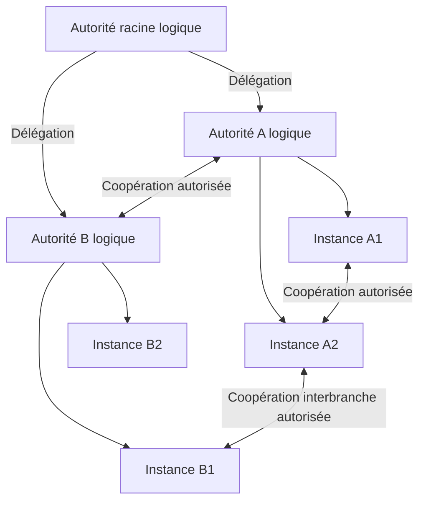

# Zéro Trust Pixs (ZTP)

- Version : 0.3.0
- Date : 5 octobre 2026
- Statut : cahier des charges de conception avec points techniques à arbitrer

Ce document décrit Zéro Trust Pixs (ZTP), le réseau propre à Pixs destiné à
relier des instances selon une chaîne d'autorité verticale et des relations
de coopération horizontales. ZTP est exécuté par le Pixs Agent (PA), contrôlé
et configuré par le Pixs Backoffice (PBO). Le document rassemble les orientations
validées pendant la réflexion et identifie les mécanismes qui restent à arbitrer.

La version 0.3.0 intègre le choix explicite de WireGuard comme base logicielle
du transport et des capacités inspirées de la documentation officielle NetBird,
à redévelopper au sein de ZTP et du PA. Elle conserve le module officiel dédié
côté PBO, les autorités et délégations, ainsi que les garanties de contrats,
de configuration, d'exploitation et de qualification. Les arbitrages techniques
non décidés sont identifiés séparément ; une recommandation ne vaut pas validation.
Elle ne constitue pas une
spécification OpenSpec validée, une autorisation d'implémentation ou une preuve
de fonctionnement. Les spécifications OpenSpec existantes conservent leur
autorité sur le comportement actuel de Pixs.

## Objet et périmètre

ZTP assure l'identification des pairs, leur rattachement aux autorités,
l'autorisation de leurs communications, la découverte des destinations et le
transport chiffré. Sa granularité va de la machine complète aux services
applicatifs d'une instance Pixs.

Une position dans la hiérarchie, une appartenance au réseau, une adresse IP ou
un certificat valide ne donnent pas, à eux seuls, accès aux ressources.
Chaque communication est couverte par une autorisation vérifiable émanant
d'une autorité compétente.

Le réseau possède ses propres mécanismes de sécurité. Son fonctionnement ne
dépend pas obligatoirement d'un SSO externe, d'un cloud, d'un VPN supplémentaire
ou d'un service mesh. Des protections complémentaires peuvent s'y superposer
sans remplacer ses contrôles ni élargir ses permissions.

Le nom Zéro Trust Pixs et son sigle ZTP désignent cette architecture Pixs.
Aucun choix du produit ZeroTier n'est effectué.

## Base WireGuard et développement propre à Pixs

WireGuard, en tant que logiciel, est la base retenue pour le transport IP
authentifié et chiffré entre pairs ZTP. Le protocole cryptographique n'est pas
réimplémenté dans Pixs. Le backend, les versions et les interfaces de pilotage
restent à qualifier pour chaque plateforme et profil.

ZTP développe ses propres fonctions d'enrôlement, de gestion des pairs,
d'autorisation, de distribution des configurations, de découverte, de
rendez-vous, de relais, d'adressage, de DNS, de posture et de supervision.
NetBird sert de référence documentaire pour les capacités retenues ; ses
agents, serveurs, briques et code ne sont pas intégrés. Aucune compatibilité
avec ses API, protocoles internes ou formats n'est exigée implicitement.
La réutilisation de bibliothèques standards indépendantes de NetBird reste
soumise aux choix techniques et à la politique de dépendances Pixs.

Le plan de contrôle associe les décisions de gestion du PBO et les décisions
des autorités compétentes selon les frontières déjà décrites. Le PA exécute
les fonctions de contrôle qui correspondent à ses rôles déclarés et applique
le plan de données WireGuard. Le trafic métier ne traverse pas obligatoirement
le PBO ni une autorité. Une carte réseau autorisée ne crée pas un maillage
intégral et ne confère pas de droit métier.

Tous les composants nécessaires sont exploitables sur l'infrastructure de
l'opérateur : autorités, certification, découverte, rendez-vous, relais,
résolution de noms et références temporelles. Aucun service NetBird, cloud
éditeur ou SSO extérieur n'est nécessaire au fonctionnement du réseau.
Les dépendances externes facultatives sont déclarées et leur indisponibilité
n'élargit jamais les accès. L'autonomie est qualifiée au démarrage à froid,
à l'enrôlement, au renouvellement et au basculement, avec les services de
l'éditeur injoignables.

### Capacités de référence et adaptation ZTP

La documentation officielle a été consultée le 5 octobre 2026. Cette matrice
identifie des capacités à spécifier ; elle ne promet ni parité générale avec
NetBird ni prise en charge de tous ses clients et plateformes.

| Référence fonctionnelle | Exigence propre à ZTP | Référence officielle |
| --- | --- | --- |
| Gestion et distribution des pairs | Inventaire et carte réseau limitée aux relations autorisées, versionnée et réconciliée. | [Architecture NetBird](https://docs.netbird.io/about-netbird/how-netbird-works) |
| Groupes et politiques d'accès | Sélection explicite des sources, destinations, directions, protocoles et ports, sous les délégations ZTP et les permissions Pixs. | [Politiques NetBird](https://docs.netbird.io/manage/access-control/manage-network-access) |
| Enrôlement automatisé | Jetons à validité et usages bornés, admission contrôlée et identités permanentes ou éphémères. | [Enrôlement NetBird](https://docs.netbird.io/manage/peers/register-machines-using-setup-keys) |
| Connectivité directe et relayée | Recherche de chemins autorisés et relais ZTP transportant les paquets WireGuard sans les déchiffrer. | [Connectivité NetBird](https://docs.netbird.io/about-netbird/understanding-nat-and-connectivity) |
| DNS privé | Zones et résolveurs administrés, résolution par domaine et visibilité bornée par les politiques. | [DNS NetBird](https://docs.netbird.io/manage/dns) |
| Ressources et passerelles | Accès explicite à une IP, un préfixe ou un domaine sans PA sur la ressource finale. | [Networks NetBird](https://docs.netbird.io/manage/networks) |
| Posture | Évaluation des versions et conditions de sécurité déclarées, distincte de l'attestation TPM. | [Posture NetBird](https://docs.netbird.io/manage/access-control/posture-checks) |
| Redondance de routage | Sélection et basculement entre passerelles, avec effets sur les sessions documentés. | [Passerelles NetBird](https://docs.netbird.io/manage/networks/how-routing-peers-work) |

Le socle de rédaction couvre les pairs, politiques, connectivité, DNS,
posture, réconciliation et révocation. Les passerelles et ressources sans PA
constituent un profil de réseau étendu dont l'inclusion dans la première
réalisation reste à arbitrer. Les sorties Internet globales, accès SSH,
reverse proxies publics et intégrations EDR/MDM restent des extensions
à cadrer séparément ; cette intégration ne les active pas.

## Modes de fonctionnement

| Mode | Fonctionnement |
| --- | --- |
| Autonome | Une seule instance Pixs, indépendante des autres instances, assure sa propre gouvernance, son administration et ses opérations métier. |
| Zéro Trust Pixs (ZTP) | Plusieurs instances participent à un réseau gouverné, avec autorités hiérarchiques, délégations explicites et coopération autorisée entre pairs. |

Le mode autonome conserve les règles de sécurité de Pixs. L'autonomie décrit
l'absence de dépendance à une autorité Pixs extérieure ; les dépendances
techniques nécessaires au service restent déclarées et exploitées dans son
périmètre.

Dans le mode ZTP, chaque instance conserve ses responsabilités locales,
ses contrôles applicatifs et l'autorité sur les ressources qui lui sont
attribuées. Elle respecte les contraintes communes et les mandats reçus.

Le passage d'un mode à l'autre est explicite. Une coupure, une révocation ou
une perte de quorum ne déclenche pas un retour automatique au mode autonome.
La procédure d'adhésion ou de retrait reste à spécifier.

## Vocabulaire

| Terme | Sens dans ce document |
| --- | --- |
| Zéro Trust Pixs (ZTP) | Le réseau sécurisé Pixs et ses mécanismes de communication et d'autorité. |
| PZT | Sigle employé dans le CdC du PA pour le même réseau ; ZTP reste le sigle de ce document. |
| Pixs Agent (PA) | Le composant qui exécute ZTP selon les rôles et permissions qui lui sont attribués. |
| Pixs Backoffice (PBO) | Le composant qui contrôle et configure le PA dans le périmètre autorisé. |
| Instance Pixs | Une installation logique Pixs ; elle peut comporter plusieurs processus ou services. |
| Pair | Une entité communicante identifiée : machine, environnement isolé, instance ou service. |
| Autorité logique | Une responsabilité de gouvernance, éventuellement assurée par plusieurs membres actifs. |
| Membre d'autorité | Un composant participant au fonctionnement d'une même autorité logique. |
| Tranche | Un niveau de l'organisation verticale ; son appartenance ne crée aucun droit automatique. |
| Groupe de coopération | Un ensemble de pairs autorisés à collaborer pour une finalité et un périmètre précis. |
| Délégation | Un mandat limité autorisant un bénéficiaire à exercer certains pouvoirs. |
| Autorisation de communication | Une décision couvrant une relation entre pairs et les services concernés. |
| Relais | Un service acheminant les échanges lorsque le chemin direct est indisponible. |

L'identité d'un pair reste distincte de son adresse de connexion. Un déplacement
réseau ne modifie pas automatiquement son identité, sa tranche ou ses droits.

## Modèle des identités ZTP

L'installation Pixs, l'autorité logique, le membre d'autorité, le PA, le pair
et le service exposé possèdent des références distinctes et stables. Les
entités persistées par Pixs utilisent les UUIDv7 prévus par le projet ; les
composants, capacités et contrats utilisent leurs identifiants namespacés.
Les identifiants de transport et empreintes cryptographiques restent séparés
de ces références.

Les mappings vers les DigitalIdentity Pixs sont explicites, déterministes et
auditables. Une identité de machine ou de service n'implique pas la présence
d'un utilisateur humain. Le renouvellement d'une clé ne change pas
automatiquement l'identité ; un certificat ne fusionne pas deux identités.
Un pair distant ne peut pas imposer un tenant ou un scope local.

L'assurance d'identité, l'assurance d'authentification et la confiance fédérée
restent distinctes. La possession d'une clé n'accorde pas automatiquement une
assurance multifacteur. Les opérations de gestion sensibles du PBO exigent
l'assurance et la fraîcheur déclarées, avec step-up ou refus lorsque nécessaire.
La représentation détaillée des identités et de leurs mappings reste à spécifier.

## Articulation avec le cahier des charges du PA

Le [CdC Pixs Agent](PIXS_AGENT.md), relu en version 0.0.6 pour cette intégration,
décrit le PA comme un binaire pouvant fonctionner sans PBO, PFO ou navigateur
local. ZTP conserve cette indépendance d'installation. Le langage cible du PA
est Python avec génération de C puis compilation native ; les bibliothèques
et adapters ZTP doivent être qualifiés avec cette chaîne, ses dépendances et
les plateformes retenues. L'outil de compilation n'est pas choisi par ce CdC.

Les sept modes proposés du même binaire sont system-start, system-stop,
system-daemon, session-start, session-stop, session-daemon et `pzt-daemon`.
Ils constituent
des contextes d'exécution du PA, distincts de ses rôles ZTP de pair, d'autorité,
de découverte ou de relais. Un mode système ne donne pas automatiquement
un pouvoir d'autorité et un mode utilisateur ne s'élève pas implicitement.

Les identités, états et permissions des contextes système et utilisateur sont
séparés. Une session graphique est distinguée du compte utilisateur ; plusieurs
sessions concurrentes restent isolées. Le contrat rattache les opérations et
communications au mode, à la cible et à la session lorsque celle-ci s'applique.

Les délais de lancement de system-daemon et de session-daemon, les préconditions
et les budgets d'arrêt sont déclarés. Le mode `pzt-daemon` démarre sans délai
au démarrage du système ou du conteneur, avec les droits système. Il assure
la convergence et la réconciliation de ZTP lorsque celui-ci est activé et
configuré sur ce PA ; sinon, il se ferme. Son démarrage sans délai ne dispense
pas des préconditions et contrôles d'autorisation applicables et ne modifie
pas les délais des deux autres démons.
Le séquencement garantit que les fonctions ZTP nécessaires sont
disponibles pour les échanges des invocations ponctuelles et permanentes.
Le provisionnement établit explicitement la configuration minimale, l'identité,
les ancrages et les références de secrets avant le premier échange PBO–PA.
Il ne sert pas de canal continu de commandes par fichiers. L'initialisation
minimale ZTP reste distincte des activités différées des démons ; son
séquencement avec `pzt-daemon` et les autres modes reste à qualifier dans
l'adaptateur de plateforme.

L'arrêt conserve ZTP tant que les échanges requis restent possibles dans
le budget déclaré, puis draine ou interrompt les traitements selon leur contrat.
Un arrêt forcé ne vaut pas preuve d'exécution d'une opération de fermeture.
Une indisponibilité du réseau pendant l'arrêt produit un résultat explicite
et suit la politique de reprise définie.

Les opérations locales sont sélectionnées dans un catalogue déclaré et livré
par une chaîne contrôlée. La détection d'une dérive reste distincte de sa
correction ; celle-ci exige une politique et une autorisation propres. Une
instruction reçue via ZTP ne suffit pas à télécharger du code, évaluer du
Python ou ouvrir un shell privilégié.

Les états techniques locaux éventuellement nécessaires au PA sont déclarés,
bornés, protégés et soumis à rétention. Ils ne deviennent pas une source
d'autorité métier et ne remplacent pas les états autoritatifs ZTP. Une opération
interne au PA, sans échange PBO, reste distincte d'une communication PBO–PA ;
elle n'autorise aucun canal de contournement ni succès métier déduit localement.

La composition des capacités PA est réalisée au build et utilise les
métadonnées et contrats Pixs applicables. Elle n'impose pas à l'exécutable PA
d'embarquer Django ou PostgreSQL. Le stockage technique de reprise possède
son contrat de durabilité et ne dépend pas d'un filesystem éphémère lorsque
la reprise est requise. Un stockage plein, indisponible ou corrompu bloque
les opérations dont la preuve durable ne peut être tenue.

## Exécution et contrôle de ZTP

Le PA assure l'exécution de ZTP. Selon les rôles qui lui sont attribués, il
porte les fonctions de communication entre pairs et les services de contrôle
ou de transport décrits dans ce document. Ses capacités effectives restent
limitées par sa configuration, son identité et ses mandats.

Le PBO contrôle et configure le PA : il permet de gérer les rôles, les
paramètres et les politiques applicables, ainsi que de consulter l'état
d'exécution et les diagnostics autorisés. Les actions effectuées depuis le
PBO respectent les trois politiques complémentaires et la chaîne d'autorité.

| Élément | Responsabilité |
| --- | --- |
| ZTP | Définir le fonctionnement du réseau et ses garanties. |
| PA | Exécuter les fonctions ZTP autorisées et appliquer la configuration reçue. |
| PBO | Contrôler et configurer le PA dans le périmètre attribué à l'opérateur ou à l'autorité. |

Le PBO constitue le point de contrôle et de configuration ; son utilisation
ne vaut pas, à elle seule, autorisation d'une opération. Les décisions restent
rattachées à l'autorité compétente et aux permissions de l'acteur. Le PA
vérifie les instructions et leurs mandats avant de les appliquer.

Le backend Django du PBO autorise les opérations de gestion. Les services
d'autorité ZTP exécutés par les PA valident les communications dans leur
mandat ; les PA destinataires appliquent les décisions vérifiables. Une
instruction de gestion acceptée par le PBO ne remplace pas la validation
réseau requise par l'autorité compétente.

Les opérations métier restent autorisées par Django chez le destinataire.
Le PA ne devient pas une seconde autorité métier et une permission de
communication ne vaut pas permission applicative.

Tous les échanges entre PBO et PA passent par ZTP, dans les deux sens et
pour les sept modes décrits par le CdC PA. Cela couvre les instructions,
configurations, opérations d'administration, états, diagnostics, événements
et résultats, même sur le même hôte ou dans le même conteneur.

Un transport local fait partie de ZTP et applique identification,
authentification mutuelle, autorisation, chiffrement, validité, protection
contre le rejeu et traçabilité. Il n'impose pas un détour par un relais distant.
Une socket Unix, la boucle locale ou un fichier ne peuvent pas servir de canal
PBO–PA hors ZTP. Les permissions système sont complémentaires aux contrôles ZTP.

Si ZTP est indisponible, non initialisé ou non vérifiable, la communication
PBO–PA concernée est bloquée sans repli hors ZTP. Le séquencement d'amorçage,
les transports locaux et la répartition des services restent à spécifier.

## Module ZTP côté PBO

Le pilotage de ZTP côté PBO est fourni par un module Pixs officiel dédié,
utilisant le système normal de modules. Il possède ses propres responsabilités,
contrats publics, données de gestion, migrations, permissions, contributions
frontend et cycle de vie.

Le module ZTP n'est pas intégré au Kernel ni absorbé par pixs.core. Le Kernel
fournit les mécanismes génériques de composition ; pixs.core fournit les
identités, tenants, scopes et permissions communes que le module consomme
par leurs contrats publics. ZTP ne crée pas de référentiel d'identité Pixs
concurrent.

Le module porte la représentation et le pilotage des autorités, des délégations,
des politiques, des configurations des PA, des opérations de contrôle et de
leur suivi. Le PA conserve l'exécution des fonctions réseau et des services
ZTP correspondant à ses rôles. Cette séparation ne déplace pas l'exécution
des communications dans le PBO.

Les autres opérations système ou utilisateur restent possédées par les
modules qui les définissent et utilisent les interfaces publiques PA et ZTP.
Le module réseau ne devient pas propriétaire de toutes les opérations locales.
PFO adresse ses demandes à PBO, qui les autorise avant transmission via ZTP ;
une liaison directe PFO–PA exige un cadrage distinct.

### Caractère obligatoire et protection

Le module est requis dans les profils PBO qui pilotent ZTP. Une composition
déclarant ce profil sans le socle ZTP est invalide. Son caractère obligatoire
est déclaré et vérifié par les mécanismes génériques de composition, sans
traitement fonctionnel spécifique de ZTP dans le Kernel.

Le terme inaliénable signifie que le socle ne peut pas être retiré ou désactivé
tant que le profil le requiert. Un retrait du réseau et un changement de profil
passent par une procédure explicite et contrôlée avant tout retrait éventuel
du module.

Cette protection reste compatible avec les mises à jour, migrations,
réparations et mesures de quarantaine autorisées. La suspension d'un transport
ou l'isolement d'un pair ne supprime pas le socle de contrôle. Une panne produit
un état diagnostiquable et suspend les fonctions concernées selon leurs
garanties, sans fonctionnement permissif ni abandon des contraintes du réseau.

La présence obligatoire du module dans toutes les installations autonomes
n'est pas décidée. S'il est inclus dans un profil autonome, il peut fournir
le pilotage local du PA sans activer les fonctions de réseau distribué.

### Enrichissement par sous-modularité

Le module comprend un socle stable de pilotage et de contrats avec le PA.
Ses capacités sont enrichies par des sous-modules utilisant les mécanismes
Pixs habituels : manifests, dépendances, lifecycle, services, permissions,
configuration et contributions frontend déclarées.

Le découpage envisagé est le suivant ; ses frontières exactes restent à préciser :

```text
Module ZTP côté PBO
├── Socle de pilotage et contrats PA
├── Autorités et délégations
├── Politiques et autorisations
├── Gestion des agents
├── Découverte et relais
├── Topologie et supervision
└── Extensions spécialisées
```

Les sous-modules enrichissent le module par ses interfaces publiques, sans
modifier directement son implémentation privée ou celle d'un autre composant.
Ils ne peuvent ni supprimer les contrôles obligatoires, ni élargir implicitement
les permissions. Une capacité nécessaire à un rôle déclaré reste requise,
même si son implémentation est portée par un sous-module.

### Administration locale et reprise

Un accès d'administration local authentifié et protégé permet de diagnostiquer
et réparer ZTP lorsque ses communications distantes sont indisponibles. Le
contrôle PBO–PA utilise un transport local intégré à ZTP et conserve ses
permissions, contrôles et audit ; il ne dépend pas exclusivement d'un chemin
distant, mais ne contourne jamais ZTP.

Si les fonctions ZTP locales nécessaires sont elles-mêmes indisponibles,
le contrôle PBO–PA reste bloqué. Les opérations d'amorçage ou de reprise
strictement internes au PA et les adapters de plateforme déclarés sont
spécifiés séparément, avec leur autorisation ; ils ne créent pas un canal
alternatif PBO–PA. Aucun accès local hors ZTP n'est activé implicitement.

Les mécanismes exacts de protection du lifecycle, l'accès local de reprise,
l'identifiant canonique du module et les contrats PBO vers PA restent à
spécifier avant implémentation.

## Contrats et compatibilités

Des contrats publics distincts définissent la configuration, les instructions
de contrôle, les rapports d'état, la découverte, les autorisations et les
révocations. Chaque contrat possède un propriétaire, un identifiant, une
version, des schémas, des erreurs stables et des garanties documentées.

Les versions du CdC, du module PBO, du PA, du protocole ZTP, des schémas de
configuration et des politiques sont distinctes. Une matrice de compatibilité
vérifie les composants, capacités, contrats, événements, providers et données
concernés avant activation ou mise à niveau. Une version plus récente n'est
pas présumée compatible.

Pour le CdC en version x.y.z, un incrément de 0.1.0 augmente la composante
mineure et conserve les autres composantes : x.(y+1).z. La consolidation
présente fait ainsi passer le CdC de 0.2.0 à 0.3.0.

Les API de gestion PBO suivent les contrats OpenAPI Pixs, leurs enveloppes de
succès et d'erreur et leur versionnement. Le protocole entre PA peut employer
un transport adapté avec ses propres schémas documentés. Les événements de
contrôle sont versionnés séparément des contrats HTTP.

Les mises à jour progressives prévoient une coexistence explicite des versions
supportées. Une combinaison incompatible est refusée sans abaisser les
exigences de sécurité. Les migrations restent contrôlées et aucun downgrade
automatique du schéma ne simule un rollback. Les versions admises et les
formats exacts des contrats restent à définir avant implémentation.

Le contrat d'instruction de contrôle précise l'émetteur PBO vérifié, l'acteur
initial, l'exécuteur technique, la cible canonique, le contexte, l'opération
et sa version, les paramètres typés et bornés, le mandat et sa validité,
les versions de politique et de délégation, les obligations et les références
de suivi. PA vérifie ces éléments à l'exécution, y compris après attente ou
reprise. Une permission de surveillance ne vaut pas permission de modification.

La réception, la validation, l'exécution technique, la livraison du résultat
et sa confirmation applicative sont des dimensions distinctes. Un accusé de
réception ne prouve pas la réussite. Après un effet système dont le résultat
est indéterminé, la reprise vérifie la postcondition si le contrat le permet
ou requiert une intervention autorisée, sans rejeu aveugle.

## Configuration demandée et configuration appliquée

Le PBO conserve la configuration souhaitée. Le PA rapporte la configuration
effectivement appliquée, sa version, son résultat et les écarts diagnostiquables.
Une configuration envoyée ou reçue n'est pas présentée comme appliquée avant
confirmation vérifiable de son application.

Les configurations possèdent un schéma typé et versionné. Leur résolution
respecte les sources et priorités communes Pixs : schéma, défauts du composant,
configuration statique, configuration runtime, puis références de secrets.
Les formats Debian, Docker et développement alimentent ce même modèle.

L'application vérifie les préconditions, la compatibilité, l'autorisation et
la version de concurrence attendue. Une configuration périmée ou conflictuelle
est refusée explicitement. Le contrat définit la frontière d'application,
les états intermédiaires et le comportement après application partielle ou
interruption. La reprise ne restaure pas une ancienne configuration interdite.

Un feature flag ne peut ni retirer une capacité requise, ni modifier
implicitement les permissions, les providers ou les contraintes du réseau.

Une reconfiguration affectant ZTP prévoit dans son plan la validation du
nouveau canal de contrôle et le comportement en cas de perte de contact.
Une compensation préautorisée peut être prévue lorsque sa faisabilité,
son déclencheur et sa durée sont déclarés. Elle ne réactive jamais une identité
révoquée, un mandat expiré ou une permission supprimée. Sans compensation sûre,
l'échec reste explicite et suit la procédure de reprise, sans canal hors ZTP.

## Opérations de gestion persistantes

L'enrôlement, le changement de parent, la révocation, la reconfiguration,
la maintenance et les mises à niveau sont des opérations contrôlées. Elles
portent un plan, un identifiant d'opération, un acteur, un périmètre, une
version, une corrélation, une clé d'idempotence et un résultat persistant.
Les mutations sensibles séparent la préparation du plan et son application
confirmée ou explicitement autorisée.

Les mutations de gestion possédées par le module PBO passent par ses Commands
autorisées et leurs frontières transactionnelles Django. Les instructions
vers le PA conservent le mandat et l'identité de l'acteur initial. La CLI,
l'interface PBO et les façades non interactives consomment les mêmes contrats.

Les traitements longs utilisent des opérations suivies et des Jobs persistants
avec checkpoints, retries bornés et états d'échec diagnostiquables. L'autorisation
est réévaluée à l'exécution. Les identifiants d'opération, de Command, d'événement
et de Job restent distincts.

Un rejeu identique restitue l'état ou le résultat enregistré sans double effet ;
un contenu divergent produit un conflit. Les événements confirmant une mutation
sont publiés après son engagement, avec outbox et déduplication lorsqu'elles
sont requises. La livraison générale suit at-least-once sans promesse
exactly-once de bout en bout.

## Trois politiques complémentaires

Les trois politiques sont complémentaires. Leur attribution est explicite ;
aucune ne donne automatiquement les pouvoirs des deux autres.

| Politique | Pouvoirs possibles | Limites |
| --- | --- | --- |
| Gouvernance et délégation | Définir les contraintes communes, enrôler dans un périmètre, attribuer ou révoquer des mandats et encadrer les échanges. | La position hiérarchique ne vaut pas accès général aux données ou aux machines. |
| Administration | Consulter la santé, distribuer une configuration autorisée, organiser les mises à jour, gérer les modules, renouveler les identités et mettre en quarantaine. | Chaque opération possède un périmètre et un contrôle ; un accès système général ne découle pas de cette politique. |
| Opérations métier | Consulter des projections autorisées, traiter des ressources, approuver des opérations et coordonner des workflows. | Les règles métier, tenant, scope, confidentialité et propriété des données continuent à s'appliquer. |

Une autorité régionale peut disposer des trois politiques avec des périmètres
différents. Un service de maintenance peut recevoir uniquement un mandat
d'administration. Un pair métier peut coopérer sans gouverner ni administrer
son destinataire.

Le pouvoir d'administration peut affecter indirectement les données, notamment
lorsqu'il permet de changer le logiciel ou les permissions. Les opérations
modifiant les contrôles de sécurité demandent donc une protection spécifique.
La séparation des identités techniques utilisées pour ces pouvoirs est une
proposition de conception à préciser.

## Organisation verticale et horizontale

La structure retenue superpose un arbre de gouvernance et un graphe de
coopération. Une instance rattachée possède un parent logique unique ; les
rattachements sont sans cycle. Le nombre de niveaux reste adaptable.



Les relations horizontales couvrent les pairs d'une même tranche et peuvent
relier des branches différentes sur un périmètre autorisé. Les permissions
peuvent être différentes dans les deux sens. Une instance peut participer à
plusieurs groupes de coopération.

Le niveau organisationnel et le niveau de sécurité sont distincts. Les rôles
d'identité, d'administration et de traitement métier peuvent être isolés sans
imposer un nombre fixe de tranches ou un classement universel des instances.

L'arbre des autorités ne se confond pas avec la hiérarchie des scopes métier
de Pixs. Un rattachement au réseau ne crée ni tenant, ni appartenance, ni accès
intertenant implicite.

## Règles de délégation

Une délégation identifie son émetteur, son bénéficiaire, les actions permises,
les cibles, le périmètre, la période de validité et le droit éventuel de
redélégation. Elle possède une identité stable, une version et un état
vérifiable de validité ou de révocation.

Une autorité ne transmet que les pouvoirs qu'elle détient et qu'elle est
autorisée à déléguer. Les contraintes obligatoires d'un ancêtre restent
applicables ; un descendant peut les renforcer sans les affaiblir.

Le destinataire contrôle le mandat avant d'exécuter une instruction, même si
l'émetteur est son parent. Les refus explicites et les limites de périmètre
restent applicables. Une délégation valide ne remplace pas une vérification
d'identité ou une autorisation métier.

Un changement de parent, de tranche ou de groupe réévalue les droits concernés.
Les versions de politiques et de délégations utilisées sont traçables.

## Autorités multimaîtres et synchronisation

L'autorité racine et les sous-autorités peuvent fonctionner en multimaître.
Plusieurs membres actifs représentent une même autorité logique et
synchronisent leur état. Le parent unique désigne cette autorité logique,
sans imposer une machine unique.

L'état partagé comprend les rattachements, identités publiques, délégations,
politiques, autorisations, révocations et décisions nécessaires à leur
exercice. La gestion des clés privées de signature est traitée séparément de
la réplication ordinaire des données.

Chaque état de contrôle ZTP identifie son propriétaire, sa source autoritative,
son mécanisme d'engagement et ses projections. Cela couvre notamment les
politiques, délégations, rattachements et révocations, qui sont eux-mêmes des
données de référence. La base du PBO et l'état des autorités ne peuvent pas
décider indépendamment de la validité d'un même mandat.

PostgreSQL demeure la référence applicative Pixs. L'utilisation d'un autre
stockage autoritatif exige une capacité spécialisée explicitement spécifiée
et validée. Le choix du stockage spécialisé éventuel, du consensus et de la
coordination entre gestion PBO et décisions d'autorité reste ouvert.

Le multimaître des autorités ne signifie pas que les données métier Pixs
deviennent multimaîtres. Leurs règles de persistance, de propriété et de
placement restent celles des spécifications applicables.

**Proposition à arbitrer :** utiliser un fonctionnement actif-actif avec
cohérence forte pour les changements critiques. Chaque membre peut recevoir
une demande ; son engagement est soumis à une validation commune. Cette
organisation peut utiliser un leader interne de consensus. Elle ne correspond
pas à des écritures indépendantes engagées par tous les membres pendant une
partition réseau.

Une synchronisation ultérieure avec priorité au dernier horodatage n'est pas
une règle suffisante pour résoudre un conflit entre révocation et attribution
de droits. L'ordre des décisions, leur validation et la protection contre une
autorité périmée restent à spécifier.

**Proposition à arbitrer :** sans quorum, bloquer les nouveaux changements
critiques et conserver uniquement les opérations dont le mandat, la fraîcheur
et la validité restent vérifiables. Le délai de propagation des révocations
et la disponibilité recherchée devront être définis ensemble.

Le consensus protège la cohérence ; il ne suffit pas à protéger contre un
signataire compromis. Les règles de signature, de révocation d'un membre et
de preuve d'engagement des décisions font partie du futur design.

## Chaîne de certification et identités

La confiance cryptographique repose sur une chaîne de certification ancrée
dans les autorités racines et déléguée aux autorités intermédiaires.
L'enrôlement établit explicitement les ancrages de confiance avant les échanges.
La découverte d'une autorité ne suffit pas à lui accorder confiance.

Chaque pair dispose d'une identité propre et d'une clé privée protégée. Le
certificat rattache l'identité à une autorité reconnue ; les permissions de
communication sont portées par une décision distincte et vérifiable.

L'authentification mutuelle vérifie l'identité attendue, la chaîne, les usages
admis, les contraintes des autorités, la validité et la révocation selon la
politique applicable. La preuve de possession de la clé est nécessaire.

La rotation, le renouvellement, la révocation et la récupération sont prévus
pour les pairs comme pour les autorités. Aucun secret n'est publié dans la
découverte, les journaux ou les messages d'audit.

La racine logique peut être représentée par plusieurs membres, mais cela ne
valide pas une copie non contrôlée de sa clé sur chacun d'eux. La distribution
des signataires, les certificats intermédiaires et l'éventuelle signature à
seuil restent à choisir. Les formats de certificats, de signatures d'autorité
et de liaisons de clés ne sont pas arrêtés ; la cryptographie du transport
reste celle de l'implémentation WireGuard retenue.

### Enrôlement et protection des clés

L'enrôlement définit l'établissement initial de confiance, la preuve d'identité,
les préconditions, le mandat et la mise en service contrôlée. La présence
d'une configuration, d'une adresse découverte ou d'un artefact ne crée pas
automatiquement un compte administrateur, un rattachement ou une confiance.
Une reprise réutilise l'opération persistante sans dupliquer l'identité.

La protection des clés, leur rotation et la récupération après compromission
font partie des procédures d'exploitation. Les configurations du PBO utilisent
des références de secrets ou des interfaces de signature contrôlées ; les
clés privées ne sont pas exposées dans le frontend, les API de consultation,
les rapports, les manifests, les paquets ou les images.

Les accès aux secrets ou fonctions de signature sont liés à une identité
de workload et à une politique déclarée. Une référence indisponible ou une
permission non vérifiable bloque la fonction protégée concernée. Les procédures
de renouvellement, de changement d'ancrage et de reprise précisent leurs
conditions de sécurité sans transformer la découverte en source de confiance.

### Intégration du PA et attestation TPM de l'hôte

L'identité stable Pixs, le certificat d'identité ZTP, la clé publique
WireGuard et la clé d'attestation TPM sont des éléments distincts. Leur
association est vérifiée, versionnée et auditée. Le certificat ne participe
pas directement au handshake WireGuard ; il établit la confiance dans la
liaison identité–clé que le contrôle ZTP distribue aux pairs autorisés.
Une rotation de clé WireGuard ne recrée pas l'identité Pixs et la révocation
de son ancienne liaison entraîne le retrait des accès correspondants.

La clé WireGuard est générée localement et sa valeur privée reste dans le
périmètre d'exécution autorisé. Le backend retenu précise son accès et sa
protection. La non-exportabilité de la clé d'attestation TPM ne prouve pas
que la clé privée WireGuard reste dans le TPM : le stockage protégé, le
déverrouillage éventuel et la résidence en mémoire sont qualifiés séparément.

Le protocole d'intégration d'un PA au réseau ZTP enregistre la clé publique
TPM de référence de l'hôte ainsi que son nom d'hôte. Ces informations sont
rattachées explicitement à l'identité stable du PA et de son hôte, avec le
rôle de la clé, sa provenance vérifiée et les justificatifs de confiance
nécessaires. Le nom d'hôte est une métadonnée contrôlée ; il ne constitue
ni une identité cryptographique, ni une preuve d'intégrité à lui seul.

La clé publique sert à vérifier les preuves TPM requises lors de chaque
connexion ou reconnexion du PA à ZTP. La clé d'identité du TPM et la clé
d'attestation utilisée pour signer ces preuves sont distinguées lorsque
leurs rôles diffèrent ; leur liaison est vérifiée à l'enrôlement. La clé
privée d'attestation est créée dans le TPM et non exportable. Le PBO reçoit
les éléments publics et les preuves, jamais cette clé privée.

Chaque vérification utilise un défi aléatoire frais et une preuve liée au
PA, à l'hôte et à la connexion concernée, afin de refuser le rejeu d'une
ancienne réponse. Une signature valide prouve l'utilisation de la clé
correspondante ; elle ne démontre pas, à elle seule, l'intégrité du PA.
La vérification d'intégrité exige une attestation des mesures du binaire
PA et de l'environnement requis par son profil, collectées par une chaîne
de mesure de confiance, protégées par le TPM et confrontées aux références
approuvées. Une empreinte simplement déclarée ou signée par le PA ne suffit
pas. La preuve ne couvre que les éléments et états effectivement mesurés.

Ce contrôle complète le protocole d'authentification du PA à ZTP sans le
remplacer, le surclasser ou affaiblir ses exigences. Une attestation valide
ne dispense jamais de l'authentification, des contrôles de certificat,
de révocation, de délégation et d'autorisation applicables. Une preuve
d'intégrité requise absente, périmée, rejouée, invalide ou non vérifiable
bloque la connexion ou reconnexion concernée et produit un diagnostic
et un audit sans secret.

Pour un PA dans Docker ou LXC, le protocole distingue le nom du conteneur
du nom de l'hôte portant le TPM et vérifie la liaison PA–conteneur–hôte.
Le partage du TPM ne fusionne pas les identités des PA. Un changement
d'hôte, de clé ou de nom d'hôte suit une mise à jour contrôlée du rattachement,
sans remplacement automatique sur simple déclaration du PA.

Les formats de preuves, le choix et la liaison des clés TPM, les mesures
couvrant effectivement le PA, leurs références et leur politique de mise
à jour restent à spécifier. L'absence ou l'inaccessibilité d'un TPM, ainsi
que l'emploi d'un TPM logiciel ou virtuel, sont déclarés explicitement ;
les conditions d'admission de ces profils restent à arbitrer et ne valent
pas implicitement une attestation matérielle réussie.

## Services de contrôle et de transport

| Service | Responsabilité |
| --- | --- |
| Autorité | Enrôler, déléguer, valider les relations et gérer leur révocation. |
| Certification | Émettre et renouveler les justificatifs d'identité dans un mandat autorisé. |
| Découverte | Enregistrer et résoudre les pairs et services accessibles selon la politique. |
| Rendez-vous | Aider les pairs autorisés à déterminer leurs chemins de connexion possibles. |
| Relais | Acheminer le trafic chiffré lorsque la communication directe est impossible. |
| Adressage et DNS | Gérer les adresses overlay, les noms et la résolution dans les périmètres autorisés. |
| Passerelle | Acheminer les flux autorisés vers des ressources sans PA selon un profil de réseau étendu déclaré. |
| Pixs Agent (PA) | Exécuter ZTP selon les rôles attribués, présenter les identités des pairs, vérifier les permissions et établir les canaux. |
| Pixs Backoffice (PBO) | Contrôler et configurer les PA et consulter leur état dans le périmètre autorisé. |

La découverte et le relais peuvent comporter plusieurs services répartis.
Leur emplacement ne leur donne aucun pouvoir d'autorité implicite. Les rôles
peuvent être cohébergés sans confondre leurs permissions.

Les services de contrôle possèdent eux aussi des identités certifiées et des
communications authentifiées et chiffrées. La réplication de leur état respecte
la confidentialité et les règles de résidence applicables.

## Lifecycle et profils ZTP

L'installation, l'activation, la configuration, la readiness et la santé sont
des dimensions distinctes. Le rattachement au réseau, la disponibilité des
capacités et la quarantaine sont également représentés explicitement, sans
les réduire à un état global ambigu.

Chaque profil déclare ses rôles, capacités obligatoires et optionnelles,
contrats, dépendances, limites et frontières réseau. Les rôles de pair,
d'autorité, de découverte, de rendez-vous et de relais ne sont pas activés
implicitement par la présence d'un composant ou d'un fichier.

Les contrôles distinguent liveness, startup, readiness et diagnostic opérateur.
Ils sont rapides, bornés, sans mutation métier et sans secret. Une capacité
obligatoire non vérifiable ne devient pas prête ; une capacité optionnelle
indisponible peut être isolée avec un état dégradé explicite.

Une panne de transport ne masque pas l'état du contrôle local. La maintenance
et la quarantaine peuvent cibler un composant, service ou capacité déclaré,
avec drainage borné, opérations permises et conditions de sortie vérifiées.
La reprise ne réactive pas un rôle ou un accès révoqué. Les états précis et
les profils distribuables restent à spécifier.

## Découverte et établissement des communications

### Inventaire et carte réseau autorisée

L'inventaire de contrôle associe l'identité stable, les liaisons de clés
publiques, les adresses overlay, les capacités, les groupes, les services,
les profils, les versions et les états d'admission. Les données privées de
connexion et de posture respectent les règles de minimisation et de rétention.

Chaque PA reçoit une carte réseau limitée à ses relations autorisées. Elle
identifie l'autorité compétente, le destinataire, la version et la validité,
les pairs joignables, leurs clés publiques vérifiées, leurs chemins candidats,
les routes et les décisions applicables. Elle ne révèle pas toute la topologie
ni les informations privées des branches étrangères au mandat.

La distribution prévoit un état initial, les changements de version et la
réconciliation après coupure. Une séquence manquante déclenche une resynchronisation
contrôlée ; un état périmé, contradictoire ou non vérifiable n'est pas appliqué.
Le transport, les schémas, snapshots, deltas et preuves de distribution
restent à choisir dans l'arbitrage A07. L'accusé de réception ne prouve pas
que les tunnels, routes et filtres sont effectivement configurés.

### Parcours d'établissement

La découverte ne révèle que les informations accessibles au demandeur. Elle
publie l'identité du service, ses caractéristiques nécessaires à la connexion
et des informations de joignabilité bornées dans le temps. Elle ne constitue
pas un annuaire public de toute la topologie.

Une communication suit le parcours de référence suivant :

1. Le pair demande une destination et un service identifiés.
2. L'autorité compétente valide la relation, en ligne ou par une autorisation
   signée encore valide selon le profil de sensibilité.
3. La découverte ou le rendez-vous fournit les chemins candidats autorisés.
4. Les pairs s'authentifient mutuellement et vérifient les permissions.
5. Ils privilégient un chemin direct compatible avec les contraintes déclarées.
6. Si le direct échoue, ils utilisent un relais autorisé.
7. Ils renouvellent les preuves nécessaires ou ferment la communication lorsque
   ses conditions cessent d'être satisfaites.

La recherche de connectivité ne contourne pas les règles du réseau sous-jacent
et n'accorde pas de nouvelles permissions. Un changement d'adresse ou de
chemin conserve les contrôles d'identité et d'autorisation.

Les mécanismes de traversée de NAT, le repli lorsque certains transports sont
bloqués et la sélection des relais restent à définir techniquement.

La recherche de chemins reprend les capacités de rendez-vous et de traversée
de NAT documentées par NetBird, avec un protocole et une implémentation propres
à ZTP. Les candidats de connectivité ne sont distribués qu'après autorisation.
Les services de découverte de chemins sont auto-hébergés et leurs messages
sont protégés contre l'usurpation et le rejeu selon un contrat à qualifier.
Le roaming WireGuard ne remplace pas la réévaluation d'une condition de
politique dépendant du réseau physique ou de la posture.

### Amorçage et identité du contrôle

Le premier tunnel nécessite la connaissance vérifiée des clés des pairs.
L'amorçage établit les ancrages, le mandat d'admission, la liaison de clé
WireGuard et les preuves d'attestation requises avant l'accès courant.
Il ne repose ni sur la confiance dans le premier serveur rencontré ni sur
une admission générale au réseau.

Deux modalités sont soumises au développeur dans A02 : un canal TLS
authentifié intégré à ZTP, restreint à l'enrôlement et à l'attestation, ou un
pair WireGuard d'amorçage préprovisionné. La recommandation TLS n'est pas
adoptée tant que l'arbitrage reste ouvert. Le profil choisi précise la preuve
d'identité initiale du PA, l'émetteur admis, les opérations accessibles et
les limites. Il ne crée aucun canal PBO–PA hors ZTP et aucune capacité métier
avant validation. Les mêmes règles s'appliquent à la reprise et au renouvellement.

La connexion logique ZTP, le tunnel WireGuard, le canal de contrôle et le
renouvellement cryptographique sont des événements distincts. Le mapping
vers les vérifications TPM et la reconnexion reste à décider dans A10 ; cette
distinction n'exempte aucune connexion ou reconnexion ZTP du contrôle requis.

## Enrôlement automatisé et pairs éphémères

Un jeton d'enrôlement possède un émetteur autorisé, un périmètre, une durée,
un nombre maximal d'usages et des conditions d'admission. Il sert uniquement
à l'admission prévue et ne remplace ni l'attestation, ni le certificat, ni
l'autorisation de communication. Aucun secret partagé sans limite n'est
fourni par défaut. Sa consommation concurrente respecte l'atomicité et
l'idempotence et son contenu n'est exposé ni dans les diagnostics ni dans
les lignes de commande journalisées.

La révocation ou l'expiration du jeton interdit les nouveaux enrôlements.
Le retrait des pairs déjà admis est une opération de révocation distincte,
explicite et traçable. Les affectations initiales à des groupes ne confèrent
que les permissions autorisées dans le mandat d'admission.

Un pair éphémère possède une politique de fin de vie déclarée. Sa disparition
entraîne une révocation et un retrait contrôlés des cartes, routes et noms,
avec les traces et tombstones requis ; aucun délai de suppression NetBird
n'est repris implicitement. Une reprise ne ressuscite pas son ancien accès.
Les règles de durée, de renouvellement et de nettoyage relèvent de A11.

## Adressage et résolution de noms

Le plan d'adressage overlay est configurable, distinct des réseaux physiques
et rattaché au domaine réseau déclaré. Il garantit l'unicité dans le périmètre
où elle est requise et détecte les collisions, chevauchements et boucles.
Il ne reprend pas automatiquement la plage CGNAT de NetBird. Les préfixes,
la prise en charge IPv4/IPv6 et l'interconnexion de domaines sont arbitrés
dans A06 ; un chevauchement non résolu bloque la route concernée.

Le DNS privé fournit les noms de pairs et de services autorisés, les zones,
résolveurs, règles par domaine et délais de fraîcheur déclarés. Un nom DNS
n'est pas une preuve d'identité ; sa résolution est confrontée à la destination
et à la liaison de clé attendues. Les changements retirent les noms et routes
invalidés sans maintenir silencieusement un accès supprimé.

Les réponses et caches respectent la visibilité par contexte et la rétention.
Les modes de résolution administrés ou laissés au système sont explicites
et leur coexistence est qualifiée. La gestion du DNS ne remplace pas sans
mandat les paramètres de l'hôte ni n'impose un résolveur public. Le composant
de résolution, les conflits avec les services existants et les règles de
fallback sont à débattre dans A06.

## Politiques réseau et posture

Une politique décrit ses sources et destinations canoniques, les groupes
ou selectors autorisés, le service, la direction, les protocoles, les ports,
le contexte, la validité et les conditions de posture. Les groupes réseau
ne créent pas automatiquement des appartenances ou droits métier Pixs.
Le refus explicite prévaut, puis l'autorisation explicite, puis le refus
par défaut. La création d'une instance ou d'un groupe n'ouvre aucun maillage
général. Les directions d'initiation et le trafic de réponse sont spécifiés.

Les AllowedIPs WireGuard associent les adresses aux clés des pairs ; ils
ne constituent pas une autorisation par port ou par service applicatif.
Le PA applique les contrôles complémentaires sur les flux entrants,
sortants et transférés selon le profil et vérifie leur état réel. Une règle
autorisant une ressource derrière une passerelle n'autorise pas les services
locaux de la passerelle. Les états de connexion existants sont invalidés
conformément aux délais de révocation, sans exception générale pour les
flux déjà établis. Les adapters de filtrage restent à choisir dans A04.

La posture peut porter sur la version du PA, le système, la présence de
protections requises et le contexte réseau. Chaque donnée indique son origine,
son niveau de confiance et sa fraîcheur. Une information rapportée par PA
n'est pas présentée comme une mesure matériellement attestée. Les évaluations
à l'admission, après modification et pendant les sessions respectent les
délais déclarés ; une preuve requise absente ou non vérifiable bloque l'accès
concerné. La posture complète l'attestation TPM sans la remplacer.

Un profil qualifie l'expiration et la révocation des règles même si PA est
arrêté ou planté alors que les tunnels et filtres du noyau subsistent. Il
déclare un mécanisme d'expiration, de surveillance ou d'arrêt du périmètre
protégé et en mesure le délai. A05 tranche ce mécanisme et les durées ; aucune
expiration automatique des configurations WireGuard n'est présumée.

## Passerelles et ressources sans PA

Un rôle explicite permet d'accéder à des ressources déclarées par IP, préfixe
ou domaine depuis l'overlay, sans PA sur leur destination finale. L'annonce
d'une route et sa distribution ne valent pas permission d'accès. Les droits
de consommer et de fournir une ressource sont vérifiés séparément. Une
passerelle ne devient ni une autorité ni un relais par sa seule présence.

Le relais transporte le tunnel chiffré entre ses pairs ; la passerelle termine
un tunnel puis transfère des paquets vers une autre ressource. Le chiffrement
WireGuard couvre alors le segment jusqu'à la passerelle. La protection du
dernier segment et l'authentification du service final sont déclarées ; si
le profil exige le chiffrement jusqu'à la ressource, une protection applicative
ou un pair WireGuard à destination est nécessaire. L'attestation de la
passerelle ne constitue pas celle de l'équipement sans PA.

Le profil spécifie les routes de retour, la conservation ou traduction des
adresses sources, les frontières de confiance et la traçabilité. Les routes
larges exigent un mandat explicite. Les règles contre le contournement, les
chevauchements et les boucles couvrent aussi IPv6 lorsque pris en charge.

Plusieurs passerelles peuvent desservir une ressource. La sélection tient
compte des contraintes du profil et n'est pas confondue avec un équilibrage
de charge. Les conséquences du changement de passerelle sur les sessions,
notamment avec traduction d'adresses, sont documentées et testées. Leur
redondance ne remplace pas le consensus des autorités. Le périmètre initial,
le NAT et les règles de basculement sont arbitrés dans A08.

## Validation hybride selon la sensibilité

Le principe validé combine une décision en ligne et des autorisations signées
de courte durée selon la sensibilité. Chaque communication possède une preuve
d'autorisation d'une autorité compétente ; chaque paquet ne nécessite pas
une consultation centrale.

| Profil proposé | Validation |
| --- | --- |
| Courant | Autorisation signée courte, vérifiée localement par les pairs. |
| Protégé | Autorisation courte avec exigences renforcées de fraîcheur, de révocation et de renouvellement. |
| Critique | Décision en ligne avant la session ou l'opération concernée ; une approbation collective peut être requise par la politique. |

Les noms de profils et leur affectation sont des propositions à arbitrer.
Aucun délai numérique ni seuil de sensibilité n'est fixé en v0.3.0.

Le contenu proposé d'une autorisation comprend : émetteur, bénéficiaire,
destination, service, direction, périmètre, conditions, validité, identifiant
unique, versions de politique et de délégation, et liaison à l'identité
cryptographique du bénéficiaire. Son format reste à définir.

Une autorisation de canal ne remplace pas le contrôle des opérations qui y
circulent. Une opération critique peut nécessiter une nouvelle décision même
si le canal existe déjà. Les protections contre le rejeu et les changements
de contexte sont prévues dans le futur protocole.

Une autorisation courte borne la durée d'accès ; elle ne garantit pas seule
une révocation immédiate. Les sessions persistantes ne prolongent pas
indéfiniment une permission expirée. Une fraîcheur ou une révocation non
vérifiable conduit au refus de l'opération concernée.

### Révocation et référence temporelle

La politique définit la propagation des révocations, l'invalidation des caches,
la fermeture des sessions et la réévaluation des instructions en attente.
Une preuve conservée localement ne prolonge pas silencieusement un accès
révoqué, une délégation expirée ou une version de politique dépassée.

Les instants contractuels sont exprimés en UTC. La source de temps, les écarts
tolérés, les fenêtres de validité et la fraîcheur maximale sont déclarés.
Un temps non fiable ou des conditions temporelles non vérifiables conduisent
au refus de l'opération concernée, sans période de grâce permissive implicite.

Les mesures monotones des délais de lancement ou durées d'arrêt du PA sont
distinctes des instants UTC de validité des mandats. Elles ne remplacent pas
la référence temporelle nécessaire à l'autorisation.

Les délais maximaux de propagation, d'invalidation, de renouvellement et de
fermeture des accès sont des objectifs explicites par profil. Leur qualification
couvre aussi les partitions, les redémarrages et les connexions persistantes.

## Chiffrement et relais

Tous les échanges réseau entre pairs sont authentifiés et chiffrés, y compris
les communications des autorités, de découverte, de rendez-vous et de
synchronisation. Les données restent chiffrées de bout en bout entre les
pairs destinataires, y compris lorsqu'un relais est utilisé.

Le relais ne dispose pas des clés permettant de lire les données transportées.
Il peut observer les métadonnées nécessaires à l'acheminement ; leur exposition
et leur rétention sont limitées. Le passage du direct au relais ne change ni
les identités, ni le périmètre autorisé.

L'accès aux relais est contrôlé afin qu'ils ne deviennent pas des services
ouverts de transit. Leur sélection tient compte de la disponibilité, du chemin,
de la capacité et des contraintes de résidence.

Le protocole réutilise des primitives cryptographiques et des bibliothèques
éprouvées. L'authentification mutuelle, le renouvellement des clés de session
et la confidentialité persistante après compromission ultérieure d'une clé
font partie du design à préciser ; aucune cryptographie propriétaire n'est
retenue dans cette rédaction.

Le relais ZTP transfère les paquets WireGuard sans disposer des clés privées
des pairs. Son autorisation de transport est liée aux identités, au périmètre
et à une validité bornée. Un repli sur TCP ou WebSocket transporte ces paquets
via un adapter ZTP à qualifier ; WireGuard n'offre pas nativement un mode TCP.
Le choix ICE/STUN et du transport de relais figure dans A09. Aucune brique
NetBird de signalisation ou de relais n'est utilisée pour leur réalisation.

## Granularité des pairs

| Granularité | Périmètre d'exposition |
| --- | --- |
| Machine | Les interfaces ou réseaux explicitement déclarés de l'hôte. |
| VM ou conteneur | Un environnement isolé identifié. |
| Instance Pixs | Les capacités réseau déclarées d'une installation. |
| Service applicatif | Un service précisément identifié, avec ses relations propres. |

Le contrôle réseau d'une machine peut limiter les destinations et protocoles,
mais ne prouve pas l'identité de chaque application qu'elle héberge.
L'identification d'un service exige une identité distincte et un point de
contrôle adapté : intégration au service, proxy ou agent avec identification
vérifiée du processus. Un numéro de port ou une étiquette déclarée par le
client ne suffit pas. Le PA porte ou coordonne ce point de contrôle selon
le mode d'intégration retenu.

L'isolation d'un service dépend aussi de la frontière fournie par l'hôte.
Le réseau ne promet pas de protéger un service contre un administrateur qui
contrôle entièrement son environnement d'exécution.

Les permissions de transport et les permissions métier restent distinctes.
Le droit de joindre une API n'autorise pas toutes ses actions ni toutes les
données qu'elle peut traiter.

## Privilèges et exposition réseau

Chaque profil déclare ses interfaces, ports, protocoles, réseaux exposés et
privilèges système nécessaires. Les frontières d'accès sont vérifiées avant
mise en service. Un profil nouveau ne rend pas publics les workers, schedulers,
stores de coordination ou interfaces de management existants.

L'exécution utilise le moindre privilège. Les fonctions nécessitant des droits
système élevés sont limitées, justifiées et isolées autant que possible.
L'API PBO ne reçoit pas automatiquement les privilèges réseau du PA. Le
contrôle d'une machine n'accorde pas une exécution arbitraire de commandes
système hors des opérations et mandats déclarés.

La distribution précise les droits, ressources persistantes et adaptations
nécessaires pour Debian, Docker et le développement. Les choix du runtime PA
et de son déploiement restent explicites ; ils ne remplacent pas la pile
applicative de référence Django, PostgreSQL et TanStack du PBO.

## Intégration avec Pixs et ses données

Le destinataire conserve l'évaluation applicative des droits par Django.
L'identité distante est résolue explicitement vers le contexte d'identité
Pixs et son périmètre. Un tenant ou scope transmis par un pair ne devient pas
automatiquement une référence canonique locale.

Les échanges métier utilisent des contrats déclarés. La propriété des
ressources, les règles de confidentialité, de résidence, de suppression et
d'audit suivent les données et leurs projections. Le réseau ne crée pas de
réplication générale ou d'accès SQL interinstance implicite.

Le profil PDP minimal v1 actuel refuse l'intertenant. Le réseau ne contourne
pas cette limite ; une capacité métier nécessitant des échanges intertenants
demande un cadrage OpenSpec adapté et une autorisation distincte.

Les profils web, worker et scheduler conservent leurs frontières d'exposition.
Les nouveaux services de contrôle sont explicitement déclarés et protégés ;
leur présence ne rend pas publics les services privés existants.

Le placement côté PBO est fixé par le module officiel ZTP décrit ci-dessus.
Le détail des sous-modules, providers et profils d'exécution du PA reste à
définir en respectant le Kernel agnostique. WireGuard est la base logicielle
du transport IP. Les orchestrateurs, stores de consensus, adapters et autres
outils ne sont pas imposés implicitement au Kernel ou au socle Pixs ; leurs
choix suivent les arbitrages et profils déclarés.

La qualification des déploiements distingue PA seul, le cohébergement PBO–PA
sur un hôte, les conteneurs séparés et le conteneur commun. Un conteneur commun
exige un profil et un adapter explicitement validés ; il ne découle pas d'un
lancement implicite des rôles PBO. Chaque profil précise ses modes, comptes,
signaux, budgets d'arrêt, persistance et capacités désactivées. Un profil non
qualifié n'est pas présenté comme supporté.

## Sauvegarde et restauration

La stratégie couvre séparément l'état des autorités, les configurations,
les opérations et checkpoints, les audits et les mécanismes de protection
des clés. Chaque périmètre déclare sa rétention, son accès, sa résidence,
ses objectifs de perte acceptable et de délai de reprise, ainsi que la preuve
attendue après restauration.

Une restauration commence en état contrôlé. Elle vérifie les versions,
la cohérence des états et les décisions de révocation intervenues depuis la
sauvegarde avant toute exposition ou réintégration. Elle ne réactive aucun
droit révoqué ; si l'état courant ne peut pas être établi, les fonctions
protégées restent bloquées.

Les tombstones, décisions d'effacement, restrictions et rétentions applicables
sont réconciliés. Les opérations non terminées reprennent de manière idempotente
sans réémission automatique d'effets confirmés. Une sauvegarde ne devient
pas une nouvelle autorité et une restauration ne réinitialise pas les identités
ou permissions pour masquer un écart.

Les procédures sont testées dans un environnement isolé et produisent une
preuve auditable. Les sauvegardes de clés et leurs mécanismes de récupération
respectent leurs protections propres ; aucune clé privée n'est incorporée
aux artefacts applicatifs ou aux rapports.

La reprise distingue les opérations non commencées, en cours, interrompues
et terminées. Un résultat inconnu ne constitue ni un succès ni une preuve
d'absence d'effet. Une action non idempotente n'est pas rejouée sans stratégie
de reprise validée. La reconnexion à plusieurs PBO conserve l'isolation des
relations et refuse les instructions incompatibles sans priorité implicite
au dernier message reçu.

## Limites et quotas

Les enrôlements, requêtes de découverte, sessions, débits des relais, tailles
des messages et profondeurs de délégation sont bornés par des politiques
déclarées. Chaque limite précise son unité, son périmètre, sa période ou sa
durée, sa stratégie d'agrégation et le comportement en cas de dépassement.

Une autorisation ne donne pas une capacité de consommation illimitée. Les
limites applicables à plusieurs périmètres sont cumulatives. Les quotas
durables et réservations utilisent les garanties persistantes, atomiques
et idempotentes prévues par Pixs, avec réconciliation après reprise ou annulation.
Le comptage réseau de haute fréquence dispose d'un contrat adapté, sans
transformer chaque paquet en transaction applicative obligatoire.

Les refus et indisponibilités produisent des erreurs stables et diagnostiquables.
Un quota ou un entitlement ne remplace pas l'autorisation et un contrôle non
vérifiable n'accorde pas une consommation protégée implicite. Les valeurs
et méthodes de mesure restent à définir par profil.

## Performance et observabilité

La priorité est un chemin direct entre pairs autorisés, sans transit métier
obligatoire par les autorités. Les autorisations réutilisables restent bornées
par les exigences de sécurité ; la performance ne justifie pas un repli
permissif.

WireGuard est la base logicielle retenue pour le transport IP. QUIC avec
TLS 1.3 peut être étudié comme protocole applicatif au-dessus de ce transport,
sans devenir une base concurrente implicite. ICE, STUN et TURN constituent
des références de connectivité ; les mécanismes ZTP sont développés dans Pixs
et leurs bibliothèques, encapsulations et combinaisons restent à qualifier.
Aucune supériorité de performance n'est démontrée à ce stade.

Les mesures prévues couvrent latence d'autorisation et d'établissement, débit,
CPU, mémoire, pertes, MTU, proportion de chemins directs, capacité des relais,
temps de convergence et délai de révocation. Les objectifs chiffrés restent
à fixer par release ou profil. Chaque objectif précise son périmètre, sa
méthode, son seuil, sa période d'évaluation et sa version. La qualification
produit une preuve reproductible ou un diagnostic d'insatisfaction ; une
mesure locale ne constitue pas une garantie générale du réseau.

Les objectifs couvrent également la disponibilité, la reprise et la
compatibilité. Aucun seuil universel n'est déduit du runtime ou inventé
pour l'ensemble des déploiements.

Les diagnostics distinguent refus de politique, identité invalide, autorisation
expirée, perte de quorum, destination indisponible et recours au relais.
Ils permettent la corrélation des décisions sans exposer de clé, de jeton,
de secret ou de donnée personnelle dans les journaux techniques.

Les métriques, traces et journaux techniques sont distincts du diagnostic
opérateur et de l'audit fonctionnel persistant. La corrélation relie le PBO,
les autorités et les PA, avec trace_id, correlation_id et causalité lorsque
pertinents ; la propagation suit W3C Trace Context lorsque le transport
le permet. Ces références ne constituent jamais une preuve d'identité.

Les métriques emploient des labels à cardinalité bornée. Les signaux respectent
la minimisation, la pseudonymisation et des rétentions séparées ; les accès
tenant-scoped ou plateforme restent explicitement autorisés. L'audit des
opérations de gestion et de sécurité conserve l'acteur, le périmètre, les
versions utiles, la décision et le résultat sans copier les payloads sensibles.
Une panne de collecte technique est diagnostiquée et ne supprime pas une
obligation d'audit requise pour autoriser une opération.

## Interface PBO

Le module et ses sous-modules déclarent leurs contributions frontend dans
leurs manifests communs. Routes, navigation, formulaires et points d'extension
restent namespacés, versionnés, composés au build et soumis aux contrats du
shell TanStack. L'interface ne charge pas implicitement du code distant pour
activer une contribution.

Les textes sont traduits par les catalogues du composant propriétaire, avec
le catalogue canonique anglais prévu par Pixs. L'interface utilise le Design
System, les modes Light et Dark, le responsive et la cible WCAG 2.2 AA.
Une vue de topologie graphique possède une alternative lisible et accessible,
notamment sous forme de liste ou de tableau, permettant les mêmes opérations.

Les permissions d'affichage ne remplacent pas les contrôles Django. Les clés
de cache et états de l'interface respectent l'identité, le tenant et le scope ;
un changement de contexte invalide les données dépendantes. L'état demandé,
l'état appliqué et les opérations en cours sont présentés distinctement,
sans afficher de clé privée ni de token brut.

## Validation future de la conception

Les scénarios suivants sont retenus comme critères de validation future.
Ils ne constituent pas des tests déjà exécutés.

Les exigences WireGuard et capacités inspirées de NetBird ajoutent les
scénarios suivants. Les alternatives A01 à A12 sont qualifiées seulement
après leur décision et leur spécification ; aucune recommandation n'est
considérée comme un résultat de recette.

- Démarrage à froid, admission, renouvellement et basculement réussissent
  avec les services de l'éditeur injoignables et les services locaux requis disponibles.
- Un pair reçoit uniquement sa carte réseau autorisée ; une carte altérée,
  périmée, destinée à un autre pair ou à une ancienne liaison de clé est refusée.
- Une rupture de séquence déclenche une réconciliation sans réintroduire
  les pairs ou permissions révoqués.
- Une clé WireGuard valide ou des AllowedIPs larges ne permettent pas
  d'accéder à un protocole, port ou service non autorisé.
- La révocation d'un jeton bloque les nouvelles admissions ; la révocation
  d'un pair retire ses accès indépendamment du jeton utilisé à l'installation.
- Le chemin direct et le relais conservent les identités et permissions ;
  le relais ne peut déchiffrer les données WireGuard.
- Un changement d'endpoint conserve l'identité et réévalue les conditions
  dépendant de la localisation ou de la posture lorsqu'elles sont requises.
- Le DNS privé respecte la visibilité, refuse les destinations inattendues
  et retire les noms ou routes invalidés ; un conflit bloque le périmètre concerné.
- Une posture déclarée ne constitue pas une attestation TPM ; une preuve
  requise non vérifiable bloque l'accès selon le profil.
- Un flux déjà établi cesse après révocation dans le délai déclaré, y compris
  si PA plante et que le noyau conserve une interface active.
- Une configuration réseau partielle ou concurrente reste diagnostiquable
  et n'ouvre aucune fenêtre permissive.
- Une passerelle ne donne pas accès à ses services locaux ; les ressources
  sans PA ont un dernier segment protégé conformément au profil.
- Le basculement de passerelle respecte les contraintes de résidence et
  documente les pertes ou réinitialisations des sessions, sans promesse implicite de continuité.
- Le retrait d'un pair éphémère enlève ses accès, routes et noms tout en
  préservant les traces requises et sans résurrection après restauration.
- Le profil local et l'amorçage retenus restent dans PZT, avec leurs contrôles,
  même avant la disponibilité du transport WireGuard courant.

- Une instance autonome fonctionne sans autorité Pixs extérieure.
- Le PA exécute ZTP conformément à sa configuration et à ses mandats.
- Le mode `pzt-daemon` démarre sans délai au démarrage du système ou du
  conteneur et assure la convergence et la réconciliation de ZTP si celui-ci
  est activé et configuré sur ce PA ; sinon, il se ferme. Les délais de
  system-daemon et de session-daemon restent respectés.
- Une instruction de contrôle ou de configuration reçue depuis le PBO sans
  permission valide est refusée par le PA.
- Une composition PBO déclarant le pilotage ZTP sans son socle requis est
  refusée ; le retrait ou la désactivation du socle dans ce profil est bloqué.
- Un sous-module peut enrichir le pilotage sans modifier les implémentations
  privées ; une extension affaiblissant un contrôle obligatoire est refusée.
- L'administration locale authentifiée permet une reprise contrôlée lorsque
  les chemins distants sont indisponibles, via un transport local ZTP sans
  contournement des permissions.
- Tous les échanges PBO–PA restent dans ZTP sur le même hôte ou dans le même
  conteneur ; toute tentative de canal hors ZTP est refusée.
- Un ZTP non initialisé ou non vérifiable bloque les échanges PBO–PA, y compris
  pendant l'amorçage, sans repli vers un canal de secours hors ZTP.
- Un certificat valide sans permission de communication est refusé.
- L'intégration d'un PA enregistre la clé publique TPM de référence et le
  nom de l'hôte, avec leur rattachement vérifié à l'identité du PA.
- Chaque connexion ou reconnexion vérifie une attestation fraîche couvrant
  les mesures d'intégrité requises du PA ; une preuve rejouée, une mesure
  non conforme ou une preuve requise non vérifiable bloque la connexion.
- Une signature TPM valide sans mesures de confiance couvrant le PA ne
  constitue pas une preuve de son intégrité ; une attestation valide ne
  remplace pas l'authentification ni les autorisations ZTP.
- Des PA en conteneurs partageant un TPM conservent leurs identités distinctes
  et un rattachement vérifiable à leur hôte ; un profil sans TPM ou à TPM
  logiciel ou virtuel n'est pas présenté automatiquement comme matériellement
  attesté.
- Deux pairs d'une même tranche ne communiquent pas sans autorisation.
- Une délégation dépassant le mandat de l'émetteur est refusée.
- Un chemin direct est privilégié lorsqu'il est disponible et autorisé.
- Le relais permet le même échange sans accéder au contenu en clair.
- Une identité de service ne donne pas accès aux autres services de l'hôte.
- Une opération critique exige sa décision même sur un canal déjà établi.
- Expiration, révocation et perte de fraîcheur interrompent les accès concernés
  selon des délais et règles explicitement définis.
- Les membres d'une autorité reprennent après panne sans réintroduire de droits
  révoqués ni accepter un état périmé comme courant.
- Une partition réseau respecte le comportement arbitré pour les changements
  critiques et ne déclenche pas de passage automatique au mode autonome.
- Une communication autorisée ne contourne ni les droits métier ni les
  contraintes tenant, scope et résidence.
- Une configuration reçue ne devient appliquée qu'après confirmation
  vérifiable ; un conflit ou une application partielle reste diagnostiquable.
- Une reconfiguration réseau préserve ou valide son canal de contrôle ; une
  compensation ne réactive aucun droit invalidé et ne contourne pas ZTP.
- Une opération de gestion rejouée ne produit aucun double effet ; son mandat
  est réévalué avant exécution et son suivi survit au redémarrage.
- Une restauration ne réactive aucun droit révoqué après la sauvegarde et
  n'expose pas le service avant réconciliation des états de sécurité.
- Les privilèges du PA restent limités au rôle déclaré et ne sont pas transmis
  implicitement à l'API PBO.
- Les limites et quotas sont appliqués sans transformer une autorisation
  en consommation illimitée ni compter deux fois une opération rejouée.

### Matrice de qualification ZTP

Chaque profil déclare ses scénarios applicables et les preuves attendues.
La matrice distingue tests de contrat, d'intégration, de sécurité, de reprise,
de packaging et d'interface. Les environnements sont dédiés ; les fixtures
et identités sont synthétiques, sans secret ni donnée de production.

| Domaine | Scénarios de qualification |
| --- | --- |
| Connectivité | Chemins directs et relayés, NAT, transports bloqués et changement de chemin avec mêmes contrôles. |
| WireGuard et politiques | Backends qualifiés, AllowedIPs, routes et filtres distincts, absence d'accès général, rotation et retrait des liaisons de clés. |
| Carte réseau et admission | Visibilité limitée, versions, destinataire, ruptures de séquence, enrôlements concurrents, jetons bornés et retrait des pairs éphémères. |
| DNS et adressage | Collisions, chevauchements, réponses et caches par contexte, identité attendue et retrait des noms ou routes invalidés. |
| Posture et expiration locale | Origine et fraîcheur des preuves, évolution en session et blocage après crash de PA avec tunnels persistants. |
| Passerelles, si le profil est retenu | Accès aux ressources distinct des services locaux, NAT et routes de retour, protection du dernier segment et effets du basculement. |
| Autorités | Partitions, perte d'un membre, reconnexion, convergence et refus des décisions périmées selon le modèle arbitré. |
| Autorisations | Révocation en session, expiration, dérive temporelle, invalidation des caches et instructions en attente. |
| Attestation TPM du PA | Enrôlement de la clé publique et du nom d'hôte, liaison des clés d'identité et d'attestation, défis frais à chaque connexion et reconnexion, mesures du PA conformes ou altérées, rejeu, maintien de l'authentification, clés privées non exportées, conteneurs partageant un TPM et profils sans TPM matériel. |
| Reprise | Redémarrage, messages dupliqués ou désordonnés, checkpoints, restauration et absence de droits réintroduits. |
| Configuration | Versions concurrentes, refus d'une configuration invalide, application partielle et distinction entre état souhaité et appliqué. |
| Compatibilité | Coexistence des versions supportées, mise à niveau, migration, refus d'une combinaison incompatible et rollback autorisé. |
| Isolation | Services, tenants, scopes, branches, groupes de coopération, privilèges et visibilité de la découverte. |
| Distribution | Packaging Debian et Docker, configuration runtime, secrets externes, persistance, signaux et arrêt contrôlé. |
| Intégration PA | Sept modes d'exécution, dont `pzt-daemon` sans délai pour la convergence et la réconciliation de ZTP si activé et configuré sur ce PA, sinon fermeture ; provisionnement, initialisation minimale ZTP distincte des démons différés, fermeture bornée, sessions concurrentes, absence de PBO/PFO local, chaîne Python/C et états techniques de reprise. |
| Transport local | PBO et PA cohébergés, chiffrement et contrôles ZTP, refus des canaux hors ZTP, amorçage et reprise sans chemin distant. |
| Interface PBO | Parcours dans Chromium et Firefox headless déclarés dans DEVOPS.md, clavier, technologies d'assistance, traductions, Light/Dark et responsive. |
| Objectifs de service | Latence, débit, ressources, révocation, convergence et reprise selon les seuils et méthodes du profil. |

Les contrôles d'interface incluent des parcours manuels d'accessibilité lorsque
nécessaires. Une construction réussie ou un test Node ne remplace pas une
preuve de comportement dans les navigateurs déclarés. Un scénario non exécuté,
non applicable, indisponible ou échoué est signalé explicitement.

## Points restant à arbitrer

### Registre des choix WireGuard et capacités inspirées de NetBird

Le développeur a validé WireGuard comme base logicielle et le développement
propre à PZT/PA des capacités inspirées de NetBird. Les choix ci-dessous
restent ouverts. A01, A02 et A03 ont été soumis sous forme de questions le
5 octobre 2026 ; leur nouvelle présentation ne constitue pas une réponse.
Les autres arbitrages sont présentés avec leurs alternatives pour le débat
au fil de la rédaction. Toute décision reçue est reportée dans les deux CdC,
avec sa date, son périmètre et ses conséquences ; une présélection de l'interface
ou l'absence de réponse ne vaut jamais validation.

| Référence et état | Alternatives et conséquences | Recommandation proposée, non validée |
| --- | --- | --- |
| A01 — Backend — soumis | Noyau Linux prioritaire : adapter de pilotage privilégié ; espace utilisateur prioritaire : runtime et traitement des paquets supplémentaires ; deux backends initiaux : double qualification. | Noyau pour Debian/Linux, espace utilisateur distinct à qualifier selon les cibles. |
| A02 — Amorçage — soumis | TLS authentifié intégré à PZT et limité à l'admission ; ou pair WireGuard préprovisionné avec distribution initiale des clés et gestion de leur reprise. | TLS d'amorçage intégré à PZT, avec preuve d'identité initiale déclarée et aucun accès métier. |
| A03 — Transport local — soumis | TLS mutuel intégré à PZT sur le même hôte ; ou WireGuard local avec pairs et namespaces ou frontières équivalentes à qualifier. | TLS mutuel local avec les mêmes garanties ; WireGuard comme base interhôtes. |
| A04 — Filtrage et propriété — à débattre | Adapter nftables dédié sous Linux ; ou abstraction de plusieurs moteurs dès la première réalisation. Propriété par pzt-daemon ; ou coordination de plusieurs invocations. | Tables/règles possédées explicitement par PZT sous Linux et un propriétaire réseau par périmètre, porté par pzt-daemon. Qualifier le contrôle des processus et sessions séparément. |
| A05 — Expiration et panne — à débattre | Réévaluation en ligne pour chaque accès ; ou autorisations courtes avec expiration locale et mécanisme de surveillance indépendant du processus PA. Durées et propagation à fixer par sensibilité. | Modèle hybride déjà cadré, expirations locales opposables et preuve de retrait même après crash ; aucune durée inventée. |
| A06 — Adressage et DNS — à débattre | IPv4 initial avec trajectoire IPv6 explicite ; ou dual stack initial. Résolveur PZT local ; ou intégration à un résolveur administré existant. Préfixes et conflits à décider. | Plan configurable, préfixes sans collision et adapter DNS séparé ; décider le support IPv6 et le résolveur avant qualification. |
| A07 — Contrats du contrôle — à débattre | HTTP avec schémas JSON et notifications de versions ; ou RPC binaire et schémas dédiés. Snapshots seuls ; ou snapshots et deltas ordonnés. Les flux PA–PA et PBO–PA peuvent avoir des contrats distincts. | Contrats typés versionnés, snapshot de réconciliation et notifications ; comparer HTTP/JSON et RPC avant de choisir une dépendance. |
| A08 — Passerelles — à débattre | Socle pair-à-pair initial, passerelles dans un profil ultérieur ; ou passerelles dès la première réalisation. NAT : retours simplifiés mais identité source à corréler ; sans NAT : routes de retour et HA à qualifier. | Profil étendu explicite, préférence pour les ressources ciblées ; aucun NAT ni routage large activé implicitement. |
| A09 — Connectivité et relais — à débattre | ICE/STUN avec signalisation propre à PZT ; ou un rendez-vous plus limité avec davantage de relais. Relais UDP ; ou ajout d'une encapsulation TCP/WebSocket pour réseaux restrictifs. | Primitives standards et bibliothèques indépendantes qualifiées, direct prioritaire et relais conservant le chiffrement WireGuard ; mesurer coûts et couverture des réseaux. |
| A10 — Identités, clés et attestation — à débattre | Identité de service au-dessus du tunnel hôte ; ou pairs/interfaces isolés par service. Certificats et formats de liaison à choisir. Déclencheurs TPM distincts des handshakes à définir. | Liaisons explicites des quatre identités/clés, clés privées locales, attestation fraîche à chaque connexion logique et contrôles supplémentaires par service selon son profil ; mapping exact à valider. |
| A11 — Admission et éphémères — à débattre | Validation opérateur ou admission automatisée par mandat préalable ; jetons à usage unique ou usages limités. Délais de présence, renouvellement et retrait à fixer. | Jetons bornés et admission mandatée, expiration du jeton distincte du retrait des pairs ; nettoyage traçable avec conservation de l'audit. |
| A12 — État autoritatif et multimaître — à débattre | État de gestion et décisions coordonnés autour de PostgreSQL ; ou capacité de consensus spécialisée validée avec source de vérité explicite. Signataires et preuves d'engagement à définir. | Cohérence forte des changements critiques, refus des décisions périmées et maintien des seules permissions encore vérifiables sans quorum ; ne pas présumer une HA à partir de la redondance de routage. |

### Autres modalités restant à préciser

| Sujet | Décision attendue |
| --- | --- |
| Multimaître et état autoritatif | Source de vérité précise des états de contrôle, coordination avec le PBO, stockage spécialisé éventuel, écritures concurrentes, partitions, quorum et éventuel leader interne. |
| Certification | Formats, ancrages, signataires, protection des clés racines, rotation et reprise après compromission. |
| Validation hybride | Classes de sensibilité, opérations exigeant une décision en ligne et conditions de réutilisation. |
| Révocation | Délais maximaux, propagation, clôture des sessions et comportement lorsque l'état courant est inconnu. |
| Découverte | Distribution du catalogue, visibilité, fraîcheur, quotas et autorité compétente pour les relations interbranches. |
| Transport | WireGuard retenu ; backends A01, transports d'amorçage/local A02–A03, connectivité et relais A09 et protocoles applicatifs à préciser. |
| Relais | Placement, sélection, capacité, contrôle d'accès et contraintes de résidence. |
| Cycle de vie | Enrôlement, changement de parent, adhésion, retrait, quarantaine et réintégration. |
| Services | Attestation locale, frontières d'isolation et intégration aux identités Pixs. |
| PA et PBO | Interfaces de contrôle et de configuration, déploiement et répartition des services exécutés par les PA. |
| Contrats et configuration | Formats, versions compatibles, états de suivi, frontières d'application et traitement des conflits ou applications partielles. |
| Identités | Références, mappings DigitalIdentity, enrôlement et preuves d'assurance propres aux rôles. |
| Attestation TPM du PA | Clés d'identité et d'attestation, formats et fraîcheur des preuves, chaîne de mesure couvrant le binaire et son environnement, références approuvées et mises à jour, liaison PA–conteneur–hôte, changement d'hôte et conditions d'admission sans TPM ou avec TPM logiciel ou virtuel. |
| Intégration PA | Séquencement des sept modes avec les services ZTP, dont `pzt-daemon` sans délai et son articulation avec l'initialisation minimale, sessions, budgets d'arrêt, qualification Python/C et états techniques locaux. |
| Amorçage et secours local | Transport local ZTP, initialisation, réparations internes au PA et blocage du contrôle PBO–PA lorsque ZTP local est indisponible. |
| Module ZTP côté PBO | Identifiant canonique, contrats, découpage des sous-modules, protection du lifecycle, accès local de reprise et présence éventuelle dans les profils autonomes. |
| Exploitation | Objectifs chiffrés, périmètres de sauvegarde, restauration, privilèges système, limites et quotas par profil. |

## Historique du document

| Version | Date | Évolution |
| --- | --- | --- |
| 0.0.1 | 4 octobre 2026 | Première rédaction du réseau Zero Trust Pixs. |
| 0.0.2 | 4 octobre 2026 | Adoption du nom Zéro Trust Pixs (ZTP), exécuté par le Pixs Agent (PA), contrôlé et configuré par le Pixs Backoffice (PBO). |
| 0.1.0 | 4 octobre 2026 | Formalisation du cahier des charges et intégration du module officiel ZTP côté PBO, obligatoire et protégé dans les profils concernés, enrichissable par sous-modularité, avec administration locale de reprise. |
| 0.2.0 | 4 octobre 2026 | Consolidation validée après relecture des cadrages Pixs : responsabilités, sources autoritatives, identités, contrats, configuration souhaitée/appliquée, lifecycle, opérations persistantes, clés, révocation, restauration, privilèges, quotas, interface PBO et matrice de qualification. Confrontation au CdC PA v0.0.4 : six modes, chaîne Python/C, séparation système/session, provisionnement, preuve d'exécution, protection du contrôle lors d'une reconfiguration et passage obligatoire PBO–PA par ZTP, y compris localement. Incrément mineur de 0.1.0 appliqué à la version précédente 0.1.0. |
| 0.3.0 | 5 octobre 2026 | Intégration demandée de WireGuard comme base logicielle et des capacités documentées par NetBird à redévelopper dans PZT/PA : cartes réseau, admission, connectivité, relais, DNS, posture, filtrage et passerelles ; critères de qualification et registre A01–A12. Les recommandations restent ouvertes. Alignement sur PA v0.0.6 ; aucune écriture OpenSpec ni implémentation. |

## Références

Le cadrage existant de Pixs est décrit dans [PROJECT.md](PROJECT.md),
[TECHNICAL.md](TECHNICAL.md), [BUILD.md](BUILD.md) et [DEVOPS.md](DEVOPS.md).
L'intégration du PA est cadrée dans [PIXS_AGENT.md](PIXS_AGENT.md), relu en
version 0.0.6. PZT y désigne le réseau nommé ZTP dans le présent document.

Les spécifications applicables comprennent
[security](openspec/specs/security/spec.md),
[authorization](openspec/specs/authorization/spec.md),
[authorization-engine](openspec/specs/authorization-engine/spec.md),
[authentication](openspec/specs/authentication/spec.md),
[kernel](openspec/specs/kernel/spec.md),
[core](openspec/specs/core/spec.md),
[modules](openspec/specs/modules/spec.md),
[lifecycle](openspec/specs/lifecycle/spec.md),
[component-model](openspec/specs/component-model/spec.md),
[compatibility](openspec/specs/compatibility/spec.md),
[configuration](openspec/specs/configuration/spec.md),
[interactions](openspec/specs/interactions/spec.md),
[events](openspec/specs/events/spec.md),
[jobs](openspec/specs/jobs/spec.md),
[operations](openspec/specs/operations/spec.md),
[secrets-providers](openspec/specs/secrets-providers/spec.md),
[backup-disaster-recovery](openspec/specs/backup-disaster-recovery/spec.md),
[observability](openspec/specs/observability/spec.md),
[service-objectives](openspec/specs/service-objectives/spec.md),
[quotas-entitlements](openspec/specs/quotas-entitlements/spec.md),
[frontend](openspec/specs/frontend/spec.md),
[accessibility](openspec/specs/accessibility/spec.md),
[internationalization](openspec/specs/internationalization/spec.md),
[themes](openspec/specs/themes/spec.md),
[runtime](openspec/specs/runtime/spec.md) et
[regional-residency](openspec/specs/regional-residency/spec.md).

Les références techniques éclairent les mécanismes envisagés sans sélectionner
une brique NetBird ni démontrer une intégration fonctionnelle. WireGuard est
retenu explicitement comme base logicielle ; les autres choix restent ouverts :

- [WireGuard](https://www.wireguard.com/) : logiciel de transport IP sur UDP,
  clés publiques et AllowedIPs ; distribution de clés et configuration hors protocole.
- [Limites WireGuard](https://www.wireguard.com/known-limitations/) : absence
  de mode TCP natif et contraintes à traiter par les couches complémentaires.
- [Namespaces WireGuard](https://www.wireguard.com/netns/) : référence pour
  la qualification des frontières réseau locales et des conteneurs.
- Les références officielles NetBird sont identifiées dans la matrice de
  capacités en début de document ; elles servent au cadrage du développement propre à Pixs.

- [NIST SP 800 207](https://csrc.nist.gov/pubs/sp/800/207/final) : architecture
  Zero Trust et absence de confiance implicite fondée sur l'emplacement réseau.
- [RFC 9001](https://www.rfc-editor.org/rfc/rfc9001.html) : sécurisation de QUIC
  à l'aide de TLS.
- [RFC 8445](https://www.rfc-editor.org/rfc/rfc8445.html) : établissement de
  connectivité ICE et traversée de NAT.
- [FAQ etcd](https://etcd.io/docs/v3.6/faq/) : exemple de consensus majoritaire
  et de compromis entre cohérence, tolérance aux pannes et latence.
