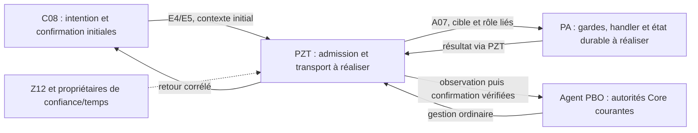

# PA01 — Cadrage documentaire des exécutables et raccordements PA/PZT

Date : 26 octobre 2026.

## 1. Statut, objet et limites

Ce document répond à la demande explicite de cadrage documentaire uniquement :
interfaces, travaux manquants et plan de qualification. Il décrit le passage
du constructeur natif aux exécutables fonctionnels, sans implémentation,
production de code, installation ou exécution de recette produit.

Il synthétise les contrats existants et incorpore les orientations A1–A5
explicitement validées par le développeur le 26 octobre 2026. Leur
[registre de décision](DECISIONS_A1_A5.md) distingue adoption, détails
contractuels encore à spécifier, réalisation et preuves manquantes.
Aucun champ de message, numéro de nouvelle version, délai ou fournisseur
concret n'est inventé ici. Les tâches de réalisation et les scénarios
fonctionnels restent ouverts ; la validation documentaire ne les clôture pas.

Le [détail A1/A2/A3 avec migration](DETAIL_A1_A2_A3.md) est désormais validé
par le développeur sous les décisions D-A1, D-A2, D-A3 et D-MIG : modèle
logique de liaison, transitions, Agent 2.0.0, codec et migration additive.
Ces détails sont inscrits dans le delta PA01 et synchronisés à l'identique
au canon pixs-agent sur demande explicite complémentaire du développeur le
26 octobre 2026, sans réapplication des principes A1–A5 déjà présents.
La validation de ces détails ne livre ni code, fournisseur ou migration exécutée.

Le 27 octobre 2026, le développeur valide [S1/R1/F1](DECISIONS_S1_R1_F1.md) :
tables PostgreSQL privées dédiées Agent ; outbox durable et relais PBO vers
PZT ; fournisseurs par domaine. Cinq exigences et douze scénarios sont
inscrits dans les deltas PA01 Agent/PZT et synchronisés à l'identique aux deux
canons sur sa demande explicite complémentaire du même jour, sans réapplication
des autres deltas. Cette synchronisation ne prouve aucune disponibilité fonctionnelle.

Le [détail S1/R1/F1 et migration](DETAIL_S1_R1_F1.md) est VALIDÉ le
27 octobre 2026 par le développeur sous D-S1/D-R1/D-F1/D-SMIG :
schéma physique, contrat du relais, interfaces privées et migration avec
preuves attendues. Dix-sept exigences et trente-quatre scénarios détaillés
sont inscrits dans les deltas PA01 Agent/PZT, NON SYNCHRONISÉS au canon
par cette inscription. Les choix S1/R1/F1 déjà canoniques sont conservés.
Ces décisions ne livrent ni schéma exécutable, relais, fournisseur ou migration,
ni preuve produit ; les réalisations et qualifications restent manquantes.

### Références à appliquer

- [Conception et décisions PA01](design.md), notamment D1–D14, E3, E4/E5,
  admission B et retrait selon leurs statuts et dates propres.
- [Contrats PA01](contracts.md) : formes exactes, propriétaires, versions,
  bindings, garde de temps, journal/ancre et interfaces privées.
- [Spécification Cython par campagne](specs/pixs-agent/spec.md).
- [Décisions A1–A5 adoptées](DECISIONS_A1_A5.md) et leurs deltas
  [Agent](specs/pixs-agent/spec.md) et [PZT](specs/pzt/spec.md), synchronisés
  au canon le 26 octobre 2026 sur demande explicite du développeur ; cette
  synchronisation ne livre aucune réalisation ni preuve fonctionnelle.
- [Canon pixs-agent](../../specs/pixs-agent/spec.md) et
  [canon pzt](../../specs/pzt/spec.md).
- [Matrice PA10 des raccords R01–R10 et points A1–A5](../separate-pa-pzt-and-pbo-management-modules/RACCORDS.md).
- [Recette PA10 C01–C28 et format de preuve](../separate-pa-pzt-and-pbo-management-modules/RECETTE_RACCORDS.md).
- [PROJECT.md, sections 43–44](../../../PROJECT.md),
  [TECHNICAL.md, sections PA/PZT](../../../TECHNICAL.md),
  [BUILD.md, sections 46–47](../../../BUILD.md) et
  [environnements déclarés dans DEVOPS.md](../../../DEVOPS.md).

Les copies historiques de `requirements.md`, les anciennes propositions et
les résultats datés restent des traces. Avant réalisation, rapprocher chaque
point de sa dernière décision applicable et de ses sources courantes.

## 2. État de départ observé et niveaux de preuve

| Élément | Preuve disponible au 26 octobre 2026 | Ce qui reste à établir |
| --- | --- | --- |
| Constructeur natif | [Campagne de dix recettes natives](../../../output/tests/pa01-cython-native/20261026T211014Z-a88a898a/RAPPORT.md), CPython 3.14.9 avec GIL, Cython 3.3.0 ; objets synthétiques et contrôle du verrou. | Comportement des exécutables, fermeture des dépendances et fonctionnement du produit distribué. |
| Précontrôle fonctionnel | [Rapport et empreintes](../../../output/tests/pa01-functional-preflight/20261026T212409Z-bdd9a816/RAPPORT.md) : aucun point d'entrée Python de production dans les 51 modules inspectés, ports de transport/exécution indisponibles. | Entrées fonctionnelles, composition réelle, transport, handlers et résultats durables consommables. |
| Frontières Agent/PA01 | Dix-sept tests structurels exécutés lors du précontrôle, sur données synthétiques. | Autorités réelles, origine, postconditions, effets et confirmation opérationnelle. |
| Liaison des quatre programmes | La [recette de liaison](../../../tests/native/test_object_linker.py) construit des fonctions de fixture ; elle annonce explicitement ne pas qualifier de service. | Sources de production et distribution fonctionnelle, sans entrée factice ni succès retourné sans effet vérifié. |

Ces campagnes restent séparées. Leurs nombres de tests ne constituent pas
un total de qualification fonctionnelle. Un succès du constructeur ou du
lieur ne change pas le statut des cas C01–C28 ni des recettes R01–R68.
Les preuves restent liées aux empreintes réellement testées.

## 3. Composition cible et points d'entrée

| Fichier adopté | Propriétaire | Modes autorisés | Travail restant et critère observable |
| --- | --- | --- | --- |
| `bin/pixs-pa-system` | PA, gestion PBO par `pixs.agent`. | `system-daemon` | Composer le lifecycle système et les handlers sélectionnés ; vérifier les autorités avant chaque effet et produire un résultat technique durable. |
| `bin/pixs-pa-events` | PA, gestion PBO par `pixs.agent`. | `system-start`, `system-stop` | Raccorder les événements de l'hôte, ou du seul conteneur dans Docker ; borner l'arrêt et conserver une issue inconnue si l'arrêt n'a pas pu s'achever. |
| `bin/pixs-pa-session` | PA, gestion PBO par `pixs.agent`. | `session-start`, `session-stop`, `session-daemon` | Raccorder les sessions réelles et leur fermeture sous identité utilisateur ; prouver l'isolation entre sessions et avec le rôle système. Exclu de Docker. |
| `bin/pzt` | PZT indépendant, gestion PBO par `pixs.pzt`. | `pzt-daemon` | Composer l'exécutant et ses canaux déclarés, l'identité, l'admission, le routage et l'état appliqué ; conserver le propriétaire réseau unique par périmètre. |

L'interface d'entrée déjà retenue est `main(rôle_fixe)` dans le module
compilé désigné par le descripteur natif. Le rôle vient de la construction.
Le lanceur attend un entier exact de 0 à 255 et refuse notamment booléen,
exception, module ou fonction absents. Ce code de sortie ne constitue pas
une preuve d'admission, de readiness ou de postcondition technique.

Le [parseur CLI existant](../../../src/pixs/pa_native/cli.py) contrôle les deux
formes de `--mode`, sans lancer de service. Le raccord à réaliser relie ce
contrôle au lifecycle réel, à ses dépendances et à la fermeture des ressources.
Les noms `entry.py` et `postgresql.py` du profil de fixture ne sélectionnent
pas les futurs noms de fichiers de production.

La distribution conserve le répertoire `bin/`, `runtime/`, `lib/` et le
runtime isolé D7/D8. Aucun Python hôte, chargement de plugin, recherche de
code au runtime ou cinquième exécutable n'est déduit de ce cadrage.

## 4. Interfaces à raccorder

Les identifiants I01–I09 ci-dessous servent uniquement au suivi documentaire.
Ils ne sont ni des noms d'API, ni des identifiants de contrats publics.

| ID | Frontière et propriétaires | Entrées et sorties déjà décrites | Garanties à établir avant branchement |
| --- | --- | --- | --- |
| I01 | Lanceur natif vers entrée compilée ; PA01. | Descripteur du rôle, module d'entrée, arguments CLI ; code de sortie exact. | Modules effectivement compilés, catalogue fermé, refus de mauvaise identité/mode, runtime distribué et lifecycle réel. |
| I02 | Gestion Agent vers transport ; PA10/C14 et PZT. | Instruction, contexte et catalogue Agent ; demande acheminée et retour corrélé sous A07. | Autorités courantes, bindings A1, version et cible vérifiés ; aucun accès direct PBO–PA. `dispatch()` refuse actuellement `PZT_TRANSPORT_UNAVAILABLE`. |
| I03 | Transport local E3 ; PZT, PA01 et Z12. | HTTP/JSON sur TCP IPv4 loopback, TLS 1.3 mutuel ; enveloppes A07 et profils sélectionnés. | Certificats terminaux ECDSA P-256, matière de clé et confiance propriétaire effectivement utilisables, suite A10h explicitement fournie, 0-RTT interdit ; versions/ABI/providers OpenSSL qualifiés. Endpoints, ports et budgets non sélectionnés ici. |
| I04 | Acheminement PZT vers exécutant PA ; PZT et PA01. | Opération/version du catalogue livré, mandat et contexte natif ; admission ou refus puis résultat technique corrélé. | Identité terminale et relation, révocation/politique/temps actuels, garde D14 et handler du rôle. Le Protocol `PztExecutionGate` ne fournit pas ce transport. |
| I05 | Préparation initiale ; C08 vers PA01 par PZT. | Projection/publication C08, observation PA, plan technique et bundle de confirmation ; requêtes et réponses E5. | Conserver OBSERVE, PREPARE_PLAN, consentement C08, nouveau PREPARE Critique puis READ_RESULT ; aucune autorité Core fictive avant PostgreSQL. |
| I06 | Sources d'autorité et de temps ; Z12, PA01, C08 et propriétaires compétents. | Identités, politique/révocation, observations D14 et preuves du contrat générique de temps. | Source et acquisition courantes, incertitude/continuité du profil sélectionné et bindings vérifiés. Un DTO, une signature, un UID ou un Name TPM isolé ne vaut pas autorité. |
| I07 | Exécution vers état technique durable ; PA01. | Plan et préconditions vérifiés, résultats d'IO, journal/ancre et postconditions ; résultat inspectable. | Contrôle avant chaque effet, consommation du mandat applicable, idempotence/fencing, durabilité et réconciliation ; aucune réémission aveugle après issue inconnue. |
| I08 | Observation et confirmation de gestion ; PA10, PA01 et C08. | Résultat et références d'observation ; vérifications par `AgentOriginTrustPort` et `AgentConfirmationTrustPort`. | Résoudre et vérifier origine, cible/scope/génération, document observé, postcondition et confirmation ; liaison serveur et projection conditionnelle A1/A2 à détailler et réaliser, évolution temporelle A3 versionnée sans modification implicite du contrat 1.0.0. |
| I09 | Supervision, arrêt et distribution ; PA01, PA03/PA07, PA09/X01, PA08/Z26 et gestion PBO. | État réellement observé, arrêt/reprise et artefacts versionnés. | Readiness liée aux dépendances effectives, observation datée, fermeture/annulation prouvées et contenu de distribution exact ; pas de succès d'après une seule présence de fichier. |

Le [contexte TLS existant](../../../src/pixs/pa_native/tls_context.pyx) déclare
`ready_for_transport=False`. Le [lifecycle de gestion PZT](../../../src/pixs/pzt/lifecycle.py)
refuse actuellement `PZT_EXECUTION_UNAVAILABLE`. Ces refus sont des frontières
à conserver tant que les fournisseurs réels et leurs preuves sont absents.

### Deux parcours distincts

Le diagramme décrit une cible documentaire. La gestion ordinaire ne réemploie
pas une identité ou un mandat initial comme autorité Core. L'amorçage ne
fabrique ni Subject, tenant, CommandMetadata ni droit Super Admin.

### Formes et versions conservées

Le catalogue logique reste limité à `inspect_postgresql`,
`prepare_postgresql` et `get_postgresql_result`, version 1.0.0.
`TechnicalPlan` 1.0.0 et son digest propre restent distincts des enveloppes
1.1.0 E5. Les profils 1.0.0 et 1.1.0 ne sont pas convertis implicitement.
Les champs, tableaux signés, encodages et bindings exacts restent ceux de
[contracts.md](contracts.md), sans copie simplifiée dans ce document.

RECEIVED, RUNNING, SUCCEEDED, FAILED, IN_DOUBT et BLOCKED sont des phases
techniques distinctes. SUCCEEDED technique, confirmation NV, confirmation
Agent, marqueur C08 et commit Core/Auth ne sont pas équivalents.

## 5. Décisions validées et livraisons encore nécessaires

| Point | Propriétaires | Orientation VALIDÉE le 26 octobre 2026 | Détails, réalisation et preuves encore manquants |
| --- | --- | --- | --- |
| A1 — Cible et génération | PA01/C08 avec PA10. | A1/D-A1 puis S1/R1/F1 et D-S1/D-R1/D-F1 validés : liaison privée, huit tables/contraintes, outbox/relais PBO vers PZT et interfaces privées détaillées. | Modèles, dépôts, intégration transactionnelle, hébergement/profils du relais, fournisseurs exécutables et contrôles réels à réaliser et qualifier. |
| A2 — Phases | PA01 avec PA10. | A2 et D-A2 validés : transitions, projection conditionnelle, preuves et refus détaillés, sans confirmation automatique. | Producteurs, lecture causale, déduplication et rapprochement à réaliser et qualifier. |
| A3 — Précision temporelle | PA10 avec C08/PA01/Z12. | A3/D-A3/D-MIG puis D-S1/D-SMIG validés : Agent 2.0.0, codecs, provenance séparée et migration physique additive M0–M5 avec retour/restauration. | Descripteurs, consommateurs, codecs/validateurs, modèles et migrations exécutables, producteurs temporels et preuves encore manquants. |
| A4 — Autorité | Z12/PA01/PZT/C08/Agent et producteur temporel sélectionné. | Interfaces spécialisées et responsabilités conservées ; F1 retient les fournisseurs par domaine et les producteurs temporels propres aux processus ; contrôle courant avant effet. | Implémentations et versions des fournisseurs retenus, sélection authentique, raccordements et preuves de fonctionnement/révocation avant effet. |
| A5 — Preuves | Chaque propriétaire d'artefact et de recette. | Quatre paliers de qualification, recette intégrée obligatoire et revue explicite avant promotion. | Exécutables fonctionnels, environnements et recettes produit applicables, preuves liées aux artefacts, postconditions et nettoyage. |

Ces orientations ne sont plus des arbitrages ouverts. Les formes détaillées
et livraisons restantes ne sont pas réputées adoptées ou présentes par
extension ; elles suivent les orientations sans les soumettre à nouveau
comme si la décision de principe manquait. Le
[registre A1–A5](DECISIONS_A1_A5.md) est la trace commune de cette distinction.

Le [raccord du temps](../add-pzt-ca-hierarchy-rotation-and-recovery/RACCORDS_TEMPS_V2.md)
et le contrat `pixs.time.evidence` 2.0.0 sont des références existantes ;
une interface abstraite n'en livre pas le producteur. Les bornes de temps,
budgets et politiques adoptés sont à reprendre de leurs sources exactes,
sans substituer une durée de fixture ou une fenêtre d'un autre domaine.

### Travaux de réalisation futurs, dans l'ordre des dépendances

| Lot documentaire | Travail manquant | Dépendance et critère de sortie attendu | Raccords existants |
| --- | --- | --- | --- |
| L1 | Réaliser les modèles/dépôts/migrations du schéma D-S1/D-SMIG, le contrat D-R1 et les adaptateurs D-F1 ; choisir hébergement PBO et profils opérationnels encore ouverts. | Détails validés ; implémentations/versions, composition authentique, transaction/transport et preuves encore nécessaires avant tout raccord fonctionnel revendiqué. | R01–R03, R07–R08. |
| L2 | Définir les modules d'entrée et la composition de chaque rôle. | D4–D9 conservés ; profil de production, sources et ressources déclarés ; ni `main()` factice ni rôle ou handler découvert au runtime. | R01, R05, R09. |
| L3 | Raccorder les gardes et la matière native de confiance/temps. | Fournisseurs Z12/PA01/C08 réels, gardes D11–D14 et préconditions du parcours sélectionné consommables. B/retrait/INIT A gardent leurs décisions propres. | R02–R03, R05. |
| L4 | Réaliser le transport, l'admission et le routage PZT, puis leur branchement aux handlers. | I02–I06 satisfaites ; environnement et paramètres sélectionnés, aucun canal alternatif ni accès direct PBO–PA. | R04–R05. |
| L5 | Compléter les effets techniques, résultats durables et stratégies de reprise. | Journal/ancre, autorités avant effet, postconditions et lecture courante après panne prouvables ; autorisations matérielles/SQL distinctes. | R05–R06. |
| L6 | Brancher observation, confirmation, supervision et lifecycle. | Contrats détaillés A1–A4 et fournisseurs concernés livrés et qualifiables selon les orientations validées ; séparation des domaines, arrêt/annulation et reprise explicités. | R07–R09. |
| L7 | Assembler les distributions et exécuter la qualification par profil. | Sources réelles, runtime, dépendances, provenance et inventaire disponibles ; preuves des cas applicables et nettoyage vérifié. | R10 et dépendances PA09/X01/PA08/Z26. |

Ces lots sont un ordonnancement documentaire ; ils n'ajoutent ni tâche
OpenSpec numérotée ni autorisation d'implémentation. Une partie indépendante
peut être préparée sans attendre un autre lot, sans déclarer satisfaite sa
dépendance. Aucun port, chemin système, UID, unité, matériel de clé, plafond
ou protocole distant supplémentaire n'est choisi ici.

## 6. Plan de qualification à préparer

Les repères Q01–Q11 organisent la recette future. Ils complètent la traçabilité
vers les cas existants, sans les remplacer. **Tous les repères ci-dessous sont
NON EXÉCUTÉS dans ce cadrage.** Les preuves historiques restent séparées.

Les critères [SRF01–SRF08](DECISIONS_S1_R1_F1.md) complètent ce plan pour
stockage exact, atomicité de remise, reprise, fournisseurs et temps.
Ils restent tous NON EXÉCUTÉS ; ils ne remplacent ni Q01–Q11, ni C01–C28,
ni D01–D16, et ne constituent aucune qualification par leur rédaction.

| Repère | Objet et conditions d'entrée | Résultat observable et preuves attendues | Références existantes |
| --- | --- | --- | --- |
| Q01 | Chaîne sélectionnée au début de campagne. | Dernière stable Cython publiée et non retirée vérifiée à date ; version exacte dans `toolchain.cython`, déclaration cohérente, provenance/empreintes. Comparaison réelle et refus d'une version différente avant compilation. Autres choix CPython/GIL/ABI conservés. | Politique Cython du change ; critères de chaîne du design. |
| Q02 | Construction et distribution des véritables sources. | Objets et quatre programmes attendus issus du profil fermé, des sources et outils épinglés ; runtime isolé, dépendances inventoriées, initialisation après déplacement et refus du repli hôte. Preuves de signatures/provenance selon le profil. | D4–D9 ; BUILD sections 46–47 ; C25/C27. |
| Q03 | Entrées, modes et privilèges réels. | Modes nominaux et refus des modes étrangers/absents ; vraie initialisation du rôle, isolation système/session, pas de succès retourné par une entrée vide. Sessions et événements correctement bornés. | Canon pixs-agent R01–R68 ; répartition des modes ; C24/C27. |
| Q04 | Amorçage avant PG et gestion ordinaire. | Parcours E4/E5 avec projection/confirmation C08 et autorités courantes ; catalogue fermé, paramètres/types/versions et bornes testés ; aucun contexte Core fabriqué. | C01–C08 ; R01–R03/R05. |
| Q05 | Canaux PZT et identités opérationnels. | Passage exclusif PZT/A07 localement ; mTLS, rôle/cible/relation, suite, protocoles et interdiction 0-RTT prouvés. Refus d'identité ou transport absent ; topologies distantes qualifiées séparément. | C09–C13 ; E3 et canons pzt/pixs-agent. |
| Q06 | Autorité, révocation et temps courants. | Signature sous clé non autorisée refusée ; perte ou changement de source/mandat/politique/temps bloque l'effet suivant. Preuves d'origine et de postcondition réellement vérifiées. | C10–C11/C17–C19 ; A3–A4. |
| Q07 | États, résultat et confirmation. | Reçu/progression conservés sans état appliqué ; succès technique durable et observation vérifiés ; confirmation Agent et commit métier distincts ; incohérences de binding refusées. | C06/C14–C19 ; A1–A2. |
| Q08 | Effets autorisés, concurrence et réponse perdue. | Postconditions techniques réelles, un effet admissible au plus, résultat inspectable et réconciliation ; aucune réémission aveugle ni compensation destructive. Mandats et plan exacts du test conservés. | C20–C22 ; journal/ancre et contrats PA01. |
| Q09 | Lifecycle, collecte et ressources. | Observation courante contre dernier connu, révocation/péremption respectée ; interruption, échec d'acquisition et annulation laissent les ressources libérées ou conservées sous reprise connue ; absence d'orphelin prouvée. | C23–C24 ; PA03/PA07 et BUILD section 47. |
| Q10 | Distribution et plateformes sélectionnées. | Debian : trois PA plus PZT, sans PBO/PFO imposés ; Docker : deux PA plus PZT et absence contrôlée des modes de session. Hôte PA/PZT distant sans puis avec PBO/PFO ; autres OS/cibles restent non qualifiés sans recette dédiée. | C13/C25–C27 ; PA09/X01/PA08/Z26. |
| Q11 | Revue de promotion. | Chaque cas applicable relié à son contrat/version, artefact et preuve ; dépendances, échecs, inconnues et exclusions motivées examinés. Le bilan distingue source, compilation, qualification, livraison et activation. | C28 ; tâches PA01 7–10 et règles d'archive du projet. |

### Conditions avant exécution d'un cas

Le dossier d'exécution futur identifie le profil, le rôle, l'opération, la
cible, les fournisseurs et les artefacts exacts. Il reprend les paramètres
adoptés de leurs sources propriétaires. Il distingue l'autorisation des
tests, l'accès technique à l'environnement et les mandats d'effet réels.
Une permission de test ou un accès root ne remplace pas une autorité PA/PZT.

Les essais LXC/Docker restent ceux des ressources dédiées et autorisées dans
DEVOPS.md. S'il y a partage, réconcilier propriété, réservation et état courant
avant effet selon le protocole applicable. Aucun accès SSH, secret, création
de certificat, installation, opération TPM/NV, SQL ou modification de service
n'est exécuté par ce document. Les règles de protection des secrets restent
applicables aux futurs producteurs, outils et rapports.

Les scénarios avec effets ont un plan exact, une cible isolée, des ressources
possédées, un nettoyage et une vérification après nettoyage. Les outils et
bibliothèques installés pour les tests sont conservés selon DEVOPS.md ;
préservation des données et reprise des issues inconnues restent distinctes
du nettoyage des seuls fichiers de test.

### Preuve minimale par cas

Reprendre le format de la recette C01–C28 : identifiant et exigence source,
statut, versions/empreintes, profil et fournisseurs réels ou doubles nommés,
commande effectivement exécutée, autorisation applicable, code de sortie,
préconditions, observations et postconditions, état durable après panne,
nettoyage, limites et résultat de la revue. Les preuves restent sans secret.

Un cas non lancé reste NON EXÉCUTÉ ; une dépendance absente est BLOQUÉE.
PASS ou FAIL suppose une exécution réellement observée. NON APPLICABLE exige
une justification du profil, notamment pour les sessions exclues de Docker.
Un mock ou une fixture peut qualifier un contrôle isolé, jamais le fournisseur
réel manquant. Une validation OpenSpec ou des liens ne qualifie aucun runtime.

## 7. Sortie documentaire et premier jalon suivant

Le livrable présent est le cadrage des interfaces, dépendances et recettes,
complété par les orientations A1–A5 et les détails D-A1/D-A2/D-A3/D-MIG
VALIDÉS, puis par S1/R1/F1 et D-S1/D-R1/D-F1/D-SMIG validés le 27 octobre
2026. Tables privées Agent et définitions physiques, contrat outbox/relais,
interfaces privées et migration sont adoptés ; modèles, raccordements
exécutables et preuves produit restent à produire. Aucune tâche de
réalisation n'est cochée et aucun cas produit n'est exécuté par cette
inscription. Le statut fonctionnel reste BLOQUÉ tant que les dépendances
ci-dessus ne sont pas livrées et qualifiables.

Le premier jalon futur est L1 : réaliser le schéma et les contrats validés,
arrêter l'hébergement/profil du relais et les versions exécutables des fournisseurs,
puis arrêter la composition
des entrées L2. Il précède un adaptateur de transport ou de résultat qui
ferait autrement des hypothèses sur l'autorité, les générations, les phases
ou le temps.
Une future demande de réalisation/exécution aura son périmètre propre ;
la présente demande reste strictement documentaire.
