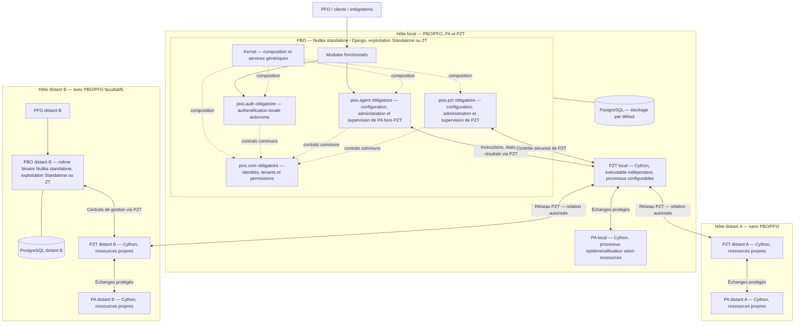
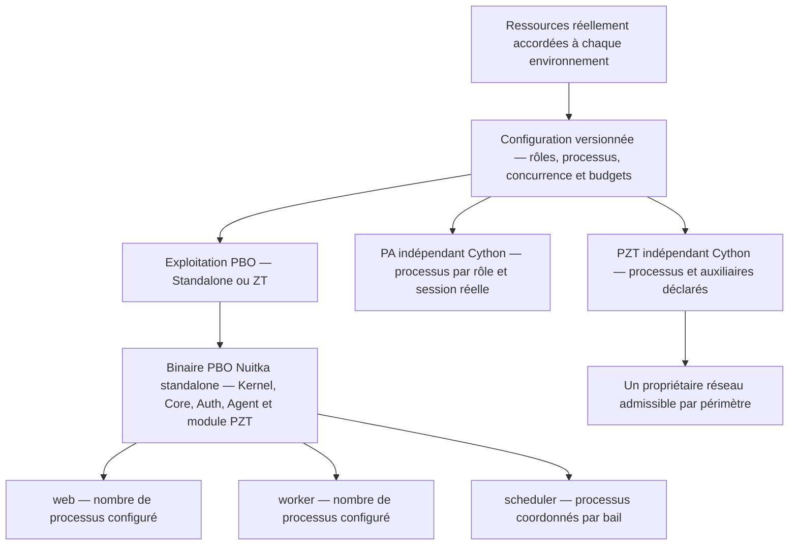

# Conception adoptée — binaire PBO et ressources

<!-- ACL-PIXS-2026-10-31-E3-R1:start -->
## Renvois courants — ACL-PIXS-2026-10-31-E3-R1

Renvois aux modes d’Instance Standalone/ZT/Domaine ; chaîne de compilation, tâches et preuves historiques inchangées.

Les choix et preuves de compilation sont conservés. La référence des modes est [runtime](../../specs/runtime/spec.md) et [pixs-instance](../../specs/pixs-instance/spec.md). Le profil antérieur à deux modes est une référence historique, sans réapplication à la nouvelle cible. Aucun changement de tâches, de cases, de chaîne ou de preuve produit.
<!-- ACL-PIXS-2026-10-31-E3-R1:end -->

## Réconciliation courante des deltas — reprise ACSM du 31 octobre 2026

Le [contrôle de couverture des 37 exigences](COUVERTURE_DELTAS_ACSM.md) distingue 34 blocs déjà au canon, le modèle de modes remplacé et deux exigences encore proposées. Les sept fichiers intégraux sont conservés dans [l'historique interne](historique-deltas-avant-reprise-acsm/README.md), hors des deltas actifs.

Seules **Admission indépendante de la sélection officielle Nuitka PBO** et **Conservation et rattachement des preuves de sélection PBO** restent proposées dans le [delta actif reference-runtime](specs/reference-runtime/spec.md), avec leurs six scénarios inchangés. Elles ne sont pas synchronisées au canon ; leur adoption et leur réalisation restent à engager sous les autorisations applicables. Le change reste normatif, sans `skip_specs: true` global.

Les sections datées ci-dessous retracent les décisions antérieures. Pour la cible courante, Standalone, ZT et Domaine sont des modes de l'Instance Pixs, distincts de Nuitka standalone et de l'activation du transport PZT. Les critères des tâches futures suivent les contrats canoniques courants et les deux exigences encore proposées ; aucune tâche ni preuve historique n'est requalifiée.

## Décision du 21 octobre 2026

ARCHITECTURE_ADOPTÉE ; CANON_SYNCHRONISÉ ; RÉALISATION_NON_ENGAGÉE.

Ce statut décrit la décision du 21 octobre 2026. Les six exigences du complément
Nuitka par campagne adopté le 26 octobre 2026 sont également synchronisées au
canon sur validation explicite du développeur, sans réapplication des deltas
antérieurs ni réalisation produit.

Le complément de métadonnées validé ensuite le 26 octobre 2026 précise le
verrou `toolchain.nuitka` et ajoute quatre exigences. Il est synchronisé au
canon sur validation explicite du développeur, sans réapplication des autres
deltas ni réalisation du constructeur.

Le complément de preuve officielle datée du 27 octobre 2026 ajoute deux
exigences et six scénarios dans ce change, sans synchronisation du canon,
code ni implémentation. Le verrou reste `toolchain.nuitka` des métadonnées PBO.

Le binaire PBO commun réunit Kernel, pixs.core, pixs.auth, pixs.agent et pixs.pzt,
avec les autres composants sélectionnés. Les frontières de propriété,
contrats, migrations, permissions et dépendances restent celles des modules.
Le Kernel conserve les mécanismes génériques ; il ne relaie pas tous les appels.
La modularité dans un processus ne constitue pas une isolation mémoire ou
de privilèges. Les fonctions internes utilisent les contrats publics sans
imposer une IPC par module.

Les sous-graphes représentent la composition logique du binaire et les topologies ; ils ne désignent pas un processus distinct pour chaque module.

## Binaire, rôle et processus

Un fichier exécutable PBO peut démarrer plusieurs processus web, worker ou
scheduler, selon une configuration explicite. Les rôles supplémentaires
doivent être spécifiés ; le nombre de binaires ne détermine pas le nombre de
processus. Les composants obligatoires demeurent dans la composition sans
activer tous leurs services ou exécutants dans chaque processus.

PA conserve trois binaires et six modes, PZT son binaire indépendant et
pzt-daemon. Leurs plans sont propres à l'environnement où ils s'exécutent,
même si PBO est distant. Les événements système sont bornés, les sessions
réelles restent isolées. PZT conserve un propriétaire admissible unique des
ressources réseau par périmètre ; des auxiliaires déclarés n'introduisent
aucun écrivain concurrent implicite.

Ce schéma décrit les rôles et budgets, sans fixer de valeur numérique ni de canal de communication. Les nombres de processus restent soumis à la qualification et au lifecycle de chaque profil.

## Politique de ressources

Chaque plan versionné déclare rôles, processus, concurrence, files/buffers,
CPU, mémoire et connexions. La qualification tient compte des quotas effectifs
du service, VM ou conteneur, des réplicas, dépendances et marges système.
Les ressources physiques seules et le nombre de cœurs ne suffisent pas.

Les dimensions restent séparées : détecté, accordé, demandé, effectif et
réellement appliqué. Une proposition de dimensionnement n'est appliquée que
sous configuration explicite ou politique préautorisée et bornée. Une variation
de charge ne change pas silencieusement les processus ou garanties. L'état
appliqué est vérifié ; une mesure périmée ou un résultat partiel est signalé.

Les superviseurs déclarés assurent lancement, limites, signaux et redémarrage.
PBO garde l'autorité applicative ; pixs.agent gère PA via PZT et pixs.pzt gère
PZT par ses interfaces sécurisées. Les changements exigent autorisation,
validation, drain, reprise et observation. La réplication scheduler conserve
bail et clôture de péremption ; les opérations PA conservent idempotence et
propriété des ressources.

## Sécurité et admission

Les budgets ne réduisent ni les garanties d'identité, autorisation, isolation,
audit, durabilité, attestation, expiration, révocation ou protection indépendante.
Un profil insuffisant est refusé à l'admission ; en service, le comportement sûr
déclaré s'applique. Tous les échanges PBO–PA restent sous PZT, même localement ;
aucune optimisation n'introduit un canal de substitution.

La recette mesure mémoire, CPU au repos/en charge, latence, débit, saturation,
redémarrage et reprise avec la configuration et la cible distribuées.
Compiler ne démontre ni gain de ressources ni parallélisme Python multicœur.

## Compilation et modes d'exploitation précisés le 21 octobre 2026

PBO est compilé avec Nuitka en mode standalone. Les distributions livrent
un exécutable commun, son runtime, ses bibliothèques et ressources déclarées.
Le mode onefile ne remplace pas ce profil. Les modes d'exploitation Standalone
(instance autonome sans autorité Pixs extérieure) et ZT (réseau gouverné via PZT)
utilisent le même binaire et conservent le module essentiel pixs.pzt.
L'activation du transport PZT reste distincte : Standalone peut l'utiliser
pour joindre ses PA locaux ou distants autorisés.
L'activation réseau garde les préconditions et contrôles existants ; aucun canal
PBO–PA alternatif n'est créé. Les trois binaires PA et le binaire réseau PZT sont compilés avec Cython.

Dans PBO, Cython est réservé aux optimisations ciblées : profilage du coût,
critères définis avant recette et mesures comparables de gain/non-régression.
Les preuves couvrent ressources, contrats, sécurité et maintenabilité ; les
imports dynamiques Django et toutes les ressources livrées sont qualifiés.
Cython ne remplace pas la construction Nuitka du PBO complet. Le choix ne
produit ni artefact, ni mesure, ni installation par cette formalisation.

La sélection Cython pour les trois binaires PA remplace leur ancien choix Nuitka, avec les mêmes modes et frontières de privilèges. PZT conserve Cython. La restriction aux optimisations ciblées mesurées concerne uniquement l'usage de Cython à l'intérieur de PBO, dont la chaîne principale est Nuitka standalone.

## Politique Nuitka par campagne — décision du développeur du 26 octobre 2026

Le [contrat canonique reference-runtime](../../specs/reference-runtime/spec.md) complète
la construction PBO sur le modèle de la [politique Cython PA01](../add-pa-native-build-and-component-composition/design.md#politique-cython-par-campagne--décision-du-développeur-du-26-octobre-2026).
Au début de chaque campagne de qualification PBO, la chaîne sélectionne la
dernière version stable de Nuitka publiée et non retirée, après vérification
datée de la source officielle [PyPI](https://pypi.org/project/Nuitka/). Les
préversions et versions de développement sont exclues. La date de vérification,
la source, la version exacte, la provenance et les empreintes des distributions
utilisées sont enregistrées avec les métadonnées de chaîne de la campagne.

La version exacte est verrouillée dans `toolchain.nuitka` pendant toute la campagne et pour reproduire
ses artefacts. Les contrôles de construction comparent la version effectivement
utilisée au verrou et refusent tout écart ; une contrainte ouverte ne remplace
pas ce verrou. Une nouvelle publication ne modifie ni une campagne en cours
ni ses preuves. La campagne suivante réévalue la dernière stable ; la seule
reproduction d'un artefact conserve sa chaîne historique verrouillée.

Un changement de version impose l'alignement de `pyproject.toml`, des métadonnées
de chaîne, des contrôles de construction PBO, des tests concernés et de la
documentation courante, puis la qualification de la nouvelle chaîne Nuitka
standalone. Celle-ci couvre Python, Django et ses imports dynamiques,
dépendances, compilateur C, ABI, plateformes, options, rôles et ressources
embarquées. Les anciennes preuves restent rattachées à leurs versions et
artefacts, sans transfert de qualification à la nouvelle chaîne.

Une dernière stable invérifiable ou dont la compatibilité ne peut pas être
qualifiée bloque la sélection ou la qualification concernée, sans repli
implicite vers une ancienne version. La politique ne modifie pas implicitement
CPython, le mode GIL, le compilateur C, l'ABI, les cibles, les dépendances,
les rôles ou les choix Cython distincts de PA/PZT et des optimisations PBO.
Le profil Nuitka standalone et les modes d'exploitation Standalone/ZT restent
conservés. Le format des métadonnées et le verrou sont désormais définis par
le complément ci-dessous ; les autres schémas et choix de chaîne restent ouverts.

La sélection et son inscription documentaire ne valent ni autorisation
d'installation, ni construction, ni qualification. Ce complément de six
exigences et sept scénarios est adopté dans ce change et synchronisé au canon
sur validation explicite du développeur le 26 octobre 2026 ; les deltas déjà
synchronisés du 21 octobre restent historiques et ne sont pas réappliqués.

## Métadonnées de campagne PBO et verrou Nuitka — complément du 26 octobre 2026

Ce contrat reprend la séparation de PA01 entre validation de structure,
sélection officielle, verrou de version et observation avant compilation.
Il définit un document TOML de métadonnées de campagne, fourni explicitement
au futur constructeur PBO, distinct du profil de ressources et de
`pyproject.toml`. Aucun chemin de fichier ni option CLI par défaut n'est fixé.
Ce document ne définit pas l'ensemble du profil de construction PBO et
n'adopte aucune version Python, ABI, cible, dépendance ou option supplémentaire.

### Schéma fermé v1

Les seules clés racines sont `schema_version`, `campaign`, `toolchain`,
`selection` et `distributions`, toutes obligatoires. Les trois tables
`campaign`, `toolchain` et `selection` sont uniques ; `distributions` est une
liste non vide de tables TOML `[[distributions]]`. Les clés de chaque table
sont exactement celles indiquées ci-dessous. Les champs inconnus, absents,
dupliqués ou mal typés sont refusés. Les fichiers texte sont UTF-8/LF.
Une valeur textuelle est non vide et sans caractère de contrôle ; aucune
variable d'environnement ni interpolation n'est évaluée.

| Champ | Type et règle |
| --- | --- |
| `schema_version` | Texte exact `1.0.0`, version du seul schéma de métadonnées. |
| `campaign.id` | Texte identifiant une campagne PBO de manière unique dans son historique ; pas de valeur implicite. Une reproduction conserve cet identifiant et les métadonnées figées. |
| `campaign.component` | Texte exact `pbo`, sans désigner une campagne PA01 ou PZT. |
| `toolchain.nuitka` | Texte de version publique PEP 440 normalisée, finale ou `.postN`, selon la même forme admise que `toolchain.cython` dans PA01. Refuser contraintes ouvertes, préversions, développement, versions locales et formes non normalisées. Une forme valide ne prouve pas sa publication ni sa qualification. |
| `selection.verified_at` | Texte horodaté en UTC `YYYY-MM-DDTHH:MM:SS[.fraction]Z`, date civile valide de la vérification officielle ; pas de date TOML native, de date sans fuseau ni de valeur calculée implicitement. |
| `selection.source_url` | Texte exact `https://pypi.org/pypi/Nuitka/json`, source du relevé de sélection. |
| `selection.snapshot` | Chemin relatif POSIX, canonique et sans remontée, vers le relevé JSON conservé relativement au document de campagne. Le fichier réellement lu reste dans son dossier, sans lien symbolique. |
| `selection.snapshot_sha256` | Texte de 64 caractères hexadécimaux minuscules, SHA-256 des octets du relevé conservé ; vérifié sur le fichier réel. |
| `distributions[].filename` | Nom simple du fichier Nuitka utilisé, sans chemin ni doublon. |
| `distributions[].url` | URL HTTPS de cette distribution, exactement celle déclarée dans le relevé officiel pour la version verrouillée ; aucune information d'authentification embarquée. |
| `distributions[].sha256` | Texte de 64 caractères hexadécimaux minuscules, égal au SHA-256 officiel et à celui des octets effectivement utilisés. |

Le validateur structurel n'effectue ni accès réseau ni installation. La
preuve de sélection est vérifiée séparément avant de figer les métadonnées :
le relevé officiel doit établir que `toolchain.nuitka` est la dernière stable
publiée et non retirée à `selection.verified_at`, en excluant préversions et
développement. Les fichiers retenus doivent être non retirés dans ce relevé.
Le nom, l'URL et le condensat de chaque distribution utilisée doivent
correspondre à ses données ; une distribution utilisée mais absente du
document de campagne est refusée. Le relevé figé est conservé pour permettre
la revue ultérieure de la sélection. Son empreinte seule ne prouve pas
l'origine officielle ni la réalisation de cette vérification datée.

### Verrou, observation et compte rendu

La déclaration unique `Nuitka==<version exacte>` de `[build-system].requires`
dans `pyproject.toml` doit correspondre à `toolchain.nuitka`. Les deux valeurs
sont des contraintes d'entrée ; aucune ne vaut observation du compilateur
réellement appelé. Les contrôles ne modifient pas le manifeste pour résoudre
une divergence et n'installent aucun paquet implicitement.

Avant toute compilation PBO, une sonde locale avec le même interpréteur et
le même Nuitka que la construction produit exactement un objet structuré
`{"version": "<version observée>"}`. Une sortie absente, mal typée, ambiguë
ou non normalisée ferme la construction. La version observée doit être
strictement égale au verrou ; même une stable plus récente est refusée.
Le constructeur ne consulte pas PyPI et ne sélectionne aucune autre version.

Le compte rendu `build-report.json` contient au minimum `campaign_id`,
`campaign_metadata_sha256`, `profile_sha256` et `nuitka_version` avec
`locked` et `observed`. Les empreintes portent respectivement sur les octets
du document de campagne et du profil de construction PBO effectivement
utilisés. Ce sont des entrées figées indépendantes ; le rapport dérivé n'est
inclus dans aucune de ces empreintes, sans auto-condensat ni cycle. Le rapport
trace aussi les distributions vérifiées et l'issue du contrôle. Si la sonde
échoue, `observed` vaut `null` et aucune version n'est inventée ; si elle
réussit avec un écart, les deux valeurs sont conservées et l'issue est un refus.
Une entrée dont l'intégrité n'est pas vérifiée ne doit pas être présentée
comme vérifiée dans le rapport. Aucun diagnostic n'expose une valeur secrète.

Les refus distingués sont `PBO_CAMPAIGN_METADATA_INVALID` pour un schéma
invalide, `PBO_CAMPAIGN_EVIDENCE_INVALID` pour une preuve absente ou incohérente,
`PBO_BUILD_NUITKA_METADATA_INVALID` pour une sonde inexploitable et
`PBO_BUILD_NUITKA_MISMATCH` pour une divergence entre déclaration, verrou et
version observée. Ces codes sont des contrats à réaliser, sans contrôleur
exécutable livré par cette rédaction.

### Immutabilité et périmètre

Après sélection validée, l'identité, le verrou, la date et les preuves de la
campagne sont figés. Une nouvelle sélection exige une nouvelle campagne et
la qualification correspondante ; elle ne réécrit pas les métadonnées ou
preuves d'une campagne antérieure. Une reproduction réutilise ses entrées
figées et vérifiées, sans nouvelle consultation de la dernière stable ni
horodatage de sélection remplacé. Les anciens artefacts restent liés à leurs
versions et à leurs campagnes.

Les six exigences Nuitka initiales restent historiquement synchronisées.
Ce complément précise dans le delta l'exigence de verrouillage et ajoute
quatre exigences et six scénarios ; ces évolutions sont synchronisées au canon
sur validation explicite du développeur le 26 octobre 2026, sans réapplication
des autres deltas.
Les tâches 2.1 à 2.5 restent non cochées. Aucun relevé PyPI, document de
campagne réel, constructeur, sonde, installation, compilation ou qualification
n'est produit par cette définition documentaire.

## Preuve officielle datée Nuitka — complément du 27 octobre 2026

Le développeur autorise la définition documentaire d'une [procédure de preuve PBO](PREUVE_SELECTION_PBO.md)
équivalente à celle de PA01. L'observation directe de PyPI en HTTPS vérifié
est datée en UTC ; les entrées et leurs empreintes sont figées puis revues
explicitement par le développeur ou un responsable de campagne délégué.
L'admission lie le manifeste exact et la campagne PBO dans un registre
protégé, distinct du candidat et non modifiable par le constructeur ou son
appelant. Le lecteur de confiance appartient au contexte de build autorisé,
sans sélection d'un registre de remplacement par le demandeur.

Le futur raccord contrôle l'admission et son état courant hors ligne,
rapproche les octets effectivement utilisés, `toolchain.nuitka` et la
déclaration exacte du manifeste Python, puis observe le compilateur avant
toute compilation. Une admission PA01 ou une preuve auto-déclarée ne vaut
pas admission PBO. Les entrées manquantes, altérées, retirées ou invérifiables
restent bloquantes, sans ancienne version choisie implicitement.

Le manifeste de preuve, l'admission et les retraits sont des documents
distincts de l'enveloppe fermée v1. Aucune clé n'y est ajoutée ; le verrou
Nuitka et les autres choix de chaîne restent conservés. Le rapport ajoute
`selection_admission_ref`, `selection_admission_sha256` et
`selection_manifest_sha256`, liés aux preuves vérifiées, sans auto-condensat.
Les dates et preuves historiques restent conservées pour les reproductions.

Comme pour PA01, ce mécanisme repose sur la collecte contrôlée, la validation
HTTPS, l'horloge UTC, l'autorité de revue et le registre protégé ; il ne
prétend pas fournir une signature de PyPI ni un horodatage public certifié.
Emplacement, propriétaire, droits et conservation du registre seront
qualifiés avant une admission réelle ; aucun chemin, UID ou droit réel n'est
créé ou modifié par cette définition.

Deux exigences et six scénarios sont ajoutés au delta reference-runtime,
sans synchronisation du canon. Les groupes P01–P06 sont préparés, non
exécutés. Aucun code, constructeur, relevé courant, admission réelle,
stockage protégé, installation ou qualification n'est produit ; les tâches
de réalisation restent non cochées.

## Distribution et points ouverts

| Artefact | Contenu et ressources |
| --- | --- |
| Debian PBO/PFO | Binaire PBO commun et ressources PFO ; profils externes, sans exécutables PA/PZT embarqués. |
| Debian PA/PZT | Trois binaires PA et un PZT indépendant ; profils propres à leur environnement, sans PBO local requis. |
| Docker | Binaire PBO commun, ressources PFO, deux binaires PA système/événements et PZT ; un rôle PBO explicite par conteneur, instances bornées et modes de session PA exclus. |

Nuitka standalone est retenu pour PBO ; la politique de version suit désormais
la dernière stable par campagne définie ci-dessus. La version effective et sa
compatibilité, les options, noms/CLI, autres schémas de configuration, chargement des extensions,
valeurs par défaut et seuils restent à spécifier et qualifier avant réalisation.
Le développement depuis les sources reste possible. Aucune option Python sans
GIL, dépendance, nouveau rôle PA/PZT ou isolation système n'est adopté ici.

## Propriété et coordination des dossiers

| Propriétaire | Coordination à la reprise |
| --- | --- |
| Ce change | Définition du binaire PBO commun, politique Nuitka par campagne et politique transverse de ressources. |
| activate-reference-runtime-composition | Activer le même socle et les profils sans retirer les obligations P0. |
| separate-pa-pzt-and-pbo-management-modules | Préserver propriétaires, contrats, canaux et séparation PA/PZT ; sa conception est complétée par la présente décision. |
| Lots PA/PZT et distributions existants | Qualifier compilation, sessions, propriétaire réseau, budgets et lifecycle dans leurs périmètres. |

Les deltas de sept capacités issus du 21 octobre sont déjà synchronisés au
canon ; toute clôture doit reconnaître cet état sans double application. Les
six exigences Nuitka par campagne du 26 octobre ont été synchronisées
séparément sur validation explicite du développeur, sans rejouer les anciens deltas.
Le complément de métadonnées et la précision `toolchain.nuitka` sont également
synchronisés sur validation explicite du développeur le 26 octobre 2026 ; les
anciens deltas ne sont pas rejoués.
Les anciens audits et matrices restent historiques et sont à réconcilier avant réalisation. Le change
reste ouvert ; ses tâches produit ne sont pas exécutées.

## Vérifications documentaires

### Premier passage — binaire commun et ressources

Avant modification : OpenSpec strict global réussi, 189 éléments valides
(111 changes ouverts et 78 capacités), aucune erreur. Le canon compte
812 exigences et 948 scénarios.

Après modification, OpenSpec 1.14.3, appelé avec Node et télémétrie désactivée,
valide le contrôle `validate --all --strict --json --no-interactive` avec
code natif 0 : 190 éléments sur 190, soit 112 changes ouverts et 78 capacités,
sans erreur ni avertissement. Le change reste ouvert ; aucune archive n'est créée.

Le contrôle de concordance compare les sept capacités au HEAD de départ et à
leurs deltas : aucune exigence retirée, 16 ajoutées, trois modifiées et
28 scénarios ajoutés. Les 19 blocs concernés sont identiques entre deltas et
canon ; leurs descriptions restent sous 500 caractères et emploient les
mots-clés normatifs. Le canon compte 78 capacités, 828 exigences et 976 scénarios.
L'inventaire de suivi compte 158 archives et 112 changes ouverts, soit 270 et
58,52 % ; PROJECT et README distinguent ce relevé des instantanés historiques.

Les 24 fichiers concernés sont des documents Markdown et la seule métadonnée
.openspec.yaml du nouveau change. UTF-8/LF, clôture des blocs, neuf liens ajoutés
et 13 schémas Mermaid sont contrôlés statiquement. Les copies de topologie,
gestion PA/PZT et plans de ressources concordent. La commande mmdc n'est pas
disponible ; aucun rendu graphique ni contrôle par moteur Mermaid n'est revendiqué.
Le diff ne présente aucune erreur d'espacement.

Aucun code, manifest produit, dépendance, configuration effective, secret,
fixture, test runtime, build, processus applicatif, installation, déploiement,
publication, commit ou push n'est réalisé par cette formalisation.
Les tâches de réalisation restent non cochées ; les contrôles documentaires
ne prouvent ni binaire disponible ni performance ou qualification P0.

### Complément — compilateurs et modes d'exploitation

Le choix final est Nuitka en mode standalone pour PBO, Cython pour les trois
binaires PA et pour le binaire PZT indépendant. Dans PBO, Cython reste limité
aux optimisations ciblées mesurées. Les modes d'exploitation PBO Standalone
(autonome) et ZT restent distincts du mode de compilation.
Aucune optimisation PGO n'est sélectionnée par ce complément.

Le contrôle OpenSpec 1.14.3 strict global réussit avec code natif 0 sur les
190 éléments : 112 changes et 78 capacités, sans erreur ni avertissement.
Le bilan consolidé face au HEAD initial est de 19 exigences ajoutées, six
modifiées et 34 scénarios supplémentaires ; aucune exigence n'est retirée.
Les 25 blocs concernés concordent exactement entre les sept capacités et
leurs deltas ; les descriptions contrôlées restent sous 500 caractères.
Le canon compte 78 capacités, 831 exigences et 982 scénarios. Les compteurs
PROJECT/README sont alignés ; l'inventaire reste 158 archives et 112 ouverts.

Le contrôle documentaire couvre 46 fichiers, uniquement Markdown et la
métadonnée du change : UTF-8/LF, clôture des blocs, 12 liens ajoutés valides,
13 schémas Mermaid contrôlés statiquement et copies concordantes. Le diff
ne présente pas d'erreur d'espacement. Aucun rendu Mermaid n'est revendiqué.

Les dossiers de préparation PA sont alignés sur Cython. L'instantané PA01
requirements.md reçoit une annotation historique ; sa comparaison au HEAD
confirme que seuls ces mots d'annotation sont ajoutés, sans modification des
blocs sources, empreintes ou preuves antérieures. Les archives restent intactes.
Les tâches produit restent non cochées ; aucun outil, build, test applicatif,
mesure de performance ou artefact exécutable n'est produit par cette rédaction.

### Vérification finale — compilateurs et modes Standalone/ZT

Les compilateurs sont cohérents : PBO sous Nuitka standalone, les trois
binaires PA et le binaire PZT sous Cython. Dans PBO, Cython reste réservé aux
optimisations ciblées mesurées. Les anciennes mentions Nuitka pour PA sont
limitées aux traces historiques annotées ; aucune archive n'est modifiée.

Deux incohérences des derniers ajouts sont corrigées. Le nom du second mode
d'exploitation PBO est ZT ; PZT reste le composant réseau et ZTP son appellation
historique. Standalone exprime l'autonomie de gouvernance, comme PROJECT §44.2,
sans imposer la désactivation du transport PZT. Une instance Standalone peut
utiliser PZT pour ses PA autorisés, même locaux. Le profil sans réseau activé
reste un cas particulier ; les échanges PBO–PA restent bloqués lorsque PZT
est absent ou invalide, sans substitution ni retour autonome implicite.

Le scénario « Transport PZT en mode Standalone » complète cette distinction.
Le bilan consolidé est de 19 exigences ajoutées, six modifiées et 35 scénarios
supplémentaires. Le canon compte 78 capacités, 831 exigences et 983 scénarios ;
PROJECT et README sont alignés. Les 25 blocs des sept capacités concordent
avec leurs deltas et les compteurs de changes restent inchangés.

OpenSpec 1.14.3 strict global réussit avec code natif 0 : 190 éléments sur 190,
soit 112 changes et 78 capacités, sans erreur ni avertissement. Les contrôles
UTF-8/LF, blocs, 12 liens ajoutés, 13 schémas statiques et copies concordantes
réussissent ; le diff ne présente pas d'erreur d'espacement. Aucun rendu par
moteur Mermaid, test applicatif ou binaire qualifié n'est déduit de cette revue.

### Complément Nuitka par campagne — vérifications du 26 octobre 2026 avant synchronisation

La demande du développeur autorise la mise à jour de ce change selon la
politique Cython PA01. Quatre fichiers sont modifiés : `proposal.md`,
`design.md`, `tasks.md` et `specs/reference-runtime/spec.md`. Six exigences et
sept scénarios sont ajoutés au delta ; les blocs antérieurs sont conservés
à l'identique. Les états et identifiants des tâches existantes sont conservés,
et les tâches produit 2.1 à 2.5 restent non cochées.

Avec OpenSpec 1.15.0, les commandes
`openspec validate define-common-pbo-binary-and-resource-profiles --strict --json --no-interactive`
et `openspec validate --all --strict --json --no-interactive` retournent le code
natif 0. Le contrôle global valide 185 éléments sur 185, soit 107 changes et
78 capacités, avant et après modification, sans erreur ni avertissement.
Les 86 diagnostics INFO sont identiques avant et après. Celui du change
concerne le delta reference-composition déjà présent au canon et son refus
d'archivage éventuel ; il est préexistant et ne vaut pas autorisation de rejouer
les anciens deltas ni d'archiver ce dossier.

Les contrôles documentaires des quatre fichiers réussissent : UTF-8/LF,
clôture des blocs Markdown, liens locaux et ancres, présence des mots-clés
normatifs et scénarios WHEN/THEN, six exigences et sept scénarios supplémentaires,
ainsi que `git diff --check` limité à ce change. La comparaison des empreintes
confirme que les sept capacités canoniques concernées, les autres fichiers du
change et `pyproject.toml` restent inchangés par cette intervention.

Le complément reste adopté dans ce change, non synchronisé au canon. Aucune
nouvelle campagne produit n'est lancée et aucune version n'est sélectionnée
par cette seule rédaction. Aucun constructeur, contrôle exécutable ou test
applicatif n'est modifié ou exécuté ; aucune installation, compilation,
qualification de chaîne, archive, publication, commit ou push n'est effectué.

### Synchronisation ciblée Nuitka au canon — 26 octobre 2026

Sur validation explicite du développeur, les seules six exigences Nuitka par
campagne et leurs sept scénarios sont ajoutés à
[reference-runtime au canon](../../specs/reference-runtime/spec.md). La comparaison
au relevé précédant cette synchronisation confirme un ajout strict à la fin
du fichier : les 18 exigences et 25 scénarios antérieurs sont inchangés ;
la capacité compte désormais 24 exigences et 32 scénarios. Les six blocs
ajoutés sont identiques au delta validé, sans doublon ni réapplication des
deltas déjà synchronisés. Le delta source et les six autres capacités
canoniques concernées par ce change restent inchangés.

Quatre fichiers sont modifiés par cette synchronisation : le canon
`openspec/specs/reference-runtime/spec.md`, ainsi que `proposal.md`, `design.md`
et `tasks.md` du change pour leur suivi. Les états et identifiants des tâches
restent inchangés ; les tâches produit 2.1 à 2.5 restent non cochées.
Les autres fichiers du change et `pyproject.toml` sont inchangés.

Avec OpenSpec 1.15.0, les validations strictes de la capacité reference-runtime,
du change et de l'ensemble par `openspec validate --all --strict --json --no-interactive`
retournent le code natif 0. Le contrôle global valide 185 éléments sur 185,
soit 107 changes et 78 capacités, sans erreur ni avertissement. Les 86
diagnostics INFO restent identiques au relevé précédant la synchronisation,
y compris le diagnostic d'archivage préexistant sur reference-composition.
Les contrôles UTF-8/LF, blocs Markdown, liens locaux et `git diff --check`
réussissent sur les quatre fichiers concernés.

La synchronisation documentaire est réalisée ; le change reste ouvert.
Aucune installation, compilation, qualification de chaîne, exécution de test
applicatif, archive, publication, commit ou push n'est effectué.

### Complément de métadonnées PBO — vérifications du 26 octobre 2026 avant synchronisation

La validation du développeur porte sur la définition des métadonnées de
campagne et du verrou `toolchain.nuitka` dans ce change. Quatre fichiers sont
modifiés par cette intervention : `proposal.md`, `design.md`, `tasks.md` et
`specs/reference-runtime/spec.md`. Le delta précise une exigence existante,
classée MODIFIED, et ajoute quatre exigences ADDED avec six scénarios. Les
autres blocs normatifs antérieurs et les états des tâches sont conservés.
Ce complément ne réapplique pas les deltas déjà synchronisés et ne modifie
pas le canon : la précision du verrou et les quatre ajouts restent dans le change.

OpenSpec 1.15.0 valide le change en mode strict et le contrôle
`openspec validate --all --strict --json --no-interactive` retourne le code
natif 0 avec 185 éléments valides sur 185, soit 107 changes et 78 capacités,
sans erreur ni avertissement. Les 86 diagnostics INFO restent identiques au
relevé précédant ce complément, dont le diagnostic d'archivage préexistant
sur reference-composition. Le classement MODIFIED du verrou évite de le
présenter comme une exigence nouvelle absente du canon.

Les contrôles documentaires réussissent sur les quatre fichiers : UTF-8/LF,
blocs Markdown, liens et ancres, concordance des champs, des codes de refus
et du rapport entre design et delta, ainsi que `git diff --check`. Il s'agit
de contrôles statiques des contrats, sans validateur PBO ni recette runtime
réalisés ou exécutés. Les empreintes des 78 capacités canoniques et de
`pyproject.toml` sont inchangées. Quatre documents du change PA01 ont évolué
concurremment entre les relevés ; ils sont laissés intacts par cette intervention.

Le change reste ouvert et les tâches produit restent non cochées. Aucun
document de campagne réel, sélection courante, téléchargement, installation,
constructeur, test produit, compilation, qualification, synchronisation
supplémentaire, archivage, commit ou push n'est produit par cette rédaction.

### Synchronisation ciblée des métadonnées PBO au canon — 26 octobre 2026

Sur validation explicite du développeur, le complément est synchronisé dans
[reference-runtime au canon](../../specs/reference-runtime/spec.md) : l'exigence
de verrouillage est précisée avec `toolchain.nuitka`, et les quatre exigences
de métadonnées, preuve de sélection, distributions et rapport sont ajoutées
avec leurs six scénarios. La capacité passe de 24 exigences et 32 scénarios
à 28 exigences et 38 scénarios. Les 23 autres exigences antérieures sont
inchangées ; aucun delta déjà synchronisé n'est réappliqué.

Les quinze blocs normatifs du delta reference-runtime concordent exactement
avec le canon, chacun en un exemplaire. Le delta source reste inchangé par
cette synchronisation. Quatre fichiers sont modifiés : le canon
`openspec/specs/reference-runtime/spec.md`, ainsi que `proposal.md`, `design.md`
et `tasks.md` du change pour leur suivi. Les empreintes des 77 autres capacités
canoniques, des autres fichiers du change et de `pyproject.toml` sont inchangées.
Les identifiants et états des tâches sont conservés, sans nouvelle coche produit.

Avec OpenSpec 1.15.0, les validations strictes de reference-runtime, du change
et de l'ensemble par `openspec validate --all --strict --json --no-interactive`
retournent le code natif 0. Le contrôle global valide 185 éléments sur 185,
soit 107 changes et 78 capacités, sans erreur ni avertissement. Les 86
diagnostics INFO restent identiques au relevé précédant la synchronisation,
dont le diagnostic d'archivage préexistant sur reference-composition.
Les contrôles UTF-8/LF, blocs Markdown, liens et ancres, ainsi que
`git diff --check`, réussissent sur les quatre fichiers de l'intervention.

Le complément est synchronisé ; le change reste ouvert. Cette opération
documentaire ne réalise aucun constructeur ou validateur PBO, ne produit
aucun document de campagne réel et ne lance aucune installation, compilation,
qualification, recette produit, archive, publication, commit ou push.
