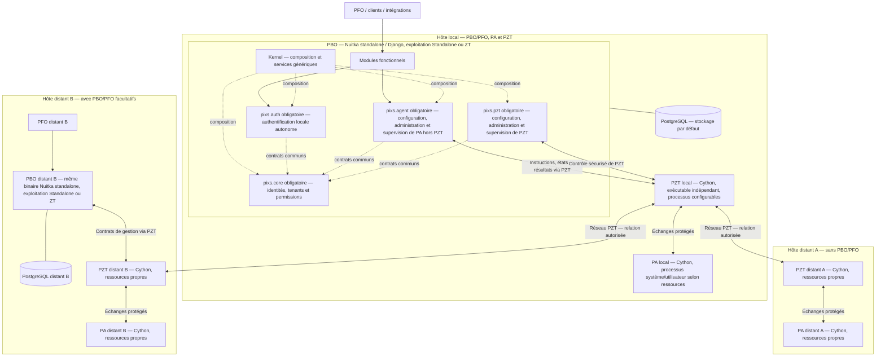
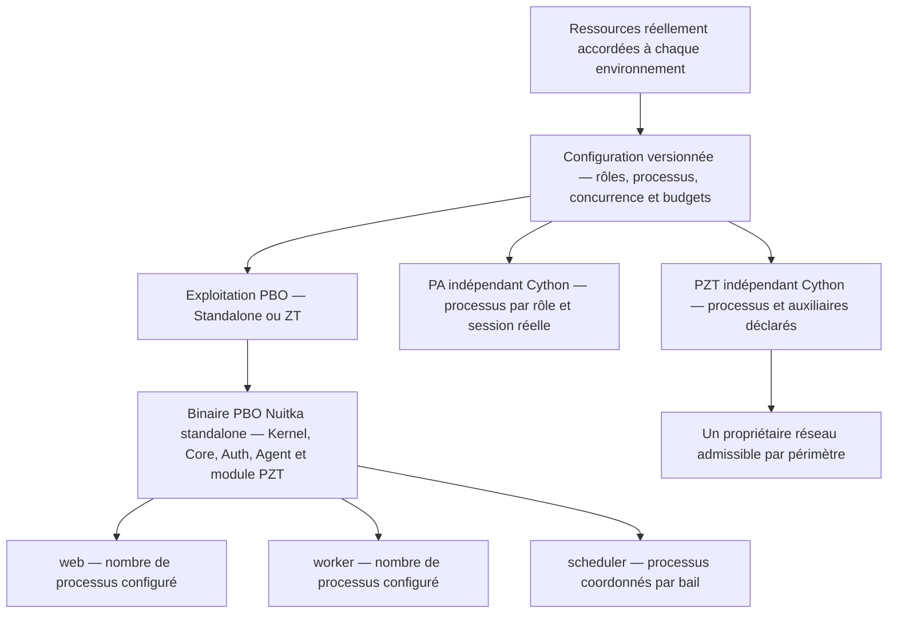

# Conception adoptée — binaire PBO et ressources

## Décision du 21 octobre 2026

ARCHITECTURE_ADOPTÉE ; CANON_SYNCHRONISÉ ; RÉALISATION_NON_ENGAGÉE.

Le binaire PBO commun réunit Kernel, pixs.core, pixs.auth, pixs.agent et pixs.pzt,
avec les autres composants sélectionnés. Les frontières de propriété,
contrats, migrations, permissions et dépendances restent celles des modules.
Le Kernel conserve les mécanismes génériques ; il ne relaie pas tous les appels.
La modularité dans un processus ne constitue pas une isolation mémoire ou
de privilèges. Les fonctions internes utilisent les contrats publics sans
imposer une IPC par module.

Les sous-graphes représentent la composition logique du binaire et les topologies ; ils ne désignent pas un processus distinct pour chaque module.

## Binaire, rôle et processus

Un fichier exécutable PBO peut démarrer plusieurs processus web, worker ou
scheduler, selon une configuration explicite. Les rôles supplémentaires
doivent être spécifiés ; le nombre de binaires ne détermine pas le nombre de
processus. Les composants obligatoires demeurent dans la composition sans
activer tous leurs services ou exécutants dans chaque processus.

PA conserve trois binaires et six modes, PZT son binaire indépendant et
pzt-daemon. Leurs plans sont propres à l'environnement où ils s'exécutent,
même si PBO est distant. Les événements système sont bornés, les sessions
réelles restent isolées. PZT conserve un propriétaire admissible unique des
ressources réseau par périmètre ; des auxiliaires déclarés n'introduisent
aucun écrivain concurrent implicite.

Ce schéma décrit les rôles et budgets, sans fixer de valeur numérique ni de canal de communication. Les nombres de processus restent soumis à la qualification et au lifecycle de chaque profil.

## Politique de ressources

Chaque plan versionné déclare rôles, processus, concurrence, files/buffers,
CPU, mémoire et connexions. La qualification tient compte des quotas effectifs
du service, VM ou conteneur, des réplicas, dépendances et marges système.
Les ressources physiques seules et le nombre de cœurs ne suffisent pas.

Les dimensions restent séparées : détecté, accordé, demandé, effectif et
réellement appliqué. Une proposition de dimensionnement n'est appliquée que
sous configuration explicite ou politique préautorisée et bornée. Une variation
de charge ne change pas silencieusement les processus ou garanties. L'état
appliqué est vérifié ; une mesure périmée ou un résultat partiel est signalé.

Les superviseurs déclarés assurent lancement, limites, signaux et redémarrage.
PBO garde l'autorité applicative ; pixs.agent gère PA via PZT et pixs.pzt gère
PZT par ses interfaces sécurisées. Les changements exigent autorisation,
validation, drain, reprise et observation. La réplication scheduler conserve
bail et clôture de péremption ; les opérations PA conservent idempotence et
propriété des ressources.

## Sécurité et admission

Les budgets ne réduisent ni les garanties d'identité, autorisation, isolation,
audit, durabilité, attestation, expiration, révocation ou protection indépendante.
Un profil insuffisant est refusé à l'admission ; en service, le comportement sûr
déclaré s'applique. Tous les échanges PBO–PA restent sous PZT, même localement ;
aucune optimisation n'introduit un canal de substitution.

La recette mesure mémoire, CPU au repos/en charge, latence, débit, saturation,
redémarrage et reprise avec la configuration et la cible distribuées.
Compiler ne démontre ni gain de ressources ni parallélisme Python multicœur.

## Compilation et modes d'exploitation précisés le 21 octobre 2026

PBO est compilé avec Nuitka en mode standalone. Les distributions livrent
un exécutable commun, son runtime, ses bibliothèques et ressources déclarées.
Le mode onefile ne remplace pas ce profil. Les modes d'exploitation Standalone
(instance autonome sans autorité Pixs extérieure) et ZT (réseau gouverné via PZT)
utilisent le même binaire et conservent le module essentiel pixs.pzt.
L'activation du transport PZT reste distincte : Standalone peut l'utiliser
pour joindre ses PA locaux ou distants autorisés.
L'activation réseau garde les préconditions et contrôles existants ; aucun canal
PBO–PA alternatif n'est créé. Les trois binaires PA et le binaire réseau PZT sont compilés avec Cython.

Dans PBO, Cython est réservé aux optimisations ciblées : profilage du coût,
critères définis avant recette et mesures comparables de gain/non-régression.
Les preuves couvrent ressources, contrats, sécurité et maintenabilité ; les
imports dynamiques Django et toutes les ressources livrées sont qualifiés.
Cython ne remplace pas la construction Nuitka du PBO complet. Le choix ne
produit ni artefact, ni mesure, ni installation par cette formalisation.

La sélection Cython pour les trois binaires PA remplace leur ancien choix Nuitka, avec les mêmes modes et frontières de privilèges. PZT conserve Cython. La restriction aux optimisations ciblées mesurées concerne uniquement l'usage de Cython à l'intérieur de PBO, dont la chaîne principale est Nuitka standalone.

## Distribution et points ouverts

| Artefact | Contenu et ressources |
| --- | --- |
| Debian PBO/PFO | Binaire PBO commun et ressources PFO ; profils externes, sans exécutables PA/PZT embarqués. |
| Debian PA/PZT | Trois binaires PA et un PZT indépendant ; profils propres à leur environnement, sans PBO local requis. |
| Docker | Binaire PBO commun, ressources PFO, deux binaires PA système/événements et PZT ; un rôle PBO explicite par conteneur, instances bornées et modes de session PA exclus. |

Nuitka standalone est retenu pour PBO ; versions/options, noms/CLI, schémas de configuration, chargement des extensions,
valeurs par défaut et seuils restent à spécifier et qualifier avant réalisation.
Le développement depuis les sources reste possible. Aucune option Python sans
GIL, dépendance, nouveau rôle PA/PZT ou isolation système n'est adopté ici.

## Propriété et coordination des dossiers

| Propriétaire | Coordination à la reprise |
| --- | --- |
| Ce change | Définition du binaire PBO commun et politique transverse de ressources. |
| activate-reference-runtime-composition | Activer le même socle et les profils sans retirer les obligations P0. |
| separate-pa-pzt-and-pbo-management-modules | Préserver propriétaires, contrats, canaux et séparation PA/PZT ; sa conception est complétée par la présente décision. |
| Lots PA/PZT et distributions existants | Qualifier compilation, sessions, propriétaire réseau, budgets et lifecycle dans leurs périmètres. |

Les deltas de sept capacités sont déjà synchronisés au canon ; toute clôture
doit reconnaître cet état sans double application. Les anciens audits et
matrices restent historiques et sont à réconcilier avant réalisation. Le change
reste ouvert ; ses tâches produit ne sont pas exécutées.

## Vérifications documentaires

### Premier passage — binaire commun et ressources

Avant modification : OpenSpec strict global réussi, 189 éléments valides
(111 changes ouverts et 78 capacités), aucune erreur. Le canon compte
812 exigences et 948 scénarios.

Après modification, OpenSpec 1.14.3, appelé avec Node et télémétrie désactivée,
valide le contrôle `validate --all --strict --json --no-interactive` avec
code natif 0 : 190 éléments sur 190, soit 112 changes ouverts et 78 capacités,
sans erreur ni avertissement. Le change reste ouvert ; aucune archive n'est créée.

Le contrôle de concordance compare les sept capacités au HEAD de départ et à
leurs deltas : aucune exigence retirée, 16 ajoutées, trois modifiées et
28 scénarios ajoutés. Les 19 blocs concernés sont identiques entre deltas et
canon ; leurs descriptions restent sous 500 caractères et emploient les
mots-clés normatifs. Le canon compte 78 capacités, 828 exigences et 976 scénarios.
L'inventaire de suivi compte 158 archives et 112 changes ouverts, soit 270 et
58,52 % ; PROJECT et README distinguent ce relevé des instantanés historiques.

Les 24 fichiers concernés sont des documents Markdown et la seule métadonnée
.openspec.yaml du nouveau change. UTF-8/LF, clôture des blocs, neuf liens ajoutés
et 13 schémas Mermaid sont contrôlés statiquement. Les copies de topologie,
gestion PA/PZT et plans de ressources concordent. La commande mmdc n'est pas
disponible ; aucun rendu graphique ni contrôle par moteur Mermaid n'est revendiqué.
Le diff ne présente aucune erreur d'espacement.

Aucun code, manifest produit, dépendance, configuration effective, secret,
fixture, test runtime, build, processus applicatif, installation, déploiement,
publication, commit ou push n'est réalisé par cette formalisation.
Les tâches de réalisation restent non cochées ; les contrôles documentaires
ne prouvent ni binaire disponible ni performance ou qualification P0.

### Complément — compilateurs et modes d'exploitation

Le choix final est Nuitka en mode standalone pour PBO, Cython pour les trois
binaires PA et pour le binaire PZT indépendant. Dans PBO, Cython reste limité
aux optimisations ciblées mesurées. Les modes d'exploitation PBO Standalone
(autonome) et ZT restent distincts du mode de compilation.
Aucune optimisation PGO n'est sélectionnée par ce complément.

Le contrôle OpenSpec 1.14.3 strict global réussit avec code natif 0 sur les
190 éléments : 112 changes et 78 capacités, sans erreur ni avertissement.
Le bilan consolidé face au HEAD initial est de 19 exigences ajoutées, six
modifiées et 34 scénarios supplémentaires ; aucune exigence n'est retirée.
Les 25 blocs concernés concordent exactement entre les sept capacités et
leurs deltas ; les descriptions contrôlées restent sous 500 caractères.
Le canon compte 78 capacités, 831 exigences et 982 scénarios. Les compteurs
PROJECT/README sont alignés ; l'inventaire reste 158 archives et 112 ouverts.

Le contrôle documentaire couvre 46 fichiers, uniquement Markdown et la
métadonnée du change : UTF-8/LF, clôture des blocs, 12 liens ajoutés valides,
13 schémas Mermaid contrôlés statiquement et copies concordantes. Le diff
ne présente pas d'erreur d'espacement. Aucun rendu Mermaid n'est revendiqué.

Les dossiers de préparation PA sont alignés sur Cython. L'instantané PA01
requirements.md reçoit une annotation historique ; sa comparaison au HEAD
confirme que seuls ces mots d'annotation sont ajoutés, sans modification des
blocs sources, empreintes ou preuves antérieures. Les archives restent intactes.
Les tâches produit restent non cochées ; aucun outil, build, test applicatif,
mesure de performance ou artefact exécutable n'est produit par cette rédaction.

### Vérification finale — compilateurs et modes Standalone/ZT

Les compilateurs sont cohérents : PBO sous Nuitka standalone, les trois
binaires PA et le binaire PZT sous Cython. Dans PBO, Cython reste réservé aux
optimisations ciblées mesurées. Les anciennes mentions Nuitka pour PA sont
limitées aux traces historiques annotées ; aucune archive n'est modifiée.

Deux incohérences des derniers ajouts sont corrigées. Le nom du second mode
d'exploitation PBO est ZT ; PZT reste le composant réseau et ZTP son appellation
historique. Standalone exprime l'autonomie de gouvernance, comme PROJECT §44.2,
sans imposer la désactivation du transport PZT. Une instance Standalone peut
utiliser PZT pour ses PA autorisés, même locaux. Le profil sans réseau activé
reste un cas particulier ; les échanges PBO–PA restent bloqués lorsque PZT
est absent ou invalide, sans substitution ni retour autonome implicite.

Le scénario « Transport PZT en mode Standalone » complète cette distinction.
Le bilan consolidé est de 19 exigences ajoutées, six modifiées et 35 scénarios
supplémentaires. Le canon compte 78 capacités, 831 exigences et 983 scénarios ;
PROJECT et README sont alignés. Les 25 blocs des sept capacités concordent
avec leurs deltas et les compteurs de changes restent inchangés.

OpenSpec 1.14.3 strict global réussit avec code natif 0 : 190 éléments sur 190,
soit 112 changes et 78 capacités, sans erreur ni avertissement. Les contrôles
UTF-8/LF, blocs, 12 liens ajoutés, 13 schémas statiques et copies concordantes
réussissent ; le diff ne présente pas d'erreur d'espacement. Aucun rendu par
moteur Mermaid, test applicatif ou binaire qualifié n'est déduit de cette revue.
