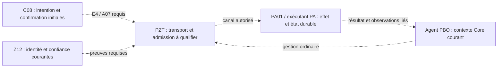

# Raccords PA10 — préparation non normative

Date : 24 octobre 2026. Statut : annexe préparatoire non normative, sans activation ni nouvelle règle fonctionnelle.

Mise à jour du 27 octobre 2026 : A1–A5, D-A1/D-A2/D-A3/D-MIG puis S1/R1/F1 sont validés ; voir les §17–19 et les registres [A1–A5](../add-pa-native-build-and-component-composition/DECISIONS_A1_A5.md) et [S1/R1/F1](../add-pa-native-build-and-component-composition/DECISIONS_S1_R1_F1.md). Les mentions historiques de points ouverts conservent leur date ; elles ne rouvrent pas les choix désormais acquis. Schémas exacts, intégration, réalisations et preuves manquants restent distincts de l'adoption.

Ce document prépare le travail demandé sur les tâches 2.2–2.4 du change
[PA10](../../../openspec/changes/separate-pa-pzt-and-pbo-management-modules/tasks.md).
Il ne crée ni contrat public, ni provider, ni profil de production et ne coche
aucune tâche. Les choix encore ouverts restent soumis à leurs propriétaires.
Les empreintes et réponses de coordination figurent dans
[instantané préparatoire](../../../output/cismp/cismp8-pixs-6f9152399b784e97/raccords-preparation.json).

## 1. Résultat préparé

La gestion locale Agent 2.1a–2.1e dispose de preuves historiques bornées.
La préparation présente identifie les raccords exacts, leurs fournisseurs,
les incompatibilités de représentation et les preuves qui permettront leur
activation. Les tests produit antérieurs ne sont pas réexécutés ici. Un palier P1 distinct de 17 tests de frontière Python purs est maintenant prouvé au §15 ; il ne remplace aucun scénario runtime ou fournisseur requis.

C14 est livré et archivé ; sa livraison de gestion PZT/DNS ne fournit pas le
transport PBO–PA. PA01, C08 et Z12 poursuivent leurs réalisations. Les sources
natives de journal, ancre, baux et identité ne valent pas compilation,
qualification ou autorité déployée. Les tâches PA03/PA09/X01 restent préparatoires.

La préparation est intégrée sous mandats CAB distincts après rétablissement de la connexion MCP et prévol natif. Les observations et rapports intermédiaires restent dans le checkpoint du RUN. Aucun quota n’est consulté ou réinitialisé ; aucun parcours runtime n’est qualifié par ces annexes.

## 2. Sources faisant autorité et limites du rapport

- [Conception PA10](../../../openspec/changes/separate-pa-pzt-and-pbo-management-modules/design.md).
- [Contrats Agent existants](../../../src/pixs/agent/contracts.py),
  [ports](../../../src/pixs/agent/ports.py),
  [service](../../../src/pixs/agent/service.py) et
  [supervision](../../../src/pixs/agent/supervision.py).
- [Contrats PA01](../../../openspec/changes/add-pa-native-build-and-component-composition/contracts.md)
  et [DTO natifs](../../../src/pixs/pa_native/postgresql_contracts.py).
- [Contexte TLS privé](../../../src/pixs/pa_native/tls_context.pyx).
- [Conception C08](../../../openspec/changes/add-installation-and-first-configuration/design.md),
  [contrat de projection adopté](../../../openspec/changes/add-installation-and-first-configuration/projection-contract.md)
  et [source de plan écrite](../../../src/pixs/backend/installation/plan_source.py).
- [Conception Z12](../../../openspec/changes/add-pzt-ca-hierarchy-rotation-and-recovery/design.md).
- [Preuves C14 archivées](../../../openspec/changes/archive/2026-10-23-add-essential-pbo-pzt-and-dns-modules/VALIDATION.md).
- [Ports internes PZT](../../../src/pixs/pzt/ports.py).

En cas de divergence, les spécifications validées et décisions explicites
prévalent sur ce rapport. Un chemin ou symbole présent ne prouve pas son
fonctionnement. Les états des RUN sont des observations de coordination,
distinctes des preuves fonctionnelles.

## 3. Deux parcours à conserver séparés

### Amorçage initial avant PostgreSQL

C08 porte intention, projection technique et confirmation opérateur.
Le mandat initial E4 relève de PA_POSTGRESQL_INITIAL. Le contrat exige
PZT/A07, y compris localement. Aucun Subject Core, CommandMetadata ordinaire,
tenant ou droit Super Admin fictif n’est créé pour franchir cette étape.

La représentation du mandat, son empreinte et une signature Ed25519 valide
ne constituent pas une admission. La provenance de clé, l’identité terminale,
la relation PZT, la politique courante, le temps qualifié, les préconditions,
la consommation durable et l’autorité avant chaque effet restent nécessaires.
Les garanties du journal et de son ancre matérielle restent celles du propriétaire PA.

### Gestion ordinaire PBO après disponibilité des autorités requises

Le service Agent reçoit Request, AgentValidationContext et instruction/résultat
liés à la source serveur courante. Il conserve les contrôles Core/C03/C04/C05,
gouvernance, portée Super Admin, génération, idempotence et refus audités.
Les ports de confiance réellement compétents vérifient l’origine et la
confirmation. Les éléments de l’amorçage initial ne sont pas recopiés dans
ce parcours comme s’ils étaient déjà une identité ou une permission Core.

### Chaîne cible, non exécutée



Toutes les flèches sont des raccords à prouver ; aucune liaison directe PBO–PA
de remplacement n’est préparée.

## 4. Matrice des raccords

| ID | Consommateur et besoin | Fournisseur / objet existant | État et preuve requise avant branchement |
| --- | --- | --- | --- |
| R01 | Agent, catalogue PostgreSQL sélectionné | PA01 : inspect_postgresql, prepare_postgresql, get_postgresql_result, version 1.0.0 | Catalogue adopté et DTO écrits ; fournir leur qualification et le binding du profil sélectionné. Les références pixs.agent.postgresql.* ne sont pas ajoutées automatiquement au manifest Agent. |
| R02 | Amorçage, projection et confirmation courantes | C08, projection technique et contrat E4 ; C08InstallationPlanSource écrit | Raccord propriétaire en réalisation. Ne pas assimiler son existence à un résolveur opérationnel avant PG ni l’appeler directement depuis PA avec un plan privé R01. |
| R03 | Origine, autorité et fraîcheur vérifiées | Z12 + PA01 + contexte PZT/A07 | Fournir les sources courantes, leurs bornes et preuves réelles. DTO, référence, signature, Name TPM et compteur isolés ne suffisent pas. |
| R04 | Acheminement PBO–PA | PZT, Z01/Z06/Z25 et raccord natif PA01 selon profil | Aucun transport opérationnel qualifié constaté. Le port PztExecutionGate interne n’est pas un transport. Le service Agent conserve PZT_TRANSPORT_UNAVAILABLE. |
| R05 | Admission et effet technique | PA01 ; périmètre général PA04, PA02 et PA03 | Fournir handlers, autorité avant chaque effet, préconditions et lifecycle réel. Pas de shell ou SQL libre dans le message ; aucune identité déduite d’un UID ou d’un booléen. |
| R06 | Résultat durable et reprise sans double effet | PA01, journal/ancre et périmètre général PA06 | Sources privées en réalisation ; fournir séquences d’effet, états incertains, relecture et preuves de concurrence/reprise. Aucun succès déduit d’une simple écriture ou du cache NV. |
| R07 | Observation de gestion PA | Source réelle consommée par AgentOriginTrustPort.verify_origin | Vérifier résultat, contexte, document observé, date, source, cible et scope. Le port PZT de vérification réseau n’a ni cette signature ni cette responsabilité. Aucun adaptateur qui renvoie systématiquement () n’est proposé. |
| R08 | Confirmation Agent | Source réelle consommée par AgentConfirmationTrustPort.verify_confirmation | Vérifier état, résultat, fait observé, origine/source et postcondition liés. Confirmation NV, succès technique, confirmation Agent et commit Core/Auth restent distincts. |
| R09 | Supervision native et lifecycle | PA03, PA07, PA01 et gestion Agent existante | Les vues Agent locales restent honnêtes ; mesures, arrêts et reprise d’un PA réel exigent leurs propriétaires. |
| R10 | Artefacts et deux topologies distantes | PA09, X01, PA08 et Z26 | Conserver trois PA + PZT pour Debian ; deux PA système/événements + PZT pour Docker. Aucun PBO/PFO local obligatoire sur un hôte PA/PZT. Qualifier réellement le profil sélectionné. |

## 5. Correspondances de données à examiner

Ce tableau est une analyse de rapprochement, pas un sérialiseur autorisé.

| Élément | Agent existant | PA01/E4 | Condition ou écart |
| --- | --- | --- | --- |
| Versions | schema_version et catalog_version | Versions 1.0.0 de NativeRequest/NativeResult/E4 | Versions exactes et catalogue du profil ; aucune coercition. |
| Opération | operation_id | operation_id ; subject_operation_ref pour la cible d’une lecture de résultat | Identifier séparément la demande de lecture et l’opération technique lue. Ne pas utiliser l’UUID de stockage Agent comme identifiant logique par défaut. |
| Catalogue | catalog_operation dans le catalogue fermé injecté | Trois opérations PostgreSQL ; références publiques pixs.agent.postgresql.* | La forme transportée et la déclaration du profil doivent être fournies par les propriétaires, sans nouvelle inscription publique implicite. |
| Cible | pa_target et ScopeContext | installation_ref, target_ref, caller_terminal_ref, executor_terminal_ref, pzt_relation_ref | Binding serveur à vérifier ; une cible technique ne crée ni tenant ni acteur Core. |
| Acteur | initial_actor, expected_actor | operator_ref et contexte natif vérifié | Aucun copier-coller d’operator_ref vers Subject/Core avant PG. |
| Génération | expected_generation de l’instruction ; génération réalisée du journal Agent | Époque, séquence, génération de registre, ancre, read_serial natif | Domaines distincts. Aucune équivalence ou formule de conversion adoptée n’est présumée. |
| Idempotence | idempotency_key, acteur/scope/cible/opération/version | idempotency_key et journal technique | Deux domaines d’enregistrement ; conserver l’acteur initial et réconcilier chaque propriétaire, sans confondre rejeu de lecture et nouvel effet. |
| Traces | correlation_ids et causation_ids | correlation_id plus tableaux complets E4/A07 | Préserver ordre et doublons signés ; rapprocher l’enveloppe réelle. Aucun dédoublonnage silencieux ni réduction à correlation_id. |
| Mandat | mandate_ref et port de confiance | mandat E4 signé, request_digest, projection_binding, anchor_binding, claims | Une référence et un digest ne prouvent ni mandat courant, ni consommation unique. |
| Paramètres | tuple AgentParam et catalogue explicite | Objet fermé de NativeRequest.params | Candidat structurel : chaînes plan_ref/plan_version/plan_digest pour prepare ; operation_ref pour get_result ; aucun paramètre pour inspect. Aucun profil opérationnel créé ici. |
| Bornes | Longueur de chaînes / nombres de paramètres et traces du profil Agent | max_json_bytes, max_ref_bytes et autres bornes natives protégées | Caractères et octets UTF-8 ne sont pas interchangeables ; tester les chaînes multioctets. Aucun plafond de production inventé. |
| Document appliqué | observed_doc + observed_at | observation_refs et result_ref | Ces références doivent être résolues/vérifiées par le propriétaire ; le JSON d’un NativeResult n’est pas automatiquement un document appliqué. |
| Dates | YYYY-MM-DDTHH:MM:SSZ, UTC à la seconde | E4 YYYY-MM-DDTHH:MM:SS.ffffffZ | Projection non adoptée identifiée ; conserver les octets signés et la précision d’origine. Pas d’arrondi/troncature ou délai ajouté implicitement. |

La borne de qualification du temps et la durée de validité d’un mandat sont
deux notions distinctes. Les paramètres communs adoptés dans PA01/C08/Z12
restent ceux de leurs sources ; ce rapport n’importe aucune fenêtre R01,
aucune tolérance ni valeur par défaut dans les contrats Agent.

## 6. États natifs et états Agent : aucune conversion automatique

| Phase native | Sens technique documenté | Traitement préparatoire sûr |
| --- | --- | --- |
| RECEIVED | Accusé de réception | Ne prouve ni effet ni observation appliquée. Un futur rapprochement avec ack exige les bindings et l’origine prévus ; aucun fait OBSERVED n’est fabriqué. |
| RUNNING | Exécution suivie en cours | Pas d’issue Agent running. Garder la progression chez son propriétaire ; aucun choix de conversion vers ack/unknown n’est arrêté ici. |
| SUCCEEDED | Succès technique durable avec postconditions requises | Ne produit pas à lui seul outcome=confirmed, confirmation_proof, marqueur C08 installé ou commit Core/Auth. |
| FAILED | Échec technique connu | Un rapprochement éventuel avec failed exige origine et contexte courants ; une issue de commit incertaine reste distincte. |
| IN_DOUBT | Issue incertaine | Conserver l’incertitude et la référence inspectable ; réconciliation avant effet. Un rapprochement avec unknown reste soumis au contrat propriétaire. |
| BLOCKED | Précondition ou autorité manquante/refusée | Garder un refus explicite ; ne pas fabriquer échec d’exécution ou observation appliquée. |

La supervision Agent n’annonce un état courant qu’avec un document observé
et une date valides ; le dernier connu et la confirmation restent séparés.
La preuve native de confirmation d’une intention de journal/NV ne démontre
pas, à elle seule, la postcondition PostgreSQL ou un état Agent appliqué.

## 7. Points ouverts confirmés par les propriétaires

Constat historique antérieur à la validation A1–A5 du 26 octobre 2026. Le §17 fixe l'état documentaire courant sans modifier rétroactivement les réponses reçues ni leurs preuves.

Les retours PA01, C08 et Z12 sont reçus. Réponse de coordination reçue et
point résolu sont deux états distincts : aucune de ces réponses ne livre
le raccord opérationnel ni n’adopte une conversion implicite. Les points
A1–A5 restent ouverts pour les raisons suivantes.

- **A1 — Génération et cible** : quel binding serveur adopté lie une opération
  technique à la cible/scope et à la génération Agent ? Fournisseurs PA01/C08. **Ouvert confirmé** : aucun champ/producteur de génération Agent ni binding serveur adopté/livré ; registry_generation_ref, epoch et sequence ne sont pas des alias.
- **A2 — États** : quelle représentation adoptée des phases natives est
  consommable par Agent sans transformer reçu/progression en fait appliqué ?
  Fournisseur PA01, cohérence PA10. **Ouvert confirmé** : phases techniques adoptées, aucune projection automatique vers Agent adoptée.
- **A3 — Temps** : quelle projection autorisée conserve les dates E4 à six
  décimales et permet un état Agent à la seconde, sans modifier les octets
  signés ni affaiblir fraîcheur/validité ? Fournisseurs C08/PA01/Z12. **Ouvert confirmé** par PA01/C08 : aucune projection six décimales/seconde arrêtée ou autorisée.
- **A4 — Autorité** : quels symboles déjà livrés vérifient identité terminale,
  relation, politique/révocation/UTC courants et postconditions ? Fournisseurs
  Z12/PA01/PZT et ports Agent. **Ouvert** : contrats structurels connus, aucun producteur courant qualifié livré pour ce raccord.
- **A5 — Preuves** : quelle version/artefact et quelles recettes réelles
  permettent la promotion du raccord ? Fournisseurs de chaque dépendance. **Ouvert** : les inventaires reçus ne fournissent pas les recettes runtime requises.

Les demandes de coordination n’autorisent aucune nouvelle réalisation,
décision fonctionnelle, installation, clé ou essai matériel dans un autre RUN.
Une réponse reçue sera conservée comme déclaration propriétaire à recouper,
pas comme validation CAB ou preuve d’exécution.

## 8. Frontière des distributions

La préparation 2.3 peut conserver dès maintenant les responsabilités et
contenus adoptés. Elle ne prétend pas livrer les paquets.

| Profil | Contenu conservé | Preuves nécessaires pour 2.4 |
| --- | --- | --- |
| Debian PBO/PFO | PBO commun et ressources PFO, sans exécutants PA/PZT | Construction et installation qualifiées par leurs propriétaires. |
| Debian PA/PZT | Trois binaires PA et PZT indépendant ; sans PBO/PFO embarqués | Contenu, signatures, droits, mise à niveau, arrêt et relation distante. |
| Docker | PBO/PFO, deux PA système/événements et PZT ; sans PA utilisateur/session | Inspection des binaires/modes, configuration, drainage/recréation et indépendance de l’état. |
| Hôte PA/PZT distant | PBO/PFO locaux facultatifs | Autorités, transport, panne, reprise et isolation réels, avec et sans backend local. |

## 9. Ordre de reprise proposé

1. Recouper les réponses A1–A5, sources et empreintes ; identifier les éléments
   adoptés, livrés et encore ouverts.
2. Rétablir un prévol de pilotage prouvé, sans reset ou redémarrage global,
   puis réserver uniquement les ressources utiles du même RUN.
3. Faire valider les écritures documentaires exactes PA10 sous mandats distincts.
   Une nouvelle sémantique exige sa validation propre.
4. Réaliser le raccord du profil réellement livré, sous dépendances et
   autorisations explicites, avec refus des sources absentes/divergentes.
5. Exécuter la [recette préparée](RECETTE_RACCORDS.md), puis les régressions
   affectées. Les résultats historiques ne sont pas transposés.
6. Cocher seulement les tâches prouvées ; l’archivage reste conditionné à
   tous les scénarios applicables de 2.2–2.4 et aux statistiques postarchive.

## 10. Limites de cette livraison préparatoire

Aucun code de production, configuration OpenCode, secret, migration,
build, accès SQL métier, TLS/PZT ou TPM/NV n’est modifié ou activé. Ces annexes sont une préparation des raccords demandée, pas une nouvelle source
de vérité fonctionnelle ni un provider. Les tâches 2.2–2.4 demeurent ouvertes.

## 11. Retour propriétaire reçu : Z12

Z12 confirme qu’aucun producteur courant d’identité, de temps UTC ou
d’autorité n’est livré et qualifié pour consommation par Agent. Les objets
adoptés sont notamment C.Z12_TLS_MATERIAL_RESOLVER/v1 (port local privé),
z12.initial_terminal_identity/v1 et z12.initial_tls_material/v1, décrits au
[§13 des contrats Z12](../../../openspec/changes/add-pzt-ca-hierarchy-rotation-and-recovery/contracts.md).
Les §14–15 décrivent les propriétaires, observations, temps et custody.

Sources déclarées par Z12 : InitialTerminalIdentity, identity_from_mapping,
identity_from_json dans src/pixs/pzt_ca/initial_terminal_identity.py ;
inspect_initial_terminal_der, verify_initial_terminal_issued et
assert_terminal_pair_distinct dans initial_terminal_x509.py. Cette liste ne
constitue ni exécution de ces sources ni preuve courante d’identité/époque,
de fraîcheur ou d’ancrage. Aucun certificat, clé ou contenu TLS n’a été lu.

D14 commun conserve les observations natives libsystemd et la qualification
du temps chrony/NTS déjà adoptées : incertitude totale au plus une seconde,
preuve de synchronisation âgée d’au plus 600 secondes, recontrôle pour les
mandats et pour TLS/X509. Il s’agit des conditions de ce propriétaire,
pas d’une durée de mandat ou d’une nouvelle borne du profil Agent.
D15 reste propre au gardien PKI ; il ne transfère aucune autorité PA.

Les primitives/collecteurs natifs déclarés restent non compilés/non testés ;
propriétaire initial, source UTC, gardien, fournisseur CA et résolution privée
restent en réalisation. Z12 ne fournit dans cette réponse aucune nouvelle
décision de projection des dates E4 vers Agent. Les points A3/A4 restent
ouverts pour le raccord opérationnel, avec cet inventaire maintenant reçu.
Les retours complémentaires PA01 et C08 sont reçus et intégrés ci-dessous ; ils confirment les points ouverts.

## 12. Retour PA01 reçu le 24 octobre 2026

PA01 confirme que NativeRequest/NativeResult portent les références techniques
installation_ref/target_ref, les identifiants d’opération/corrélation et les
versions. Aucun champ ni producteur de génération Agent n’est adopté/livré
par ces DTO. Le binding serveur vers cible/scope/génération Agent reste
ouvert et non réalisé. registry_generation_ref, epoch et sequence du journal/NV
ne sont pas des alias de cette génération.

Les phases RECEIVED, RUNNING, SUCCEEDED, FAILED, IN_DOUBT et BLOCKED sont
adoptées et représentées selon leur sens technique. Le codec ne fournit pas
les handlers ni les résultats PostgreSQL durables. SUCCEEDED ne confirme ni
mode PBO, ni marqueur C08, ni commit Core/Auth, ni état Agent. Aucun mapping
Agent automatique n’est adopté : A2 reste à arrêter.

E4 impose exactement UTC à six décimales (_MANDATE_TIME) et
mandate_signed_bytes conserve le domaine et les octets canoniques exacts.
Aucune projection vers une date Agent à la seconde n’est arrêtée ou
implémentée. Aucun arrondi, troncature ou réencodage des octets signés ne
peut être déduit de cette réponse.

Les sources et recettes sont déclarées écrites mais non compilées/non testées
dans cet inventaire. Les observations LXC/SSH/UID0/TPM rapportées par PA01
restent distinctes d’une qualification produit ou D5 et ne transmettent
aucune permission matérielle, décision fonctionnelle ou validation CAB.

## 13. Retour C08 reçu le 24 octobre 2026

Le [contrat propriétaire de projection](../../../openspec/changes/add-installation-and-first-configuration/projection-contract.md),
notamment ses champs fermés et sa section « Confirmation et admission E4 »,
est adopté. Il lie installation_ref/target_ref/operation_id, publication et
digest, plan PA et digest, confirmations immuables, acteurs/exécutant,
relation PZT et politique courants. Références et digests ne valent pas
consentement, observation, permission ou producteur opérationnel.

C08 confirme qu’aucun producteur/résolveur opérationnel de projection ou
confirmation E4 n’est livré ou qualifié. Format/stockage du bundle et
producteurs restent à réaliser. Les sources Auth REUSE, participants,
lecteur et PlanSource sont déclarées écrites sans compilation/test/
qualification ; leur existence n’en fait pas un producteur E4.

Aucun mapping implicite vers Subject/CommandMetadata ou génération Agent
n’est adopté. Aucune conversion six décimales/seconde n’est autorisée par
C08. Le parcours initial garde ses autorités propres, sans fabrication
de contexte ordinaire Core avant PostgreSQL.

## 14. Conséquences pour la reprise

Les réponses sont des inventaires de ce qui est adopté, écrit et non livré,
pas de nouvelles décisions ni des preuves d’effet. La coordination est
renseignée ; A1–A5 et les tâches 2.2–2.4 ne sont pas clos. Les cas C04/C05,
C07, C14–C19 et C28 de la recette sont précisés en conséquence, tous
NON EXÉCUTÉS. Aucun raccord de secours, conversion ou nouvelle borne n’est
introduit pour rendre artificiellement ces cas exécutables.

## 15. Palier P1 structurel exécuté le 24 octobre 2026

La [suite de frontière Agent/PA01](../../../tests/unit/test_agent_pa_native_contract_boundary.py)
exécute les codecs Python publics, sous fixtures explicitement synthétiques.
Ses 17 méthodes réussissent ; compilation syntaxique Python exit 0
(msg_16e61eb830013XZxTtuV6RBqNG), puis suite exit 0
(msg_16e62696f001rdExN2aL3irQJz). La découverte combinée Agent réussit aussi : 99 tests (msg_16e64ab90001YyEaEAnMl7LaX5, exit 0), comprenant ces 17 méthodes. Les sous-cas des boucles ne sont pas
comptés comme de nouvelles méthodes. Les sources du RUN PA01 ne sont pas
modifiées et sa propre suite n’est pas exécutée.

Commande retenue :

```text
PYTHONPATH=src /home/devops/datas/pixs/.venv/bin/python3 -B -m unittest discover -s tests/unit -p test_agent_pa_native_contract_boundary.py
```

Couverture bornée : formes des trois opérations sous contexte de fixture,
refus des champs d’autorité et paramètres étrangers, versions/types,
écart caractères/octets UTF-8, objets requête/résultat non interchangeables,
phases natives distinctes des valeurs d’issue Agent et absence de preuve
Agent depuis un succès technique. Deux compteurs d’ancre de fixture ne
satisfont pas la génération attendue de la fixture Agent ; cela ne définit
aucun binding serveur ni aucune formule de génération.

Le codec public AnchorSnapshot préserve les six décimales de son horodatage,
refusé tel quel par le format Agent à la seconde ; une fixture Agent séparée
au bon format est acceptée. Ce test ne projette pas une date E4, ne teste pas
la signature d’un mandat et ne modifie aucun octet signé. Les bornes, acteurs,
références, générations et dates de fixture ne sont ni des défauts produit
ni des preuves d’autorité. L’absence d’import des providers natifs,
Django et psycopg est contrôlée dans un sous-processus isolé : les imports
des autres suites ne contaminent pas ce contrôle.

Ce palier n’importe aucune extension native et n’exécute aucun handler,
accès SQL, PZT/TLS, TPM/NV, build C/Cython ou recette de plateforme. Il
ne qualifie ni PA01, ni C08, ni Z12. La campagne historique complète de 211 cas Agent n’est
pas réexécutée. Ses 82 tests unitaires font partie des 99 tests combinés,
avec les 17 nouveaux ; ces deux décomptes ne sont pas additionnés. Les points A1–A5,
les scénarios runtime C01–C28 et les tâches 2.2–2.4 restent ouverts.

## 16. État de coordination du 26 octobre 2026, préparation non normative

Cet état précède la validation explicite des orientations A1–A5 consignée au §17. Ses limites de réalisation et de preuve restent applicables ; ses mentions de choix ouverts sont à lire avec les décisions désormais adoptées.

Cet appendice conserve les sections historiques et leurs dates. Il ajoute un état de coordination fondé sur les preuves fournies et les sources protégées, sans contrat nouveau, sans provider et sans coche de tâche.

### Adopté

- B, retrait et INIT A, avec formes détaillées 16, 17, 18 et 7. Les contenus contractuels fermés sont adoptés ; les résolveurs courants, producteurs et qualification restent à réaliser.
- Contrat temps générique pur pixs.time.evidence 2.0.0, interface abstraite sans producteur livré, détaillé dans [time.py](../../../src/pixs/kernel/contracts/time.py) et cadré dans [RACCORDS_TEMPS_V2](../../../openspec/changes/add-pzt-ca-hierarchy-rotation-and-recovery/RACCORDS_TEMPS_V2.md). En SYNCHRONISE, preuve amont inférieure ou égale à 600 s. En HORS_LIGNE, un âge supérieur n'est admissible qu'avec modèle, provenance, continuité et profil qualifiés, acquisition courante et incertitude totale inférieure ou égale à 1 s. La fenêtre finale R01 de 600 s reste distincte, sans remise à zéro.
- Catalogue PA01 trois opérations 1.0.0 et répartition plan PA01 et projection C08, selon [contracts PA01](../../../openspec/changes/add-pa-native-build-and-component-composition/contracts.md).
- D1A, D2A et D3A PA02 pour [provisioning_contracts](../../../src/pixs/pa_native/provisioning_contracts.py).

### Écrit, sans qualification déduite

- Codecs C08 de forme et octets [postgresql_confirmation](../../../src/pixs/backend/installation/postgresql_confirmation.py) et [exchange_response_1_1](../../../src/pixs/backend/installation/exchange_response_1_1.py).
- Conception PA10 [design](../../../openspec/changes/separate-pa-pzt-and-pbo-management-modules/design.md), avec pixs.agent hors PZT et PZT indépendant.

### Testé, campagnes séparées non additionnées

- C6 : contrat TimeProducer à quatre méthodes et 68 tests cités, avec syntaxe et contrôles stricts valides.
- C7, bilan déclaré par CISMP7 : total courant de 219 tests distincts, soit contexte 43, NV 37, INIT 33, base 37 et composition 69 PASS ; les 69 tests de composition remplacent l'ancien périmètre de 63.
- C08 : 117 tests locaux de forme cités, soit requête 21, bundle 20, réponse 15, confirmation 28, présentation 12 et stockage 21 ; F3 restauré fidèle mais non exécuté.
- C2 : 44 tests cités pour le provisionnement.

### Limites et conditions de reprise

- Ports Agent [ports](../../../src/pixs/agent/ports.py) et [contrats](../../../src/pixs/agent/contracts.py) : Protocols déclarés et points d'injection pour verify_origin et verify_confirmation ; aucun fournisseur opérationnel prouvé.
- A1 cible et génération, A2 phases techniques vers issues Agent, A3 projection explicite conservant les octets signés à coordonner avec les propriétaires, A4 autorité, origine et postcondition courantes, transport PZT, handlers, résultat durable et lifecycle.
- La poursuite de 2.2 exige des décisions et livraisons propriétaires, avec interfaces adoptées, consommables et qualifiées.

## 17. Orientations A1–A5 validées le 26 octobre 2026

Cette section conserve l'état de l'adoption des orientations avant validation des détails D-A1/D-A2/D-A3/D-MIG ; le §18 actualise les éléments détaillés désormais adoptés, sans réécriture des preuves historiques.

Le développeur a validé les cinq recommandations et demandé leur inscription
documentaire, sans implémentation ni production de code. Le
[registre commun PA/PZT](../add-pa-native-build-and-component-composition/DECISIONS_A1_A5.md)
conserve l'autorisation, les décisions et les éléments encore manquants.
Les deltas correspondants sont portés par le dossier PA01 :
[pixs-agent](../add-pa-native-build-and-component-composition/specs/pixs-agent/spec.md)
et [pzt](../add-pa-native-build-and-component-composition/specs/pzt/spec.md).

| Point | Orientation désormais VALIDÉE | Ce qui ne devient pas livré ou prouvé |
| --- | --- | --- |
| A1 | Liaison persistante côté serveur ; génération Agent et compteurs natifs distincts ; contexte initial C08/PA conservé avant PG. | Structure exacte, persistance, mises à jour/concurrence/péremption et producteur effectif de la liaison. |
| A2 | Phases techniques et issues Agent séparées ; projection explicite conditionnelle, sans confirmation automatique. | Tableau exact des transitions, conditions de preuve/refus et implémentation du rapprochement. |
| A3 | Nouvelle version Agent acceptant les six décimales natives ; preuves signées intactes et contrôle sur l'instant exact. | Numéro/schéma de version, compatibilité et migration, producteur concret ; Agent 1.0.0 reste inchangé jusqu'à migration définie. |
| A4 | Interfaces spécialisées et responsabilités conservées, contrôles courants avant chaque effet, refus si fournisseur requis absent. | Symboles et fournisseurs concrets, sélection authentique, transport et vérifications opérationnelles qualifiés. |
| A5 | Quatre paliers distincts, recette intégrée obligatoire et revue explicite des preuves avant promotion. | Exécutables fonctionnels, recettes intégrées/distribution et preuves applicables manquantes. |

Les orientations ne sont plus à présenter comme des choix de principe ouverts.
Les détails contractuels restants suivent ces choix sans être réputés adoptés
par extension. Les cas C01–C28 et les tâches 2.2–2.4 restent ouverts ; aucune
réalisation, nouvelle preuve fonctionnelle ou promotion n'est produite par
cette inscription. Sur demande explicite complémentaire du développeur le
26 octobre 2026, les neuf exigences et treize scénarios A1–A5 du dossier PA01
sont synchronisés à l'identique dans les canons
[pixs-agent](../../specs/pixs-agent/spec.md) et [pzt](../../specs/pzt/spec.md),
sans réapplication des autres deltas. Cette synchronisation reste
documentaire et ne change aucun statut de réalisation ou de preuve.

## 18. Détails D-A1, D-A2, D-A3 et D-MIG adoptés — 26 octobre 2026

Cette section conserve l'état du 26 octobre avant adoption S1/R1/F1 ;
le §19 actualise les choix de stockage, remise et fournisseurs.

Le développeur valide les quatre propositions et demande leur inscription,
sans implémentation ni production de code. Le
[détail validé](../add-pa-native-build-and-component-composition/DETAIL_A1_A2_A3.md)
et le [delta pixs-agent PA01](../add-pa-native-build-and-component-composition/specs/pixs-agent/spec.md)
portent les structures et règles adoptées.

| Décision | Adopté documentairement | Toujours manquant |
| --- | --- | --- |
| D-A1 | AgentPaBinding 1.0.0, modèle privé fermé, séparation MUTATION/READ, cycle de liaison, concurrence, idempotence et reçu de résolution. | Forme physique, remise à PZT, fournisseurs réels et preuves du raccord. |
| D-A2 | Transitions natives, projection vers les issues Agent, confirmations séparées, refus et réconciliation. | Lecteurs et producteurs concrets, mécanisme de déduplication, branchements et qualification. |
| D-A3 | Contrats Agent 2.0.0, grammaire UTC à six décimales et codec agent-content.v2, sans modification implicite des versions 1.0.0. | Descripteurs exécutables, consommateurs, code des codecs/validateurs et preuves. |
| D-MIG | Migration additive M0–M5, provenance de version, historique intact, idempotence commune et retour sans perte de précision. | Schéma physique, migration et retour exécutables, environnement de recette et preuves réelles. |

Les quatorze exigences et vingt-cinq scénarios détaillés sont ajoutés au
delta PA01 et synchronisés à l'identique au
[canon pixs-agent](../../specs/pixs-agent/spec.md) sur demande explicite
complémentaire du développeur le 26 octobre 2026, sans réapplication des
autres deltas. Les orientations A1–A5 restent canoniques. Les tâches
2.2–2.4, les cas C01–C28 et les cas D01–D16 restent sans nouvelle exécution
ou coche ; Agent 2.0.0 est adopté mais non livré, la migration non exécutée.

## 19. Stockage, remise et fournisseurs S1/R1/F1 adoptés — 27 octobre 2026

Le développeur valide les trois recommandations et leur inscription
documentaire. Le [registre S1/R1/F1](../add-pa-native-build-and-component-composition/DECISIONS_S1_R1_F1.md)
détaille les choix, limites, travaux et critères de preuve.

| Décision | Choix validé | Réalisation et preuve encore manquantes |
| --- | --- | --- |
| S1 | Tables PostgreSQL privées dédiées Agent : liaison/révisions, intentions/tentatives, version/provenance ; colonnes typées, payload immuable et octets engagés exacts, migration additive. | Noms et contraintes exacts, modèles, transactions, concurrence, migration/retour exécutables et conservation des données prouvée. |
| R1 | Outbox durable Agent dans la transaction de l'opération/liaison ; relais PBO après commit vérifié vers PZT ; recontrôles courants et réconciliation avant réémission incertaine. | Interface d'intégration, relais/concurrence/reprise, transport et preuve d'absence de double effet natif ; C09 Core n'est pas un raccord Agent prêt à l'emploi. |
| F1 | Dépôt Django/PostgreSQL ; adaptateur PZT et E3 Cython/OpenSSL 3 local ; fournisseurs Core/Auth ordinaires et PA/C08/Z12 initiaux ; résolveur PA durable ; adaptateurs d'origine/confirmation Agent ; producteurs temporels PBO/PA/PZT derrière TimeProducer 2.0.0. | Implémentations exécutables et versions, composition authentique, résolution et contrôles au point d'usage, postconditions réelles, preuves de fonctionnement/reprise/révocation. |

Les ajouts sont dans les deltas PA01 Agent/PZT : cinq exigences et douze
scénarios, SYNCHRONISÉS À L'IDENTIQUE dans les canons pixs-agent/pzt sur
demande explicite complémentaire du développeur le 27 octobre 2026, sans
réapplication des autres deltas. Le contenu canonique antérieur est conservé.
Ces choix ne constituent pas une
readiness : PZT_TRANSPORT_UNAVAILABLE, PZT_EXECUTION_UNAVAILABLE et
ready_for_transport=False restent des frontières observées, sans modification.
Les tâches 2.2–2.4 restent ouvertes, Agent 2.0.0 non livré et migration non
exécutée. Les cas C01–C28, D01–D16 et critères SRF01–SRF08 ne sont pas
exécutés ici ; la qualification fonctionnelle reste bloquée.

## 20. Détail physique et interfaces validés — 27 octobre 2026

Le [dossier D-S1/D-R1/D-F1/D-SMIG](../add-pa-native-build-and-component-composition/DETAIL_S1_R1_F1.md)
détaille les choix canoniques S1/R1/F1. Le développeur valide explicitement
D-S1/D-R1/D-F1/D-SMIG le 27 octobre 2026 et demande leur inscription sans
implémentation ni production de code. Ils sont VALIDÉS DOCUMENTAIREMENT
et restent NON RÉALISÉS par cette inscription :

| Décision | Détail validé | Réalisation et preuve encore manquantes |
| --- | --- | --- |
| D-S1 | Huit tables Agent, colonnes typées, clés/contraintes/index, documents exacts et historique de provenance. | Modèles/dépôts, DDL/migrations, contraintes et conservation prouvées sur PostgreSQL réel ; octets natifs chez leurs propriétaires. |
| D-R1 | Contrat privé du relais, preuve du commit propriétaire, réservation, tentatives, retours et réconciliation. | Relais/hébergement/profil, intégration transactionnelle/transport et preuves de reprise sans permission recyclée ni double effet natif. |
| D-F1 | Interfaces privées nommées du dépôt, transport, autorité, résultat et adaptateurs de confiance ; TimeProducer 2.0.0 conservé. | Implémentations/versions, composition authentique et preuves d'autorité, résultat, origine, postcondition et temps ; aucun fournisseur livré par sa déclaration. |
| D-SMIG | Application physique de M0–M5, provenance historique, coexistence et retour/restauration. | Migrations et classement exécutables, environnement autorisé et preuves de compatibilité/restauration sans réémission automatique du passé. |

Les deltas PA01 reçoivent dix-sept exigences et trente-quatre scénarios
détaillés. Ces nouveaux détails sont NON SYNCHRONISÉS au canon par cette
inscription ; les décisions canoniques antérieures sont conservées.
Les réalisations, versions concrètes de fournisseurs, profils opérationnels
et preuves d'intégration restent manquants. Les tâches PA10 et cas produit
ne sont ni cochés ni exécutés ; P-SRF01–P-SRF18 restent NON EXÉCUTÉS.
