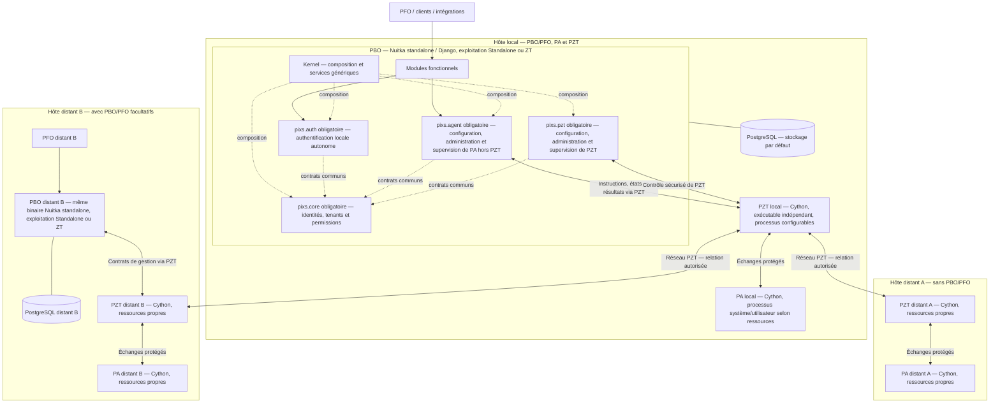

# Conception validée — PBO/PFO, PA et PZT

## État de décision et périmètre

ARCHITECTURE_VALIDÉE ; DOCUMENTATION_ET_SPÉCIFICATIONS_UNIQUEMENT.
La validation du développeur couvre les quatre composants, les deux modules,
la colivraison PA/PZT et Docker incluant PZT. L'hôte distant peut aussi contenir
PBO/PFO ; cette présence est facultative. Aucune réalisation produit n'est engagée.

## Propriété des responsabilités

| Élément | Propriété et frontière |
| --- | --- |
| Modules fonctionnels | Opérations et règles métier, autorisées par PBO/Django. |
| pixs.agent | Configuration, administration, supervision de PA hors PZT ; contrats publics d'instructions, états et résultats pour les autres modules. |
| pixs.pzt | Module officiel essentiel, nouveau nom du module PZT PBO ; configuration, administration, visualisation, supervision et monitoring de PZT. |
| PA | Trois binaires, six modes système/utilisateur ; exécution et collecte hors PZT. |
| PZT | Binaire réseau indépendant, mode pzt-daemon ; WireGuard, filtrage et fonctions réseau autorisées. |
| Kernel / pixs.core | Mécanismes génériques / primitives communes, sans passerelle ni logique propre PA/PZT. |

pixs.agent n'administre pas PZT ; pixs.pzt ne possède pas les opérations PA hors
PZT. Les droits de transport et les droits métier restent distincts. Les données
souhaitées restent dans PostgreSQL côté PBO, les états réellement appliqués sont
rapportés par leur exécutant. Un accusé de réception ne prouve pas l'exécution.

## Complément adopté le 21 octobre 2026

Le [binaire PBO commun et les profils de ressources](../define-common-pbo-binary-and-resource-profiles/design.md) complètent cette conception. Le Kernel, Core, Auth et les modules Agent/PZT sont regroupés dans une application PBO ; les plans de processus PBO et PA/PZT sont configurables selon leur environnement. La séparation des exécutants, les canaux sécurisés et les responsabilités décrits ici sont conservés. Le schéma ci-dessous reflète cette composition actuelle ; les preuves datées du 17 octobre restent historiques.

## Topologies

Ce schéma est logique. Les interfaces et endpoints concrets ne sont pas choisis.
Le profil local PZT conserve TLS mutuel, sans WireGuard local obligatoire ; les
VM/conteneurs distincts conservent leurs frontières. Les chemins distants suivent
les profils PZT qualifiés. PFO passe par PBO. Chaque PBO, local ou distant,
possède un périmètre d'autorité explicite ; aucun dernier arrivé ne gagne et
aucune présence locale n'accorde un droit sur PA/PZT ou sur un autre PBO.

## Identités, canaux et continuité

Les flux PBO–PA passent toujours par PZT. Les flux PBO–PZT passent par ses
interfaces sécurisées. Les interfaces PA–PZT et les canaux internes à chaque
composant restent à spécifier et qualifier avec appelant, cible, autorisation,
isolation et traçabilité. Colivraison ne signifie ni identité ni secret communs.
La séparation ne supprime aucune preuve d'identité, d'hôte ou d'intégrité.

Les décisions détaillées A01–A12 conservent leurs identifiants, valeurs et
conditions : les mentions héritées de PA comme propriétaire/exécutant réseau
PZT désignent PZT pour ces rôles ; PA, sessions, hôte et attestation TPM gardent
leur portée propre et leurs liaisons explicites. Les preuves nécessaires au
nouvel exécutant doivent être qualifiées, sans admission automatique.
Si PZT est indisponible, aucun canal PBO–PA de substitution n'est ouvert.
PA/PZT ne poursuivent sans PBO que des fonctions provisionnées encore autorisées.

## Compilation et distribution conservées

La révision du 21 octobre 2026 retient Nuitka standalone pour PBO et Cython pour les trois binaires PA et le binaire PZT. Les deltas de compilation de ce dossier sont alignés sur ce choix ; les contrôles et décisions datés du 17 octobre ci-dessous restent des preuves historiques sans requalification produit.

| Artefact | Composition |
| --- | --- |
| Debian PBO/PFO | Binaire PBO commun Kernel/Core/Auth/Agent/PZT, composants requis et ressources PFO, sans exécutables PA/PZT. |
| Debian PA/PZT | Trois binaires PA (Cython) et PZT indépendant (Cython), sans PBO/PFO embarqués. |
| Docker | Binaire PBO commun et ressources PFO, deux binaires PA système/événements (Cython) et PZT (Cython), sans binaire utilisateur PA. |

Les quatre exécutables PA/PZT complets et les trois exécutants Docker restent inchangés en nombre ; ils sont distincts du binaire PBO commun. Le nombre de processus est configuré selon les ressources et ne modifie pas ce nombre de fichiers exécutables.
PZT garde son démarrage sans délai, PA ses délais système/session ; comptes,
signaux, états durables et budgets d'arrêt sont distincts et déclarés par profil.
Les noms de paquets/fichiers, options CLI, versions d'outils et endpoints restent
ouverts. Aucun artefact, processus, droit hôte ou réseau n'est créé ici.

## Coordination de la réalisation future

- Ce change porte pixs.agent et la coordination des contrats de séparation.
- PA01 conserve composition/compilation, PA03 lifecycle, PA07 supervision PA.
- C14 conserve pixs.pzt et DNS ; les autres lots PZT conservent leurs contrats.
- PA09 et X01 conservent le paquet commun PA/PZT et l'image Docker.
- PA08 et la qualification PZT conservent recettes et preuves par profil.

Les copies requirements.md et les matrices d'audit déjà produites sont des
instantanés historiques. Leurs lignes, empreintes et titres peuvent avoir changé ;
ils doivent être réconciliés avec le canon avant reprise des lots. Aucun ancien
audit ou scénario non exécuté n'est déclaré revalidé par cette mise à jour.

## Synchronisation et état de livraison

Les six capacités canoniques sont mises à jour directement sur mandat du
développeur. Les deltas de ce change décrivent le passage de l'ancien canon au
canon adopté et restent des traces de cette décision. Une future synchronisation
ou clôture doit reconnaître cet état sans réintroduire d'anciens titres ni compter
les ajouts deux fois. Le change reste ouvert pour sa réalisation future ; aucun
archivage n'est demandé. La rédaction et son strict ne prouvent aucun code livré.

## Vérifications documentaires exécutées le 17 octobre 2026

- Canon courant : 78 capacités, 724 exigences, 824 scénarios ; sept exigences et
  douze scénarios nets ajoutés par cette décision, sans nouvelle capacité.
- Inventaire : 135 archives et 107 changes ouverts, soit 242 au total et 55,79 %
  d'archives ; README, PROJECT et plan de préparation alignés. Les matrices des
  audits antérieurs restent des instantanés historiques, non régénérés.
- OpenSpec 1.14.3 appelé par son chemin local avec Node : validation stricte du
  présent change, exit natif 0, sans avertissement ; les six capacités modifiées
  sont valides au contrôle strict.
- Strict global avant et après : exit natif 1. Après ajout : 107 changes sur 107
  valides et 76 capacités sur 78 valides. Les quatre avertissements préexistants
  sont inchangés : bulk-operations requirements[6], requirements[10],
  requirements[13] et identity-assurance requirements[4]. Message natif commun :
  « Requirement text is very long (>500 characters). Move examples and edge
  cases into scenarios, or split it into separate requirements that each state
  one behavior. » Aucune correction hors périmètre n'est effectuée.
- UTF-8/LF, liens locaux et ancres, clôture des blocs et structure des neuf
  diagrammes Mermaid contrôlés ; diff sans erreur d'espacement. Aucun parseur
  Mermaid n'est disponible dans les emplacements de résolution testés : aucun
  rendu graphique ni validation par moteur Mermaid n'est revendiqué.
- Revue du diff : uniquement fichiers Markdown et métadonnée .openspec.yaml du
  nouveau change ; code et tâches produit des dossiers existants préservés.
  Aucune tâche de réalisation future n'est cochée et aucune archive n'est créée.
- Aucun test runtime, test navigateur, build, installation ou artefact exécuté :
  la demande porte exclusivement sur la documentation et les spécifications.
