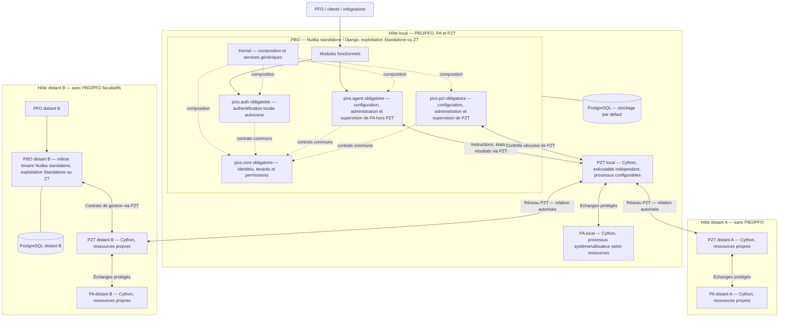

# Conception validée — PBO/PFO, PA et PZT

<!-- ACL-PIXS-2026-10-31-E3-R1:start -->
## Cible consolidée du 31 octobre 2026 — ACL-PIXS-2026-10-31-E3-R1

Raccords Agent/PZT et nouveaux contextes ; préserver les versions et preuves anciennes sans qualification nouvelle par héritage.

Les orientations du modèle validé remplacent précisément les formulations antérieures incompatibles avec ce périmètre. Les autres clauses restent applicables. Les sections antérieures et leurs références sont conservées pour traçabilité ; elles ne doivent pas être utilisées pour réintroduire une décision remplacée. Les preuves et cases cochées ne qualifient que leur version d'origine.

### Sources et responsabilités courantes

- [pixs-agent](../../specs/pixs-agent/spec.md).
- [pzt](../../specs/pzt/spec.md).
- [scope-context](../../specs/scope-context/spec.md).
- [managed-device-policies](../../specs/managed-device-policies/spec.md).

Le canon courant prévaut sur ses copies de préparation. Le périmètre présent est documentaire : aucun code, test produit, migration, service, secret, publication ou Git n'est exécuté. Les choix de fournisseurs manquants restent à qualifier avant réalisation.

### Refus et critères de réalisation

Les scénarios des sources et de requirements.md doivent être reliés à des résultats vérifiables par unité. Réception n'est pas application ; donnée ancienne n'est pas état courant. Une autorisation expirée/révoquée ou une dépendance requise non qualifiée bloque l'usage concerné. La validation documentaire ne fait pas réussir les recettes futures.

### Préservation de l'historique et articulation des travaux

Les titres, codes, identifiants de tâches et de sous-lots, libellés, cases, statistiques et preuves antérieurs sont conservés. Les compléments sont rattachés aux unités existantes sans renumérotation ni validation produit anticipée. Les ouvertures C95/C96/C97/N08/PA12/Z28/Z29/Z30/Z31/Z32 portent leurs seules parts résiduelles ; elles ne relancent pas les archives.
<!-- ACL-PIXS-2026-10-31-E3-R1:end -->

## État de décision et périmètre

Les [détails D-S1/D-R1/D-F1/D-SMIG](../add-pa-native-build-and-component-composition/DETAIL_S1_R1_F1.md)
sont VALIDÉS DOCUMENTAIREMENT le 27 octobre 2026 et inscrits dans les deltas
PA01 : dix-sept exigences et trente-quatre scénarios, NON SYNCHRONISÉS au
canon par cette inscription. Schéma physique, contrat de relais, interfaces
privées et migration détaillée sont adoptés ; réalisations exécutables,
hébergement/profils, versions concrètes et preuves restent manquants.
Le §20 des raccords et le §12 de la recette consignent cette distinction.

Les [décisions S1/R1/F1](../add-pa-native-build-and-component-composition/DECISIONS_S1_R1_F1.md)
sont VALIDÉES le 27 octobre 2026 et inscrites dans les deltas PA01. Leurs cinq
exigences et douze scénarios sont synchronisés à l'identique aux canons sur
demande explicite complémentaire du développeur du même jour, sans
réapplication des autres deltas : tables PostgreSQL privées
Agent, outbox/relais PBO vers PZT et fournisseurs par domaine. Le §19 de
RACCORDS.md et le §11 de RECETTE_RACCORDS.md distinguent ces choix acquis
des modèles, réalisations et preuves encore manquants. Les mentions
antérieures de choix physiques ou fournisseurs ouverts sont complétées
par cette décision, sans réécriture des preuves historiques.

Le [détail A1/A2/A3 et de migration](../add-pa-native-build-and-component-composition/DETAIL_A1_A2_A3.md) est VALIDÉ par le développeur le 26 octobre 2026 sous D-A1/D-A2/D-A3/D-MIG : liaison serveur, transitions, contrats Agent 2.0.0 et codec, migration additive. Les nouvelles exigences sont inscrites dans le delta PA01 et synchronisées à l'identique au canon pixs-agent sur demande explicite complémentaire du développeur le même jour ; aucun des contrats, modèles, codecs ou consommateurs 1.0.0 n'est modifié. S1/R1/F1 complètent ces choix ; modèles du schéma adopté, réalisations et preuves restent à produire.

Les [orientations A1–A5](../add-pa-native-build-and-component-composition/DECISIONS_A1_A5.md) sont VALIDÉES par le développeur le 26 octobre 2026, reprises dans les deltas PA01 Agent/PZT et synchronisées au canon sur sa demande complémentaire du même jour ; le §17 de RACCORDS.md conserve cette traçabilité. La liaison serveur, la projection conditionnelle, l'évolution temporelle Agent versionnée, les vérifications spécialisées et la qualification progressive sont acquises comme principes ; D-A1/D-A2/D-A3/D-MIG sont également adoptés et complétés par S1/R1/F1. Les modèles du schéma adopté, réalisations et preuves restent à produire ; les contrats exécutables Agent 1.0.0, les tâches 2.2–2.4 et les réalisations des autres sessions ne sont pas modifiés par cette inscription.

ARCHITECTURE_VALIDÉE ; DOCUMENTATION_ET_SPÉCIFICATIONS_UNIQUEMENT.
La validation du développeur couvre les quatre composants, les deux modules,
la colivraison PA/PZT et Docker incluant PZT. L'hôte distant peut aussi contenir
PBO/PFO ; cette présence est facultative. Aucune réalisation produit n'est engagée.

## Propriété des responsabilités

| Élément | Propriété et frontière |
| --- | --- |
| Modules fonctionnels | Opérations et règles métier, autorisées par PBO/Django. |
| pixs.agent | Configuration, administration, supervision de PA hors PZT ; contrats publics d'instructions, états et résultats pour les autres modules. |
| pixs.pzt | Module officiel essentiel, nouveau nom du module PZT PBO ; configuration, administration, visualisation, supervision et monitoring de PZT. |
| PA | Trois binaires, six modes système/utilisateur ; exécution et collecte hors PZT. |
| PZT | Binaire réseau indépendant, mode pzt-daemon ; WireGuard, filtrage et fonctions réseau autorisées. |
| Kernel / pixs.core | Mécanismes génériques / primitives communes, sans passerelle ni logique propre PA/PZT. |

pixs.agent n'administre pas PZT ; pixs.pzt ne possède pas les opérations PA hors
PZT. Les droits de transport et les droits métier restent distincts. Les données
souhaitées restent dans PostgreSQL côté PBO, les états réellement appliqués sont
rapportés par leur exécutant. Un accusé de réception ne prouve pas l'exécution.

## Complément adopté le 21 octobre 2026

Le [binaire PBO commun et les profils de ressources](../define-common-pbo-binary-and-resource-profiles/design.md) complètent cette conception. Le Kernel, Core, Auth et les modules Agent/PZT sont regroupés dans une application PBO ; les plans de processus PBO et PA/PZT sont configurables selon leur environnement. La séparation des exécutants, les canaux sécurisés et les responsabilités décrits ici sont conservés. Le schéma ci-dessous reflète cette composition actuelle ; les preuves datées du 17 octobre restent historiques.

## Topologies

Ce schéma est logique. Les interfaces et endpoints concrets ne sont pas choisis.
Le profil local PZT conserve TLS mutuel, sans WireGuard local obligatoire ; les
VM/conteneurs distincts conservent leurs frontières. Les chemins distants suivent
les profils PZT qualifiés. PFO passe par PBO. Chaque PBO, local ou distant,
possède un périmètre d'autorité explicite ; aucun dernier arrivé ne gagne et
aucune présence locale n'accorde un droit sur PA/PZT ou sur un autre PBO.

## Identités, canaux et continuité

Les flux PBO–PA passent toujours par PZT. Les flux PBO–PZT passent par ses
interfaces sécurisées. Les interfaces PA–PZT et les canaux internes à chaque
composant restent à spécifier et qualifier avec appelant, cible, autorisation,
isolation et traçabilité. Colivraison ne signifie ni identité ni secret communs.
La séparation ne supprime aucune preuve d'identité, d'hôte ou d'intégrité.

Les décisions détaillées A01–A12 conservent leurs identifiants, valeurs et
conditions : les mentions héritées de PA comme propriétaire/exécutant réseau
PZT désignent PZT pour ces rôles ; PA, sessions, hôte et attestation TPM gardent
leur portée propre et leurs liaisons explicites. Les preuves nécessaires au
nouvel exécutant doivent être qualifiées, sans admission automatique.
Si PZT est indisponible, aucun canal PBO–PA de substitution n'est ouvert.
PA/PZT ne poursuivent sans PBO que des fonctions provisionnées encore autorisées.

## Compilation et distribution conservées

La révision du 21 octobre 2026 retient Nuitka standalone pour PBO et Cython pour les trois binaires PA et le binaire PZT. Les deltas de compilation de ce dossier sont alignés sur ce choix ; les contrôles et décisions datés du 17 octobre ci-dessous restent des preuves historiques sans requalification produit.

| Artefact | Composition |
| --- | --- |
| Debian PBO/PFO | Binaire PBO commun Kernel/Core/Auth/Agent/PZT, composants requis et ressources PFO, sans exécutables PA/PZT. |
| Debian PA/PZT | Trois binaires PA (Cython) et PZT indépendant (Cython), sans PBO/PFO embarqués. |
| Docker | Binaire PBO commun et ressources PFO, deux binaires PA système/événements (Cython) et PZT (Cython), sans binaire utilisateur PA. |

Les quatre exécutables PA/PZT complets et les trois exécutants Docker restent inchangés en nombre ; ils sont distincts du binaire PBO commun. Le nombre de processus est configuré selon les ressources et ne modifie pas ce nombre de fichiers exécutables.
PZT garde son démarrage sans délai, PA ses délais système/session ; comptes,
signaux, états durables et budgets d'arrêt sont distincts et déclarés par profil.
Les noms de paquets/fichiers, options CLI, versions d'outils et endpoints restent
ouverts. Aucun artefact, processus, droit hôte ou réseau n'est créé ici.

## Coordination de la réalisation future

- Ce change porte pixs.agent et la coordination des contrats de séparation.
- PA01 conserve composition/compilation, PA03 lifecycle, PA07 supervision PA.
- C14 conserve pixs.pzt et DNS ; les autres lots PZT conservent leurs contrats.
- PA09 et X01 conservent le paquet commun PA/PZT et l'image Docker.
- PA08 et la qualification PZT conservent recettes et preuves par profil.

Les copies requirements.md et les matrices d'audit déjà produites sont des
instantanés historiques. Leurs lignes, empreintes et titres peuvent avoir changé ;
ils doivent être réconciliés avec le canon avant reprise des lots. Aucun ancien
audit ou scénario non exécuté n'est déclaré revalidé par cette mise à jour.

## Reprise de réalisation 2.1 — validée le 22 octobre 2026

Cette reprise est limitée à `design.md` et `tasks.md`, sur validation explicite du développeur. Elle précise les contrats et le découpage nécessaires à `pixs.agent` ; elle ne réalise aucun code, migration ou test produit. L'architecture adoptée, les six deltas historiques, les canons et les tâches 2.2–2.4 sont conservés. Aucun couplage aux contrats métier Bulk, nouvelle bibliothèque, activation réseau ou nouveau profil n'est introduit.

### Contrats dédiés et schémas de réalisation

Les contrats publics sont `pixs.agent.management.command`, `pixs.agent.management.query` et `pixs.agent.management.service`, en version exacte `1.0.0`. Ils réutilisent les mécanismes génériques du Kernel et les contrats publics Core, sans importer de données privées. Les formes ci-dessous sont des choix de réalisation de PA10, sans modification du canon.

- L'instruction de gestion lie explicitement version de schéma, identifiant d'opération, opération/version du catalogue fermé, acteur initial, tenant/scope, cible PA et génération attendue, paramètres typés, référence du mandat, échéance, corrélation et clé d'idempotence. Une référence de mandat seule ne constitue jamais une preuve : le vérificateur de confiance doit établir sa validité courante et sa liaison à l'acteur, au périmètre, à la cible et à l'opération avant tout effet.
- Les états de gestion conservent séparément configuration souhaitée et sa génération, observation appliquée rapportée par l'exécutant, dernier état connu daté et confirmation de réconciliation. Une observation absente ou périmée ne devient ni une application ni une disponibilité courante. L'absence de valeur est explicite et ne vaut jamais succès.
- Le résultat lie opération, cible, génération, corrélation, date et preuve d'origine ; il distingue accusé de réception, résultat confirmé, échec et issue indéterminée. Une réponse perdue conserve l'issue inconnue jusqu'à réconciliation, sans réémission automatique de l'effet.
- Les types, champs requis, valeurs du catalogue et versions sont validés avant effet ; champs étrangers, type ambigu, version inconnue, cible/périmètre incohérent, génération périmée, preuve absente, mandat expiré et opération hors catalogue sont refusés. Les identités consomment les identifiants Core ; aucune identité ou autorité n'est créée par simple déclaration.
- Les bornes de paramètres et la validité/fraîcheur proviennent du contrat/profil explicitement fourni et vérifié ; aucune valeur opérationnelle par défaut n'est inventée. Sans borne ou référence temporelle requise vérifiable, l'opération concernée est refusée. Les valeurs de fixture utilisées par les tests ne deviennent pas des paramètres de production.

Le premier livrable réalise ces types et validateurs de frontière dans `src/pixs/agent/contracts.py` et ses tests propres. Les champs Python exacts traduisent les éléments fermés ci-dessus ; toute nouvelle sémantique ou paramètre fonctionnel non déductible revient à l'orchestrateur avant écriture.

### Manifest et composition

Le composant `pixs.agent` est `MODULE`, version `0.1.0`, avec `schema_version = "1"`, sur les formes existantes des manifests Core/Auth. Il dépend explicitement de `pixs.kernel ==0.1.0` et `pixs.core ==0.1.0` ; ses consommations Core utilisent les contrats publics nécessaires d'identité, scope et autorisation, en versions exactes existantes, recensés par les tests de registre. Il fournit la capacité `agent.management` version `1.0.0`, `criticality = "REQUIRED"`, `fallback = "none"`, portant les trois contrats ci-dessus, également déclarés dans `implements.contracts`.

Le manifest et l'enregistrement Django ne revendiquent aucune attestation de conformité ni disponibilité P0. Les tests de composition distinguent les manifests réels livrés et les fixtures des composants externes ; une fixture PZT ne vaut jamais livraison C14. Le plan de composition initial existant est préservé ; le plan PBO consomme le nouveau manifest et son adaptateur dans le périmètre explicitement sélectionné.

### Persistance et réconciliation propriétaires

Les données de gestion PA appartiennent à `pixs.agent` dans PostgreSQL PBO, avec modèles et migrations propres. Le souhaité est persistant ; appliqué/dernier connu/confirmé restent des faits distincts liés à l'exécutant, à la génération et à leur date. Aucun stockage mémoire seul ni couche inscriptible éphémère du conteneur ne prouve la reprise durable.

Les écritures concurrentes utilisent génération attendue, transaction et unicité de l'identité/idempotence dans le périmètre tenant/cible/opération. Un rejeu identique retrouve son résultat connu ; une même clé avec contenu divergent ou une génération obsolète est refusée. Après crash ou perte de réponse, la réconciliation relit les faits propriétaires et les postconditions vérifiables avant toute nouvelle action autorisée. Elle ne fabrique ni résultat ni confirmation.

Les limites de conservation, confidentialité et effacement restent celles des contrats canoniques applicables ; aucun délai ou mécanisme de purge nouveau n'est fixé ici. Une erreur PostgreSQL, donnée invalide ou dépendance indisponible est explicite et ne produit pas une réussite. Les tests PostgreSQL chargent leurs variables uniquement dans le processus de test autorisé, sans exposition des valeurs.

### Service, adaptateur et états observés

L'autorité métier reste Django/PBO. Le service consomme les contrats publics d'identité et permissions Core, respecte l'exception Super Admin dans sa seule portée canonique et conserve l'acteur initial sans transférer credentials ou privilèges à un worker. Le contrôle du transport et du réseau reste à `pixs.pzt` ; tous échanges PBO–PA passent par PZT, y compris locaux. Sans transport/proof requis disponible, aucune commande PA n'est envoyée et aucun canal de substitution n'est ouvert.

L'adaptateur suit `ComponentAdapter` de `src/pixs/backend/host_runtime.py`, lié exactement à `pixs.agent` et `0.1.0`. `observe_capabilities` et `observe_lifecycle` relisent le producteur ; `build_hooks` expose seulement `configure` et `start`, sous les gates existants. L'acquisition et la libération des ressources restent propres au composant, y compris sur échec partiel. L'adaptateur ne démarre implicitement ni PA, ni PZT, ni DNS, et ne déclenche pas de migration au chargement.

La présence du module essentiel est distincte de la présence/qualification des exécutants. PA absent, réseau désactivé, PZT indisponible ou observation périmée sont rapportés honnêtement. Les comportements de gestion déjà démontrables sont testés avec leurs refus ; aucun test simulé ne qualifie un transport réel. Les tâches 2.2–2.4 et leurs lots propriétaires conservent coordination et qualifications réelles locales/distantes, distributions et scénarios applicables.

### Vérifications successives

Chaque tâche 2.1a–2.1e inclut sa syntaxe, ses unités et refus, ainsi que les intégrations requises pour son propre résultat avant validation et cochage par mandat distinct. Les validations globales ultérieures complètent ces preuves ; elles ne les remplacent pas. L'absence d'un contrat, d'une décision ou d'une preuve obligatoire interdit la tâche suivante.

## Synchronisation et état de livraison

Les six capacités canoniques sont mises à jour directement sur mandat du
développeur. Les deltas de ce change décrivent le passage de l'ancien canon au
canon adopté et restent des traces de cette décision. Une future synchronisation
ou clôture doit reconnaître cet état sans réintroduire d'anciens titres ni compter
les ajouts deux fois. Le change reste ouvert pour sa réalisation future ; aucun
archivage n'est demandé. La rédaction et son strict ne prouvent aucun code livré.

## Vérifications documentaires exécutées le 17 octobre 2026

- Canon courant : 78 capacités, 724 exigences, 824 scénarios ; sept exigences et
  douze scénarios nets ajoutés par cette décision, sans nouvelle capacité.
- Inventaire : 135 archives et 107 changes ouverts, soit 242 au total et 55,79 %
  d'archives ; README, PROJECT et plan de préparation alignés. Les matrices des
  audits antérieurs restent des instantanés historiques, non régénérés.
- OpenSpec 1.14.3 appelé par son chemin local avec Node : validation stricte du
  présent change, exit natif 0, sans avertissement ; les six capacités modifiées
  sont valides au contrôle strict.
- Strict global avant et après : exit natif 1. Après ajout : 107 changes sur 107
  valides et 76 capacités sur 78 valides. Les quatre avertissements préexistants
  sont inchangés : bulk-operations requirements[6], requirements[10],
  requirements[13] et identity-assurance requirements[4]. Message natif commun :
  « Requirement text is very long (>500 characters). Move examples and edge
  cases into scenarios, or split it into separate requirements that each state
  one behavior. » Aucune correction hors périmètre n'est effectuée.
- UTF-8/LF, liens locaux et ancres, clôture des blocs et structure des neuf
  diagrammes Mermaid contrôlés ; diff sans erreur d'espacement. Aucun parseur
  Mermaid n'est disponible dans les emplacements de résolution testés : aucun
  rendu graphique ni validation par moteur Mermaid n'est revendiqué.
- Revue du diff : uniquement fichiers Markdown et métadonnée .openspec.yaml du
  nouveau change ; code et tâches produit des dossiers existants préservés.
  Aucune tâche de réalisation future n'est cochée et aucune archive n'est créée.
- Aucun test runtime, test navigateur, build, installation ou artefact exécuté :
  la demande porte exclusivement sur la documentation et les spécifications.

## Réalisation PA10 et preuves du 23 octobre 2026

Le développeur a autorisé la réalisation du change après la préparation
documentaire historique ci-dessus. Sa demande de reprise impose de conserver
Muse Spark high et de ne vérifier ni réinitialiser les quotas. Sa demande
ultérieure organise le travail en deux phases : réalisation, puis tests et
validation. Les anciens paragraphes décrivant une session exclusivement
documentaire restent des faits datés ; ils ne décrivent pas cette reprise.

### Périmètre réalisé et garanties observées

Les contrats Agent 1.0.0, le manifest MODULE 0.1.0, la persistance propriétaire,
le service de gestion, son adaptateur et la supervision sont réalisés.
Le souhaité durable ne devient jamais un état appliqué ou confirmé par sa
seule écriture. Les observations et confirmations restent liées à leur
opération, génération, cible, périmètre, date et ports de confiance.
Une vue périmée conserve son dernier connu daté ; une nouvelle génération,
un résultat inconnu ou un échec ne réactive pas une ancienne confirmation.
La réconciliation lit les faits et ne réémet aucune commande.

Le service utilise les contrôles Core courants et respecte la portée
Super Admin. Les refus sont audités lorsque les conditions requises le
permettent ; une dérogation n’est pas présentée comme un audit effectué.
Les transactions PostgreSQL, rollbacks réels, visibilité après commit et
perte de réponse au commit sont exercés. Le producteur possède sa connexion
de sonde et son alias temporaire par ouverture ; il conserve sa référence
pour réconcilier une fermeture échouée. Le composant reste configuré lorsque
sa capacité n’a pas de consommateur ; seules les capacités effectivement
liées sont exposées comme observations de capacité.

Aucun démarrage PA/PZT/DNS, migration au chargement, canal de substitution,
transport réseau PA, build, installation, artefact ou qualification P0
n’est réalisé par ces actes de gestion.

### Campagne exécutée après réalisation

Neuf recettes retenues totalisent 211 cas réussis sur les sources actuelles ;
les tentatives échouées de diagnostic et les relances ne sont pas ajoutées
à ce total. Les compilations Python des sources modifiées ont aussi un
code de sortie 0. Les recettes PostgreSQL observent Django 6.1.2 et
PostgreSQL 16.0.14 ; elles utilisent le venv du projet et des schémas privés
créés puis nettoyés par le harnais autorisé, avec fermeture des connexions
et des threads vérifiée.

| Recette | Cas réussis | Commande native retenue | Message natif de preuve |
| --- | ---: | --- | --- |
| Unités Agent | 82 | `PYTHONPATH=src /home/devops/datas/pixs/.venv/bin/python3 -B -m unittest discover -s tests/unit -p 'test_agent_*.py'` | `msg_16830ccb2001fCPXH8SQ5viaPI` |
| Stockage PG | 20 | `/home/devops/datas/pixs/.venv/bin/python3 -B tests/integration/test_agent_storage_postgres.py` | `msg_16836ae3a0013AeboiwsTo5EgU` |
| Raccord C05 PG | 16 | `/home/devops/datas/pixs/.venv/bin/python3 -B tests/integration/test_agent_audit_adapter_postgres.py` | `msg_168312e0b001QwlrVA9L2ZZBus` |
| Autorisation Core PG | 26 | `/home/devops/datas/pixs/.venv/bin/python3 -B tests/integration/test_agent_authorization_postgres.py` | `msg_16831b94b001Ch4RMlPHK5DzWj` |
| Service de gestion PG | 26 | `/home/devops/datas/pixs/.venv/bin/python3 -B tests/integration/test_agent_management_service_postgres.py` | `msg_1682eddc3001KaKmJxabvrHkHG` |
| Adaptateur et composition PG | 14 | `/home/devops/datas/pixs/.venv/bin/python3 -B tests/integration/test_agent_adapter_postgres.py` | `msg_1682cc401001lX4fuxDkTFblIK` |
| Supervision PG | 16 | `/home/devops/datas/pixs/.venv/bin/python3 -B tests/integration/test_agent_supervision_postgres.py` | `msg_16835ddbd001lC0dMjin5JPgFM` |
| Composition des manifests | 10 | `PYTHONPATH=src /home/devops/datas/pixs/.venv/bin/python3 -B -m unittest discover -s tests/integration -p 'test_agent_manifest_integration.py'` | `msg_168371cb4001YlmFSiOEX1r08l` |
| Frontière des contrats publics | 1 | `PYTHONPATH=src /home/devops/datas/pixs/.venv/bin/python3 -B -m unittest discover -s tests/integration -p 'test_agent_management_contracts_boundary.py'` | `msg_1683788ee001OTTstlmAmukYnh` |

La campagne distingue les composants Agent/Core/C05 et les transactions
PostgreSQL réels des fixtures Auth, gouvernance, mandats, origine,
confirmation et adapters externes. Ces dernières n’établissent aucune
identité PA, preuve cryptographique, attestation TPM, disponibilité PZT,
mesure d’exécutant ou qualification de plateforme. La recette de composition
utilise les six manifests réels avec des adapters externes nommés comme
fixtures ; un consommateur synthétique séparé exerce la liaison de capacité.
Les tests de stockage nommés « confirm_real » prouvent une persistance PG,
avec ports de confiance simulés, pas une confirmation d’un PA réel.

La vérification de fidélité des 30 fichiers réalisée avant la validation
du service est prouvée par `msg_16832c78b001YqL9IpD2bZBuUj` : empreintes
SHA-256, UTF-8, LF et absence de BOM conformes. Les vérifications finales
des fichiers et du dossier OpenSpec sont consignées dans le
[checkpoint du RUN](../../../output/cismp/cismp8-pixs-6f9152399b784e97/state.json).
Aucune suite frontend n’est applicable à PA10 : ce lot ne modifie aucune
interface web. Les travaux frontend C14 gardent leurs propres preuves.

### Acceptation et limites par exigence

| Exigence et scénario applicables | Preuve de gestion PA10 | Qualification restant ouverte |
| --- | --- | --- |
| pixs-agent, « Supervision PBO et collecte PA » / collecte interrompue | Supervision PG : péremption, dernier connu daté, inconnu/échec et changement de génération ; aucune réémission | Collecte d’un PA réel via PZT, tâche 2.4 |
| pixs-agent, « Contrats publics de pixs.agent et propriété des opérations » / module sollicitant PA | Types/versions/catalogue et frontière publique ; souhaité, accusé et confirmé distincts ; logique métier conservée hors Agent | Exécution d’une instruction par un PA authentifié, tâches 2.2 et 2.4 |
| pixs-agent, « Interfaces de gestion PA au-dessus du socle » / sollicitation locale | Core/C05 réels, adapters et gates ; dispatch sans PZT refusé et audité ; aucun canal de remplacement | Contrat et transport PZT local/distant adoptés et qualifiés, tâches 2.2 et 2.4 |
| reference-runtime, « Modules de gestion pixs.agent et pixs.pzt dans PBO » / composition et réseau désactivé | Manifest Agent réel et composition du module de gestion, adapters externes explicitement simulés ; Agent ne démarre pas les exécutants | Composition installée complète, hors preuve P0 de ces fixtures |
| runtime, « États techniques PA et PZT distincts du runtime PBO » et « Topologies locales et distantes PA PZT » | États de gestion propriétaires conservés sans inventer état ou disponibilité d’exécutant | Recréation réelle des distributions et deux topologies distantes, tâches 2.3–2.4 |
| Qualification des binaires, matrice R01–R68, Debian et Docker | Aucune compilation ou distribution déduite des tests Python/PG | Preuves OS/CPU/ABI/modes, paquets et conteneurs chez les lots propriétaires |

### Coordination et blocages conservés

Les réponses courantes de C14 et PA01 confirment l’absence de contrat natif
versionné consommable et de transport d’exécution PA/PZT livré et qualifié.
Les contrats PZT 1.0.0 de gestion souhaitée ne sont pas ce transport.
PA03 conserve son lifecycle préparatoire ; PA09 et X01 ne fournissent pas
encore les artefacts qualifiés nécessaires. Les canaux, profils et comptes
ouverts restent sous leurs propriétaires ; aucun choix n’est inventé ici.

Les échanges C14/PA01 et la relecture des dossiers PA03/PA09/X01 sont consignés
dans le checkpoint (`coordination_22_24`, `qualification_matrix_24`).
Les tâches 2.2–2.4 restent non cochées faute de leurs preuves propriétaires :
la réalisation locale de gestion ne permet ni leur validation, ni l’archivage
du change. Les trois binaires PA plus PZT pour Debian, les deux binaires PA
plus PZT pour Docker et l’absence de dépendance PBO locale imposée sont conservés.

### Cohérence documentaire examinée

| Document | Décision et motif |
| --- | --- |
| AGENTS.md | Relu après régénération ; règles appliquées sous la priorité des demandes explicites du développeur. |
| PROJECT.md | Inchangé : responsabilités Agent/PZT et topologies cibles conservées ; aucun nouveau choix architectural. |
| TECHNICAL.md | Inchangé : contrats Core, PZT comme seul transport et séparation des exécutants conservés. |
| BUILD.md | Inchangé : contenus Debian/Docker et obligations de qualification restent aux lots propriétaires ; aucun artefact annoncé. |
| DEVOPS.md | Relu après régénération ; venv, outils et versions utilisés ; aucune dépendance ajoutée. |
| ORCHESTRATED_CODING.md | Appliqué : mandats unitaires, ask/once, verrous, preuves et checkpoint propres au RUN ; services partagés conservés. |
| README.md | État de gestion Agent précisé, limites des exécutants et absence de qualification P0 explicites ; ajouts C14 préservés. |
| CHANGELOG.md | Entrée Unreleased Agent ajoutée ; historique et entrée C14 conservés. |
| OpenSpec PA10 | Preuves de réalisation ajoutées ici et cases locales validées dans tasks.md ; canons, deltas et autres changes inchangés. |

## Préparation des raccords du 24 octobre 2026

Sur demande explicite du développeur, les [raccords préparatoires](RACCORDS.md)
et la [recette de reprise](RECETTE_RACCORDS.md) recensent les contrats existants,
les propriétaires, les écarts de représentation et les preuves encore requises.
Les six phases natives, les quatre issues Agent, les générations et les dates
ne sont pas converties implicitement. Ces annexes sont non normatives ; elles
ne créent aucun contrat, provider ou défaut de production.

C14 est livré et archivé au 23 octobre ; son périmètre de gestion ne livre pas
le transport PBO–PA. PA01/C08/Z12 poursuivent leurs réalisations. Les nouveaux
schémas et sources privées ne valent pas qualification du transport, des
identités/mandats courants ou des postconditions. Les tâches 2.2–2.4 restent
non cochées, et aucun archivage PA10 n’est autorisé par cette préparation.
La recette décrit 28 cas NON EXÉCUTÉS. Les vérifications de cette préparation
portent sur les documents, liens et validation OpenSpec, pas sur le produit.
Les observations, réponses propriétaires et preuves natives sont conservées
au [checkpoint](../../../output/cismp/cismp8-pixs-6f9152399b784e97/state.json).

## Statut des deltas antérieurs après contrôle E3

Les anciens fichiers sous specs/ ont été déplacés, avec empreintes conservées, vers [l’historique interne](historique-deltas-avant-e3/README.md). Le [contrôle de couverture](COUVERTURE_DELTAS_E3.md) relie chaque ancienne exigence au contrat courant et aux tâches ouvertes. Le dossier reste actif ; skip_specs évite seulement la réapplication des anciennes prescriptions. Il ne termine ni la réalisation, ni les tests, ni les 49 tâches encore ouvertes dans les sept dossiers concernés.
