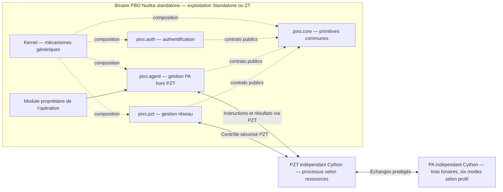

# pixs-agent Specification

## Purpose

Pixs Agent est la couche d’exécution locale à trois binaires et six modes, distincte du
runtime applicatif PBO/PFO. Cette capacité spécifie ses modes, droits,
contrats, compilation, gestion PBO par pixs.agent et livraison cible. PZT est
un exécutable indépendant défini par pzt, colivré avec PA. Aucune implémentation
n’est déclarée par ces spécifications.

Le schéma est logique ; les exigences ci-dessous fixent les responsabilités.
Les profils locaux et distants, avec ou sans PBO/PFO sur l'hôte distant,
sont définis par runtime. Les endpoints restent à qualifier.

## Requirements

### Requirement: Processus PA configurables par rôle et session

Les trois binaires et six modes PA MUST conserver leur répartition et permettre un plan de processus et de concurrence selon runtime et les ressources de leur environnement. Le plan MUST distinguer démons permanents, événements bornés et sessions réelles. Il MUST NOT transformer un événement en démon, activer un mode exclu du profil ou partager les privilèges entre système et utilisateur.

#### Scenario: Deux sessions utilisateur

- **WHEN** deux sessions réelles utilisent le binaire utilisateur PA
- **THEN** leurs processus, droits, ressources et arrêts restent isolés dans le budget global déclaré

#### Scenario: Profil Docker dimensionné

- **WHEN** un plan de ressources PA est appliqué dans Docker
- **THEN** seuls les modes système et événements du conteneur admissibles sont sélectionnés, sans mode de session

### Requirement: Unicité des opérations PA multiprocessus

Les processus PA MUST coordonner propriété des ressources, admission, idempotence et résultats durables selon leurs contrats. Leur multiplication MUST NOT dupliquer un effet, créer une identité ou une autorité implicite, ni permettre des mutations concurrentes incompatibles. Les configurations de ressources MUST être gérées par pixs.agent via PZT avec état appliqué vérifié.

#### Scenario: Deux processus pour une opération

- **WHEN** deux processus PA reçoivent une même opération ou des opérations incompatibles sur une ressource
- **THEN** la coordination conserve l'idempotence et la propriété déclarée sans double application ni choix implicite d'autorité

### Requirement: Trois binaires PA et six modes distincts de PZT

PA MUST comporter exactement trois binaires : démon système pour system-daemon ;
événements système pour system-start et system-stop ; sessions utilisateur pour
session-start, session-stop et session-daemon. PZT et son mode pzt-daemon MUST
rester un composant exécutable indépendant, colivré selon deb-package et
docker-image. Le démon de session MUST NOT créer un binaire supplémentaire.
Les chemins et options CLI restent à spécifier.

#### Scenario: Répartition PA et PZT

- **WHEN** la composition complète PA/PZT est décrite
- **THEN** elle distingue trois binaires et six modes PA du binaire indépendant PZT et de son mode pzt-daemon

### Requirement: Compilation différenciée validée

Les trois binaires PA MUST être compilés avec Cython ; le binaire indépendant
PZT MUST suivre Cython selon pzt. Les chaînes MUST partir de Python via C avec
runtime, dépendances et ABI déclarés et qualifiés avant construction. Cette
décision MUST NOT installer un outil ni prouver un gain de performance.

#### Scenario: Compilation des composants distincts

- **WHEN** la matrice de compilation PA/PZT est déclarée
- **THEN** les trois binaires PA et PZT indépendant utilisent Cython avec leurs chaînes et qualifications propres

### Requirement: Plateformes demandées et qualification progressive

PA MUST conserver le périmètre Linux et Windows physiques, VM Linux et Windows, Docker et LXC sous Proxmox. La première qualification MUST cibler Debian/Linux et Docker locaux, puis les autres cibles ; une cible non qualifiée MUST être indiquée comme telle. Versions OS/CPU, topologies Docker dans VM ou LXC, droits, bureaux et vTPM MUST être déclarés par profil ; un support MUST NOT être inféré du seul environnement de développement.

#### Scenario: Plateformes demandées et qualification progressive

- **WHEN** seuls Debian et Docker disposent de preuves de recette
- **THEN** Windows et les autres profils restent demandés et explicitement non qualifiés

### Requirement: Indépendance d'installation et autorité applicative

Les binaires PA MUST pouvoir être installés sans PBO, PFO ou navigateur locaux et joindre un PBO distant autorisé. PA MUST NOT embarquer Django/PostgreSQL comme autorité métier, accéder directement aux tables métier ni confirmer une mutation de sa propre initiative. PBO/Django MUST conserver les décisions applicatives et PostgreSQL leur persistance de référence.

#### Scenario: Indépendance d'installation et autorité applicative

- **WHEN** PA est installé seul sur une cible
- **THEN** ses opérations restent liées à leurs mandats et à l'autorité PBO compétente

### Requirement: Composition au build et catalogue fermé

Chaque capacité PA MUST déclarer identité, version, propriétaire, contrats, dépendances, configuration, sécurité et permissions selon le modèle de composants. La composition initiale MUST se faire au build ; instructions et mandats MUST sélectionner seulement des opérations déjà livrées. PA MUST NOT télécharger ou charger implicitement du code, évaluer du Python ou ouvrir un shell privilégié à partir d'une instruction réseau.

#### Scenario: Composition au build et catalogue fermé

- **WHEN** une instruction demande une opération absente du catalogue livré
- **THEN** elle est refusée sans téléchargement ou exécution de code arbitraire

### Requirement: Démarrage système et session borné

system-daemon et session-daemon MUST avoir des délais indépendants,
configurables et non négatifs, des préconditions et attentes maximales déclarées.
L'arrêt pendant un délai MUST annuler le lancement différé. Le démarrage du
composant indépendant PZT MUST suivre pzt et MUST NOT être attribué à un mode PA.
Une mesure de démarrage MUST NOT tenir lieu de validité d'autorisation.

#### Scenario: Arrêt pendant délai PA

- **WHEN** le système s’arrête pendant le délai du démon système
- **THEN** ce lancement est annulé sans modifier la validité des mandats ni transférer la gestion de PZT à PA

### Requirement: Provisionnement distinct du canal de contrôle

Le provisionnement MUST établir configuration minimale, identité, ancrages et références de secrets avant le premier échange PBO–PA, avec états inspectables non provisionné, en cours, prêt ou échoué. L'origine et l'autorisation MUST être vérifiées ; le premier PBO rencontré MUST NOT être approuvé automatiquement. La reprise MUST éviter de dupliquer identité ou autorisation ; des fichiers de provisionnement MUST NOT devenir un canal continu hors PZT.

#### Scenario: Provisionnement distinct du canal de contrôle

- **WHEN** l'ancrage requis est absent au premier démarrage
- **THEN** les échanges dépendants restent bloqués avec un état de provisionnement explicite

### Requirement: Arrêt contrôlé et résultats réellement observés

Les traitements system-stop et session-stop MUST avoir un budget maximal, un ordre déclaré avec les démons et dépendances, et une protection contre les doublons. PZT MUST être conservé tant que des échanges nécessaires et autorisés restent possibles dans le budget d'arrêt. Panne électrique, arrêt forcé et perte du processus MUST NOT être présentés comme une fermeture exécutée ou un résultat livré.

#### Scenario: Arrêt contrôlé et résultats réellement observés

- **WHEN** le conteneur disparaît avant confirmation du traitement d'arrêt
- **THEN** le résultat reste incomplet ou inconnu et aucun succès n'est inventé

### Requirement: Isolation des sessions et des privilèges

Le binaire utilisateur MUST fonctionner avec l'identité et les droits de la session réelle, distincte du compte utilisateur ; sessions concurrentes MUST être isolées. Fermer une session MUST arrêter son démon sans affecter les autres ; verrouillage ou suspension MUST NOT valoir fermeture. Le démon système et le binaire PZT MUST conserver leurs comptes, clés et frontières déclarés, sans élévation implicite depuis une session.

#### Scenario: Isolation des sessions et des privilèges

- **WHEN** une session demande une clé ou un droit réservé au système
- **THEN** l'accès est refusé selon les contrôles applicables sans transfert de privilège

### Requirement: Contrat public des instructions et revalidation

Une instruction MUST identifier émetteur, acteur initial, exécuteur, opération/version, cible, plateforme, tenant/scope, paramètres typés/bornés, mandat, validité, fraîcheur, corrélation et idempotence lorsqu'applicables. PA MUST vérifier ces éléments à l'exécution, y compris après attente ou reprise. Une permission de lecture/surveillance MUST NOT accorder une reconfiguration ; un canal authentifié MUST NOT accorder un droit métier.

#### Scenario: Contrat public des instructions et revalidation

- **WHEN** une instruction admise expire avant son exécution
- **THEN** elle n'est pas exécutée sur la seule base de son admission passée

### Requirement: Plusieurs PBO et conflits explicites

Chaque relation PBO–PA MUST déclarer son périmètre et ses versions ; plusieurs connexions MUST NOT permettre l'administration libre d'une même ressource. Les autorités, délégations et priorités MUST être définies avant activation ; des commandes incompatibles MUST être bloquées sans règle du dernier message reçu. Les résultats, identités et configurations d'une relation MUST NOT être exposés à une autre sans accord explicite.

#### Scenario: Plusieurs PBO et conflits explicites

- **WHEN** deux instructions incompatibles ciblent la même ressource
- **THEN** le conflit est déclaré et aucune autorité n'est choisie implicitement

### Requirement: Exécution locale et états indéterminés

Chaque opération MUST déclarer préconditions, postconditions, effets, codes stables, caractère rejouable et stratégie d'erreur. Après crash entre effet et persistance du résultat, PA MUST vérifier la postcondition ou demander une intervention autorisée avant réexécution. Simulation, préparation, exécution et confirmation MUST rester distinctes ; une simulation MUST NOT produire de mutation.

#### Scenario: Exécution locale et états indéterminés

- **WHEN** un crash survient après un effet système avant son enregistrement
- **THEN** la reprise distingue l'effet inconnu et évite une réexécution aveugle

### Requirement: Plans sensibles et compensation préautorisée

Une reconfiguration sensible MUST utiliser un plan versionné, borné, autorisé et encore courant, avec confirmation ou assurance renforcée lorsque requise. Une compensation après perte de contrôle MUST rester dans le plan préautorisé, sans restaurer une permission révoquée ni ouvrir un canal hors PZT. Un plan obsolète ou hors mandat MUST NOT être appliqué.

#### Scenario: Plans sensibles et compensation préautorisée

- **WHEN** une modification coupe le canal de contrôle
- **THEN** l'état est diagnostiqué et seule une compensation encore autorisée peut être tentée

### Requirement: Configuration souhaitée et appliquée distinctes

PBO MUST conserver la configuration souhaitée et PA MUST rapporter version, résultat et état réellement appliqués. Validation de schéma, compatibilité, préconditions et concurrence MUST précéder l'application ; application partielle et conflit MUST être déclarés. Envoyé ou reçu MUST NOT être présenté comme appliqué ; un feature flag MUST NOT supprimer une capacité requise ni élargir un droit.

#### Scenario: Configuration souhaitée et appliquée distinctes

- **WHEN** PA a reçu une configuration mais son application échoue
- **THEN** PBO conserve la distinction souhaité/appliqué et affiche l'échec

### Requirement: Persistance technique locale bornée

Les seuls états techniques locaux nécessaires à l'exécution, déduplication, résultats en attente et reprise MUST avoir un propriétaire, un contrat de durabilité, des limites, une rétention, une protection et une stratégie de corruption/restauration déclarés. Ils MUST NOT devenir une source de vérité métier. Un stockage requis plein ou corrompu MUST bloquer les opérations sans preuve durable ; en conteneur il MUST NOT dépendre du filesystem éphémère.

#### Scenario: Persistance technique locale bornée

- **WHEN** l'état durable de reprise est corrompu
- **THEN** les traitements dépendants restent bloqués sans état remis à zéro implicitement

### Requirement: Continuité sans PBO et reprise locale PZT

Sans PBO joignable, PA MUST se limiter aux capacités explicitement provisionnées, éligibles et encore valides ; une décision en ligne indisponible MUST bloquer l'action concernée. Diagnostic et reprise depuis PBO MUST passer par PZT, y compris local. Si PZT est entièrement indisponible, une réparation interne/opérateur MUST suivre sa procédure distincte, sans canal de substitution PBO–PA.

#### Scenario: Continuité sans PBO et reprise locale PZT

- **WHEN** PZT est entièrement arrêté
- **THEN** PBO ne reçoit aucun canal de contrôle local de contournement

### Requirement: Observation des dérives et corrections distinctes

PA MUST distinguer constat de dérive et correction. La surveillance MUST produire des états et diagnostics autorisés ; une correction MUST disposer de sa politique et de son mandat propres. Référentiels, fréquences, budgets et catalogue de corrections MUST être spécifiés et qualifiés avant activation, sans valeurs implicites.

#### Scenario: Observation des dérives et corrections distinctes

- **WHEN** une dérive est détectée sans mandat de correction
- **THEN** le constat est rapporté sans engager de modification non autorisée

### Requirement: Supervision PBO et collecte PA

Le module PBO pixs.agent MUST configurer, administrer et superviser toutes les
fonctions PA hors PZT. PA MUST rapporter ses mesures, versions et états réels
via PZT ; pixs.agent MUST distinguer état souhaité, appliqué, dernier état connu
et résultat confirmé. La gestion réseau MUST rester dans pixs.pzt. Une mesure
ancienne MUST être datée et MUST NOT devenir un état courant sans preuve.

#### Scenario: Collecte PA interrompue

- **WHEN** la collecte PA est interrompue alors que le dernier état était sain
- **THEN** pixs.agent signale les mesures périmées sans déduire une disponibilité actuelle

#### Scenario: Gestion PZT exclue de pixs.agent

- **WHEN** une configuration du composant réseau PZT est demandée
- **THEN** la gestion relève de pixs.pzt et aucune mutation PZT n’est attribuée à pixs.agent

### Requirement: Maintenance et quarantaine sans nouveaux droits

Les profils MUST déclarer états normal, surveillance seule, maintenance et quarantaine avec portées, actions permises/interdites et conditions de sortie. Drainage et arrêt MUST être bornés ; les nouvelles modifications incompatibles MUST être refusées. Ces états MUST NOT accorder de droit supplémentaire ni supprimer les contrôles applicables.

#### Scenario: Maintenance et quarantaine sans nouveaux droits

- **WHEN** la cible entre en maintenance pendant une opération
- **THEN** son drainage suit le contrat et les nouvelles mutations incompatibles sont refusées

### Requirement: Audit, confidentialité et exception Super Admin

PA et PBO MUST appliquer les obligations ordinaires de security, authorization et audit sous réserve de l'exception unique définie par initial-administration. Une requête Super Admin MUST conserver acteur initial et tenant explicitement accordé, sans credentials ou exception transférés à un worker/autre compte. Audit ou contrôle dérogé/non réalisé MUST NOT être présenté comme effectué ; profils structurels et contrats d'exécution MUST rester distincts.

#### Scenario: Audit, confidentialité et exception Super Admin

- **WHEN** le Super Admin utilise une dérogation d'audit dans son tenant accordé
- **THEN** l'audit absent n'est pas revendiqué comme réalisé et aucun autre compte n'hérite de la dérogation

### Requirement: Interfaces et messages cohérents

Les interfaces CLI et les contributions PBO/PFO MUST utiliser les contrats publics, des erreurs stables et les traductions des composants propriétaires ; codes et champs MUST rester non localisés. PFO MUST adresser ses demandes à PBO ; une liaison directe PFO–PA MUST NOT être introduite par ces spécifications. Les interfaces MUST respecter accessibilité, thèmes et confidentialité déclarés.

#### Scenario: Interfaces et messages cohérents

- **WHEN** une action est présentée dans PFO
- **THEN** son autorisation reste évaluée par PBO avant transmission éventuelle à PA via PZT

### Requirement: Qualification des binaires PA et PZT et de la composition

Chaque binaire PA ou PZT livré MUST disposer de preuves correspondant à son
OS/CPU, runtime, dépendances/ABI, modes et composition. La matrice MUST conserver
R01–R68 selon leurs rôles PA ou PZT et déclarer les cas de session non applicables
à Docker avec absence contrôlée. Une compilation réussie MUST NOT tenir lieu
de recette ou de mesure de performance.

#### Scenario: Compilation sans recette de plateforme

- **WHEN** une compilation réussit sans recette Windows
- **THEN** aucune compatibilité Windows qualifiée n’est annoncée

### Requirement: Publications locales expérimentales et sécurité de distribution

La première livraison envisagée MUST rester locale sur canal expérimental, avec capacités, versions, limites et preuves déclarées. Elle MUST satisfaire artifact-publication, notamment signature, provenance, inventaire, intégrité, immuabilité et révocation ; locale ou expérimentale MUST NOT dispenser de ces garanties ni autoriser une clé secrète dans un artefact. La présente formalisation MUST NOT construire, signer ou publier un artefact.

#### Scenario: Publications locales expérimentales et sécurité de distribution

- **WHEN** un artefact local expérimental ne dispose pas d'une signature admissible
- **THEN** il ne peut pas être déclaré publiable ou installable conformément à artifact-publication

### Requirement: Paramètres ouverts et absence d'implémentation implicite

Les identifiants pixs.agent, pixs.pzt et le nom du composant/binaire PZT MUST
être considérés validés. Noms/versions de paquets, noms de fichiers exécutables,
chemins, CLI, bibliothèques, comptes, formats et valeurs non arrêtés MUST rester
ouverts jusqu'à décision ou qualification. Les versions de Cython MUST
être qualifiées avant installation. Cette rédaction MUST NOT valoir code,
recette runtime, support de plateforme ou artefact livré.

#### Scenario: Paramètres ouverts et absence d'implémentation implicite

- **WHEN** seules les spécifications sont déclarées
- **THEN** les états d'implémentation, qualification et publication restent explicitement non réalisés

### Requirement: Matrice de recette PA PZT complète par profil

La recette conjointe PA/PZT MUST couvrir R01–R68 selon les fonctions livrées et
leur exécutant propriétaire. R05–R08 et R30
MUST être justifiés non applicables à Docker ; l’absence du binaire utilisateur
MUST y être contrôlée. Chaque résultat MUST être déclaré exécuté/réussi,
exécuté/échoué, non exécuté, non disponible ou non applicable justifié,
sans test implicitement réalisé.

##### Critères normatifs R01–R68

| Référence | Scénario à vérifier | Résultat attendu |
| --- | --- | --- |
| R01 | Installation sans Pixs Frontoffice ni Pixs Backoffice | Les binaires PA fonctionnent avec leurs seules dépendances déclarées et joint une instance distante autorisée via PZT. |
| R02 | Démarrage du système ou du conteneur | `system-start` exécute les opérations déclarées et restitue leur résultat. |
| R03 | Arrêt contrôlé du système ou du conteneur | `system-stop` réalise ou interrompt explicitement les opérations dans le budget prévu. |
| R04 | Démarrage différé système | `system-daemon` respecte le délai, les préconditions et l'annulation en cas d'arrêt anticipé. |
| R05 | Ouverture de session graphique | `session-start` utilise l'identité et les droits de la session concernée. |
| R06 | Fermeture contrôlée de session graphique | `session-stop` produit un résultat borné et le démon concerné s'arrête. |
| R07 | Démarrage différé de session | `session-daemon` respecte le délai et ne survit pas à la fermeture de sa session. |
| R08 | Sessions concurrentes et déclenchements répétés | Les sessions restent isolées et les invocations répétées ne produisent pas de doublon incontrôlé. |
| R09 | Requête utilisateur exigeant des droits système | L'élévation implicite est refusée et diagnostiquée. |
| R10 | Agent dans un conteneur | Aucun accès à l'hôte n'est possible au-delà du périmètre explicitement accordé. |
| R11 | Identité, autorisation ou fraîcheur invalide | L'action concernée est refusée sans repli permissif. |
| R12 | Relations avec plusieurs instances Pixs | Les périmètres sont isolés et les instructions contradictoires sont bloquées selon la politique. |
| R13 | Coupure réseau, expiration ou révocation | Les opérations non autorisées cessent et seules les capacités locales explicitement éligibles restent possibles. |
| R14 | Rejeu, crash et redémarrage | La reprise respecte l'idempotence et distingue les effets dont le résultat est inconnu. |
| R15 | Dérive détectée | Un constat traçable est produit ; aucune correction non autorisée n'est engagée. |
| R16 | Configuration ou contrat incompatible | La capacité concernée reste inactive avec un diagnostic exploitable. |
| R17 | Binaire compilé sur une cible supportée | Les modes livrés par les trois binaires PA et PZT indépendant conservent leur comportement et les performances respectent les budgets validés ; dans Docker, les modes de session sont explicitement exclus. |
| R18 | Inspection des artefacts et diagnostics | Aucun secret ni donnée personnelle interdite n'est présent. |
| R19 | Arrêt forcé ou disparition brutale de session | L'agent ne prétend pas avoir exécuté un traitement de fermeture non observé. |
| R20 | Mise à niveau du composant | Configuration et reprise compatibles ; A10f : références signées/versionnées, transition bornée, ensembles cohérents, retrait à échéance, refus du rejeu et des références révoquées, nouvelle preuve après modification des mesures ; rollback uniquement autorisé par la politique courante. |
| R21 | PBO et PA sur le même hôte ou dans le même conteneur | Tous leurs échanges, dans les deux sens, passent par PZT avec ses contrôles et son chiffrement. |
| R22 | Tentative de communication PBO–PA hors PZT | Le canal de contournement est refusé, même si les permissions locales permettraient son utilisation. |
| R23 | Canal PZT requis indisponible, non initialisé ou preuves invalides | La communication PBO–PA concernée est bloquée sans repli hors PZT, y compris pendant l'amorçage. |
| R24 | Premier démarrage sans PBO joignable | PA se limite aux capacités et opérations locales explicitement provisionnées, éligibles et encore autorisées. |
| R25 | Réseau distant indisponible et profil local PZT disponible | Le diagnostic et la reprise depuis PBO utilisent PZT avec les mêmes contrôles ; une décision en ligne indisponible bloque l'action qui l'exige. |
| R26 | PZT entièrement arrêté | Aucun échange PBO–PA n'est possible ; une éventuelle réparation système suit la procédure opérateur distincte et auditée. |
| R27 | Profil de pilotage PZT sans module officiel requis | La composition PBO est refusée ; une extension ne peut ni retirer le socle ni affaiblir ses contrôles. |
| R28 | Capacité incompatible ou ajout de code demandé par message | L'activation ou le chargement est refusé ; seules les opérations livrées par une composition vérifiée sont sélectionnables. |
| R29 | Mandat hors cible, périmètre, validité ou obligations | L'instruction est refusée au moment de l'exécution, même sur un canal PZT valide et après attente ou reprise. |
| R30 | Instance de session demandant un secret ou un droit système | L'accès est refusé ; les identités, clés et privilèges des fonctions séparées restent isolés. |
| R31 | Stockage technique plein, indisponible ou corrompu | Les opérations dont les garanties durables ne peuvent être tenues sont bloquées et l'écart est diagnostiqué sans perte silencieuse. |
| R32 | Crash après effet système mais avant enregistrement du résultat | L'état indéterminé conduit à une vérification de postcondition ou une intervention autorisée, sans réexécution aveugle. |
| R33 | Simulation ou plan expiré ou devenu obsolète | La simulation reste sans mutation ; l'application d'un plan invalide est refusée jusqu'à nouvelle validation. |
| R34 | Reconfiguration réseau interrompant le contrôle | L'échec est diagnostiqué et la compensation suit le plan préautorisé, sans réactiver un droit révoqué ni ouvrir un canal hors PZT. |
| R35 | Restauration d'un ancien état technique | Les droits révoqués et mandats expirés restent refusés et les préconditions sont réévaluées avant reprise. |
| R36 | Maintenance, surveillance seule ou quarantaine | Les actions interdites restent bloquées, le drainage est borné et la sortie contrôle les préconditions avant réactivation. |
| R37 | Action privilégiée soumise à une obligation d'audit | L'acteur, l'exécuteur, le mandat, la cible et le résultat sont corrélés ; une obligation non satisfaite empêche l'autorisation. |
| R38 | Changement de langue et appel non interactif | Les messages humains sont traduits tandis que codes de sortie, codes d'erreur et structures contractuelles restent stables. |
| R39 | Profil de déploiement qualifié | Les comptes, signaux, persistance, réseaux et limites correspondent au profil ; le conteneur commun ne lance pas implicitement plusieurs rôles PBO. |
| R40 | Versions PBO–PA–PZT incompatibles | La capacité est bloquée ou suit la migration déclarée, sans compatibilité déduite du seul numéro de version. |
| R41 | Binaire sur une cible OS/CPU déclarée | Le runtime embarqué et les bibliothèques natives sont qualifiés et les modes disponibles passent leurs tests applicables. |
| R42 | Artefact altéré ou révoqué | La vérification de signature, d'intégrité, de confiance et de provenance empêche son activation. |
| R43 | Arrêt contrôlé pendant une opération et livraison du résultat | Le séquencement conserve PZT dans le budget prévu et distingue exécution, résultat en attente et confirmation par PBO. |
| R44 | Configuration reçue, concurrente ou partiellement appliquée | L'état souhaité reste distinct de l'état appliqué ; les conflits et interruptions sont explicites et aucune réussite n'est déduite de la réception. |
| R45 | Référence temporelle d'autorisation non fiable | L'opération concernée est refusée ; les délais monotones ne servent pas de preuve de validité du mandat. |
| R46 | Démarrage du système ou du conteneur avec `pzt-daemon` | Le mode démarre sans délai et assure la convergence et la réconciliation de PZT lorsque celui-ci est activé et configuré sur ce composant PZT ; sinon, il se ferme. |
| R47 | Backend WireGuard du profil retenu | PZT pilote le backend qualifié, sans réimplémenter la cryptographie ; dépendances et privilèges correspondent au profil. |
| R48 | Carte ou delta altéré, périmé, hors destinataire, dupliqué ou de base incompatible ; séquence manquante et reprise | La configuration invalide est refusée ; un doublon ne produit aucun double effet et ne prolonge aucune permission. Une base incompatible, un trou ou un historique hors rétention déclenche un état complet vérifié. La réconciliation contrôle l'état effectivement appliqué et ne réintroduit aucun droit expiré ou retiré ; les objectifs A05b restent opposables. |
| R49 | AllowedIPs ou route présents sans permission du service | Les adapters nftables Linux et Windows Filtering Platform Windows appliquent les politiques PZT du profil et vérifient leur état ; les flux non autorisés sont bloqués, le tunnel ne donne pas accès aux services voisins et les ressources gérées restent distinctes des règles de l’opérateur. |
| R50 | PBO, PA et sessions utilisant le même composant PZT | Le propriétaire des ressources réseau évite les écritures concurrentes ; aucune session ne reçoit de clé ou privilège système. |
| R51 | Admission automatisée, demande hors mandat ou preuves invalides, jeton expiré/révoqué/consommé, concurrence et reprise après crash | A11a : identité, contexte et preuves A10 vérifiés, aucune gestion ou exposition métier avant admission, arbitrage opérateur hors mandat sans dispense de preuve ; A11b : jeton à usage unique par instance, engagement atomique et reprise sans double identité ni consommation ; nouvelles admissions invalides refusées, secrets non exposés et retrait des pairs existants distinct. |
| R52 | Échéance d'un pair éphémère encore présent, renouvellement concurrent, fin de charge, partition et restauration | A11c : échéance finie sans report sur présence ; renouvellement autorisé avant échéance avec contrôles courants, blocage/retrait sans résurrection après échéance ou retrait engagé ; nettoyage par génération avec audit/tombstones et suivi des échecs, aucune suppression de VM/conteneur/volume ; nouvelle admission avec nouveau jeton et preuves après retrait. |
| R53 | Connectivité ICE/STUN, relais QUIC DATAGRAM et secours WSS | Signalisation protégée, sondes encadrées, candidats et mapping réel WireGuard vérifiés ; direct puis QUIC DATAGRAM et secours WSS selon la politique autorisée, sans contournement ni prolongation des droits. Support DATAGRAM, tailles, MTU, pertes, reprise et backends qualifiés ; le relais ne déchiffre pas WireGuard. Sans chemin admis, échec explicite. |
| R54 | Changement d'endpoint ou de contexte réseau | L'identité demeure stable et les conditions de posture concernées sont réévaluées selon le profil. |
| R55 | Activation/désactivation IPv6 PZT, DNS administré et chevauchement d'adresses ou de routes | Le réglage unique retire les ressources IPv6 PZT, les AAAA propres à PZT et les échanges/endpoints IPv6 WireGuard/TLS concernés sans désactiver l'IPv6 hôte. Les sessions et états souhaité/appliqué sont vérifiés ; aucune réussite n'est annoncée sans preuve, aucun repli hors PZT ni droit périmé restauré. Les familles actives appliquent les garanties PZT ; les conflits bloquent le périmètre concerné sans écraser la configuration de l'hôte sans mandat. |
| R56 | DNS Pixs via module essentiel PBO : publication, consultation, panne et destination inattendue | Les contrats publics et droits distincts de publication/consultation sont vérifiés pour chaque contexte PA ; retraits et caches gérés respectent la validité, avec aucune fuite par repli public en panne. Dépendance essentielle, état appliqué et continuité sans PBO sont qualifiés selon le profil. Une résolution DNS seule n'accorde aucun accès ; une destination dont l'identité ou la clé diffère de celle attendue est refusée. |
| R57 | Posture modifiée, reconnexion PA, preuve TPM absente, expirée ou rejouée | A10c : preuve fraîche à chaque connexion/reconnexion puis sur événement ou expiration, bornée par génération/contexte ; A10e : PA chargé, runtime, dépendances, collecteur et paramètres requis mesurés par chaîne qualifiée, journaux et références vérifiés. Contrôles des services conservés ; preuves manquantes/incohérentes refusées, sans simple déclaration ni renouvellement implicite des droits. |
| R58 | Crash ou blocage de PA avec tunnel et flux déjà actifs dans le noyau | La protection indépendante ferme les accès en 10 secondes maximum, détection et action comprises, sans prolonger une permission ni en créer ; une échéance antérieure reste prioritaire. Une révocation connue n'attend pas l'expiration et prend effet en 5 secondes maximum si PA est joignable sur le chemin de contrôle qualifié. La reprise vérifie l'état courant avant réactivation ; les objectifs A05b doivent être démontrés sur chaque profil. |
| R59 | Rotation d'une clé WireGuard | Identité Pixs stable et certificat X.509 encore valide conservés ; nouvelle liaison séparée JWS vérifiée, incohérences ou signatures invalides refusées et ancienne liaison retirée conformément à la politique, sans renouvellement implicite des droits. |
| R60 | Ressource sans PA derrière une passerelle déclarée | La permission ne donne pas accès aux services locaux de la passerelle ; le dernier segment respecte la protection du profil. |
| R61 | Basculement du profil passerelle ultérieur sans NAT | Une seule passerelle est active par périmètre de routage cohérent ; sélection déterministe, mandat valide, retours convergents et retrait des décisions obsolètes sont vérifiés. Le profil qualifie conservation des sources, sessions et traçabilité ; aucune continuité non démontrée ni prolongation des droits n'est annoncée. |
| R62 | Démarrage à froid, admission, renouvellement et basculement sans accès à l'éditeur | Les services PZT exploités par l'opérateur suffisent lorsque les dépendances déclarées du profil sont disponibles. |
| R63 | TLS d'amorçage A02 et TLS mutuel local A03 validés | L'amorçage vérifie l'autorité à partir de l'ancrage préalable et refuse l'admission si les preuves requises sont invalides ; aucun accès métier avant admission. Le profil local sur le même hôte d'exécution vérifie les deux identités et les contrôles PZT ; identité, permission ou preuve requise invalides bloquent l'échange sans repli hors PZT. Endpoints, isolation et frontières des VM/conteneurs sont qualifiés par profil. |
| R64 | Propriété, réconciliation et retrait des ressources réseau | pzt-daemon gère les ressources PZT de son périmètre ; les six autres modes soumettent leurs demandes autorisées sans écritures directes, y compris après indisponibilité du propriétaire. PA ne retire que les ressources dont il possède la gestion ; une application partielle est rapportée sans fenêtre permissive. |
| R65 | Handshake récent et service indisponible | Le diagnostic distingue transport, joignabilité, readiness, autorisation et résultat métier. |
| R66 | PA Linux et Windows sur machines physiques et virtuelles | Chaque cible demandée dispose d'un backend, d'adapters système/session, de réseau, DNS et filtrage qualifiés ; aucune exclusion n'est déduite de l'environnement Debian du projet. |
| R67 | PA Docker et LXC sous Proxmox | Le profil vérifie le noyau effectif, le placement, les droits minimaux et l'isolation ; aucun repli en espace utilisateur ne suppose des privilèges absents. |
| R68 | Snapshot, clone, restauration ou migration d'une VM ou d'un conteneur | Les identités, liaisons de clés et preuves TPM/vTPM sont réévaluées ; aucun accès ni identité clonée n'est accepté implicitement. |

#### Scenario: Profil Docker sans recette de session

- **WHEN** la matrice de recette est produite pour l’image Docker
- **THEN** les cas utilisateur exclus sont justifiés non applicables et l’absence du binaire est contrôlée

### Requirement: Contrats publics de pixs.agent et propriété des opérations

Les modules fonctionnels MUST solliciter PA via les contrats publics versionnés
de pixs.agent et MUST conserver la propriété de leurs opérations et règles métier.
pixs.agent MUST exposer les fonctions de gestion PA hors PZT et le suivi des
instructions, états et résultats. Il MUST NOT absorber les opérations métier,
le transport PZT ou les données privées d'un autre module.

#### Scenario: Module sollicitant une opération PA

- **WHEN** un module fonctionnel demande une opération système autorisée
- **THEN** il utilise le contrat pixs.agent, garde ses règles métier et suit un résultat PA distinct de l'accusé de réception

### Requirement: Interfaces de gestion PA au-dessus du socle

pixs.agent MUST utiliser les mécanismes communs de composition et les contrats
pixs.core d'identité et de permissions. Ses données de gestion, contrats,
permissions, contributions frontend et lifecycle MUST être déclarés. Le Kernel et pixs.core MUST NOT porter une logique de gestion ou de transport
spécifique à PA. Tous les échanges PBO–PA MUST passer par PZT, même localement.

#### Scenario: Sollicitation locale via pixs.agent

- **WHEN** le PBO et le PA partagent un environnement d'exécution
- **THEN** pixs.agent utilise PZT et aucun canal local de substitution n'est ouvert

### Requirement: Préparation PostgreSQL par le PA système

Le PA système du profil sélectionné MUST préparer PostgreSQL sur hôte physique/VM ou initialiser les ressources manquantes dans Docker, sous mandat technique vérifié et catalogue fermé. Il MUST conserver les données et sa séparation avec les migrations et mutations applicatives PBO. Tous échanges PBO–PA MUST passer par PZT ; reprise et garanties ci-dessous sont obligatoires.

#### Scenario: Garanties de la préparation PA

- **WHEN** le profil sélectionne cette capacité pour le parcours de préparation PostgreSQL
- **THEN** Le PA système MUST posséder une capacité livrée et versionnée de préparation PostgreSQL sélectionnée explicitement par le profil d'installation. Sur hôte physique ou VM elle MUST installer et configurer le service dans son périmètre autorisé ; sous Docker elle MUST utiliser le logiciel fourni dans l'image, initialiser seulement les ressources absentes et conserver les données persistantes. Son mandat MUST lier opérateur préautorisé, exécutant effectivement vérifié, installation, hôte ou conteneur cible, opération et version, plan confirmé, validité, politique courante, corrélation et idempotence. PA MUST limiter ses connexions SQL aux opérations techniques explicitement prévues de service, rôle et base ; les privilèges de préparation MUST être distincts des accès applicatifs et retirés ou rendus inutilisables après leur phase. PA MUST NOT lire ou muter les tables métier, exécuter les migrations à leur place, créer Core/Auth/Super Admin/tenant ni confondre son résultat technique avec un commit applicatif. Tous échanges avec PBO MUST emprunter PZT, y compris locaux. La capacité MUST rester dans le catalogue fermé livré ; aucun code reçu, shell arbitraire ou droit hôte issu du seul conteneur n'est admis.

#### Scenario: Rejeu après préparation technique

- **WHEN** la même opération PA est reprise après une réponse perdue
- **THEN** PA inspecte son résultat durable et la ressource cible avant tout effet ; une issue inconnue est réconciliée, sans recréer ni effacer la base

#### Scenario: Demande hors rôle technique

- **WHEN** un mandat PA de préparation PostgreSQL demande une mutation de table métier ou un code reçu de PBO
- **THEN** PA la refuse sans transférer de privilège ni inventer un résultat applicatif

### Requirement: Préparation confirmée sous enveloppe 1.1 et plan PA

Pour le profil PostgreSQL initial 1.1 E5 sélectionné, la préparation PA MUST suivre OBSERVE, PREPARE_PLAN, confirmation puis PREPARE critique et READ_RESULT, sans modifier les contrats 1.0 ni fallback. Le request_digest MUST engager tous les octets de l'enveloppe. Les bindings MUST être vérifiés par leurs propriétaires. Docker, INITIALIZE_START, RECREATE et DATABASE_DROP MUST être refusés avant tout effet sans conversion silencieuse.

#### Scenario: Enveloppe et confirmation liées avant effet

- **WHEN** une préparation est demandée avec observation et planning vérifiés
- **THEN** PA retourne l'observation puis le planning avant toute confirmation C08, avec projection C08 immuable liée à l'observation et bundle vérifié, et la confirmation C08 seize champs porte le plan, les préconditions et les effets avant l'acte signé, avec request_digest engageant toute l'enveloppe 1.1 et READ_RESULT distincte

#### Scenario: Refus sans conversion silencieuse

- **WHEN** un plan contient RECREATE, DATABASE_DROP ou une branche Docker non sélectionnée
- **THEN** PA refuse le plan entier avant tout effet sans le convertir en CREATE
### Requirement: Gestion du service de temps par PA et pixs.agent

MUST appliquer intégralement toutes les clauses, bornes et conditions du contrat détaillé ci-dessous, sans retrait ni réinterprétation.

##### Contrat détaillé — Service de temps PA

Le service de temps système MUST être installé, réutilisé, configuré et supervisé par PA sous politique explicite, capacité catalogue fermé et mandat de cible exacte. PA MUST conserver un propriétaire unique par horloge système. pixs.agent MUST gérer les opérations PA hors responsabilité du réseau PZT, et tous les échanges PBO vers PA MUST passer par PZT ; le temps amont demeure un service système selon profil et MUST NOT devenir un canal de commande PBO vers PA. PA MUST NOT modifier l’horloge d’un hôte partagé depuis un conteneur LXC. Sur Linux, chrony demeure retenu avec ses dépendances déclarées. Les autres profils MUST qualifier leurs adaptateurs avant activation. Dans une image isolée, le paquet est fourni par l’image sans mutation de l’hôte. Un service NTP local MAY être utilisé seulement lorsque la topologie l’exige et sous profil déclaré. Aucun montage, aucun changement de privilège et aucune discipline supplémentaire ne sont induits. Les fonctions indépendantes du temps MUST pouvoir continuer pendant une dégradation.

#### Scenario: Mandat de cible exacte pour le service de temps

- **WHEN** PA reçoit un mandat de cible exacte avec un profil valide
- **THEN** PA installe ou réutilise le service déclaré, vérifie l’état appliqué et refuse toute cible étrangère ou capacité hors catalogue

### Requirement: Dernière stable Cython au début de chaque campagne PA01

Au début de chaque campagne de qualification PA01, la chaîne MUST sélectionner la dernière version stable de Cython publiée et non retirée sur la source officielle PyPI à la date de vérification. Les préversions et versions de développement MUST NOT être sélectionnées comme dernière stable. La sélection MUST être réévaluée à chaque nouvelle campagne.

#### Scenario: Sélection de la dernière stable au début de la campagne

- **WHEN** une nouvelle campagne PA01 commence et PyPI publie une version stable plus récente que le verrou précédent, ainsi qu'une préversion encore plus récente
- **THEN** la version stable publiée et non retirée la plus récente est sélectionnée, la préversion est exclue et la vérification datée, la source, la version et les éléments de provenance et d'intégrité sont enregistrés avec le verrou de la campagne

### Requirement: Traçabilité de la chaîne Cython PA01

La date de vérification, la source officielle, la version exacte sélectionnée, la provenance et les empreintes des distributions utilisées MUST être enregistrées avec la chaîne de la campagne. Les preuves historiques MUST rester rattachées à leurs versions et artefacts ; elles MUST NOT être attribuées automatiquement à une nouvelle chaîne.

#### Scenario: Conservation des preuves après changement de version

- **WHEN** une campagne utilise une version Cython différente d'une campagne antérieure
- **THEN** chaque campagne conserve sa vérification datée, sa source, sa version, sa provenance et ses empreintes, et les anciennes preuves restent liées à leurs versions et artefacts d'origine

### Requirement: Verrouillage exact de Cython pendant la campagne PA01

La version exacte sélectionnée MUST être verrouillée dans `toolchain.cython` du profil PA01 pendant la campagne et pour la reproduction de ses artefacts. Les déclarations, métadonnées et contrôles de construction MUST vérifier cette version ; une contrainte ouverte MUST NOT remplacer le verrou. Une nouvelle publication MUST NOT modifier automatiquement la campagne ou ses preuves. La seule reproduction MUST NOT imposer une nouvelle sélection de la dernière stable.

#### Scenario: Publication pendant une campagne et reproduction des artefacts

- **WHEN** une nouvelle stable est publiée après le verrouillage d'une campagne ou qu'un artefact de cette campagne doit être reproduit
- **THEN** la version verrouillée est conservée et une version effective différente est refusée par les contrôles de construction, sans actualisation automatique ni nouvelle sélection pour la seule reproduction

### Requirement: Actualisation coordonnée de Cython pour PA01

Tout changement de version Cython MUST entraîner la mise à jour coordonnée de `pyproject.toml`, des métadonnées de chaîne, des contrôles PA01, des tests concernés et de la documentation courante, puis la qualification de la nouvelle chaîne. La sélection ou l'inscription documentaire d'une version MUST NOT tenir lieu de qualification.

#### Scenario: Actualisation lors de la campagne suivante

- **WHEN** une campagne suivante sélectionne une nouvelle stable Cython
- **THEN** les déclarations, métadonnées de chaîne, contrôles PA01, tests concernés et documentation courante sont alignés avant la qualification de la nouvelle chaîne, tandis que les preuves historiques restent liées à leurs anciens artefacts et versions

### Requirement: Préservation des autres choix de chaîne PA01

La sélection d'une version Cython MUST NOT modifier implicitement CPython, le mode GIL, l'ABI, les cibles ou les autres choix adoptés. La politique de dernière stable MUST NOT valoir autorisation d'installation.

#### Scenario: Nouvelle version Cython avec autres choix conservés

- **WHEN** une nouvelle stable Cython est sélectionnée pour PA01
- **THEN** CPython, le GIL, l'ABI, les cibles et les autres choix adoptés restent conservés, et aucune installation n'est autorisée par la seule sélection

### Requirement: Blocage si la dernière stable Cython ne peut pas être qualifiée

Si la dernière stable ne peut pas être vérifiée ou si sa compatibilité ne peut pas être qualifiée, la sélection ou la qualification concernée MUST rester bloquée. Une ancienne version MUST NOT être choisie implicitement pour contourner ce blocage.

#### Scenario: Dernière stable non vérifiable ou incompatible

- **WHEN** la source officielle ne permet pas de vérifier la dernière stable ou que cette version ne peut pas être qualifiée avec la chaîne et les cibles adoptées
- **THEN** la sélection ou la qualification reste bloquée, sans repli implicite vers une ancienne version ni modification implicite de CPython, du GIL, de l'ABI ou des cibles

### Requirement: Liaison serveur persistante du contexte Agent et PA

En gestion ordinaire, pixs.agent MUST posséder une liaison persistante côté serveur entre opération, cible, scope, génération Agent et références techniques PA/C08, sous contrôle des propriétaires. Une liaison absente, périmée ou divergente MUST être refusée. Une donnée client MUST NOT suffire à établir cette liaison ; les compteurs natifs PA MUST rester distincts de la génération Agent.

#### Scenario: Liaison absente ou divergente

- **WHEN** un résultat technique est présenté sans liaison serveur courante correspondant à son opération, sa cible, son scope et sa génération Agent
- **THEN** son rapprochement avec l'état Agent est refusé sans déduire une génération depuis un compteur natif ou une déclaration cliente

### Requirement: Contexte initial PA distinct de la gestion ordinaire Agent

L'amorçage avant PostgreSQL MUST conserver son contexte initial C08/PA. Il MUST NOT créer une génération Agent fictive pour satisfaire la liaison de gestion ordinaire. La décision de liaison serveur MUST NOT ajouter implicitement de champs aux messages PA existants ; sa structure et ses règles de mise à jour MUST être spécifiées conjointement par PA01/C08/PA10 avant réalisation dépendante.

#### Scenario: Amorçage avant disponibilité du contexte Agent

- **WHEN** C08 et PA exécutent le parcours initial avant PostgreSQL et les autorités Agent requises
- **THEN** ils conservent le contexte initial propriétaire sans fabriquer de génération ou d'autorité Agent

### Requirement: Phases PA et issues Agent séparées avec projection conditionnelle

Les phases techniques PA et les issues de gestion Agent MUST rester distinctes. Toute projection MUST être explicite, conditionnelle et liée aux preuves requises. Son tableau exact de transitions, contrôles et refus MUST être arrêté dans les contrats PA01/PA10 avant branchement ; une égalité de libellé MUST NOT constituer une preuve d'effet ou de confirmation.

#### Scenario: Réception ou progression sans fait appliqué

- **WHEN** la phase native vaut RECEIVED ou RUNNING
- **THEN** aucun état appliqué ni confirmation Agent n'est déduit de la seule réception ou progression

#### Scenario: Succès technique sans confirmation automatique

- **WHEN** la phase native vaut SUCCEEDED et le succès technique durable est vérifié
- **THEN** la confirmation Agent exige encore ses contrôles propres d'origine et de postcondition et n'est pas produite depuis la seule phase native

#### Scenario: Échec connu et issue incertaine distincts

- **WHEN** la phase native vaut FAILED ou IN_DOUBT
- **THEN** le rapprochement conserve respectivement l'échec connu ou l'incertitude sous preuves propriétaires, et IN_DOUBT exige une réconciliation avant nouvel effet

#### Scenario: Précondition refusée sans échec d'exécution fabriqué

- **WHEN** la phase native vaut BLOCKED
- **THEN** le refus de précondition reste explicite et ne produit pas de constat fictif d'exécution échouée

### Requirement: Évolution versionnée de la précision temporelle Agent

La frontière Agent MUST évoluer par une nouvelle version acceptant les six décimales natives. Le contrat Agent 1.0.0 MUST rester inchangé jusqu'à une migration explicitement définie. Le numéro, le schéma exact, la compatibilité des consommateurs et la migration des états persistés MUST être spécifiés avant leur réalisation ; l'adoption du principe MUST NOT rendre la nouvelle version disponible.

#### Scenario: Principe temporel adopté avant migration

- **WHEN** l'évolution temporelle Agent est adoptée mais sa nouvelle version et sa migration ne sont pas encore spécifiées et livrées
- **THEN** le contrat 1.0.0 reste inchangé et aucune compatibilité avec les dates natives fractionnaires n'est déclarée réalisée

### Requirement: Conservation des instants exacts et des preuves temporelles signées

Les octets signés et les preuves d'origine MUST rester intacts. Les contrôles temporels MUST utiliser l'instant exact et les preuves du fournisseur compétent. Un affichage moins précis MUST NOT participer aux décisions de sécurité ; arrondi ou troncature MUST NOT remplacer l'instant de contrôle. Cette décision MUST NOT sélectionner un nouveau délai, seuil ou producteur concret.

#### Scenario: Affichage à précision réduite

- **WHEN** une interface affiche à la seconde un instant natif à six décimales
- **THEN** les preuves signées restent intactes et les contrôles utilisent l'instant exact et le fournisseur temporel compétent

### Requirement: Qualification progressive PA PZT et recette intégrée obligatoire

La qualification PA/PZT MUST distinguer chaîne Cython/constructeur/liaison, véritables exécutables, parcours intégré réel, puis distributions et plateformes sélectionnées. Une recette intégrée MUST rester obligatoire ; une réussite partielle MUST NOT clôturer cette recette ni qualifier une autre plateforme. Les cas applicables C01–C28 et R01–R68 MUST rester couverts par leurs preuves.

#### Scenario: Construction réussie avant exécutables fonctionnels

- **WHEN** seule la chaîne de construction et de liaison dispose de preuves sur des fixtures
- **THEN** ce palier garde sa portée et les exécutables fonctionnels ainsi que la recette intégrée restent non qualifiés

### Requirement: Revue explicite des preuves avant promotion PA PZT

Chaque résultat de qualification MUST rester lié aux sources, versions, empreintes, commandes exécutées, postconditions et nettoyage. La promotion MUST être précédée d'une revue explicite des preuves réelles. L'adoption documentaire A1–A5 MUST NOT tenir lieu de raccordement livré, de fournisseur concret, de nouvelle preuve fonctionnelle ou d'autorisation de réalisation.

#### Scenario: Décisions adoptées et preuves encore manquantes

- **WHEN** A1–A5 sont validés mais que les fournisseurs, exécutables ou preuves intégrées applicables manquent
- **THEN** les choix sont déclarés adoptés tandis que la qualification fonctionnelle reste bloquée sans promotion ni nouvelle tâche cochée

### Requirement: Métadonnées fermées et identité de campagne PA01

L'enveloppe TOML PA01 MUST avoir les seules racines `schema_version`, `campaign`, `toolchain`, `selection`, `distributions`. Le schéma MUST être `1.0.0` ; campaign MUST contenir seulement un `id` unique non vide et `component=pa01`, toolchain seulement `cython`, version stable exacte normalisée. Les tables MUST être fermées ; champs inconnus, absents, dupliqués ou mal typés MUST être refusés. L'identité et les entrées figées MUST être conservées pour reproduire la campagne.

#### Scenario: Métadonnées valides et reproduction

- **WHEN** une campagne fournit les métadonnées fermées valides et qu'une reproduction est ensuite demandée
- **THEN** le même identifiant, le verrou et les preuves figées sont conservés, sans nouvelle sélection de version ni réécriture des métadonnées historiques

#### Scenario: Métadonnées invalides

- **WHEN** un champ est absent, inconnu, dupliqué ou mal typé, ou que le verrou contient une contrainte ouverte, une préversion, une version de développement, locale ou non normalisée
- **THEN** les métadonnées sont refusées avant compilation avec PA01_CAMPAIGN_METADATA_INVALID, sans valeur implicite ni correction automatique

### Requirement: Preuve de sélection Cython dans la campagne PA01

La table selection MUST contenir seulement `verified_at` UTC textuel, `source_url` PyPI officiel, `snapshot` relatif au document et `snapshot_sha256`. Le relevé JSON conservé MUST prouver la dernière stable non retirée à cette date ; son empreinte MUST être vérifiée sur ses octets. Un chemin sortant ou symbolique MUST être refusé. Une empreinte seule MUST NOT prouver l'origine officielle. Le constructeur MUST utiliser la sélection vérifiée, sans consulter PyPI ni choisir une version.

#### Scenario: Relevé absent ou preuve non concluante

- **WHEN** la date ou la source est invalide, le relevé est absent, sortant, symbolique ou altéré, ou qu'il ne démontre pas la sélection officielle de la dernière stable non retirée
- **THEN** la sélection ou la construction reste bloquée avec PA01_CAMPAIGN_EVIDENCE_INVALID pour une preuve inexploitable, sans ancien compilateur choisi implicitement ; un schéma invalide conserve PA01_CAMPAIGN_METADATA_INVALID

### Requirement: Distributions Cython tracées par campagne PA01

distributions MUST être une liste non vide de tables contenant seulement `filename`, `url`, `sha256`. Les noms simples MUST être uniques, les URL HTTPS sans authentification et les SHA-256 en hexadécimal minuscule sur 64 caractères. Chaque fichier utilisé MUST correspondre au nom, à l'URL et au condensat d'une distribution non retirée de la version verrouillée dans le relevé officiel. Une distribution absente ou altérée MUST être refusée avant compilation.

#### Scenario: Distribution non déclarée ou altérée

- **WHEN** un fichier utilisé ne figure pas dans les métadonnées ou que son nom, son URL, son empreinte réelle ou son état dans le relevé officiel ne correspond pas à la distribution autorisée
- **THEN** le contrôle refuse la construction avec PA01_CAMPAIGN_EVIDENCE_INVALID avant compilation, sans téléchargement ou installation implicite

### Requirement: Rapport de construction lié au verrou Cython PA01

Avant compilation, le constructeur MUST rapprocher `toolchain.cython` du profil, sa copie dans l'enveloppe, la déclaration Cython exacte de `pyproject.toml` et la sonde réelle. `build-report.json` MUST conserver `profile_sha256`, `cython_version` avec `locked` et `observed`, et ajouter `campaign_id`, `campaign_metadata_sha256`, distributions vérifiées et issue du contrôle. Les empreintes MUST porter sur les entrées réelles indépendantes du rapport, sans auto-condensat.

#### Scenario: Sonde conforme et rapport lié aux entrées

- **WHEN** le verrou du profil, sa copie dans l'enveloppe, la déclaration et la version observée concordent et que les entrées et distributions ont été vérifiées
- **THEN** le rapport lie l'identifiant, les empreintes des métadonnées et du profil effectifs, les versions verrouillée et observée ainsi que les distributions vérifiées, sans que ce contrôle seul qualifie le binaire

#### Scenario: Sonde inexploitable ou divergence de version

- **WHEN** la sonde est absente, mal typée ou ambiguë, ou que la copie d'enveloppe, la version déclarée ou observée diffère du verrou du profil
- **THEN** le constructeur refuse avant compilation avec PA01_BUILD_CYTHON_METADATA_INVALID pour la sonde ou PA01_BUILD_CYTHON_MISMATCH pour l'écart ; le rapport conserve les valeurs vérifiées et observed vaut null si aucune version exploitable n'est obtenue

### Requirement: Admission indépendante de la sélection officielle Cython PA01

La sélection Cython PA01 MUST provenir d'une observation directe HTTPS vérifiée et datée en UTC, suivie d'une revue explicitement autorisée du dossier figé. L'admission MUST lier le manifeste exact et la campagne dans un registre protégé distinct du candidat, non modifiable par le constructeur ou son appelant. Un booléen, un relevé auto-déclaré ou son empreinte seule MUST NOT établir cette autorité. Le constructeur MUST vérifier l'admission hors ligne.

#### Scenario: Observation et revue du manifeste exact

- **WHEN** une nouvelle campagne dispose d'une observation officielle exploitable, d'une sélection de la dernière stable non retirée, d'entrées figées vérifiées et d'une revue explicitement autorisée
- **THEN** une admission liée à l'identité de campagne et au manifeste exact est conservée dans le registre protégé, sans que cette décision seule autorise installation, compilation ou qualification

#### Scenario: Preuve auto-déclarée ou registre substitué

- **WHEN** le demandeur fournit un booléen de validation, une admission dans son candidat, une identité de responsable non autorisée ou un registre de remplacement
- **THEN** ces éléments ne valent pas admission et le contrôle refuse avant outils avec PA01_CAMPAIGN_EVIDENCE_INVALID, sans repli implicite ni compilation

#### Scenario: Observation officielle impossible ou non concluante

- **WHEN** HTTPS ou la date n'est pas vérifiable, la source est indisponible ou différente, ou que les données ne permettent pas d'établir la dernière stable non retirée
- **THEN** aucune sélection n'est admise, aucune preuve rétroactive n'est inventée et aucune ancienne version n'est choisie implicitement

### Requirement: Conservation et rattachement des preuves de sélection PA01

Le dossier figé MUST conserver entrées, manifeste, autorisation et admission sans réécriture. Le registre MUST préserver retraits et état courant ; une admission absente, retirée ou invérifiable MUST bloquer la construction. Le rapport MUST lier `selection_admission_ref`, `selection_admission_sha256` et `selection_manifest_sha256` aux preuves vérifiées, sans cycle d'empreintes. La reproduction MUST conserver dates et entrées sans nouvelle sélection.

#### Scenario: Altération ou échange après admission

- **WHEN** un fichier ou le manifeste est altéré, ou qu'une admission est présentée pour une autre campagne ou d'autres octets
- **THEN** les empreintes ou l'identité divergent, la construction est refusée avec PA01_CAMPAIGN_EVIDENCE_INVALID et les preuves d'origine restent conservées

#### Scenario: Retrait ou état courant non vérifiable

- **WHEN** l'admission est absente, retirée, inaccessible ou que son état courant est ambigu, y compris après restauration
- **THEN** la construction reste bloquée avec PA01_CAMPAIGN_EVIDENCE_INVALID, sans réactivation depuis une ancienne copie favorable

#### Scenario: Reproduction avec admission et rapport liés

- **WHEN** les entrées et l'admission de la campagne d'origine restent vérifiées et utilisables pour une reproduction
- **THEN** dates et versions d'origine sont conservées, le rapport lie les références et empreintes vérifiées d'admission et de manifeste, et le constructeur ne consulte pas PyPI pour sélectionner une autre version

### Requirement: Propriété de la liaison privée AgentPaBinding 1.0.0

AgentPaBinding 1.0.0 MUST respecter la propriété et les limites du contrat détaillé D-A1 ci-dessous. La liaison MUST NOT constituer un mandat ou une autorité durable ; l'amorçage C08/PA avant PostgreSQL MUST rester distinct de la gestion ordinaire.

##### Contrat détaillé validé 3.1

Le modèle retenu est un enregistrement privé `AgentPaBinding`, schéma `1.0.0`, possédé
par Agent dans sa persistance serveur. Il lie un contexte de gestion ordinaire
accepté aux références PA/C08/PZT résolues par leurs propriétaires.
Ce nom ne crée ni contrat public ni capacité ; la forme physique du stockage
reste à arrêter avant une éventuelle migration de données.

La liaison n'est ni un mandat ni une preuve d'autorité durable. Son existence,
son état ACTIVE et son empreinte ne dispensent jamais des gardes courantes
A4 avant effet. Le contexte initial C08/PA avant PostgreSQL reste séparé et
ne reçoit pas de génération Agent artificielle.

#### Scenario: Liaison active sans autorité courante

- **WHEN** une liaison est ACTIVE mais qu'un fournisseur ou mandat requis n'est plus valide
- **THEN** la liaison ne vaut pas autorisation et l'effet concerné reste refusé

### Requirement: Modèle fermé de la liaison privée AgentPaBinding

La liaison et ses objets agent, native et audit MUST respecter exactement les champs, types, origines et couplages du modèle détaillé D-A1 ci-dessous. Champ étranger, référence ambiguë, type incohérent ou valeur de profil absente MUST être refusés. Le raccord MUST NOT créer de champ supplémentaire implicite dans NativeRequest ou NativeResult.

##### Contrat détaillé validé 3.2

Racine : exactement `schema_version`, `binding_ref`, `revision`, `state`,
`agent`, `native`, `audit`. Les objets imbriqués ont les champs ci-dessous.
Une référence est opaque et non autoritaire ; sa forme ne remplace pas sa
résolution. Les textes, collections et entiers ont les bornes du profil
protégé explicitement sélectionné, sans valeur par défaut ajoutée ici.

| Racine | Type et règle validés |
| --- | --- |
| `schema_version` | Version exacte `1.0.0` de cette liaison privée, distincte des versions Agent et PA. |
| `binding_ref` | Référence serveur stable, non choisie par le client ; indépendante des identifiants d'opération et des digests. |
| `revision` | Entier exact positif, booléens refusés ; révision locale de concurrence, jamais génération Agent ou compteur PA. |
| `state` | PREPARED, ACTIVE, SUSPENDED ou RETIRED, selon le cycle validé ci-dessous. |
| `agent`, `native`, `audit` | Objets fermés définis ci-dessous ; aucune donnée secrète. |

| Objet `agent` : champs exacts | Origine et couplage validés |
| --- | --- |
| `request_kind` | MUTATION ou READ, déterminé par l'opération/profil serveur, jamais par une déclaration cliente seule. |
| `contract_version` | Version du contrat Agent réellement sélectionné et validé, sans déduction depuis la longueur d'une date. |
| `operation_ref` | Référence de l'AgentOperation persistée pour MUTATION ; absence explicite pour READ si aucune opération souhaitée n'est créée. |
| `request_operation_id` | Identifiant logique de l'invocation de gestion, distinct de `operation_ref`. |
| `scope_context` | ScopeContext existant, validé dans sa forme et son autorité courantes. |
| `actor_ref` | Acteur initial issu de la source serveur compétente ; aucune identité fabriquée depuis un opérateur natif ou un UID. |
| `pa_target` | Cible Agent, rapprochée des références natives par le fournisseur propriétaire. |
| `expected_generation` | Génération attendue de l'instruction/contexte accepté. |
| `bound_generation` | Génération réellement attribuée à l'opération persistée, ou génération serveur validée pour READ ; aucun calcul depuis époque/séquence/NV. |
| `request_digest` | SHA-256 du contenu canonique Agent accepté (`content_digest`), sous le codec lié à sa version ; pas un digest de tous les champs du message ni un substitut du digest natif. |
| `idempotency_key` | Clé acceptée dans le domaine existant acteur/scope/cible/opération/version ; pas de nouveau domaine permis par un changement de contrat temporel. |

| Objet `native` : champs exacts | Origine et couplage validés |
| --- | --- |
| `protocol_profile` | Profil propriétaire explicitement sélectionné : messages 1.0.0 ou enveloppes E5 1.1.0 ; les deux restent distincts. |
| `catalog_operation`, `catalog_version` | Opération et version du catalogue fermé livré, vérifiées côté serveur. |
| `purpose` | Purpose E5 exact quand le profil l'exige ; absence explicite dans le profil 1.0.0 sans purpose, sans le fabriquer. |
| `request_operation_id` | Identifiant de l'invocation native ; aucune égalité supposée avec les identifiants Agent. |
| `subject_operation_ref` | Opération technique lue pour READ_RESULT ; absence hors cette branche. Résolution et autorisation de lecture actuelles obligatoires. |
| `installation_ref`, `target_ref` | Références natives rapprochées de la cible Agent par des sources compétentes. |
| `pzt_relation_ref`, `executor_terminal_ref` | Relation et exécutant attendus résolus et vérifiés ; une reconnexion ne change pas silencieusement leur identité. |
| `request_digest` | Digest prescrit par le profil natif ; pour E5, il engage l'enveloppe entière, pas seulement NativeRequest. |
| `trace_binding_ref` | Référence à la liaison vérifiée des corrélations/causalités ; ordre et doublons signés conservés, sans réduction à une seule corrélation. |

| Objet `audit` : champs exacts | Origine et couplage validés |
| --- | --- |
| `accepted_at` | Instant d'acceptation serveur exact en UTC à six décimales ; ne vaut pas autorité temporelle à lui seul. |
| `authority_context_ref` | Référence au contexte vérifié et à ses sources propriétaires ; aucun credential ni permission consommée réutilisable. |
| `time_evidence_ref` | Référence de traçabilité à la preuve temporelle ; usage courant encore recontrôlé auprès du producteur. |
| `state_reason_ref` | Absence explicite lorsque non requise ; raison propriétaire inspectable pour suspension ou retrait, sans restitution de secret. |

Les couples de références n'impliquent pas une correspondance calculable.
Une cible ou relation ambiguë bloque la création utilisable de la liaison.
Les octets de la requête native et de ses preuves restent chez leurs
propriétaires ; un digest seul n'en démontre ni origine ni validité.

#### Scenario: Champ ou type de liaison incompatible

- **WHEN** un objet de liaison contient un champ inconnu ou un booléen à la place de sa révision entière
- **THEN** la liaison est refusée sans valeur par défaut ni modification des messages natifs

### Requirement: Acceptation et idempotence de la liaison Agent PA

La création MUTATION ou READ MUST suivre les règles D-A1 détaillées ci-dessous, avec commit local connu et idempotence propriétaire. Un commit ou envoi incertain MUST être réconcilié avant nouvelle émission ; une transaction Agent MUST NOT être présentée comme une transaction distribuée avec PA.

##### Contrat détaillé validé 3.3

MUTATION désigne ici un changement du souhaité Agent et READ une lecture
sans ce changement. Ces catégories ne sont pas les classes de sensibilité
ou d'effet du catalogue natif ; leur sélection dépend du parcours Agent
réellement accepté, pas du seul nom de l'opération PostgreSQL.

Pour MUTATION, le mécanisme retenu prévoit la persistance de l'opération Agent, de la liaison
et de l'intention d'envoi dans une même transaction propriétaire, sous les
contrôles actuels de scope, génération et idempotence. Le résultat de commit
est rapproché avant de remettre la demande à PZT. Le contenu canonique exact
et la génération viennent de la persistance Agent, pas du raccord.

Une transaction locale n'est pas une transaction distribuée avec PA. L'envoi
réseau commence après le commit local vérifié. Si le commit ou l'envoi est
incertain, conserver l'incertitude et réconcilier les propriétaires avant
nouvelle émission ; ni l'intention persistée ni une réponse perdue ne prouve
la livraison ou l'absence d'effet. Le mécanisme physique d'intention d'envoi
reste à choisir dans les dispositifs du projet, sans nouvelle dépendance ici.

Pour READ, enregistrer le contexte accepté sans incrément de génération
du souhaité. READ_RESULT porte sa propre invocation et son propre mandat
de lecture, séparés de l'opération lue et d'un mandat critique consommé.
Une lecture d'une opération initiale C08/PA conserve ce contexte initial ;
elle ne lui attribue pas rétroactivement une opération ou génération Agent.

Un rejeu identique retrouve la liaison et le résultat connus sans nouvel
effet ni nouvelle génération. La même identité d'idempotence avec contenu,
cible, contexte ou version divergents est refusée. Aucun suffixe de version
temporelle ne transforme un rejeu conflictuel en nouvelle opération.

#### Scenario: Commit ou envoi incertain

- **WHEN** le commit local ou la remise de la demande à PZT reste incertain
- **THEN** la situation est réconciliée chez les propriétaires sans émission déduite de la seule intention persistée

#### Scenario: Lecture sans mutation du souhaité

- **WHEN** une demande READ_RESULT est acceptée sous son autorité de lecture courante
- **THEN** la lecture conserve ses identifiants distincts du sujet et n'incrémente pas la génération du souhaité

#### Scenario: Rejeu identique de liaison

- **WHEN** la même demande déjà acceptée est présentée avec son contexte et son contenu identiques
- **THEN** la liaison et le résultat connus sont retrouvés sans nouvel effet ni génération

### Requirement: Cycle et immutabilité de la liaison Agent PA

Les états PREPARED, ACTIVE, SUSPENDED et RETIRED MUST suivre le cycle D-A1 détaillé ci-dessous. Le payload de rapprochement MUST rester immuable ; les révisions et contrôles courants MUST préserver concurrence, refus, reprise et attribution à la génération d'origine. Un mandat consommé MUST NOT être réutilisé lors d'une reprise.

##### Contrat détaillé validé 3.4

| État | Passage admis validé | Condition et limite |
| --- | --- | --- |
| PREPARED | ACTIVE, SUSPENDED ou RETIRED. | Contexte complet, commit et gardes vérifiés avant ACTIVE ; absence d'émission prouvée avant retrait sans effet. |
| ACTIVE | SUSPENDED ou RETIRED ; maintien sous recontrôles courants. | Une perte de source, divergence ou issue incertaine suspend ; un changement incompatible de cible/génération retire l'usage courant. |
| SUSPENDED | ACTIVE uniquement après réconciliation et gardes actuelles satisfaites, ou RETIRED. | Aucun nouvel effet si une issue reste inconnue ; aucune réutilisation d'un mandat consommé. Si une nouvelle invocation est nécessaire, elle a son contexte et sa liaison propres. |
| RETIRED | Aucun retour vers ACTIVE. | Conservation historique selon gouvernance et droits de lecture courants, sans capacité d'effet restaurée. |

Le payload de rapprochement Agent/natif est immuable après création ; seules
révision, état et traçabilité du changement évoluent sous contrôle de
concurrence. Une nouvelle cible, identité, génération ou requête crée une
nouvelle liaison après autorisation, pas une réaffectation de l'ancienne.
Les références d'autorité et de temps de l'acceptation restent historiques ;
les vérifications au point d'usage sont tracées séparément, sans remplacer
l'instant d'acceptation ni faire passer sa preuve pour une autorité courante.
Les gardes du transport et de l'exécutant restent nécessaires : la révision
de cette ligne ne constitue pas à elle seule un fencing sur PA.

Un résultat tardif reste lié à sa génération et son opération d'origine.
Il ne remplace pas l'état courant d'une génération suivante. L'inspection
historique exige une autorité de lecture actuelle et ne réactive pas la
liaison retirée. Les durées de conservation et d'expiration restent celles
des politiques propriétaires, sans TTL inventé.

#### Scenario: Résultat tardif après changement de génération

- **WHEN** une réponse arrive pour une liaison d'une génération devenue historique
- **THEN** elle reste liée à son opération d'origine et ne remplace pas l'état courant d'une autre génération

#### Scenario: Suspension et issue inconnue

- **WHEN** une liaison est suspendue alors qu'un effet possible n'est pas réconcilié
- **THEN** aucun nouvel effet n'est émis et la suspension ne réactive pas une permission consommée

### Requirement: Résolution privée des preuves de résultat Agent PA

Le reçu privé de résolution MUST respecter les références et garanties D-A1 détaillées ci-dessous. Le fournisseur compétent MUST établir le snapshot courant et son ordre causal ; date, compteur ou référence client MUST NOT fournir cette autorité. Un fournisseur absent MUST bloquer le rapprochement sans ajout implicite aux messages natifs.

##### Contrat détaillé validé 3.5

Pour appliquer A2, le reçu retenu est une preuve privée résolue par le fournisseur
compétent, liant exactement : `binding_ref`, `native_operation_ref`,
`native_result_ref`, `native_snapshot_ref`, `native_revision_ref`,
`response_digest`, `origin_proof_ref`, `postcondition_refs`,
`time_evidence_ref`. Ces références ne sont ni de nouveaux champs NativeResult,
ni des permissions, ni une preuve par simple présence.

Le fournisseur établit le snapshot, sa version courante et son ordre causal.
Une date ou un numéro fourni par le client ne décide pas quel résultat est
plus récent ; un compteur natif n'est pas converti en génération Agent.
Sans source permettant cette résolution, le rapprochement reste bloqué.
Le contrat concret de ce fournisseur reste dépendant d'A4.

#### Scenario: Ordre de résultat sans preuve propriétaire

- **WHEN** deux notifications ne disposent pas d'une résolution propriétaire courante de leur ordre causal
- **THEN** leur date ou compteur client ne décide pas de la progression et le rapprochement reste bloqué

### Requirement: Transitions natives détaillées du raccord Agent PA

Les phases d'une invocation native MUST suivre la table D-A2 détaillée ci-dessous. Le consommateur MUST résoudre un snapshot courant sans fabriquer les événements intermédiaires non observés. Une issue incertaine MUST rester IN_DOUBT jusqu'à réconciliation ; un résultat terminal contradictoire MUST être traité comme divergence.

##### Contrat détaillé validé 4.1

Cette table fixe les transitions internes validées d'une invocation. Le consommateur
peut ne pas voir tous les états intermédiaires : il résout un snapshot courant
chez le propriétaire avant tout rapprochement, sans inventer les événements
manquants. Un message non authentifié ou non lié n'avance aucun état.

| Phase source | Suite validée | Conditions |
| --- | --- | --- |
| Nouvelle invocation | RECEIVED ou BLOCKED. | Accusé d'une demande liée, ou précondition refusée avant exécution. Une requête invalide sans contexte n'obtient pas un résultat propriétaire fabriqué. |
| RECEIVED | RUNNING, SUCCEEDED, FAILED ou BLOCKED. | SUCCEEDED direct admis pour une opération achevée avec ses preuves ; FAILED seulement pour une issue connue ; aucun RUNNING artificiel imposé à une lecture synchrone. |
| RUNNING | RUNNING, SUCCEEDED, FAILED ou IN_DOUBT. | La progression ne prouve pas un effet. Si l'issue d'un effet possible n'est pas connue, IN_DOUBT, pas FAILED ou BLOCKED pour masquer l'incertitude. |
| IN_DOUBT | IN_DOUBT, SUCCEEDED ou FAILED. | Résolution depuis résultats durables et postconditions réels ; pas de rejeu automatique de l'effet et pas de disparition de l'incertitude par péremption. |
| SUCCEEDED, FAILED ou BLOCKED | Même résultat terminal répété à l'identique. | Pas de retour à RECEIVED/RUNNING. Une nouvelle invocation autorisée est distincte ; un résultat contradictoire déclenche une divergence à réconcilier. |

La phase appartient à l'invocation identifiée. SUCCEEDED de PREPARE_PLAN
prouve le planning prévu par son contrat, pas une préparation PostgreSQL.
SUCCEEDED de READ_RESULT ne confirme pas l'effet de l'opération lue : celle-ci
est identifiée séparément par `subject_operation_ref` et résolue chez PA.

#### Scenario: Effet possible et issue inconnue

- **WHEN** un traitement RUNNING ne peut plus établir l'issue d'un effet possible
- **THEN** il conserve IN_DOUBT sans fabriquer FAILED ou BLOCKED et sans rejeu automatique

#### Scenario: Instantané sans observation de chaque phase

- **WHEN** une première lecture autorisée obtient un résultat terminal propriétaire courant
- **THEN** le consommateur peut le rapprocher sous preuves sans inventer une suite d'événements intermédiaires reçus

#### Scenario: Lecture réussie et effet du sujet distincts

- **WHEN** READ_RESULT réussit à lire un résultat d'une autre opération
- **THEN** son succès de lecture ne confirme pas l'effet de l'opération lue

### Requirement: Projection détaillée des phases PA vers les issues Agent

La projection MUST respecter la table et les distinctions D-A2 détaillées ci-dessous. RECEIVED/RUNNING MUST NOT produire une application ; SUCCEEDED MUST NOT confirmer Agent sans contrôles d'origine et de postcondition. unknown MUST conserver origin_proof absent dans le résultat Agent, sans effacer les preuves natives séparées.

##### Contrat détaillé validé 4.2

| Phase et conditions vérifiées | Résumé validé | État observé et confirmation |
| --- | --- | --- |
| RECEIVED, origine et liaison vérifiées. | `ack` possible pour la seule réception. | Aucune application, aucun document appliqué ni fait CONFIRMED déduit. |
| RUNNING courant. | Pas de nouvelle issue à fabriquer ; un `ack` antérieur reste un reçu historique. | Progression conservée chez PA ; aucune application ni fraîcheur d'observation renouvelée depuis ce seul progrès. |
| SUCCEEDED avec résultat durable, contexte et origine vérifiés. | Pas de `confirmed` immédiat depuis la phase. | Résoudre les observations et postconditions ; leur admission comme fait observé suit le port d'origine Agent. La confirmation est une étape séparée. |
| Fait observé admis, puis confirmation et postcondition vérifiées dans le contexte courant. | `confirmed`. | Fait CONFIRMED lié au fait OBSERVED réel, aux mêmes opération/cible/scope/génération et aux preuves requises. |
| FAILED, échec connu et preuve d'origine/contextes vérifiés. | `failed`. | Diagnostic d'échec, sans fabriquer un document appliqué ni supprimer les éventuels effets connus à réconcilier. |
| IN_DOUBT ou issue de transport/commit réellement inconnue. | `unknown` lorsque le contrat et le contexte le permettent. | `origin_proof=None` dans ce résultat Agent ; preuves natives et références de réconciliation conservées séparément, sans application ou confirmation supposée. |
| BLOCKED. | Refus typé de précondition et phase native BLOCKED ; pas d'issue `failed` d'exécution fabriquée. | Pas d'état appliqué ni de confirmation. Un reçu antérieur reste un reçu ; le refus et sa raison restent consultables sous autorité courante. |

OBSERVED est un type de fait de stockage, pas un synonyme de SUCCEEDED.
La structure actuelle permet aussi des observations d'échec ou d'incertitude ;
leur type ne prouve pas un état appliqué. Un document observé n'est admis que
si son origine, sa date et son contenu sont effectivement vérifiés.

La progression et les refus techniques restent accessibles au résolveur
interne de gestion sous autorité courante, distincts du document appliqué.
Cette décision n'ajoute pas une nouvelle phase à AgentManagementResult
et ne définit pas implicitement un nouvel endpoint public de progression.

#### Scenario: Confirmation séparée du succès technique

- **WHEN** un succès technique existe sans confirmation Agent et postcondition vérifiées
- **THEN** aucun résultat confirmed ni fait CONFIRMED n'est fabriqué

#### Scenario: Incertitude et preuve native conservée

- **WHEN** une issue de gestion unknown est produite dans son contexte autorisé
- **THEN** origin_proof reste absent du résultat Agent et les preuves natives de réconciliation sont conservées séparément

#### Scenario: Précondition bloquée sans exécution fictive

- **WHEN** la phase native vaut BLOCKED
- **THEN** un refus typé est conservé sans résultat failed d'exécution ou document appliqué fabriqué

### Requirement: Refus et réordonnancement des observations Agent PA

Le rapprochement MUST appliquer les règles D-A2 détaillées ci-dessous pour refus, doublons et réordonnancement. Il MUST préserver l'identité, le contexte et la preuve causale courante, sans régression d'une observation confirmée ni deuxième effet. Une ancienne confirmation MUST NOT devenir courante sans les contrôles requis.

##### Contrat détaillé validé 4.3

Avant projection, rapprocher liaison A1, identité et relation PZT, opération
de requête et éventuel sujet de lecture, profil/version, génération, contexte,
provenance et état courant. Un résultat plus ancien ou reçu hors ordre ne
fait pas régresser une observation confirmée. Sa date seule ne détermine
pas l'ordre : employer le snapshot propriétaire courant et sa preuve causale.

Une notification répétée se rapproche de sa preuve immuable ; elle ne crée
pas de deuxième effet, de deuxième génération ou de confirmation fictive.
Le mécanisme exact de déduplication des faits reste à aligner avec la
persistance Agent, sans promettre une unicité déjà livrée.

Une perte d'autorité interdit la projection protégée ou l'effet suivant.
Une ancienne confirmation peut rester une trace historique, jamais une
confirmation courante sans contrôle de fraîcheur et de contexte. Le contrat
exact des erreurs de transport/gestion reste à raccorder aux diagnostics
existants ; aucun nouveau vocabulaire public n'est adopté ici.

#### Scenario: Notification dupliquée ou ancienne

- **WHEN** une notification répétée ou antérieure est reçue après une observation confirmée
- **THEN** la preuve immuable et l'état propriétaire sont rapprochés sans nouvel effet ni régression de l'état courant

### Requirement: Contrats temporels Agent 2.0.0

La nouvelle frontière Agent MUST utiliser la version exacte 2.0.0 et les identifiants, formes fermées, champs temporels et règles D-A3 détaillés ci-dessous. La sélection MUST être explicite par composition et compatibilité, sans déduction depuis la forme d'une date. Le contrat 1.0.0 MUST rester distinct et inchangé jusqu'à la migration définie.

##### Contrat détaillé validé 5.1

Le numéro retenu est **2.0.0**, car une forme canonique à six décimales obligatoires
n'est pas interchangeable avec la grammaire 1.0.0 à la seconde. Ce numéro
est adopté documentairement, sans descripteur exécutable enregistré ni contrat livré. Les mêmes identifiants publics
`pixs.agent.management.command`, `pixs.agent.management.query` et
`pixs.agent.management.service` porteraient cette nouvelle version exacte.
Leur sélection relève de la composition authentique et de la compatibilité
des consommateurs, sans négociation implicite par la forme d'une date.

La version retenue conserve les champs, types non temporels, champs fermés et
issues des quatre objets Agent existants. L'instruction porte la version
de schéma 2.0.0 ; contexte, état et résultat sont identifiés par leurs types
et contrats versionnés sélectionnés, sans champ de version ajouté silencieusement
à leurs formes 1.0.0. Les limites et garanties propriétaires sont conservées.

| Objet | Champ temporel concerné | Règle 2.0.0 validée |
| --- | --- | --- |
| AgentValidationContext | `now_iso` | Instant UTC exact fourni par la source compétente ; aucune lecture d'horloge locale ajoutée par le validateur. |
| AgentManagementInstruction | `expires_at` | Échéance UTC exacte, contrôlée sans arrondi et recontrôlée au point d'usage. |
| AgentManagementResult | `occurred_at` | Instant exact de l'événement selon son fournisseur vérifié ; pas une date cliente utilisée comme preuve. |
| AgentManagementState | `observed_at`, `last_known_at` | Instants exacts ; absence conservée avec absence de document, observation actuelle et dernier connu toujours distincts. |

La forme textuelle retenue est `YYYY-MM-DDTHH:MM:SS.ffffffZ` : UTC explicite,
six chiffres fractionnaires, calendrier valide et règles de secondes du
contrat natif sélectionné. Rejeter les dates naïves, offsets alternatifs,
fractions de longueur différente et normalisations silencieuses. Aucun
profil supplémentaire de seconde intercalaire n'est introduit ici.

Comparer les instants avec une précision entière ou un type temporel exact,
sans passage par un nombre flottant. Les règles existantes de non-futur,
d'échéance, d'ordre observé/dernier connu et de fraîcheur restent applicables
avec la précision conservée et les bornes du profil sélectionné.

Six décimales décrivent une représentation ; elles ne prouvent ni précision
physique, ni synchronisation UTC, ni incertitude admissible. Le producteur
de temps et ses gardes restent indispensables. L'affichage à la seconde
est une vue seule ; il n'alimente ni empreinte ni décision de sécurité.

#### Scenario: Sélection explicite du contrat temporel

- **WHEN** un consommateur est sélectionné pour les contrats Agent 2.0.0
- **THEN** les dates UTC à six décimales sont validées exactement et une date v1 n'est pas acceptée par détection ou normalisation implicite

#### Scenario: Précision textuelle sans autorité temporelle

- **WHEN** un message contient six décimales mais aucune preuve temporelle compétente requise
- **THEN** la précision de représentation ne vaut pas synchronisation ni autorisation et l'usage protégé reste refusé

### Requirement: Codec de contenu Agent v2 et intégrité des contenus v1

Le contenu Agent 2.0.0 MUST utiliser agent-content.v2 et la forme canonique D-A3 détaillée ci-dessous. Les domaines agent-head.v1 et agent-idem.v1 MUST être conservés s'ils restent inchangés. Contenus, signatures, digests et clés historiques MUST NOT être réécrits ou recalculés comme v2 ; les engagements E4/E5 MUST rester natifs.

##### Contrat détaillé validé 5.2

Conserver `agent-head.v1` et `agent-idem.v1` si leurs domaines et champs
restent inchangés ; ne pas ajouter la version temporelle au domaine
d'idempotence pour permettre un deuxième effet. Le codec retenu est `agent-content.v2`
pour le nouveau contenu, avec schéma 2.0.0 et dates exactes à six décimales.

Le contenu retenu garde exactement les clés du contenu actuel : `codec`,
`schema_version`, `operation_name`, `operation_version`, `subject_id`,
`scope_type`, `tenant_id`, `scope_id`, `target_id`, `expected_generation`,
`params_canonical`, `mandate_ref`, `expires_at`. Seuls le codec sélectionné,
la version de schéma et la grammaire de l'échéance évoluent. Les validations
de scope, de paramètres canoniques, de version de catalogue et les bornes
numériques existantes sont conservées ; booléen n'est pas entier.

L'encodage déterministe retenu reste celui de v1 : JSON UTF-8, clés triées,
séparateurs compacts, Unicode conservé sans normalisation implicite,
pas de NaN, infini, doublon ou champ supplémentaire. `params_canonical`
reste une chaîne canonique déjà validée, sans transformation en objet.
Le digest de contenu est le SHA-256 hexadécimal des octets UTF-8 ainsi
produits, sans LF ajouté. Cette définition détaillée est validée ;
aucun codec v2 n'est implémenté par le présent document.

Les anciens contenus `agent-content.v1`, octets signés, digests et clés
d'idempotence ne sont jamais réécrits ou recalculés comme s'ils étaient v2.
Les signatures/digests E4/E5 restent attachés aux octets natifs originaux ;
le codec Agent n'est pas un nouveau canon de signature PA.

#### Scenario: Historique v1 et nouveau contenu v2

- **WHEN** un contenu Agent v2 est créé ou un ancien contenu v1 est relu
- **THEN** le codec approprié est sélectionné et les octets ainsi que les digests historiques et natifs restent intacts

### Requirement: Provenance des données lors de la migration temporelle Agent

La migration MUST suivre les règles de données et de compatibilité D-MIG détaillées ci-dessous. payload_contract_version et la provenance MUST distinguer les versions sans les deviner depuis une date. Une ligne ambiguë MUST bloquer son usage protégé ; une vue à zéros fractionnaires MUST NOT augmenter la précision de source ou réécrire l'historique.

##### Contrat détaillé validé 6.1

Les modèles actuels contiennent des dates contractuelles sous forme de texte
et des métadonnées de stockage UTC distinctes. Le compteur entier `version`
de BaseAgent n'est pas la version sémantique du contrat et ne devient pas
2.0.0 par migration. Les références d'opération, générations, scopes,
identités et faits historiques restent stables.

Les dates de suivi de migration restent des métadonnées distinctes ; elles
ne remplacent pas les dates contractuelles ou la provenance des événements
historiques. Une table de suivi séparée permet de classifier sans réécrire
les lignes anciennes ; le choix physique reste à valider.

Le discriminant privé retenu est `payload_contract_version`, dans une extension
de stockage ou une table de métadonnées à arrêter, et une provenance de
classification. La version n'est pas devinée depuis la seule présence d'un
point décimal. AgentOperation porte déjà `schema_version`, conservé pour les
lignes anciennes ; les faits sans version explicite exigent une provenance
de producteur et une validation avant classification. Une ligne ambiguë
reste non interprétée comme v2 et bloque son usage protégé.

Une vue de lecture peut représenter une ancienne date à la seconde avec
`.000000Z`, en indiquant séparément sa précision de source et son contrat
d'origine. Cette vue ne réécrit ni la date stockée ni son digest ; elle
n'invente pas une résolution microseconde et n'alimente pas une preuve
native à la place de la source d'origine. Une date ancienne invalide ou
sans provenance n'est pas corrigée silencieusement.

#### Scenario: Donnée ancienne sans provenance suffisante

- **WHEN** un fait ancien ne peut pas être classifié avec sa provenance et son codec
- **THEN** il n'est pas interprété comme v2 et son usage protégé reste bloqué

#### Scenario: Vue de lecture d'un instant ancien

- **WHEN** une date v1 est affichée par une vue comportant des zéros fractionnaires
- **THEN** le stockage et son digest restent inchangés et la précision de source ne devient pas microseconde

### Requirement: Étapes additives de migration Agent M0 à M5

La migration MUST suivre les étapes et conditions de passage M0–M5 détaillées ci-dessous. La coexistence et la bascule MUST dépendre des preuves et profils sélectionnés, sans délai implicite. Une opération IN_DOUBT MUST NOT être relancée ou effacée pour achever le retrait des écritures v1 ; le plan physique et l'exécution MUST rester distincts de son adoption.

##### Contrat détaillé validé 6.2

| Étape | Opération future validée comme stratégie | Condition de passage et preuve attendue |
| --- | --- | --- |
| M0 — Inventorier | Identifier producteurs/consommateurs 1.0.0, profils, données contractuelles, digests, opérations en cours et issues inconnues. | Versions et empreintes rapprochées ; sauvegarde et restauration isolées préparées ; aucun format modifié. |
| M1 — Étendre | Préparer une migration additive des métadonnées de version/provenance et les lecteurs nécessaires, sans transformer les anciens contenus. | Retour à la lecture précédente vérifié avant activation ; clés/contraintes et autorisations conservées ; aucune migration exécutée par le présent document. |
| M2 — Classifier et lire | Classifier les anciens enregistrements depuis provenance et codec ; fournir des vues de lecture distinctes et identifier les lignes ambiguës. | Octets/digests/identités historiques inchangés ; aucune ligne promue en fait courant ou confirmé par le seul classement. |
| M3 — Coexister | Sélectionner explicitement le contrat par consommateur et opération ; conserver les lecteurs 1.0.0 et les nouveaux lecteurs 2.0.0. | Matrice de compatibilité et composition vérifiées ; pas de repli automatique en 1.0.0 après erreur de validation ou perte de précision. |
| M4 — Activer les nouvelles écritures | Émettre en 2.0.0 uniquement sur les parcours sélectionnés et qualifiés ; les opérations déjà acceptées gardent leur contenu/version d'origine. | Fournisseurs et consommateurs compatibles, gardes A4 courantes, refus et reprise testés ; une seule opération/liaison autorisée pour le même contexte d'idempotence. |
| M5 — Retirer les nouvelles écritures v1 | Fermer les admissions 1.0.0 du périmètre migré lorsque les consommateurs et opérations en cours le permettent. | Revue explicite du périmètre, opérations v1 et issues inconnues réconciliées ou maintenues dans un parcours isolé supporté ; lecteurs historiques conservés selon gouvernance. |

Aucune durée de coexistence ni date de bascule n'est choisie ici. Le retrait
des écritures 1.0.0 dépend de critères vérifiés, pas de l'âge du déploiement.
Une opération IN_DOUBT n'est pas relancée ou effacée pour achever M5.

#### Scenario: Activation de nouvelles écritures v2

- **WHEN** le passage à M4 est demandé
- **THEN** les fournisseurs, consommateurs, gardes et preuves du périmètre sont vérifiés avant activation effective

#### Scenario: Retrait v1 avec opération incertaine

- **WHEN** une opération v1 reste IN_DOUBT au moment du passage à M5
- **THEN** elle est réconciliée ou conservée dans un parcours isolé supporté sans rejeu ni effacement pour terminer la migration

### Requirement: Idempotence entre versions Agent 1 et 2

Les rejeux entre versions MUST respecter D-MIG ci-dessous. Une opération acceptée en v1 MUST conserver ses octets, son codec et sa liaison. Le même contexte d'idempotence MUST NOT créer un deuxième effet sous v2 ; un contenu divergent MUST être refusé sans équivalence supposée depuis une conversion temporelle.

##### Contrat détaillé validé 6.3

Une opération acceptée en 1.0.0 garde ses octets, son codec et sa liaison.
Le même identifiant d'idempotence ne crée pas une nouvelle opération en
2.0.0. Si le contenu diffère, même par ajout de zéros fractionnaires, signaler
le conflit ; ne pas supposer une équivalence sémantique de contenus engagés
par des digests différents. L'appelant relit l'opération existante sous une
autorité de lecture courante ; aucun effet n'est rejoué automatiquement.

Une nouvelle intention réellement différente suit une nouvelle autorisation
et l'idempotence propriétaire ; le changement de version n'est pas à lui seul
une nouvelle intention. Les contrôles du journal PA restent distincts de
l'unicité locale de la liaison Agent.

#### Scenario: Même clé entre versions et contenu divergent

- **WHEN** une demande v2 réutilise l'identité d'idempotence d'une opération v1 avec un contenu différent
- **THEN** le conflit est signalé et la version ne crée pas une nouvelle opération ni un second effet

### Requirement: Retour arrière sans perte temporelle ni restauration d'autorité

Le retour arrière et la restauration MUST respecter D-MIG détaillé ci-dessous. Après écritures v2, un lecteur v2 compatible MUST être conservé ou le périmètre bloqué. La restauration MUST NOT supprimer les nouvelles données, tronquer leur précision, réécrire l'historique ou réactiver une génération ou un mandat révoqué.

##### Contrat détaillé validé 6.4

Avant toute écriture v2, le retour peut retirer sa sélection et conserver
les données originales intactes. Après des écritures v2, garder un lecteur
v2 compatible ou bloquer le périmètre : un ancien binaire incapable de lire
ces données ne les convertit pas automatiquement à la seconde.

Ne pas supprimer les nouvelles données, réécrire l'historique, restaurer
une ancienne génération ou réactiver un mandat révoqué pour revenir en v1.
Une restauration rapproche versions, révocations et opérations incertaines
avec les propriétaires courants avant reprise. Les migrations descendantes
destructives et transformations de signatures sont exclues de cette stratégie validée.

#### Scenario: Retour après des écritures v2

- **WHEN** un retour vers un ancien composant incapable de lire les données v2 est demandé
- **THEN** un lecteur compatible est conservé ou le périmètre reste bloqué sans conversion automatique à la seconde

#### Scenario: Restauration et autorité courante

- **WHEN** des données sont restaurées après évolution des versions ou révocations
- **THEN** les propriétaires courants sont rapprochés et aucun ancien droit ou mandat révoqué n'est réactivé

### Requirement: Stockage PostgreSQL privé dédié aux liaisons et remises Agent

Agent MUST utiliser des tables PostgreSQL privées dédiées pour liaison/révisions, intentions/tentatives de remise et version/provenance historique, selon S1. Elles MUST préserver identité, scope, génération, révision, payload immuable et octets engagés exacts. La migration MUST rester additive selon D-MIG. Une projection JSONB MUST NOT remplacer les octets signés ou hachés.

##### Contrat détaillé validé S1

| Élément | Règle validée |
| --- | --- |
| Propriété | Dépôt Agent via Django/PostgreSQL ; même base et transaction propriétaire que l'opération concernée. |
| Forme physique retenue | Tables privées dédiées pour AgentPaBinding 1.0.0 et historique de révisions, intentions durables de remise à PZT et tentatives, version/provenance distinctes des payloads historiques. |
| Intégrité | Colonnes typées et contraintes explicites pour identité, scope, génération et révision ; noms exacts, contraintes et modèles restent à détailler puis réaliser. |
| Immutabilité | Payload de rapprochement immuable séparé de l'état courant et de sa révision contrôlée ; cycle D-A1 conservé, sans assimilation aux générations Agent ou compteurs PA. |
| Documents engagés | Octets exacts des documents non secrets conservés ; projection JSONB de recherche possible sans substitution au codec ou aux octets d'origine ; preuves natives chez leurs propriétaires. |
| Migration | Extension additive M0–M5, version et provenance explicites ; historique, identités, générations, signatures, digests et précision de source conservés. Aucun DDL ou migration exécuté par cette adoption. |

#### Scenario: Persistance et conflit de révision

- **WHEN** une liaison est persistée ou son état courant est révisé
- **THEN** les contraintes privées préservent identité, scope et génération, le payload de rapprochement reste immuable et une révision divergente ne réaffecte pas la liaison

#### Scenario: Projection JSONB et preuve engagée

- **WHEN** une projection de recherche diffère de la représentation originale d'un document signé ou haché
- **THEN** les octets exacts et le codec propriétaire restent la référence engagée et la projection ne remplace pas la preuve

#### Scenario: Extension du stockage historique

- **WHEN** la migration additive enrichit les versions et provenances des payloads historiques
- **THEN** les anciennes données engagées restent intactes et une provenance ambiguë bloque l'usage protégé sans réécriture pour lever l'ambiguïté

### Requirement: Outbox Agent transactionnelle et relais PBO vers PZT

Agent MUST persister opération MUTATION, liaison et intention de remise dans la même transaction locale propriétaire. Le relais PBO MUST soumettre l'intention via PZT seulement après commit vérifié, sans broker externe. Cette atomicité MUST NOT être présentée comme une transaction distribuée ou une preuve de remise. READ MUST conserver la séparation D-A1 sans incrément du souhaité.

##### Contrat détaillé validé R1 — remise

| Élément | Règle validée |
| --- | --- |
| Mécanisme | Outbox durable privée Agent et relais dans PBO vers l'adaptateur PZT ; pas de canal direct PBO–PA. |
| Frontière transactionnelle | Opération MUTATION, liaison et intention atomiques dans la même base propriétaire ; émission réseau après commit local vérifié seulement. |
| Incertitude du commit | Réconciliation du résultat local avant remise ; l'intention seule ne prouve ni commit acquis, ni livraison, ni absence d'effet distant. |
| Réutilisation C09 | Réutiliser des mécanismes compatibles par une frontière d'intégration explicitement définie ; le participant C09 des mutations Core n'est pas un raccord Agent directement utilisable et ne justifie aucune dépendance privée. |
| Livraison restante | Schéma, interface d'intégration, relais, concurrence, reprise et diagnostics restent à préciser puis réaliser et qualifier ; aucun nouveau statut public ou calendrier de tentative n'est fixé. |

#### Scenario: Commit vérifié avant remise

- **WHEN** une mutation Agent est acceptée puis son commit local est vérifié
- **THEN** opération, liaison et intention sont persistées atomiquement et le relais peut seulement ensuite soumettre la demande à PZT sous les contrôles courants

#### Scenario: Rollback ou commit incertain

- **WHEN** la transaction est annulée ou son issue n'est pas établie
- **THEN** aucun envoi n'est déclenché sur l'intention seule et une issue incertaine est réconciliée avant toute remise

### Requirement: Recontrôle et réconciliation des tentatives de remise Agent

Avant émission ou reprise, le relais Agent MUST recontrôler génération, état de liaison, mandat, expiration, relation et identité attendue. Une issue d'envoi incertaine MUST être réconciliée avant réémission, sans permission consommée rejouée. Un ACK PZT MUST NOT valoir succès PA ou confirmation Agent. La remise répétée MUST NOT suffire à garantir l'absence de double effet natif.

##### Contrat détaillé validé R1 — reprise

| Élément | Règle validée |
| --- | --- |
| Contrôle courant | Sources propriétaires compétentes pour chaque garde, sans remplacement des contrôles PZT/PA au point d'usage avant effet. |
| Trace durable | Intentions, tentatives et résultats connus conservés ; incertitude distincte d'un échec connu ou d'une absence d'effet prouvée. |
| Réconciliation | Rapprocher les états propriétaires avant réémission lorsque l'issue est inconnue ; ne pas recycler un mandat consommé. |
| Réception et effet | ACK limité à la réception de son contrat ; succès technique, observation, postcondition et confirmation restent distincts selon D-A2. |
| Double effet | Idempotence, journal et réconciliation natifs nécessaires au-delà du mécanisme de remise ; aucune garantie déduite de la seule répétition de livraison. |

#### Scenario: Contexte changé avant reprise

- **WHEN** une tentative reprend avec génération, liaison, mandat, expiration, relation ou identité devenue invalide
- **THEN** l'émission est refusée sur le contexte courant sans réutilisation d'une ancienne vérification favorable ou permission consommée

#### Scenario: Réponse perdue ou ACK reçu seul

- **WHEN** l'issue d'envoi est inconnue ou qu'un ACK PZT constitue le seul retour
- **THEN** aucun succès PA ni confirmation Agent n'est fabriqué, l'incertitude requise est conservée et une réémission éventuelle attend la réconciliation et les garanties natives applicables

### Requirement: Fournisseurs PA PZT retenus et disponibilité démontrée

La composition MUST sélectionner les fournisseurs F1 par responsabilité, avec implémentation exécutable, version, propriétaire et preuves applicables. Le temps MUST provenir des producteurs propres aux processus PBO/PA/PZT derrière TimeProducer 2.0.0. Un fournisseur requis absent, ambigu ou sans preuve courante MUST bloquer l'usage protégé. Une sélection documentaire MUST NOT valoir livraison ou qualification.

##### Contrat détaillé validé F1

| Besoin | Fournisseur ou mécanisme retenu et limite |
| --- | --- |
| Liaison et provenance | Dépôt privé Agent Django/PostgreSQL selon S1 ; modèles, contraintes, migration et preuves restent à produire. |
| Remise et transport | Outbox/relais Agent PBO selon R1 vers adaptateur PZT ; E3 local conserve l'adaptateur Cython/OpenSSL 3 mTLS adopté. Relais, client/serveur, admission et routage réels restent à livrer. |
| Mandats et autorisation | Fournisseurs des contrats publics Core/Auth pour gestion ordinaire ; fournisseurs PA/C08/Z12 du parcours initial ; aucune autorité Core fictive avant PostgreSQL. |
| Résultat technique | Résolveur natif PA adossé au résultat durable, journal/ancre et postconditions réelles ; codec ou ancre seuls ne prouvent pas l'effet PostgreSQL. |
| Origine et confirmation | Adaptateurs AgentOriginTrustPort et AgentConfirmationTrustPort consommant les preuves propriétaires ; résolution, bindings et vérifications réels encore nécessaires, sans confirmation automatique depuis SUCCEEDED. |
| Temps | Producteurs de chaque processus PBO/PA/PZT enregistrés par composition authentique derrière TimeProducer 2.0.0, sources du profil adopté et acquisition courante. Aucun repli implicite Clock.now ni transfert de garde native en autorisation Python réutilisable. |
| Preuve de disponibilité | Identifier implémentation, version, sélection authentique et preuves de fonctionnement, reprise et révocation ; DTO, Protocol, bibliothèque, symbole ou source seuls insuffisants. Aucun endpoint, compte, port, budget ou seuil supplémentaire sélectionné ici. |

#### Scenario: Interface présente et fournisseur requis absent

- **WHEN** la composition présente un port ou une bibliothèque mais ne peut établir son fournisseur exécutable requis et sa sélection authentique
- **THEN** le parcours protégé reste bloqué sans disponibilité déduite de l'interface ou de la décision F1

#### Scenario: Résultat natif sans postcondition vérifiée

- **WHEN** un résultat, un codec ou une ancre est disponible sans preuve d'origine et de postcondition réelle requise
- **THEN** aucun effet PostgreSQL ni confirmation Agent n'est déduit et les preuves manquantes restent explicitement signalées

#### Scenario: Producteur temporel manquant dans un processus

- **WHEN** un processus PBO, PA ou PZT ne dispose pas de son producteur sélectionné ou de la preuve courante requise au point d'usage
- **THEN** l'usage protégé est refusé sans horloge implicite de remplacement ni garde native transférée comme permission réutilisable
