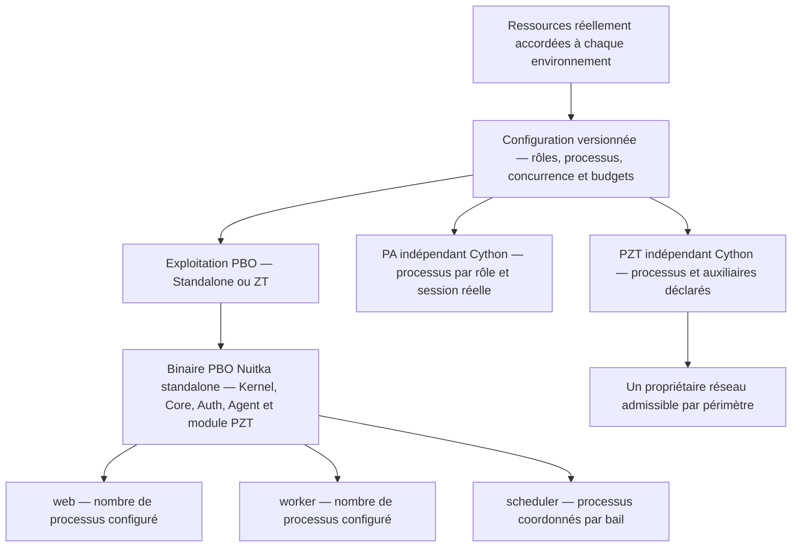

# runtime Specification

## Purpose
Le runtime exécute le binaire PBO commun selon des profils web, worker et scheduler configurables. Les plans de processus PBO, PA et PZT suivent les ressources réellement accordées à chaque environnement, avec états de référence persistants et garanties de sécurité conservées.

Ce schéma décrit les rôles et budgets, sans fixer de valeur numérique ni de canal de communication. Les nombres de processus restent soumis à la qualification et au lifecycle de chaque profil.

## Requirements

### Requirement: Modes d'exploitation PBO Standalone et ZT

PBO MUST distinguer Standalone, instance autonome sans autorité Pixs extérieure, et ZT, participation autorisée au réseau gouverné via PZT. Les deux MUST utiliser le même binaire Nuitka standalone et conserver pixs.pzt. L'activation de PZT MUST être un choix explicite distinct du mode : Standalone MAY utiliser PZT pour les échanges PBO–PA autorisés. Le passage Standalone/ZT MUST être explicite, sans bascule automatique après panne ou révocation.

#### Scenario: Exploitation Standalone sans réseau activé

- **WHEN** PBO fonctionne en mode Standalone avec un profil sans réseau PZT activé
- **THEN** les capacités locales sélectionnées restent disponibles sous leurs dépendances, les modules essentiels restent composés et aucun échange PBO–PA ni résultat réseau n'est inventé

#### Scenario: Exploitation ZT

- **WHEN** le mode ZT est demandé pour le même binaire PBO
- **THEN** la participation au réseau gouverné exige configuration, exécutant PZT admissible, identités, permissions, mandats et preuves du profil, sans repli hors PZT ni retour autonome implicite si ces préconditions manquent

#### Scenario: Transport PZT en mode Standalone

- **WHEN** une instance PBO Standalone sollicite un PA local ou distant dans son périmètre autorisé
- **THEN** elle conserve son autonomie de gouvernance et utilise PZT avec les contrôles requis ; l'absence ou l'invalidité de ce transport bloque l'échange sans canal de substitution

### Requirement: Profil de ressources par environnement d'exécution

PBO, chaque rôle PA et PZT MUST disposer de profils de ressources distincts liés à leur environnement d'exécution. Le dimensionnement MUST respecter CPU, mémoire et quotas réellement accordés à la machine, VM, conteneur ou service, ainsi que les dépendances et la marge système déclarées. Les ressources physiques de l'hôte MUST NOT remplacer les limites effectives du profil.

#### Scenario: Quota inférieur aux ressources physiques

- **WHEN** un conteneur dispose d'un quota CPU et mémoire inférieur à celui du serveur
- **THEN** le plan utilise ce quota effectif et conserve une marge déclarée pour les processus et dépendances cohébergés

#### Scenario: Exécutant distant

- **WHEN** un PA ou PZT dépend d'un PBO situé sur une autre machine
- **THEN** son profil utilise les ressources de son propre environnement et non celles de PBO

### Requirement: Dimensionnement explicite et borné des processus

Le profil MUST déclarer les rôles actifs, nombres de processus, concurrence, files et buffers bornés, budgets CPU et mémoire et plafonds de connexions requis. La somme des instances et réplicas MUST être contrôlée face au budget accordé et aux dépendances, notamment PostgreSQL. Un nombre de cœurs MUST NOT déterminer seul le nombre de workers. Des rôles supplémentaires MAY être déclarés sous contrats validés.

#### Scenario: Multiplication des connexions

- **WHEN** une configuration augmente les processus web ou worker
- **THEN** les limites cumulées de mémoire, concurrence et connexions sont revalidées avant application

#### Scenario: Rôle inconnu ou budget invalide

- **WHEN** un profil demande un rôle non déclaré, une limite invalide ou une concurrence hors bornes
- **THEN** le périmètre concerné reste non prêt avec un diagnostic explicite

### Requirement: Proposition de dimensionnement sous configuration

Une détection des ressources MAY proposer un dimensionnement. Son application MUST résulter d'une configuration explicite et versionnée ou d'une politique d'adaptation préautorisée et bornée. Une variation observée, un redémarrage ou une pression de charge MUST NOT modifier silencieusement les rôles, processus, budgets ou capacités sélectionnées.

#### Scenario: Détection sans politique d'adaptation

- **WHEN** les ressources observées changent sans politique préautorisée applicable
- **THEN** le système rapporte l'écart et ne modifie pas implicitement le plan demandé

#### Scenario: Adaptation sous politique

- **WHEN** une politique autorise une plage de processus et ses conditions de changement
- **THEN** seul un plan dans cette plage et revalidé peut être appliqué, avec suivi de son résultat

### Requirement: Ressources détectées demandées et appliquées distinctes

Le diagnostic MUST distinguer ressources détectées, budget accordé, configuration demandée, configuration effective et état réellement appliqué, avec origine, version et erreurs. Un plan calculé, transmis ou accepté MUST NOT être présenté comme appliqué sans observation vérifiable. PBO MUST suivre séparément les états PA et PZT via leurs contrats de gestion.

#### Scenario: Application partielle d'un profil

- **WHEN** un exécutant reçoit une configuration mais ne peut appliquer une partie du budget ou du nombre de processus
- **THEN** l'état partiel ou en échec est rapporté sans inventer un état appliqué ni masquer la dernière observation connue

### Requirement: Reconfiguration contrôlée des ressources

Tout changement de processus ou de budget MUST être autorisé, validé puis appliqué par le lifecycle et le superviseur déclarés, avec drain borné, reprise et contrôle de l'état appliqué. La réduction de workers MUST préserver les travaux et leur déduplication. La réplication des schedulers MUST conserver bail persistant et clôture de péremption par périmètre.

#### Scenario: Réduction de workers occupés

- **WHEN** le plan réduit la concurrence pendant des travaux engagés
- **THEN** les travaux sont terminés ou restitués selon leur contrat sans perte ni double effet non maîtrisé

#### Scenario: Plusieurs schedulers

- **WHEN** plusieurs processus scheduler sont configurés pour le même périmètre
- **THEN** seul le détenteur d'un bail courant peut déclencher les travaux et un ancien détenteur est refusé

### Requirement: Budgets compatibles avec les garanties du profil

Un profil de ressources MUST préserver autorisation, isolation, audit, durabilité, révocation, santé et budgets temporels applicables. Une insuffisance initiale MUST bloquer l'admission du profil ; une perte de capacité en service MUST conduire au comportement sûr déclaré. La charge MUST NOT justifier un privilège supplémentaire, une expiration prolongée ou un contournement PZT.

#### Scenario: Ressources insuffisantes pour une garantie

- **WHEN** le budget ne permet pas de respecter une garantie obligatoire de sécurité ou de reprise
- **THEN** le profil est refusé ou le périmètre en service passe à son état sûr déclaré, sans assouplir cette garantie

### Requirement: Supervision et qualification des profils de ressources

Le superviseur OS ou conteneur déclaré MUST assurer lancement, limites, signaux et redémarrages sous lifecycle Pixs, sans autorité métier ni privilège implicite. La qualification MUST relier binaire, configuration et environnement aux mesures de mémoire, CPU au repos et en charge, latence, débit, saturation et reprise ; une simple compilation MUST NOT valoir qualification.

#### Scenario: Profil sans recette de ressources

- **WHEN** un profil dispose d'un binaire et d'une configuration mais d'aucune mesure sur la cible
- **THEN** il reste non qualifié pour ses performances et limites annoncées

#### Scenario: Redémarrage supervisé

- **WHEN** un superviseur redémarre un processus défaillant
- **THEN** les identités, préconditions, budgets et états de reprise sont revalidés sans octroi de droits ni remise à zéro des garanties

### Requirement: Profils distincts d'un même artefact

Les rôles web, worker et scheduler MUST être des profils du même binaire PBO commun, activés par configuration explicite sans branche fonctionnelle cachée. Le développement MAY les regrouper ; la production MUST permettre plusieurs processus par rôle selon le plan de ressources, les capacités sélectionnées et les règles de coordination, sans imposer un processus par module.

#### Scenario: Profil activé par configuration

- **WHEN** un déploiement produit un worker et un scheduler à partir du même artefact
- **THEN** leurs capacités et limites respectives sont inspectables sans code divergent

### Requirement: Profils de déploiement déclarés

Une release MAY déclarer des profils tels que développement local, mono-tenant,
multi-tenant ou haute disponibilité. Chaque profil MUST identifier ses
capacités garanties, dépendances obligatoires, limites et capacités désactivées
et MUST NOT modifier silencieusement les invariants de sécurité ou de périmètre.

#### Scenario: Capacité absente dans un profil local

- **WHEN** un profil de développement n'active pas une capacité optionnelle
- **THEN** cette absence est déclarée et le profil ne prétend pas fournir la garantie associée

### Requirement: Exposition minimale par défaut

Seul le profil web MUST être exposé à l'entrée publique par défaut ; workers, schedulers, files, stores de coordination et endpoints de management MUST rester sur un réseau privé ou derrière une frontière authentifiée, autorisée et auditée.

#### Scenario: Endpoint de management publiquement joignable

- **WHEN** un endpoint de management se retrouve atteignable depuis le trafic public sans frontière explicite
- **THEN** la composition est déclarée invalide et l'exposition est refusée

### Requirement: Processus stateless et coordination persistante

Les processus du runtime applicatif PBO web, worker et scheduler MUST NOT conserver en mémoire ou sur disque local un état nécessaire à l’autorité métier, à l’idempotence, à la reprise ou aux sessions. Leur coordination MUST reposer sur la persistance de référence ; un verrou mémoire n’est qu’une optimisation sans garantie. Les états techniques PA MUST suivre leur exigence distincte ci-dessous.

#### Scenario: Redémarrage d'un worker

- **WHEN** un worker PBO est redémarré en cours de traitement
- **THEN** ses travaux reprennent depuis la persistance de référence sans double effet non maîtrisé

#### Scenario: État technique PA requis en conteneur

- **WHEN** un profil PA nécessite un état durable de reprise
- **THEN** l’exigence distincte des états techniques PA est satisfaite sans autorité métier locale

### Requirement: Lease du scheduler avec clôture de péremption

Le scheduler MUST acquérir un lease persistant borné, renouvelable et expirant, avec un mécanisme vérifiable empêchant un ancien détenteur d'agir après expiration.

#### Scenario: Ancien détenteur toujours actif

- **WHEN** une instance perd son lease puis tente de déclencher un traitement
- **THEN** sa requête est rejetée par la clôture de péremption et l'état reste diagnostiquable

### Requirement: Arrêt, drain et reprise contrôlés

L'arrêt MUST être contrôlé : cesser l'exposition, drainer les traitements en cours dans une durée bornée puis s'éteindre sur un état explicite ; une instance défaillante MUST NOT recevoir de trafic.

#### Scenario: Arrêt pendant traitement

- **WHEN** une instance reçoit un signal d'arrêt pendant un traitement engagé
- **THEN** elle termine ou restitue le traitement selon son contrat et atteint un état final sans perte silencieuse

### Requirement: États techniques PA et PZT distincts du runtime PBO

PA et PZT MUST conserver des états techniques locaux distincts selon leurs
contrats, bornés, protégés et durables lorsque requis, sans autorité métier ni
stockage implicite du runtime PBO. Leurs états de reprise MUST NOT dépendre
du filesystem éphémère d'un conteneur. Leurs profils MUST déclarer propriétaires,
comptes, signaux, préconditions et séquencement d'arrêt sans lancer de rôle implicite.

#### Scenario: Recréation du conteneur PA PZT

- **WHEN** un conteneur PA/PZT est recréé
- **THEN** les exécutants reprennent depuis leurs stockages déclarés sans fusion des états ou autorité métier locale

### Requirement: Topologies locales et distantes PA PZT

Les profils MUST permettre la colivraison PA/PZT avec ou sans PBO/PFO locaux.
Un hôte distant MAY héberger aussi PBO/PFO ; cette présence MUST NOT accorder
un droit sur un autre exécutant. Chaque relation PBO–PA/PZT MUST déclarer
périmètre, autorité et contrats. Les échanges PBO–PA MUST toujours utiliser
PZT ; le contrôle PBO–PZT MUST conserver ses interfaces sécurisées.

#### Scenario: Hôte local avec tous les composants

- **WHEN** PBO/PFO, PA et PZT partagent un environnement d'exécution
- **THEN** pixs.agent gère PA hors PZT, pixs.pzt gère PZT et le profil local conserve les contrôles PZT

#### Scenario: Hôte distant sans backend local

- **WHEN** PA/PZT est déployé sur un hôte sans PBO/PFO
- **THEN** le PBO distant autorisé gère les exécutants par les contrats de pixs.agent et pixs.pzt via PZT

#### Scenario: Hôte distant avec backend local

- **WHEN** un hôte distant comprend PBO/PFO, PA et PZT
- **THEN** son PBO peut gérer les exécutants locaux ou distants dans ses seuls périmètres autorisés, sans priorité implicite sur un autre PBO
